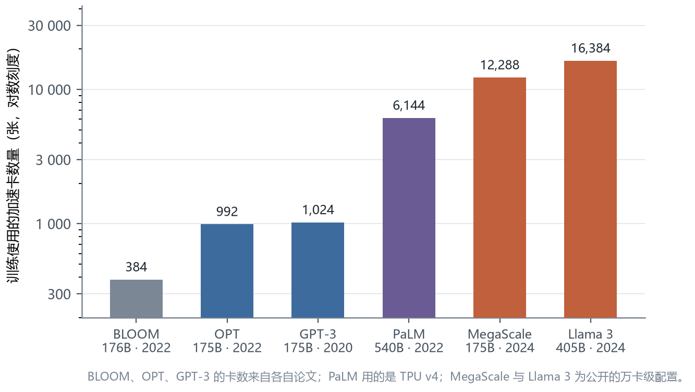
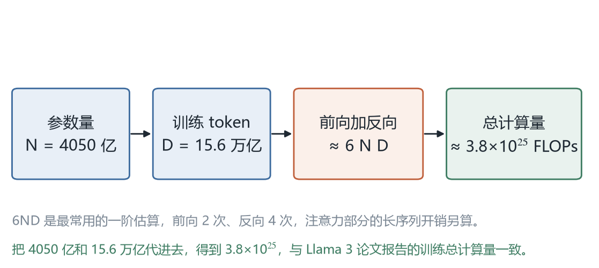

# 第 1 章　一个模型要吃掉多少算力

## 1.1　一笔从 2020 年开始的账

$3.14\times10^{23}$。这是 GPT-3 训练结束时烧掉的浮点运算次数，在论文里只占一行，连注释都没有。换成普通写法，是 314 后面跟 21 个零。绝大多数人读到这个数字会直接翻页，因为它不带任何可感的参照。

换个方式感受一下。假设手上有张卡，峰值算力是每秒一百万亿次运算，也就是 $10^{14}$ 的量级，让它独自把 GPT-3 训完，需要 $3\times10^{9}$ 秒，差不多一百年。这个估算还偏乐观，它假定卡从不降频、从不出错、数据永远喂得上，也假定那一百年里电费一直有人付。

论文里的做法是把这件事摊到 1024 张 V100 上。$3.14\times10^{23}$ 除以 1024，每张卡分到 $3\times10^{20}$ 次运算，按同样的峰值再算一遍，是 $3\times10^{6}$ 秒，三十五天左右。实际耗时比这更长，因为卡不可能一直跑在峰值上，也不可能三十五天一停不停。

这里第一次出现了规模的雏形。一千张卡不是为了跑得更快，是因为单卡根本跑不完。从一张卡到一千张卡，改变的不是速度，是可行性。很多关于并行训练的讨论都从“怎么切模型”开始，其实第一步是接受一个事实，有些活一张卡干不完，无论写多聪明的代码。

一千张卡在物理上是什么样，值得先有个印象。一台服务器装 8 张卡，1024 张就是 128 台机器，摞在四五个机柜里，占满半个机房的一排。这些机器之间要用专门的网络连起来，共享同一套供电和散热，由同一批人维护。所以从第一天起，训练就是一件和机房打交道的事，不是一件只在编辑器里发生的事。

而这三十五天里，一千多张卡不能停，不能坏，不能有人拔错一根线，不能有某个风扇被灰尘堵住导致一台机器降频。所谓训练一个大模型，落到实处就是把一桩需要一百年的活切成一千份，再保证这一千份同时正确地往前推进一个多月。这个视角比任何架构图都更接近真相。训练不是把代码写完就结束了，而是让几万个零件在几十天里保持同步。

这笔账不是孤例。几年之后，同样的做法被放大到几千张、上万张卡。把几次代表性训练的卡数摆在一起，能看到这条曲线是怎么走的。

*图 1-1　几次代表性大模型训练使用的加速卡数量（对数刻度）*

本书后面的所有内容，无论是显存怎么分、卡和卡怎么通信、坏了怎么恢复，都是在回答同一件事，怎么让那“同时正确地推进”变成现实。所以先把这笔账算清楚。

## 1.2　参数量、token 数与计算量

训练一个模型要花多少算力，有一个几乎人人都在用的估算式，写作 6ND。N 是参数量，D 是训练用的 token 数，6 是每个参数在每个 token 上摊到的浮点运算次数。

这个 6 可以拆开，拆开之后就没有神秘感了。前向传播时，每个参数要和输入的每个元素做一次乘加，一次乘加算两次浮点运算，所以是 2。反向传播要算两样东西，一样是损失对输入的梯度，用来继续往浅层传，一样是损失对参数的梯度，用来更新权重。两样各要一次乘加，加起来是 4。2 加 4 等于 6。

顺带得到一个结论，反向比前向贵一倍。这一点在后面会反复出现。算梯度占的显存和权重一样多，算它也花两倍的运算，所以训练一步的时间，三分之二花在反向。很多人第一次听说“训练比推理慢得多”时觉得奇怪，道理就在这里。

拿 GPT-3 验一下。参数量 1750 亿，token 数 3000 亿，6 × $1.75\times10^{11}$ × $3\times10^{11}$ 得 $3.15\times10^{23}$，和论文报的 $3.14\times10^{23}$ 只差最后一位。在这个量级上，6ND 够用了。

*图 1-2　用参数量与 token 数估算训练总计算量*

它有两个地方不精确。注意力那部分开销随序列长度增长，序列从几千拉到几十万时这一项不能忽略，要单独补上。它算的也只是“必须做的运算”，这些运算有没有被高效执行，它一概不管。同一份 6ND，实现得好的集群花五十天，实现得差的集群花一百天，公式看不出区别。做量级判断时，这两个偏差可以接受；做容量规划时，第二个偏差会要命。

token 数从哪来是另一件事。GPT-3 用了 3000 亿 token，相对 1750 亿参数只有 1.7 倍。Chinchilla 换了个思路，用 700 亿参数配 1.4 万亿 token，正好 20 倍，并指出在给定算力预算下，参数量和 token 数要一起涨，把算力全堆在参数上并不划算。这条 20 倍的经验比例后来被反复引用，也反复被打破。

这个式子还默认了两件事，值得点出来。一是所有参数在每个 token 上都参与计算，专家混合那类只激活一部分参数的结构不适用，得按激活的参数算；二是数据只过一遍，如果同一批 token 反复训练好几个 epoch，D 要按实际处理的 token 数算，算力跟着翻倍。

从 6ND 能看出一件重要的事。算力需求和参数量、token 数都是线性关系，参数量翻十倍，算力涨十倍；token 数再翻十倍，算力涨一百倍。钱是按乘积付的，而人对“十倍”的直觉是按加法长的。这就是为什么 2020 年到 2024 年之间，模型参数只涨了两倍多，训练算力却涨了上百倍。

## 1.3　算力从哪里来

算力的来源只有一个乘法，单卡峰值乘以卡数，再乘以时间，再乘以利用率。前三项是花钱买来的，最后一项是工程做出来的。

这四个因子对谁都适用，小模型也算得出来。一个 70 亿参数的模型，喂 1 万亿 token，按 6ND 是 $4.2\times10^{22}$ 次运算，让一张 H100 满负荷跑需要 $4.2\times10^{7}$ 秒，一年零四个月。这也是为什么小团队训小模型时要反复偷工，减 token、减 epoch、换小一点的卡，每一项都在这个乘法里。

单卡峰值涨得不算慢。A100 的 BF16 峰值是 312 TFLOPS，H100 是 989 TFLOPS，一代差了 3.2 倍。

| 项目 | A100 SXM 80GB | H100 SXM |
|---|---|---|
| BF16 峰值 | 312 TFLOPS | 989 TFLOPS |
| 显存容量 | 80 GB | 80 GB |
| 显存带宽 | 2.04 TB/s | 3.35 TB/s |
| NVLink 带宽 | 600 GB/s | 900 GB/s |
| 功耗 | 400 W | 700 W |

这 3.2 倍是四年才等来的。表里还有一行不太起眼，功耗从 400 W 涨到 700 W。制程在放缓，频率早就涨不动了，性能提升靠的是堆更多的计算单元和更大的芯片面积，代价是功耗和散热。再往上加就不是芯片问题，而是机房问题。指望单卡每年翻一倍，过去十年里一次都没发生过。

对照 1.1 那笔账就能看出问题。2020 年用 1024 张卡跑三十五天，如果模型再大十倍、token 再多十倍，算力需求涨一百倍，而单卡只涨了三倍。剩下那三十多倍的缺口，只能靠往机房里塞更多的卡来填。

回头看图 1-1。BLOOM 用了 384 张，OPT 992 张，GPT-3 1024 张，PaLM 6144 块 TPU v4，MegaScale 12288 张，Llama 3 405B 用了 16384 张 H100。注意纵轴是对数刻度，从 384 到 16384 看起来只往上走了小半格，实际是四十二倍。四年里卡数涨了四十多倍，单卡算力涨了三倍，乘起来才勉强跟上需求。这张图最该看出的不是“某家用了多少卡”，而是曲线本身在往右上角走，而且没有平缓的迹象。

一万张 H100 摞在一起，峰值算力是 $10^{19}$ FLOPs 每秒的量级，行业里写作 10 EFLOPS。让它满负荷跑一天是 $8.6\times10^{23}$ 次运算，跑一年是 $3\times10^{26}$。Llama 3 405B 的训练量是 $3.8\times10^{25}$，大约相当于一座万卡集群满负荷运转四十天。而这只是预训练一趟，实验、失败重跑、数据配比消融都还没算进去。真实集群上，为了得到那一次成功的训练，烧掉的算力往往要乘个两三倍。

工程上更常用的单位是卡时，卡数乘以小时。GPT-3 那趟训练是 1024 张卡跑三十五天，按这个乘出来约 86 万卡时。DeepSeek-V3 的预训练是 266.4 万 H800 卡时，数字更大，但卡时单价更低，最后的总账反而更少。用卡时来记账有个好处，不同规模、不同硬件、不同时长的训练可以放在一起比，比“用了多少张卡”公道得多。

利用率那一项最容易被忽略，也最贵。同样一万张卡，利用率 40% 和 55% 差的不是零头，是三分之一的算力，换成时间是四个月。后面要讲的并行策略、通信优化、故障处理、检查点，讲的全是这一项怎么从 40% 抠到 55%。这是一门很具体的工程手艺，没有哪一步是“买个更快的卡”能替代的。

时间那一项也没法随便拉长。卡是按小时租的，跑得越久账单越厚，而且市场上不等人，别人两个月的迭代周期，你拖到五个月就落后一代。于是“加时间”这条基本只剩理论意义，真正能动的是卡数和利用率。这也是为什么所有大厂都在同一个方向上堆卡，而不是各自找巧办法。

## 1.4　一次真实训练的量级

纸上的公式套到一次公开的训练上，量级感会具体很多。Llama 3 的 405B 模型是最好的例子，因为它的配置、耗时、故障记录都写在论文里，别人可以拿来核对。

4050 亿参数，126 层，隐藏维度 16384，训练用了 15.6 万亿 token，总计算量 $3.8\times10^{25}$ FLOPs，跑在 16384 张 H100 上，耗时 54 天。用 6ND 复核一遍，6 × $4.05\times10^{11}$ × $1.56\times10^{13}$ 得 $3.79\times10^{25}$，对得上。

先看 token 和参数的比例。15.6 万亿除以 4050 亿，是 38.5 倍，接近 Chinchilla 那条 20 倍经验线的两倍。这不是算错了，是把推理成本算进来之后的另一种最优，下一节会讲。

再看显存。按训练时每个参数 16 字节估算，这个模型的状态是 6.5 TB 左右。而 16384 张 H100 加起来有 1.3 PB 显存。容量上绰绰有余，多出来的十几倍空着。所以用一万六千张卡不是为了装下模型，是为了在能接受的时间里算完。这句话值得记住，后面讲并行和显存的每一章都在解释它。

换个角度看更清楚。4050 亿参数的 BF16 权重是 810 GB，十倍于一张卡 80 GB 的容量。任何一张卡都装不下，这是硬约束；但一万六千张卡装下之后还剩 99% 的空位，这也是事实。约束和浪费同时存在，中间那段就是并行策略要解决的问题。

最后看速度。15.6 万亿 token 除以 54 天，平均每天要流过 2900 亿 token，折算下来整个集群每秒处理 330 万个 token，平均到每张卡是每秒 200 个 token 出头。单看一张卡，这个速度慢得有点滑稽，一秒钟只嚼两百来个 token；乘上一万六千，才成了一台吞吐机器。

还有一件事没有解释，一万六千张卡是怎么组织起来的。4050 亿参数放不进一张卡，就得切开；切开之后每张卡只算一部分，算完要把结果合起来，合的过程要通信；一万六千张卡之间的通信不可能都一样快，于是哪些卡放得近、哪些放得远，成了一门要精心安排的学问。16384 这个数字本身也不是随便挑的，它是 2 的 14 次方，能被 8、16、128 这些并行度整除，切起来正好不剩零头。这些是第 7 章到第 9 章的内容。

54 天这个数字还有另一层含义。它意味着在将近两个月里，这一万六千张卡组成的系统要保持可用，任何一个环节出问题都可能让时间表往后推。后面会看到，这 54 天里发生了几百次中断。规模越大，能一次跑完的概率越低，真正的本事是把中断的影响压到很小。

同期的 DeepSeek-V3 走的是另一条路。2048 张 H800，14.8 万亿 token，预训练花了 266.4 万 H800 卡时，折下来一千三百小时出头。卡数是 Llama 3 的八分之一，token 数却差不多，靠的是更省的并行配置和 FP8 训练。规模不是唯一解，效率也能换回不少。

论文还报了一个数，MFU 在 38% 到 43% 之间。MFU 是模型实际完成的浮点运算量除以硬件峰值乘时间，简单说就是硬件的力气用上了几成。四成这个数字听起来不高，但在万卡规模上已经是很漂亮的成绩，后面第 4 章会专门讲它怎么算。

## 1.5　规模为什么停不下来

到这里会冒出一个问题。既然一万多张卡这么麻烦，为什么不训练小一点的模型，把省下来的钱拿去做别的。

因为损失下降是有规律的。把不同规模的训练结果画在双对数坐标上，损失随算力增加近似沿着一条直线往下走，这条直线就是 scaling law。斜率是个不大的负数，意味着算力翻十倍，损失只降一点点。

这一点点很值钱。语言模型的损失降一点点，下游一堆任务的表现会跟着变，而这些任务没法单独优化，只能靠底座变强。于是局面变成，能买到的性能就用钱买。集群建得起来，卡数就往上涨。

Chinchilla 在那条线上补了一刀。它指出给定算力预算时，参数量和 token 数要同比增加，比例大约 20 token 每参数，这样损失最低。这解释了为什么后来的模型 token 数涨得比参数快。在此之前，业界的做法是把参数往大了堆，token 数常年不够，等于花了钱没买到对应的损失下降。

再往后，人们发现 20 倍也不是终点。训练完的模型要反复推理，推理成本随参数量走，token 数却只影响训练。于是把参数压小、把 token 拉长变得更划算，一次训练多花点，换来此后每一次推理都便宜。Llama 3 405B 的 38 倍就是这么来的。这条经验线会随着部署成本移动，唯一不变的是总计算量还在往上涨。

scaling law 还有一层不太被提起的作用，它让预算可以提前批。既然损失和算力的关系在训练之前就能估出来，那么“花多少算力能把损失做到什么程度”在开工前就是一个可以讨论的问题，而不是一场赌博。能算清楚的投入，才容易被批准。这也是卡数一路往上走的组织原因。

还有一层更硬的理由，数据。token 数要涨，得有那么多高质量文本。公开语料的总量是有限的，模型越大越容易把语料背下来，加 token 的边际收益会掉。这堵墙还没有真正撞上，影子已经能看见，于是合成数据、多语种、代码和数学语料都被翻了出来。数据这件事不在本书范围内，但它决定了算力需求的曲线什么时候会弯。

停不下来这件事也有它的代价。集群越大，一次失败的成本越高，一次成功的周期越长，能做的实验就越少。规模把研究变成了一场工程组织能力的比赛，能跑起来只是入场券。

所以到这里可以先下一个结论。算力需求涨得比单卡快，缺口只能靠集群填；集群一大，一张卡装不下、一条线传不动、一个零件坏掉就拖垮全部的问题就都冒出来了。要把这些运算真正落到硅片上，还得先回答一个更朴素的问题，一张卡到底装得下什么。这个问题留给下一章，本章先把另外几笔账补完。

## 1.6　把卡时折成钱

卡时是工程上的单位，比较起来方便，汇报时就不好用了。老板要听的是钱。按 2 美元一卡时的市价折算，前面提到的几次训练摆在一起是这样的。

| 训练 | 卡数 | 时长 | 卡时 | 按 2 美元一卡时 |
|---|---|---|---|---|
| GPT-3 | 1024 | 35 天 | 86 万 | 172 万美元 |
| DeepSeek-V3 预训练 | 2048 | 1300 小时 | 266 万 | 532 万美元 |
| Llama 3 405B | 16384 | 54 天 | 2123 万 | 4247 万美元 |

竖着看这张表，能得出一条心算规则。一万张卡跑一小时是两万美元，跑一天是四十八万。所以任何一次万卡规模的训练，账单都按天在几十万美元的量级上走。前面说时间表不等人，不只是市场问题，每一天都在实实在在地烧钱。

第二行值得单独看一眼。DeepSeek-V3 的卡时只有 Llama 3 的八分之一，钱也只有八分之一，但训出来的模型并不小，token 数还接近。差别在硬件和精度，H800 配 FP8 把每一步的运算压得更省。这说明总账可以靠两条路做小，少用卡时，或者压低每一卡时的单价，两条路的斜率不同，方向是一致的。

还要提醒一句，2 美元是租价，不是成本。自建集群把买卡的钱摊进折旧，单价可能低不少，前提是卡一直有活干。一张卡满负荷跑一年是 8760 小时，闲置三成，摊到有效卡时上的成本立刻涨四成。这就是为什么团队会为一个百分点的利用率较真，在万卡规模上，一个百分点是一整排卡的钱。

电费在这本账里反而是小项。一台八卡机按 7 kW 算，一天 168 度；一万张卡一千两百多台机器，一天二十万度出头。按每度电一角美元的量级估算，一天两万美元上下，占那四十八万的百分之几。贵的是设备折旧和机房，不是电。这个比例在电价便宜的地方更极端，在电价贵的地方能抬到一成上下，主项不变。

预算倒推也是同一个乘法。手里有一千万美元，按 2 美元一卡时算，能买到五百万卡时。摊到一万张卡上是五百小时，二十天出头；摊到一千张卡上是五千小时，七个多月。同一笔钱，卡多则时间短，卡少则时间长，而模型规模又有下限，所以预算、卡数、时长三者只能定两个，第三个是被算出来的。

失败重跑是最容易漏掉的一项。Llama 3 的 54 天里中断了 466 次，其中 419 次是意外。如果每次中断都从头再来，这个训练永远跑不完，实际做法是定期存检查点，中断之后回滚到最近一次。论文给出的有效训练时间高于 90%，意思是 54 天里有五天半耗在中断上。摊到 466 次，每次平均十七分钟，这十七分钟里要重启进程、重新加载 6.5 TB 的模型状态、把通信重新预热，留给回滚的只剩几分钟。反推回去，检查点间隔被压在了二十分钟上下。

这个间隔不能随便定。存一次检查点要把全部模型状态写进存储，写的时候训练是停着的，间隔越短，花在写盘上的总时间越长；间隔越长，每次中断回滚得越远。两头都是钱，最优点落在中断频率和检查点开销相当的位置。中断平均三小时一次、检查点二十分钟一次，写盘占掉的总时间还算能接受；卡数再翻一倍，中断频率跟着翻一倍，检查点就得写得更勤，这项开销开始咬人。

## 1.7　6ND 在什么情况下不再准

6ND 好用，但它默认了三件事，所有参数在每个 token 上都参与运算，注意力那部分可以忽略，只算必须做的运算。这三条在 2020 年基本成立，到 2024 年都不太成立。

先说参数不全都参与的那一类。专家混合的模型把一层里的前馈网络切成很多份，每个 token 只走其中几份，其余的完全不碰。一个总参数一万亿、每 token 激活一千亿的模型，算力要按一千亿算，是总量的十分之一。若是拿一万亿去套 6ND，结果会高出一个数量级。

显存不这么算。所有专家的权重都得留着，因为不知道下一个 token 会挑哪个。按每参数 16 字节，一万亿参数是 16 TB，一张卡装不下，两百张卡才勉强放得开。于是出现一个别扭的局面，算力按十分之一记账，容量按全额记账，两边差一个数量级。稀疏模型看着便宜，省下来的是运算，不是显存。

还有一笔 6ND 完全看不见的开销，路由。每个 token 要被送到它选中的专家所在的卡上，算完再送回来，走的是 all-to-all。这份流量和激活值同量级，而且没有规律，热门专家被挤爆、冷门专家闲着的时候，通信时间能盖过计算时间。6ND 数的只是浮点运算，这类开销一点都不在里面。

这种结构还带来一个配置约束。专家放不下就得切开，切开之后一个 token 的计算要跨卡完成，切法直接决定 all-to-all 走节点内还是跨机柜。带宽差一个数量级，同一个模型两种放法，吞吐能差一倍。

再说注意力。序列短的时候它确实可以忽略，序列一长就不是了。自注意力那部分的运算量随序列长度线性增长，线性层那部分只随隐藏维度走，两者的比值是序列长度除以六倍的隐藏维度。隐藏维度 16384 时，分界线落在九万八千 token 附近。

Llama 3 的上下文是 128K，正好骑在这条线上。也就是说在长上下文训练里，注意力项的运算量和全部线性层已经相当，6ND 会把总算力少算一半。序列再往上走，低估得更快，一边是线性，一边是平方。长上下文训练的成本不按 token 数线性涨，原因就在这里。

第三条默认最容易忽略。6ND 算的是必须做的运算，而实际花掉的总是更多。重计算把前向多跑一遍，6ND 变成 8ND；通信不产生浮点运算，却要占时间；流水线的气泡让一部分卡空着等。这些都不在公式里，所以 6ND 给的是下限，做规划时要往上加料。

分清场合用就行。判断一个模型大概要多少算力、一万张卡要跑多少天，6ND 够用，偏差在能接受的范围内。判断这批卡够不够、这一步要几毫秒，6ND 就不够了，得把注意力、通信、气泡、重算一项项加上去。前者是量级，后者是容量，混着用就会出事故。

## 1.8　训练算力和推理算力不是一回事

前面所有的账都算在训练这一侧。模型上线之后还要花算力，而这笔账的形状完全不同。

训练一个 token 要 6N 次运算，推理一个 token 只要 2N，因为推理只有前向，不反向，也不更新权重。6ND 里那个 6，到了推理这里换成 2。

两边一除，得到一个很好用的结论。训练的总量是 6 倍参数量乘训练 token 数，推理的总量是 2 倍参数量乘推理 token 数，当推理的 token 数是训练 token 数的三倍时，两边的总算力相等。这条线很低，一个模型只要服务一段时间，推理烧掉的算力就会超过训练。

拿 Llama 3 405B 试一下。训练用了 15.6 万亿 token，三倍是 47 万亿。一个日活百万的应用，按每人每天一千 token 估算，一天十亿，四十七天就把训练那笔账追平，往后全是净支出。这也解释了 1.5 节里那个 38 倍的来历，训练时多喂 token，是为了让推理时每个 token 都更便宜。

推理内部还要再分两段。用户发来一段提示，模型一次读完，这一段叫预填充，一批 token 一起过，行为像训练的前向，算力能吃满。然后逐个吐字，这一段叫解码，一次只有一个 token，权重还得整读一遍，卡在带宽上。同一个模型，预填充跑满算力，解码跑满带宽，两段的瓶颈不同，配置也就不同。

1750 亿参数的 BF16 权重是 350 GB，H100 的显存带宽是 3.35 TB/s，读一遍要 0.1 秒，单卡解码每秒出不了十个 token。想更快只有两条路，把权重压小，或者把权重摊到多张卡上并行读。

这两条路都不影响训练，只影响推理。所以推理侧的优化和训练侧的优化几乎是两门手艺，做训练的人转去做推理，第一件要改的习惯就是把“算得快”换成“读得少”。

解码还有一笔显存账，键值缓存。每生成一个 token，都要把之前所有 token 的键和值留着，长度随上下文线性增长。上下文一万 token、隐藏维度 8192、80 层、BF16，一份缓存是 26 GB 的量级，并发十条就上两百 GB。长上下文推理吃显存，占大头的不是权重，是这笔缓存。

## 1.9　两条经验线的分歧

scaling law 不是一条线，至少有两条，而且互相打过架。

2020 年前后的那一条说，算力增加时优先加参数，token 数慢慢跟上。GPT-3 就是那个思路的产物，1750 亿参数配 3000 亿 token，比例只有 1.7 倍。当时流行的信念是参数越多越聪明，数据够用就行。

2022 年的另一条说应该平分。同样的算力，参数和 token 一起涨，比例大约 20 token 每参数。按这个比例，1750 亿参数该配 3.5 万亿 token，是 GPT-3 实际用量的十倍还多。这条线一出来，业界的做法集体转向，token 数开始疯涨。

两条线能同时成立，因为量的东西不一样。一条在固定算力下找最低损失，另一条在固定预算下找最低总成本，而成本里算不算推理，结论会翻。再加上学习率怎么退火、数据怎么筛、词表开多大，同一条幂律的常数能挪出一截，不同论文报出来的指数也对不齐。

所以幂律的指数不能外推太远。它在拟合的那两个数量级里很准，往外推一格就开始偏。做容量规划时更稳的做法是在目标规模附近找几个实测点，而不是把一条直线从十亿参数一路拉到一万亿。

那个 38 倍可以看成第三条线的雏形。把推理成本算进总账之后，参数要压、token 要拉。这条线的位置还在动，取决于推理多贵、卡多贵、模型要服役多久。唯一稳定的是总计算量还在涨，因为无论怎么分配，损失下降都要拿算力换。

回到开头那笔账。一百年的活切成一千份，需要三十五天不停；切成一万六千份，需要五十四天，中间还得处理四百多次中断。算力、卡数、时间、钱、故障这五个数互相咬着，改动任何一个都会牵动其余四个。真正难的地方从来不是把其中一个算出来，而是同时把它们摆平。要摆平，先得看清楚最底下那一层，一张卡里究竟装了多少东西。
