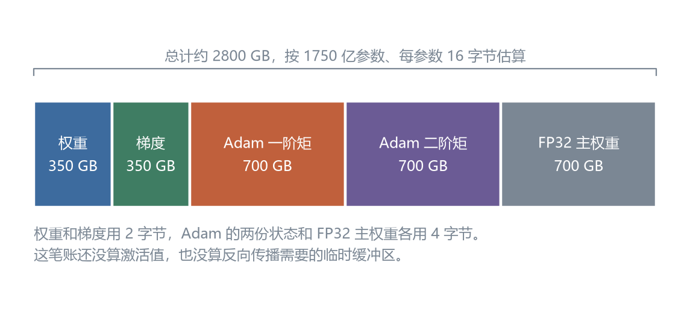
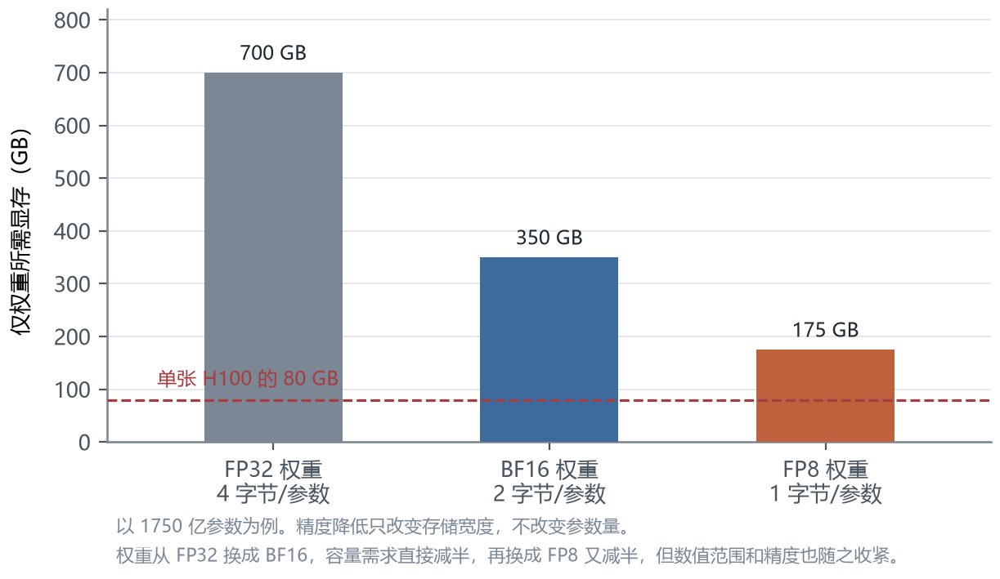

# 第 2 章　一张卡的尺寸

## 2.1　80 GB 能装多少参数

一张 H100 的显存是 80 GB。这个数字印在规格表最显眼的位置，也是所有显存问题的起点。

先把单位换算清楚。显存按十进制标称，80 GB 就是 800 亿字节，不是 2 的整数次幂。这一点和内存条、硬盘的标法一致，但和很多人的直觉不一致，所以在算账时经常差出几个百分点。

800 亿字节能装多少参数，取决于每个参数占几个字节。BF16 每个参数 2 字节，800 亿除以 2，是 400 亿参数。也就是说一张 H100 的显存刚好能装下一个 400 亿参数的模型，一点余量都没有。Llama 3 的 4050 亿参数按 BF16 是 810 GB，十倍于一张卡，这就是为什么单卡训练在 2023 年之后彻底不成立了。

400 亿参数是个什么概念，拿几个熟悉的模型比一下。Llama 3 的 8B 版本权重是 16 GB，一张卡能装五个还有空；70B 版本是 140 GB，一张卡装不下；405B 是 810 GB，得十张卡才够放。这条线大致落在 400 亿附近，往下装得下，往上装不下。

注意这是按纯权重算的。换成训练场景，同一个 800 亿字节要分成四份用，能带的参数就只剩 50 亿。也就是说一张卡装得下的模型和训得动的模型，差了一个数量级。这个差距是后面所有并行策略存在的理由。

这里有个容易忽略的细节，80 GB 不等于 80 GB 可用。驱动要占一块，CUDA 上下文要占一块，通信库的缓冲区要占一块，显存分配器还会因为碎片浪费一些。实际留给张量的往往少几个 GB，越是大模型越要按紧一点算。规划时按 90% 估比较稳。

为什么停在 80 GB 而不是更大，原因在封装。显存是一颗颗 HBM 堆栈焊在芯片旁边的，能焊几颗受封装尺寸和布线长度限制，而封装尺寸又受主板和机箱限制。想装更多，要么把堆栈做高，要么换更先进的封装工艺，两者都贵且慢。所以容量的提升往往靠一代制程，不像算力那样可以靠堆单元。

## 2.2　训练时的四份账

上面的账只算了权重，那是推理的算法。训练要多出好几份东西，一份都不能少。

反向传播要用梯度，每个参数对应一个梯度，精度通常和权重一样，BF16 是 2 字节。优化器要给每个参数维护状态，Adam 有了一阶矩还要二阶矩，这两份通常用 FP32 存，各 4 字节。多数框架还会保留一份 FP32 的主权重，更新在这份副本上做，再加 4 字节。全部加起来，每个参数要占 16 字节。

| 项目 | 每参数字节 | 1750 亿参数合计 |
|---|---|---|
| 权重 | 2 | 350 GB |
| 梯度 | 2 | 350 GB |
| Adam 一阶矩 | 4 | 700 GB |
| Adam 二阶矩 | 4 | 700 GB |
| FP32 主权重 | 4 | 700 GB |
| 合计 | 16 | 2800 GB |

1750 亿参数乘 16 字节，是 2800 GB。这个数字比权重那 350 GB 大了八倍，很多人的第一反应是意外，因为平时说“模型多大”说的是 350 GB。

*图 2-1　1750 亿参数模型训练时的显存账本*

看这张图会发现一件反直觉的事，优化器状态占了三分之二。Adam 之所以要两份 FP32，是因为它要记住梯度的滑动平均和梯度平方的滑动平均，这两份东西决定每个参数下一步走多远、走多快，精度不够就会抖。如果把这两份砍成 BF16，省下 700 GB，代价是训练稳定性变差，这笔交易在多数情况下不划算。

按 2800 GB 算，光是把这些状态摊开，就需要 35 张 80 GB 的卡。注意这 35 张卡只是用来“放”，还没有位置放激活值，也没有算任何一张卡装不下全部权重这件事。真实的训练配置要比这大得多，原因在后面几节。

还要说明的是，这 16 字节是完整账。有的实现不保留主权重，直接更新 BF16 权重，按 12 字节算就是 2100 GB；有的把梯度压缩后再存，有的用 8 位优化器。账本的具体条目会变，但“每参数十几字节”这个量级不会变。

还有一个细节值得盯住，梯度和权重用 2 字节，优化器状态用 4 字节。为什么不是全部 2 字节，也不是全部 4 字节。权重和梯度参与矩阵乘，BF16 的精度够用，而且 Tensor Core 就是按这个宽度设计的。优化器状态要做的是累加，一步一小步地往下走，误差会积累，用 BF16 存很快就会走偏。这是一个很典型的取舍，算的地方用低精度，记的地方用高精度。

再算一个读者更可能遇到的规模。70 亿参数的模型，16 字节乘上去是 112 GB，需要两张 80 GB 的卡才放得下，这还是没算激活值。所以哪怕是最普通的微调任务，只要用了 Adam 全参数更新，单卡就已经不够了。很多人第一次意识到“需要多卡”就是在这个位置。

这 2800 GB 是账面值，实际占用还要高一点。框架在跑的时候会留出临时缓冲区，通信库要预先分配一块放待发送的数据，梯度归约时还得有一份接收缓冲。这些开销随并行方式变化，量级通常是百分之十几。做容量规划的人习惯在上面再加一层余量，因为一旦跑到一半显存不够，前面的时间全白费。

精度一换，容量跟着变。同一个 1750 亿参数的模型，用 FP32 存权重是 700 GB，用 BF16 存是 350 GB，用 FP8 存是 175 GB。

*图 2-2　不同精度下仅存放权重所需的显存*

图里那条虚线是一张 H100 的 80 GB。三种精度都在线上方，意思是无论怎么压，这个模型都装不进一张卡。但三种精度之间的差距是实打实的，从 700 GB 到 175 GB 是四倍，四倍意味着需要的卡数从九张变成三张。这就是精度为什么会变成一个工程问题，它不只影响算得快不快，还直接影响买多少张卡。

## 2.3　还有激活值和临时缓冲区

权重、梯度、优化器状态都是常驻的，训练开始前分配好，结束才释放。激活值不一样，它随每一步的数据变化，是流动的。

激活值是前向传播时每一层的输出。反向传播要算梯度，需要用到这些中间结果，所以它们得留着。占多少取决于四个量，批次大小、序列长度、隐藏维度、层数，任何一个翻倍，激活值都跟着涨。

举一个具体的估算。批次 1 条、序列 4096 个 token、隐藏维度 8192、BF16 存，一层里一个 token 的隐藏状态是 16 KB，一条序列是 67 MB，80 层就是 5.4 GB。这还只是每层存一份最基础的张量，注意力的中间矩阵还没算。序列拉到 8192，这一项直接翻倍。

序列长度的影响比很多人想的更陡。自注意力要算一个序列内所有 token 两两之间的关系，中间矩阵的大小正比于序列长度的平方。4096 的时候还好，32768 的时候这一项就能把显存吃光。这就是长上下文训练为什么这么贵。

对付激活值有一个常用手段，重计算。前向时不存中间结果，反向需要的时候再算一遍。显存立刻降下来，代价是多花一部分算力做重复的前向。这个交换的比率可以调，存一部分、重算一部分，找一个显存和时间的平衡点。

这个平衡点的位置取决于卡上的瓶颈在哪。如果显存够、算力不够，就别重算，多存一点；如果显存紧、算力有余，就多重算。极端情况下，一层都不存，全部重算，显存占用能降到很小，代价是前向多跑一遍，总计算量从 6ND 变成 8ND 左右。省一半显存，多三成算力，在很多配置下是划算的。

还有一个容易被忽略的敌人，碎片。显存分配器不是万能的，反复申请释放之后会留下一些用不上的空洞。训练跑得久了，空洞越来越多，最后明明总量够却申请不到。解决办法通常是预先分配一大块自己管，或者调大分配器的块尺寸。这类问题不会在第一天出现，往往在训练进行到一半、大家都以为稳定了的时候才爆出来。

批次大小和显存的关系也值得说一句。整个集群的批次是固定的，切到每张卡上的那一份叫微批次。微批次越大，一张卡一次算的越多，通信摊得越薄；微批次越小，显存越省，但通信占比越高。这个参数在后面的并行章节里会反复出现，它是调节显存和效率的总旋钮。

把这个旋钮拧到底会看到什么，可以算一下。批次 1 条、序列 4096 的配置占 5.4 GB，微批次提到 4，激活值就是 21 GB 多，再加上权重和优化器状态，一张 80 GB 的卡立刻吃紧。反过来，微批次降到 1，显存宽裕了，但每算一次就要同步一次梯度，通信开销翻四倍。没有免费的档位，只有适合当前配置的那一档。

所以一张卡的显存要同时装下两类东西，常驻的模型状态和流动的激活值。前者决定“能不能装下这个模型”，后者决定“能喂多大的批次”。批次太小，一张卡喂不饱，算力利用率上不去；批次太大，激活值爆掉。这个矛盾是所有显存优化的出发点。

## 2.4　容量之外还有带宽

显存有两个指标，容量和带宽。容量决定装不装得下，带宽决定算得快不快。后者经常被忽略，但它往往是真正的瓶颈。

H100 的显存是 HBM3，带宽 3.35 TB/s。这个数字的意思是每秒可以从显存里读出 3.35 万亿字节。听着很大，除以模型大小就不大了。

一个 1750 亿参数的模型，BF16 权重 350 GB。把这份权重从显存完整读一遍，需要 350 除以 3.35，大约 0.1 秒。训练的一步里，前向要读一遍，反向要再读一遍，参数更新还要写一遍，光是搬运权重就要花掉零点几秒。而一步真正的浮点运算时间是多少，要等第 4 章算完才知道，但可以先记住这个对比，搬运和计算是同一量级的事。

推理时的表现更极端。生成一个 token，要把全部权重过一遍，权重多大，延迟就有多高。一个 80 亿参数的模型，BF16 是 16 GB，读一遍 4.8 毫秒，理论上每秒最多生成 200 个 token。这个上限和显卡有多少算力几乎无关，纯粹由带宽决定。想更快只有两条路，把权重压小，或者把权重摊到多张卡上一起读。

同样一件事，训练和推理对带宽的敏感度不一样。训练时一个批次里有成百上千个 token，权重读一遍能伺候一整批，摊到每个 token 上就便宜了。推理时一次只有一个（或几个）token，权重要读多少遍就有多少遍，摊不开。这就是为什么同一个模型，训练时看着还好，上线之后发现慢得离谱。

带宽还有一个容易被忽略的用处，通信。多卡训练时，数据要在卡之间来回搬，搬的时候也要占显存带宽。节点内走 NVLink 的数据，一头连着显存，一头连着另一张卡的显存，两次都要占带宽。所以显存带宽不只是“计算需要的”，也是“通信需要的”，两者会互相挤。

把这两个指标放在硬件层级里看会更清楚。离计算单元越近的存储越小越快，越远的越大越慢。H100 里有一块 50 MB 的 L2 缓存，再往下是 80 GB 的 HBM3。矩阵乘的分块要是能塞进 L2，就不用反复去 HBM 取，带宽压力小很多。同一个 kernel，数据放的位置不同，跑出来的速度可以差好几倍。这也是为什么矩阵乘的实现要费那么大劲做分块，第 4 章会从算术强度的角度再讲一遍。

带宽和容量的增长速度也不一样。容量一代涨得不多，80 GB 维持了两代；带宽每代能涨百分之几十。这个不对称会带来一个后果，模型装得下的上限涨得慢，而读得快的能力涨得快，于是“把权重摊到更多卡上并行读”成了标准做法。

## 2.5　单卡的物理边界

前面算的都是逻辑上的账，最后看一下物理上的卡。这些限制看起来离算法很远，其实决定了整个机房的形状。

功耗是第一个。H100 SXM 的 TDP 是 700 W，这还只是芯片本身，加上周围的供电电路、风扇，一张卡实际要按 800 W 到 1000 W 预留。一台服务器装 8 张，就是 5.6 kW 起步，整机加上两颗 CPU 和八张网卡，六七千瓦很正常。一个机架装 32 台，功率就到了几十千瓦到一百多千瓦的量级，远超传统机架十几千瓦的水平。这也是液冷在这两年迅速普及的直接原因，风冷已经吹不动了。

尺寸是第二个。一颗大芯片加上周围一圈 HBM 堆栈，封装出来的模块比一张信用卡还大，8 张挤在一个机箱里，主板要走几百根高速线把它们和 CPU、网卡连起来。线越长，信号越难保真，这也是为什么节点内的拓扑不是随便画的。

良率是第三个，也是最贵的一个。芯片面积越大，一片晶圆上能切出的完好芯片越少，单价越高。HBM 堆栈要一片片键合到芯片上，任何一层出问题整个模块报废。这些成本最终都摊到卡时价格上，而卡时价格决定了训练的总预算。

还有一个隐性的边界，散热的一致性。8 张卡挤在一起，中间那张和边上那张的进风温度不一样，温度高的会先降频。降频的幅度可能只有百分之几，但在一万张卡的集群里，只要有一张卡慢下来，整个批次都要等它。这个问题在第 13 章会展开，这里只需要知道，物理上的不均匀会在规模上被放大。

这些物理约束会直接改变采购决策。同样是 H100 的计算能力，H800 把 NVLink 从 900 GB/s 砍到 400 GB/s，显存和算力不变。这不是厂商随意缩水，是出口管制下的产品划分。对训练的影响很具体，节点内带宽少了一半，张量并行能切的宽度就受限，同样的模型要换一种并行摆法。硬件参数表上的一行，落到工程上就是一整套配置的重新设计。

供电的连锁反应也值得一提。一个机架从十几千瓦涨到一百多千瓦，意味着配电要重做，母线要重铺，制冷从风冷换成液冷，机房的承重和消防都要重新评估。这些改造的周期以年计，往往比买到卡的时间还长。所以真正卡住扩张的，很多时候不是芯片产能，是机房能不能在规定时间里改完。

还有一个不写在规格表上的参数，价格。一张 H100 租出去按卡时计价，两美元一卡时是 2024 年前后常见的报价。一张卡满负荷跑一年是 8760 小时，折成一万七千多美元，比买一张卡便宜，但这个账只有在满负荷时成立。租的卡每天只跑几个小时，单价就翻上去。这也是为什么团队会为一个百分点的利用率较真，那一百分点在大规模上就是一整排卡的钱。

把这些限制放在一起看，会发现一个规律。单卡的容量和带宽每代只涨两三倍，功耗和尺寸却已经贴到物理极限。想继续往上，只能靠数量。数量一多，卡和卡之间怎么连就成了新的问题，那就是下一章的内容。
