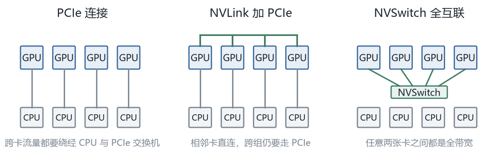

# 第 3 章　从一台机器到一座机房

## 3.1　一台服务器里有什么

打开一台训练用的服务器，最先看到的是八块立起来的板卡，每块上面一颗大芯片和周围一圈显存堆栈，这就是八张 GPU。它们不是插在主板上的普通显卡，而是固定在一块底座上的模块，彼此之间用很高的带宽连着。

底座下面还有两颗 CPU、一大片内存条、八张网卡。CPU 在这台机器里不管矩阵乘，它负责的是喂数据、起进程、管设备、处理异常。八张网卡对应八张 GPU，一张卡一张网卡，这个一比一的搭配不是巧合，后面会讲为什么。

把这些东西的账算一下。八张 H100，显存合计 640 GB；功耗每张 700 W，光 GPU 就是 5.6 kW；加上 CPU、内存、网卡、风扇，整机七八千瓦。一台这样的机器比一套三居室的用电量还高，而且它一天二十四小时都在这个功率上。

八卡一台这个规格是行业惯例，不是技术必然。定下这个数的是节点内互联的拓扑，八张卡刚好能用一个交换芯片做成全互联，再多就得分层，延迟和成本都不划算。所以过去几年里，无论 CPU 是什么、网卡有几张，GPU 这一层基本都是八卡一台。知道这一点很重要，后面所有关于集群规模的除法，分母都是八。

数据在这台机器里要走一段不短的路。它存在远端的存储上，先通过网络进到内存，再由 CPU 发起的拷贝进到显存，然后才能被 GPU 用。这条路要经过两次总线，每一步都有开销。训练时一个批次的数据还没算完，下一批就要提前搬进来，这就是数据加载器存在的意义。加载跟不上，GPU 就空转，这个现象在真实集群上比很多人想的普遍。

CPU 两颗就够用。它在这台机器里干的活不多，不参与矩阵乘，只负责调度和搬运。八张卡配两颗 CPU，比例大致是一比四，这个配比是按数据加载和进程管理的开销算出来的，不是随便拍的。如果哪天模型小到 CPU 成了瓶颈，说明这张卡本身就没被喂饱。

机箱里的温度是另一个容易被低估的细节。八张卡紧挨着，风扇从前面吸冷风，吹过一排排鳍片，从后面排出热风，风道上一段比一段热。靠近排风口的卡长期工作在更高的环境温度下，寿命和频率都会吃一点亏。厂商会靠传感器监控每张卡的温度，一旦过了阈值就降频，而一次降频就会让整个同步批次等它。这类问题不会报错，只会让训练慢慢变慢。

## 3.2　机架与集群

八卡一台往上数，下一个单位是机架，一柜 32 台，也就是 256 张卡。

这个密度带来的第一个问题是功率。一个机架装 32 台这种机器，整架功率落在四十千瓦到一百二十千瓦的量级，具体取决于配置和散热方式。传统数据中心一个机架十几千瓦，风扇吹就够了；到了这个量级，风冷的极限被顶穿，只能上液冷，把冷却液直接引到芯片上。

再往上就是集群。一万张卡除以 8，是 1250 台服务器；再除以 32，是 40 个机架。Llama 3 训练用的 16384 张卡，折合 2048 台服务器、64 个机架。这些机器排成几列，中间是网络交换机和配电柜，占满一个机房大厅。

*图 3-1　从一张卡到一个集群的层级结构*

图上每一层都乘一次，8 卡一台，32 台一柜，上百个机柜排成一个集群。图里的格数是示意的，真实集群不会把每个柜都装满；按 8 卡一台、32 台一柜算，一万张卡大约是 1250 台服务器、几十个机柜。

机器也不是一次性到齐的。芯片产能紧张的时候，一个万卡集群往往分几批交付，先把几千张卡跑起来，边跑边扩。这就要求软件上有个能力，能在卡数变化时重新切分并行度，而不是一开始就把一万张卡写死在配置里。现实中大多数作业的规模是固定的，于是集群被切成几个互不干扰的分区，分区之间的边界往往就是网络拓扑的边界。部署时还会被供电和承重打乱，机柜不会是满的，总有一些位置空着或者混装别的设备，所以真实的可用容量总比算出来的少，规划时按八成估比较接近现实。

层级结构带来的不只是数量的变化，更重要的是每一层内部的连接方式完全不同。同一台机器里的八张卡可以用很贵的线连，因为它们离得近；跨机柜的两张卡只能用光纤，因为距离是几十米。距离决定了带宽，带宽决定了哪些运算能放在一起。

机架内部的布线本身就是一件麻烦事。32 台机器，每台八根光纤往柜顶的交换机上跑，一个柜就是 256 根线；一个万卡集群四十个机柜，上万根光纤，每一根都要标号、绑扎、留出维护余量。这些线少接一根，那个位置的八张卡就上不了网；接错一根，可能出现一个隐蔽的性能问题。真实的集群故障里，线缆和交换机占的比例不小，原因就在这里。

机柜往上还有一层，网络。柜顶交换机把 32 台机器聚起来，再往上连到汇聚交换机，再往上到核心。这三层之间的带宽要逐层收敛，收敛比定得高，跨机柜通信就便宜；定得低，成本下来了，大作业一跑就撞墙。这个取舍在第 10 章会详细展开，这里先建立印象，集群的网络不是一根管子，是三层叠起来的树。

还有一件不在机柜里但离不开的东西，存储。一万张卡同时读数据，每秒要吐出几百 GB 的样本，普通硬盘阵列根本顶不住。训练集群通常配一套并行文件系统，把数据切成块分散到很多台存储服务器上，让读取也能并行。数据怎么存、怎么预取、怎么缓存到本地盘，直接决定了 GPU 会不会空转。很多人调模型调了半天不见效果，最后发现是数据管道卡住了。

## 3.3　节点内的三种连接

节点内部有三种连接方式在同时工作，它们的带宽差了一个数量级以上，理解这个差距是理解后面所有并行策略的前提。

第一种是 PCIe。H100 用的 PCIe 5.0，单向带宽 64 GB/s。所有卡都要通过它和 CPU 说话，也要通过它和网卡说话。数据从硬盘读进来、从网络收进来，第一站都是内存，再到显存，走的是这条路。

第二种是 NVLink，卡和卡之间的直连，H100 上是 900 GB/s。同样是搬数据，走 NVLink 比走 PCIe 快十四倍。这个差距不是优化出来的，是物理上短距离并行链路的优势，PCIe 要兼容太多设备，只能妥协。

第三种是 NVSwitch，一块交换芯片，把八张卡连成一个全互联的网。没有它的时候，卡和卡只能两两直连，八张卡要连 28 条链路才够，布线根本做不下；有了交换芯片，任意两张卡之间都是全带宽，代价是多一跳延迟。

*图 3-2　节点内三种连接方式的区别*

图里三种拓扑的差别一眼能看出来。走 PCIe 的话，两张卡之间要绕到 CPU 再绕回来，中间还和别的卡共享带宽；NVLink 直连是抄近路，但只能连有限几个邻居；NVSwitch 是给了一张任意两卡都能全速通话的网，代价是那块芯片本身。

把这三个数字放在一起，节点内的带宽梯度就有了形状。NVLink 900 GB/s，PCIe 64 GB/s，两者差十四倍。这个倍数决定了一件事，凡是通信量大、又要求低延迟的操作，必须待在节点内；一旦跨出节点，带宽掉到每卡 50 GB/s 的量级，再频繁地通信就是自杀。

| 连接 | 单向带宽 | 连接范围 | 拓扑 |
|---|---|---|---|
| NVLink | 900 GB/s | 节点内卡与卡 | 网状直连 |
| PCIe 5.0 | 64 GB/s | 卡与 CPU、卡与网卡 | 树形，经交换芯片 |
| InfiniBand NDR | 50 GB/s | 节点与节点 | 交换网络 |

表格最后一行是跨节点的连接，一张 NDR 网卡是 400 Gb/s，换成字节是 50 GB/s。一台机器八张网卡，合计 400 GB/s，还不到一张卡 NVLink 的一半。也就是说，跨节点通信的带宽比节点内低了一个数量级还多，这个事实会反复出现在后面每一章的配置建议里。

网卡和卡的对应关系也值得说一句。八个网卡对着八张卡，目的是让每张卡都有自己的一条出口，不让它们挤在一起。数据从网卡进显存可以走一条捷径，绕过 CPU 和内存，直接写进去。这条路径省下了一次拷贝和一次总线穿越，在大规模通信里很关键。如果没有它，每一份梯度都要先在内存里停一下，带宽和延迟双双变差。

还有一个方向问题容易被忽略。厂商标的带宽通常是单向，实际通信是双向同时发生，所以真实的总流量要按两倍算。这不影响量级判断，但在算“这一步会花多久”的时候会差一倍，很容易算错。后面估算通信时间时，记得先确认手里这个数是单向还是双向。

把三种连接合起来看，一台服务器就不再是八台独立的机器，而是一台有 640 GB 显存的大设备。只要任务能塞进这 640 GB，并且通信都发生在节点内，那么它的行为和单卡几乎一样，只是快了很多。一旦超出去，就得走 50 GB/s 的网卡，行为立刻变了。这条边界是后面所有并行方案的分水岭，越过它就要重新算账。

## 3.4　集群不是一台大电脑

从外面看，一个万卡集群像一台超级计算机。从里面看，它是一千多台各自独立的机器，装在一个机房里，共享电和网。

第一个区别是故障域。一台机器的八张卡是一起上电、一起下电的，主板坏了八张卡一起掉线，NVSwitch 坏了也是八张。这个“一起坏”的单位比单卡大八倍，调度系统在分配资源时必须按这个粒度来，否则一组需要八卡的任务会被拆到两台机器上，性能直接打折。

第二个区别是异构。一千多台机器不是同一批到货的，固件版本、网卡型号、内存颗粒都可能不一样。这些差异平时看不出来，一做全集群的集体通信就暴露了，某个版本的驱动在某种拓扑下会慢一点点，足以把整个作业拖住。运维上有个说法，集群跑得越久，机器之间的差异越大。

第三个区别是调度。一台电脑上开几个进程，操作系统自己就分配好了。集群不行，一个训练作业要几百上千张卡同时到位，缺一张就起不来。这需要调度器一次性把整块资源留出来，还要尽量把这些卡放在网络拓扑上相近的位置。资源碎片是常态，总数够而拼不出一个大作业的情况经常发生。

第四个区别是电和冷。一台电脑插上电就能跑，一个机房要考虑总容量、每柜的功率上限、冷量的分配、故障时的断电顺序。一万张卡满负荷是七兆瓦的量级，这已经是一个小型工厂的用电规模，供电局要单独拉线，机房要配自己的变电站。

第五个区别是人。一个万卡集群不是建好就不用管了，它每天都需要有人值班，看告警、换硬件、处理卡住的作业。运维团队往往比开发团队大，而且他们的工作方式和写代码完全不同，更像是维护一条产线。很多人第一次进机房时才发现，训练一个模型背后的组织形态更像制造业。

## 3.5　规模带来的新问题

规模一大，有些问题的性质会变。它们不是“变严重了”，是从可以忽略变成无法忽略。

故障率是最直接的一个。单卡的平均无故障时间是个很长的数字，长到你觉得它不会坏。但一万张卡是并联的，任何一张坏了作业就得停，于是整体的平均无故障时间被除以一万。Llama 3 的训练记录里，54 天发生了 466 次中断，平均不到三小时就有一次。在一张卡的世界里这是不可想象的频率，在万卡的世界里这就是日常。

通信跳数是第二个。同一个节点内，两张卡通过 NVSwitch 通信，一跳就到。跨节点要经过本机的网卡、机架上的交换机、汇聚层的交换机，再原路返回，三跳起步。每一跳增加一点延迟，光在光纤里每走一百米就要 0.5 微秒。单次通信差几微秒不算什么，一步里通信几百次、训练几百万步，累积起来就是几个小时。

第三个是局部慢拖累全局。数据并行的每一步都要等所有卡算完，梯度才能归约。这意味着整个集群的速度由最慢的那张卡决定。一张卡因为温度高了降频百分之五，整个批次就慢百分之五；一千张卡里有一张网卡在重传，所有卡都在等它。

慢的来源比想象的多。温度高了会降频，显存出了可纠正错误要重试，某个固件版本的路径多了一次拷贝，某段光纤的误码率高一点导致重传，甚至某个进程被后台任务抢了一下 CPU。这些单看都是小概率事件，一万张卡乘上去，每一步都可能有一两个在拖后腿。更麻烦的是它不报错，只是慢，排查起来没有任何线索。

这三件事有一个共同的根源，同步。为了让一万张卡像一张卡那样工作，每一步都要对齐，而任何一处的不齐都会变成全体等待。异步可以绕开这个问题，但会让训练的收敛变差，这笔账后面会算。

同步还有个不那么直观的好处，它让规模真的能换成速度。假设一张卡一步要一秒，其中一半时间在算、一半在等数据，那么多卡并行之后，等的那一半并不会变长，算的那一半被平摊了。规模越大，通信和调度的固定开销摊得越薄，单位算力反而越便宜。这就是为什么大集群的效率可以比小集群高，前提是并行策略配对了。

配错了就是另一回事。一个常见的错法是把需要频繁通信的切分放到跨机柜的位置，带宽从 900 GB/s 掉到 50 GB/s，一步里的通信时间从几十毫秒变成几百毫秒，利用率直接从五成掉到一成。这类错误在小集群上不明显，因为机器少、网络压力小；一上万卡就原形毕露。

所以“规模”不是一个中性的词。它带来的是能力，同时也带来了一类新的问题，这类问题的特点是概率很低但次数很多，个体很小但影响全局。处理它们需要的东西和写模型代码完全不是一回事，这也是本书后半部分的主要内容。下一章先回到单卡，看清楚显卡到底在算什么。
