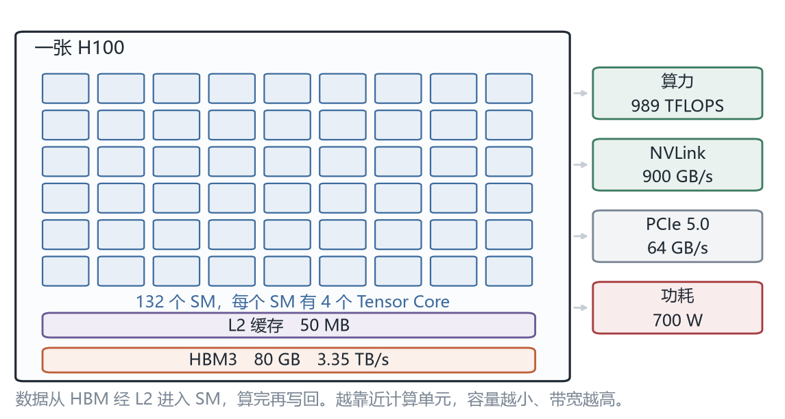
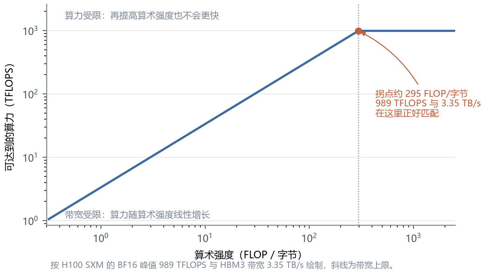

# 第 4 章　显卡在算什么

## 4.1　一个 SM 里有什么

把 H100 的顶盖掀开，会看到一片被切成一百三十二块的芯片。每一块叫一个 SM，流式多处理器，是真正干活的地方。

每个 SM 里有四个 Tensor Core，这是从 Volta 那一代开始加进来的专用单元，专门算矩阵乘。普通的 CUDA 核心算一次乘加要一个周期，Tensor Core 一次能算一整个小矩阵的乘加，吞吐高出一个数量级。深度学习之所以能在 2017 年之后起飞，靠的就是这类单元。

一百三十二个 SM 乘四个，整张卡上有五百多个 Tensor Core，平均到每一个是每秒一点九万亿次。这个视角能解释一件事，为什么每一代新卡都要改 Tensor Core 的形状。它不是通用处理器，只为几种固定的矩阵尺寸和精度服务，模型里用到的形状一变，它就得重新设计。

SM 里还有两样不起眼但很关键的东西。一样是寄存器，每个线程的临时变量都放在这里，速度最快，容量最小；另一样是共享内存，同一个 SM 里的线程可以共同访问一小块空间，用来放矩阵分块。这两样东西的大小直接决定了分块能开多大，也就决定了矩阵乘能跑多快。

线程是按组调度的。同一个组里的线程走同一条指令，处理不同的数据，这种模式叫单指令多数据。好处是硬件简单、吞吐高；坏处是遇到分支就分裂，一组里有的线程走 if、有的走 else，两边都要执行一遍，效率打折。深度学习里的算子大多是整齐的乘加，正好适合这种模式。

另一个关键概念是占用率。从显存取一次数要几百个周期，这段时间算力是空着的。要把它填满，就得同时挂很多组线程，一组在等数据的时候换另一组算。所以 GPU 的设计思路和 CPU 相反，CPU 用大缓存和乱序执行把单线程做快，GPU 用大量线程把等待藏起来。这也解释了一个常见现象，同一个 kernel 把线程数调少一半，速度可能慢一倍以上，不是因为活变多了，是因为等待藏不住了。

*图 4-1　一张 H100 的主要部件与数据通路*

图里画的是一条自下而上的路。数据从 HBM3 出发，经过 50 MB 的 L2 缓存，进入各个 SM，算完再写回 HBM。越靠近计算单元，容量越小，带宽越高；越往外，容量越大，速度越慢。这个层次结构不是 GPU 特有的，CPU 也一样，只是 GPU 把“宽”这件事做到了极致，用几千个简单的核心换吞吐。

理解这张图要抓住一个事实，数据每往上一层都要花时间。如果每次乘加都去 HBM 取数，那算力再高也没用，因为取数的速度跟不上。让数据在 SM 里多待一会儿，反复用几次，才是高性能计算的核心技巧。这就是下一节要算的账。

为什么是一百三十二个，不是更多，原因在面积。芯片做得越大，一片晶圆能切出的完好芯片越少，良率越低，单价越高。所以厂商开始在封装上想办法，把几片小的拼成一片大的，用封装换良率。对写代码的人来说，这意味着未来一张卡内部也可能是多块芯片在通信，分块的思路要跟着改。

线程是按 32 个一组打包的，这一组叫一个 warp。SM 里有四个调度器，每个周期各挑一个就绪的 warp 发一条指令，四条一起走，正好是 128 个线程在同一个周期里动。这个数字和 SM 里那四个 Tensor Core 对得上，硬件的每一份都被四等分了。调度器挑谁不挑谁，看的是哪一组的操作数已经就位，所以“多挂几组”不是一句口号，是唯一能让发射槽不空着的办法。

算一遍就知道等待是怎么被摊掉的。一条从 HBM 取数的指令往返要几百个周期，取 400 周期、主频按 1.7 GHz 估算，也就是 235 纳秒。一个 SM 最多挂 64 个 warp，即 2048 个线程，若每个线程只许一个 4 字节的取数在路上，SM 里同时在飞的字节是 8 KB。8 KB 除以 235 纳秒，是 34 GB/s，132 个 SM 加起来 4.5 TB/s，刚刚压过 3.35 TB/s 这条线。占用率掉到一半，在飞的字节也掉一半，能拿到的带宽只剩 2.2 TB/s，也就是峰值的六成多。这就是“线程数少一半、速度慢一倍”的来历，它不是一个模糊的说法，是一道可以代入数字的除法。

把取数指令从 4 字节换成 16 字节，账就完全变了。同样是 2048 个线程，在飞的字节变成 32 KB，每个 SM 能扛 136 GB/s，整卡算下来 18 TB/s，远在 HBM 之上。这时带宽被打满，瓶颈回到显存本身，占用率低一点也无所谓。向量化加载之所以被当作写 kernel 的第一条纪律，原因就在这里。

占用率还受寄存器卡着。假设一个 SM 有 65536 个寄存器，每个线程用 128 个，一个 256 线程的 block 就要吃掉 32768 个，一个 SM 只能同时放两个 block，也就是 512 个线程；若 SM 最多挂 2048 个线程，占用率只有 25%。把每线程的寄存器压到 64 个，同样的 block 能放四个，占用率到 50%；压到 40 个，能放六个，到 75%。所以在调 kernel 的时候改 block 大小、加编译选项限制寄存器用量，效果往往大得超出预期，它动的正是能同时在飞的 warp 数。

分支的代价也能这样量化。一个 warp 里 32 个线程走同一条指令，遇到 if 就分成两拨，硬件不能只执行一拨，得把两条路径都发一遍，各带一半的掩码，有效吞吐掉一半。深度学习里的算子大多整齐，例外集中在两处，一是注意力掩码，二是混合专家模型的路由。后者的麻烦在于同一个 warp 里的 token 可能被分到不同专家，一个 kernel 里同时要跑好几条路径，这也是这类 kernel 难写的主要原因。

## 4.2　算力与带宽的比值

H100 的 BF16 峰值是 989 TFLOPS，显存带宽是 3.35 TB/s。两个数放在一起除一下，是 295。

295 的单位是 FLOP 每字节，意思是这张卡每从显存里读一个字节，理论上能做 295 次浮点运算。反过来读，如果某个计算每读一个字节只能做 10 次运算，那它最多只能用到峰值的三十分之一，剩下的算力全在等数据。

这个比值有个正式的名字，叫机器的平衡点，也有人叫它拐点。它是硬件的属性，和跑什么程序无关。A100 的这个数是 312 TFLOPS 除以 2.04 TB/s，约 153。H100 把它提到了 295，因为算力涨得比带宽快。

这一代之间发生了什么，可以算一下。算力从 312 到 989，涨了 3.2 倍；带宽从 2.04 到 3.35，只涨了 1.6 倍。两个一除，平衡点就翻了一倍。后果是原来在 A100 上刚好算力受限的算子，到 H100 上可能已经掉到带宽受限那边。硬件变强了，能用上这份强的代码却变少了，这是每一代新卡上线时都要重新调优的原因。

带宽涨得慢有物理原因。算力可以靠堆单元、提频率、加专用电路，带宽要靠把内存做得更快更宽，而 HBM 的引脚数和信号速率都有上限，还得和封装尺寸抢空间。过去几年里算力和带宽的差距一直在拉大，这也是为什么“减少数据搬运”这件事在工程上越来越值钱。

*图 4-2　H100 的 roofline 曲线*

图上有两条边界。斜着往上的那条是带宽上限，横着的那条是算力上限，两条线交在 295 那个位置。任何一个算子，只要知道它的算术强度，就能在图上找到一个点，这个点的高度就是它能达到的最快速度。

斜线左边是带宽受限区。在这里，算力再多也没用，因为数据喂不上，速度只跟带宽成正比。斜线右边是算力受限区，这时候瓶颈在计算单元，再优化数据搬运也没用。

这张图最有用的一点是，它把“这个算子能跑多快”变成了一个可以算的问题。不用跑 benchmark，只要数一下它读了多少字节、做了多少次运算，就能知道它的天花板在哪。后面两节就用这个方法看两类算子。

它也有不管的地方。roofline 描述的是稳态，也就是数据已经准备好、流水线已经跑满之后的速度。真实算子有启动开销，有排空阶段，有同步等待，这些在图上都看不到。所以它是一个上限，不是预测。拿它来判断“这个算子还有多少优化空间”很准，拿它来预测“这一步要跑多久”会偏低。

平衡点还有一个用处，是判断换精度会不会改变一个算子的处境。FP8 的峰值是 1979 TFLOPS，除以同样的 3.35 TB/s，平衡点升到 591。粗看像是低精度更容易掉进带宽受限区，其实不会。位宽减半，同一个算子的字节数也减半，算术强度从 400 翻到 800，仍然在 591 右边。两个数一起翻倍，位置不动，时间整体减半。所以低精度不是改变 roofline 形状的手段，它是一把等比例的缩放，算力受限的算子还是算力受限，带宽受限的还是带宽受限，只是一起变快了。这个结论第五章还会用到。

## 4.3　为什么矩阵乘适合 GPU

矩阵乘是深度学习里最重的活，一个 Transformer 里九成以上的浮点运算都花在它身上。它也是最适合 GPU 的活。

先看一个最朴素的实现。算 C 等于 A 乘 B，都是 n 阶方阵。每个输出元素要做 n 次乘加，总共 2n 的立方次运算。而要算出这些结果，至少要把 A 和 B 都读一遍，按 BF16 算是 4n 的平方个字节。除一下，算术强度是 n 除以 2。

n 等于 1024 的时候，强度是 512，远在 295 右边，算力受限，能跑满。n 等于 64 的时候，强度只有 32，掉到斜线左边，只能跑到带宽允许的速度。所以矩阵越小，GPU 越使不上劲。这就是为什么推理时 batch 太小会慢，也是为什么大模型的训练效率反而比小模型高。

真实的实现不会只读一遍。把矩阵切成小块，一块一块搬进共享内存，反复用。假设块的大小是 T，每块要算 2 个 T 的立方次运算，只需要读 4 个 T 的平方个字节，算术强度是 T 除以 2。

T 等于 128，强度是 64，还在拐点左边。T 等于 256，强度是 128，进步了但还不够。要跨过 295，T 得做到将近 600。一块 600 阶的 BF16 矩阵是 720 KB，远超一个 SM 的共享内存容量。所以单靠共享内存做不到，实际的做法是三级复用，寄存器里放最小的块，共享内存放中等的块，L2 放大的块，一层层把复用次数堆上去。

这就是为什么矩阵乘的 kernel 要写几千行。它不是简单地循环，而是精心安排每一级缓存里放什么、什么时候换、线程之间怎么分工。同一个矩阵乘，写得好的能跑到峰值的八九成，写得差的只有一成。差距不在算法，在数据怎么搬。

Tensor Core 还有个脾气，它只认几种固定的小矩阵形状。一个大的矩阵乘会被切成很多小碎片喂给它，碎片尺寸对不上就得补零，补上的零也要花时间算。这就是为什么隐藏维度这类超参喜欢取 2 的幂或者 128 的倍数，不是迷信，是为了让碎片刚好装满。一个奇怪的维度值，性能可能直接掉一两成。

还有一个放大器，矩阵越大越好。算术强度随 n 线性增长，而真实的模型里 n 就是隐藏维度，动辄几千。Llama 3 405B 的隐藏维度是 16384，这意味着它的矩阵乘天生就在拐点右边很远的地方，只要数据搬得动，算力就能吃满。这也是大模型在硬件上反而“好训”的原因之一。

注意力里的那两个矩阵乘也是一样的道理。算注意力分数是一个矩阵乘，把分数乘到 value 上又是一个，两者都是大的批量矩阵乘，形状由序列长度和头数决定。序列短的时候块很小，效率不高；序列长了块变大，效率反而上升。长上下文训练之所以贵，贵在显存和注意力的平方项，不在矩阵乘本身。

卷积也算这一类。把它展开成矩阵乘之后，和全连接没有区别，所以同一个 kernel 能复用到两种网络上。这也是 cuBLAS 这类库能吃掉大部分算力的原因，模型千变万化，最后都归到几个固定的矩阵形状上。

## 4.4　为什么 norm、softmax、逐元素运算不适合

Transformer 里还有另一类算子，归一化、softmax、残差相加、激活函数。它们数量不少，但对算力的利用极差。

拿最简单的逐元素加法举例。给 1750 亿个参数每个加一个数，要读 350 GB，写 350 GB，一共 700 GB 的流量。除以 3.35 TB/s，是 0.2 秒。这 0.2 秒里做了多少次浮点运算，1750 亿次，也就是 $1.75\times10^{11}$ 次。除一下，实际速度是 0.84 TFLOPS。

0.84 对比 989，是千分之一。这张卡的算力在这一刻几乎完全闲置，全部时间都在等显存。

原因在算术强度。这个算子的强度是每读 2 个字节做 1 次加法，也就是 0.5 FLOP 每字节，离 295 差了将近六百倍。它天生就在 roofline 的斜线最左端，无论怎么优化代码都没用，除非减少数据搬运。

归一化和 softmax 好一点，也没好到哪去。它们要读一遍输入、算一个统计量、再读一遍输入做缩放，强度是个位数。这类算子在任何 GPU 上都是带宽受限，跑出来的 TFLOPS 数字难看得让人怀疑显卡坏了。

它们又不能不存。归一化负责把每层的数值拉回一个稳定的范围，softmax 负责把分数变成概率，残差相加负责把梯度直接送到浅层。去掉任何一个，训练要么不收敛，要么直接出 NaN。所以这不是一个可以“优化掉”的开销，而是一个必须付的成本，能做的只是让它付得便宜一点。省不下来的那部分时间，最后都会出现在 MFU 的账上。

这件事的后果很实际。一个 Transformer 里，矩阵乘占了九成以上的运算量，却只占一小部分时间；那些零零碎碎的归一化和逐元素运算只占不到一成的运算量，却可能吃掉三成的时间。所以真正拖慢训练的往往不是大矩阵，是这些“小算子”。

一个直观的换算能说明差距有多大。假设某个算子的算术强度是 10 FLOP 每字节，按 3.35 TB/s 的带宽，它每秒最多做 33.5 万亿次运算，也就是峰值的百分之三。写代码的人看到 TFLOPS 只有三十几，第一反应是显卡有问题，实际上硬件一点问题没有，是这个算子天生就只能跑这么快。

业界的应对办法有两个方向。一个是融合，把几个连续的逐元素算子合成一个 kernel，读一次写一次，把三次搬运压成一次。另一个是减少数据精度，用 FP8 甚至更低，让同样的带宽能搬更多元素。这两条路都不是算法创新，是实打实的工程活，也是各家框架拉开差距的地方。

## 4.5　MFU：把峰值和实际对上

规格表上的 989 TFLOPS 是个理论值，任何真实程序都跑不到。跑不到多少，需要一个统一的尺子来衡量，这把尺子叫 MFU。

MFU 的定义很直白，模型实际完成的浮点运算量，除以硬件峰值乘以实际耗时。分子是 6ND 那样的账，分母是卡数乘峰值乘时间。算出来的百分比，就是硬件的力气用上了几成。

几个公开的数字可以当作参照。PaLM 5400 亿参数，6144 块 TPU v4，MFU 46.2%。Megatron 的 1 万亿参数模型，3072 张 A100，单卡跑到峰值的 52%。MegaScale 在 12288 张卡上把 1750 亿参数的训练做到 55.2%，比同规模的 Megatron-LM 高 1.34 倍。Llama 3 405B 在 16384 张 H100 上是 38% 到 43%。

这些数字集中在 35% 到 55% 之间，不是巧合。剩下的那一半去哪了，可以一项项数。

一部分在通信。梯度要同步，参数要广播，这些时间 GPU 在等网络。一部分在显存。4.4 节算过，那些带宽受限的算子把时间吃掉了，却几乎不贡献运算量。一部分在重算。为了省显存做的重计算，多出来的前向运算是真实发生的，但如果按 6ND 算分子，这些运算不计入，MFU 就被压低了。还有一部分在故障和恢复，卡住了、重启了、加载检查点，这些时间里 GPU 什么也没算。

所以 MFU 是个复合指标，它同时反映了硬件、软件和运维的水平。两家公司用同样的卡训同样大小的模型，MFU 差十个百分点，意味着一趟训练要多花两三成的钱。

还有一个比 MFU 更细的指标，HFU，把重计算多出来的运算也算进去。因为重计算是真的在算，硬件确实忙了，只是这份忙对训练进度没有直接贡献。一个作业的 HFU 往往比 MFU 高几个点，差距就是重计算的比例。两个数一起看，能判断出效率损失到底是“算得慢”还是“算得冤”。

用 MFU 还能反推时间。知道了参数量、token 数、卡数和单卡峰值，除一下就是预期耗时。如果实际耗时比这个多很多，说明中间有别的东西在吃时间，值得去查。这是集群运维里最常用的一个粗筛手段。

一个规律值得记住，集群越大，MFU 往往越低。小集群里通信少、拓扑简单、坏卡少，MFU 能做到五成以上；到了一万张卡，通信跳数变多、掉队者变多、故障变频繁，同样的代码可能只剩四成。MegaScale 能在 12288 张卡上做到 55.2%，靠的不是一块好卡，是一整套把通信藏到计算背后的调度安排，以及对慢卡的持续监测。

最后提醒一句，MFU 不是越高越好。把 MFU 拉到极限往往意味着牺牲别的，比如把批次开到最大导致显存吃紧、把重计算全关掉导致装不下模型。真正要优化的是端到端的有效算力，MFU 只是其中一环。这一环怎么和可用率乘在一起，第 13 章会算。

## 4.6　Tensor Core 换了几代，换的是什么

从 Volta 把 Tensor Core 加进来到现在，这块电路的形状改过好几轮，改的方向有迹可循。每一次大的提升，几乎都来自再塞进一种更窄的格式，而不是把电路做得更巧。

A100 的 BF16 峰值是 312 TFLOPS，H100 是 989.4，三倍多。但如果只看同一个格式，这个涨幅里有一部分是制程和规模堆出来的。更狠的一步是 H100 多了一种 FP8，1979 TFLOPS，正好是 BF16 的两倍，不用改算法，把数据类型换掉就行。代价是数值范围又窄了一截，这笔账留到下一章细算。

另一个方向是把一次能算的小块做大。早期 Tensor Core 一次算 4×4 的碎片，后来变成 16×8×16 这样的规模，K 维上要求的对齐从 4 变成 8 再到 16。补零的比例跟着变。算一个例子，假设隐藏维度是 4104，它已经是 8 的倍数，按 8 对齐不用补；要求对齐到 128 就得补到 4224，多算 2.9% 的乘加。维度取 4096 这类整数就没有这个问题，所以模型设计时把维度定成 128 的倍数，省下来的是几个百分点的实打实的钱，不是什么仪式。

第三个方向不那么显眼，影响却更大，是把搬运和计算解耦。早期的 Tensor Core 是一条同步指令，取数、算、写回串着来；后来有了异步拷贝和 warpgroup 级的矩阵指令，取下一块数据的同时可以算当前这块。手写 kernel 能跑到峰值的八九成，靠的就是这个重叠。代价是复杂度，一个矩阵乘 kernel 从几十行变成几千行，寄存器用量、同步屏障、流水级数都得手工安排。

| 项目 | A100 SXM 80GB | H100 SXM |
| --- | --- | --- |
| BF16 峰值 | 312 TFLOPS | 989.4 TFLOPS |
| FP8 峰值 | 不支持 | 1979 TFLOPS |
| 显存 | 80 GB HBM2e | 80 GB HBM3 |
| 显存带宽 | 2039 GB/s | 3.35 TB/s |
| 算力带宽比（BF16） | 153 | 295 |
| 算力带宽比（FP8） | — | 591 |
| NVLink | 600 GB/s | 900 GB/s |
| 功耗 | 400 W | 700 W |

表里最值得看的是算力带宽比那一行。两代之间算力涨了 3.2 倍，带宽只涨了 1.6 倍，比值翻了一番。这意味着 A100 上调好的分块参数搬到 H100 上大概率不再最优，因为要把算力吃满就得把块做得更大，而共享内存并没有跟着变大。每次换卡都得重新调一遍，不是代码写得不好，是硬件的比例变了。

## 4.7　带宽是怎么测出来的

标称的 3.35 TB/s 是理论值，任何程序都跑不到。实际能到多少，得测。

测法很朴素，分配一块远大于 L2 的缓冲区，做一次拷贝，量时间。假设缓冲区 8 GB，读 8 GB 写 8 GB，一共 16 GB 的流量，按 3.35 TB/s 算需要 4.8 毫秒。实测若是 5.5 毫秒，有效带宽就是 16 GB 除以 5.5 毫秒，约 2.9 TB/s，达成率 87%。这个数是健康的，说明卡没降频、显存没报错。如果实测只有 2 TB/s，达成率六成，那就得查了，可能是 ECC 在纠错，可能是卡被别的进程挤着，也可能是缓冲区切得太碎导致页命中率低。

缓冲区必须远大于 50 MB 的 L2，否则测出来的是 L2 带宽，会得到一个漂亮但没有意义的数字。这个坑很容易踩，因为 L2 带宽比 HBM 高好几倍，一次不小心的测试能让人误以为显卡超频了。

纯读的达成率通常比读写混合高一两个点，因为读写之间要换方向，显存需要时间。所以正经的 benchmark 会报三个数，拷贝、纯读、纯写，三个一起看才知道瓶颈在哪一侧。

集群里对应的测法是集合通信。八张卡在节点内做一次 all-reduce，梯度桶按 1 GB 算，每张卡要收发 2×7/8 倍的量，也就是 1.75 GB，NVLink 900 GB/s 下理论耗时 1.9 毫秒。实测若是 2.6 毫秒，有效带宽 670 GB/s，达成率 75%。这个数比显存那边低是正常的，集合通信有启动开销，桶不够大就摊不薄。

这类测试值得在每次换硬件、换驱动、换通信库版本之后重跑。它是判断“机器还是不是原来那台机器”最快的办法，比看监控曲线可靠，因为降频和链路降速在曲线上往往只表现为一点点抖动。

还有一个用处容易被忽略，测出来的达成率要带到后面所有的估算里。算单步时间、算通信量、算分块能不能吃满算力，如果一律按 3.35 TB/s 代入，得到的结论会比现实乐观一成多；按 2.9 TB/s 代入，误差就收窄了。这一成看着琐碎，放到一个跑几个月的作业上就是好几天，也是容量规划时最容易把季度排期打乱的地方。

## 4.8　两个 roofline 算例

第一个算例是一个大矩阵乘，4096 阶方阵，BF16。运算量是 2 乘 4096 的三次方，$1.37\times10^{11}$ 次。数据量按只读一遍算，三个矩阵各 4096 的平方个元素，每个 2 字节，共 100.7 MB。两者一除，算术强度 1365 FLOP 每字节，是平衡点 295 的四倍多，稳稳落在算力受限区。按峰值算，耗时 0.139 毫秒。

实测大概在 0.2 毫秒上下，对应七成的效率。差的那部分不在算法，在启动和收尾，kernel 拉起要几十微秒，最后几个块收尾时 SM 已经闲着。矩阵越大，这两头摊得越薄；4096 这个尺寸刚好在“账算得清”和“启动开销不可忽略”的交界上。

第二个算例是一个逐元素运算，1 GB 的 BF16 张量整体乘 2。元素数是 $5.37\times10^8$，每个元素一次乘法，运算量 $5.37\times10^8$ 次；流量是读 1 GB 写 1 GB，共 2 GB。算术强度 0.25 FLOP 每字节，按带宽算耗时 0.6 毫秒。这不到一毫秒的时间里，有效算力是 0.9 TFLOPS，峰值的万分之九。

两个算例放在同一张 roofline 上，算术强度差了几千倍。前者是深度学习里最值钱的那部分工作，后者是绕不开的杂活。看 MFU 的时候要记住这一点，一个作业里这两类算子都在跑，它们的天花板根本不在一个平面上。

第三个算例用来说明融合能省多少。还是 1 GB 的张量，三个逐元素算子串起来，先加偏置、再乘系数、再过一次激活。不融合的话每个算子读一遍写一遍，6 GB 流量，1.8 毫秒；融合成一个 kernel，读 1 GB 写 1 GB，0.6 毫秒。省下的正好是三分之二，中间结果根本不出 SM。这三分之二不是靠更快的算术拿到的，是靠少搬两趟数据。

这就是 roofline 的用法。它不告诉你代码写得好不好，只告诉你再怎么写也快不过哪条线。离这条线远，说明还有活可干；贴着这条线，就只能换算法或者换硬件。

## 4.9　MFU 算错的几种方式

MFU 的式子只有两个数相乘相除，但每一处都能算错，错的幅度也都值得弄清楚，因为它决定了一次对比还有没有意义。

分子最常被少算。6ND 里的 6 是前向 2 加反向 4，没有算重计算。如果一个作业对一半的层开了重计算，多跑的那部分前向是 0.5 乘 2ND，也就是 1ND，总运算量从 6ND 变成 7ND。这时候拿 6ND 去除实际耗时，算出来的 MFU 比真实值低一成四。4.5 节提到的 HFU 就是补这个洞的，把多算的那部分也计进去。

注意力也常被漏掉。6ND 假设每参数每 token 的运算量与序列长度无关，这个假设在 2048 上还站得住，到了 32768 就站不住。按每层注意力 4sd、其余部分 12d² 估，注意力占的比例是 s 除以 3d 与 s 之和。以 d 等于 16384 算，2048 的序列是 4%，32768 的序列是 40%。长上下文作业拿 6ND 算分子，会漏掉近四成的运算，MFU 被压得很难看，其实硬件没偷懒。

分母的错法更隐蔽。峰值要用这张卡在这个格式下的密集算力，不能拿稀疏值，也不能拿别的格式的值，1979 和 989.4 差一倍，用错了 MFU 就差一倍。另一个坑是降频，标称峰值对应一定的主频，卡热了降频之后实际峰值跟着降，而分母还按标称算，MFU 就虚高。判断降频要看同一份代码的 step time 有没有在温度上来之后变长，而不是看 MFU。

还有一个口径问题经常引起争论，就是时间取哪一段。用纯计算时间算出来的 MFU 高，用完整 step time 算出来的低，两者差的就是通信尾巴、数据加载和同步等待。1024 张卡那个例子里，21.7 秒对应 40%，端到端的 23 秒只对应 37.7%，差 2.3 个百分点。汇报时不写清是哪一个，两个团队的数字就没法比。

反向换算是验算的好办法。每秒 token 数等于卡数乘峰值乘 MFU 再除以 6N。1024 张 H800，40% 的 MFU，每张卡每秒约 377 个 token，全集群 38.6 万。监控上实测若是 30 万，反推 MFU 只有 31%，说明中间丢了将近四分之一，这个差距值得去查，而不是在报表上照抄 40% 交差。

把这四种错法记下来，至少能避开一半的无谓争论。分子少算，MFU 偏低，会让人误以为还有很大优化空间；分母用错，MFU 偏高，会让人以为已经没什么可做；时间口径不统一，两个数字根本不在同一个尺度上，比得再热闹也说明不了问题。一个可信的 MFU 后面一定跟着三个限定，什么格式的峰值、算不算重计算、时间是计算段还是端到端。少了这三个限定，那个百分数就只能当口号看。
