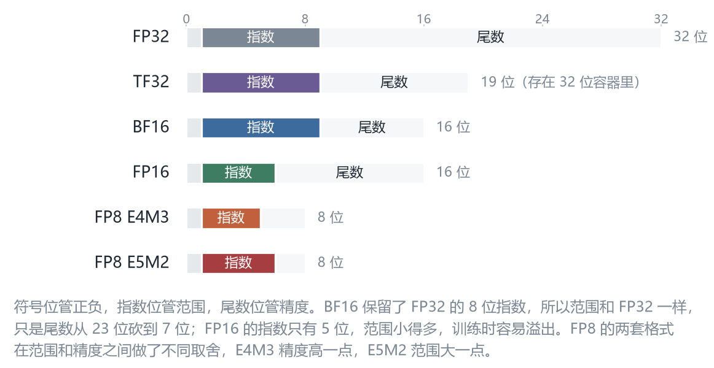

# 第 5 章　数字的精度

## 5.1　浮点数的三个部分

计算机存一个小数，用的不是我们熟悉的定点写法，而是一套叫浮点的表示法。它把一个数拆成三段，符号、指数、尾数。

符号一位，管正负。指数管大小，决定这个数在数轴上的位置有多远。尾数管精度，决定这个数能精确到小数点后几位。三段拼起来，就是科学计数法的二进制版本。

这样设计的好处是范围大。指数有几位，能表示的跨度就是 2 的多少次方。八位指数能跨 2 的 256 次方，从极小到极大都能装下。坏处是，同样是三十二位，分给指数的多了，分给尾数的就少，精度就下降。

所以位数不是免费的。总位数固定的时候，范围和精度在互相争抢。想表示很大的数，就得把指数做宽；想表示很精确的数，就得把尾数做宽。不同的浮点格式，本质上是对这场争抢给出的不同答案。

深度学习对这两件事的需求并不对称。模型的权重基本落在很小的动态范围里，不需要表示天文数字；但梯度累加会跨越好几个数量级，范围不够就会溢出或下溢。理解这个不对称，才能看懂后面几种格式为什么这么设计。

还有一件事得先说清楚，浮点是近似的。十进制里的 0.1，写成二进制是无限循环小数，任何有限位数的浮点都只能存一个接近的值。所以一个看起来等于零的差值，实际可能是个很小的非零数；一万个这样的数加起来，误差就到了不可忽略的量级。训练里大量出现“理论上应该相等，实际对不上”的现象，根源都在这里。

浮点还有一个特点，它的误差是相对的。一个数乘上 2 的幂，精度不变；换成加上一个大数再减回去，低位就被吃掉了。所以在大数上叠加小增量是最危险的写法，而参数更新恰好就是这种形式，一个很小的学习率乘梯度，加到很大的权重上。这也是为什么参数更新那一步必须用高精度，哪怕其他部分都用了低精度。

## 5.2　从 FP32 到 BF16

最早训练用的是 FP32，一位符号、八位指数、二十三位尾数。这个配置很均衡，范围够用，精度也够，单精度浮点能表示大约七位十进制有效数字。CPU 上的科学计算一直用它。

问题是它太占地方。一个参数四字节，1750 亿参数就是 700 GB，一张卡装不下，得十张才够放。而且 Tensor Core 在三十二位上的吞吐远不如十六位，算得也慢。

于是有了 FP16，一位符号、五位指数、十位尾数。位数砍半，范围大幅缩小，最大只能表示 65504。这个上限在推理时勉强够用，在训练时就经常撞墙，梯度一大就变成无穷。

还有过一个折中方案叫 TF32，保留八位指数，尾数取十位，实际只占十九位，但存在一个三十二位的容器里。它让老代码不改字面精度也能吃到 Tensor Core，代价是算完的精度卡在中间。这个方案在某个时期被广泛使用，后来被 BF16 完全取代，因为它占的位宽没减，吞吐也上不去。

BF16 是另一个思路。它保留 FP32 的八位指数，只把尾数从二十三位砍到七位。范围完全不变，精度降了不少，七位尾数大约相当于两三位十进制有效数字。

*图 5-1　常见浮点格式的位分配*

图里能看出几种格式的取舍。FP32 和 BF16 的指数段一样宽，所以两者能表示的范围相同，这一点在训练时非常关键。FP16 的指数段只有五位，范围窄了一大截。FP8 的两套格式在范围和精度之间又各让了一步。

BF16 成为训练默认，就是因为它保住了范围。深度学习里最怕的不是精度不够，是数值直接溢出成无穷，或者下溢成零，一旦发生，后面所有的梯度都是废的。精度低一点只是收敛慢一点，范围不够是直接崩。这个区别决定了一切。

七位尾数够不够用，很多人第一次看到这个数字都会怀疑。实测的结论是够。神经网络本身对噪声有容忍度，梯度的方向比大小更重要，少量的量化噪声甚至能起到正则的作用。真正不能容忍的是系统性偏差，比如每一层都向同一个方向舍入，这种误差会逐层放大。所以工程上关心的往往不是“平均误差多大”，而是“误差会不会累积”。

实际跑起来的混合精度是三段式的。前向和反向的矩阵乘用 BF16，速度快、显存省；累加器用 FP32，避免长链累加的误差；优化器状态也用 FP32，保证每一步更新都准。三段各用各的精度，看上去很细碎，但它把“算得快”和“不跑偏”分开了，各取所需。

代价也很实在。七位尾数意味着两个相近的数相加，可能只保留了前几位，后面的被吃掉。一千万个梯度累加到一起，如果都用 BF16 累加，误差会积累得很难看。所以实际的做法是，存的时候用 BF16，累加的时候切回 FP32。这个细节几乎所有框架都做了，但写自定义算子的人经常忘。

这也是为什么推理和训练选的格式不一样。推理只跑前向，没有长链累加，数值范围也可控，用 FP16 甚至八位整型都行，换来的是更快更省。训练要跑反向，要维护优化器状态，对范围和累加精度的要求高得多，于是选了 BF16。两件事看着像，其实需求不一样。

再往下追问一句，为什么不能全部用 BF16，连优化器状态也用。因为参数更新是加法，而加法的误差不随数值大小缩放。一个 0.001 量级的更新量加到一个 1 量级的权重上，BF16 的七位尾数只能保留前几位，更新量被吃掉了大半。一天下来，权重几乎没动。这不是精度“差一点”的问题，是学习完全失效。

## 5.3　FP16 的溢出与 loss scaling

FP16 今天主要用于推理，训练里偶尔还能见到，它有一个很典型的工程问题值得讲。

问题是这样的。FP16 能表示的最大数是 65504，最小正规数只有万分之几。梯度在反向传播时会逐层变小，到了浅层往往小到 FP16 根本表示不了。这个数在 FP16 里直接下溢成零，梯度就没了，浅层永远学不动。

解决办法叫损失缩放。思路很朴素，既然数太小，那就先把它放大。前向算完损失，乘一个常数比如 1024，反向传播时所有梯度都跟着放大 1024 倍，正好落在 FP16 能表示的区间里。更新参数之前再除回去，账就平了。

这个技巧在 2017 年前后被广泛使用，也确实管用。它的问题是那个常数不好选。选大了，梯度在浅层放大过头，溢出成无穷；选小了，深层还是下溢。不同模型、不同层、不同训练阶段的梯度分布都不一样，一个固定值很难一直合适。

于是就出现了动态损失缩放。每一步检查梯度里有没有无穷或者 NaN，有就把缩放系数减半，连续几千步没有异常就把它加倍。这套逻辑现在写在框架里，用起来无感，但它背后是一连串的试探和回退，每一次回退都意味着一步白跑。

FP16 的这段历史说明一件事。精度的选择不只是“位数够不够”，还牵扯到整个训练循环的设计。为了让一个十六位格式能用，得额外加一套监控和调整机制，这套机制的复杂度和出错概率都不低。

BF16 普及之后，这套机制在很多场景下不再需要，因为范围够宽，梯度再小也不会直接下溢。但它在两个地方还活着，一是还在用 FP16 推理或微调的模型，二是 FP8 的缩放因子本质上就是同一类东西，只是从“一个全局系数”变成了“每个张量一个系数”。这套思路没有过时，只是换了件衣服。

溢出之后的传播路径也值得知道。一个数变成无穷，它乘上零就是 NaN，NaN 一旦进了张量，整个张量就废了，再往下传，参数变成 NaN，这一步的结果全部作废。所以监控必须在算完梯度、还没更新参数的那个位置，发现异常就把这一步丢掉，不能让它污染权重。跳过一步的代价很小，把权重污染了得回滚到上一个检查点，那是几小时的损失。

## 5.4　FP8 与缩放因子

FP8 是这两年的热点，位宽只有八位，理论上能让算力再翻一倍，显存再减一半。它的麻烦比 FP16 更大。

八位要分给符号、指数、尾数三样，怎么分都是捉襟见肘。业界落地的两套格式是 E4M3 和 E5M2，前者四位指数三位尾数，后者五位指数两位尾数。E4M3 精度高一点，范围小一点；E5M2 范围大，精度差。梯度这种动态范围大的用 E5M2，权重和激活这种要求精度的用 E4M3。

八位的动态范围窄到什么程度，可以感受一下。E4M3 能表示的最大值在四百多，最小值在零点零几。一个张量里的数值如果跨越两个数量级，八位就装不下了。所以在用 FP8 之前，必须先做一件事，把数据缩放到合适的区间。

这个缩放不是全局一个系数，而是按张量统计。每个张量算一个最大值，用它把整个张量归一化到 FP8 能表示的范围，记下这个系数，算完再乘回去。这套东西叫缩放因子，它比 FP16 的 loss scaling 更细，因为每个张量都有自己的因子。

代价是精度损失和额外的记账。缩放因子要存，要同步，要保证前向和反向用的是同一个，还要防止某些张量在训练过程中分布漂移导致因子失效。DeepSeek-V3 用 FP8 训了 14.8 万亿 token，跑在 2048 张 H800 上，是这条路线目前最有说服力的一个案例，但它背后的工程量远超过把 dtype 改一个参数。

缩放粒度是个很实际的选择。整个张量共用一个因子最简单，但张量里如果有个别数值特别大的元素，会把因子拉得很小，其余数值都被压成零。切成小块各用一个因子能解决这个问题，代价是因子数量变多，要额外存、额外算。最后的方案往往是硬件能支持到多细就用多细，因为软件层面的权衡再漂亮，硬件不支持就是白搭。

FP8 也不是全链路都用八位。矩阵乘的输入用八位，乘加之间的累加仍然用更高的精度，算完再缩回去写回。这个混合结构意味着硬件的矩阵乘单元要能在内部完成“八位进、高位累加、八位出”这一整套动作，不是简单地把位宽改小。

具体到一层 Transformer，哪些地方能用 FP8 是有讲究的。大的线性层最适合，数值分布比较均匀，缩放的误差可控。归一化和残差这种逐元素运算收益小、风险大，往往保持高精度。注意力的分数矩阵中间会过 softmax，那个位置对精度敏感，也常常单独处理。一条训练链路里，往往是大部分算力走 FP8，少数关键位置留一手。

## 5.5　精度换来了什么

把精度降下来，换到的东西很具体。

显存减半是最直接的。权重从 FP32 到 BF16，1750 亿参数的占用从 700 GB 变成 350 GB，需要的卡数少一半。到 FP8 再减一半，175 GB。这三个数字摆在 80 GB 的卡旁边，就是九张、五张、三张的区别。从九张到三张，一个小机箱就能装下，这种量级的差别足以改变整个并行方案的设计。

吞吐翻倍是第二个。H100 的 BF16 峰值是 989 TFLOPS，FP8 是 1979 TFLOPS，正好两倍。原因在硬件，Tensor Core 处理八位数据时一次能塞进两倍的乘加单元。这笔收益不需要改算法，改个精度就能拿到，所以厂商和框架都在拼命推。

带宽压力也跟着减。第 4 章算过，很多算子卡在显存带宽上，算术强度只有个位数。位宽减半，同样的带宽能搬两倍的元素，这些算子的速度直接翻倍。这可能是低精度最被低估的好处，它不只让矩阵乘更快，也让那些带宽受限的小算子更快。

第三个好处在多卡时才显现，通信量也减半。梯度要同步，传的字节数正比于位宽，BF16 换成 FP8，同样的参数量只要传一半的数据。对一个大集群来说，这省下的不是几毫秒，是每天几个小时。所以低精度不只是单卡优化，它是一个能直接换回集群效率的旋钮。

代价是数值风险。精度越低，两个相近的数越难区分，累加的误差越大，溢出的边界越近。BF16 的七位尾数还能容忍，FP8 的三位尾数就需要一整套缩放和监控。这些机制本身也会出错，而且出错时往往不报异常，只是 loss 曲线慢慢变差。

所以精度和稳定性是一笔交换，不是一次升级。同样的模型，用 BF16 训能收敛，换 FP8 可能就发散，这不是 FP8 不好，是数值行为变了，配套的策略也得跟着变。真正做这件事的团队，会在小规模上先跑通，对比 loss 曲线，确认没有系统偏差，再往大集群上推。

还有一个容易忽略的连锁反应。精度降了，模型变小了，需要的卡数也跟着少；卡数少了，通信的参与方就少，all-reduce 的环就短，同步的代价就低。这三个好处叠在一起，才是一家公司愿意花几个月去把 FP8 跑通的原因。它不是单纯地“省显存”，而是同时改了容量、速度和通信三笔账。

风险也藏在这里。精度造成的偏差往往不是一眼能看出来的，loss 曲线可能只差一点点，下游评测可能只低零点几个点。这零点几个点到底是精度造成的，还是数据 shuffle 的随机性，很难分清楚。所以推行低精度时，团队通常会并行跑一个小规模的高精度对照组，用两个曲线的差距来判断。没有这个对照组，出了问题就无从归因。

还有一层现实。能用什么精度，不完全由算法决定，更多由硬件和生态决定。厂商在 Tensor Core 里支持哪几种格式，框架才会去适配那几种；一套格式跑通了，周边工具链、调优经验、监控指标都会跟着沉淀，换一套的成本太大。所以低精度的推进节奏，往往跟着硬件代际走，而不是跟着论文走。

下一章把这些零件装到一起，看训练的一步里到底发生了什么。一张卡算一部分，所有卡的结果要合起来，合的过程要花时间，这个时间怎么算，是后面所有并行策略的出发点。
