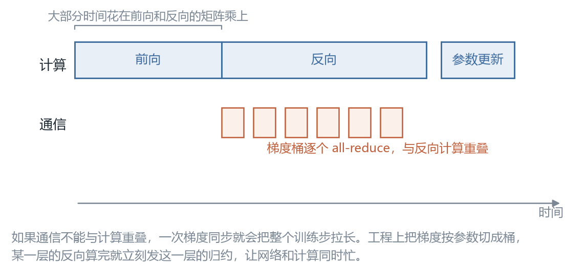

# 第 6 章　训练一步的流水账

凌晨两点，监控面板上有一行数字十几分钟没动过。step time 23.4 秒，比昨天慢了 3 秒，没人说得清这 3 秒是从哪冒出来的。要回答这个问题，得先把一个训练步拆开，看它由哪几段时间拼起来，每一段又压在什么硬件上。拆开之后你会发现，那 3 秒不是凭空长出来的，它一定是某一段变长了，或者某一段本来藏得很好、现在露出来了。

## 6.1　一步里发生什么

一个训练步从取数据开始。数据管道把样本按数据并行的份数切开，每张卡拿到自己那一份。样本先被分词、打包成固定长度的序列，再补上注意力掩码，最后放进显存。这一步看起来只是搬运，其实经常是隐藏的瓶颈。数据管道跟不上，GPU 就会在每一步开头空转几百毫秒，而这段时间在计算核的利用率曲线上看不出任何异常，只表现为 step time 抖动。

数据就位之后是前向。这批 token 逐层穿过模型，每一层先算注意力，再算前馈网络，中间夹着归一化和残差。走完最后一层，得到每个位置上对下一个 token 的预测分布，和真实标签一比，得到一个数，也就是 loss。

前向里的算子可以粗分三类。最大的一类是矩阵乘，包括把隐藏状态投影成查询、键、值的三个矩阵，注意力的输出投影，前馈网络里的两个大矩阵。第二类是注意力内部的运算，查询和键相乘得到打分矩阵，softmax 归一化，再乘上值。第三类是逐元素运算，LayerNorm、残差相加、激活函数。以 2048 的序列长度算，第一类吃掉八成以上的浮点运算，第三类占的运算量不到百分之五，却要读写同样多的数据。这就是为什么同样是前向，矩阵乘能把 Tensor Core 吃满，LayerNorm 却经常卡在显存带宽上。

反向从 loss 开始，按层倒着走。每经过一层要算出两样东西，这一层权重的梯度，以及要传给前一层的输入梯度。前者留下来等更新，后者继续往前传。这一段的浮点运算量大约是前向的两倍，因为每层要做两次矩阵乘，一次用输入激活值算权重梯度，一次用权重算输入梯度。所谓 6ND 里的那个 6，就是前向的 2 加上反向的 4。

反向还有一笔额外的账，就是激活值。前向算出来的中间结果不能扔，反向要用它们算梯度，所以整个前向过程都在往显存里堆激活值。序列越长、batch 越大、层数越多，堆得越高。显存不够时只能把一部分激活值扔掉，反向时重新算一遍，这叫重计算，用算力换显存，代价是多跑一次前向。

所有层的梯度算完，进入第三步，把各张卡上的梯度加起来。同一份模型在 N 张卡上各算了一份梯度，只有求平均，才等价于在一个大 batch 上做了一次更新。求平均靠集合通信完成，最常见的形式是 all-reduce。

最后一步是优化器更新。Adam 要读一阶矩、二阶矩、梯度和参数，算出新参数再写回去。

这四步占用的硬件几乎不重叠。前向和反向压的是 Tensor Core 的浮点吞吐，归约压的是网卡和交换机，更新压的是显存带宽。更新的浮点运算少得可以忽略，每个参数也就十几次运算，但它要把优化器状态整个搬一遍。混合精度训练下每参数 16 字节，1750 亿参数就是 2.8 TB 的数据，读一遍写一遍，按 H100 的 3.35 TB/s 显存带宽估算，光这一步就要一秒上下。这个数字不大，却解释了为什么优化器更新在时间线上总是一小段实心的方块，而且很难再压缩。

所以一个 step 的时间可以粗略写成四段相加，前向、反向、归约、更新。麻烦在于，归约这一段并不一定要老老实实加在总时间上，它能不能被藏起来，是这一章真正要问的问题。

## 6.2　计算时间怎么估

计算时间只有一个来源，浮点运算量除以有效算力。

浮点运算量用 6ND 估算。N 是参数量，D 是这一步喂进去的 token 数，每个参数每个 token 大约要花 6 次浮点运算。有效算力是卡数乘以单卡峰值，再乘一个效率系数 MFU。这个式子里没有任何一项跟并行方式有关，说明无论怎么切模型，要做的浮点运算总数是不变的。变的只是这些运算能有多少落在硬件峰值上。

拿 1750 亿参数、每步 839 万 token 走一遍。6 乘以 $1.75\times10^{11}$ 再乘以 $8.39\times10^{6}$，得到 $8.8\times10^{18}$ 次浮点运算。单卡 H800 的 BF16 峰值是 989.4 TFLOPS，按 40% 的 MFU 折下来接近 396 TFLOPS。1024 张卡合起来是 $4.05\times10^{17}$ FLOP/s。两者一除，21.7 秒。

同一笔运算量放在一张卡上要跑两百五十多天。这就是集群存在的全部理由，也是为什么并行度每提高一档，工程师愿意付出可观的通信代价。

关于那个 6，有个细节常被忽略。矩阵乘里的一次乘加，在 FLOPs 的计数口径下算两次浮点运算，一次乘、一次加。所以前向每个参数每个 token 贡献 2 次运算，反向贡献 4 次，加起来是 6。这个系数对稠密模型基本成立，对混合专家模型要打折扣，因为每个 token 只经过一部分专家。

6ND 故意漏掉了几项。注意力里的打分矩阵相乘和 softmax 的运算量随序列长度平方增长，在 2048 的序列长度下占几个百分点；最后的词表投影在词表五万、token 又多的时候也不算小；重计算会额外多跑一次前向，把算力账再抬高两三成；kernel 之间的空隙、显存等待、流水线停顿这些零碎损耗，则被 MFU 一并打了折。所以 6ND 给出的不是精确值，是一个五分钟内能算出来、误差在可接受范围内的量级。序列长度上到三万二、六万四，注意力的那部分就不能再当零头了，得单独算。

40% 这个数字不是随手挑的。Llama 3 405B 在 16384 张 H100 上跑完全程，MFU 落在 38% 到 43% 之间。单机八卡做微调，认真调过的实现能到 50% 以上；规模一上到几千张卡，掉到 35% 附近也很常见。这中间的差距，一半来自通信与等待，一半来自故障和重启。所以估算时选 40%，是选了一个万卡级训练的典型值，既不是乐观值，也不是保守值。真要给某个具体集群做容量规划，最好先跑一天，拿实测的 MFU 代进去。

## 6.3　通信时间怎么估

通信时间里要算的只有两样东西，梯度有多少字节，这些字节要走多少路。

混合精度训练里梯度按 BF16 存，每参数 2 字节。1750 亿参数就是 350 GB。这 350 GB 分布在 1024 张卡上，每张卡手上只有 350 MB，但它需要的是全部 350 GB 求和之后的结果，所以每张卡都得把别人手上的那 350 MB 收过来。

如果做成最朴素的中心化收集，每张卡把自己的 350 MB 发给一个汇总点，汇总点算完再广播回去，汇总点的网卡要扛 350 GB 的进出，一秒都撑不住。这就是为什么实际用的是 ring 形式的 all-reduce，每张卡只跟左右邻居说话，把流量摊平到所有链路上。

摊平之后，每张卡的收发量是参数总量的 2(N-1)/N 倍。N 等于 1024 的时候这个系数是 0.998，几乎就是 2 倍。于是每张卡要发出 700 GB 左右，同时也收回差不多同样的量。为什么是 2 倍而不是 1 倍，因为归约要先把数据在环上转一圈做累加，再把结果在环上转一圈分发回去，两趟。

除以带宽。400 Gb/s 的网卡是 50 GB/s，700 除以 50，14 秒。如果换成上一代的 200 Gb/s，这个数字翻倍到 28 秒，比计算时间还长。如果只有 100 Gb/s，56 秒，任何调度技巧都救不回来。这三个数字放在一起，就能看出网络升级对大规模训练的意义，它不是在优化百分之几，而是在决定这件事能不能做。

有三个地方容易算错。第一，700 GB 是每张卡的收发量，不是全网总量，全网实际搬的字节是它的 1024 倍，只是这些流量分摊在不同的链路上，单条链路并不需要承受全部。第二，50 GB/s 是单向带宽，ring 上每张卡同时收和发，两个方向都要跑满，所以网卡的全双工能力和交换机的无阻塞设计都必须跟上。第三，标称带宽是理想值，小包、协议头、拥塞、以及跨交换机多一跳，都会让实际吞吐打折，工程上按标称的八到九成估算比较稳。

还有一笔固定开销容易忽略，就是延迟。一次 all-reduce 不是一个包，是几百上千个块，每块都要在环上走一圈。环长 1024 的时候，一个块从发出到回来要经过 1023 跳，每跳几微秒，累起来就是几毫秒。块太小，延迟占比高，带宽跑不满；块太大，显存放不下，也没法早发。所以实际系统会把梯度切成几十 MB 一块，在延迟和带宽之间找一个平衡点。这个平衡点在节点内和在跨机架时完全不一样，因为一跳的代价差了两个数量级。

## 6.4　谁在等谁

如果四段老老实实串起来，22 秒计算加 14 秒归约，一步 36 秒。这样的系统在千卡规模上一天只能跑两千多步，没有人会接受。

能不串的原因在于粒度。归约不必等到所有梯度都算完才发起，它可以细到一层。

反向是从最后一层往前算的，最后一层的梯度最先齐。把参数按顺序切成若干桶，某一桶的梯度凑齐了，就在后台发起这一桶的 all-reduce，同时前台继续算前面那些层的反向。等反向走到第一层，最早那几桶多半已经归约完了，只剩最后几桶还挂在时间线尾巴上。

图 6-1 画的正是这件事，计算条上一段连续的反向，下面挂着六个小方块，代表六个桶的归约，它们都落在反向的时间窗里，没有一个跑到右边去。

*图 6-1　一个训练步中计算与通信的时间线*

桶的大小是个工程参数。桶太大，要等很久才凑满，重叠的窗口就短，甚至可能等到反向全做完才凑满一桶，等于没重叠；桶太小，每个 all-reduce 的启动延迟占比升高，网络跑不满，还会多占调度开销。实际系统里常见几十 MB 到几百 MB 一桶，正好是几层参数的量。有的实现干脆把桶和层的边界对齐，代价是桶大小不均匀，收益是逻辑简单、容易调试。

重叠能省下的时间上限是计算与通信里较小的那个。22 秒对 14 秒，理论上最多藏住 14 秒，实际因为首尾两端的桶没法完全藏住，能省 13 秒左右，一步落在 23 秒。这也是为什么监控上看到的 step time 总比纯计算时间多一点，那个零头就是桶的尾巴。

反过来，如果每步的 token 数太少，计算只有 5 秒而通信要 14 秒，重叠就只能藏住 5 秒，剩下的 9 秒赤裸裸地挂在时间线上。这时 step time 由通信决定，加卡没用，调 kernel 也没用，只有两条路可走，要么把 batch 做大，要么把通信量降下来。

重叠还有个不太显眼的代价，显存。要重叠，就得让前后向和归约同时在飞，这意味着一部分梯度缓冲区不能立刻释放，还得留出一块给通信用的暂存区。桶越大，这块暂存区越大。在显存本来就紧的配置里，工程师常常得先把显存让出来，接受一个更小的桶和更差的重叠。

还有一个限制来自前向。前向阶段根本不存在梯度，所以没有任何东西可以归约，通信网络在那段时间是闲着的。所有梯度同步都被压进反向这一段，这也是为什么反向的二十二秒里要塞进十四秒的通信，密度很高。想在前向阶段也用上网络，就得换一种切法，让通信变成另外一种形状，这件事留到后面两章再说。

另外，all-reduce 是个同步动作，环上所有卡都要参与，谁慢谁决定整圈的节奏。1024 张卡里只要有一张因为降频、显存纠错重试或者被别的进程挤了一下慢了 5%，这一圈的耗时就会按最慢的那张算。一次归约多出几百毫秒，一千次归约就是几分钟。这也是为什么大规模训练里，慢卡比坏卡更难对付，坏卡会被检测出来踢掉，慢卡只是安静地把所有人都拖住。

## 6.5　一个具体的例子

把上面的算法在一个配置上走完。1750 亿参数，1024 张 H800，每张卡一张 400 Gb/s 网卡，每卡每步喂 4 条 2048 token 的序列，全局 batch 是 839 万 token，BF16 混合精度，MFU 按 40% 算。

| 项目 | 数值 |
| --- | --- |
| 参数量 | 1750 亿 |
| 全局 batch | 839 万 token |
| 每步计算量 | $8.8\times10^{18}$ FLOPs |
| 有效算力 | $4.05\times10^{17}$ FLOP/s |
| 计算时间 | 21.7 秒 |
| 梯度字节 | 350 GB |
| 每卡归约收发量 | 700 GB |
| 通信时间 | 14 秒 |
| 串行总时间 | 36 秒 |
| 重叠后 step time | 约 23 秒 |

23 秒一步，换算成吞吐是每秒 36 万 token 左右。如果按纯计算的 21.7 秒算，同样的有效算力能吐出 38 万，差的那一点就是归约的尾巴。要是拿这个速度去跑 3000 亿 token，需要三万五千多步，光算力就是九天多。GPT-3 当年在 1024 张卡上花掉的可不是这个时间，差别全在单卡峰值上。

真正有意思的是换 batch 看变化。通信量只跟参数量有关，跟 batch 无关，所以它是一条水平线；计算量跟 batch 成正比，是一条斜线。两者相交的地方，就是这套配置的临界 batch。

| 每卡序列数 | 每步 token | 计算时间 | 通信时间 | 重叠后 step time |
| --- | --- | --- | --- | --- |
| 1 | 210 万 | 5.4 秒 | 14 秒 | 约 15 秒 |
| 4 | 839 万 | 21.7 秒 | 14 秒 | 约 23 秒 |
| 8 | 1678 万 | 43.4 秒 | 14 秒 | 约 44 秒 |

第一行是最难看的。计算只有 5 秒，通信 14 秒，重叠之后 step time 还是 15 秒，六成多的时间在等网。第二行开始，计算盖住了通信，加卡才真正加到了吞吐上。第三行再翻倍，step time 也几乎翻倍，通信彻底被藏住了。

所以大规模训练偏爱大 batch，不是什么审美偏好，而是算术结果。只有当一步的计算量足够大，梯度归约的那十几秒才能被反向的二十二秒吸收掉。反过来说，一张 400 Gb/s 的网卡配一千张卡，能撑住的模型规模是有上限的，参数量再往上走，通信时间就会超过计算时间，加卡只会让所有人一起等。

但 batch 不能无限加。学习率要跟着调，太大的 batch 会让收敛变差，泛化也会受影响。这就逼出了另一条路，不是把通信藏起来，而是把通信量本身降下去。同样是 1750 亿参数，如果每张卡只需要归约七分之一的梯度，通信时间就掉到 2 秒，临界 batch 也跟着降七倍。后面几章讲的张量并行、流水并行、显存分片，说到底都是在动这笔账，只不过每种切法付出的代价不一样。

回到开头那 3 秒。有了这张流水账，排查就有顺序了。先看计算时间有没有变，那多半是降频或者算子退化；计算没变而 step time 变长，就看归约有没有被拖慢，是网卡协商速率掉了，还是某张卡在等别人；两者都没变而 step time 抖，就得怀疑数据管道。一步 23 秒的系统里，3 秒的异常已经足够说明有一整段重叠失效了。
