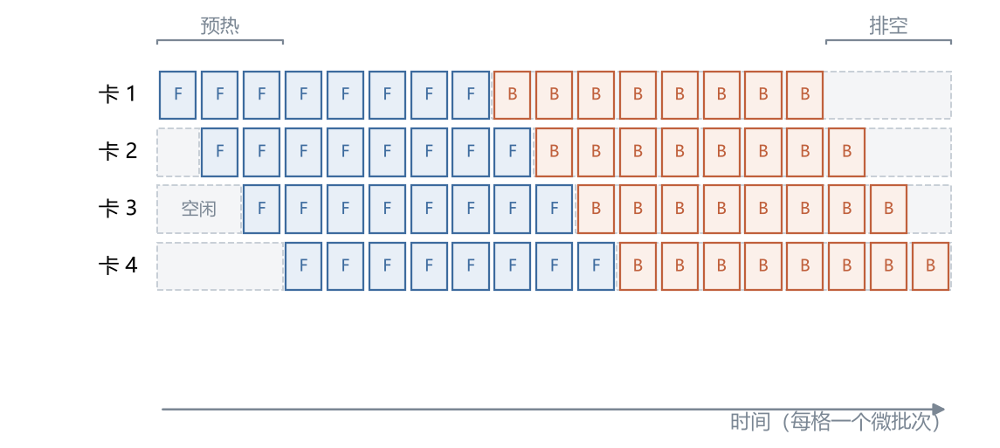

# 第 7 章　把模型切开：张量并行与流水并行

有人第一次尝试把 1750 亿参数的模型分到多张卡上，用的办法很自然，前四十层放卡 1，中间四十层放卡 2，后十六层放卡 3。代码改完跑起来，速度比单卡还慢。原因不难猜，卡 1 算的时候卡 2 和卡 3 在等，卡 2 算的时候另外两张在等，三张卡的有效利用率只有三分之一。这个失败说明了切模型的第一条原则，切得开不等于跑得快，关键看切完之后有多少张卡能同时干活。

## 7.1　为什么不能简单地按层切

按层切的诱惑在于它几乎不需要写代码。层与层之间本来就靠激活值传递，把某些层搬到另一张卡，只在边界上加一次发送和接收，剩下的逻辑一行不改。

问题出在并行度上。GPT-3 有 96 层，Llama 3 405B 有 126 层，层数是个两位数。而集群有几千上万张卡。就算一层一张卡，也只用到 96 张，按 1024 张卡算，剩下九百多张没地方放。想在 1024 张卡上做 1750 亿参数，平均每张卡只能分到不到十分之一层，也就是说必须把一层本身切开。

还有第二个问题，就算层数够分，按层切也不省时间。模型的计算是一条链，第 40 层的输入必须等第 39 层算完。链式依赖意味着任意时刻只有一张卡在真正计算，其他卡都在等消息。加卡不会让这条链变短，只会让等待的队伍变长。这种切法唯一的作用是装下放不下的模型，代价是把并行度全部丢掉。

所以要把模型切到几千张卡上，得同时做两件事。一件是把一层内部的计算分给多张卡同时做，这叫张量并行；另一件是让不同层的卡在同一时刻处理不同批次的数据，把链式依赖变成流水线，这叫流水并行。前者解决“一层太大”，后者解决“层数太少”。

两种切法的代价完全不同。张量并行把一次矩阵乘拆成几份，每份算完要凑到一起，所以通信频繁、量大，而且卡在关键路径上。流水并行只在层的边界上传一次激活值，通信量小得多，代价是流水线填充和排空时有一段空闲。理解了这两种代价的形状，才能理解为什么真实配置总是一台机器内做张量并行、机器之间做流水并行。

## 7.2　列并行与行并行

先看一层里到底有什么可以切。前馈网络是两个矩阵相乘，输入先乘一个宽矩阵，过激活函数，再乘一个窄矩阵。写成式子就是输入乘以 A 得到中间结果，激活之后乘以 B 得到输出。A 的形状是隐藏维度乘四倍隐藏维度，B 是四倍隐藏维度乘隐藏维度。1750 亿参数的模型隐藏维度是 12288，A 有 6 亿个元素，按 BF16 存是 1.2 GB，单看这一块是放得下的。真正放不下的是它配套的梯度、优化器状态和激活值，以及注意力那边的几个投影矩阵叠起来。

切法有两种，名字很直白。列并行是按列切 A，每张卡拿一半的列，算出来的中间结果也就只有一半的输出通道。这一步完全不需要通信，因为每个输出通道只依赖自己那一列权重。行并行是按行切 B，每张卡拿一半的行，算出来的是一半的乘积，需要把两张卡的结果加起来才对。

关键在于把两者接起来。列并行之后每张卡手上有中间结果的一半，激活函数是逐元素运算，可以在本地做完，再拿去做行并行的乘法。这样一路下来，整个前馈网络只需要在最后做一次加法，也就是一次 all-reduce。图 7-1 画的正是这个结构，输入 X 分成两路，各走一遍列并行的 A、激活、行并行的 B，最后按元素相加得到 Y。

*图 7-1　张量并行把一层里的两个矩阵分别切开*

如果反过来，先按行切 A，每张卡算出来的部分和要先加起来才能过激活函数，那就得在激活之前做一次归约；再按列切 B，输出又要拼一次。同样是一层，通信变成了两次。所以切分的顺序不是随便定的，列在前、行在后，一次归约就能收尾。

这种切法还有个附带的好处，权重被分到了每张卡上，每卡只存八分之一。这意味着 1750 亿参数的模型，做 8 路张量并行之后，每张卡只背 220 亿参数的权重和优化器状态，显存压力立刻下来了。显存省下来，才能把 batch 做大、把激活值留住。所以张量并行不只是为了算得快，它同时也是第一种真正省显存的切法，只是这个作用常被它的通信代价盖过去。

注意力部分用的是同一套思路。查询、键、值的投影矩阵按列切，每张卡负责一部分注意力头，头与头之间本来就没有交互，可以各算各的。输出投影按行切，算完再归约一次。这就是为什么张量并行常被说成“按头切”，一个 32 头的模型做 8 路张量并行，每张卡分到 4 个头。

归约的次数还有一个容易搞错的地方。前向一次，反向还要一次。反向时梯度从上层传下来，行并行的矩阵要把它按列分回去，这一步是归约；列并行的矩阵算完权重梯度后，输入梯度要按行拼回去，这一步是另一个归约。合起来，每一层在前向和反向各做一次 all-reduce，一共两次。

## 7.3　张量并行的通信代价

张量并行的通信量有一个很好的性质，它等于激活值的大小，跟参数量无关。

一次归约传的是这一层的输出激活值，字节数是 token 数乘以隐藏维度再乘以 2。每卡每步 8192 个 token、隐藏维度 12288，算下来每次 201 MB。96 层，前向反向各一次，就是 192 次归约，每张卡每步要发出去 38 GB 左右的激活值。

这个数字放在两种链路上差别巨大。走 NVLink，H100 是 900 GB/s，H800 是 400 GB/s，38 GB 只要零点一秒，几乎可以忽略。走 400 Gb/s 的网卡，50 GB/s，38 GB 要 0.8 秒。看起来也不算多，但这里有个致命区别，张量并行的归约在关键路径上。

梯度归约可以藏，因为反向还在算别的层，网络和计算能并行。张量并行的归约藏不了。第 40 层的输出必须先归约完，第 41 层才能开始算，中间没有任何别的工作可以填补。所以这 0.8 秒是实打实加在每一步上的，而且是一层一层加的，192 次同步，每次都要等最慢的那张卡。

更麻烦的是规模效应。张量并行的度数越高，每张卡分到的计算越少，而归约的字节数基本不变，因为激活值的形状由 token 数和隐藏维度决定，跟切几份无关。切 8 份，单卡的计算量掉到八分之一，通信量还是那么多，通信与计算的比例就翻了八倍。这就是为什么张量并行通常不超过 8 路。

8 这个数字不是巧合，它正好是一台服务器里的 GPU 数。NVLink 把 8 张卡连成一个高带宽域，域内带宽 400 到 900 GB/s，域外只有 50 GB/s，差了一个数量级。张量并行要放在域内，是因为它最频繁、对延迟最敏感、又完全无法重叠。跨出这台机器，同样一份流量要走交换机和光模块，还要和别人的流量抢带宽，192 次同步里只要有一次堵住，整步就慢下来。

还有一个不太显眼的开销来自重复计算。LayerNorm、dropout、残差这些逐元素操作，在标准张量并行里每张卡都完整地做一遍，做完之后大家的激活值是一模一样的冗余副本。有的实现把这些操作也按 token 切开来做，每张卡只处理一段 token，算完再换回来，代价是多一次 all-gather。这种做法的收益在层数多、隐藏维度大的模型上能到几个百分点，代价是又增加了一类集合通信，调试起来更麻烦。

有一类例外值得提一句。有的系统把 NVLink 域做到了 72 张卡，张量并行的度数就可以往上走，但原理没变，仍然是“把最频繁的通信关在最大的高带宽域里”。域有多大，张量并行就能开多大。

## 7.4　流水并行：把层分给不同卡

张量并行解决了“一层放不下”，但它带来的通信太贵，度数上不去。要让几千张卡都有活干，还得回到层这个粒度，把层分给不同的卡，同时让它们别闲着。

做法是把模型按层切成若干段，每段放在一组卡上。126 层切成 16 段，每段 8 层左右。数据从第一段进去，一层层往下走，走到最后一段出 loss。这就是流水并行。

朴素实现就是开头那个失败的例子，同一时刻只有一段在算。GPipe 想出的办法是把一个 batch 切成若干个微批次，让它们像工件一样排队流过流水线。

具体走一遍。第一个微批次进入第一段，第一段开始算。算完之后激活值传给第二段，第一段立刻开始算第二个微批次，此时第二段在算第一个，两段同时忙。等到流水线填满，每一段手上都有一个微批次，整条线满负荷运转。等最后一个微批次进入第一段，前面已经没有新工件了，第一段开始空转，这就是排空。

图 7-2 是一张时空图，横轴是时间，纵轴是四段流水线，每个小格是一个微批次的一次前向。开头几格是斜的，一段一段填进去，中间是整齐的阶梯，最后几格又斜着收尾。

*图 7-2　流水并行的时空图与气泡*

流水并行的通信量和张量并行不是一个量级。每个微批次只在段的边界上传一次激活值，8192 个 token 的激活值按微批次摊薄之后，一次也就几 MB 到几十 MB，而且这些流量可以走网卡、可以跨机架，因为它不像张量并行那样每层都要同步。段数越多，边界越多，但每个边界的字节数反而越少，因为微批次变小了。

代价转到显存上。为了让流水线填满，同时在飞的微批次有好几个，每个都要留着激活值等反向用，显存占用随微批次数量线性上升。这是流水并行最尴尬的地方，你为了填满流水线而增加微批次，结果显存不够了，只能减少微批次，流水线又填不满。

所以微批次的数量有个下限，至少要等于段数，否则流水线根本填不满，后面几段会一直空着。全局 batch 太小的时候，切不出足够多的微批次，只能减少段数。这就是为什么小模型做流水并行往往不划算，它的 batch 撑不起那么多段。

工程上的解法有两种，方向都是减少同时在飞的微批次。一种是 1F1B 调度，每段在稳态时做一次前向接一次反向，手里只留一个待反向的微批次，在飞数量从 m 降到和段数相当。另一种叫交错调度，让每段不持有一段连续的层，而是持有两段，算完一个微批次的前向就去算另一个微批次的反向，交替进行。后者把气泡又压小一截，代价是段边界的通信次数翻倍。

## 7.5　气泡从哪来

流水线里那段没人干活的时间，叫气泡。

气泡的大小可以算出来。假设流水线有 p 段，一个 batch 切成 m 个微批次。总用时是 m 加 p 减 1 个时间格，从第一段喂进第一个微批次算起，到最后一段吐出最后一个微批次结束。这段时间里每段真正干活只有 m 格，剩下 p-1 格在等前面的结果，或者在等后面的反向。所以气泡占比是 (p-1)/(m+p-1)。

代几个数进去。16 段流水线配 32 个微批次，气泡是 15 除以 47，差不多三成。同样的 16 段配 64 个微批次，气泡降到 19%。如果只切 8 段，微批次 32 个，气泡是 7 除以 39，不到两成。

由此能看出两条规律。加微批次能压气泡，但压不掉，因为分子的 p-1 是固定的；减段数也能压气泡，但段数少了，能容纳的卡就少。气泡是流水并行的结构性成本，只能稀释，不能消除。

实际配置里，各段分到的层数往往不一样。第一段要处理输入嵌入，最后一段要算词表投影和 loss，这两头的显存和计算都和前几段不同，平铺会让某一段先爆显存。所以常见做法是把靠近输入输出的段切得薄一些，中间段厚一些。这种不均匀让气泡的计算稍微复杂，但换来的显存余量是实打实的。

用 16 段、32 个微批次这一档算一笔账。32 个微批次意味着每卡的 batch 被切得很碎，如果每卡每步 8192 个 token，一个微批次只剩 256 个。矩阵乘的 M 维只有 256，Tensor Core 的效率就掉下来了，这是气泡之外的另一重损失，藏在 MFU 里，不容易单独看出来。

怎么选这两个参数，背后是一张取舍表。段数 p 决定了能放进多少张卡，也决定了每段要装多少层，而每段的层数直接对应显存里的权重和优化器状态。微批次数 m 决定了气泡大小，也决定了同时在飞的激活值有多少。想扩到更多卡，只能加 p；加了 p 气泡就变大，只能加 m 去压；加了 m 显存又吃紧。这三个约束互相顶着，实际配置往往是在显存刚好够用的边界上反复试出来的。

气泡虽然是浪费，换来的东西很值。通信量小、可以跨节点、可以扩展到几千张卡，这三点是张量并行给不了的。所以真实系统里两者是搭配用的，一台机器内 8 路张量并行，机器之间做流水并行。前者解决单层放不下，后者解决层数不够分。

也有人想办法把气泡填上。一种思路是在气泡期间做下一批的通信，把梯度同步提前或者延后，让网络别闲着。另一种思路是把反向拆成两半，先算输入梯度，再算权重梯度，权重梯度那一半不依赖前一层的反向结果，可以塞进气泡里。后者在论文里报告过，同样显存下吞吐能比 1F1B 高出两成多。这些都是很细的活，收益是几个百分点到二十几个百分点，前提是先把流水线的段数、微批次数和显存配平。

回到开头那个失败的尝试。它错在只切了层，没切微批次，也没在层内部做并行。补上微批次，三张卡能同时忙起来，但流水线只有三段，气泡四成上下，而且每段要放三四十层，显存依然放不下。所以真正的配置不是二选一，而是张量并行切一层、流水并行切层间、数据并行复制整份模型，三个维度一起用。这套组合怎么摆，是后面两章的事。
