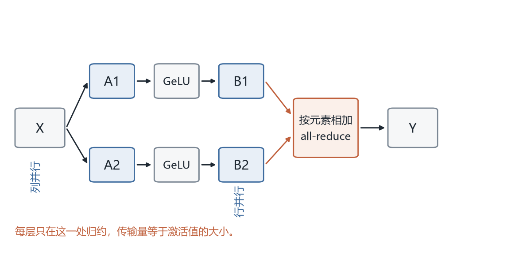

# 第 7 章　把模型切开：张量并行与流水并行

有人第一次尝试把 1750 亿参数的模型分到多张卡上，用的办法很自然，前四十层放卡 1，中间四十层放卡 2，后十六层放卡 3。代码改完跑起来，速度比单卡还慢。原因不难猜，卡 1 算的时候卡 2 和卡 3 在等，卡 2 算的时候另外两张在等，三张卡的有效利用率只有三分之一。这个失败说明了切模型的第一条原则，切得开不等于跑得快，关键看切完之后有多少张卡能同时干活。

## 7.1　为什么不能简单地按层切

按层切的诱惑在于它几乎不需要写代码。层与层之间本来就靠激活值传递，把某些层搬到另一张卡，只在边界上加一次发送和接收，剩下的逻辑一行不改。

问题出在并行度上。GPT-3 有 96 层，Llama 3 405B 有 126 层，层数是个两位数。而集群有几千上万张卡。就算一层一张卡，也只用到 96 张，按 1024 张卡算，剩下九百多张没地方放。想在 1024 张卡上做 1750 亿参数，平均每张卡只能分到不到十分之一层，也就是说必须把一层本身切开。

还有第二个问题，就算层数够分，按层切也不省时间。模型的计算是一条链，第 40 层的输入必须等第 39 层算完。链式依赖意味着任意时刻只有一张卡在真正计算，其他卡都在等消息。加卡不会让这条链变短，只会让等待的队伍变长。这种切法唯一的作用是装下放不下的模型，代价是把并行度全部丢掉。

所以要把模型切到几千张卡上，得同时做两件事。一件是把一层内部的计算分给多张卡同时做，这叫张量并行；另一件是让不同层的卡在同一时刻处理不同批次的数据，把链式依赖变成流水线，这叫流水并行。前者解决“一层太大”，后者解决“层数太少”。

两种切法的代价完全不同。张量并行把一次矩阵乘拆成几份，每份算完要凑到一起，所以通信频繁、量大，而且卡在关键路径上。流水并行只在层的边界上传一次激活值，通信量小得多，代价是流水线填充和排空时有一段空闲。理解了这两种代价的形状，才能理解为什么真实配置总是一台机器内做张量并行、机器之间做流水并行。

## 7.2　列并行与行并行

先看一层里到底有什么可以切。前馈网络是两个矩阵相乘，输入先乘一个宽矩阵，过激活函数，再乘一个窄矩阵。写成式子就是输入乘以 A 得到中间结果，激活之后乘以 B 得到输出。A 的形状是隐藏维度乘四倍隐藏维度，B 是四倍隐藏维度乘隐藏维度。1750 亿参数的模型隐藏维度是 12288，A 有 6 亿个元素，按 BF16 存是 1.2 GB，单看这一块是放得下的。真正放不下的是它配套的梯度、优化器状态和激活值，以及注意力那边的几个投影矩阵叠起来。

切法有两种，名字很直白。列并行是按列切 A，每张卡拿一半的列，算出来的中间结果也就只有一半的输出通道。这一步完全不需要通信，因为每个输出通道只依赖自己那一列权重。行并行是按行切 B，每张卡拿一半的行，算出来的是一半的乘积，需要把两张卡的结果加起来才对。

关键在于把两者接起来。列并行之后每张卡手上有中间结果的一半，激活函数是逐元素运算，可以在本地做完，再拿去做行并行的乘法。这样一路下来，整个前馈网络只需要在最后做一次加法，也就是一次 all-reduce。图 7-1 画的正是这个结构，输入 X 分成两路，各走一遍列并行的 A、激活、行并行的 B，最后按元素相加得到 Y。

*图 7-1　张量并行把一层里的两个矩阵分别切开*

如果反过来，先按行切 A，每张卡算出来的部分和要先加起来才能过激活函数，那就得在激活之前做一次归约；再按列切 B，输出又要拼一次。同样是一层，通信变成了两次。所以切分的顺序不是随便定的，列在前、行在后，一次归约就能收尾。

这种切法还有个附带的好处，权重被分到了每张卡上，每卡只存八分之一。这意味着 1750 亿参数的模型，做 8 路张量并行之后，每张卡只背 220 亿参数的权重和优化器状态，显存压力立刻下来了。显存省下来，才能把 batch 做大、把激活值留住。所以张量并行不只是为了算得快，它同时也是第一种真正省显存的切法，只是这个作用常被它的通信代价盖过去。

注意力部分用的是同一套思路。查询、键、值的投影矩阵按列切，每张卡负责一部分注意力头，头与头之间本来就没有交互，可以各算各的。输出投影按行切，算完再归约一次。这就是为什么张量并行常被说成“按头切”，一个 32 头的模型做 8 路张量并行，每张卡分到 4 个头。

归约的次数还有一个容易搞错的地方。前向一次，反向还要一次。反向时梯度从上层传下来，行并行的矩阵要把它按列分回去，这一步是归约；列并行的矩阵算完权重梯度后，输入梯度要按行拼回去，这一步是另一个归约。合起来，每一层在前向和反向各做一次 all-reduce，一共两次。

## 7.3　张量并行的通信代价

张量并行的通信量有一个很好的性质，它等于激活值的大小，跟参数量无关。

一次归约传的是这一层的输出激活值，字节数是 token 数乘以隐藏维度再乘以 2。每卡每步 8192 个 token、隐藏维度 12288，算下来每次 201 MB。96 层，前向反向各一次，就是 192 次归约，每张卡每步要发出去 38 GB 左右的激活值。

这个数字放在两种链路上差别巨大。走 NVLink，H100 是 900 GB/s，H800 是 400 GB/s，38 GB 只要零点一秒，几乎可以忽略。走 400 Gb/s 的网卡，50 GB/s，38 GB 要 0.8 秒。看起来也不算多，但这里有个致命区别，张量并行的归约在关键路径上。

梯度归约可以藏，因为反向还在算别的层，网络和计算能并行。张量并行的归约藏不了。第 40 层的输出必须先归约完，第 41 层才能开始算，中间没有任何别的工作可以填补。所以这 0.8 秒是实打实加在每一步上的，而且是一层一层加的，192 次同步，每次都要等最慢的那张卡。

更麻烦的是规模效应。张量并行的度数越高，每张卡分到的计算越少，而归约的字节数基本不变，因为激活值的形状由 token 数和隐藏维度决定，跟切几份无关。切 8 份，单卡的计算量掉到八分之一，通信量还是那么多，通信与计算的比例就翻了八倍。这就是为什么张量并行通常不超过 8 路。

8 这个数字不是巧合，它正好是一台服务器里的 GPU 数。NVLink 把 8 张卡连成一个高带宽域，域内带宽 400 到 900 GB/s，域外只有 50 GB/s，差了一个数量级。张量并行要放在域内，是因为它最频繁、对延迟最敏感、又完全无法重叠。跨出这台机器，同样一份流量要走交换机和光模块，还要和别人的流量抢带宽，192 次同步里只要有一次堵住，整步就慢下来。

还有一个不太显眼的开销来自重复计算。LayerNorm、dropout、残差这些逐元素操作，在标准张量并行里每张卡都完整地做一遍，做完之后大家的激活值是一模一样的冗余副本。有的实现把这些操作也按 token 切开来做，每张卡只处理一段 token，算完再换回来，代价是多一次 all-gather。这种做法的收益在层数多、隐藏维度大的模型上能到几个百分点，代价是又增加了一类集合通信，调试起来更麻烦。

有一类例外值得提一句。有的系统把 NVLink 域做到了 72 张卡，张量并行的度数就可以往上走，但原理没变，仍然是“把最频繁的通信关在最大的高带宽域里”。域有多大，张量并行就能开多大。

## 7.4　流水并行：把层分给不同卡

张量并行解决了“一层放不下”，但它带来的通信太贵，度数上不去。要让几千张卡都有活干，还得回到层这个粒度，把层分给不同的卡，同时让它们别闲着。

做法是把模型按层切成若干段，每段放在一组卡上。126 层切成 16 段，每段 8 层左右。数据从第一段进去，一层层往下走，走到最后一段出 loss。这就是流水并行。

朴素实现就是开头那个失败的例子，同一时刻只有一段在算。GPipe 想出的办法是把一个 batch 切成若干个微批次，让它们像工件一样排队流过流水线。

具体走一遍。第一个微批次进入第一段，第一段开始算。算完之后激活值传给第二段，第一段立刻开始算第二个微批次，此时第二段在算第一个，两段同时忙。等到流水线填满，每一段手上都有一个微批次，整条线满负荷运转。等最后一个微批次进入第一段，前面已经没有新工件了，第一段开始空转，这就是排空。

图 7-2 是一张时空图，横轴是时间，纵轴是四段流水线，每个小格是一个微批次的一次前向。开头几格是斜的，一段一段填进去，中间是整齐的阶梯，最后几格又斜着收尾。

*图 7-2　流水并行的时空图与气泡*

流水并行的通信量和张量并行不是一个量级。每个微批次只在段的边界上传一次激活值，8192 个 token 的激活值按微批次摊薄之后，一次也就几 MB 到几十 MB，而且这些流量可以走网卡、可以跨机架，因为它不像张量并行那样每层都要同步。段数越多，边界越多，但每个边界的字节数反而越少，因为微批次变小了。

代价转到显存上。为了让流水线填满，同时在飞的微批次有好几个，每个都要留着激活值等反向用，显存占用随微批次数量线性上升。这是流水并行最尴尬的地方，你为了填满流水线而增加微批次，结果显存不够了，只能减少微批次，流水线又填不满。

所以微批次的数量有个下限，至少要等于段数，否则流水线根本填不满，后面几段会一直空着。全局 batch 太小的时候，切不出足够多的微批次，只能减少段数。这就是为什么小模型做流水并行往往不划算，它的 batch 撑不起那么多段。

工程上的解法有两种，方向都是减少同时在飞的微批次。一种是 1F1B 调度，每段在稳态时做一次前向接一次反向，手里只留一个待反向的微批次，在飞数量从 m 降到和段数相当。另一种叫交错调度，让每段不持有一段连续的层，而是持有两段，算完一个微批次的前向就去算另一个微批次的反向，交替进行。后者把气泡又压小一截，代价是段边界的通信次数翻倍。

## 7.5　气泡从哪来

流水线里那段没人干活的时间，叫气泡。

气泡的大小可以算出来。假设流水线有 p 段，一个 batch 切成 m 个微批次。总用时是 m 加 p 减 1 个时间格，从第一段喂进第一个微批次算起，到最后一段吐出最后一个微批次结束。这段时间里每段真正干活只有 m 格，剩下 p-1 格在等前面的结果，或者在等后面的反向。所以气泡占比是 (p-1)/(m+p-1)。

代几个数进去。16 段流水线配 32 个微批次，气泡是 15 除以 47，差不多三成。同样的 16 段配 64 个微批次，气泡降到 19%。如果只切 8 段，微批次 32 个，气泡是 7 除以 39，不到两成。

由此能看出两条规律。加微批次能压气泡，但压不掉，因为分子的 p-1 是固定的；减段数也能压气泡，但段数少了，能容纳的卡就少。气泡是流水并行的结构性成本，只能稀释，不能消除。

实际配置里，各段分到的层数往往不一样。第一段要处理输入嵌入，最后一段要算词表投影和 loss，这两头的显存和计算都和前几段不同，平铺会让某一段先爆显存。所以常见做法是把靠近输入输出的段切得薄一些，中间段厚一些。这种不均匀让气泡的计算稍微复杂，但换来的显存余量是实打实的。

用 16 段、32 个微批次这一档算一笔账。32 个微批次意味着每卡的 batch 被切得很碎，如果每卡每步 8192 个 token，一个微批次只剩 256 个。矩阵乘的 M 维只有 256，Tensor Core 的效率就掉下来了，这是气泡之外的另一重损失，藏在 MFU 里，不容易单独看出来。

怎么选这两个参数，背后是一张取舍表。段数 p 决定了能放进多少张卡，也决定了每段要装多少层，而每段的层数直接对应显存里的权重和优化器状态。微批次数 m 决定了气泡大小，也决定了同时在飞的激活值有多少。想扩到更多卡，只能加 p；加了 p 气泡就变大，只能加 m 去压；加了 m 显存又吃紧。这三个约束互相顶着，实际配置往往是在显存刚好够用的边界上反复试出来的。

气泡虽然是浪费，换来的东西很值。通信量小、可以跨节点、可以扩展到几千张卡，这三点是张量并行给不了的。所以真实系统里两者是搭配用的，一台机器内 8 路张量并行，机器之间做流水并行。前者解决单层放不下，后者解决层数不够分。

也有人想办法把气泡填上。一种思路是在气泡期间做下一批的通信，把梯度同步提前或者延后，让网络别闲着。另一种思路是把反向拆成两半，先算输入梯度，再算权重梯度，权重梯度那一半不依赖前一层的反向结果，可以塞进气泡里。后者在论文里报告过，同样显存下吞吐能比 1F1B 高出两成多。这些都是很细的活，收益是几个百分点到二十几个百分点，前提是先把流水线的段数、微批次数和显存配平。

回到开头那个失败的尝试。它错在只切了层，没切微批次，也没在层内部做并行。补上微批次，三张卡能同时忙起来，但流水线只有三段，气泡四成上下，而且每段要放三四十层，显存依然放不下。所以真正的配置不是二选一，而是张量并行切一层、流水并行切层间、数据并行复制整份模型，三个维度一起用。这套组合怎么摆，是后面两章的事。
## 7.6　一层之内的账

上一节留下了三个参数，段数、微批次数、每卡 batch。要定这三个数，得先把一层之内的时间算清楚，因为张量并行还能不能往上开，答案全在这笔账里。

先算一层要算多久。1750 亿参数、96 层，平均每层 18 亿参数。每参数每 token 六次浮点运算，每卡每步 8192 个 token，一层是 $6\times1.8\times10^{9}\times8192$，约 $8.9\times10^{13}$ 次运算。有效算力按 400 TFLOPS 算，一层 224 毫秒，96 层累起来 21.5 秒，和第 6 章那笔 21.7 秒对得上，说明这个粗算的误差不影响结论。

再算一层要传多少。层间的激活值是 8192 个 token 乘 12288 维再乘 2 字节，201 MB。一次归约就是把这 201 MB 在组内过一遍。这个字节数只跟 token 数和隐藏维度有关，跟切几份无关，是张量并行最容易搞错的一处。

把两者摆在一起，度数从 1 翻到 32，规律很干净。

| 张量并行度 | 每卡每层运算量 | 计算时间 | 归约时间（NVLink 400 GB/s） | 通信占计算 |
| --- | --- | --- | --- | --- |
| 1 | $8.9\times10^{13}$ | 224 ms | 不需要 | — |
| 2 | $4.5\times10^{13}$ | 112 ms | 0.5 ms | 0.4% |
| 4 | $2.2\times10^{13}$ | 56 ms | 0.5 ms | 0.9% |
| 8 | $1.1\times10^{13}$ | 28 ms | 0.5 ms | 1.8% |
| 16 | $5.6\times10^{12}$ | 14 ms | 0.5 ms | 3.6% |
| 32 | $2.8\times10^{12}$ | 7 ms | 0.5 ms | 7.1% |

这张表的算法和 7.3 一致，都把一次归约记成每卡过一次完整的激活值。它偏保守，真实的 ring 实现会把字节按度数摊到各条链路上，但同步的次数和每次同步的延迟下限不会因此变小，所以趋势是准的，绝对值偏大一点。

表里能读出两件事。度数翻倍，每卡的计算量减半，归约的字节不动，通信占计算的比例就跟着翻倍。8 路时是 1.8%，还可以当噪声忽略；32 路时是 7.1%，已经够把 MFU 拉下去一截。另一件事是这张表只算到 32，再往下算，每张卡分到的矩阵窄得没有意义，算力根本达不到 400 TFLOPS。

换成一整步来看更直观。96 层，前向反向各一次归约，一共 192 次同步。8 路时每次 0.5 毫秒，加起来 96 毫秒，每卡每步的计算是 96 层乘三次传递再乘 28 毫秒，两秒七；通信占 3.6%，比按单次前向算的 1.8% 高出一倍，因为反向的两次归约夹在更短的计算之间。同一份 201 MB 换到 50 GB/s 的网卡上，每次 4 毫秒，192 次是 0.77 秒，占两秒七的近三成。到这一步还没崩，但已经不能说能忍了。

真正崩掉是在度数继续往上走之后。16 路时每卡每层只算 14 毫秒，归约走网卡要 4 毫秒，通信占计算接近三成；一整步算下来，计算 1.34 秒，通信 0.77 秒，通信比计算的一半还多。这就是张量并行不能出机器的算术原因，不是网卡"慢一点"，是每层的计算被切薄之后，那份不动的 201 MB 占的分量成倍变重。

还有第三个原因，藏在延迟而不是带宽里。0.5 毫秒是拿带宽除出来的下界，一次归约实际还有一段固定开销，kernel 启动、握手、等最慢的那张卡，加起来十几到几十微秒。192 次乘下来是几毫秒，单独看不值一提。麻烦的是它的结构，每一次都要求全组同时到位。8 张卡里有一张慢了 5%，这 5% 不是摊到一整步的 5%，而是塞进每一次同步里，叠 192 遍。

第四个原因在矩阵形状。8 路时每卡分到的是 12288 乘 1536 的矩阵，32 路时只剩 12288 乘 384。N 维掉下来，数据的复用次数跟着掉，访存占比上升，同一块 Tensor Core 跑出来的有效算力比表里的 400 TFLOPS 低。所以表的后两行是乐观值，实际比它更差，这也是为什么现场测出来的张量并行扩展曲线总在 8 路之后明显变平。

换一个模型算同一笔账，结论会变，方向很清楚。通信量正比于 hidden，计算量正比于 hidden 的平方，所以通信占计算的比例大致反比于 hidden。一个 700 亿参数、80 层、hidden 8192 的模型，每层 8.75 亿参数，一层是 $6\times8.75\times10^{8}\times8192$，$4.3\times10^{13}$ 次运算，8 路下每卡 13.5 毫秒；激活值 8192 乘 8192 乘 2 字节，134 MB，走 400 GB/s 是 0.34 毫秒，占比 2.5%。看起来比 1750 亿参数那台还高一点，因为 hidden 从 12288 掉到 8192，计算量掉得比通信快。

把这条规律推到窄模型上就更明显了。hidden 12288 是 1.8%，hidden 4096 就是 5.4% 上下，hidden 2048 要过一成。这解释了一个常见现象，几十亿参数的模型几乎没人开 8 路张量并行，开 2 路、4 路或者干脆纯数据并行更划算。张量并行是给宽模型准备的工具，窄模型用它只会把通信占比放大。

表里的计算时间还依赖一个假设，就是 400 TFLOPS 这个有效算力。现场 MFU 只有三成的时候，同样一层的计算时间从 28 毫秒涨到 37 毫秒，通信占比从 1.8% 掉到 1.4%。这个方向有点反直觉，算得越慢，通信显得越便宜，但没人会因为想让通信占比好看而去降 MFU。真正该记的是另一面，把 MFU 往上推的时候，通信那一份不会跟着缩小，它在每层时间里的份额会同步变大。

四个原因合起来，8 这个上限就解释清楚了。一台机器 8 张 GPU 被 NVLink 连成一个高带宽域，域内 400 到 900 GB/s，跨域只有 50 GB/s。域内的 8 路，通信占计算不到两个百分点；跨域的 8 路，同样的字节要多花八倍时间，占比直接跳到一成四，而且这 0.77 秒是硬加在关键路径上的，一层都藏不住。

有的系统把域做到了 72 张卡，张量并行理论上可以开到 72。按同一套算术估算，72 路时每卡每层只剩 3 毫秒计算，域内归约 0.22 毫秒，占比回到百分之七。域变大换来的只是带宽，占比随度数上升的趋势没变，只是把那条曲线往右推了一截。这才是"域有多大，张量并行就能开多大"的准确含义，它不是一条物理定律，是一笔带宽账。

## 7.7　三个参数怎么定

定参数的顺序和直觉相反。先由显存定段数，再由气泡定微批次数，最后由这两个数反推每卡 batch。

段数由每张卡能匀出多少显存决定。4050 亿参数的训练状态是 6480 GB，张量并行乘流水并行是 128，每卡 50.6 GB，80 GB 的卡上还剩 29 GB。这 29 GB 要装激活值、通信缓冲区和碎片，能匀给激活值的不到 25 GB。

激活值这笔账和权重不是一回事，它跟着在飞的 token 数走，不跟模型大小直接挂钩。开了激活重算之后，每层每个 token 只需要留一份 hidden 向量等着反向重算，hidden 16384、BF16 就是 32 KB。126 层乘起来，一个在飞的 token 占 4 MB 左右。25 GB 除以 4 MB，能同时留住六千个 token 上下。

六千个 token 要在 16 段流水线上分配，每段手上同时拿着 16 个微批次，每个微批次就是 384 个 token。取整到 256，激活值占 16 GB，剩下的留给通信缓冲区和显存碎片，勉强够。这个数很反直觉，一个全局 batch 到百万 token 的训练，单个微批次只有两百多个 token，矩阵乘的 M 维窄得可怜。但它就是 4050 亿参数在 80 GB 卡上的现实。

段与段之间还不会一样厚。最后一段要算词表投影，词表按十几万、hidden 16384 估算，一个投影矩阵就是二十亿参数上下，抵得上大半个 transformer 层；第一段要放输入嵌入，也是同一量级的矩阵。这两块如果和普通层一起平摊，靠近两端的段会先爆显存。所以 126 层分 16 段时，中间的段放 9 到 10 层，两端各放 6 到 7 层，用不均匀换显存余量。代价是气泡公式不再严格成立，最厚的那一段决定整条线的节奏，p 得按"有效段数"来估。

微批次数 m 和每微批次 token 数是两个不同的东西，容易混。每卡每步的 token 是 $M\times m$，而同时在飞的微批次数量在 1F1B 调度下约等于段数 p，跟 m 关系不大。这一点和第 7.4 节的直觉不同，那里说"微批次越多显存越紧"，说的是 GPipe 那种先跑完全部前向再统一反向的调度，在飞数量等于 m，显存确实随 m 线性涨。换成 1F1B，在飞数量从 m 降到 p，激活显存就跟 m 脱钩了。

由此得到一个容易被误用的结论，加段数不省激活显存。稳态下每卡的在飞 token 是 $p\times M$，而 p 段平摊 126 层、每段 126/p 层，乘起来是 $126\times M$，p 被约掉了。切 8 段和切 32 段，激活值一样多，变的只有每卡的权重和优化器状态。想省激活，只能减 M、减在飞 token，或者把重算的粒度做细。

m 由气泡决定。气泡占比是 $(p-1)/(m+p-1)$，把常见组合铺开看一圈。

| 段数 p | m=8 | m=16 | m=32 | m=64 | m=128 |
| --- | --- | --- | --- | --- | --- |
| 4 | 27.3% | 15.8% | 8.6% | 4.5% | 2.3% |
| 8 | 46.7% | 30.4% | 17.9% | 9.9% | 5.2% |
| 16 | 65.2% | 48.4% | 31.9% | 19.0% | 10.5% |
| 32 | 79.5% | 66.0% | 49.2% | 32.6% | 19.5% |

表里有三条边界。第一条是 m 至少等于 p，否则流水线根本填不满，表左下角那几格就是这样，m 小于 p 时算出来的气泡没有意义，因为后面的段压根没有微批次可做。第二条是 m 取 p 的整数倍时调度最整齐，每段的前向次数和反向次数完全对称，1F1B 的稳态不会出现某一段多背一个微批次。第三条是压气泡的边际收益递减，16 段从 m=32 加到 m=64，气泡从三成降到一成九，再加到 128 只降到一成，翻倍的微批次换来不到十个点。

按这三条选一遍。16 段想把气泡压到一成以下，需要 $15/(m+15)\le0.1$，也就是 m 至少 135，取整到 144。这时每卡每步的 token 是三万多，128 份副本合起来全局 batch 到四百万 token 量级，学习率、预热步数、数据管道的吞吐全都要跟着改。所以 4050 亿参数这一档，实际配置往往接受两成左右的气泡，用 m=64 换一个能调的 batch，而不是硬把气泡压到一成。

三个参数互相咬住，能动的地方其实不多。M 由显存定，p 由每卡要装的权重定，m 只决定每步把多少个微批次串起来。想加 batch 只能加 m，m 一大，气泡小了但全局 batch 也跟着涨到难调的地步；想让矩阵的 M 维变宽得加 M，那要显存，而显存又被 p 和权重顶住。

段数本身也有天花板。126 层切 64 段，每段只剩两层，段边界的点对点通信次数翻了两番，每次只有几 MB 到几十 MB，延迟占比一下就上来了；同时气泡占比 $≈ p/m$ 变成 64/m，想让气泡维持两成就得把 m 抬到 320。所以段数往上涨，是拿带宽换容量，换到通信起主导作用就得停。

一个具体的失败方式值得记一下。有人发现气泡三成太高，把 m 从 32 加到 128，气泡降到一成，然后发现 step time 只快了百分之十几。原因是气泡之外还有两笔账，一是 warmup 和 cooldown 阶段每段只做前向或只做反向，那段时间的算力利用率本来就低，这部分不随 m 变小；二是 m 变大之后每段的调度更碎，通信次数没变但每次都要等更细的粒度对齐。气泡是流水线的主要成本，不是唯一成本。

真正把气泡压到很低的路子是改调度，不是加参数。交错调度让每段持有不连续的两组层，前向和反向交替，把分母做大一倍。零气泡调度把反向拆成输入梯度和权重梯度两半，把不依赖前一层的那一半塞进气泡，论文报告的数字是同样显存下吞吐高出 23%。这两条路都不用改段数，代价是实现复杂度和显存。

三个参数定完，一层之内和一条流水线之内的账就都算清了。每卡每步的 token 是 M 乘 m，乘上数据并行的副本数才是全局 batch，这个换算在下一章还会再出现一次，因为数据并行那边也在用同一份 batch 预算。剩下的是把三个度数的乘积对到总卡数上，再看每一类流量的通信组落在什么物理位置。
