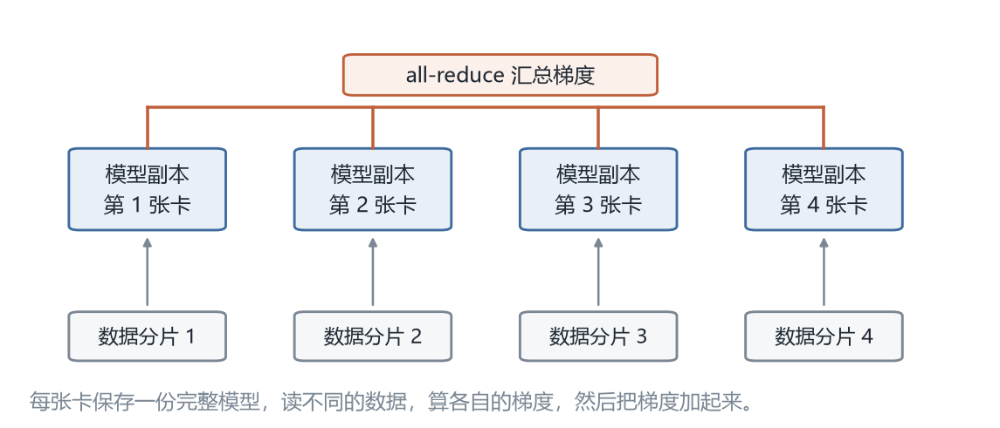
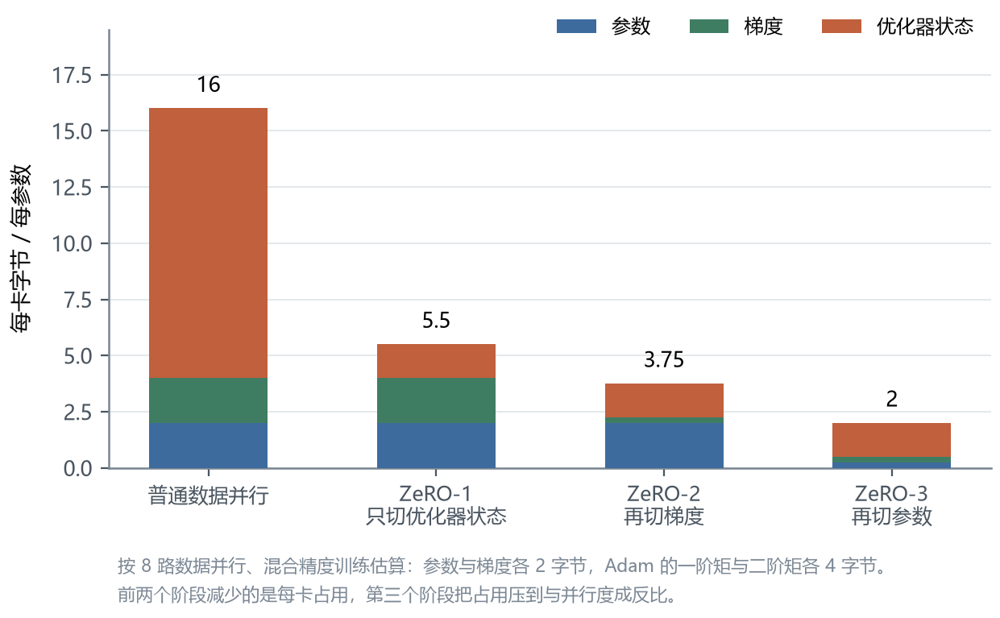

# 第 8 章　把数据分开：数据并行与显存分片

八张卡的机器上跑一个 30 亿参数的模型，最省事的加速办法是把 batch 切成八份，每张卡拿一份，各自算完梯度再一平均。吞吐几乎线性涨了七倍多，代码只加了一个 all-reduce。这个办法用了很多年，直到模型大到单张卡连一份权重都放不下，它才第一次失效。失效的原因很简单，数据并行复制的是整个模型，它从来没有打算帮你省显存。

## 8.1　数据并行：每张卡一份完整模型

数据并行的结构是所有并行方式里最好理解的。每张卡保存一份完整的模型副本，包括权重、梯度、优化器状态。一个全局 batch 被平均切成 N 份，每张卡读自己那一份，独立做完前向和反向，得到一份梯度。然后把 N 份梯度加起来求平均，每张卡用平均后的梯度更新自己的参数。因为起点相同、梯度相同，更新之后 N 份副本依然一模一样。

图 8-1 画的就是这个结构，四个模型副本下面各接一个数据分片，上面用一次 all-reduce 把梯度汇总。

*图 8-1　数据并行与梯度归约*

它在数学上等价于用一个大 batch 训练。只要模型里没有跨样本的统计量，N 份小 batch 的梯度平均就等于一个 N 倍大的 batch 的梯度。所以数据并行不改变优化的语义，只改变吞吐。这一点让它成为最安全的加速手段，调参经验可以直接搬过来，学习率按 batch 放大就行。

代价藏在显存里。每张卡要放一整套训练状态，混合精度下每参数 16 字节，1750 亿参数就是 2800 GB。单卡 80 GB，差了两个数量级。所以数据并行有个前提，模型得先能放进一张卡。放得下的时候它非常好用，几乎线性扩展；放不下的时候它一点忙都帮不上，加多少张卡都只是多复制几份放不下的东西。

这就解释了为什么早期的分布式训练都卡在几十亿参数。那个年代模型能塞进 32 GB，数据并行就够了，工程上只需要一个 all-reduce。等到百亿、千亿参数出现，第一件事不是加卡，而是想办法让一张卡上的东西变少，于是有了张量并行、流水并行，以及这一章后半部分要讲的显存分片。

还有一个容易被忽略的前提，数据管道要能喂饱 N 张卡。八张卡时每步需要读八个分片，一千张卡时每步需要读一千个分片，读的字节数没变，但并发打开的文件、解码的进程、跨网络拉取的压力都涨了 N 倍。很多集群在扩到几百卡之后发现 GPU 利用率上不去，最后查出来是数据加载成了瓶颈，每步开头要等几百毫秒。这种损失不在通信账上，却在 step time 里。

数据并行的度数也不是随便定的。总卡数除以张量并行度、再除以流水并行度，剩下的才是数据并行度。16384 张卡，张量并行 8、流水并行 16，数据并行就是 128。这个 128 决定了梯度要在 128 份副本之间同步，也决定了每份副本能分到多大的 batch。

## 8.2　梯度同步的代价

数据并行的唯一通信动作是梯度归约，代价可以算得很清楚。

梯度有多少字节，前面已经算过，1750 亿参数按 BF16 是 350 GB。ring all-reduce 每张卡的收发量是参数总量的 2(N-1)/N 倍。N 等于 128 的时候这个系数是 1.98，N 等于 1024 的时候是 1.998。

这个系数有个很好的性质，它几乎不随 N 变化。也就是说，从 8 路数据并行扩到 1024 路，每张卡要发的字节数几乎没变，始终是参数量的两倍左右。这正是数据并行能扩展到几千张卡的原因，加卡不会让每个人的通信负担变重，只是把同样的总流量摊到更多链路上。

按 400 Gb/s 的网卡算，700 GB 需要 14 秒。看起来和计算时间差不多，但它是可以藏的。第 6 章讲过梯度分桶，反向算完一层就发一层，这 14 秒被摊进二十二秒的反向里，几乎完全消失。所以数据并行的代价主要不是时间，是带宽占用。网络空着的时候它不花钱，网络紧张的时候它会把别人的流量挤掉。

数据并行对显存的中立性值得再强调一次。不管开 8 路还是 1024 路，每张卡要存的权重、梯度、优化器状态都是完整的一份，激活值也只跟自己那一份 batch 有关。所以加数据并行不会让模型变得能放下，它只是把同样的工作分给更多人做。这个性质决定了它的适用边界很清楚，模型必须已经能装进单卡，否则加多少卡都是在重复一个装不下的失败。

能不能藏住，取决于两件事。一件是每步的计算量够不够大，batch 太小就藏不住；另一件是网络的实际吞吐能不能达到标称值的八九成，跨机架多跳、多条流争抢同一个上行端口，都会让实际时间超过估算。真正跑起来时，如果 step time 比纯计算多出几秒，多半就是归约的尾巴露出来了。

数据并行还有两个副作用，都不在通信账上。一个是 batch 变大带来的收敛问题。1024 路数据并行、每卡 4 条序列，全局 batch 就是 800 多万 token，这么大的 batch 需要精细调整学习率和预热策略，否则前期容易发散。另一个是同步的代价。all-reduce 是全局同步，1024 张卡里最慢的那张决定整圈的节奏，卡越多，出现一张慢卡的概率越高，整步被拖住的机会也越多。

所以在千卡规模上，数据并行的效率损失通常不体现在通信时间上，而体现在尾部的抖动上。一个作业的平均 step time 可能只比理论值高 5%，但方差很大，偶尔冒出几个两倍长的步，最后摊到有效算力上就是十几个百分点的损失。

把这几笔账落到具体数字上，还有一个前提要先说清。真正的字节数要按每卡手上那一片算，这里很容易搞错。把梯度同步的账记成"每卡收发两倍参数量"，只在纯数据并行、每卡存一整套模型的时候才对。混合并行下每卡的梯度已经被张量并行和流水并行切过一遍，归约的字节跟着变小，所以每卡的通信量并不随数据并行度上涨。

拿 4050 亿参数走一遍。梯度按 BF16 是 810 GB。如果每卡存一整套，128 路 ring 上每卡要收发 $2\times(127/128)\times810$，约 1.6 TB，按 50 GB/s 算是 32 秒。这个数字本身就说明了纯数据并行在 4050 亿参数上为什么不成立，一步的计算只要一秒六，梯度同步要三十二秒。

换成张量并行 8、流水并行 16 的配置，每卡手上的梯度是 810 GB 除以 128，6.3 GB。同样的 ring 系数，每卡收发 12.5 GB，0.25 秒。同一份计算量下，同步占的时间不到两成，而且这 0.25 秒是跟着反向一层一层发出去的，能藏掉大半。

| 配置 | 每卡梯度 | 128 路 ring 的每卡收发 | 走 50 GB/s |
| --- | --- | --- | --- |
| 1750 亿，纯数据并行 | 350 GB | 694 GB | 13.9 秒 |
| 1750 亿，张量并行 8 | 43.8 GB | 86.8 GB | 1.7 秒 |
| 4050 亿，纯数据并行 | 810 GB | 1607 GB | 32.1 秒 |
| 4050 亿，张量并行 8 加流水并行 16 | 6.3 GB | 12.5 GB | 0.25 秒 |

表里的数字还是最坏情况，它们假设所有成员平铺在同一层 ring 上。真实的集群不会这么铺。以 8.1 节那套 1024 路纯数据并行为例，128 台机器每台 8 个成员，实现上先做节点内的 reduce-scatter，把每卡的 350 GB 压到 43.8 GB，再让 128 个节点之间做 all-reduce，每卡收发 86.8 GB，最后在节点内 all-gather 拼回完整形状。跨网卡的字节从 699 GB 降到 86.8 GB，时间从 14 秒变成 1.7 秒。

这就是分层 all-reduce 在千卡集群上成为标配的原因。算法没变，还是 ring，只是把大部分流量关进了 NVLink 域，只让压完的那一小份出门。它和 8.3 节的 ZeRO-2 是同一个动作的两面，那边用 reduce-scatter 省显存，这边用 reduce-scatter 省跨网流量，两者可以同时吃。

顺手校验一下"一步的计算只要一秒六"这句话。4050 亿参数、全局 batch 420 万 token，按六倍参数量乘 token 数是 $1.0\times10^{19}$ 次运算；16384 张 H100 的峰值合起来是 $1.6\times10^{19}$ FLOP/s，打四折是 $6.5\times10^{18}$，除下来 1.6 秒。数量级对得上，说明表里 32 秒那个差距不是算错了，是数据并行本身在这一档上失效了。

## 8.3　ZeRO 的三个阶段

显存分片的出发点是一个观察。数据并行里，N 张卡各存一份完全相同的权重、梯度和优化器状态，这 N 份副本在归约之前是重复的。既然重复，为什么不让每张卡只存一份中的 N 分之一，用的时候再凑起来。

ZeRO 就是把这句想法拆成三步实现的。三步切的东西不一样，省下的显存和付出的通信也不一样。

第一步切优化器状态。优化器状态在 16 字节里占 12 字节，是最大的一块。把这一块按数据并行度切开，每张卡只负责更新自己那一份参数对应的状态，更新完再把新参数广播给所有人。每卡的占用从 16 字节降到 4 加 12 除以 N。8 路数据并行时，是 2 加 2 加 1.5，一共 5.5 字节。

第二步再切梯度。梯度在归约之后每张卡都有完整的一份，其实只有负责对应参数的那张卡需要它。于是把归约的动作从 all-reduce 换成 reduce-scatter，每张卡只收自己那一份梯度的和，其余的发出去就不留了。每卡占用降到 2 加 14 除以 N，8 路时是 3.75 字节。通信量和 all-reduce 相同，只是形状变了。

第三步连参数也切。每张卡只保存自己负责的那一部分参数，前向用到哪一层就把那一层的参数取过来，用完就扔。每卡占用降到 16 除以 N，8 路时是 2 字节，64 路时降低 64 倍。

图 8-2 把四个阶段放在一起比，柱子的高度从 16 一路降到 5.5、3.75、2，最上面那截红色的优化器状态被切得最狠，蓝色的参数到第三阶段才动。

*图 8-2　ZeRO 三个阶段下每张卡需要保存的字节数*

阶段三的通信不再免费。前向每经过一层都要把这一层的参数从所有卡上收集过来，反向又要再收集一次。通信量从原来的每步两份参数，变成每步三份出头，多了五成。而且频率从每步一次变成每层两次，消息变小，启动延迟的占比上升。

把 8 路这个数代回去看会更清楚。1750 亿参数在 8 路 ZeRO-3 下每卡还有 262 GB，80 GB 的卡根本装不下，切分在这里不是优化而是必需品。切到 64 路，每卡 32.8 GB，才留得出地方放激活值。这说明分片的度数直接决定你能开多大的 batch，而 batch 又决定第 6 章里计算能不能盖住通信。显存、通信、batch 这三个东西连成一圈，改一个另外两个都要动。

换一个角度看，2800 GB 的训练状态切成 64 路，每卡 43.8 GB，加上激活值和临时缓冲区，80 GB 的卡刚好够。要是只切 32 路，每卡 87.5 GB，就更不够了。所以在这个规模上，显存分片的度数是硬指标，不是调优选项。

ZeRO 论文给出的整体结论是，在优化器状态和梯度都切分的前提下，显存最多能降 8 倍。这个 8 倍是有条件的，它对应特定的并行度和模型形状。实际配置里，能不能吃到这个收益，取决于激活值占了多少，以及切分之后通信有没有变成瓶颈。

8 路只是起步。把度数铺开看，每卡占用的曲线会更清楚。

| 分片方式 | 每卡字节 | 8 路 | 16 路 | 64 路 | 128 路 | 512 路 |
| --- | --- | --- | --- | --- | --- | --- |
| 数据并行 | 16 | 2800 GB | 2800 GB | 2800 GB | 2800 GB | 2800 GB |
| ZeRO-1 | 4 + 12/N | 963 GB | 831 GB | 733 GB | 716 GB | 704 GB |
| ZeRO-2 | 2 + 14/N | 656 GB | 503 GB | 388 GB | 369 GB | 355 GB |
| ZeRO-3 与 FSDP | 16/N | 350 GB | 175 GB | 44 GB | 22 GB | 5.5 GB |

表里按 1750 亿参数、每参数 16 字节的口径算，4050 亿参数把每一格乘 2.3 就行。这张表最值得看的是前两列的对比，ZeRO-1 和 ZeRO-2 在 8 路和 16 路上只能把 2800 GB 压到六七百，连零头都算不上，因为它们切的是每个参数配套的那点状态，压不动参数本身。只有 ZeRO-3 那一行是真正的反比曲线，度数翻倍，每卡减半。

口径这件事要说明白，否则数字对不上。表用的是 16 字节，含 FP32 主权重。有些材料按不保留主权重的 12 字节算，1750 亿参数的训练状态是 2100 GB，8 路 ZeRO-3 下每卡 262 GB。两个数都对，差别只在算不算那 4 字节。本节前面引用的 262 GB 和 32.8 GB 都属于后一种口径，按 16 字节算，同一格是 350 GB。麻烦的是混用，一边按 12 字节得出"切 8 路就够"，一边按 16 字节发现要切 64 路，最后配置和预期差八倍。

ZeRO-1 切的是优化器状态，参数和梯度还是每卡一份。所以它有一个容易被忽略的细节，每个参数分片有一个负责的 rank，叫参数的主人。主人存着自己那一片的一阶矩、二阶矩和 FP32 主权重，每步只更新自己那一片，更新完把新参数广播出去，其他人收到就覆盖本地副本。Adam 的更新是逐元素的，不同参数之间没有耦合，所以这个拆法在数学上完全等价，不是近似。

通信量也没变。数据并行原来做一次 all-reduce，字节是参数的两倍；ZeRO-1 把它拆成一次 reduce-scatter 加一次参数 all-gather，同样两倍。所以 8.5 节那张表里 ZeRO-1 的每步通信量写着"2 份参数"，和纯数据并行一样。省下来的显存是白得的，代价是更新那一步要在主人和副本之间多一次广播，多几十毫秒的延迟，藏在计算后面基本看不出来。

拿小模型验一遍。70 亿参数，训练状态 112 GB，单机 8 卡。ZeRO-1 在 8 路上是每参数 5.5 字节，38.5 GB，一张 80 GB 的卡装得下；ZeRO-2 是 3.75 字节，26 GB，更宽松。所以 7B 这个量级根本用不到 FSDP，开个 ZeRO-2 就够，省下的显存留给激活值和更大的 batch。

同一个算盘打到 700 亿参数上结论就变了。1120 GB 的训练状态，ZeRO-1 在 8 路上还有 385 GB，ZeRO-2 有 262 GB，ZeRO-3 也有 140 GB，没有一种能进 80 GB。要在单机 8 卡上放下 700 亿参数，只能靠张量并行把参数切到 8 张卡上，或者把分片度数推到 16 以上、让 all-gather 开始走网卡。后者会把每层的收集摊到 50 GB/s 的链路上，代价在 8.4 节会算。

ZeRO-3 的代价还有一半没说完，是频率。前向每层收集一次，反向每层收集一次、归约一次，一层三次集合通信，96 层就是 288 次。每次传的是整层参数，1750 亿参数下是 3.6 GB，288 次加起来 1 TB 出头，正好对上"三份参数"那个说法。1 TB 走 50 GB/s 是 20 秒，和整步 22 秒的计算几乎一样长，通信藏都没地方藏。同样是 1 TB 走 400 GB/s 的 NVLink，2.6 秒，能藏进反向里。

这也是 FSDP 的适用域为什么被锁在节点内的算术理由。它的通信量和纯数据并行只差五成，但频率高了两个数量级，每一次都小、都需要同步，一旦跨出机器就摊不开。跨节点用 FSDP，要么配张量并行先把每层参数切小，要么接受吞吐掉一半。

## 8.4　FSDP：参数也分片

ZeRO 阶段三在工程上最麻烦的部分是参数的收集与释放，它要求框架知道每个参数的归属，还要在正确的时候触发通信。PyTorch 后来把这个思路做成了原生能力，叫完全分片数据并行，简称 FSDP。

FSDP 的组织方式是按模块包装。你把模型里的每一层或者每一组层包成一个单元，每个单元的参数在这一组卡上切分。前向走到这一层时，先做一次 all-gather 把完整参数拼出来，算完立刻释放，只留下自己那一份。反向走到这一层时，再 all-gather 一次，算完梯度做 reduce-scatter，把梯度也切回去。

这套流程的通信量可以粗算。前向收集一次，反向收集一次，梯度归约一次，加起来是参数量的三倍左右。相比纯数据并行的两倍，多了五成。听起来不划算，但换来的是每卡显存与并行度成反比，可以用几十路、上百路的分片把一个放不下的模型塞进去。

FSDP 的难点不在算法，在调度。all-gather 是阻塞的，如果等走到这一层才发起，卡就会空等几十毫秒。所以实现里要做预取，在算上一层的时候就把下一层的参数收集起来，让通信和计算重叠。预取的深度是个参数，取浅了藏不住，取深了显存又不够，等于把刚省下来的显存还回去一部分。

另一个难点是分片粒度。按层切，粒度太粗的层会拖慢整体；切得太碎，通信次数暴涨，每次都是小消息。实际配置里常见的是把相邻的几个线性层合成一个单元，单元大小控制在几十 MB 到一百多 MB，和梯度桶的量级一致。

还有一件事在训练中经常被忽略，检查点。参数被分片存到每张卡上之后，保存出来的是一堆碎片，想拿去做推理或者换个并行度继续训练，得先把它们拼回完整的一份。FSDP 提供了相应的接口，但拼接本身要跑一次全量收集，几百 GB 的数据在存储和网络之间搬一遍，几分钟到十几分钟不等。所以分片训练的检查点格式往往要和并行度解耦，存成完整的分片文件，加载时再按新的并行度重新切。这套流程不难，但每次改并行度都得重跑一遍，很耗时间。

实践中 FSDP 很少单独用。它通常和张量并行搭配，一台机器内 8 路张量并行，机器之间做 FSDP 分片。这样最频繁的通信留在 NVLink 域里，分片的 all-gather 走网卡，跨机架也能接受。很多团队的默认组合就是这个形状，两边的度数都不推到极限，因为两边都推到极限时，瓶颈会从一个地方换到另一个地方，调起来更难。

一次前向的时间线值得画出来，因为 FSDP 的开销全在"通信能不能塞进上一层计算"这件事上。

1750 亿参数、96 层，一层 18 亿参数，BF16 是 3.6 GB。按层包装，单元就是一个 3.6 GB 的 all-gather。64 路分片时每卡存 56 MB，但收集的时候要把 3.6 GB 拼回来，按每卡收发 3.6 GB 算，走 50 GB/s 是 72 毫秒。同一层的计算在前面算过，224 毫秒。72 小于 224，所以预取一层就够，拿到这一层的参数时，上一层的计算还没做完。

| 时间段 | 计算 | 同时进行的通信 |
| --- | --- | --- |
| 0–224 ms | 前向第 1 层 | 收集第 2 层参数，72 ms |
| 224–448 ms | 前向第 2 层 | 收集第 3 层参数，72 ms |
| … | 前向第 3 层到第 96 层 | 每层一次收集 |
| 反向第 1 层 | 224 ms | 再收集一次参数，同时归约这一层的梯度 |
| 反向第 2 层到第 96 层 | 224 ms 每层 | 每层一次收集加一次 reduce-scatter |

表里能读出一条不太直觉的结论，all-gather 的时间跟分片度数没有关系。度数从 64 加到 512，每卡存的从 56 MB 降到 7 MB，收集时要拼的还是那 3.6 GB，时间还是 72 毫秒。度数只决定显存，不决定通信。所以 FSDP 的分片深度可以开得很大而不直接伤吞吐，真正伤吞吐的是两件别的事，一是跨机架，把 72 毫秒变成更长的往返；二是单元切得太碎，每次只有几 MB 的小消息，启动延迟盖过传输时间。

单元大小反过来有上限。把 4 层打成一个包，单元变成 14.6 GB，一次收集要 290 毫秒，比一层计算还长，预取一层盖不住，只能预取两层，显存又还回去了。上限可以估出来，单元字节数不能超过带宽乘单层计算时间，50 GB/s 乘 0.224 秒是 11.2 GB，也就是三层左右。网络差一半，上限就掉到 5.6 GB，连两层都包不下。

还有一处显存峰值容易踩。all-gather 的那一瞬间，这一层的完整参数和自己的分片同时躺在卡上，峰值比稳态高出一个单元的大小。3.6 GB 的单元在 80 GB 卡上不算什么，单元开到 14 GB 就是稳态加 14 GB，预取两层还得再翻一倍。所以单元大小的上限不只由时间定，也由这个峰值定，两头一起卡住，实际的甜区往往在 2 到 4 层一包。

## 8.5　三种分片的取舍

把数据并行、ZeRO 阶段一和二、ZeRO 阶段三和 FSDP 放在一起看，它们其实是在同一个坐标系里取不同的点。

| 方式 | 切什么 | 每卡字节 | 每步通信量 | 通信频率 |
| --- | --- | --- | --- | --- |
| 数据并行 | 不切 | 16 | 2 份参数 | 每步一次 |
| ZeRO-1 | 优化器状态 | 4 + 12/N | 2 份参数 | 每步一次 |
| ZeRO-2 | 状态与梯度 | 2 + 14/N | 2 份参数 | 每步一次 |
| ZeRO-3 与 FSDP | 全部 | 16/N | 约 3 份参数 | 每层两次 |

这张表里藏着一个规律，省下的显存和付出的通信是同一种货币的两面。想少存一份东西，就得在用到它的时候把它取回来，取的次数取决于切得多细。切优化器状态最划算，省了 12 字节里的绝大部分，通信一点没多。切梯度也不亏，通信量不变，只是换了形状。切参数最狠，省得最多，也最贵。

选择顺序因此很清楚。模型放得下，就用纯数据并行，别引入不必要的复杂度。放不下但单层放得下，就上 ZeRO 或者 FSDP，先切状态再切梯度最后切参数，够用就停。单层都放不下，就必须上张量并行，因为它切的是矩阵本身。层数不够分、卡又特别多，才需要流水并行。

经验上有一套粗略的起步配置。模型能放进单卡，纯数据并行。单卡放不下但单层放得下，先上 ZeRO 阶段一，不够再上阶段二，还不行再上阶段三或者 FSDP，分片度数取到刚好够用为止，不要取整到总卡数。单层放不下，才引入张量并行，度数取 8，正好一台机器。卡数远超模型能用的并行度，才引入流水并行。这条路径不保证最优，但能避免大多数方向性错误。

这里有个常见的翻车方式。有人为了省显存，把 FSDP 的分片度数开到几百路，结果每层的 all-gather 变成跨机架的集合通信，每层两次，一百多层，通信时间直接翻倍。症状是显存确实够了，但吞吐只有预期的一半，而且 GPU 利用率曲线呈现规律的锯齿。看到这种锯齿，基本可以判断是分片太深，把高频通信赶到了低速链路上。

反过来也有另一种翻车，显存明明够，却为了“用满卡”把数据并行开到很大，结果全局 batch 到了几千万 token，学习率怎么调都训不动。这种情况不是系统问题，是并行度选错了维度，该用张量并行或流水并行去消耗卡数，而不是一味加数据并行的副本。

真正把这些维度摆到一起，就是一张三维的网格。数据并行占一个轴，张量并行占一个轴，流水并行占一个轴，三个轴的乘积等于总卡数。哪一维放多少，取决于模型多大、单卡显存多少、网络什么形状。动手摆之前还有一笔账要结清，就是一步到底处理多少个 token，这个数把三个轴串在同一个数上。

## 8.6　梯度累积与等效 batch

前面所有的账都假设每步只做一次归约。真实训练里还有一个旋钮叫梯度累积，它把 a 个小步的梯度先攒在本地，最后一起归约一次。

全局 batch 由三个因子相乘得到，数据并行度、累积步数、每卡每步的 token 数。而每卡每步的 token 又是流水线的微批次数 m 乘每微批次的 token 数，所以拆到底是四个因子，前三个是数据并行的账，后两个是流水线的账，混起来算最容易差一个。

累积的存在理由很直接。显存和流水线把每卡每步的 token 压到几百、几千，而优化需要十万到百万级的 batch，缺的那一截就靠累积补。它在数学上等价于同尺寸的大 batch，梯度是同一批样本的平均，参数只在最后更新一次。

累积省不省显存，答案是省一点，但不省主要的那些。每微批次的前向激活在它自己的反向用完就能释放，所以峰值只跟单个微批次的 token 数有关，跟累积多少步无关；梯度和优化器状态照样是完整一份。真正把显存压下去的是切分片、切张量、减每微批次 token，累积只是让"batch 很大、微批次很小"这件事成立。

| 数据并行 | 每卡每步 token | 累积步数 | 全局 batch | 每步归约次数 |
| --- | --- | --- | --- | --- |
| 8 | 4096 | 1 | 3.3 万 | 1 |
| 8 | 4096 | 32 | 105 万 | 1 |
| 128 | 256 | 8 | 26 万 | 1 |
| 128 | 256 | 64 | 210 万 | 1 |
| 128 | 256 | 144 | 472 万 | 1 |

按这套算法给 700 亿参数配一次。张量并行 8、流水并行 4、数据并行 4，一共 128 张卡，每卡 35 GB 状态；每卡每步 2048 个 token，累积 16 步，全局 batch 是 4 乘 16 乘 2048，13 万 token。想把 batch 抬到 100 万，累积要 128 步，step time 跟着涨八倍；换成加卡，数据并行从 4 到 32，卡数乘 8，step time 不变。同一个 batch 目标，两条路的代价差八倍，这就是该先看卡、再看累积的原因。

等价归等价，累积和加卡是两笔不同的交易。累积 a 倍，step time 涨 a 倍，每步的通信次数不变，总吞吐不变；数据并行加 a 倍，step time 不变，每步的通信参与者变多，总吞吐接近线性。所以能加卡的时候不该用累积，累积是卡用完了、网络先饱和了、或者显存只允许小 batch 时的补丁。

代价的具体形状在反向里。梯度分桶的重叠窗口是跟着反向一层层铺开的，累积的时候前 a-1 次反向他只往桶里加、不往外发，桶要到最后一次反向才满。结果是那 a-1 次反向上的网络空着，最后 1/a 的时间里挤进 a 倍流量，原来能藏住的归约露出来了。解决办法是把不同桶的归约错开，让每个桶在自己填满时立刻发，而不是等整步结束。

重叠窗口的大小由桶决定，不由步决定。桶装到几百 MB，归约的启动就有足够的时间摊在后面的反向里；桶只装几 MB，反过来是延迟占主导。所以调桶大小和调累积步数经常一起做，前者决定每次发多少，后者决定一共发几次。

还有一层容易被忽略的取舍。累积让梯度更平滑，等效 batch 变大，学习率要跟着放大，线性缩放是常见的起点，配合按 token 数计的预热。但 batch 大到百万 token 之后，线性的斜率往往要收，改用平方根缩放，否则前期几步就把权重推飞。这和 8.2 节末尾说的收敛问题是一回事，累积只是换了个方式到达同一个大 batch。

最后提一句容易混的地方。流水线的微批次数 m 是步内的事，梯度累积的 a 是步间的事，两者都叫"攒几个小批"，作用完全不同。m 决定的是一步里有多少个微批次流过流水线，影响气泡；a 决定的是一步里有多少个微批次累加梯度，影响 step time 和 batch。算全局 batch 的时候，两者都要乘进去，漏一个就差十倍。
