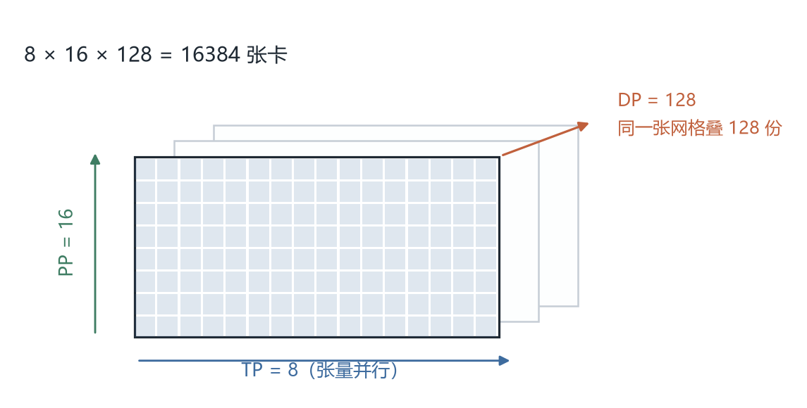
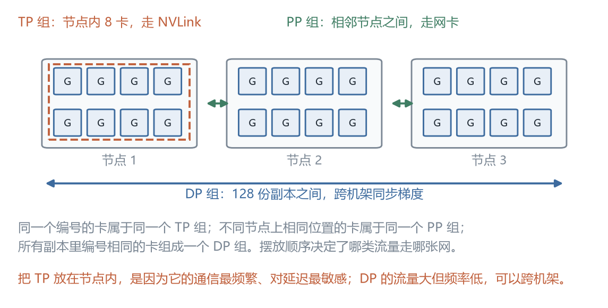

# 第 9 章　混合并行的一张地图

一个 4050 亿参数的模型，16384 张 H100，配置文件里写着三个数字，张量并行 8，流水并行 16，数据并行 128。三个数相乘正好是 16384。这三个数字不是随便填的，每一个都被一条硬约束顶住，动一个，另外两个就得跟着动。这一章要做的，是把这三条约束和它们之间的关系摆到一张图上，然后看看摆错了会出什么症状。

## 9.1　三个维度一起用

三种并行解决的是三个不同的问题，这是理解混合并行的起点。

张量并行解决“一层放不下”。它把矩阵按列和按行切开，每张卡算一部分，算完归约。它同时也省显存，因为权重被切到了每张卡上。代价是每层两次归约，通信在关键路径上。

流水并行解决“层数不够分”。它把层切成段，每段放在一组卡上，用微批次把流水线填满。它省显存，因为每张卡只放几层。代价是气泡，以及微批次带来的调度复杂度。

数据并行解决“想更快”。它复制整个模型，切分数据，用梯度归约保持副本一致。它不省显存，只省时间。代价是每步一次全局同步。

三个维度乘起来等于总卡数，这是硬约束。反过来说，给定模型和卡数，能选的组合是有限的。如果只用张量并行，度数受 NVLink 域限制，最多 8，16384 张卡里只能用 8 张，剩下 16380 张闲着。如果只用流水并行，126 层切成 16 段每段八层，再往上切每段就只剩一两层，通信和气泡都不划算。如果只用数据并行，4050 亿参数 6480 GB 的训练状态，一张卡根本放不下。

所以三个维度必须一起用，各承担一部分。图 9-1 把这张网格画出来了，横向是 8 路张量并行，纵向是 16 段流水线，叠了 128 层副本。

*图 9-1　8 × 16 × 128 的三维并行网格*

这张图容易被误读成一个平面的方块阵。实际上三个轴的性质完全不同。张量并行的轴是真的在切同一份计算，8 张卡必须同时工作才能算出一层的输出；流水并行的轴是在切时间，16 段在稳态时同时工作，但处理的是不同的微批次；数据并行的轴是在切样本，128 份副本之间除了每步一次归约之外毫无关系。

三条轴对网络的要求也不一样。张量并行的轴每层都要同步，延迟敏感，带宽要求最高。流水并行的轴只在段边界传激活值，量小，可以忍受较高延迟。数据并行的轴每步同步一次，量大但可以重叠，对带宽要求中等，对稳定性要求高。

这条约束链可以倒着算一遍。给定 4050 亿参数和 80 GB 的卡，先算训练状态总量 6480 GB，留三成给激活值和临时缓冲区，每卡可用大约 55 GB，于是张量并行乘流水并行至少要到 118，取整到 128。再给定 NVLink 域是 8 卡，张量并行就是 8，流水并行被顶到 16。最后拿总卡数除以 128，才得到数据并行。三个数字是一条链上算出来的，不是三个独立的选择。

三条轴还有一个差别，是时间尺度。张量并行的一次同步发生在一层之内，间隔是毫秒量级，一秒钟里要重复几百次；流水并行的传递发生在一个微批次跨段时，间隔也是毫秒到十毫秒；数据并行的一次同步发生在一整步结束时，间隔是秒量级。频率差三个数量级，对硬件的要求自然差三个层次。同样是一千兆字节的流量，拆成一百次发和拆成一万次发，对延迟的敏感度完全不同，这也是为什么张量并行离不开 NVLink，而数据并行用普通网卡也能跑。

理解了这一点，配置的思路就清楚了。把最敏感的流量放进最快的链路，把量大的流量摊到最多的链路上，把不能重叠的流量放进延迟最低的域里。

## 9.2　一个真实配置怎么摆

Llama 3 405B 的配置是公开的，4050 亿参数，126 层，16384 张 H100，张量并行 8、流水并行 16、数据并行 128。这三个数字背后有一条清晰的推理链。

先算显存。4050 亿参数按每参数 16 字节算，训练状态是 6480 GB。这个总量不因为数据并行而减少，因为 128 份副本各存一份完整的状态。真正摊薄它的是张量并行和流水并行，两者相乘是 128，6480 除以 128 等于 50.6 GB。也就是说每张卡要背 50 GB 左右的权重、梯度和优化器状态，80 GB 的卡上还剩不到 30 GB 给激活值和临时缓冲区。

这一步很关键，它说明显存是由张量并行乘流水并行决定的，数据并行在显存这条账上是零贡献。很多人第一次配并行时会本能地拿总卡数去除显存，算出来每卡只要 0.4 GB，然后困惑为什么一跑就爆显存。原因就是那 128 份副本，每一份都要装全套东西。

这个 50.6 GB 可以再拆一层看。一段流水线装 8 层，每层大约 32 亿参数，8 层就是 257 亿参数，再除以 8 路张量并行，每张卡手上是 32 亿参数，乘 16 字节正好 51 GB。账面能对上，说明这套切法没有漏掉哪一块。如果某一层特别大，比如词表投影那一层，它就会被单独拿出来放到最后一段，这也是为什么实际配置里各段的层数并不完全相等。

再看层数。126 层切成 16 段，每段接近 8 层。这个粒度是有讲究的。段数太少，每段层数多，单卡放不下；段数太多，每段只有三四层，段边界的通信次数增加，气泡也变大。8 层一段，正好是既能放下、又不至于切得太碎的位置。

再看张量并行为什么是 8。这个数字被 NVLink 域锁死了。一台机器 8 张 GPU，NVLink 把它们连成一个高带宽域，域内带宽 400 到 900 GB/s，出了机器只有 50 GB/s。张量并行每层都要归约，192 次同步全在关键路径上，一旦跨出机器，每次都要多走交换机和光模块，延迟翻几倍，还和别人的流量抢带宽。所以 8 是上限，正好一台机器。

最后数据并行是算出来的。16384 除以 8 再除以 16，等于 128。这 128 份副本分到 2048 台服务器上，每台机器承担 1 个张量并行组、16 个流水段中的 1 段、以及 128 份副本中的 1 份。

微批次的数量也不是随便定的。16 段流水线要填满，每步至少要 16 个微批次，实际配置会取更多，比如几十个，用来压低气泡。微批次数一多，每步的全局 batch 就大，这又回到第 6 章那个结论，大 batch 才能让计算盖住通信。4050 亿参数的模型能跑起来，一半功劳在并行配置，另一半在大 batch。

## 9.3　通信组怎么划分

三维网格落到具体实现上，是三种不同的通信组。每张卡同时属于三个组，每个组负责一类通信，互不干扰。

张量并行组是最小的一组，8 张卡，就在同一台机器里。组内每层做两次 all-reduce，传的是激活值。这 8 张卡的编号通常是连续的，比如 rank 0 到 7 就在节点 1，rank 8 到 15 在节点 2。

流水并行组是跨节点的。它由不同节点上位置相同的卡组成，比如节点 1 的第 1 张卡、节点 2 的第 1 张卡、一直到节点 16 的第 1 张卡，构成一个流水线。组内通信是点对点，前一段算完把激活值发给后一段，量很小，一次几 MB。

数据并行组是最大的一组，128 个成员，每个成员实际上是“一个完整的模型副本里的一张卡”。组内每步做一次梯度 all-reduce。

图 9-2 把三类组画在了机器上。虚线框里的是一个张量并行组，横向箭头连接的是流水并行的相邻段，底部那条长箭头是数据并行组跨越 128 份副本。

*图 9-2　TP、PP、DP 三类通信组在机器上的位置*

组的划分方式直接决定了 rank 到物理位置的映射。最自然的编法是让张量并行的编号最快变化，也就是 rank 0 到 7 是节点 1 的 8 张卡，rank 8 到 15 是节点 2 的 8 张卡，依次类推。这样同一个张量并行组的卡天然在同一个节点，不需要额外的调度约束。

在这个基础上，流水并行的编号是第二快的。节点 1 到 16 的同一个位置构成 16 段流水线，节点 17 开始是第二份副本。这样一份完整的模型副本占据 16 台机器，128 份副本占 2048 台。

建组本身也有成本。16384 个进程要按三种规则分别建通信域，每个域有自己的连接、自己的缓冲区、自己的初始化握手。全部建完要几十秒，而且这几十秒在每个作业启动时都要花一次。如果训练中途有卡挂掉需要重建，这段时间还要再来一遍。所以大规模作业的恢复时间里有相当一部分不是花在加载检查点上，而是花在建组上。

这种编法的好处是每一层约束都能用简单取模表达。rank 对 8 取模得到张量并行位置，除以 8 再对 16 取模得到流水段号，除以 128 得到副本号。工程上很多框架就是这么算的，配置文件里只要写三个数字，剩下的映射自动生成。

代价是它对物理拓扑的假设很强。它假设节点内一定有 8 张卡、每个节点的网卡数量和接线方式完全一致、相邻编号的节点在物理上也相邻。集群一旦有异构，比如某个机柜只有 4 台机器装了 8 卡，映射就会错位，某些张量并行组会被迫跨节点。

## 9.4　拓扑感知的摆放

rank 的编号决定了哪类流量走哪张网，这件事在大集群上值几十个百分点。

先看节点内。一台机器 8 张 GPU，通过 NVSwitch 全互联，任意两张卡之间都是 900 GB/s 的对称带宽。所以节点内的摆放没什么讲究，8 张卡谁跟谁一组都一样。真正有讲究的是节点之间。

集群的网络是分层的。一台机器 8 张网卡，每张网卡接到一个 leaf 交换机，8 张网卡分别接到 8 个不同的 leaf，这叫 rail 优化。同一条 rail 上的流量只经过一级交换，不同 rail 之间才需要走 spine。如果流水并行的相邻两段被放到了不同 rail 上，激活值的传递就要多走一级交换机，延迟从几微秒变成十几微秒，乘以每步几十次传递，就是几毫秒。

数据并行的 all-reduce 更复杂。128 份副本分布在 128 个不同的位置，ring 上的每一跳都可能跨机架。如果这个 ring 的拓扑和物理拓扑对不上，某些链路上的流量会是平均值的几倍，成为瓶颈。所以高性能集群会做拓扑感知的 rank 映射，把 ring 上相邻的成员尽量放在物理上相邻的位置，或者干脆改用分层的 all-reduce，先在节点内归约，再在节点间归约。

网络还有一个参数叫收敛比。机柜内的 leaf 交换机往下接机器是全速的，往上接 spine 的链路往往是几比一收敛，因为它假设不是所有机器同时往外发满。数据并行的 all-reduce 恰好是所有人同时发，一旦 ring 的路径设计得不好，上行链路就会成为瓶颈，实测带宽只有标称值的一半。这也是为什么大集群会给训练流量单独规划一套无收敛或者低收敛的网络，而不是和存储、管理流量混在一起。

调度器在这里也有责任。作业申请 2048 台机器时，如果调度器给的是一堆碎片，跨越了几十个机柜，那么无论 rank 怎么编号，都拼不出一个紧凑的拓扑。这也是为什么大作业要 gang scheduling，要么一次性给全，要么不给。

还有一个常被忽略的细节，网卡与 GPU 的亲和性。一台机器有 8 张 GPU 和 8 张网卡，PCIe 拓扑决定了 GPU 0 到 3 挂在一颗 CPU 下，GPU 4 到 7 挂在另一颗下，网卡也分两组。如果某个 GPU 的流量被路由到了另一颗 CPU 下的网卡，就要多走一次跨 CPU 的 PCIe，带宽减半。NCCL 会自己探测这个拓扑并尽量选近的网卡，但如果用户手动指定了网卡列表，就可能绕路。

## 9.5　配错了会怎样

并行配置错了，症状往往很一致，只是原因不同。会看症状，比会算配置更有用。

张量并行跨了节点，最典型的症状是 step time 高得离谱，但 GPU 利用率曲线很平稳，网络流量打满，显存占用正常。因为每层都要跨机架归约，192 次同步每次都多走几跳，通信时间从零点几秒涨到几秒。这时候看计算时间会发现它没变，多出来的全在等网。

流水并行切得太深，症状是气泡大。16 段配 32 个微批次，气泡三成；切到 32 段，同样的微批次气泡接近一半。表现出来是 GPU 利用率周期性起伏，每一段的利用率都不高，而且卡越多单步越慢。这种情况再继续加卡只会更糟。

数据并行开得太大，症状是收敛问题而不是性能问题。step time 可能很漂亮，但 loss 曲线在前期抖得厉害，怎么调学习率都不对。同时因为副本多，出现慢卡的概率高，step time 的方差变大，偶尔冒出几个特别长的步。

张量并行度数超过 8，比如硬开 16，症状是单卡矩阵乘的规模变小，Tensor Core 的效率掉下来。每张卡算的矩阵从 12288 乘 12288 变成 12288 乘 768，形状细长，访存占比上升，MFU 会掉好几个百分点。这种损失不会报错，只是在 profiler 里看到每个 kernel 的时间都比预期长。

还有一个常见错误是把三维配置当成可以单独调的旋钮。有人发现显存不够，就把流水并行从 16 改到 20，总卡数不变，于是数据并行从 128 变成 102，除不尽，最后几份副本少几张卡，同步时直接卡死。三个数字的乘积必须等于总卡数，而且最好都是 2 的幂，否则一边除不尽，另一边就会多出一些落单的卡。

诊断的顺序建议从显存开始，再看 step time 的构成，最后看网络流量的分布。显存够不够决定并行度能不能往上加，step time 里计算和通信各占多少决定瓶颈在哪一侧，网络流量能不能对上理论值决定拓扑有没有摆错。

最后要说的是，并行配置没有全局最优解。同一份模型，换一批卡数、换一种网络、换一个 batch 大小，最优配置就变了。能做的只是把三条约束理清楚，先满足显存，再满足通信，最后用 batch 把剩下的时间填满。这也是为什么大集群的训练配置总是要反复试，而不是抄一份就能用。探究到具体某一层变慢的时候，往往需要把一步拆成几千个 kernel 逐个看，那已经是另一个层次的活了。
