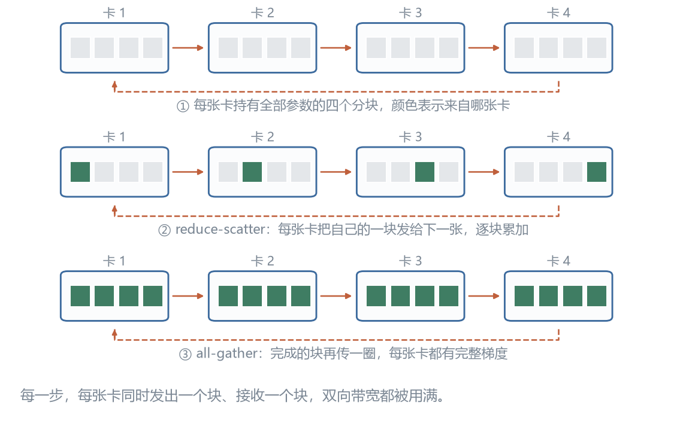
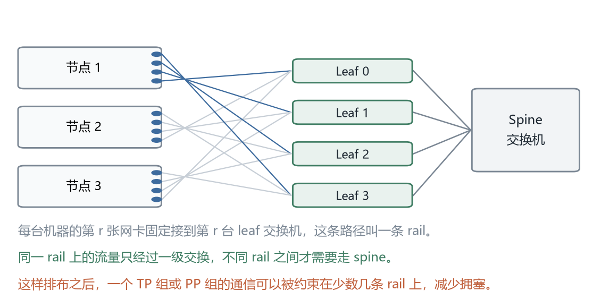

# 第 10 章　卡与卡怎么说话

一台机器上的八张卡通过 NVSwitch 连在一起，任意两张之间的带宽是 900 GB/s。同一个机柜里的两台机器之间，带宽是 50 GB/s。这两个数字差了十八倍，而训练时每张卡每步要发出去几百 GB 的数据。所以“卡与卡怎么说话”这件事，不能交给应用层临时决定，得有一套专门的通信原语、一套专门的库和一套专门的网络。这一章讲的就是这条链路的三层，动作、算法和硬件。

## 10.1　集合通信的四种动作

训练里最常用的通信动作只有四个。

第一个是广播。一张卡有一份数据，发给组里所有其他卡。初始化的时候用得多，比如把主卡上初始化好的参数发给所有人，或者加载检查点后同步一份。

第二个是 all-reduce。每张卡有一份同样形状的数据，组内求和，结果发给每张卡。梯度同步用的就是这个，1024 张卡各算一份梯度，加起来求平均，每张卡都要拿到完整结果。

第三个是 all-gather。每张卡有一份数据的碎片，拼起来之后每张卡都拿到完整的全部。FSDP 收集参数用的就是这个，一层参数被切在 8 张卡上，前向之前把它们拼回完整的一份。

第四个是 reduce-scatter。每张卡有一份完整数据，组内求和，但结果按块切开，每张卡只拿自己那一块。ZeRO 的梯度归约用的就是这个，省显存的关键在于归约完之后每张卡只留八分之一。

这四个动作之间有很清楚的关系。all-reduce 等于先 reduce-scatter 再 all-gather，这个等价关系是下一节 ring 算法的全部基础。all-gather 是 broadcast 的一般化，reduce-scatter 是 reduce 的一般化。框架层看到的所有集合通信，最终都落到这四个动作上，硬件也只需要把这四个动作做快。

还有第五个动作，all-to-all。每张卡把自己的数据按目的地切成 N 份，分别发给 N 张卡，同时也从 N 张卡各收一份。它在稠密模型里用得少，在混合专家模型里是核心，因为要把 token 路由到对应的专家所在的卡上。all-to-all 对网络的要求最苛刻，因为它没有“聚合”这个动作可以省流量，每一份数据都要点对点送到。

除了这五个集合动作，训练里还大量用点对点发送。流水并行的段边界就是一张卡发给另一张，没有聚合，没有分发，一对一。它不属于集合通信，但在时间线上的分量不小，因为它串在关键路径上，发送端算完才能发，接收端收到才能算。

把这几个动作写成一般形式，会发现它们的差别只在参数上。all-gather 是人人交一块，最后人人拿到全部；broadcast 只有一个人交，其余全收；reduce-scatter 是人人交全部，最后人人只留一块；all-reduce 是把后两步串起来。所以真正的原语只有两个，一个负责把碎块拼完整，一个负责把副本加起来再切开。硬件按这两个原语做优化，框架按这两个原语算账，判断一次通信贵不贵，看它要做几次拼、几次切就够了。

理解这些动作的意义在于，后面所有的优化都是在这四个动作上做文章。张量并行把两次矩阵乘之间插一次 all-reduce，数据并行在每步末尾插一次 all-reduce，流水并行在段边界插一次点对点发送，显存分片把 all-reduce 换成 reduce-scatter 加 all-gather。整个分布式训练的通信结构，就是这些动作按不同频率、不同大小、不同组合排出来的。

## 10.2　ring all-reduce 怎么做

all-reduce 最直观的实现是找一张卡当中心，所有人把数据发给它，它加完再广播回去。这个做法在 8 张卡时还能用，在 1024 张卡时中心卡的网卡会被打爆，因为它要承受 1024 倍于单卡的数据量。

ring 算法把这个压力摊平了。N 张卡排成一个环，每张卡只跟左右两个邻居说话，数据被切成 N 块。整个过程分两个阶段。

第一个阶段叫 reduce-scatter。每一步，每张卡把自己手上的某一块发给下家，同时从上家收到一块，把收到的和自己对应的那一块相加。走 N-1 步之后，每张卡手上会有一块完整的和，其余 N-1 块是残的。

第二个阶段叫 all-gather。还是同样的环，每一步把手上那块完整的和传给下家，同时从上家收一块。再走 N-1 步，每张卡都拿到了全部 N 块的和。

图 10-1 用四张卡画了这个过程。第一行是初始状态，四块灰色代表四张卡各自的完整数据。第二行是 reduce-scatter，每张卡上只有一块变绿，表示那一块已经是四张卡的和。第三行是 all-gather，四块全绿，每张卡都拿到了完整结果。

*图 10-1　ring all-reduce 的两个阶段*

每一小步里，每张卡同时发出一个块、接收一个块。发送和接收是两个方向，正好把网卡的全双工能力用满。这也是 ring 算法的效率来源，它不需要额外的带宽，收发各占一半。

算一下传输量。总共 2(N-1) 步，每步每张卡发 S/N 字节，S 是数据总量。乘起来是 2(N-1)/N 乘以 S。N 等于 1024 时这个系数是 1.998，几乎就是 2 倍。所以 ring all-reduce 的代价是“把数据搬两遍”，这个下界很难突破，因为每个字节至少要参与一次求和、一次分发。

把真实的数代进去体会一下。1750 亿参数的梯度是 350 GB，1024 张卡，每卡分到 350 MB 一块，2046 步走完要 14 秒，平均每步 7 毫秒，而这 7 毫秒里要搬 350 MB，正好把 50 GB/s 跑满。这种时候限速的是带宽，延迟只是零头。换成一个小消息，比如一个 1 MB 的参数，每步只传 1 KB，传输时间不到一微秒，可一跳的固定延迟就有几微秒，2046 跳加起来就是十几毫秒的纯等待。同一个算法，大消息是带宽题，小消息是延迟题。

它的弱点是延迟。2(N-1) 步，每一步都要等上一跳的消息到达。1024 张卡就是 2046 次跳，每次几微秒，加起来就是十几毫秒的固定开销，和数据量无关。数据小的时候，这十几毫秒就是全部成本；数据大的时候，它被带宽时间淹没。

把 ring 的耗时拆成两段更好用。一段是传输，2S(N-1)/N 字节除以链路带宽 B；另一段是延迟，2(N-1) 乘每跳的固定开销 t，两段相加就是一次 all-reduce 的时间。这两段对 N 的敏感度完全不同，传输段几乎不随 N 变，延迟段线性涨。1024 卡时延迟段是 2046 个 t，一个 t 按 2 微秒算是 4.1 毫秒，按 6 微秒算是 12 毫秒。这个拆法把慢分成了两种，一种是等，一种是搬，后面几节都在这两段上做加减。

还有一个小优化值得知道。单向环只用了一半的双向带宽，因为数据只朝一个方向流。如果开两个环，一个顺时针一个逆时针，数据对半分，两个方向同时用，带宽利用率就上去了。这就是双二叉树和双 ring 的动机，很多通信库会根据数据量和卡数自动在几种算法之间切换。

## 10.3　分层与树形

ring 算法假设所有卡之间的链路是对称的。真实集群不是这样。

一台机器内 8 张卡走 NVLink，900 GB/s；出了机器走网卡，50 GB/s。如果 1024 张卡排成一个环，环上每一跳都是跨机器的，整条环就被最慢的那一段卡住。更糟的是，每张卡贡献的流量都要挤过它自己那张 50 GB/s 的网卡，节点内 900 GB/s 的带宽完全用不上。

所以实际的 all-reduce 是分层的。先在节点内做一次 reduce-scatter，把 8 张卡的数据归约成 8 份，每份对应一块；然后 8 个代表跨节点做一次 all-reduce，数据量只有原来的八分之一；最后再在节点内做一次 all-gather，把结果摊回 8 张卡。

这个改动的效果很直接。跨节点的流量从 2 倍数据量降到八分之一乘 2，因为节点内先聚合过了。1024 张卡、128 个节点，跨网卡的总流量减少到原来的八分之一，而节点内多做的两次通信走的是 900 GB/s，几乎不花时间。

具体到数字上看分层能省多少。1024 张卡，128 个节点，每节点 8 卡。不分层的话，跨网卡的流量是 2 倍数据量；分层之后，先在节点内归约成八分之一，跨节点的只有八分之一乘 2，节点内再补两次高速通信。用 350 GB 的梯度算，跨网卡的总量从 700 GB 降到 87 GB 左右，按 50 GB/s 算是 1.7 秒，而节点内那两次走 900 GB/s，几乎不占时间。八倍的差距，就是分层的全部意义。

分层的思想可以推广到更多层。机柜内一层、机柜间一层、甚至跨数据中心一层，每一层用自己最快的链路做聚合，只在必要的时候向上传。这就是为什么大规模集群的网络要做成树形，也是为什么 rank 的摆放要和这个树对齐。

树形算法是另一条路。它不用环，而是用一棵二叉树，数据从叶子往上汇总，再往下分发。步数是 2 倍的 log N，1024 张卡是 20 步，比 ring 的 2046 步少两个数量级。代价是链路利用率不如 ring，靠近根的节点承担更多流量。

所以选择变得很清楚。数据小的时候用树，延迟低；数据大的时候用 ring，带宽利用率高。分界点大概在几十 KB 到十几 MB 之间，卡越多越往大的一头偏，网络越快越往小的一头偏。

InfiniBand 还有一招叫交换机内归约。数据发到交换机，交换机内部的专用单元直接做加法，只把结果转发出去，不用先收齐再算。这样跨节点的往返次数减半，延迟进一步下降。这项能力需要交换机支持，不是所有集群都有，但它说明了一件事，聚合这个动作可以下沉到网络设备里做，不必都在端点上做。

## 10.4　网络硬件

把三层拆开看，最底下是物理链路。

InfiniBand 是训练集群里最常见的选择。现在的 NDR 单端口是 400 Gb/s，换算成字节是 50 GB/s。它用 RDMA，数据从 GPU 显存直接 DMA 到网卡，再到对端显存，全程不经过 CPU，也不进内核协议栈。这条路径叫 GPUDirect RDMA，它的意义是把延迟压到几微秒，同时把 CPU 从通信里解放出来。

RoCEv2 是另一条路，在以太网上跑 RDMA。硬件便宜，和现有网络运维体系兼容，缺点是 UDP 不保证不丢包，一旦丢包重传，延迟会突然涨一个数量级。所以 RoCE 集群必须仔细调拥塞控制，把无损队列、优先级流控这些机制配好，运维成本比 IB 高。两种方案都能跑万卡，选哪个更多是成本和团队习惯的问题。

再往上是拓扑。最常见的是 fat-tree，两级交换，机器接 leaf，leaf 接 spine。任意两台机器之间最多走三跳，任何一半机器之间的通信能力都是对称的。它的好处是简单、可预测，坏处是贵，因为要用大量交换机和光模块把带宽堆成无收敛。

rail 优化是在 fat-tree 上做的一个改动。一台机器有 8 张网卡，编号 0 到 7。把所有机器的第 0 张网卡都接到同一组 leaf 上，第 1 张接到另一组，依次类推。这样形成 8 条平行的 rail，每条 rail 内部的流量只经过一级交换，不同 rail 之间才需要走 spine。

图 10-2 画的就是这个结构，三台机器的第 r 张网卡接到第 r 台 leaf，同一条 rail 上的通信是一级，跨 rail 才经过 spine。

*图 10-2　rail-optimized 拓扑*

这个设计的价值在于，它让“哪些卡之间说话多”和“哪些链路最短”对上了。张量并行组在同一台机器内，走 NVLink，根本不碰网卡。流水并行组是相邻节点的同一位置，如果 rank 摆放得对，它们落在同一条 rail 上，只走一级交换。数据并行组跨机架，走 spine，流量大但频率低。

拓扑之上还有一个数决定跨机柜的带宽，叫收敛比。每条 rail 的叶交换机上行到脊交换机的端口数，除以接进来的下行端口数，就是收敛比。1:1 叫无收敛，任意两台机器之间的带宽都等于线速；3:1 意味着三台机器抢一个上行端口的带宽，跨 pod 的通信最多只有线速的三分之一。训练集群很少做全无收敛，因为脊交换机那一层的端口和光模块能吃掉整个网络造价的一半，而这一层的带宽并不是每一步都用得上。

这些设备也会坏。光模块的误码率不是零，链路质量差的时候交换机会反复重传，表现为带宽掉一半而利用率看着正常。线缆被碰松、接头脏了、模块温度过高，都是大集群里每周都会遇到的事。它们不会像 GPU 掉卡那样直接报错，只会让某条链路变慢，而同步的训练会把这个变慢放大到所有卡上。所以大规模集群会把链路误码计数纳入监控，而不是只看端口是不是 up。

网络还有一个物理事实值得记住。光在光纤里的速度大约是每秒二十万公里，每走一百米要零点五微秒。跨一个机柜几十米，跨一排机柜几百米。这些时间累起来，就是为什么大规模集群的延迟不是零，也是为什么把通信关在最近的域里永远是最优策略。

## 10.5　NCCL 在做什么

上面这些算法和硬件，普通用户不需要自己实现。NCCL 是 NVIDIA 的集合通信库，它做了四件事。

第一件是探测拓扑。启动时它会读 PCIe 拓扑、NVLink 连接关系、网卡与 GPU 的亲和性、跨交换机的距离，拼出一张“谁离谁近、带宽多少”的图。这张图决定了后面所有决策。

第二件是选算法。根据数据量、卡数、拓扑，在 ring、树、以及更复杂的组合算法之间选一个。数据小选树，数据大选 ring，跨节点多就先在节点内聚合。用户不需要指定，也最好不要指定，除非在做性能调优。

第三件是开通道。一次集合通信可以拆成多个通道并行跑，每个通道负责一部分数据，走不同的路径。通道数开得多，带宽利用率高；开得太多，每个通道的消息变小，延迟占比上升。这个参数也是自动算的，通常在几到几十之间。

第四件是实际收发。它负责把数据从显存搬到网卡、管好缓冲区、处理完成事件、在出错时报出来。

用户能干预的地方主要是环境变量。指定用哪些网卡、用哪个协议、走哪个网络接口、日志打到什么级别。这些参数配错了，性能可能只剩一半。最常见的问题是网卡选错，选了管理网而不是数据网，看起来能跑，但带宽只有千兆。第二个常见问题是 GPU 直连网卡没开，数据绕了一圈 CPU，延迟翻倍。

排查的时候，`NCCL_DEBUG=INFO` 打出来的日志信息量很大。它会告诉你用了哪些网卡、走的是 NVLink 还是 PCIe、选的什么算法、开了几个通道、有没有启用 GPUDirect。把这份日志和预期的拓扑对一遍，大部分“为什么这么慢”的问题都能定位。

这里有个反直觉的地方。通信 kernel 也是跑在 GPU 上的，它要占用 SM 和寄存器。通信量大的时候，NCCL 会占用几个 SM 去做数据搬运和协议处理，留给计算 kernel 的 SM 就少了。所以“完全重叠”在物理上做不到，重叠本身有成本，典型情况是损失几个百分点的计算吞吐。这也是为什么有些团队宁愿多花一点通信时间，也要把通道数调低，把 SM 还给计算。

能改的东西比想象中少，但改错的地方痕迹很明显。容器的 PCI 设备没有透传好，NCCL 探测不到 NVLink，节点内会退回 PCIe，8 卡 all-reduce 从 900 GB/s 掉到 64 GB/s，症状是节点内带宽只剩标称的十四分之一。GPU 与网卡的亲和性没配对，第 0 张卡的流量跑到第 7 张网卡上，跨机延迟会多出一次 PCIe 往返。IB 的 GID 索引选错，路由对不上，表现为连接建得起来、一传数据就重传。这三种错都不会报错，只会在带宽图上留一个坑。

最后一件事值得强调。同样的硬件，通信库配好了能跑出九成带宽，配不好只有六成。而训练是同步的，最慢的那一次通信决定整步的时间，所以这三成的差距会原封不动地体现到吞吐上。这也是为什么大规模训练团队里总有几个人专门盯着通信这一层。他们每天看的图无非几张，网卡吞吐、链路误码、集合通信耗时、GPU 利用率，但这几张图一放，就知道今天的作业是被网络拖了还是被计算拖了。

## 10.6　集合通信的字节账

前面说的传输量都是定性的，这一节把它写成式子。令 S 为一份数据的字节数，N 为组内卡数，五个动作的收发量有统一的形状。

| 动作 | 源卡发送 | 每卡接收 | 全网总量 | 350 GB、1024 卡时的每卡收发 | 走 50 GB/s |
| --- | --- | --- | --- | --- | --- |
| broadcast | (N−1)S | S，源卡为 0 | (N−1)S | 350 GB | 7 秒 |
| all-reduce | (N−1)S/N | (N−1)S/N | 2(N−1)S | 699 GB | 14 秒 |
| all-gather | (N−1)S/N | (N−1)S/N | (N−1)S | 350 GB | 7 秒 |
| reduce-scatter | (N−1)S/N | (N−1)S/N | (N−1)S | 350 GB | 7 秒 |
| all-to-all | (N−1)S/N | (N−1)S/N | (N−1)S | 350 GB | 7 秒 |

表里能读出三件事。

all-reduce 是唯一付两倍的动作，也是唯一让每张卡都拿到完整结果的动作。all-gather 和 reduce-scatter 各付一倍，加起来正好等于 all-reduce，这就是前面那句等价关系在账面上的写法。所以把 all-reduce 换成 reduce-scatter 加 all-gather，字节数一分不多，换到的是显存，代价是两次通信的启动延迟。

每卡收发和全网总量是两套数。每卡收发 699 GB，1024 张卡加起来是 716 TB。前一个数决定这张卡要等多久，后一个数决定交换机和光模块要扛多少。扩容时前者几乎不动，后者线性涨，所以单卡视角看不出问题、网络总带宽却被吃干的时候，症状是整个集群一起慢，不是某几张卡慢。

all-to-all 要单独看一眼。它的字节数和 all-gather 一样，但目的地是分散的，每份数据都要送到不同的对端，拼不成一个大块。大块传输能靠流水线摊掉延迟，散块不行，所以同样的字节数，all-to-all 通常比 all-gather 慢出一截，卡越多、切得越碎，差得越远。专家并行把 token 发到几百个专家所在的卡上，这类小包在一步里能有几十万个，省字节的办法在这里全都不管用。

拿 700 亿参数走一遍。梯度按 BF16 是 140 GB，只算 ring，三档组大小。8 卡时每卡收发 $2\times(7/8)\times140$，245 GB，全网 1.96 TB，走 50 GB/s 是 4.9 秒。64 卡时每卡 275.6 GB，全网 17.6 TB，5.5 秒。512 卡时每卡 279.5 GB，全网 143 TB，5.6 秒。

每卡的收发量从 245 GB 涨到 279.5 GB，多了一成四；全网总量从 1.96 TB 涨到 143 TB，多了七十二倍；时间从 4.9 秒到 5.6 秒，几乎没变。

这张小表解释了 ring 为什么能扩到几千张卡。加卡不增加每张卡的负担，只是把同一笔总流量摊到更多链路上，所以在单卡视角下 all-reduce 的耗时近乎常数。代价落在网络上，1024 张卡的数据并行要求网络总带宽也涨 1024 倍，做不到的那部分就变成排队，表现为 step time 的尾巴变长。

分层之后这笔账换个样子。512 张卡按 64 节点、每节点 8 卡摆，节点内先归约成八分之一，跨网卡只剩 $2\times140\times63/512$，34.5 GB，0.69 秒。同一个 512 卡的 all-reduce，从 5.6 秒变成 0.69 秒加两次 NVLink 上的通信。分层不改算法，它改的是每一段流量走哪条线。

记账的时候有三件事要一起记，动作、大小、频率。动作决定倍数，一倍还是两倍；大小决定传输时间；频率决定它一天来多少次。三个数乘起来才是这笔通信的总代价。显存分片就是个好例子，它把动作从一倍变成三倍出头，动作变贵了；但它同时把大小从整份参数变成一层参数，又把频率从每步一次变成每层两次。只看倍数会得出「FSDP 比数据并行贵五成」这个正确但没用的结论，把三个数乘起来才知道它贵在频率上，也因此必须关在节点内。

## 10.7　延迟和带宽两条曲线

ring 和 tree 谁快，取决于消息多大、卡多少，这件事可以算。把两个算法各写成一个函数，一项是传输，一项是延迟。

ring 走 2(N−1) 步，每步搬 S/N 字节，时间是 $2(N-1)(t+S/(NB))$，t 是一跳的固定开销，B 是链路带宽。tree 走 $2\log_2 N$ 步，但每步搬的是整份消息，不是碎块，时间是 $2\log_2 N\,(t+S/B)$。

两个式子放在一起，比的是两件事。ring 的延迟项有 2(N−1) 个 t，tree 只有 $2\log_2 N$ 个，1024 卡是 2046 比 20，差一百倍；ring 的传输项是 2S/B，tree 是 20S/B，差十倍。一个赢在起步，一个赢在搬货。

| 消息大小 | ring | tree | 快的一方 |
| --- | --- | --- | --- |
| 1 MB | 4.1 ms | 0.46 ms | tree，快 9 倍 |
| 13 MB | 4.6 ms | 5.5 ms | 打平 |
| 100 MB | 8.3 ms | 42 ms | ring，快 5 倍 |
| 350 GB | 14 秒 | 140 秒 | ring，快 10 倍 |

表按 1024 卡、每跳 2 微秒、50 GB/s 算。1 MB 那一行，ring 每步只搬 1 KB，传输 0.02 微秒，一跳开销 2 微秒，2046 步里 4.09 毫秒全是等。tree 每步搬整份 1 MB，21 微秒，20 步，0.46 毫秒。

让两个式子相等去解 S，得到分界点 $S^*=tB(N-1-\log_2 N)/[\log_2 N-(N-1)/N]$。1024 卡代进去是 12.7 MB，128 卡是 2 MB，8 卡只有 190 KB。卡越多，ring 那条延迟曲线涨得越快，分界点就越高。

这个分界点在训练里有具体落点。梯度同步是几百 GB 量级，站在 ring 这一侧，所以数据并行该走 ring。而每步末尾的那些标量同步，比如 loss 平均、梯度范数、调度器要的步数，只有几个字节，1024 卡上 ring 要 4 毫秒，tree 只要 0.5 毫秒。八次这样的同步，两条路差三十毫秒，一万步就是五分钟。这也是框架会把这些标量攒成一个包、一次发出去的原因。

模型给的是方向，不是精确值。NCCL 还要考虑通道切分、tree 每层合并的开销、以及节点内那条 900 GB/s 的链路怎么参与，实际分界点会在这个数附近浮动，差一倍都算正常。知道公式的用处是判断方向对不对，不是替代实测。

还有两个实际情况会把这个模型拧一下。卡数往往不是 2 的幂，1024 是，1280 不是，树在不满的那一层会有节点多担一份活，步数按向上取整算，效率和 2 的幂差一截。另外 NCCL 默认用的不是单棵树，而是两棵互补的二叉树，各自负责一半数据，让每张卡的上下行都用上。双树比单树的延迟略高、带宽比 ring 略低，落在两者中间，很多集群在这个中间地带反而最稳。

## 10.8　NCCL 的旋钮

NCCL 的默认值对多数作业够用。需要动它的场合只有三种，集群的网络命名和它的默认探测对不上，要复现某个性能问题，或者确实知道自己的流量形状和它的假设不同。要动的变量不多，就那么十来个。

| 变量 | 作用 | 常见设置 | 配错的症状 |
| --- | --- | --- | --- |
| `NCCL_SOCKET_IFNAME` | 带外通信走哪张网卡 | 数据网接口名 | 走到管理网，带宽掉到千兆 |
| `NCCL_IB_HCA` | 用哪些 IB 网卡 | 列出全部 8 张 | 只用一半，跨机带宽腰斩 |
| `NCCL_NET_GDR_LEVEL` | GPUDirect RDMA 的层级 | 允许直连 | 数据绕一圈 CPU，延迟翻倍 |
| `NCCL_ALGO` | 强制 Ring 或 Tree | 一般留空 | 小消息被钉在 ring 上，慢十倍 |
| `NCCL_PROTO` | LL、LL128 或 Simple | 一般留空 | 大消息走 LL128，带宽上不去 |
| `NCCL_MIN_NCHANNELS` | 通道数下限 | 大消息调高 | 通道太少，单条排队 |
| `NCCL_MAX_NCHANNELS` | 通道数上限 | 小消息调低 | 通道太多，带宽和 SM 被摊薄 |
| `NCCL_BUFFSIZE` | 每通道缓冲 | 默认 4 MB | 太小碎包多，太大吃显存 |
| `NCCL_IB_TIMEOUT` | 重传超时 | 按 fabric 规模调 | 抖动被放大成超时退出 |
| `NCCL_P2P_LEVEL` | 节点内走 P2P 的层级 | 允许 NVLink | 退回共享内存，节点内带宽掉一个数量级 |

排查的顺序是先看它用了什么，再看它为什么慢。`NCCL_DEBUG=INFO` 的输出里有几行必须核对，用了哪些网卡、走的是 NVLink 还是 PCIe、选的什么算法、开了几个通道、有没有启用 GPUDirect、环上有几个节点。这几行和 10.4 节画的拓扑对一遍，对不上的地方就是问题。

网络故障的症状和 GPU 故障不一样，它不报错。

| 症状 | 常见的位置 | 先看什么 |
| --- | --- | --- |
| 平均耗时正常，P99 翻倍 | 单条链路在重传 | 端口 CRC 与重传计数 |
| 同一条 rail 上的 rank 一起慢 | 叶交换机或光模块 | 该交换机的下行误码 |
| 机架内正常，跨机架腰斩 | 收敛比与上行争抢 | 上行端口利用率 |
| 启动阶段就慢 | 网卡或接口选错 | 日志里的网卡列表 |
| 越跑越慢，重启就好 | 模块老化或过热 | 模块温度与 CRC 累积 |
| 少数 rank 稳定慢几个点 | 降频的慢卡 | 各卡频率与功耗 |

这几条的共同点是都不报错。网络不像 GPU，坏了会留 XID，它只会变慢，而同步训练把慢放大成整步的慢。所以判断今天是被网络拖了还是被计算拖了，靠的不是错误日志，是把集合通信耗时和网卡吞吐两张曲线放在一起看。计算拖的时候网卡是闲的，网络拖的时候网卡贴着上限而 GPU 利用率在掉。

确认靠对比，不靠看。改一个变量、跑两次、只比四张图，四张图是集合通信耗时、网卡吞吐、GPU 利用率、step time。只改一个是因为这几个量互相耦合，同时改两个就分不清谁在起作用。跑两次是因为集群自身的噪声就有几个百分点，一次跑出来的差异可能是噪声。作业已经在跑的时候，可以用同一份检查点、同一份数据、同一个 batch 做 A/B，两次的步数一致，比较才有意义。

## 10.9　rail、收敛比与量级

前面说过收敛比是跨机柜带宽的那个折扣，这一节把它算成钱和时间。rail 解决的是谁跟谁说话多，收敛比解决的是跨 rail 能有多快。这两个数定下来之后再改就要停机重布线，所以在设计阶段算清楚，比运维阶段补救便宜得多。

算一个 1024 卡的集群。128 台机器，每台 8 张 400 Gb/s 网卡，每台上行能力 8 乘 50 是 400 GB/s，全网合起来 51.2 TB/s。全无收敛意味着脊交换机一侧也要 1024 个下行端口，每个端口配一个光模块，这一层的造价能顶掉整个网络的一半。

改成 3:1，脊侧只需要 341 个端口，跨 pod 的可用带宽降到 17 TB/s。对张量并行没影响，TP 组在机器内部走 NVLink，根本不碰网卡。对流水并行影响有限，相邻流水级应该被摆在同一条 rail 上，只走一级交换。真正挨刀的是数据并行，它的流量必须穿过脊交换机。

拿 4050 亿参数、张量并行 8、流水并行 16、数据并行 128 的配置算。每卡手上的梯度是 6.3 GB，128 路 ring 每卡收发 12.5 GB。全无收敛时 0.25 秒，3:1 之后有效带宽从 50 GB/s 降到 16.7 GB/s，同样字节要 0.75 秒。一步多等半秒，一万步就是五千秒。收敛比不能只按交换机预算定，得按数据并行的组大小和通信频率反推。

把前面提过的几条链路摆到一张表上，量级关系比记任何公式都管用。

| 链路 | 单向带宽 | 单跳延迟 | 传 100 MB | 位置 |
| --- | --- | --- | --- | --- |
| HBM3 | 3.35 TB/s | 不算链路 | 30 微秒 | 卡内 |
| NVLink | 900 GB/s | 约 1 微秒 | 0.11 毫秒 | 机内 8 卡 |
| PCIe 5.0 | 64 GB/s | 约 1.5 微秒 | 1.6 毫秒 | 卡到网卡 |
| IB NDR | 50 GB/s | 1 到 2 微秒 | 2 毫秒 | 跨机，通常 3 跳 |
| RoCEv2 | 50 GB/s | 2 到 5 微秒 | 2 毫秒起 | 跨机，拥塞时更高 |
| 千兆管理网 | 0.125 GB/s | 数百微秒 | 800 秒 | 配错时会掉到这 |

竖着看，从 HBM 到千兆网，带宽差了两万六千倍，传同一个 100 MB 的时间从三十微秒变成十三分钟。所以任何一次通信慢得离谱，先问它走的哪条线，再问它用的什么算法。顺序反了，会在算法上白折腾半天。

表里还有个隐变量，链路预算是按最坏情况配的。一根 400 Gb/s 的链路在实验室能跑满，进了机柜，因为接头、跳线、模块温度，实际能用的余量只有几个点。所以设计时给每条链路留一成余量，等于把收敛比从 3:1 变成 2.7:1，看着浪费，实际是买保险。缺了这份余量，第一批衰减的光模块就能把整条 rail 的带宽啃掉一块。

把这一章和前几章连起来看，逻辑是递进的。并行策略决定了要发什么、发给谁、多久发一次，集合通信提供了四种基本动作，ring 和树提供了两种走法，硬件决定了每一步多快，NCCL 把这些选择统统自动化。上一层每改一个参数，下一层就要重新选一遍最优解。所以调优不是找一个全局最优，而是每次改完配置后重新看一遍流量图。
