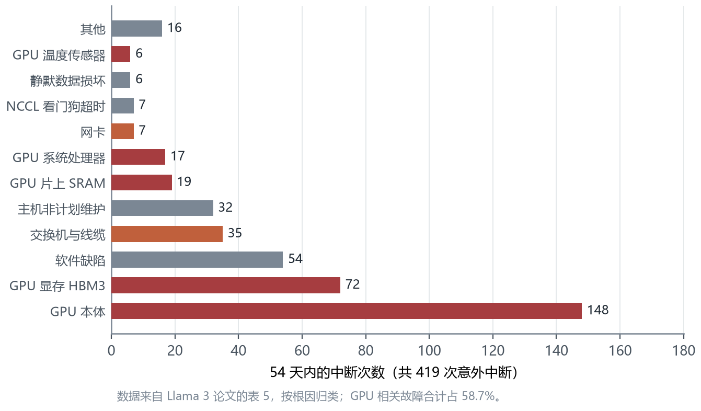
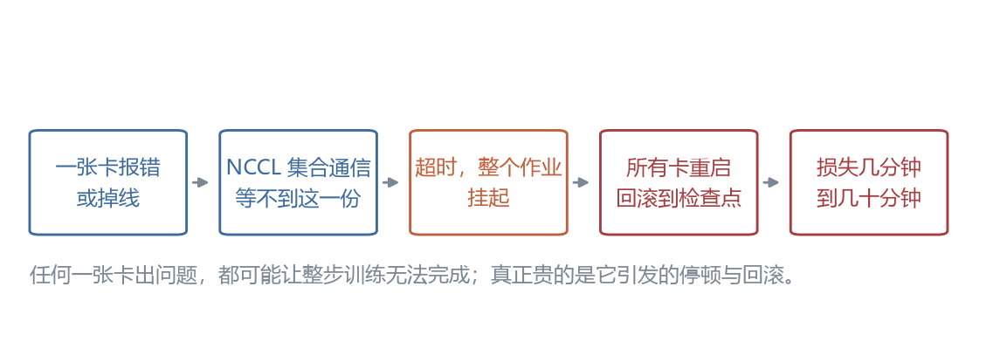

# 第 11 章　会坏的东西

## 11.1　一万张卡跑五十天

训练跑到第十一天，日志不动了。所有 rank 的 loss 停在同一个数，时间戳不再往前走，`nvidia-smi` 里 16384 张卡的利用率还显示 100%，温度正常，功耗正常，进程一个都没退出。值班的人先怀疑数据管道，又怀疑存储，最后从一台机器的内核日志里翻出一条 XID 79。那张卡的驱动已经把它从总线上摘掉了，但训练进程并不知道，它在原地空转，等一个永远不会到的数据块。

这次训练前后跑了 54 天。Llama 3 的论文里给了一张表，54 天里作业中断 466 次，其中 47 次是计划内的，换线、升级驱动、调整配置，这些都算在预算里。剩下 419 次是意外。54 天差不多 1296 小时，摊下来**平均每 3.1 小时就有一次意外中断**。

3.1 小时这个数值得停一下。一次中断从发生到恢复训练，快则几分钟，慢则半小时。也就是说，你刚把上一次的现场收拾完，重新跑了两三百步，下一次又来了。一天八次，五十天四百次。表格里那个 419 不是某个倒霉团队的运气，它就是一万六千张卡跑五十天的正常产出。

计划内和意外这两类要分开看。计划内的 47 次不会带来损失，因为换线、升级驱动这些动作本来就安排在检查点之后，写完检查点再动手，回来接着跑就行。意外的那 419 次才是成本，它什么时候来你不知道，来了之后最近的检查点可能已经是两三个小时之前的事。所以统计故障率时要问清楚分母是什么，有些团队报的数字只算硬件损坏，有些把超时和软件退出也算进去，两者能差一倍。

这个比例不是 Llama 3 独有。OPT-175B 只有 992 张 A100，跑了约两个月，论文里提到 35 次以上的人工重启和 70 次以上的硬件故障自动重启。BLOOM-176B 用 384 张 A100 跑了约三个半月。卡数差一个数量级，中断次数也大致差一个数量级。

道理很朴素。如果一张卡一天坏掉的概率是万分之一，一千张卡一天就有十分之一次，一万六千张卡一天就有一次半。想跑五十天，就得接受几十次。想要更长的训练，就要接受更多的中断，这两件事是同一件事。

真正让人不适应的不是数字，是**故障在这个规模下不是意外，而是日程表的一部分**。在一张卡上写代码，报错意味着你写错了；在一万张卡上跑训练，报错意味着今天是星期三。

## 11.2　故障都长什么样

把 419 次拆开看，各种故障的分量差别很大。图 11-1 是按根因归类的分布。

*图 11-1　Llama 3 训练 54 天内的意外中断按根因分类*

最长的一条是 GPU 本体，148 次。第二条是 GPU 显存 HBM3，72 次。这两项加起来 220 次，已经超过一半。再往下是软件缺陷 54 次，交换机与线缆 35 次，主机非计划维护 32 次，GPU 片上 SRAM 19 次，GPU 系统处理器 17 次，网卡 7 次，NCCL 看门狗超时 7 次，静默数据损坏 6 次，GPU 温度传感器 6 次，其余 16 次归到其他。论文的汇总是 78% 的中断能归到确认或疑似的硬件问题，GPU 相关问题占 58.7%。

这张图里有三条信息容易被忽略。

最明显的一条是，**软件缺陷 54 次，比交换机和线缆加起来还多**。它不是指 PyTorch 有 bug，而是指训练栈上任意一层在遇到非预期状态时选择退出，比如某个集合通信调用收到脏数据后抛异常，比如驱动在特定序列下崩掉，比如容器里的某个后台进程 OOM。这类故障没有硬件可以换，只能改代码或改配置，定位往往比换卡慢得多，因为日志里只有一行栈，没有 XID。

另一个显眼的是**交换机与线缆 35 次**。这一项在单机调试里根本不会出现。一万六千张卡分布在几百个机柜里，中间是上千根光模块和几万根铜缆。光模块的激光器会衰减，接头会进灰，线缆会被机柜门夹住。这些故障的表现通常是某个 rail 上的一组 rank 通信变慢或者丢包，而不是干脆断掉。

看上去最不该在名单里的**NCCL 看门狗超时 7 次**。看门狗本身不坏，它只是把"等了太久"报成了一次错误。这 7 次背后是别的东西先坏了，只是根因没被找到，最后落在超时上。所以看这类统计时不能只看名字，超时、断开、进程退出，这些都是症状，不是病。

不同的故障在系统里留下的痕迹完全不同，这一点决定了你用什么工具去抓它。

| 故障类型 | 典型表征 | 通常的处理 |
|---|---|---|
| GPU 本体 | 掉卡、XID 报错、进程退出 | 换卡或换整节点 |
| GPU 显存 | 不可纠正 ECC、分配失败 | 换卡 |
| 片上 SRAM | 计算单元出错、结果异常 | 换卡 |
| 系统处理器 | 固件挂死、无法查询状态 | 重启节点 |
| 温度传感器 | 读数异常触发降频或关机 | 换卡或改散热 |
| 网卡与线缆 | 链路抖动、重传、带宽下降 | 换线换模块 |
| 交换机 | 一组 rank 同时变慢 | 换端口或换交换机 |
| 软件缺陷 | 栈回溯、断言失败 | 改代码、改配置 |
| 主机维护 | 计划外的节点下线 | 迁移作业 |

还一个容易漏掉的类别是相关性故障。单看每一项概率都不高，但它们不是独立的。同一个机柜里的机器共享供电和散热，一台机器的风扇堵了，旁边的机器进风温度就高，一群卡一起降频。同一批次的卡有相同的制造缺陷，会在相近的时间窗口里集中失效。同一根线缆坏了，它的两端都会报错，统计的时候容易被算成两次故障。按根因归类的时候要注意这些，不然会把一个问题当成三个。

上面那张表按事件数算，不是按台数算。一次光模块失效可能同时打掉两个方向的链路，算一次还是两次，取决于采集口径。一次机柜断电会让 32 台机器同时下线，按事件算是一次，按台数是 32 次。跨团队对比故障率之前先把口径问清楚，否则差出三五倍是常事。论文里那个 78% 也有同样的讲究，它说的是“确认或疑似与硬件相关”，“疑似”两个字留了很大的活动空间。

还有一个现象值得记住，**坏卡会反复坏**。同一台机器在一个月里坏三次的情况并不罕见。新卡上机后的头几周故障率偏高，这叫早期失效，中间一段平稳，快到寿命末期又抬起来。所以故障隔离不能只看"这次修好了没有"，还要看这台机器的历史。一台一个月内出过两次故障的节点，第三次出问题时应该直接换掉，而不是再修一次。

## 11.3　一张坏卡如何拖垮整个作业

单卡跑训练，一张卡坏了就是那个进程崩了，你看到 traceback，改代码或者重启。万卡跑训练，一张卡坏了是整个作业停住，而且往往不告诉你为什么。

链路是这样的。数据并行在每个 step 末尾做一次梯度 all-reduce，张量并行在每一层的前向和反向各做一次 all-reduce。这些都是同步操作，一次集合通信要求参与的每一个 rank 都交出自己那份数据。ring 算法里每个 rank 从上游收一块、往下一块发，环上任何一环断了，整条环就停在那里。

所以一张卡掉线之后，其他一万六千三百八十三张卡不会各自继续算，它们全部卡在同一个集合通信调用里。进程还活着，显存还占着，GPU 上跑的是 NCCL 的忙等循环，所以利用率读数看起来还是满的。这就是最难判断的地方，**监控上一切正常，只有日志不动**。

*图 11-2　单卡故障如何演变成全作业中断*

图 11-2 把这条链路画成了五步。一张卡报错或掉线，集合通信等不到这一份，超时之后整个作业挂起，所有卡重启并回滚到检查点，最后损失几分钟到几十分钟的训练。故障本身只有一层成本，真正贵的是它引发的整队停顿和回滚。

这里有个容易忽视的细节，**同步训练没有"部分完成"这个概念**。一张卡慢下来，别的卡可以等；一张卡没了，这一步就不存在。不存在就意味着这一步的所有计算都白做，不管其他卡已经算到多深。流水并行里更糟，一个流水级挂了，上下游的微批次全部作废，气泡直接变成空洞。

超时设多长也是个权衡。设得短，网络抖一下就把一个健康的作业杀掉，尤其是集合通信规模到一万六千卡时，一次 all-reduce 本身的耗时就可能到秒级，偶尔的拥塞完全正常。设得长，一次真故障就要白等十几分钟才被发现。多数团队最后会把超时放在分钟量级，并且对不同通信组设不同的值，节点内的 NVLink 组短一些，跨机柜的组松一些。

定位是哪一张卡，本身也要花时间。一万六千行 rank 日志里，通常只有一行是真正的报错，其余都是同一句超时。常见的做法是先把集合通信的超时按通信组拆开，缩小到某个 TP 组或某个机柜，再看这一组的 rank 到 GPU 的映射表。有的框架会在超时时打印每个 rank 最后一次成功完成的集合通信序号，那个序号最大的、以及最小的，往往就是断点的两侧。

区分挂起和很慢有个便宜的办法，看的也正是这个序号。每个 rank 进集合通信时打一个递增的序号，如果所有 rank 都停在同一处，是挂起；如果序号还在缓慢前进，是慢。前者要杀作业，后者可以再等。序号比 GPU 利用率有用得多，利用率反映硬件忙不忙，序号反映的是逻辑进度，而挂起的特征恰恰是硬件看着很忙、逻辑一动不动。

还有一层雪崩效应。节点掉线后调度器把作业重启，重启过程中又碰上另一张坏卡，连续失败三五次，作业进入退避重试，间隔越拉越长。这时候值班的人看到的不是"一张卡坏了"，而是"作业起不来了"。真正的原因藏在第三次重启的日志里，前两次的失败跟它没关系。所以作业级的重试要有上限，超过上限就停下来等人看，否则会把一个清晰的问题变成一团乱麻。

## 11.4　检测与隔离

发现故障的第一手材料是 GPU 驱动写进内核日志的 XID。这是一套错误码，数字对应不同性质的错误。XID 79 表示 GPU 从 PCIe 总线上掉了，这类故障基本只能换卡。XID 48 表示出现了不可纠正的双位 ECC 错误。XID 63 表示有显存页被退役，说明那片区域已经不可信。运维脚本通常盯着这几个码做自动处理，看到 79 就直接把节点标成不可调度。

ECC 是另一条线。HBM 上的 ECC 能纠正单比特错误，这类错误会计数但不影响结果，只是每次纠正都要多花时间，累积多了就表现为这张卡比别人慢。不可纠正的双位错误则会直接让进程收到异常。片上 SRAM 的情况差一些，不是所有结构都有 ECC 保护，所以 SRAM 出问题时常常没有报错，只会算错，这就是下一章要讲的静默数据损坏。

比事后检测更重要的是上机前的筛查。新节点进集群之前要跑 burn-in，用几小时的时间反复做大规模矩阵乘、反复跑集合通信带宽测试、反复读写显存，把早期失效的卡在进池子之前挑出来。这一步能拦掉相当一部分故障，成本是每台机器几小时，比在训练中间坏一次便宜太多。

巡检也不能停。集群在跑的时候要定期扫一遍所有卡的健康状态，看 ECC 计数有没有涨、看温度传感器读数是否合理、看 NVLink 的误码计数、看网卡的丢包和重传。这些指标单独看都不致命，但它们上涨的斜率往往比故障本身早出现几小时甚至几天。

还有一件事经常被跳过，**故障注入**。主动杀掉一个 rank、拔掉一根网线、往显存里写坏一个字节，看整个系统能不能按预期检测、隔离、恢复。没有演练过的恢复流程，在真出事的那天大概率不能用，因为写流程的人假设的前提在真实环境里不成立。Llama 3 那种规模的训练之所以能把 419 次中断压到只损失不到 10% 的时间，靠的不是运气，是恢复路径被反复走过几百遍。

自动处理的判断顺序基本是固定的。先看 XID，命中那几个致命码就直接摘节点，不做二次判断；再看 ECC，不可纠正的一次就够，可纠正的看增速；然后看集合通信超时，这一步往往查不出根因，只能缩小范围；最后落到人。顺序不能反，反了会让一个 XID 79 在超时逻辑里绕半小时，等绕出来，那张卡的日志已经被轮转掉了。

隔离的原则是宁可错杀。节点一旦被判定可疑，就从资源池里摘出去，打上不可调度的标记，人工确认之后再放回。自动放回看起来很聪明，实际上会把一张反复坏的卡送回训练里，然后又坏一次。判断标准应该是这台机器的历史故障次数，而不是这一次修没修好。

## 11.5　冗余与降级

既然故障是常态，系统的设计目标就不是"让故障不发生"，而是"让故障变便宜"。这两句话导向的工程完全不同。

最直接的手段是留备件。一万六千卡的集群留百分之一到二的卡做热备，就是一百六十到三百多张卡。这个比例听起来浪费，但一次中断的代价是几千卡时，折成钱是几万美元，备件的成本几天就赚回来了。备件的粒度通常是整节点，因为并行度是按 8 卡一台机器配的，单独换一张卡会打乱 rank 映射。

再往下一层是自动化。419 次中断里绝大多数不需要人来决策，脚本能做到的是发现异常、确认是哪台机器、把节点摘掉、从最近的检查点重启、把备件节点补进资源池。人只需要处理那些脚本判断不了的情况。人工介入的比例直接决定了平均恢复时间，而平均恢复时间乘上故障频率就是被吃掉的有效算力。

再退一步是降级。备件用完了，或者故障的是一整排机柜，那就得考虑缩小规模继续跑。缩小规模意味着并行度要改，检查点要重新切分，学习率可能要调。这些操作都有风险，所以多数团队宁愿等，也不愿意在训练中途改并行度。真正会做降级的场景是训练末期，剩几天就结束，等不起。

这一层还有一个不常被提起的用法，把故障当成资源做预算。开跑之前先看历史数据，算出这个集群在这个规模下的平均故障间隔，然后反推该多久写一次检查点、需要多少备件、恢复流程要压到多少分钟以内。这些数字不是拍脑袋定的，它们互相咬着。备件少一倍，平均恢复时间就要长一倍，检查点就得写得更勤，写检查点的开销又上来。算一遍才知道钱应该花在哪。

衡量这一切的指标是有效训练时间。Llama 3 的论文里说这个数字高于 90%，意思是 54 天里有超过 48 天在真正地更新参数，剩下的时间用在检测、重启、加载和重算上。419 次中断没有毁掉这次训练，因为每次中断的平均代价被压到了十几分钟。

**故障的成本不在故障本身，在它引发的停顿和回滚**。这句话解释了很多设计选择。为什么检查点要频繁写，因为回滚的距离就是浪费的距离。为什么恢复流程要自动化，因为人的反应时间是分钟级，脚本是秒级。为什么备件要热插拔，因为排队等新机器的时间可能是几小时。

## 11.6　把 419 次分到层上

图 11-1 按根因分，因为它要回答硬件到底可不可靠。运维手里那张表得分得再细一层，因为同一个根因，换件的人和改配置的人看到的完全是两件事。

| 层 | 典型故障 | 表征 | 发现手段 | 处理粒度 |
| --- | --- | --- | --- | --- |
| 芯片 | 掉卡、显存 ECC、SRAM 算错 | XID、不可纠正 ECC、结果比对不过 | 内核日志、ECC 计数 | 换卡 |
| 板卡与固件 | 系统处理器挂死、传感器读数异常 | 查询超时、莫名降频 | 带外管理日志 | 重启或换卡 |
| 节点 | 供电、风扇、内存、操作系统 | 心跳丢失 | 带外管理与心跳 | 换节点 |
| 网络 | 网卡、光模块、线缆、交换机 | 带宽下降、重传、一组 rank 同时慢 | 端口计数、集合通信耗时 | 换线换端口 |
| 软件栈 | 框架、驱动、容器 | 栈回溯、断言失败、OOM | 应用日志 | 改代码改配置 |
| 编排 | 调度、存储挂载 | 作业被驱逐、启动失败 | 调度器事件 | 改策略 |
| 数据 | 静默位翻转 | 没有表征 | 校验和比对 | 回滚 |

按层分的好处是每一层都能落到一个人头上。芯片相关的找硬件组，网络相关的找网络组，软件栈的找框架组。419 次里 GPU 本体 148 次、HBM3 72 次，光这两项 220 次，超过一半，所以硬件组永远是集群里最忙的一队，而他们的动作也最简单，换。

按可见性分是另一种办法。报错的、挂起的、静默的，三类需要的工具天差地别。报错的给一行栈或者一个 XID，照单抓药；挂起的什么都不给，只有一句超时，得靠集合通信的序号去二分；静默的不但不报错，还会把错误带进结果里，只能靠校验和比对。三类的定位成本差两个数量级，把它们混进一个故障率里平均，得到的数没有意义。

最有用的分法按可复现性。换件就好的，进维修队列；重启就好的，八成是软件或配置，得复现；重启也不好、换件也不好、放回池子又莫名好了的，进观察名单。第三类最费人，因为它不给你验证的机会，每次都要从头查一遍，而每次的线索都不重复。

三种分法的排序完全不同。按根因排，GPU 本体第一；按可见性排，挂起最多；按可复现性排，第一名的位置在软件和网络之间来回换。日常工作里最该记住的是第三种，因为它直接决定下一步做什么，而前两种只决定责任归谁。

## 11.7　MTBF 和 MTTR

决定有效训练时间的只有两个数。MTBF 是平均无故障间隔，MTTR 是平均修复时间。前一个由硬件和规模决定，后一个由流程决定。有效训练时间大致是 MTBF 除以 MTBF 加 MTTR，规模越大前一个数越小，所以大集群必须把后一个数压下去，否则整条式子往零走。

拿 Llama 3 走一遍。54 天是 1296 小时，419 次意外中断，1296 除以 419 是 3.09 小时。把 47 次计划内的也算进去，466 次，间隔 2.78 小时。两个数差得不多，说明计划内维护在这个规模下已经不是主要干扰。

换成卡时更直观。16384 张卡乘 1296 小时是 2120 万卡时，除以 419，每次故障对应 5.07 万卡时。这个集群平均每跑 5 万卡时才掉一次。反推单卡，等效 MTBF 是 3.09 小时乘 16384，约 5.1 万小时，五年半。

这个数和“一天万分之一”对不上。万分之一日坏率对应单卡 24 万小时，差四点七倍。差在分母上。一次中断不一定坏了一张卡，软件缺陷 54 次、主机维护 32 次、交换机线缆 35 次，这些账最后都摊到同一张时间表上。所以讨论 MTBF 必须说清是作业级还是器件级，前者永远比后者难看。

OPT-175B 的对照有说服力。992 张卡跑约两个月，按 1440 小时算，143 万卡时，105 次以上重启，每次 1.36 万卡时。单卡时的故障率是 Llama 3 的三点七倍。规模小十倍的集群反而更容易坏，说明这个数主要不是硬件属性，是自动化程度和备件周转的属性。

MTTR 可以反过来定。要守住 90% 的有效训练时间，1296 小时里最多允许 129.6 小时停机，摊到 419 次是 18.5 分钟。这 18.5 分钟要装下检测、定位、隔离、重启、回滚五件事。

按 20 分钟算，419 次是 139.7 小时，占 10.8%，有效训练时间 89.2%。这和“高于 90%”对得上，说明那 419 次的平均代价确实压在二十分钟上下。反过来也成立，一次卡了两小时的故障，要用后面七八次顺利恢复才补得回来。

MTTR 拆开是四段。检测是从发生到被看见，靠监控和超时；定位是从被看见到知道哪台机器哪张卡，靠日志和二分；处置是换件或改配置，取决于有没有备件；恢复是重启加回滚，取决于检查点多新、加载多快。前两段靠工具，第三段靠库存，第四段靠检查点策略。混成一个“恢复时间”来管，就会在错的地方投钱。

人的反应时间是分钟级，看到告警、登录、确认、动手，五分钟起步，脚本是秒级。419 次里每次省三分钟，54 天省出 21 小时，一个多百分点。这一个点不比换一批好交换机便宜，但它不需要采购。

## 11.8　把停机换成卡时

停机成本有统一单位，卡时。一次中断让 16384 张卡一起等 20 分钟，5461 卡时。419 次是 229 万卡时。整段训练的总供给是 2120 万卡时，占 10.8%。

换成钱要看单价。按 DeepSeek-V3 论文里那个 2 美元每卡时的口径，229 万卡时是 458 万美元，整段训练 4240 万美元。单次 20 分钟的停机一万一千美元。这个数不算吓人，它乘了 419 次。

让这个数变大的是尾巴。平均值 20 分钟，意味着有的五分钟就好，有的卡了两小时。419 次里如果有二十分之一是两小时，21 次就吃掉 69 万卡时，占总停机的三成。管停机和管延迟是一个道理，看平均没用，看 P99。

还有一笔账经常漏，回滚。作业从检查点重启，回到最后一次写盘的位置，中间那几步的计算全丢。检查点四十分钟写一次，平均白扔二十分钟，和停机本身一样贵。所以检查点间隔不是“写一次要多久”决定的，是“能容忍扔多少”决定的。按 18.5 分钟的预算，回滚加停机两笔不能超过这个数，间隔就只能压到二十几分钟，写检查点的那几十秒也在预算里。

这就是大集群的检查点为什么分层写，近端一份远端一份，恢复先读近端。也是有些团队做内存检查点的原因，把状态留在另一组机器的显存里，重启时不用读盘。这些做法的共同点是拿钱换时间，只要时间比钱贵就划算。

## 11.9　备件比例是算出来的

备件有三种形态，成本差一个数量级。冷备是仓库里的整机，坏了才去取，上架要几小时。温备是已经在池子里、跑过筛查、但不接作业的节点，出故障直接替换，几十分钟。热备是同构节点空转，随时接管，几分钟以内，代价是它一直占着电和钱。

比例可以算。16384 张卡是 2048 台机器。419 次摊到 54 天，每周 54 次，硬件相关的按 78% 算是 42 次，每次至少一台，就是每周 42 台进维修。周转三天，同时在修的是 42 乘 3 除 7，18 台。

1% 的备件是 20 台，刚好覆盖三天周转，一点余量没有。一次批次性故障，比如同一批光模块一周内接连失效，这 20 台一天就用完了，之后换件时间从分钟变成小时。2% 是 41 台，能扛七天，这才是有余量的数。

| 备件比例 | 台数 | 相当于 | 可支撑的周转 | 54 天的卡时成本 |
| --- | --- | --- | --- | --- |
| 1% | 20 | 160 卡 | 3.3 天 | 41.5 万美元 |
| 2% | 41 | 328 卡 | 6.8 天 | 85.0 万美元 |
| 3% | 61 | 488 卡 | 10.2 天 | 126.5 万美元 |

表里最后那列不是纯浪费。空闲节点可以跑评测、跑数据预处理、跑低优先级实验，真正浪费的只是“必须随时能腾出来”这部分。按七折算，1% 备件的实际成本降到 29 万美元。

没有备件的代价可以直接算。一次本该 20 分钟修好的故障，等机器等了 4 小时，多花 3 小时 40 分，6 万卡时，12 万美元。一周碰两次，54 天十五次，180 万美元，比 2% 备件贵一倍多。备件比例不是拍出来的，是拿等机器的时间乘故障频率反推出来的。

隔离和备件是一套动作的两端。判断可疑就摘，摘了就要有东西补，补不上等于把停机从分钟拖成小时。所以“宁可错杀”这条原则只在备件够的时候成立，备件不够时，运维会不自觉地放宽标准，把可疑节点留在池子里，那是另一种形式的赌。

## 11.10　故障演练怎么做

11.4 节提到故障注入，这一节讲怎么把它做成一件可重复的事。恢复流程没演练过，等于没有。真出事那天，写流程的人假设的前提大概率不成立，跑脚本的人没权限，有权限的人在处理另一个故障。

演练按影响面分五级。一级杀掉一个 rank 进程；二级让一台机器掉电；三级关掉一个交换机端口；四级关掉一整台叶交换机；五级停掉一个机柜或者一条存储链路。级别越高，准备越多，能暴露的问题也越深。

每一级的验收标准要写成数字，不写“能恢复”。一级五分钟内回到检查点继续，二级十五分钟，三级三十分钟且不等人，四级一小时且作业自动缩到剩余节点，五级能停在安全状态、不产生脏检查点。五级那条最容易被忽略，一个写到一半的检查点比没有检查点更坏，因为它会被当成好的加载。

注入的手段不需要多高级。一级用 kill，二级用带外管理断电，三级在交换机配置里把端口 shutdown，四级把叶交换机的上行一起关。难的不是注入，是让受影响的作业在演练窗口里被隔离出来，以及演练完把配置一项项改回去。这一步漏了，演练本身会变成一次真故障。

演练还要覆盖不报错的故障。往一个 rank 的显存里写坏一个字节，或者给某个 all-reduce 的结果加一个极小的偏置，看系统能不能靠校验、比对或者 loss 的异常抓到。这类在真实故障里占比不高，漏掉一次就是几天的训练白跑，而它的检测手段只能靠演练验证。

频率上，全链路一季度一次，换件之后做一次单节点回归，改调度策略或者升级驱动之后做一次一级演练。每次记录四个数，检测时间、定位时间、处置时间、回滚步数。这四个数的趋势比任何一次演练的结论都有用。

演练要在和生产同构的池子里做，不要在八卡小机器上做。规模决定故障的传播方式，一张卡掉线在八卡上是一行报错，在一万六千卡上是一次全作业挂起，两条路径的代码根本不一样。

下一章讲的是另一类问题。前面这些故障至少还会报错，会留下 XID，会让日志停住。有些错误什么都不说，训练照常往前跑，loss 照常下降，直到某一天你发现模型的效果怎么都调不上去。
