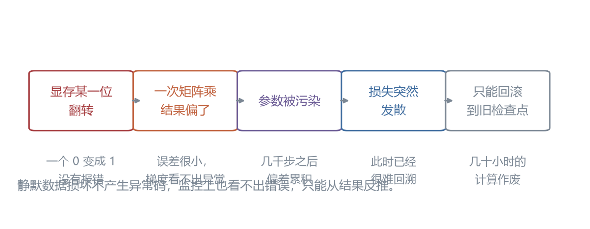

# 第 12 章　会算错的东西

## 12.1　不报错的错误

有一种故障在日志里找不到任何痕迹。进程没退，NCCL 没超时，XID 一条没有，`nvidia-smi` 干净得像刚装好。训练照常往前跑，每步耗时稳定，loss 在往下走，只是比预期慢一点，或者在某一天突然抬起来，怎么调学习率都回不去。你把最近几天的检查点挨个拉出来评测，发现效果从三天前的某个点开始就没再改善。

原因是某个比特翻了。显存里存着 0.0625 的那两个字节，其中一位被翻了过来，再读出来就是另一个数。这个变化不会触发 ECC，因为它不是硬件报的错，而是数据在传输、存储或者计算的过程中被改变了，校验位跟着一起错了，或者那一段内存根本没有校验位。翻在尾数低位，相对误差可能只有万分之一，混在一批数据里做矩阵乘，结果就偏了那么一点点；翻在指数位上，出来的就是一个完全不同的量。那次前向没报错，那次反向没报错，梯度看起来也正常。可参数已经带着这点偏差往下走了。

这东西叫静默数据损坏，英文缩写 SDC。它的传播路径比故障本身更值得记住。

*图 12-1　静默数据损坏的传播路径*

图 12-1 是一条五步的路。显存某一位翻转，一次矩阵乘结果偏了，参数被污染，损失突然发散，最后只能回滚到旧检查点。底下那行小字是这条路上最要命的地方，一个 0 变成 1 没有报错，误差很小、梯度看不出异常，几千步之后偏差累积，此时已经很难回溯，几十小时的计算作废。

Llama 3 那 419 次意外中断里，静默数据损坏只被记了 6 次。比例不到百分之二，看着不起眼。但这类故障的处理成本远高于占比。换一张卡的活是二十分钟，定位一个 SDC 可能是几天。因为它不指向任何一台机器，你先要证明"确实有东西算错了"，再要找出"是哪一台算错了"，这两步都没有现成工具。

SDC 也不是 GPU 独有的问题。Meta 在自己的数据中心里观测到过 CPU 上的静默数据损坏，规模大到可以统计出规律。CPU 跑的是同样的矩阵乘，只是频率低、规模小，出错的机会少。一旦把几万颗 CPU 和几万张 GPU 放在一起跑几十天，小概率事件就变成了必然事件。

那么 ECC 为什么没拦住。因为 ECC 只管一段。HBM 上每一位有校验位，读取时能发现并纠正单比特错误，但校验只在存储介质这一环。数据从显存进计算单元、在寄存器里被乘加、经过 NVLink 传到另一张卡、再写回去，这条路上大部分环节是裸的。片上 SRAM 不是全部带 ECC，片上网络没有端到端校验，集合通信传的梯度也只有传输层的校验。所以一个发生在链路或者计算过程中的翻转，HBM 的 ECC 根本看不到。要真正拦住它，得在应用层做端到端校验，把一段数据的校验和算出来跟着数据一起传，收到之后重算一遍比对。这个开销在大规模训练里通常舍不得付，只能在关键路径上选择性开启。

所以做大规模训练时，**"没有报错"不能当成"没有出错"**。这句话要写进监控设计里，否则你所有的告警都建立在"系统会自己喊疼"这个假设上，而这个假设在 SDC 面前不成立。

## 12.2　数值不稳定

比 SDC 常见得多的是另一类问题，数值不稳定。它也不一定报错，但它至少会在 loss 曲线上留下一个尖。

一个典型的现场是这样的。训练到第 12000 步，loss 从 1.92 跳到 3.15，一步之内完成。接下来三百步它慢慢往下走，走到 2.05 就停住了，再也回不到原来的轨迹。这种叫 loss spike。另一种更干脆，某一步的 loss 直接变成 `nan`，之后每一步都是 `nan`，因为参数里已经混进了非数，任何乘以它的运算结果都是非数。这两种要分开处理，spike 有时候能扛过去，NaN 一定扛不过去。

spike 的成因有好几种，现象却长得很像，这是难判断的地方。注意力里的 logits 数值过大，softmax 之后梯度极度集中，一个批次就能把某几层的参数推得很远。学习率在 warmup 之后爬得太快，前几千步还能靠初始化撑住，到了某个点撑不住了。数据里混进了一条异常样本，比如一段重复了几万次的字符，或者一段全是控制符的乱码，它的梯度跟正常样本完全不是一个量级。还有优化器本身的状态，Adam 的二阶矩在某个参数上估计得极小，除下去就把更新量放大了几个数量级。

把这几种放在一起会发现一件事，spike 的形状和成因没有一一对应。同一个尖峰可能来自数据，也可能来自学习率；反过来，同一条异常样本在不同学习率下造成的尖峰能差好几倍。所以现场的顺序是先定形状、再猜成因，形状决定动作，成因决定要不要改代码。12.7 把形状分成四类，处置按类定。

还有一类来自精度。BF16 的尾数只有 7 位，它能表示的相对精度大约在千分之一的量级。做一次矩阵乘，累加几千项，每一项都有千分之一的舍入误差，误差不会互相抵消，而是随机游走地累积。参数量到几千亿、序列长度到几万 token 的时候，这种累积已经不能忽略。这也是为什么很多实现要在关键位置用 FP32 累加，矩阵乘的输入是 BF16，累加的中间结果却是 FP32，代价是 Tensor Core 的吞吐要打折。FP16 的问题更直接，它的最大表示范围只有 65504，梯度稍微大一点就溢出成 `inf`，这就是当年必须做 loss scaling 的原因。

Inf 和 NaN 一旦出现就会传染。一个 `inf` 乘上 0 得到 `nan`，`nan` 加上任何数还是 `nan`，几层之后整个张量全是 `nan`。所以检测必须在最早的位置做，等优化器更新完再看就晚了。

还有一个观察值得补充。spike 的发生位置往往很集中，要么在训练的前百分之几，要么在某个学习率阶梯切换的点上，要么在换了一批新数据的那几百步。把历次 spike 的步号全部标在一条时间线上，再叠上学习率曲线、数据配比变更记录、节点替换记录，很多次能直接对上。这件事平时看着没用，出事时能省下几天。

工程上的对策是一层层加的。梯度裁剪把全局范数卡在一个阈值上，超过就等比缩小，这一招能挡住大部分爆炸。z-loss 在 softmax 上加一个惩罚项，压住 logits 的绝对值。QK-norm 在注意力计算之前把 query 和 key 归一化，让 logits 不会因为维度大而爆掉。这些手段在论文里往往只是一句话，实际效果差别很大，要靠在真机上试。DeepSeek-V3 用 FP8 训了 14.8 万亿 token，靠的不是 FP8 本身稳，而是每一层张量都有自己的缩放因子，把数值压在可控范围内。

值得强调的是，**数值不稳定不是"代码有 bug"，它是有限精度下的常态**。同样的代码，换个模型尺寸、换个 batch 大小、换一批数据，稳定区间就变了。你不能指望一次调好永久有效。

## 12.3　精度与确定性

调试数值问题时，最想要的能力是"重跑一遍看能不能复现"。这件事在单卡上也常常做不到。

原因是浮点加法不满足结合律。三个数相加，先加前两个还是先加后两个，结果在数学上一样，在浮点里不一样。GPU 上大量使用原子加，多个线程同时往同一个地址累加，谁先谁后由调度器决定。矩阵乘的 kernel 有几十种实现，cuBLAS 会根据矩阵尺寸和当前 GPU 的占用情况启发式地选一个，选的哪一个可能每次都不一样。集合通信里的 ring all-reduce 也是分块累加，块的顺序同样影响最后几位。这些因素叠在一起，同一个程序跑两次，第 10 步的 loss 就可能差在第七位有效数字上。

单看这一点没什么。但它会毁掉一个很好用的调试工具，按位比较。本来你可以让两台机器跑同一份数据，比较参数的二进制内容，不一样就说明其中一台算错了。一旦结果天然不确定，这个比较就失去意义，你没法区分"这台机器坏了"和"这次调度换了个 kernel"。

所以有的框架提供确定性模式，关掉原子加、固定算法、限制成单流执行、固定随机数种子。开了之后同样的输入必然得到同样的输出，代价是性能下降，下降多少取决于模型结构，通常不能接受在正式训练里长期开着。实际做法是在怀疑数值问题的那几天开，定位完就关掉。

还有一层是数据本身的随机性。数据加载器打乱顺序、按 token 数打包、跨 rank 切分，这几步如果用了未播种的随机数，两次跑的 batch 内容就不一样。这个差异比浮点舍入大得多，但它不叫不确定，它叫没固定种子。调试的时候这两件事要分开，先把数据固定住，再看浮点层面还差多少。很多人把两者搅在一起，结果花了三天在浮点上，真正的原因是采样。

还有一层是不同并行度之间的等价性。张量并行切了 8 路，和切 4 路，数学上是同一个计算，实际结果是两组不同的浮点舍入。这意味着你不能拿 8 路的检查点直接续到 4 路的训练上并期望 loss 曲线完全接得上。接得上，但会有一个小的跳变，这个跳变要能解释清楚，不然会被误判成故障。

## 12.4　怎么发现

数值问题没法靠单点告警抓，只能靠多条曲线互相印证。

最基础的是 loss 本身。看绝对值意义不大，要看相对变化。相邻两步之间 loss 涨了 5% 以上就该看一眼，涨了 20% 以上基本可以确认出了问题。还要看它恢复的情况，正常的波动会在几十步内回到趋势线上，回不去的就是伤了。

梯度范数是第二双眼睛。全局梯度范数突然从 0.8 跳到 15，说明某一批数据的梯度异常，这时候还没到参数被污染的地步，是最好的干预时机。分层的梯度范数更有用，如果只有第 3 层到第 7 层在涨，问题很可能出在这几层的激活值上，比如 logits 过大。参数本身的范数也要看，正常情况下它缓慢增长然后趋于平稳，如果开始加速，说明更新量失控了。

这三条曲线要一起看，还要和基线一起看。绝对阈值在规模化之后基本没用，同一个指标在不同模型、不同并行度下的正常区间能差一个数量级。可行的做法是每个指标都存一份最近几千步的基线，告警写成"相对基线的偏离"，基线本身用中位数算，不要用均值，均值会被异常值自己抬高。

不同数据并行副本之间的对比是经常被忽略的一条。同一批参数，不同的 rank 拿到不同的数据分片，算出来的 loss 应该有差异但不该有系统性偏差。如果某个 rank 的 loss 连续几百步都比别人高一个量级，那要么是它的数据有问题，要么是它的计算有问题。这一条在排查 SDC 时特别有效，因为坏掉的那张卡所在的分片会一直偏离。

参数校验和是抓 SDC 的直接手段。定期对模型参数算一组统计量，在数据并行的各个副本之间比较。理论上副本之间的参数应该完全一致，实际上因为浮点不确定性会有微小差异，所以不能比哈希，要比统计量，比如均值、方差、绝对值之和。某个副本长期偏离，就把它列进怀疑名单。这个方法不精确，但成本低，可以一直开着。

最贵也最可信的是抽取重算。从一个可疑的检查点出发，换一组机器、换一种并行配置，重跑一百步，比较 loss 轨迹。如果两边偏差在正常范围内，说明那个检查点是干净的，问题出在之后的训练里。如果两边一开始就分叉，说明检查点已经脏了，往回再找一个。这个手段一次要花掉几百卡时，只在其他方法都指向"有东西算错了"但找不到是谁的时候用。

记录粒度本身也是个坑。spike 往往只有一步，如果你每十步才往监控里写一次 loss，那一步就被平滑掉了，看到的只是一条平稳的线。日志要按步记，至少对 loss 和梯度范数要这样子，存不下就存最近几千步的滑动窗口。出事之后回看的那段原始数据，往往就是能不能定位的分界线。

还有一类主动探测，隔一段时间跑一次已知答案的小矩阵乘，结果应该永远一致。这相当于给每张卡做体检，能在正式训练里发现那些只会算错、不会报错的卡。

## 12.5　怎么恢复

发现异常之后，第一件事是停下来。这一条听起来理所当然，实际执行起来经常有人舍不得。眼看着 loss 跳了一下又回来了，心想再跑两百步看看，结果两百步之后参数已经偏出去，回滚的距离反而更长。判断标准要提前定好，NaN 立刻停，spike 超过阈值停，连续两次 spike 停。

第二步是分类。如果只是 spike 且已经恢复，可以继续跑，但要记下来，因为同一个位置反复出问题说明有结构性的毛病。如果出现了 NaN，必须回滚，因为非数不可逆。如果是 SDC，回滚只是止血，换掉坏卡才是治病。

回滚的距离是个权衡。回滚到最近的检查点，可能那个检查点本身已经被污染，你回去之后跑两百步又坏。稳妥的做法是往回多退一两个检查点，跳过可疑的那一段。但这又意味着作废更多计算。一个一万卡的集群回滚两小时，按每卡时两美元的租金估算就是四万美元，这还没算上重新跑一遍的电和机位。所以检查点保留多少个、保留多久，是运维里要明确写下来的策略，不能到出事时临时决定。

如果怀疑是数据引起的，处理方式是跳过。把出问题那几百步对应的数据分片找出来，单独跑一遍看能不能复现，能复现就把它从训练集里剔掉，或者换一个采样顺序绕过去。大规模训练的数据集动辄几万亿 token，丢掉一小段不影响最终效果，比停三天去查一条脏样本划算。

如果怀疑是数值配置引起的，动的是超参。梯度裁剪的阈值收紧一档，学习率降一个量级跑几千步再慢慢升回去，warmup 拉长。这些动作都有代价，等于把训练往回拽了一截，但比彻底重来便宜。

如果上面都试过还是反复出问题，那就是硬件。定位方法前面说过，用同一份数据在不同节点上重算，看哪一组的结果偏离。这一步很枯燥，要一块一块地排除，但它能把一个模糊的"集群有问题"变成一个具体的"第 47 机柜第 12 台机器第 5 张卡"。

真正成熟的做法是把这些动作写成手册，并且定期演练。出事的时候人是在紧张状态下的，判断力会下降，这时候最需要的是一个明确的、按顺序执行的清单，而不是临场发挥。手册里还要写清楚每一步的验收标准，比如回滚后先跑五十步看 loss 是不是落在预期区间，正常才继续，不正常就再往回退一个检查点。没有验收标准的话，很容易在一个脏检查点上反复循环，一晚上过去什么也没解决。

每次恢复完还要记一笔，时间、现象、判断、动作、结果。这些记录单看很琐碎，累到几十次之后就能看出规律。哪些型号的卡坏得勤，哪个机柜的网经常抖，哪段数据总是出事，这些结论不会从当时的单次故障里读出来。

## 12.6　校验和、抽查与自检

SDC 的检测没有一招通吃。能用的手段就那么几种，各自看到一个侧面，成本差两个数量级。

第一类是校验和。它不是对参数算一个哈希然后比位，那在浮点世界里必然误报。可行的做法是把张量按块切开，每块算一个标量，比如均值、绝对值之和、平方和，跨卡汇总成一个数，下一轮再算一遍看偏离多少。为什么不能逐位比，12.3 讲过，浮点加法不满足结合律，同一份参数在两台机器上求和本来就差在最后几位，逐位比只会得到一堆噪声。

代价用一个除法就估出来了。1750 亿参数的 BF16 权重是 350 GB，按单卡 3.35 TB/s 的显存带宽整块读一遍是 0.10 秒。分摊到 1024 张卡上每张 0.34 GB，读一遍 0.1 毫秒，真正的开销是启动几千个 kernel、做一次标量归约的固定成本，落在几十毫秒。放到 2.8 TB 的检查点旁边看，这几十毫秒等于免费。所以问题不是开不开，而是多久算一次。算得勤，固定开销会积成几个百分点；算得稀，两次之间被污染的参数已经参与了几百步更新。常见的折中是每一百到几百步一次，并且和检查点对齐，这样每个校验和都有一个明确的归属。

第二类是抽查重算，前面提过一次，这里把账算细。取一份可疑检查点，换一组机器、换一套并行配置，跑一百步，比 loss 轨迹。175B 的模型、每步 400 万 token，一步是 $6\times1.75\times10^{11}\times4\times10^{6}$，合 $4.2\times10^{18}$ 次运算，一百步是 $4.2\times10^{20}$。1024 张 H100 在 MFU 40% 下每秒给出 $4.05\times10^{17}$ 次，除下来约 1036 秒，十七分钟。折成卡时是 295 卡时，按每卡时两美元算是 590 美元。

这个价格决定了两件事。一是它不能常开，每天跑十次就是六千美元，一个月十八万。二是它适合做终审，前面所有便宜手段都指向"确实有东西算错了"但说不清是谁的时候，用它把结论坐实。它还能反向用，如果两边分叉，说明检查点脏了，那就往前再找一份，重新跑一遍同样的流程。

第三类是自检 kernel。隔一段时间在一张卡上跑一个已知答案的小矩阵乘，尺寸不用大，几百阶就够，结果应该永远一致。更狠一点的做法是同一个计算用两种实现各跑一遍，BF16 的张量核和 FP32 的 CUDA 核，两边对不上就说明这张卡的计算单元有问题。这类测试跑一次是毫秒级，几乎不占资源，可以挂在训练进程的空闲线程里。

这些手段覆盖的时间尺度完全不同，这是它们要一起用的原因。12.4 里提过的分层统计量和跳副本对比，成本低到可以一直开着；校验和、自检居中；抽查重算放在最外层。

| 手段 | 能看到什么 | 单次成本 | 从发生到发现 |
|---|---|---|---|
| 参数校验和 | 参数被改写 | 几十毫秒 | 一个比对周期 |
| 分层统计量 | 某一层激活或梯度异常 | 与校验和同量级 | 一步 |
| 跨副本对比 | 某个数据并行副本持续偏离 | 一次标量归约 | 几十步 |
| 自检 kernel | 单卡算错但不报错 | 毫秒级 | 一个自检周期 |
| 抽查重算 | 端到端是否干净 | 几百卡时 | 小时级 |

校验和便宜，但它只看见参数，看不见激活；自检快，但它只能证明这张卡在测的那一秒是好的；抽查重算最硬，但它慢到一天最多做几次。**一个只装了抽查重算的团队，等于没有检测，因为没人会天天跑它**。

## 12.7　一个尖峰有四种长相

12.2 讲的是成因，这一节按现象分。出事的时候人看到的是曲线，不是原因，而曲线只有四种长相，处置动作各不相同。

第一种是一步尖峰，随后几十步回到原来的趋势线上。这种最多，通常来自某一批异常数据，或者某个 batch 的序列长度分布偏了。处置是记录、不动作，但要记步号。同一个位置反复出现，说明数据里有一段固定的东西在捣乱，那就不是偶然。

第二种是尖峰之后停在一个更高的平台上，回不到原轨迹。参数已经被推走了一段，学习率再把它拉不回来。这种要回滚，退到尖峰之前的检查点，同时把那一带的步号和数据分片号记下来，否则下次还会撞上。

第三种是 NaN 或 Inf，一步之后整条曲线都是非数。没有讨论空间，必须回滚。而且要退到出现非数之前的那份检查点。如果加载之后第一步就是 NaN，说明这份检查点本身已经脏了，继续往回退，不要在同一个点上反复试。

第四种是几百步尺度上的缓慢抬升，没有尖，只有斜率变了。这种最难认，因为它不像事故，像收敛变差。常见原因是数据配比换了、学习率调度走到切换点、或者某几层的权重范数在单调膨胀。查法是把最近几千步的分层梯度范数画出来，看是哪一层在推，再对照那几层对应的数据和超参改动。

判据要提前写死，不能临场定。"loss 相对上一步涨 5% 记一笔，涨 20% 停"，这种阈值放进手册，值班的人照着执行。临场判断的问题是每个人对"涨了多少"的感觉不一样，而一旦决定继续跑，代价是按小时算的。

## 12.8　梯度范数这只眼睛

loss 是结果，梯度范数是过程。前者要等一步算完才知道，后者在反向传播里就能看见，而且通常比 loss 早几十步显出异常。

要看三个数。全局范数，裁剪前和裁剪后要分开记，只记裁剪后的等于自欺，因为裁剪做的就是把它压到阈值以下。分层范数，至少按层号分开，出问题往往集中在相邻的几层，全模型的范数被几千层平均掉了，看不出尖。更新量相对参数的比值，这个数反映的是"这一步把权重挪动了多远"，比范数的绝对值更能说明训练是不是稳。

判读靠基线，不靠绝对阈值。每个模型、每种并行配置，梯度范数都有自己的正常区间，0.8 在某个模型上是常态，换一个模型可能意味着爆炸。所以监控要自己学基线，用最近几千步的中位数和分位数，偏离到几倍才告警。用均值当基线是个常见的错误，均值会被尖峰本身抬高，尖峰越频繁，基线越迟钝。

采样口径也要设计。每步都往监控写会撑爆存储，每十步写一次又会把单步尖峰抹平。折中是进程内保留每一步的值，只在内存里，滚动窗口几分钟；一旦越界，把这一步连同前后各五十步一起落盘。这样平时几乎不占存储，出事时现场还在。

## 12.9　确定性值多少钱

12.3 讲过为什么同样的程序跑两遍结果不同。这里算一下把它关掉要花多少。

确定性模式做的事很具体。关掉原子加，改成固定顺序的归约；固定 cuBLAS 和 cuDNN 的算法选择，不让它按当下占用情况启发式地挑；固定集合通信的算法与分块顺序；固定数据加载的种子、worker 数和打包规则。每一项单独看都只是几个百分点，叠起来就不好看了。

假设它让 MFU 从 40% 掉到 36%。一万六千张 H100 的峰值合起来是 $1.62\times10^{19}$ 次每秒，四个百分点就是 $6.5\times10^{17}$ 次每秒，一天少算 $5.6\times10^{22}$ 次。折成卡时是一万五千多卡时，按两美元算是三万美元。一天三万，一个月九十万。这个价码解释了为什么没人长期开着它。

所以正式训练不开，怀疑数值问题的那几天开。开之前先想清楚要看什么，因为确定性只在完全相同的条件下成立：同一个镜像、同一个驱动、同一个 kernel 版本、同一套并行度、同一个拓扑。少一样，复现就断在别处，你会以为是浮点，实际是版本差异。有人花了两天对比浮点舍入，最后发现两次跑的不是同一个容器。

## 12.10　回滚要退多远

回滚的距离不由"最近"决定，由"干净"决定。三个数放在一起看就清楚了。

一次回滚一小时，一万六千张卡就是一万六千卡时，三万二千美元。退三小时，九万六千美元。而停三天查一个问题，一万六千张卡乘七十二小时是 115 万卡时，二百三十万美元。三个数字摆在这里，结论很明确，**该退就退，退得狠一点，真正贵的是犹豫**。

但"退得狠"有上限。能退多远由检查点保留的份数决定，这也是为什么保留策略要按最坏情况设计，而不是按存储余量设计。每半小时一份、保留十份，能退五小时；每小时一份、保留三份，只能退三小时，而这三小时里如果含着污染，就没有干净点可回了。存储成本在这个尺度上可以忽略，一份 2.8 TB 存十份是 28 TB，比起因为退不回去而重训五十天，便宜到不值得讨论。

还有一种动作不叫回滚，叫跳过。怀疑是数据引起的时候不必动检查点，把出问题那段数据分片剔掉，或者换个采样顺序绕过去。几万亿 token 的数据集里丢几百步的量，对最终效果的影响小于随机噪声，比停三天去查一条脏样本划算得多。

回滚之后要有验收标准。跑五十步，看 loss 是否落在检查点记录的那个区间里，看梯度范数是否回到基线。不正常就再退一份。没有验收标准的话，很容易在一份脏检查点上反复加载、反复失败，一晚上就这么过去了。

## 12.11　排查的顺序

前面几节是手段，这一节是顺序。顺序错了，手段再好也白费，因为每一步都在烧卡时。

第一步定性，先确定是"一台机器算错"还是"整个训练在漂"。看跨副本的 loss 曲线，只有一个 rank 持续偏离，基本可以锁定单点；所有 rank 一起漂，那是数据、超参或者代码。这一步十分钟，但能省掉后面一半的工作。

第二步定位时间。把异常出现的第一步找出来，往前找最近的两份检查点。两份都干净，问题在中间这一段；前一份就脏，继续往前翻。这一步决定了后面所有重算的起点。

第三步分叉。同一份检查点、不同的机器、不同的并行度，各跑一百步比轨迹。两边一致说明检查点干净，问题出在训练过程；两边从第一步就分叉，问题在检查点或者它依赖的数据。

第四步二分。数据分片、层号、rank 号，三个维度都可以二分，一次砍掉一半。一万六千个 rank，二十次能定位到一张卡，前提是每次重算只要十几分钟。这也是为什么前面要把抽查重算的成本压到几百卡时，压不下来就没法二分。

第五步才是归因和处置。前面几步只是把"集群有问题"缩小成"第 47 机柜第 12 台第 5 张卡"，归因到具体原因往往还要看日志、看复现。处置按 12.10 的规矩走。

这套顺序要配一份时间预算。定性十分钟，定位半小时，分叉一小时，二分按次数算，加起来一天之内该有结论。一天还没有结论，多半是跳过了某一步，直接从现象猜原因了。
