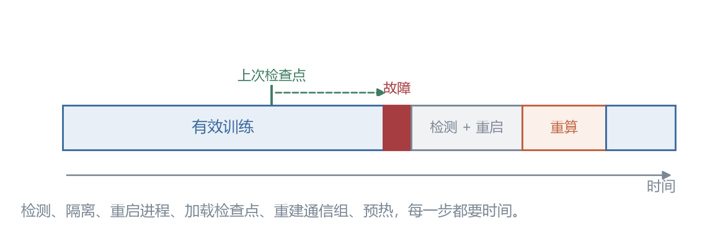

# 第 13 章　会等的东西

## 13.1　掉队者

跑训练的时候看一眼每张卡的步耗时统计，经常会看到一条长尾。中位数是 420 毫秒，百分之九十的卡在 430 毫秒以内，最慢的一张稳定在 452 毫秒。差得不多，百分之七。但这百分之七不是只损失在那张卡上。

数据并行在每个 step 末尾要做一次梯度归约，这是一次全局同步。所有卡把梯度算完，归约才能开始，归约完之后所有卡的参数才一起更新。所以一个 step 的耗时等于**最慢那张卡的耗时**，不是平均。一张卡慢百分之七，一万六千张卡一起慢百分之七。它一个人的问题变成了全队的问题。

这类卡有个专门的名字，掉队者。它的来源比故障琐碎得多，也隐蔽得多。

最常见的是降频。GPU 温度爬到阈值以上，驱动自动把时钟降下来，性能就掉一截。这件事在机柜里很常见，同一排机器共享冷风，靠后的那几台进风温度高几度，长期跑下来就比别人热。功耗封顶也会触发降频，同样的芯片，体质差一点的那个在长时间满载下更容易顶到 700 瓦的上限，然后就停在比标称低的频率上。

ECC 也会让卡变慢。单比特错误能被纠正，纠正本身不产生报错，但每次纠正要多花时间。一张卡一天纠正几百次，累积下来就是持续的微小延迟。这种卡的所有指标都正常，就是比别人慢一点，最难解释。

网络侧的拥塞更麻烦。某一条上行链路被别人占满，或者某个光模块的误码率上升导致重传，表现不是断开，而是每次通信多等几十毫秒。这时候卡的算力完全正常，慢在通信阶段，看 GPU 利用率看不出来，要看通信阶段单独的计时。

还有一类来自主机侧，数据加载跟不上。CPU 核数不够、解码太慢、本地盘读得慢，GPU 就把时间花在等 batch 上。这时候 GPU 利用率会周期性地掉到零，曲线像锯齿。这种情况在整个集群里只会发生在少数节点上，因为它们碰巧分到了比较重的那几个分片。

掉队者的影响范围跟并行策略有关。数据并行里一个慢卡拖慢一个 step 的归约，张量并行里它拖的是一整层的两次 all-reduce，而且通信量和激活值同阶，慢一点就会被放大，流水并行里一个慢级直接拉长整个流水周期，气泡也跟着变大。同样慢百分之五，卡在关键位置上的代价比在边角上的高得多。

识别掉队者靠的是分阶段计时。把每个 step 的时间拆成数据加载、前向、反向、通信四段，各自统计，再看每个 rank 的分布。如果所有 rank 的通信都慢，那是网络；如果只有少数 rank 的通信慢，那是它们所在的位置；如果只有前向慢，那是算力问题。这个拆解做起来不难，难的是把计时精度做到毫秒级又不影响性能。

掉队者的账可以直接算。中位数 420 毫秒、最慢 452 毫秒，差 7.6%。一万六千张卡的集群，一天被这张卡吃掉的时间是 $16000\times86400\times7.6\%$，约 $9.8\times10^{7}$ 卡秒，合 2.7 万卡时，按两美元算五万四千美元。一张卡的问题，一天五万美元。

统计口径比仪表盘样式重要。看平均值没有意义，一个极慢的点会被几千个正常点摊平，所以要看分布的上尾，p99 甚至最大值，而且按滑动窗口算，比如最近两百步。识别方法很朴素，把每个 rank 最近两百步的中位数排一次序，最慢的那一小摘进观察名单，连续几天都在名单里的下线检查。

处理方式是把它踢出去。掉队者不会自己好，而且会一直影响全局。有些团队的做法是每周按步耗时排一次序，把最慢的那一批节点挑出来下线检查，宁可错杀。听上去粗暴，实际上比让一张卡慢慢拖五十天便宜得多。

**同步训练的效率由最慢的那个决定，这在设计监控系统的时候就应该体现出来**。只报平均利用率的仪表盘，在这种集群上基本没有用。

## 13.2　检查点

训练不能一直往前跑。总得有地方可以回来，那个地方就是检查点。

检查点的体积不难算。混合精度训练下每个参数要存的东西不止一份，权重是 2 字节，优化器的一阶矩和二阶矩各 4 字节。一个 1750 亿参数的模型，光参数和优化器状态就是 2800 GB，这还没算梯度缓冲和随机数状态。所以一份完整的检查点大约 2.8 TB。

2.8 TB 写出去要多久，取决于存储能给多少带宽。按一个中等规模的并行文件系统、聚合写入 10 GB/s 估算，写一次要四分半。这个数字很关键，因为它直接决定了检查点能有多频繁。如果每半小时写一次，每次四分半，那么百分之十五的时间在写检查点。如果每两小时写一次，只占百分之四，但一旦出事要重跑两小时。

换成 405B 的模型，账就难看了。6480 GB 按同样的 10 GB/s 要 10.8 分钟。每三十分钟写一次，三分之一的时间在写检查点；每十九分钟写一次，超过一半。这不是效率问题，是这条路走不通，这一级参数量的模型必须用异步。存储快一点能好一些，50 GB/s 能把 10.8 分钟压到 2.2 分钟，但前提是那套存储只服务你一个作业。

写检查点的时候训练是停的。所有卡把参数和优化器状态从显存拷到主机内存，再通过网络送到存储。这两步都会打满对应的带宽，训练本身的通信就没法做了。所以同步检查点的代价不只是那四分半的写入时间，还有前后的准备和收尾。

存储还有一个容易忽略的细节，写完不等于落盘。文件系统有缓存，数据进了缓存就返回成功，真正的持久化在后台做。如果这时候机器挂了，你以为什么都写好了，实际上最后一部分没落地。所以正规的做法是写完再读回来校验一次，或者用支持同步落盘的接口。校验本身又要花时间，2.8 TB 读回来的耗时跟写出去差不多。

所以校验不能对每一份都做。常见折中是抽样，每十份读回一份，里程碑那几份必读。读回发现坏文件要当场重写，不能等到恢复那天才处理，那时候你既没带宽也没时间。

检查点的保留策略也有讲究。存多少份不是看存储够不够，而是看最坏情况下要往回退多远。一般至少保留最近两到三份，再额外保留几个里程碑级别的，比如每跑一万步、或者每次换数据配比之前。前一种用来应付日常的小故障，后一种用来应付那些需要往回查很远才发现的问题。存储成本在训练总成本里微不足道的，一份 2.8 TB 存十份也没什么，但它能换来的排查空间很大。

写检查点失败也是常见故障，而且很难发现。存储空间满了、配额到了、某个元数据服务崩了，表现可能是写入进程直接报错，也可能是默默只写了一半个文件。后者更危险，因为你在出事那天才会发现最新的几份检查点都是坏的。所以至少要有一道主动校验，在空闲时把最近几份读回来试加载一次。

检查点的分片方式也要跟着并行策略走。每个 rank 只写自己持有的那一部分参数，分片数等于数据并行度乘张量并行度乘流水并行度。这样每个 rank 写的量是 2.8 TB 除以卡数，一万张卡平均下来每张不到 1 GB，看起来很快。实际情况是几千个客户端同时打一个文件系统，元数据服务的压力比带宽更早成为瓶颈。有些团队会把检查点先写到本地盘，再异步汇总，就是为了绕开这一点。

## 13.3　恢复时间

出事之后的恢复不是一步。图 13-1 把这段时间拆成了几段。

*图 13-1　一次故障从发生到恢复的时间线*

最左边是上次写检查点的位置，然后是有效训练，接着故障发生。故障之后先是检测和重启，再是重算，重算完了才回到有效训练。图上的红色小块是故障本身，橙色块是重算，这两块加起来才是真正的损失。

检测这一段常常是最长的。前面讲过，同步训练里的一张卡掉线不会立刻报错，要等到集合通信超时。超时阈值设在分钟量级，所以最坏情况下你要白等十几分钟才知道出事了。缩短这一段只能靠旁路监控，比如在另一个进程里盯着每张卡的健康状态和每个 rank 的心跳，发现异常主动杀掉整个作业，不等超时。

旁路监控有它自己的风险，阈值设紧了会误杀。一次误杀的代价是一次完整的恢复加一段重算，实打实是二十多分钟。一天误杀两次就是一个小时，占掉一天的四个百分点。所以判据要用两个条件同时成立，序号停止前进超过若干秒，同时卡上的计算活动确实停了，只看其中一条都会把健康的作业杀掉。

重启这一段取决于有没有备件。有热备节点，调度器几秒钟就能补上；没有备件，要去队列里等别的作业释放资源，那就不是分钟级的事了。把作业重新拉起来本身也要时间，容器镜像要拉，依赖要装，几千个进程的启动顺序要协调。

加载检查点是纯 I/O。2.8 TB 从存储读回来，按同样的 10 GB/s 估算又是四分半。如果检查点存得远，或者存储正忙着给别的作业服务，这个时间会翻几倍。加载完之后还要重建通信组，NCCL 要把拓扑探测一遍，建连、握手、选算法，规模到一万六千卡时这段要几十秒。

最后是预热。这一步在纸面上经常被忽略，实际很贵。cuBLAS 和 cuDNN 要重新选 kernel，JIT 编译要重新做，显存分配器要重新长到稳定状态，流水并行要把微批次重新灌满。表现在曲线上就是头几十步特别慢，之后才回到正常步耗时。

还有一段是人。告警发出来到有人看到，中间可能隔着几分钟，半夜更久。这也是为什么恢复流程里人的那几步要尽量少，凡是能写成脚本的都不要留给人判断。值班的人只应该做一件事，确认要不要继续，而不是去找哪张卡坏了。

把这几段加起来，一次典型的中断从发生到回到有效训练，十几分钟到几十分钟。乘上 3.1 小时一次的频率，一天八次，就是两三个小时。一天二十四个小时，十分之一没了。

## 13.4　有效算力

到这里可以把前面几章的账合起来算了。

一万六千张 H100，每张的 BF16 峰值是 989.4 TFLOPS，合起来是 $1.62\times10^{19}$ 次浮点运算每秒，也就是 16 EFLOPS 量级。这是理论峰值，任何真实程序都到不了。Llama 3 报的 MFU 是 38% 到 43%，取中间值 40%，实际持续算力就是 $6.5\times10^{18}$ 左右。这是算得快的那些时候的数字，还没扣掉停机。

有效训练时间高于 90%，所以再乘 0.9，落在 $5.8\times10^{18}$ 附近。**从 16 EFLOPS 的铭牌数字，到 5.8 的实际持续算力，中间少了将近三分之二**。这部分不是被谁偷走了，它就是大规模训练的日常开销，一半来自硬件利用率上不去，一半来自系统要停机。

这个乘法关系值得记成一句话，有效算力等于峰值乘 MFU 乘可用率。三个因子互相牵制。想把 MFU 从 40% 提到 45%，可能要把并行度调小，那单卡分到的 batch 变小，通信占比上升，未必划算。想把可用率从 90% 提到 95%，检查点要写得更勤，写检查点的开销又吃掉了 MFU。所有优化都是在三个因子之间挪。

这三个因子在监控上要分开报。只报一个有效算力的话，它掉下去的时候你分不清是模型算得慢了还是机器停得多了。分开报就是两行数字，一行是每步耗时对应的 MFU，一行是过去二十四小时里真正在跑的比例，掉的是哪一行一目了然。

三个因子各自怎么测，决定了这个数字能不能横向比较。MFU 要用一步的实测耗时反推，6ND 除以卡数、峰值、步时三者的乘积，不能拿训练结束的总 FLOPs 除以总机时，后者把停机也算进了分母，算出来的是一个既不是峰值也不是实际值的数。可用率的分母要写清楚，是自然时间还是分配时间，两者的差别全在排队上。检查点开销要单列，它既不是 MFU 也不是可用率，塞进任何一边，另一个数字就失真了。

钱的角度更直观。一万卡的集群按每卡时两美元估算，一天就是四十八万美元。可用率掉十个百分点，等于每天白烧四万八千美元。这个数字比任何技术指标都更能说服人去做自动化恢复。按一天八次、每次多停十分钟算，停机就是八十多分钟，一万六千张卡乘上去约两万一千卡时，按两美元算就是四万多美元，五十天下来就是两百万。这还只是停机本身，没算重算的那一段。

MFU 那三个百分点也值钱。同样是一万六千张 H100，40% 和 43% 差的是三个百分点，折成卡时是 $16384\times86400\times3\%\div3600$，一天近一万两千卡时，两万四千美元。持续五十天就是一百二十万美元。所以 MFU 报表上多一个小数点，背后是一笔真实的预算。

## 13.5　把等待藏起来

既然等待不可避免，剩下的问题就是怎么让它不占时间。

最有效的一招是异步检查点。思路是把"写出去"和"等写完"分开。训练进程把参数和优化器状态拷到主机内存，拷完就继续跑，后台进程慢慢往存储上传。显存里的东西不能动，但主机内存里的副本是快照，跟训练无关。这样一来检查点的停顿从四分半降到拷贝的那一下，几百毫秒量级。代价是主机内存要留出 2.8 TB 的空间，一万张卡分摊下来每张几百 MB，还算能接受。

难点在于一致性。拷贝的过程中参数还在被更新，如果拷得不够快，快照里会混进不同步的参数，恢复出来就是错的。做法是先暂停更新、拷贝、恢复更新，这个暂停窗口要压到最短。有的实现用 `fork` 加写时复制，能在毫秒级拿到一个一致的快照。

第二招是计算通信重叠。梯度不是算完整个模型才归约的，反向传播是一层层往回走的，每算完一层的梯度就可以把这一层发出去。把梯度按层分桶，桶满了就启动一次 all-reduce，让网络传输和剩下的反向计算并行。这样一来通信时间大部分被藏进了计算里，MFU 能上去好几个百分点。代价是显存里要同时留几份梯度缓冲。

重叠也不是无限的。反向传播的计算量就那么多，能用来遮住通信的时间有上限，通信量超过这个上限就只能暴露出来。所以真正决定上限的还是并行策略本身，重叠只是把已经存在的空间填满。

第三招是增量或者分层检查点。参数全都要存，但优化器状态里有一部分是可重建的，可以不存。或者把不常变的部分单独存一份，只更新变化大的。这些做法能省下一些字节，但会让恢复逻辑变复杂，出错的时候更难排查。

检查点该多频繁，是可以算出来的。图 13-2 画了这条曲线。

*图 13-2　检查点间隔与浪费时间的关系*

横轴是检查点间隔，纵轴是被浪费的时间占比。曲线两头都高。间隔太短，写检查点的次数太多，每次的开销累加起来很可观；间隔太长，每次故障之后要重算的距离太长。中间有个最低点。

按异步检查点每次约 1 分钟、平均故障间隔 3.1 小时估算，最优点落在 19 分钟附近，浪费约 10.4%。这个数不是猜的，它来自两项的平衡。写检查点的开销是 1 除以间隔，间隔 19 分钟时是 5.3%。故障后的重算量平均是间隔的一半，19 分钟的一半是 9.5 分钟，除以 186 分钟的平均间隔，又是 5.1%。两项加起来 10.4%。当两项相等时总和最小，这时候的间隔约等于两次检查点开销与平均故障间隔相乘再开方。

这个算法可以直接搬到自己集群上。把实测的写检查点耗时和 MTBF 代进去，算出来一个间隔，然后在这个值附近试两三个档位。很多团队在这个问题上凭感觉拍一个"每半小时一次"，运气好落在最优点附近，运气不好就多浪费几个百分点。

曲线还说明一件事，**最优点很平**。19 分钟是 10.4%，20 分钟是 10.4%，30 分钟也只到 11% 出头。这意味着在这个问题上过度优化没有意义，差一两个百分点不值得花大力气。真正值得花力气的是那个 1 分钟的写入开销，如果能压到 30 秒，整条曲线整体下移，最优点也会左移。

## 13.6　同步写完，还是先拍个快照

13.2 描述的是同步检查点。所有卡停下，把参数和优化器状态拷到主机内存，再送到存储，确认落盘才继续。整个过程训练是停的。

异步把"写"和"等"拆开。训练进程只负责把显存里的内容拷进主机内存，拷完立刻继续跑；另起一组进程把主机内存里的副本慢慢送到存储。显存那一步必须同步，因为显存马上要被继续使用；主机内存那一步不必等，因为快照已经和训练无关了。

停顿从四分半降到几百毫秒，这是异步唯一的好处，但好处足够大。代价落在三个地方。

一是主机内存。要额外留一份完整副本。175B 是 2.8 TB，一万张卡分摊每张 280 MB；405B 是 6480 GB，一万六千张卡分摊每张 0.40 GB。单看不多，但主机内存本来就被数据加载的预取缓冲占着，再加几百兆，在内存紧的节点上会开始 swap。swap 一开，训练就废了。

二是一致性。拷贝的那一刻参数还在被更新，如果拷到一半某层被改了，快照里就混着两个时刻的参数，恢复出来是一份从来没存在过的模型。做法是先暂停更新、拷完再放开，窗口压到毫秒级；或者用 fork 加写时复制，子进程看到的是冻结的页表。

三是"写完"的定义变了。同步检查点落盘就等于可用；异步要区分快照完成和落盘完成，前者几秒，后者几分钟。这中间机器挂了，你以为有检查点，实际上存储上只有一个写了一半的文件。

| 项目 | 同步检查点 | 异步检查点 |
|---|---|---|
| 训练停顿 | 整个写入过程，175B 约 4.7 分钟 | 拷进主机内存，数百毫秒 |
| 数据路径 | 显存到主机内存到存储，全程阻塞 | 显存到主机内存阻塞，之后后台传输 |
| 主机内存 | 拷完就释放，可以复用 | 额外留一份完整副本 |
| 一致性 | 参数静止，天然一致 | 要额外保证快照一致 |
| 何时可用 | 落盘之后 | 快照完成即可，落盘前有风险窗口 |
| 典型间隔（MTBF 3.1 小时） | 41.8 分钟 | 19.3 分钟 |
| 浪费时间占比 | 22.5% | 10.4% |

表里最该看的是最后两行。同样是这台集群，换个检查点方式，浪费的时间从两成掉到一成。

分水岭在模型大小。175B 用同步，4.7 分钟写一次，间隔三十分钟，占比 15.6%，疼但忍得住。405B 就不行，10.8 分钟写一次，同样的间隔是 36%，只有异步才能把它拉回可接受的范围。所以模型越大，检查点越不是"顺手做一下"的功能，而是一套独立的子系统。

异步自己也有失败模式，后台追不上。间隔 19 分钟、单次传输才几分钟，平时有余量；但存储一抖动，队列就开始堆，主机内存被几份快照占满，最后 OOM 把训练进程一起带走。所以异步要盯队列深度，队列超过两份就跳过一份，宁可少一份检查点，不能让内存爆。

## 13.7　增量：少写一点，多想一点

增量检查点的出发点是一句观察。两次检查点之间参数全都变了，但优化器状态里有一部分是可以重建的。

Adam 的一阶矩和二阶矩理论上能从参数的历史轨迹重算，代价是要保留足够长的历史，或者接受一段精度损失。某些层在训练后期几乎不动，可以降低保存频率。这些做法能省多少，取决于你愿意在恢复时多花多少计算，没有通用答案。

更常见的是分层。热检查点写本地，只留最近两三份；冷检查点异步传对象存储，只留里程碑。恢复时先找本地，找不到再回源。这条路之所以快，是因为分片之后单节点要写的量其实很小。405B 的 6480 GB 摊到 2048 个节点上，每个节点 3.2 GB，本地盘的带宽比共享文件系统高一个数量级，写这点数据是秒级的事；而共享文件系统在几千个客户端同时开口的时候，元数据服务会先撑不住。

代价在恢复路径上。一份被裁剪过的检查点缺了哪一块、怎么补、补完怎么校验，只有写这段代码的人清楚，半夜三点值班的人不清楚。所以判断标准很简单，**如果检查点开销占总时间不到百分之五，就不要做增量**。收益太小，复杂度全落在最不该复杂的地方。

## 13.8　间隔是可以推出来的

设检查点间隔 T，写一次花 C，平均故障间隔 M。浪费来自两处。

写检查点的时间占比是 $C/T$。故障之后平均要退半个间隔，即 $T/2$，摊到每次故障是 $T/(2M)$。两项加起来是 $f(T)=C/T+T/(2M)$，求导令其为零，得到 $T^{*}=\sqrt{2CM}$，最小值 $f(T^{*})=\sqrt{2C/M}$。

代入 C 取 1 分钟、M 取 186 分钟，$T^{*}$ 是 19.3 分钟，$f$ 是 10.4%，两项各占 5.2%。13.5 里那个 19 分钟和 10.4% 就是这么来的。换成同步的 4.7 分钟，$T^{*}$ 变成 41.8 分钟，$f$ 是 22.5%。把 C 压到 30 秒，$T^{*}$ 是 13.6 分钟，$f$ 是 7.3%。

三个点摆在一起能看出规律。C 降为原来的十分之一，最优点降为三分之一，浪费也降为三分之一，因为 $T^{*}$ 和 $f(T^{*})$ 都随 $\sqrt{C}$ 走。所以异步不是锦上添花，它同时移动了最优点和最低值。

曲线平这件事 13.5 已经说过，这里只补两个隐含约束。间隔越短，同时在写的检查点越多，而保留份数乘间隔就是能回退的时间跨度，T 取 19 分钟、保留十份，只能退三小时出头。另一个约束是存储带宽，间隔短到上一份还没写完就要写下一份，后台就永远在追。所以最优点算出来之后还要过一遍这两条，过不了就把 T 调大，接受高一点的浪费。

公式的边界要说清楚。它假设故障是泊松过程，实际不是，批次性缺陷会让故障成簇出现，成簇时的重算成本比按次算高一截。它假设重算成本与回滚距离成正比，实际还要加固定重启开销，间隔取得很短时那一项会占主导。它也没算人的时间，一次半夜的告警值多少钱，取决于团队怎么排班。所以算出来的 $T^{*}$ 是起点，不是答案，真实值要在它附近试两三个档位。

M 这个数要自己测，不能拿别人的。算法是用一段时间里的意外中断次数除以那段时间，计划内的换线、升级要扣除。不同团队的统计口径差异很大，同样的集群按事件算和按节点算能差一倍，所以拿自己的历史和别人的数字对比之前，先把两边定义对齐。

## 13.9　十七分钟花在哪

13.3 把恢复拆成五段，这里给一副具体的账。检测 8 分钟，重启 2 分钟，加载 4.7 分钟，建链 0.7 分钟，预热 2 分钟，合计 17.4 分钟。一天八次是 139 分钟，两个多小时，占一天的 9.7%。剩下的九成才是在训练。

五段里只有加载是纯 I/O，压它靠带宽。其余四段都有人为设定的余量，也就是都压得动。

检测能从 8 分钟压到 1 分钟以内。办法是旁路监控，单独一个进程盯每张卡的心跳和每个 rank 的集合通信序号，序号不再前进就主动杀作业，不等 NCCL 超时。省下的七分钟，一天八次是 56 分钟。

预热能从 2 分钟压到半分钟。cuBLAS 的算法选择结果可以按形状缓存，JIT 产物可以落盘复用，显存分配器可以保留池子。这些事训练框架默认不做，要自己补，补一次之后每次重启都受益。

建链的几十秒基本压不掉，拓扑探测和握手是物理过程。加载的 4.7 分钟取决于存储离得多近，本地盘上一份热检查点能压到一分钟以内，这是分层存储真正值钱的地方。

加起来，17.4 分钟能到 6 分钟左右。一天省下 91 分钟，一万六千张卡乘上去是 2.4 万卡时，四万八千美元。这些优化是一次投入、之后每天付利息的生意，比反复调检查点间隔划算得多。

先压哪一段有讲究。检测和预热加起来占十分钟，投入小、风险低，先动它们；加载依赖存储改造，投入大，但它是下一阶段的天花板；建链基本不动。这个顺序和投入产出比一致，也和风险一致。

## 13.10　慢和坏不是一回事

掉队者最难处理的地方，是它不属于故障。故障有信号，掉线、XID 报错、通信超时；掉队者只有一个数字，比别人大一点。

所以它经常被两套流程同时漏掉。故障处理不管它，因为它没报错；性能优化也不管它，因为百分之七落在噪声里。它就挂在那里，一天五万美元，挂五十天。

按故障处理也有问题。一张卡慢 7%，没有任何理由换掉它，硬件检测全过，换上去那张还有可能更慢。粗暴下线之所以流行，不是因为它精确，是因为它便宜。下线检查的成本是几个小时，留着它的成本是一天几万美元，这笔账不需要精确。

边界得自己定。常见做法是给每个 rank 算一个相对中位数的偏离，超过某个比例并且持续若干天才进名单。进名单之后先隔离，把它从关键位置挪到边角，再看偏离跟不跟着走。跟着走说明是卡的问题；不跟，说明是位置的问题，同一排机柜、同一个交换机下面的卡一起慢，那是散热和网络，换卡没用。

还有一类是间歇性的。一周只慢两天，落在统计窗口边缘，按天排序列不出来。这类只能靠长周期记录，把每个 rank 的每日中位数存下来看趋势。只看当天的曲线，永远抓不到它。

处置的收益也值得算。把一张慢 7% 的卡拉回正常，全局步时回到原来的水平，一万六千张卡上等于每天多出一千多卡时。代价是换卡之后可能引进一张新卡，而新卡有早期失效，头几周的故障率比老卡高。所以下线的判据不只是"它慢"，还要看它慢出的损失是否大于换卡带来的风险。
