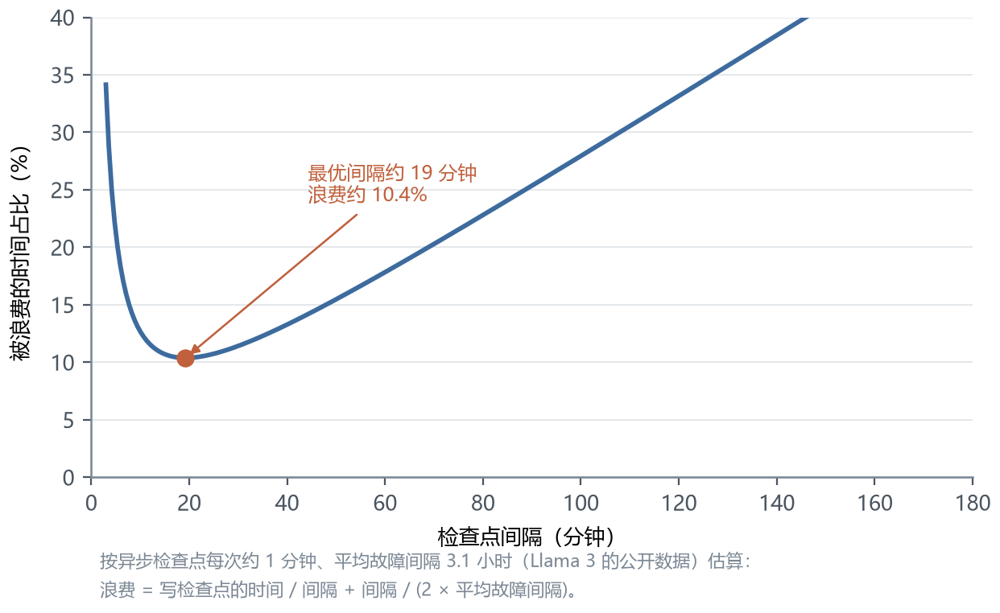

# 第 13 章　会等的东西

## 13.1　掉队者

跑训练的时候看一眼每张卡的步耗时统计，经常会看到一条长尾。中位数是 420 毫秒，百分之九十的卡在 430 毫秒以内，最慢的一张稳定在 452 毫秒。差得不多，百分之七。但这百分之七不是只损失在那张卡上。

数据并行在每个 step 末尾要做一次梯度归约，这是一次全局同步。所有卡把梯度算完，归约才能开始，归约完之后所有卡的参数才一起更新。所以一个 step 的耗时等于**最慢那张卡的耗时**，不是平均。一张卡慢百分之七，一万六千张卡一起慢百分之七。它一个人的问题变成了全队的问题。

这类卡有个专门的名字，掉队者。它的来源比故障琐碎得多，也隐蔽得多。

最常见的是降频。GPU 温度爬到阈值以上，驱动自动把时钟降下来，性能就掉一截。这件事在机柜里很常见，同一排机器共享冷风，靠后的那几台进风温度高几度，长期跑下来就比别人热。功耗封顶也会触发降频，同样的芯片，体质差一点的那个在长时间满载下更容易顶到 700 瓦的上限，然后就停在比标称低的频率上。

ECC 也会让卡变慢。单比特错误能被纠正，纠正本身不产生报错，但每次纠正要多花时间。一张卡一天纠正几百次，累积下来就是持续的微小延迟。这种卡的所有指标都正常，就是比别人慢一点，最难解释。

网络侧的拥塞更麻烦。某一条上行链路被别人占满，或者某个光模块的误码率上升导致重传，表现不是断开，而是每次通信多等几十毫秒。这时候卡的算力完全正常，慢在通信阶段，看 GPU 利用率看不出来，要看通信阶段单独的计时。

还有一类来自主机侧，数据加载跟不上。CPU 核数不够、解码太慢、本地盘读得慢，GPU 就把时间花在等 batch 上。这时候 GPU 利用率会周期性地掉到零，曲线像锯齿。这种情况在整个集群里只会发生在少数节点上，因为它们碰巧分到了比较重的那几个分片。

掉队者的影响范围跟并行策略有关。数据并行里一个慢卡拖慢一个 step 的归约，张量并行里它拖的是一整层的两次 all-reduce，而且通信量和激活值同阶，慢一点就会被放大，流水并行里一个慢级直接拉长整个流水周期，气泡也跟着变大。同样慢百分之五，卡在关键位置上的代价比在边角上的高得多。

识别掉队者靠的是分阶段计时。把每个 step 的时间拆成数据加载、前向、反向、通信四段，各自统计，再看每个 rank 的分布。如果所有 rank 的通信都慢，那是网络；如果只有少数 rank 的通信慢，那是它们所在的位置；如果只有前向慢，那是算力问题。这个拆解做起来不难，难的是把计时精度做到毫秒级又不影响性能。

处理方式是把它踢出去。掉队者不会自己好，而且会一直影响全局。有些团队的做法是每周按步耗时排一次序，把最慢的那一批节点挑出来下线检查，宁可错杀。听上去粗暴，实际上比让一张卡慢慢拖五十天便宜得多。

**同步训练的效率由最慢的那个决定，这在设计监控系统的时候就应该体现出来**。只报平均利用率的仪表盘，在这种集群上基本没有用。

## 13.2　检查点

训练不能一直往前跑。总得有地方可以回来，那个地方就是检查点。

检查点的体积不难算。混合精度训练下每个参数要存的东西不止一份，权重是 2 字节，优化器的一阶矩和二阶矩各 4 字节。一个 1750 亿参数的模型，光参数和优化器状态就是 2800 GB，这还没算梯度缓冲和随机数状态。所以一份完整的检查点大约 2.8 TB。

2.8 TB 写出去要多久，取决于存储能给多少带宽。按一个中等规模的并行文件系统、聚合写入 10 GB/s 估算，写一次要四分半。这个数字很关键，因为它直接决定了检查点能有多频繁。如果每半小时写一次，每次四分半，那么百分之十五的时间在写检查点。如果每两小时写一次，只占百分之四，但一旦出事要重跑两小时。

写检查点的时候训练是停的。所有卡把参数和优化器状态从显存拷到主机内存，再通过网络送到存储。这两步都会打满对应的带宽，训练本身的通信就没法做了。所以同步检查点的代价不只是那三分半的写入时间，还有前后的准备和收尾。

存储还有一个容易忽略的细节，写完不等于落盘。文件系统有缓存，数据进了缓存就返回成功，真正的持久化在后台做。如果这时候机器挂了，你以为什么都写好了，实际上最后一部分没落地。所以正规的做法是写完再读回来校验一次，或者用支持同步落盘的接口。校验本身又要花时间，2.8 TB 读回来的耗时跟写出去差不多。

检查点的保留策略也有讲究。存多少份不是看存储够不够，而是看最坏情况下要往回退多远。一般至少保留最近两到三份，再额外保留几个里程碑级别的，比如每跑一万步、或者每次换数据配比之前。前一种用来应付日常的小故障，后一种用来应付那些需要往回查很远才发现的问题。存储成本在训练总成本里微不足道的，一份 2.8 TB 存十份也没什么，但它能换来的排查空间很大。

写检查点失败也是常见故障，而且很难发现。存储空间满了、配额到了、某个元数据服务崩了，表现可能是写入进程直接报错，也可能是默默只写了一半个文件。后者更危险，因为你在出事那天才会发现最新的几份检查点都是坏的。所以至少要有一道主动校验，在空闲时把最近几份读回来试加载一次。

检查点的分片方式也要跟着并行策略走。每个 rank 只写自己持有的那一部分参数，分片数等于数据并行度乘张量并行度乘流水并行度。这样每个 rank 写的量是 2.8 TB 除以卡数，一万张卡平均下来每张不到 1 GB，看起来很快。实际情况是几千个客户端同时打一个文件系统，元数据服务的压力比带宽更早成为瓶颈。有些团队会把检查点先写到本地盘，再异步汇总，就是为了绕开这一点。

## 13.3　恢复时间

出事之后的恢复不是一步。图 13-1 把这段时间拆成了几段。

*图 13-1　一次故障从发生到恢复的时间线*

最左边是上次写检查点的位置，然后是有效训练，接着故障发生。故障之后先是检测和重启，再是重算，重算完了才回到有效训练。图上的红色小块是故障本身，橙色块是重算，这两块加起来才是真正的损失。

检测这一段常常是最长的。前面讲过，同步训练里的一张卡掉线不会立刻报错，要等到集合通信超时。超时阈值设在分钟量级，所以最坏情况下你要白等十几分钟才知道出事了。缩短这一段只能靠旁路监控，比如在另一个进程里盯着每张卡的健康状态和每个 rank 的心跳，发现异常主动杀掉整个作业，不等超时。

重启这一段取决于有没有备件。有热备节点，调度器几秒钟就能补上；没有备件，要去队列里等别的作业释放资源，那就不是分钟级的事了。把作业重新拉起来本身也要时间，容器镜像要拉，依赖要装，几千个进程的启动顺序要协调。

加载检查点是纯 I/O。2.8 TB 从存储读回来，按同样的 10 GB/s 估算又是三分半。如果检查点存得远，或者存储正忙着给别的作业服务，这个时间会翻几倍。加载完之后还要重建通信组，NCCL 要把拓扑探测一遍，建连、握手、选算法，规模到一万六千卡时这段要几十秒。

最后是预热。这一步在纸面上经常被忽略，实际很贵。cuBLAS 和 cuDNN 要重新选 kernel，JIT 编译要重新做，显存分配器要重新长到稳定状态，流水并行要把微批次重新灌满。表现在曲线上就是头几十步特别慢，之后才回到正常步耗时。

还有一段是人。告警发出来到有人看到，中间可能隔着几分钟，半夜更久。这也是为什么恢复流程里人的那几步要尽量少，凡是能写成脚本的都不要留给人判断。值班的人只应该做一件事，确认要不要继续，而不是去找哪张卡坏了。

把这几段加起来，一次典型的中断从发生到回到有效训练，十几分钟到几十分钟。乘上 3.1 小时一次的频率，一天八次，就是两三个小时。一天二十四个小时，十分之一没了。

## 13.4　有效算力

到这里可以把前面几章的账合起来算了。

一万六千张 H100，每张的 BF16 峰值是 989.4 TFLOPS，合起来是 $1.62\times10^{19}$ 次浮点运算每秒，也就是 16 EFLOPS 量级。这是理论峰值，任何真实程序都到不了。Llama 3 报的 MFU 是 38% 到 43%，取中间值 40%，实际持续算力就是 $6.5\times10^{18}$ 左右。这是算得快的那些时候的数字，还没扣掉停机。

有效训练时间高于 90%，所以再乘 0.9，落在 $5.8\times10^{18}$ 附近。**从 16 EFLOPS 的铭牌数字，到 5.8 的实际持续算力，中间少了将近三分之二**。这部分不是被谁偷走了，它就是大规模训练的日常开销，一半来自硬件利用率上不去，一半来自系统要停机。

这个乘法关系值得记成一句话，有效算力等于峰值乘 MFU 乘可用率。三个因子互相牵制。想把 MFU 从 40% 提到 45%，可能要把并行度调小，那单卡分到的 batch 变小，通信占比上升，未必划算。想把可用率从 90% 提到 95%，检查点要写得更勤，写检查点的开销又吃掉了 MFU。所有优化都是在三个因子之间挪。

这三个因子在监控上要分开报。只报一个有效算力的话，它掉下去的时候你分不清是模型算得慢了还是机器停得多了。分开报就是两行数字，一行是每步耗时对应的 MFU，一行是过去二十四小时里真正在跑的比例，掉的是哪一行一目了然。

钱的角度更直观。一万卡的集群按每卡时两美元估算，一天就是四十八万美元。可用率掉十个百分点，等于每天白烧四万八千美元。这个数字比任何技术指标都更能说服人去做自动化恢复。按一天八次、每次多停十分钟算，停机就是八十多分钟，一万六千张卡乘上去约两万一千卡时，按两美元算就是四万多美元，五十天下来就是两百万。这还只是停机本身，没算重算的那一段。

## 13.5　把等待藏起来

既然等待不可避免，剩下的问题就是怎么让它不占时间。

最有效的一招是异步检查点。思路是把"写出去"和"等写完"分开。训练进程把参数和优化器状态拷到主机内存，拷完就继续跑，后台进程慢慢往存储上传。显存里的东西不能动，但主机内存里的副本是快照，跟训练无关。这样一来检查点的停顿从三分半降到拷贝的那一下，几百毫秒量级。代价是主机内存要留出 2.8 TB 的空间，一万张卡分摊下来每张几百 MB，还算能接受。

难点在于一致性。拷贝的过程中参数还在被更新，如果拷得不够快，快照里会混进不同步的参数，恢复出来就是错的。做法是先暂停更新、拷贝、恢复更新，这个暂停窗口要压到最短。有的实现用 `fork` 加写时复制，能在毫秒级拿到一个一致的快照。

第二招是计算通信重叠。梯度不是算完整个模型才归约的，反向传播是一层层往回走的，每算完一层的梯度就可以把这一层发出去。把梯度按层分桶，桶满了就启动一次 all-reduce，让网络传输和剩下的反向计算并行。这样一来通信时间大部分被藏进了计算里，MFU 能上去好几个百分点。代价是显存里要同时留几份梯度缓冲。

重叠也不是无限的。反向传播的计算量就那么多，能用来遮住通信的时间有上限，通信量超过这个上限就只能暴露出来。所以真正决定上限的还是并行策略本身，重叠只是把已经存在的空间填满。

第三招是增量或者分层检查点。参数全都要存，但优化器状态里有一部分是可重建的，可以不存。或者把不常变的部分单独存一份，只更新变化大的。这些做法能省下一些字节，但会让恢复逻辑变复杂，出错的时候更难排查。

检查点该多频繁，是可以算出来的。图 13-2 画了这条曲线。

*图 13-2　检查点间隔与浪费时间的关系*

横轴是检查点间隔，纵轴是被浪费的时间占比。曲线两头都高。间隔太短，写检查点的次数太多，每次的开销累加起来很可观；间隔太长，每次故障之后要重算的距离太长。中间有个最低点。

按异步检查点每次约 1 分钟、平均故障间隔 3.1 小时估算，最优点落在 19 分钟附近，浪费约 10.4%。这个数不是猜的，它来自两项的平衡。写检查点的开销是 1 除以间隔，间隔 19 分钟时是 5.3%。故障后的重算量平均是间隔的一半，19 分钟的一半是 9.5 分钟，除以 186 分钟的平均间隔，又是 5.1%。两项加起来 10.4%。当两项相等时总和最小，这时候的间隔约等于两次检查点开销与平均故障间隔相乘再开方。

这个算法可以直接搬到自己集群上。把实测的写检查点耗时和 MTBF 代进去，算出来一个间隔，然后在这个值附近试两三个档位。很多团队在这个问题上凭感觉拍一个"每半小时一次"，运气好落在最优点附近，运气不好就多浪费几个百分点。

曲线还说明一件事，**最优点很平**。19 分钟是 10.4%，20 分钟是 10.4%，30 分钟也只到 11% 出头。这意味着在这个问题上过度优化没有意义，差一两个百分点不值得花大力气。真正值得花力气的是那个 1 分钟的写入开销，如果能压到 30 秒，整条曲线整体下移，最优点也会左移。
