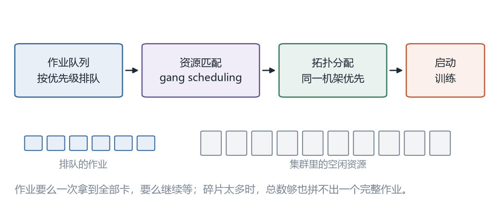
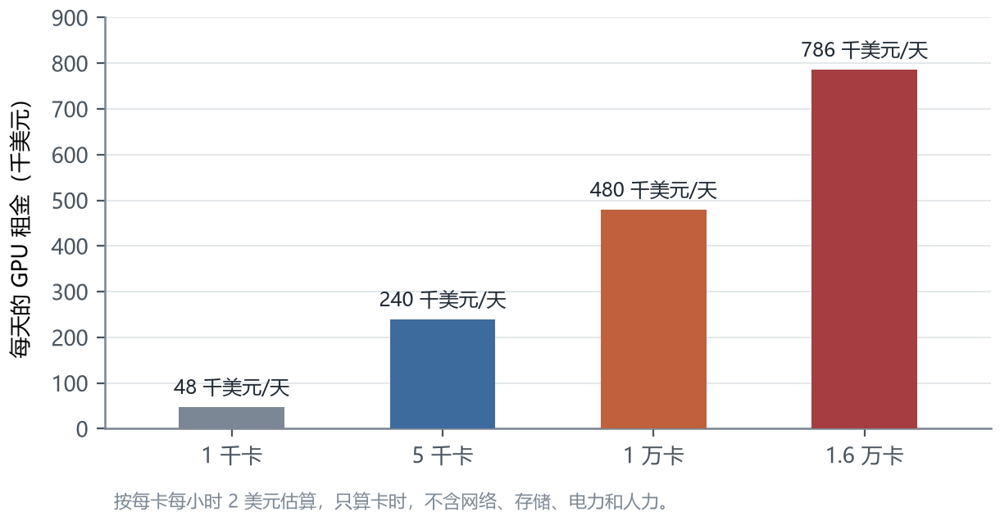

# 第 14 章　谁来管这些卡

## 14.1　从作业到调度

提交一个 512 张卡、预计跑三天的作业，命令行返回一个作业号，然后就是等。你去看队列，前面排了二百多个作业，预计开始时间是四天以后。集群现在的空闲卡有一千多张，你的作业要 512 张，数量上完全够。可它就是排不上。

这件事在共享集群里天天发生。要理解为什么，先得知道调度器在干什么。

调度器手里有一张表，一边是所有能用的卡，另一边是所有想用卡的作业。每个作业带着几个属性提交上来，需要多少张卡、要跑多久、优先级多少、属于哪个团队。调度器每隔几秒扫一遍，从队列里挑出能放的作业，分配资源，启动。听起来简单，麻烦在每一列都有坑。

队列本身就有讲究。纯先来先到会让一个只要 8 张卡的小作业排在大作业后面等三天，实际没人这么用。常见的是多级队列加优先级，高优先级的先走，同优先级按提交时间排。优先级不是免费的，高优先级意味着它可以在资源紧张时踢掉低优先级的作业，也就是抢占。被抢占的作业不一定被扔掉，多数系统会让它回滚到最近的检查点，重新排队。

配额限制的是另一个维度。一个团队这个月最多能用多少卡时，或者同时最多占多少卡。没有配额的话，最先提交的那个组会把整个集群吃满，剩下的组一直等。配额的存在让"共享"这件事有实际意义，代价是每个团队都会有一点用不满的额度，全集群的利用率因此下降几个百分点。

配额还有第二种算法，按累计卡时算，而不是按同时在跑的卡数算。两种口径的激励方向相反。按并发卡数算，占住卡不放手不吃亏，跑得慢反而占便宜；按累计卡时算，占着不干活就是在烧自己的额度。前者好实现，内部集群常用；后者能对上成本，要算账的地方常用。两种口径混用最容易出纠纷，账面上两边都没超额，可长作业就是排不上。

优先级之上通常还压着一层公平份额。调度器记住每个组最近一段时间实际用掉的资源，用得多，下次排队的权重就低。它不是硬限制，而是一个偏置，让"先提交"不至于变成"永远先"。代价是排队时间变得难以解释，同一个作业昨天等两小时，今天可能等八小时。想看懂这件事，得能看到份额的计算窗口，多数调度器都提供了这个视图，只是很少有人去点。

作业卡在队列里时，状态信息通常会写原因。看懂这几个字能省很多时间。

| 状态 | 含义 | 通常的应对 |
|---|---|---|
| 排队中，资源不足 | 集群里凑不出你要的整块 | 等，或者降规模 |
| 排队中，配额不足 | 你们组这个周期的额度用完了 | 等下个周期或申请调整 |
| 排队中，被抢占挂起 | 被更高优先级的作业挤掉 | 等它跑完自动恢复 |
| 已分配，启动中 | 卡给了，进程还在起 | 看容器拉取和初始化日志 |
| 运行中 | 正常 | 看 step 耗时和 loss |

排队时间的直觉经常是错的。人总是想"我才要 512 张，集群空着一千多张，应该很快"。实际上等待时间不看总量，看匹配。一个大作业的排队时间取决于它前面有多少个在等的同时，以及它们的时长，而不是空了多少张卡。两百个作业每个平均跑六小时，就算它们在八条通道上并行推进，你的作业也要等一百五十小时。

所以表里那几行状态，除了最后一行都很容易停很久。真正麻烦的是"资源不足"这一条，因为它可能意味着集群里明明有一千张空闲卡，但凑不出你要的形状。这个问题下一节讲。

## 14.2　gang scheduling

分布式训练有个硬约束，一次训练启动时并行度就定了。张量并行切 8 路，那就必须正好有 8 张卡组成一个组；流水并行 16 级，就必须有 16 个这样的组串起来；数据并行 128 路，就是 128 份。整个作业的卡数是这三者的乘积，一张都不能少。

如果调度器先给你 400 张，剩下的 112 张等有卡了再给，会发生什么？那 400 张卡上的进程会卡在建立通信组这一步，因为另外 112 个 rank 还不存在。它们占着显存、占着机位、什么也不干，而且会把资源一直锁着，直到那 112 张卡到位。这期间别的作业也用不了这 400 张卡。

更糟的情况是两个大作业互相卡死。作业 A 拿到了 300 张，等 200 张；作业 B 拿到了 500 张，也在等。两边的资源互不相让，谁也起不来，谁也不会释放。这种现象叫死锁，在早期没有做 gang 调度的集群上很常见。

解决办法是原子分配，要么把整个作业需要的卡一次性全给，要么一张都不给。这就是 gang scheduling，也叫全有或全无调度。图 14-1 是一个典型的流程。

*图 14-1　一个训练作业从排队到启动的调度流程*

流程是四步。作业进队列按优先级排，调度器做资源匹配并保证原子性，拿到卡之后做拓扑分配，同一机架优先，最后启动训练。图下方那两排小方块说得很直白，左边是排队的作业，右边是集群里的空闲资源，一个万卡作业要么一次拿到全部卡，要么继续等。只给一部分，训练根本启动不了。

gang 的副作用是碎片。集群里有 3000 张空闲卡，但它们散在几十个机柜里，凑不出连续的 4000 张，一个要 4000 张卡的作业就得等。空闲资源的总量够了，形状不够。这个问题在调度器里叫资源碎片，下一节展开。

缓解手段有几种。预留是提前把一段时间和一批资源圈给某个作业，到点就一定能用上，代价是那段时间别人用不了。回填是允许小作业插到大作业等待的空隙里跑，前提是不影响大作业的预计开始时间。这两种手段都在拿利用率换确定性，具体选哪个取决于集群里作业的规模分布。

还有一类做法在试图绕开 gang，就是弹性训练。训练中途重新组通信组，卡数从 4000 变成 3800，并行度重新算一遍，检查点重新切分，然后接着跑。这样就不需要一次性拿到全部资源，碎片也能用上。技术上可行，难点在状态转换的一致性和性能的稳定性。并行度一变，每卡分到的 batch 就变，学习率要不要跟着调是个新问题。所以真正在生产线用弹性训练的大规模任务并不多，多数团队宁愿等。

gang 的代价可以用一句话说清，作业越大，能接住它的时刻越少。八张卡的作业几乎任何时刻都能塞进去，四千张卡的作业得等三十二个整柜同时空出来。等待时间的增长比卡数快得多，因为要匹配的不是数量，是一整块形状。同一个集群里，小作业的平均排队是分钟级，万卡作业是小时到天级。

回填能不能做，取决于调度器知不知道你要跑多久。提交时填的预计时长本来是给账单用的，在很多集群里变成了回填的唯一依据。填长了，别人不敢插进来，自己的位置也变差；填短了，到点被强杀，不管跑没跑完。多数系统会在到点前留一段宽限，让作业自己写检查点再退出。这个数字不是随手填的。

还有一个反向效应。集群里全是小作业，碎片少、利用率高，但大作业永远排不上；全是大作业，形状整齐，可一旦某个作业提前结束，空出来的整块没人接得住。作业的规模分布实际上决定了这个集群适合跑什么，买卡之前就该想清楚。

## 14.3　拓扑与碎片

卡和卡之间的带宽差得很远。同一台机器里八张卡通过 NVLink 全互联，H100 的 NVLink 是 900 GB/s。跨机器走网卡，InfiniBand NDR 单端口 400 Gb/s，换算过来是 50 GB/s。差了十八倍。

这个差距决定了并行组的摆放。张量并行每一层要做两次 all-reduce，通信量和激活值同阶，非常频繁。如果把它放到跨机器的链路上，每次通信的时间会变成节点内的十几倍，整个训练就被通信拖死。所以 TP 组必须放在同一台机器里，八张卡一组是标准配置。流水并行的通信少一些，可以跨机器，但相邻的级最好在附近。数据并行的梯度归约量最大但频率低，能容忍跨机柜。

于是调度器在分完卡之后还要多做一步，把 rank 映射到具体的物理位置。这一步做错了，卡数一张不少，性能却差一大截。有些集群的调度器不理解并行拓扑，只保证给你 N 张卡。你拿到手发现 TP 组被拆到了两台机器上，训练能跑，MFU 只有正常值的一半。

碎片是另一个层面的事。想象一个集群有 128 个机柜，每柜 128 张卡。现在有 8000 张卡空着，但它们散在一百多个机柜里，每个机柜零散地空着几十张。这时候来一个要 4000 张卡的作业，按拓扑要求它要占满三十来个整柜，它就排不上。空着的那 8000 张卡在统计上很好看，实际用不起来。

这种浪费在利用率报表上表现为一个悖论，集群整体利用率 60%，但大作业的平均排队时间是一周。原因是大作业要的是形状，小作业要的是数量，两者被混在同一个池子里抢资源。

把这两个数字放在一张报表里就能看出问题。利用率说的是平均值，排队时间说的是尾部，平均值好看不代表大作业能跑。看集群健康度的时候，真正有用的指标是大作业的排队时间分位数，比如百分之九十的万卡作业在多久内能开始。这个数字才能反映治理得好不好。

常见的解法有几种。一是把集群分成大池和小池，大池只接整柜级别的作业，小池接零散的。二是拓扑感知的装箱，分配时优先选择能拼成完整机柜的碎片，而不是随机撒。三是定期做整理，把正在跑的小作业迁移到几个机柜里，腾出整块空间，代价是迁移本身要中断。第四种最直接，就是承认碎片存在，在容量规划时多买百分之十的卡当缓冲。

碎片有多严重，可以用一个比值描述，能拼出的最大整块除以空闲总量。空闲一万张卡，最大只能拼出两千张，比值就是 0.2，剩下八成在统计上存在，在大作业眼里不存在。调度器只报总空闲量的话，这个比值永远看不见，运维觉得还有卡，用户觉得排不上，两边吵不出结果。

拓扑感知的装箱不是免费的。每次调度要在几千个作业和上万个资源槽之间做匹配，还要满足整柜、机架、轨道这些约束，本质是多维装箱，最优解算不出来，只能用启发式。启发式的代价是调度周期变长，从几秒到几十秒，作业启动跟着慢一截。有的集群为了压这个延迟，把拓扑约束放宽成"尽量"，碎片又回来了。这一圈里没有免费选项。

还有一个隐形因素，不同批次的机器性能不完全一样。同一型号的卡，散热条件不同、体质不同，长时间跑的频率会有差别。如果调度器把一批慢卡全部分给了某个作业，那个作业的 MFU 天生就低。有的团队会按实测性能给节点打标签，分配时做均衡，避免一个作业全落在慢节点上。

## 14.4　成本与电

卡是租来的，账单按卡时算。按每卡时两美元估算，规模一上去，数字就很直观。

*图 14-2　不同规模集群每天的 GPU 租金估算*

一千张卡一天四万八千美元，五千张二十四万，一万张四十八万，一万六千张七十八万六千。图里只算了卡时，不含网络、存储、电力和人力，真实的账单还要往上加。DeepSeek-V3 的论文里报了预训练 2.664M 卡时、全流程 2.788M 卡时，按两美元一卡时估算约 557.6 万美元。这个数字之所以被反复引用，是因为它把"训练一个大模型要多少钱"从一个模糊的概念变成了一个可以核对的数量级。

有了这个单价，很多决策就变得清楚了。前面算过，回滚两小时在一万卡的集群上是四万美元。一次因为脚本写错而白跑一天的实验，是四十八万美元。一个能自动恢复的运维系统值多少钱，按它每天省下的停机时间乘单价就能算出来。这些数字不是为了吓人，是为了让"要不要做这件事"有个共同的尺子。

电是另一笔账。一张 H100 的功耗上限是 700 瓦，一万六千张卡同时满载就是 11.5 兆瓦，这还只是芯片本身。加上 CPU、内存、网卡、交换机、存储，再算上制冷的消耗，整个机房的用电要到 15 兆瓦这个量级。一个机柜能提供的功率是 40 到 120 千瓦，装十几到三十几台机器就到顶了，再往上要液冷。

电的问题不只是钱，还有物理约束。机房的供电容量是固定的，扩容要报批、要布线、要几个月。单柜功率上不去，就只能多占机柜，多占机柜就要多铺网络，成本又上去。所以新一代集群很多在往液冷走，不是为了省电费，是为了把单柜功率密度提上去，少占地方少走线。

这三个数字串起来看会更清楚。卡时单价乘卡数得到日成本，日成本乘天数得到一次训练的总成本，而总成本除以有效卡时占比才是真实单价。按两美元一卡时、可用率百分之九十估算，你实际上在为每卡时付两美元二。前面讲的那些恢复自动化和异步检查点，把它们换算成钱，就是把这两毛钱压下去。

还有一层是电价的波动。白天贵晚上便宜，有的地方差一倍。训练是长期满载的负载，理论上可以把检查点、数据预处理、离线评测这些可以挪的活安排到便宜时段，把训练本身留在必需时段。实际做起来不灵活，因为训练的连续性比电价重要，中断一次的成本远高于省下的电费。

卡时单价只是账单的一行。完整账单还有网络（交换机、光模块、布线）、存储（容量加带宽）、机房（土地、制冷、UPS）、人力（运维、平台、值班）。比例各家不同，但量级上卡时占大头，网络和存储在万卡规模各占一成到两成，机房和人力加起来几个百分点到一成。所以拿卡时单价乘卡数，算出来的是下限。

电力这一项，贵的不在电费，在容量。一万六千张卡满载 11.2 兆瓦，加上 CPU、内存、网卡、存储和制冷，整个机房要按 15 兆瓦设计。容量一旦定下来，想加就要报批、布线、扩容，周期以月计。一个集群能跑多少卡，常常不由采购预算决定，而由变电站决定。

单柜功率是另一个卡点。一台八卡服务器满载 5.6 千瓦，一柜三十二台就是 179 千瓦，超过风冷机柜 120 千瓦的上限。要么降每柜的机器数，多占机柜多铺线；要么上液冷，把功率密度提上去。前者省基础设施但占地，后者省地但要改建，这个选择在建设阶段就得定，跑起来之后没得改。

## 14.5　多租户与隔离

共享集群里，你的作业和别人的作业在同一张网上跑。物理上是隔离的，逻辑上不完全是。

最先受影响的是网络。跨机柜的上行带宽通常是超卖的，几十个机柜共享一组 spine 交换机。平时大家的流量都不满，看不出问题。邻居开始跑一个通信密集的作业，上行链路拥塞，你的 all-reduce 就开始变慢。表现是你的 MFU 从 45% 掉到 38%，而你的代码、数据、配置一个字都没改。这种问题最难查，因为所有指标都在正常范围内，只是慢了。

存储带宽也是这样。几千个 rank 同时读检查点或者读数据，存储的 IOPS 被抢光，你的数据加载就排不上队。表现出来是 GPU 利用率周期性掉到零，等你查到存储那一层，发现是隔壁的作业在做大规模数据拷贝。

判断自己是不是被邻居影响，有个简单办法。把自己的作业在不同时段、不同节点的 MFU 列出来，如果差异明显，而代码、数据、并行配置都没变，那就不是你的问题。再往下可以看网络计数器的拥塞丢包率、存储的队列深度，这两项能直接指到到底是哪一层被抢了。剩下的工作就是跟集群管理员谈，要么错峰，要么换分区。

NCCL 的拓扑探测也会被干扰。启动时要探测所有链路，这一步会发大量小包。如果同时有几十个作业在启动，探测本身就会超时，然后 NCCL 选了一个次优的算法，整个训练期间都受影响。有的团队会把作业启动时间错开，就是为了避开这个。

隔离手段分几个层次。最彻底的是独占节点，一个作业的卡不给别人用，网络也按轨分配，物理上不共享上行链路。代价是利用率低，小作业占着整机浪费。往下一点的拓扑分区只隔离网络，把集群切成几个独立的 fat-tree，租户之间不共享交换机，卡还是可以混用。再温和的一档是 QoS 限速，给每个租户的网络流量设上限，保证不互相挤死，代价是峰值性能被削掉。

GPU 层面还有一种更细的切分。有的卡支持把一张物理卡切成几个实例，各自有独立的显存和计算单元，适合推理和小规模实验。训练用不上，因为训练要的是整卡的带宽和显存。

多租户的根本矛盾在于，隔离越彻底，利用率越低。独占节点能做到互不干扰，但集群里会有一堆用不满的机器。完全共享能把利用率拉到很高，但一个坏邻居就能毁掉所有人的性能。实际的做法通常是在中间找一个点，大作业独占，小作业共享，并且把共享池的规模控制在一定比例以内。

这件事没有技术上的最优解，它是运营决策。要不要为了 10 个百分点的利用率去接受"隔壁作业会影响我"这个风险，取决于这个集群主要服务谁、作业的平均时长是多少、能不能容忍性能波动。这些问题没有标准答案，但把它们摆到台面上，比假装不存在要好。

干扰是可以量化的，只是多数团队没去量。同一份代码、同一份数据，独占节点上 MFU 是 45%，共享池里是 38%，差七个点。按一万六千卡、两美元一卡时算，等于每天多花十几万美元。这个数字可以用来做决定。如果独占让利用率掉一成，但能把这七个点找回来，两边差不多，剩下的差别在管理成本。

所以隔离的定价不是"要不要安静"，而是"安静一天值多少钱"。把这个数算出来，共享池的上限就有依据，不用年年吵一遍。

## 14.6　四个旋钮管的是四件事

队列、配额、优先级、抢占摆在一起看，会发现它们管的不是同一件事。队列管顺序，配额管上限，优先级管先后，抢占管冲突。四个旋钮各自都能调，合起来的行为却不是四者相加，而是相乘。

一个常见的组合病是这样来的。配额按并发卡数算，优先级分三级，抢占只在跨级时生效。结果是每个组都把额度占满，谁也不敢先放手，高优先级作业进来只能抢占，被抢占的作业回滚、重排队、再去挤别人。一晚上过去，所有作业都在互相踢，没有一个跑完。这不是某个参数设错了，是几个策略互相抵消。

调这些旋钮之前，最该问的是这个集群主要服务谁。给内部研究用的集群，公平份额和短作业优先更重要，因为作业多、时长短、迭代快。给少数大项目用的集群，配额和预约更重要，因为一次训练以月计，排不上就是项目延期。同一个调度器，两种配法，服务的是两种完全不同的用法。

下面这张表把四个旋钮的作用和代价摆在一起。注意最后一列，四个策略的代价都不是钱，是别人损失的时间和浪费掉的利用率。这类成本不进账单，只进抱怨。

| 旋钮 | 管什么 | 常见做法 | 代价落在谁身上 |
|---|---|---|---|
| 队列 | 谁先开始 | 多级队列，同级按提交时间 | 短作业被长作业堵住 |
| 配额 | 各组能用多少 | 并发卡数上限或累计卡时上限 | 额度用不满，集群利用率下降 |
| 优先级 | 资源紧张时谁让路 | 分级加公平份额偏置 | 低优先级作业反复被打断 |
| 抢占 | 冲突时怎么解决 | 回滚检查点、重新排队 | 已算的步数作废，卡时白花 |

## 14.7　碎片怎么算，排队时间怎么估

碎片不是一个感觉，是可以算的。把集群按整柜切开，每一柜要么整块可分配，要么不可分配；能拼出的最大整块，等于连续全空柜的数量乘每柜卡数。这个数才是大作业眼里的可用资源，和报表上的空闲总量经常差一个数量级。

算一个具体的例子。一万六千卡的集群，一百二十八个机柜，每柜一百二十八张。现在空着八千张，占一半，听起来很宽裕。可如果这八千张是均匀散开的，每柜平均空六十二张，那么一个全空的柜子几乎不存在。此时来一个要四千零九十六张卡的作业，它需要三十二个整柜，能拼出的整块接近零，只能等。等多久取决于那些柜子里最长的作业什么时候结束，而不是取决于空了多少卡。

三种空闲分布摆在一起，差别就看得很清楚。

| 空闲分布 | 空闲总量 | 能拼出的最大整块 | 四千卡作业 |
|---|---|---|---|
| 三十二个整柜全空，其余满载 | 4096 | 4096 | 立刻能跑 |
| 每柜都空一半，均匀散开 | 8192 | 接近 0 | 排不上 |
| 六十四个整柜全空，其余七成满 | 8192 | 8192 | 能跑，还剩一半用不上 |

第一行和第三行对比最能说明问题。空闲总量翻倍，能拼出的整块也翻倍，但多出来的那四千张卡对一个四千卡的作业毫无意义。碎片治理的目标不是把空闲量做大，是把空闲量攒成块。

排队时间也有个粗算的办法。假设前面排着两百个同规模作业，每个平均跑六小时，集群能同时容纳八个这样规模的作业一起推进，那么你前面的总时长是一千二百小时，分到八条通道上就是一百五十小时。这个算法很粗，忽略了作业结束时间的分布和新作业插队，但量级是对的。它解释了一件反直觉的事，排队时间取决于前面有多少活，不取决于现在空了多少卡。

再把它换成钱。一个五百一十二卡的作业多等一百五十小时，账面上一分钱没花，可这批卡的预期产出被整体推后了六天多。如果这个作业每天能产生固定收益，推迟的代价就是这六天的收益。这也是为什么有的团队愿意为预约付费，买的是确定性，不是卡。

## 14.8　一卡时到底多少钱

两美元一卡时是外界最常引用的数字，它只覆盖 GPU 本身。要把一笔训练的钱算全，得把几项分开看。

卡时是主项。一万六千张卡跑一天，一万六千乘二十四再乘二，七十八万六千美元。这个数字随供需浮动，紧缺的时候更高，卡多的时候更低，但量级就在这个位置。

电是第二项，也是最容易被高估的一项。一张 H100 满载 700 瓦，一万六千张同时跑是 11.2 兆瓦，一天 26.9 万度；算上 CPU、内存、网卡、存储和制冷，整个机房按 15 兆瓦设计，一天 36 万度。即便按工业电价算，这笔钱相对七十八万的卡时租金也只是零头。真正卡住规模的是容量，不是电价。

网络、存储、机房、人力是剩下的几项。交换机、光模块、布线按集群规模一次性投入再分摊；并行文件系统的容量和带宽按 TB 和 GB/s 计价；机房是土建和制冷；人力是运维、平台和值班。这几项加起来通常是卡时的一到三成，规模越大，网络和存储的占比越高。

| 项目 | 口径 | 一万六千卡一天 | 备注 |
|---|---|---|---|
| 卡时租金 | 两美元一卡时 | 78.6 万美元 | 主项，随供需浮动 |
| GPU 用电 | 700 瓦一卡 | 26.9 万度 | 不含 CPU 与制冷 |
| 机房总用电 | 约 15 兆瓦 | 36 万度 | 含制冷，量级估算 |
| 网络与存储 | 按配置分摊 | 卡时的两成上下 | 交换机、光模块、文件系统 |
| 人力与运维 | 按团队规模分摊 | 卡时的几个百分点 | 值班、平台、备件 |

有了这套口径，一笔训练的总账就能自己算。Llama 3 405B 用了一万六千三百八十四张卡跑五十四天，卡时是一万六千三百八十四乘五十四乘二十四，约两千一百二十三万卡时，按两美元算是四千二百多万美元。十五点六万亿 token 摊下来，每百万 token 约 2.7 美元。这不是推理成本，它只说明训练阶段每一百万个 token 的背后是两块七的算力账单。

再往下推一层。四千二百多万是按百分之百有效算的，实际有效训练时间九成出头，花掉的卡时不变，产出的有效算力打九折，所以每个有效卡时的价格是两美元二。前面讲过的自动恢复、异步检查点、掉队者治理，换算成钱就是把这零点二压回去。压一个点，一天省几千美元；压十个点，一次训练省几百万。

DeepSeek-V3 的账更能说明口径的重要。论文里报的预训练是 266.4 万卡时，全流程 278.8 万卡时，按两美元一卡时约 557.6 万美元。同样的模型规模，有人算出上亿美元，有人算出几百万，差别不在算术，在于算的是哪一段、按什么单价、有没有把失败的实验也算进去。对外的数字和自己的账本，本来就不是一回事。

## 14.9　把排队时间写进承诺

内部集群很少谈服务水平，因为用户没有别的选择。可一旦集群要对外服务，或者公司里有几个大项目抢同一批卡，排队时间就必须有个说法，否则每次延期都会变成一场争论。

承诺的口径要分开。小作业看中位数，一个八卡作业排两小时可以接受，排两天不行。大作业看分位数，万卡作业没人指望它随时能开，但需要知道九成的概率能在多久内开始。把这两类混在一个平均值里，得到的数字对谁都没有意义。

承诺还要写清楚从哪一刻算起。从提交到进程起来，和从提交到第一个有效 step，差的可能是半小时的启动和自检。用户感受到的是后者，调度器统计的是前者，两边对不上时，争论的焦点往往不是排队，是启动。

算一下承诺的价格。假设集群每天新到一百个作业，平均每个要五百一十二张卡，承诺平均等待不超过四小时。按每天的等待量算，一百乘五百一十二乘四，是二十万卡时的等待，摊到二十四小时上，等于常年有八千五百张卡在为"等待"这件事空转。一个一万六千卡的集群，一半容量被这个承诺吃掉。这就是为什么预约要收费，也是为什么大部分集群只承诺分位数，不承诺平均值。

服务水平还有两个维度常被漏掉。一个是可用性，作业跑起来之后不中断的比例，这个直接对应有效训练时间。另一个是性能，同样卡数下 MFU 不低于某个值，这一条在多租户环境里最难保证，因为邻居的流量你控制不了。三条写全，才是一份能拿来追责的承诺；只写排队，等于只承诺了最容易做到的那部分。
