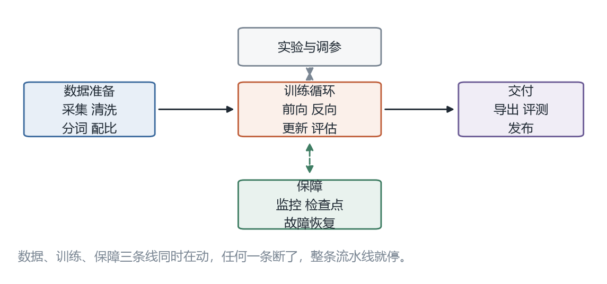

# 第 15 章　一条完整的训练流水线

## 15.1　数据准备

Llama 3 405B 用了 15.6 万亿 token。这个数字很难有实感，换个说法，按每个 token 存成 4 字节的整数编号估算，光是这些编号就要占 62 TB。它们得能被一万六千个进程同时按随机顺序读出来，读的时候不能卡，卡一下所有卡都等。

数据这条线在训练开始之前几个月就在跑了。采集是第一步，来源有网页抓取、代码仓库、书籍、合成数据、自有业务日志。每种来源的格式、质量、许可都不一样，混在一起之前要分别处理。

清洗的功夫最多。去重是第一道，网页数据里重复内容的比例高得离谱，同一篇文章被转了几十次的情况很常见。做法有精确哈希，也有近似去重，后者用一组哈希把文档压成指纹，指纹相似的判为重复。第二道是质量过滤，用规则去掉导航栏、版权声明、乱码页面，再用一个分类器打分，把明显不像自然语言的丢掉。第三道是隐私和合规，邮箱、电话号码、身份证号这类要抹掉，有版权争议的来源要排除。

去重的规模值得单独说一句。精确哈希只能抓住一模一样的文本，改一个标点就漏过去；近似去重把文档压成一组指纹，指纹重合度超过阈值就判重。阈值定高了，漏掉的重复会在训练里被反复加权，等于偷偷改了配比；定低了，会把同一主题的不同文章当成重复删掉，多样性受损。这一步没有标准答案，只能抽检。人工看两百对判定结果，比看任何指标都管用。

分词的目的是把文本变成整数序列。词表怎么定、压缩率多高，会影响后面所有事情。词表太小，一句话被切成很多片，序列变长，算力浪费；词表太大，嵌入层占的显存变多，低频词也学不好。这一步一旦定下来，整个数据集都要重新编码一遍，所以通常很早就要冻结。

冻结的代价，很多人是中途才意识到的。十五点六万亿 token 全按旧词表编码过一遍，得到的是六十二 TB 的整数编号；换一次词表，这六十二 TB 要重新生成、重新校验、重新分片。所以分词器一般在数据流水线定稿前就冻住，之后的调整只能靠采样权重，不能靠改词表。这条约束在项目初期看起来无关紧要，到中期就变成硬约束。

配比是调参数的地方。代码、数学、多语种、通用网页各占多少，没有理论答案，只能靠小规模实验试。改配比的影响不是即时的，往往要跑到几万亿 token 之后才在评测上体现出来。

配比实验的成本也高，因为结论要在足够大的规模上才显现。常见的折中是先用一个小模型、按比例缩小 token 数跑几组对照，选出方向再上大模型。这个做法有风险，小模型上的最优配比不一定能迁移，尤其是代码和数学这类需要深度的数据，小模型吃不出差别。所以配比实验只能用来排除明显错误的选项，不能用来精调。

打包是最后一个环节，也最容易埋坑。文本长度不一，直接拼 batch 会有大量填充浪费。常见做法是把多篇文档首尾相接拼成固定长度的序列，一个序列里可能横跨七八篇文档。如果拼接时不加掩码，模型会在不该看的地方看到下一篇的开头，学到一些不存在的依赖关系。这类问题不会报错，只会让最终效果差一点。

还有一个跟数据直接相关的细节。训练读数据的速度必须比算得快，否则 GPU 就在等。一万六千个进程同时读，存储端的随机读能力是瓶颈。做法通常是把数据预先切成很多个分片，每个 rank 只读自己那几片，顺序读，提前预取几个 batch 到内存里。分片大小要能整除全局 batch，否则每个 epoch 结束的时候会有 rank 多跑一步少跑一步，集合通信直接对不上。这种错误很典型，而且很难从报错信息里看出来。

图 15-1 是整条流水线的样子，可以看到数据、训练、保障三条线同时在跑。

*图 15-1　一条完整的训练流水线*

## 15.2　启动

卡到位之后，第一步是把并行度配出来。Llama 3 405B 的配置是张量并行 8、流水并行 16、数据并行 128，乘起来正好 16384。这三个数怎么选，前面几章讲过取舍，实际配的时候还要受物理拓扑约束，TP 组必须在同一台机器里，PP 组尽量在同一个机柜，DP 组分散到不同机柜。

反过来算一遍就能看出约束从哪里来。16384 除以 8 再除以 16 得到 128，这是唯一解，三个因子必须落在这个乘积上。想把它改成 TP 4、PP 32 也能凑出 16384，但 32 级的流水线气泡会把效率吃掉一大块，而且相邻级跨的机柜多，通信变贵。所以可选的组合其实不多，能把模型装下、能把气泡压小、能把通信放在节点内的，也就那两三种。

配置写错是最常见的启动失败原因。TP 度大于单机卡数，通信会走到网卡上，训练能跑但慢一半。PP 度太深，气泡占比上去，微批次数量不够填，效率掉得厉害。DP 度设成奇数，某些实现会直接报错。这些错误在上万卡的规模上排查很痛苦，因为报错信息通常只说某个 rank 初始化失败，不说为什么。

初始化阶段有几件事同时在发生。权重要么从零随机初始化，要么从检查点加载。通信组要建起来，NCCL 会探测所有链路，选算法，开通道，一万六千卡的这个过程要几十秒。显存分配器要预留出足够的池子，避免训练中途反复申请释放。数据加载器要启动几百个进程，各自打开文件句柄，建立预取队列。

启动本身是要花钱的。一万六千张卡从分配到第一个有效 step，拉镜像、挂载存储、探测链路、建通信组、加载检查点，十几分钟很正常。按十分钟算，一万六千乘六分之一，是两千七百多卡时，五千多美元。一天重启三次，这笔钱就上万。所以启动时间不是体验问题，是成本问题，值得为它做镜像预热和检查点本地缓存。

然后是最重要的一步，验证第一步。跑二十步，看四个地方。

先看 loss 的起始值。它应该落在词表大小的自然对数附近，太高说明初始化有问题，太低说明数据或者标签有泄漏。再看 loss 是不是在下降，二十步看不出趋势，但至少不该往上走。第三处是 MFU，这个数字跟预期差太多，说明并行配置或者拓扑有问题。最后看每个 rank 的步耗时方差，方差大说明有掉队者，或者数据分片不均。

这一步花不了半小时，能省下后面两周。很多团队吃过亏，训练跑了三天才发现数据管道的某个字段解析错了，全部作废。所以启动检查要写成一个脚本，每次启动都跑，不靠人的记性。

学习率要预热。前几千步用一条从零升到峰值的曲线，让优化器状态先稳定下来。不预热直接上大学习率，前面讲的 loss spike 大概率会在头几百步出现。

## 15.3　训练循环

进入训练循环之后，系统就变成了一个长期运行的服务。每个 step 做同样的事，读一批数据、前向、反向、梯度归约、参数更新。看起来单调，实际上监控的活全在这里。

loss 曲线是主指标，但不能只看它。同一批数据跑出来的 loss 有波动，正常范围要提前测出来，超出多少算异常要写成规则。梯度范数、参数范数、每层激活值的范围，这些都要画在同一个面板上。异常往往先在梯度上出现，loss 是最后才反应的。

硬件指标在另一个面板。每张卡的温度、功耗、时钟频率、ECC 计数、NVLink 误码、网卡的丢包和重传。这些数字平时不用看，但它们上涨的斜率能提前几天预警。一张卡的 ECC 计数一周内从零涨到几百，那它大概率要出问题，趁早换掉比等它坏强。

步耗时也要拆开看。一个 step 的时间大致分四块，等数据、前向、反向、通信。四块的比例决定了优化方向。等数据占比高，说明管道不行，加进程或者改预取；前向占比突然变大，说明有卡降频或者 kernel 选错了；通信占比高，说明并行策略或者网络有问题。只看一个总的 step 耗时，永远不知道钱花在哪里。

步耗时还要看分布，不能只看均值。每个 rank 有自己的步耗时，一万六千个数字里，均值看不出谁在拖后腿，p99 和最大值的比值才能。这个比值正常在一成以内，超过两成说明有稳定的掉队者，通常是一张降频的卡或者一段拥塞的链路。均值掩盖的东西，分位数能看见。

评估要定期做，但不能打断训练。验证集跑一遍要几分钟到几十分钟，如果和训练抢同样的卡，step 耗时会突然拉长，前面讲的超时机制可能误判。常见的做法是留一小批专用的卡跑评估，或者把评估安排在检查点写入的窗口里。

检查点按两条线触发。一条是时间，每多少分钟或者每多少步写一次，间隔按前面算过的公式定。另一条是事件，换数据配比之前、调学习率之前、周末没人值班之前，都手动写一次。事件触发的检查点是给"知道要出事"准备的。

实验管理是容易被轻视的一环。每一次训练要记清楚代码版本、配置、数据版本、启动时间、改动原因。三个月后回头看某个结果，如果说不清当时用的是哪一版数据，这个结果就没法复现。大规模训练一次几百万美元，这种浪费承受不起。

还有一件常被忽略的事，训练跑起来之后不代表不用管。前几百步要盯，第一次评估要看，第一次写检查点要验证能不能读回来，第一次故障恢复要看恢复时间是不是符合预期。这些"第一次"都是系统还在磨合的信号，过了这一段才敢让它无人值守。

循环里还会发生两件周期性的事，都需要人提前安排。学习率不是一成不变的，到某个阶段要降下来，降的时机靠评测结果和 loss 的下降速率决定，不能拍脑袋。数据配比也会在中途调，换一批更高质量的进去，这时候旧数据的训练量已经很大了，新数据的影响会被稀释，所以要提前算好要在哪个步号换、换多少。这两件事都要在训练计划里写死，不能到现场临时定。

## 15.4　出问题时

告警要分级，否则所有人都麻木。

最严重的一级是作业停了，进程退出或者全部挂起，这时候必须立刻有人处理，因为钱在烧。第二级是训练在跑但结果不可信，loss 变成非数、连续多次 spike、loss 长时间不降。第三级是性能退化，MFU 掉了百分之十以上，作业还在跑但效率不对。第四级是潜在风险，单卡 ECC 计数上涨、某台机器温度偏高、某个网络端口误码增加。

分级的意义在于响应方式不同。一级要立刻打电话，二级要在几小时内确认，三级可以第二天上班看，四级进工单排队。

阈值不能拍脑袋定，要从历史数据里取。同一个指标，在健康的集群上跑一周，取 p99 当告警线，误报率就有依据。定得太松，出事时不响；定得太紧，值班的人一周之后开始无视所有告警，比不响更糟。一级的条数必须少，少到每次响都有人立刻去看。

定位要有顺序，这个顺序决定了你花十分钟还是两天。

先确认作业是不是真的还活着。看日志最后一行的时间戳，看进程列表，看有没有 rank 已经退出。然后看 loss，最近一百步的值拉出来，是平的、跳的、还是非数。接着看步耗时，是不是突然变长，变长的是哪一段，数据加载、前向、反向还是通信。再往下是硬件，XID、ECC、温度、NVLink、网卡计数器。最后才是存储和数据。

这个顺序是从便宜到贵排的。日志和 loss 几秒钟就能看，硬件指标要拉监控，存储和数据要单独跑测试。很多人反过来，一上来就怀疑数据，花一天去查一个其实在第一步就能看出来的问题。

有个反直觉的建议，**在看清楚之前不要重启**。重启会把现场毁掉，进程没了，通信组的信息没了，卡在上一次状态里的计数器被清零。所以出事后的第一件事是保全现场，把每个 rank 的最后一段日志、显存快照、GPU 的寄存器转储都存下来，然后再从检查点重启。这些数据在事后定位时的价值，往往超过那十几分钟的停机成本。

恢复手册要写下来，写清楚谁有权杀作业、回滚到哪个检查点、怎么判断恢复成功。判断标准要具体，比如回滚之后先跑一百步，loss 落在某个区间内、步耗时回到正常值、没有新的告警，才算恢复成功。没有标准的话，很容易在一个有问题的检查点上反复循环。

说一个典型的夜晚。凌晨两点，loss 从 1.84 跳到 2.61，三步之后回到 1.90，然后一直在 1.90 附近振荡，不再下降。值班的人先看日志，没有报错；看硬件面板，没有新告警；看步耗时，正常。于是去看数据，发现刚换了一个新的数据分片，时间就在 crash 之前不久。把那个分片单独拿出来跑，复现了。处理方式是重写那一批数据、回滚到换数据之前的检查点、把学习率降下来重新爬。整个过程四小时，实际算错的那几小时回滚掉了，剩下的是排查时间。这类事一个月会遇上好几次，每次都不一样，但流程是同一个。

## 15.5　结束与交付

训练跑到最后一步，工作才完成一半。

第一件事是导出。训练时的检查点是按并行策略切开的，TP 切了 8 份、PP 切了 16 份，散在几千个文件里。要用这个模型，得把它合并回一个完整的权重，通常还要转成主流的格式。合并本身不难，难的是不能出错，几千个分片的顺序错一个，模型就是坏的，而且坏得很难发现，只有评测时才会露出来。

第二件事是评测。公开榜单跑一遍，内部的任务集跑一遍，再加上人工抽检。评测结果要跟训练过程中的验证集对齐，如果差得远，说明中间某个环节有问题。这一步经常暴露出训练时没注意的细节，比如某个语言的表现异常差，回头查发现那部分数据在配比里被压得太低。

第三件事是发布。模型卡要写清楚训练数据来源、规模、已知的局限、适用范围。安全评估要单独做，尤其是开放权重的模型。这些工作在技术上是琐碎的，但它们决定这个模型能不能被放心使用。

交付的其实是一整套东西，不是一个权重文件。权重、并行配置、分词器、数据分片清单与哈希、评测脚本和基线结果，缺一样，别人接手时就要重做一遍。企业内部的模型交付常见这样的场面，权重给了，配置没人记得，评测跑出来对不上，最后又回头去找当初的训练负责人，而他已经在做下一个项目。

交付之后工作也没结束。模型上线要算推理成本，一张卡能扛多少个并发，上下文长度加上去之后显存怎么分，这些跟训练时的显存账本是完全不同的一套算术。后续的微调、续训、新版本迭代，都要回到同一条流水线上，从数据准备开始重走一遍。所以把流水线做成可重复的，比把某一次训练调到极致更值钱。

最后一个决定容易被忽略，而且它得提前很久做，就是什么时候停。训练预算是提前定好的，token 数跑完就停，但停之前往往要留一点余量做退火，不然末尾的效果会差一截。什么时候降学习率、什么时候切到高质量数据、什么时候正式结束，这三件事在计划阶段就要写定，写到项目里的人都同意为止。中途拍脑袋改计划的代价，往往比预想的差得多。

最后一件事是复盘，也是最少人做的。把这次训练的总账算一遍，用了多少卡时，有效算力占比多少，中断了多少次，每次平均恢复多久，哪一段最费时间，哪些坑是第一次遇到，哪些是明知有坑还是踩了。把这些写成一页纸，下一次训练开工之前先读一遍。

## 15.6　数据漏斗

前面五节是一条线走下来。回头把其中几段拆细，会发现真正决定成败的是那些看起来最枯燥的部分，数据怎么进来，系统怎么自检，坏了怎么判断。

数据这条线可以用漏斗描述。最上面是抓下来的原始文本，往下每一层都在减量，最后留下来的是一堆整数编号。漏斗的每一层都在做取舍，取舍做错了不会报错，只会在几个月后的评测上体现出来。

把握住一个量就够了。十五点六万亿 token 按每个四字节存，是六十二 TB；平均分到一万六千三百八十四个进程，每个进程负责三点八 GB。这两个数字决定了存储怎么规划，也决定了分片怎么切。

再算一下读取速度。五十四天跑完十五点六万亿 token，平均每秒三百三十四万个 token。换成字节是每秒十三 MB，全集群加起来只有这么多。这个数比很多人的直觉小得多，说明顺序带宽不是瓶颈。真正的瓶颈是随机定位，一万六千个进程各自在几十万个文件里找自己的分片，元数据服务的压力全在这里。

所以数据侧的优化重点不是买更快的盘，是把访问模式理顺。分片数量要够多，让每个 rank 手里有几份可以轮换；单个文件要足够大，避免打开文件的开销盖过读数据；清单和校验和要提前算好，训练时只读不查。三件事做到，几万卡的作业也能把数据管道跑满。

| 阶段 | 主要动作 | 留下的东西 | 出错时的表现 |
|---|---|---|---|
| 采集 | 抓取、授权筛查、来源登记 | 原始文档与来源清单 | 某类数据整体缺失，评测时才发现 |
| 清洗 | 去模板、去乱码、去隐私字段 | 干净的正文 | 训练正常，效果整体低一截 |
| 去重 | 精确哈希加近似指纹 | 不重复的文档集 | 某类内容被过度加权 |
| 分词 | 按冻结词表编码 | 整数编号与分片 | 换词表要全量重编码 |
| 配比 | 按来源与质量加权采样 | 采样权重表 | 几万亿 token 后才看出偏差 |
| 打包 | 定长拼接、加注意力掩码 | 可直接喂给训练的序列 | 跨文档串味，效果悄悄变差 |

漏斗底下还要留一份账。每个分片属于哪一批数据、什么时候生成、用的哪版清洗脚本、哈希是多少，这些要写进一个清单，跟着训练配置一起存档。三个月后要复现一次训练，靠的就是这份清单。没有它，同一个数据集名字下的内容可能已经换过两轮，结果对不上，也没法判断是数据变了还是代码变了。

数据质量的好坏，在训练里很难直接看见。loss 不会因为某批数据有重复而突然变差，它只会安静地停在比预期低一点的位置。所以数据侧的度量要放在训练之前，抽样看正文、统计重复率、统计各来源的实际占比。这三项每周跑一次，比事后回溯便宜得多。

## 15.7　启动自检

启动自检的价值前面提过，这里把它写成一张能落地的清单。原则只有一条，能在十分钟内自动判定的，就不要靠人记。

| 检查项 | 看什么 | 不合格时先查 |
|---|---|---|
| 并行度乘积 | TP 乘 PP 乘 DP 是否等于申请卡数 | 配置文件和启动命令 |
| 数据分片整除 | 分片数能否被 DP 除尽 | 分片清单与 DP 设置 |
| TP 组位置 | rank 到节点的映射是否同机 | 拓扑分配与启动顺序 |
| 全局 batch | 能否被微 batch 乘梯度累积除尽 | batch 配置 |
| loss 起始值 | 是否在词表大小的自然对数附近 | 初始化、标签对齐、数据解析 |
| 前五十步趋势 | 是否整体向下 | 学习率、数据顺序 |
| MFU | 与预期值差多少 | 并行配置、拓扑、kernel |
| 步耗时分布 | p99 与最大值的比值 | 慢卡、链路、分片不均 |
| 检查点读回 | 形状、分片顺序、优化器状态 | 写盘完整性与元数据 |
| 分片哈希 | 与清单是否一致 | 数据生成与传输 |

十项里，前四项是静态的，配置一读就能判；中间四项要跑起来才知道；最后两项要读到真实数据。顺序也按这个来，静态的先过，动态的后过，越贵的越靠后。

清单要固化成脚本，输出一份报告，跟着这次训练的实验记录一起存。有人觉得这一步多余，因为配置是自己写的，不会错。实际错得最多的就是配置，一个并行度写错，一万六千个进程里只有一个会报错，其余都在等它。

自检还要覆盖恢复路径。挑最近的检查点，用一个小子集加载一遍，验证形状、分片顺序和优化器状态都对得上。这五分钟能避免真出事的时候发现检查点是坏的，那时候每一分钟都在烧钱。

## 15.8　监控的四个面板

监控最容易犯的错是把所有指标堆在一个页面上。指标越多，越没人看。值班时真用得上的，是四个分开的面板，每个面板回答一个问题。

第一个面板回答作业还活着吗。步号、最近一行日志的时间戳、进程数、当前阶段。这个面板只看一眼，红绿灯式的判断。

第二个面板回答算得对不对。loss、梯度范数、参数范数、每层激活的范围，还有跳过步数的计数。异常往往先在梯度上出现，loss 是最后才反应的。

第三个面板回答卡好不好。温度、功耗、时钟、ECC 计数、XID、NVLink 误码。这些数字平时不用看，斜率有用。一张卡的 ECC 一周从零涨到几百，就该排换卡了。

第四个面板回答是不是被邻居拖累。网络端口的拥塞和丢包、存储的队列深度、邻居作业占了多少带宽。多租户环境里，这个面板能省掉大量自我怀疑。

| 面板 | 关键指标 | 正常的样子 | 异常时先查 |
|---|---|---|---|
| 作业 | 步号、日志时间戳、进程数 | 步号稳定递增 | 是否有 rank 退出 |
| 数值 | loss、梯度范数、跳过步数 | 平滑下降，偶有尖峰 | 数据分片、学习率 |
| 硬件 | 温度、功耗、时钟、ECC、XID | 无新增 XID，ECC 不涨 | 单卡健康与散热 |
| 集群 | 网络丢包、存储队列、邻居占用 | 丢包为零，队列浅 | 分区与错峰 |

面板给人看，告警给机器判，两件事要分开。面板可以密，告警必须稀。同一个故障在四个面板上都会亮，如果四条都发告警，值班的人第一周就开始忽略它们。常见的做法是按根因聚合，一张卡坏了只发一条，其余面板的变化只留记录。

监控数据要留够时间。硬件指标的退化是慢变量，看一周看不出趋势，看两个月才能。ECC 从零到几十、误码从零星到持续，这些曲线得横跨几次作业才有意义。很多集群只留一周，出了事回头查，发现最关键的拐点刚好在窗口外面。

## 15.9　故障手册与复盘记录

出问题时最怕的不是故障本身，是每个人按自己的记忆处理。手册的作用是把判断标准写下来，让凌晨三点值班的人不用临场发挥。

一条手册要写五段。症状是什么，怎么判断属于哪一类，第一步查什么，处置有哪几个选项，恢复成功的标准是什么。五段写完，一条大概半页，够用，再长就没人读。

算一下这件事值多少钱。Llama 3 那次训练五十四天里中断了四百六十六次，其中四百一十九次是意外的，平均三点一小时一次。假设每次从发现到恢复平均二十分钟，一万六千三百八十四张卡空转的卡时是四百一十九乘三分之一再乘一万六千三百八十四，约二百二十九万卡时，占全部两千一百二十三万卡时的一成左右。这个一成正好对上有效训练时间高于九成那句话，按两美元一卡时，是四百五十多万美元。

这笔钱买的不是不坏，是坏得快恢复。硬件坏了没法避免，能压缩的只有那二十分钟。压缩的办法不神秘，把判定流程写成脚本，把常用处置做成命令，把恢复后的验证做成自动检查。

手册写完不等于能用。隔一个季度做一次干跑，人为停掉一张卡、拉断一根链路，看值班的人能不能按手册走到恢复。干跑会暴露两种情况，一种是手册里写的命令早就换了参数，一种是某个步骤需要权限而值班的人没有。这两种在真出事的那天都会变成几小时的停机。

复盘要留的记录不多，但每一条都要能对上账。

| 记录项 | 写什么 | 为什么留 |
|---|---|---|
| 卡时总账 | 计划卡时、实际卡时、有效占比 | 下次预算的基准 |
| 中断清单 | 时间、根因、停机分钟、回滚步数 | 找重复出现的模式 |
| 恢复时长 | 检测、重启、加载、预热各占多久 | 定位瓶颈在流程哪一段 |
| 数据版本 | 分片清单与哈希 | 结果可复现 |
| 配置快照 | 并行度、batch、学习率曲线 | 复现与对比 |
| 评测对账 | 训练中验证集与交付评测的差 | 找流水线的隐性损失 |

一页纸的复盘比十页的报告有用。写清楚这次花了多少钱、坏在哪里、下次改哪一条，就够。没人会去读一份需要半小时的报告，包括三个月后的自己。

这些数字串起来才是一份完整的答卷。$3.8\times10^{25}$ 次浮点运算，16384 张卡，54 天，MFU 38% 到 43%，419 次意外中断，有效训练时间高于 90%。每一个数字背后都是一堆具体的工程决定，从数据怎么打包，到超时设多少秒，到备件留几张。模型本身只是这条流水线的产物，真正难的是让这条线连着跑五十天不断。

回到最开始的问题。从一张卡到一万张卡，缺的从来不是卡。单卡的算力写在规格书上，一万张卡的算力要靠并行策略拼出来，靠通信网络连起来，靠调度系统排进去，靠监控和恢复机制保住。这些东西加在一起，才让"训练一个模型"从一句口号变成一件能排期、能预算、能交付的工程。中间任何一环断了，前面所有的卡都只是在耗电。
