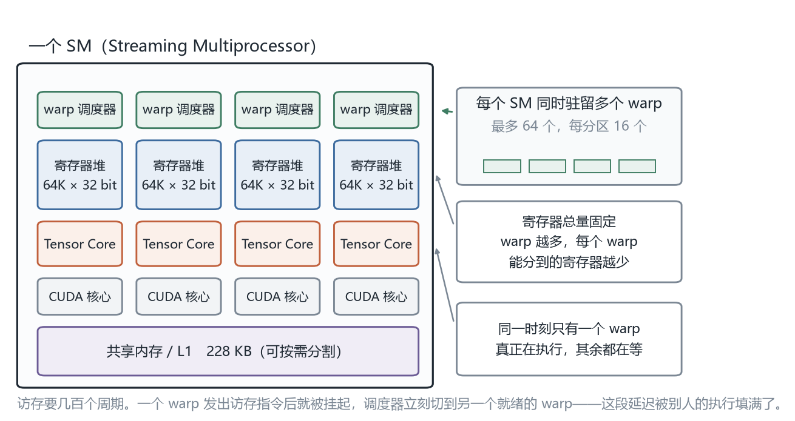

# 第 1 章　GPU 的执行模型与资源账

一张 H100 有 132 个 SM。每个 SM 里 65536 个 32 位寄存器、228 KB 共享内存、64 个 warp 槽、4 个 Tensor Core，合起来是 7.5 TFLOPS 的 BF16 吞吐，整卡 989.4 TFLOPS 除以 132 就是这个数。这几组数字构成单卡的全部物理预算。一个 kernel 能不能跑快，取决于它在这些预算上算不算得过来；算不过来的时候，再多调参也没用。

这一章把这本账拆成四份，分别看寄存器、共享内存、warp 槽和 Tensor Core 被谁占着，最后拿一个 4096 的三次方 GEMM 从头算一遍。

算账的意义在于排除。一个算子慢，可能慢在四个完全不同的地方，四种毛病的修法互不相通。凭直觉调参的人往往在错的那一层上花了两个星期，而一张资源表加上两个乘除法，十分钟就能定位到该看哪一行。做完这一章的算术，你应该能在读一段内核代码之前就说出它的上限大概是多少。

## 1.1　从网格到 warp

启动 kernel 时给出的是网格，硬件执行的是 warp。中间那层转换决定了你写下的线程数里有多少是真的在干活。

网格由线程块组成，线程块由线程组成。32 个线程捆成一个 warp，warp 是调度和发射的最小单位。线程块里的 warp 数等于线程数除以 32 向上取整，用 256 个线程启动得到 8 个 warp，用 200 个线程启动得到 7 个 warp，最后一个 warp 只有 8 个 lane 在干活，其余 24 个永远空闲。线程利用率往下至八成，算力也跟着往下，而 profiler 只会告诉你占用率是个奇怪的数字。

把一个 8×2048×4096 的 BF16 张量过一遍 elementwise 算子，元素数是 $6.71\times10^{7}$。按每线程处理 8 个元素分派，也就是一次 16 字节的向量访问，需要 $8.39\times10^{6}$ 个线程，等于 26.2 万个 warp。每块 256 线程时是 32768 个线程块。全芯片同时能驻留 132×64=8448 个 warp，所以这批活要分 31 轮才轮得完，第 32 轮只剩几百个 warp 在收尾。总 warp 数、驻留 warp 数、轮数这三个量，是后面所有讨论的基础。

warp 内 32 个 lane 共享一条指令指针。遇到 if 分支，两条路径都要执行一遍，各自屏蔽掉一半 lane，一个五五开的分歧分支代价不是 1.5 倍而是 2 倍，四路分歧就是 4 倍。这条规则在现场最常撞上的地方是 mask 和 padding。序列长度 8192 除以 128 的 tile 刚好整除，一旦长度改成 8200，最后一个 tile 里有一百多个位置全是无效计算，而在 profiler 里这部分时间会显示成"计算密集"，不会显示成浪费。

还有一种更隐蔽的分歧，来自线程数和 tile 不整除。做 128×128 的二维 tile 归约，用 288 个线程启动，九个 warp 里最后一个 warp 只覆盖了 tile 的一角，其余 lane 全在做无效访存。改成一个 256 线程的块加一个 washout 分支，速度往往直接涨两成，就是这个原因。

线程块是另一条边界，而且比 warp 更硬。一个块必须整个落在一个 SM 上，块内所有 warp 共享同一份共享内存，块与块之间没有任何片上通路。这条规则推出三个后果。共享内存只能按块算，不能按 warp 算；块间交换数据只能走 L2 或显存；两个块想协作，必须落一个中间张量。写多块归约时被绊倒的人不少，最后都不得不多花一次显存往返。

块的数量还决定 SM 之间怎么分活。8448 个 warp 槽除以每块 8 个 warp，理论上一轮能挂 1056 个块，实际受共享内存和寄存器限制，往往只有三五百个。剩下的块排队，硬件按顺序补位，补位本身有开销。所以块的大小要适中，太小的块补位次数多，太大的块让 SM 之间的负载不均，一个 SM 挂了两个重块、旁边那个只挂一个轻块，整卡就得等最慢的。

拿一个 8192×8192 的输出算一下。取 128×128 的 tile，网格是 64×64=4096 个块，分到 132 个 SM 是每个 31 块。31 不是整数，意味着一部分 SM 要跑 32 块、一部分 31 块，最后那一步的差是 3%。这个量级可以接受。如果把 tile 改成 96×96，网格变成 86×86=7396 块，每 SM 56 块，除得也不尽，但每块变小后尾部的绝对时间变短，平衡反而更好。选 tile 的时候把这两个数一起看，而不是只看 profiler 里的单块效率。

## 1.2　SM 里的四种资源

占用率不是配出来的，是四种资源里最紧的那本账算出来的。

| 资源 | 每 SM 容量 | 分配单位 | 谁在争 |
|---|---|---|---|
| 寄存器 | 65536 个 32 位，共 256 KB | 每线程，按 8 个取整 | 累加器、地址、展开的中间值 |
| 共享内存 | 228 KB | 每线程块 | tile 缓冲、归约、转置 |
| warp 槽 | 64 | 每 warp | 占用率本身 |
| Tensor Core | 4 | warp 指令 | MMA 吞吐 |

寄存器最容易被忽略。65536 个寄存器按 2048 个线程分，每线程只有 32 个。这个数字很低，一个像样的内核光累加器就要占掉几十个。编译器给出 40 个寄存器时，能驻留的线程数是 1638，也就是 51 个 warp；给出 255 个时只剩 256 个线程，8 个 warp。占用率从八成掉到一成出头，代码一行没改。

分配粒度很容易被忽略。寄存器按线程分配，但每个线程的份数要向上取整到 8 的倍数，所以 33 个寄存器实际按 40 个算，浪费的两成是硬损。这个规则还会沿 warp 累积，一个 warp 的 32 个 lane 必须是同一个份数，谁多用一两个寄存器，整个 warp 一起涨。想压占用率水位的内核通常会用 `launch_bounds` 或 `maxrregcount` 把上限卡死，代价是编译器被迫 spill。卡到多少合适，拿 65536 除以想要驻留的线程数就知道了，想要 1024 线程就卡到 64。

共享内存按线程块分配，228 KB 是上限，实际不一定用得满，因为要和 L1 分摊同一片片上存储。惯例是把每块用量凑成 2 的幂，让一个 SM 能放下整数个块。128 KB 的块只能放一个，64 KB 能放三个，48 KB 能放四个。放进去几个块，直接决定这个 SM 能藏多少延迟，也直接决定 tile 能做多大。

这片存储还要和 L1 分摊。把全部 228 KB 划给共享内存，L1 就只剩一个很小的窗口，而 L1 命中一次能省掉一次 L2 往返。两边的取舍看访问模式：规则的 tile 搬运几乎全靠共享内存，不规则的稀疏访存靠 L1 更划算。这个切分在启动时定死，运行中改不了，所以它属于设计决策，不属于调参。

把四本账合起来算一次会更清楚。目标是在一个 SM 上挂 4 个块、每块 128 线程，共 16 个 warp。寄存器这边，65536 除以 4×128 等于 128，每线程最多 128 个；共享内存这边，228 除以 4 等于 57，每块能用 57 KB。两个数一出来，内核的写法基本就定了，超出任何一条，块数就从 4 降到 3 或 2，前面算的延迟隐藏全部推倒重来。

warp 槽那本账最直白。64 个槽乘 32 等于 2048 个线程，这就是占用率百分之百的定义。用 256 线程的块，一个 SM 最多挂 8 个；用 512 线程的块，最多挂 4 个。块数上限还要受另外两条账约束，实际经常先卡在共享内存或寄存器上。真正的浪费往往发生在取整上，用 288 线程的块，块数是 7，槽位只用到 63 个，剩下一个永远空着，再加上每块末尾的空闲 lane，一口气又损失一成。

Tensor Core 的账最简单，也最反直觉。全芯片 132×4=528 个，摊到每个 SM 是 7.5 TFLOPS。这 7.5 TFLOPS 是一个 SM 的天花板，任何时刻只要有一个 Tensor Core 空着，峰值就取不到。反过来说，一个 SM 上只要有一个 warpgroup 在正确地喂 MMA，算力就能吃到饱，剩下六十个 warp 槽闲着也不影响吞吐。这个 SM 里的四类资源、四条数据通路，以及 warp 在它们之间的调度关系，就是图 1-1。

*图 1-1　一个 SM 里的执行资源与 warp 调度*

图里那四条通路是并行的，寄存器堆、共享内存、Tensor Core、L1 各有各的带宽。真正的瓶颈通常不在单个部件上，而在喂给它的指令流能不能按时到达。

Tensor Core 的使用方式还带来一条额外约束。Hopper 上的大块矩阵乘由 128 个线程组成的 warpgroup 发起，而一个 SM 的 4 个 Tensor Core 由这个 warpgroup 一起喂。所以“四个 Tensor Core”并不是四个独立的活可以并行，而是一组指令把四个部件同时占满。这也解释了为什么 GEMM 内核只需要 4 个 warp 就能吃满算力，以及为什么把 8 个 warp 拿去跑同一个 tile 反而变慢。

## 1.3　占用率与延迟隐藏

需要多少 warp，可以算出来，不必靠试。

一个 warp 发出访存指令后要等结果，等的时间是几百个周期。假设每 k 条指令遇到一次 L 周期的停顿，这个 warp 的有效 IPC 是

$$ \mathrm{IPC}_{\text{warp}} = \frac{k}{k+L} $$

一个 SM 有 4 个调度器，每个每周期能发一条 warp 指令，要打满需要 4 的 IPC。代入 k=10、L=500，单个 warp 的 IPC 只有 0.0196，需要

$$ N_{\text{warp}} = \frac{4 \times (k+L)}{k} = 204 $$

也就是 204 个 warp，才能填满发射槽。一个 SM 只有 64 个槽。

把 k 扫一遍，曲线很陡。

| k | 每 warp 的 IPC | 需要的 warp 数 |
|---|---|---|
| 5 | 0.0099 | 404 |
| 10 | 0.0196 | 204 |
| 20 | 0.0385 | 104 |
| 40 | 0.0741 | 54 |
| 80 | 0.138 | 29 |

从 k=10 到 k=40 只提了四倍，需要的 warp 从 204 降到 54，一个超预算三倍，一个刚好装得下。这条曲线的形状就是优化的方向：在寄存器预算内把 k 做到最大，比增加线程有效得多。

结论就一条。纯靠占用率盖不住显存延迟，差得不是一点，是三倍以上；真正的解法是提高指令级并行，让一个 warp 手里同时有几条独立访存在路上，把 k 做大。unroll、prefetch、寄存器分块存在的理由就是这个，它们不是优化技巧，是抬 k 的唯一手段。

反过来看，高占用率本身没有价值。H100 上一个用满 128×256 tile 的 GEMM 内核，一个 SM 只驻留一个块、十六个 warp，占用率四分之一，照样能跑到峰值的七成以上，因为这十六个 warp 的 k 做到了几百，MMA 的流水一直是满的。看到四分之一的占用率就断言内核写得差，是最常见的一种误判。

真正需要高占用率的是那些算术强度很低的算子。以 8×2048×4096 的 BF16 张量为例子，做一次残差加法，每个元素读 4 字节写 4 字节，做 1 次加法，算术强度是 0.125 FLOP/字节，而机器平衡点是 295。这种算子的上限是 0.125×3.35=0.42 TFLOPS，连峰值的千分之一都不到，它天生就该是带宽受限的。对这类算子，唯一有意义的指标是有效带宽占 3.35 TB/s 的比例，占用率只需要刚好够把带宽喂满，多了纯属浪费寄存器。

现场的症状按两个方向分。占用率低、带宽也低、SM 大量空转，说明 k 太小或者同步太多，去查 unroll 和 barrier。占用率高、带宽打满、TFLOPS 只有个位数，说明这个算子本来就不该指望算力，它是带宽受限的，下一章专门算这件事。

L 有两个来源，得分开看。一个是显存延迟，几百个周期，靠 k 和并行访存去盖。另一个是同步延迟，一个 barrier 就把整个块拖到最慢 warp 的节奏上，这种延迟用加 warp 治不好，只能减少同步次数。把两种停顿算在一起然后猛加 warp，是常见的无效调优。诊断方法很直接，把代码里的 barrier 全部注掉看性能变化，涨了就是同步问题，没变就是访存问题。

## 1.4　指令流水与依赖停顿

发射槽的预算比大多数人想的少。

一个 SM 有 4 个 warp 调度器，每个每周期发一条 warp 指令，一条 warp 指令对应 32 个线程的操作。每个 SM 每周期最多推进 4×32=128 条线程指令。想跑满 989.4 TFLOPS，靠的是每个周期都有一条 MMA 在流水里走，而不是靠标量指令堆出来。

依赖停顿的代价按链长算。一条 64 步的求和链，每步依赖上一步的结果，若依赖间隔是 4 个周期，走完要 256 个周期，这期间这个 warp 一条指令都发不出去。改成 4 条独立的链各 16 步，总步数不变，走完只要 64 个周期，四倍差距全部来自 k。上节说的是一个 warp 的间隔有多长，这里说的是间隔怎么来的，同一个公式的两种写法。

编译器开优化后一般会自动展开循环，但展开吃寄存器，寄存器一涨占用率就掉，两头是个跷跷板。用 `-Xptxas -v` 看 `spill` 是最快的体检手段，一旦出现 local memory 的读写，说明寄存器不够，展开的收益被溢出吃掉了。溢出的代价不小，一次 spill 存和取各走一趟 L1，300 周期就没了。

算一次指令预算。$6.71\times10^{7}$ 个元素的残差加法，每个元素摊到地址计算、加载、加法、存储大约十条线程指令，总共 $6.71\times10^{8}$ 条。按每个 SM 每周期 128 条摊下去，是 3.97 万个周期。这个数说明 elementwise 的指令开销很小，成本在字节上，不在发射上。反过来，如果每个元素要算上一百条指令，发射就成了瓶颈，那该考虑把计算搬到 Tensor Core 上去，或者换算法。

另一个症状是 barrier 密集。一个块里 8 个 warp 每一百条指令同步一次，每次同步等最慢的那个 warp，等于把 8 个 warp 的抖动全部暴露在外。归约、softmax、LayerNorm 最容易出这个问题。解法是把同步次数压到最少，或者把一个 warp 能算完的部分改成 shuffle 完成，彻底不跨 warp。

还有一种停顿叫等 MMA 结果。Tensor Core 的累加器要读回寄存器才能做后处理，读回有固定延迟，如果代码在每次 MMA 之后立刻读累加器，Tensor Core 的流水就被打断了。正确写法是让 MMA 连续发若干次，攒够一批再统一读回，代价是多占一批寄存器。这里又回到同一条跷跷板。

还有一个容易被忽视的停顿来源是指令 mix。一条 MMA 指令占用 Tensor Core 若干周期，这期间 CUDA Core 是空的；反过来，标量运算也会把 Tensor Core 晾在一边。两类部件可以同时干活，前提是它们被分到不同的 warp。以一个 128×128×128 的注意力 tile 为例，MMA 侧是 1024 次 16×8×16 的矩阵乘，softmax 侧要对 16384 个元素各做大约五条指令（取最大值、指数、求和、除法、写回），前者跑在 Tensor Core 上，后者只能跑在 CUDA Core 上。把它们塞进同一个 warp 串行执行，Tensor Core 就有一半时间在等。

## 1.5　一个 GEMM 的资源账

拿一个 4096×4096×4096 的 BF16 GEMM 把四本账一起算。这个形状不是随便挑的，它相当于一个七十亿参数模型里一层注意力的投影矩阵。

计算量是

$$ F = 2 M N K = 2 \times 4096^3 = 1.37 \times 10^{11} $$

按 989.4 TFLOPS 的峰值，纯计算时间 139 微秒。

数据量取决于分块。取 128×128 的输出 tile，A 和 B 各要被读 4096/128=32 遍。

$$ B_{\text{HBM}} = 2 \times 32 \times 4096^2 \times 2 = 2.15 \times 10^{9} $$

2.15 GB，按 3.35 TB/s 算是 641 微秒。计算 139 微秒，搬运 641 微秒，差 4.6 倍，这个 GEMM 会卡在带宽上，无论 Tensor Core 多快。

用算术强度说得更清楚。这个配置下每搬一个字节做

$$ I = \frac{1.37 \times 10^{11}}{2.15 \times 10^{9}} = 64 $$

次浮点运算。这张卡的机器平衡点是 989.4/3.35=295 FLOP/字节。64 不到 295 的四分之一，缺口正好是那 4.6 倍的来源。

要补齐缺口，输出 tile 要做到 T×T 且满足 T/2 ≥ 295，也就是 T 至少 590。590×590 的 BF16 tile 是 696 KB，远超 228 KB 的共享内存上限。单靠共享内存分块做不出足够的复用，必须把中间一级交给 L2，这也是 GEMM 性能对 tile 遍历顺序那么敏感的原因。上面这 641 微秒是按 L2 零复用算的，是下界；真实值介于 641 微秒和 139 微秒之间，落在哪里取决于 L2 命中率。

寄存器的账同步给出。128×128 的 tile 交给 256 个线程，每个线程要持有 128×128/256=64 个累加器。64 个单精度累加器就是 64 个寄存器，加上地址和操作数，实际落在 128 到 200 之间。按 200 算，65536/200=327，一个 SM 只放得下一个 256 线程的块，占用率 12.5%，但 Tensor Core 依然吃饱。

三个约束合起来是一句话。tile 越大，复用越高、带宽越省，但寄存器和共享内存越紧，占用率越低；tile 越小，占用率好看，带宽却成倍浪费。这三者的乘积就是单卡 GEMM 的真实上限，也是为什么同一个 GEMM 在不同实现之间能差三倍。

四种 tile 的账放在一张表里更直观。

| 输出 tile | 算术强度 | HBM 流量 | 搬运时间 | 每段共享内存 |
|---|---|---|---|---|
| 64×64 | 32 | 4.29 GB | 1282 微秒 | 16 KB |
| 128×128 | 64 | 2.15 GB | 641 微秒 | 32 KB |
| 128×256 | 85 | 1.61 GB | 481 微秒 | 48 KB |
| 256×256 | 128 | 1.07 GB | 320 微秒 | 64 KB |

四行里有三件事值得看。tile 边长翻倍，强度只翻一倍，因为强度跟边长成正比，这是分块的物理限制。即使到 256×256，强度 128 仍然只有 295 的一半不到，所以单卡纯靠共享内存分块永远到不了计算受限，剩下的一半必须靠 L2 兜住。而 256×256 的累加器是 65536 个，摊到 512 个线程上每线程 128 个寄存器，加上操作数必然 spill，这行在显存上的账好看，在寄存器上的账已经破产。

表里算的是大块 GEMM。训练里真正跑不到这些数的原因往往在形状上。一个 128×4096 乘 4096×4096 的小 GEMM，M 只有 128，刚好一个 tile，强度降到 85，而如果 batch 再小一半，M=64，tile 就装不满了，强度向 32 坠落，直接退回表的第一行。这就是小批量微调和大批量预训练在单卡效率上差一倍的原因，也是梯度累积能把效率拉回来的物理基础：攒够 token 再算，等于把 M 做大。

还有一个现实约束。一个 step 里 GEMM 只占六到七成的时间，剩下的是 LayerNorm、残差、mask、类型转换这些带宽受限的小算子。所以就算 GEMM 跑到峰值的八成，整个 step 的 MFU 也只有五成多。这两个数不能混，前者是内核指标，后者是作业指标，第 4 章会把它们分开定义。

## 1.6　资源冲突的现场症状

四本账里哪本先爆，症状不一样，看一眼 profiler 就能分开。

| 症状 | 最可能的原因 | 先查什么 |
|---|---|---|
| 占用率两三成，TFLOPS 正常 | 大 tile 的预期结果 | 不用查，直接看 MFU |
| 占用率九成，TFLOPS 5% | k 太小，依赖链太长 | unroll、barrier 次数 |
| 编译日志出现 spill | 寄存器不足 | `-Xptxas -v`，减小 tile |
| 启动即失败，报资源不足 | 共享内存超限 | 每块 smem 用量与块数 |
| 末轮占比高，端到端变慢 | 网格不是 SM 的整数倍 | 批大小与序列长度 |

头两行经常被一起误判。同样是占用率异常，一个是设计选择，一个是真问题，区别在于 TFLOPS。判断标准是这个算子的算术强度够不够，而不是占用率够不够。

资源不够的时候，手上只有三个旋钮。块大小决定每块吃多少寄存器和共享内存，tile 大小决定复用和寄存器压力，寄存器上限决定编译器能不能展开。三个旋钮互相牵制，动一个另外两个就得重算。每次只动一个，把改动前后的资源表贴在同一张纸上对比，是最不容易迷路的做法。

末轮是另一种隐形税。26.2 万个 warp 分 31 轮跑满 8448 个槽，31 轮吃掉 261888 个 warp，还剩 256 个，第 32 轮只用到 3% 的槽位。整卡的利用率在最后一轮掉到个位数。批量小的作业里这个损耗能到一成以上，而它不会出现在任何单算子 profile 里，只体现在端到端的 step 时间上。看到单算子都快、拼起来慢，先算一下网格除不除得尽。

最后一条经验。资源账只在设计 kernel 时有用，跑起来之后就该换成时间和字节的账。profiler 里最有价值的两列是 SM 的活跃周期占比和 DRAM 的实际吞吐，两列摆在一起，受限在哪一侧一目了然。其余指标都是用来解释这两列的。

排查顺序可以固定下来。先算这个算子的算术强度，确定它应该受限于哪一侧；再看那两侧的实测值离理论上限有多远；两侧都正常了，才去看资源账；资源账也算不出问题，才动代码。跳过前两步直接改代码的人，八成会改错方向。

一个真实形状的例子。某次一个 attention 内核只有峰值的 6%，第一反应是占用率不够，把块从 256 线程加到 512，快了一点点，再多加就慢了。按上面的顺序走，先算强度，QK 乘一段是 128×128×128，强度上千，应该计算受限；再看两列，Tensor Core 活跃度 30%，而 DRAM 吞吐只有 0.3 TB/s，两边都没满。到这里就能定住，问题不在带宽也不在算力，而是 Tensor Core 在等数据，即共享内存流水线断了。最后查出来是编码器把一个常数 tile 的加载放到了 MMA 之后，改了一句就恢复到峰值的六成。这种病例靠调参永远调不出来。

看一个慢的内核，先问三个问题。块有多大，tile 有多大，寄存器够不够展开。三个答案凑齐，这个内核的上限就出来了，剩下的工作只是把实现往那个上限推。推不上去的时候，再回来看是哪本账先爆的。
