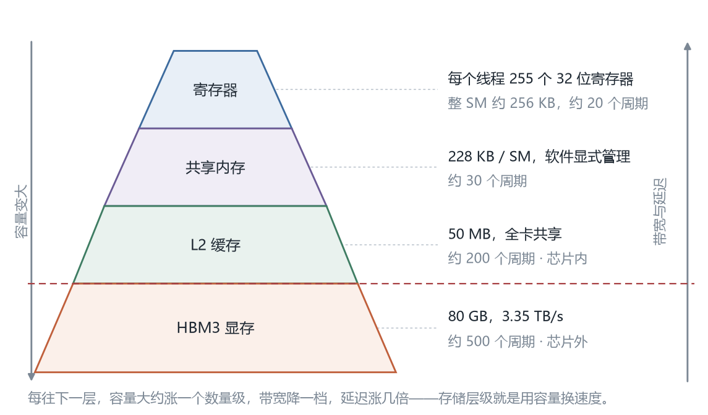
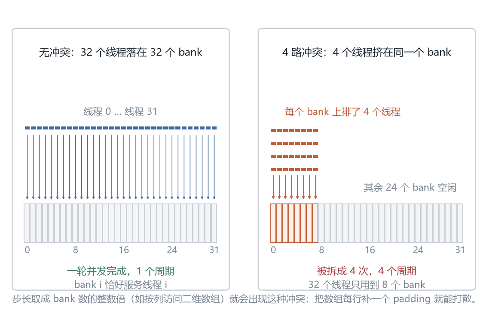

# 第 2 章　显存层级与真实带宽

H100 的 HBM3 标称带宽 3.35 TB/s，这个数在手册第一页。同一张卡上的 L2 是 50 MB，每个 SM 的共享内存 228 KB，寄存器堆 256 KB。四层存储的容量差五个数量级，带宽也差一个数量级以上，而绝大多数训练算子的时间花在把数据从下一层搬到上一层。

这一章只做一件事，把"搬"这件事算清楚。哪些搬运是必须的，哪些是访问模式造成的浪费，哪些是分块没做好导致的重复读取。算完之后你会发现，一张卡的真实上限往往不是 3.35 TB/s，而是它的三分之一到一半。

## 2.1　HBM、L2、共享内存、寄存器金字塔

四层的容量和角色差别巨大，把它们并排放在一张表里，很多设计决策就自动有了依据。

| 层级 | 每 SM | 全芯片 | 带宽角色 |
|---|---|---|---|
| 寄存器 | 256 KB | 34.6 MB | 每个线程私有，无延迟概念 |
| 共享内存 | 228 KB | 30.8 MB | 块内共享，软件显式管理 |
| L2 | 共享 | 50 MB | 全芯片共享，硬件自动缓存 |
| HBM3 | 共享 | 80 GB | 3.35 TB/s，唯一的持久层 |

先看容量。全芯片的片上存储加起来是 34.6+30.8+50=115.4 MB，占 80 GB 显存的 0.14%。这个比例说明一件事，任何一次"数据放不进片上存储"的判断，结果都是要重新从 HBM 读。一个 8192×8192 的 BF16 权重矩阵是 134 MB，比整个 L2 还大 2.7 倍，一个 token 走一遍这层矩阵，权重必须从 HBM 取。这就是大模型推理里 batch 越小越吃亏的根源，权重读一次只用一次。

把这句话落到具体形状上。隐层 16384 维，一层注意力的四个投影矩阵各是 16384×16384 的 BF16，每个 536.9 MB，四个加起来 2.15 GB。这还只是一层里的一个子模块，而 L2 只有 50 MB。一个 token 过这四个矩阵，要搬 2.15 GB，按 3.35 TB/s 算是 642 微秒；而计算量只有

$$ F = 2 \times 4 \times 16384^2 \times 1 = 2.15 \times 10^{9} $$

按峰值算是 2.2 微秒。搬运比计算多 290 倍，算术强度约等于 1 FLOP/字节。这就是为什么单条请求的推理永远跑不满算力，也是为什么批处理能把效率拉回来，八个 token 一起过，同一份权重服务八次，强度就变成 8。

再看带宽。3.35 TB/s 是整卡的，摊到 132 个 SM 上，每个 SM 平均只有

$$ b_{\text{SM}} = \frac{3.35 \times 10^{12}}{132} = 25.4 \times 10^{9} $$

也就是 25.4 GB/s。这个数非常重要，它意味着一个 SM 想跑满自己的 7.5 TFLOPS，每读一个字节必须做

$$ I_{\text{need}} = \frac{7.5 \times 10^{12}}{25.4 \times 10^{9}} = 295 $$

次浮点运算。第 1 章算出来的 295 FLOP/字节就是这么来的，它不是抽象指标，是每个 SM 分到的带宽份额逼出来的要求。

现场的推论很直接。一个算子的算术强度低于 295，它在单卡上就是带宽受限的，无论 Tensor Core 多快；高于 295，才有资格谈算力利用率。而 295 这个门槛相当高，一个 128×128 分块的 BF16 GEMM 只有 64，差得远。正因为如此，单卡上的大部分时间其实花在等数据，而不是在算。

这个门槛还会随精度变。换成 FP8，峰值是 1979 TFLOPS，带宽一点没动，门槛变成 1979/3.35=591 FLOP/字节。同样是 128×128 的分块，强度还是 64，缺口从 4.6 倍拉到 9.2 倍。低精度把算力翻了一倍，却没给数据通路加宽一毫米，两者之间的沟反而更深了。这就是为什么 FP8 训练的实际收益总是小于峰值比例，第 5 章会回头算这笔账。四层的容量和带宽画在一起就是图 2-1，越往下容量越大、带宽越低。

*图 2-1　H100 的存储层级与带宽*

图里每一层的带宽都比下一层高一个数量级以上，但容量小几个数量级。整个高性能内核的设计就是在做同一件事，把能复用的数据尽量往左上角挪，把必须过的字节压到最少。

还有一点容易被忽略，这四层里只有 L2 和 HBM 是硬件自动管理的缓存，寄存器和共享内存都是软件显式管理。编译器决定寄存器怎么分，程序员决定共享内存怎么用，硬件不帮忙也不干预。好处是可控，坏处是写错了不会有人帮你兜底。一个 tile 放错了位置，硬件不会像 CPU 的缓存那样自动换进来，它只会报一个共享内存不够，或者默默地多跑几轮。

## 2.2　带宽的测法

标称 3.35 TB/s 和你能拿到的带宽是两回事，中间隔着一个折减系数，通常在九成上下。

最可靠的测法是大块拷贝。分配 8 GB 的源和目标，做一次内存到内存的拷贝，读 8 GB 写 8 GB，一共 16 GB 的流量。按 3.35 TB/s 算，理想时间是

$$ t = \frac{16 \times 10^{9}}{3.35 \times 10^{12}} = 4.8 \text{ 毫秒} $$

实测若是 5.3 毫秒，有效带宽 16/0.0053=3.0 TB/s，占标称的 90%。这个 90% 就是这张卡的健康水位，低于它说明测量本身有问题，而不是卡有问题。

为什么用 8 GB 而不是 800 MB，因为 L2 有 50 MB。数据量只有几十 MB 时，第二轮读很可能全在 L2 里命中，测出来的带宽会虚高好几倍。8 GB 是 L2 的 160 倍，访问一遍就是一遍，没有侥幸。这个坑在测小 kernel 时特别容易出现，一个 64 MB 的张量做十次遍历，测出的带宽能到 6 TB/s 以上，那是 L2 的带宽，不是 HBM 的。

更贴近实际的测法是三元运算，`a[i]=b[i]+c[i]*d[i]`，三条读流一条写流，总流量 4 倍数组大小。同样 8 GB 的数组，流量是 32 GB，理想时间 9.6 毫秒。三元运算比拷贝更接近真实训练里的算子，因为它有四条独立的流，对 TLB、对访问模式的压力都更真实。三元运算的有效带宽做到 85% 就算不错，做到 90% 说明内核写得很干净。

还有一种误差来自测量的时间尺度。一个几十微秒的内核，启动开销和收尾的释放都会摊进去，测出来的带宽可能只有真实值的一半。测带宽要用足够长的内核，或者用事件计时把拷贝那一段单独框出来。

实测偏低的时候，原因通常不在显存。数据量太小时内核启动开销占了大头，几微秒的启动时间摊到几十微秒的执行上就是实打实的损耗；线程数不够时打不满带宽；用页锁定内存与可分页内存的差异能到两倍；跨 NUMA 访问会让一半的请求绕远路。这几种都不需要改代码结构，改的是测量的方式和数据放置的位置。

还有一个前提要说清楚，3.35 TB/s 是理想工况。跑大矩阵乘时功耗顶到 700 W 的墙，频率降下来，带宽也跟着降。同一张卡在纯拷贝和混合负载下测出的数能差 5%，报性能数字时要说清楚是哪种工况下测的。把拷贝测出的 3.0 TB/s 当成训练时的可用带宽，低估还是高估都不一定。

命令行测出来的数是一个意义上的上限，profiler 里那列显存吞吐是同一个物理量在时间轴上的平均值，两者差 5% 以内算一致。差得多的时候先别怀疑卡，看三件事，数据量够不够大、页锁定内存有没有用上、跨没跨 NUMA 节点。

顺带把一个常用算法说清楚。一个 step 的总字节数等于每个算子的输入、输出、中间张量之和，权重只算一次，激活按 micro-batch 算。把这个总数除以 3.35 TB/s，得到的是这个 step 的时间下界。这个下界算出来往往比想象的高，一个 70 亿参数模型在 8K 序列上光是搬权重和激活就要十毫秒量级。

## 2.3　合并访问与事务

显存按 128 字节的事务搬运，一次事务拆成四个 32 字节的 sector。一个 warp 的 32 个线程如果访问连续的 4 字节数据，正好拼成一个 128 字节的事务，一次搬完，效率和带宽都是满的。

错开就不行了。给每个线程加 8 个 float 的步长，32 个线程的地址跨度变成

$$ 32 \times 8 \times 4 = 1024 \text{ 字节} $$

一个 warp 的请求要 8 个事务才装得下，而每个事务里只有 16 字节是有用的，其余全浪费。有效带宽掉到

$$ 3.35 \times \frac{1}{8} = 0.42 \text{ TB/s} $$

八分之一的效率。这个数字不是理论推演，是 `a[i*8]` 这种写法在 profiler 里的真实表现，而代码看上去只是多了个乘 8。

比步长更隐蔽的是 sector 内的错位。一个结构体里放了三个 float 和一个 int，16 字节，只读其中一个 float，32 个线程的请求散在 16 个 sector 上，每个 sector 32 字节里只有 8 字节有用，浪费 75%。解法是把热字段拆成单独的数组，结构体数组换成数组的结构体，这个改动往往能让一个内核快三倍，而算法一个字没变。

向量化是另一个维度的事。每个线程一次读 16 字节，一个 warp 的请求是 512 字节，正好四个事务，有效率还是 100%，但指令数只有原来的四分之一。指令数少了，同样的发射预算能覆盖更多的字节，也就更容易把带宽喂满。注意向量化不改变有效字节数，它改变的是达到同样字节数需要多少条指令，所以它解决的是发射瓶颈，不是带宽浪费。

sector 数还要和命中率一起看。前者决定 L2 要向 HBM 要多少字节，后者决定这些请求有多少真的落到 HBM，两个数乘起来才是实际的显存流量。只看其中一个，都会得到一个和现场对不上的结论。

现场判断看一个指标，每个请求对应的 sector 数。理想值是 4，也就是一个 warp 请求刚好装进一个 128 字节事务。看到 32 就说明访问散得厉害，先去查索引表达式里有没有乘步长、有没有按列访问二维数组。这个指标比带宽本身更早暴露问题，因为带宽还会被 L2 掩盖一部分，sector 数不会。

对齐是另一个容易被忽略的边界。一行数据的起点如果不是 128 的倍数，一个 warp 的请求就会跨两个事务，有效字节从 128 降到 64，带宽直接减半。行宽是 4096 个 BF16 时刚好 8192 字节，怎么切都对齐；行宽是 4097 时每行都错开两字节，每一行都要多碰一个事务。这种问题在 padding 加错一位时出现，现象是整个内核的带宽只有一半，但代码看上去一点没错。

把这两层损失乘起来会更难看。步长 8 让有效字节降到八分之一，行首又不对齐再打八折，一个内核可能只剩理论带宽的十分之一，而 profiler 里只有一条平平的曲线。所以查带宽问题先看 sector 数，再看对齐，最后才看带宽数字本身。

只读一次的数据还能加个提示。显式声明为流式加载，硬件会把它标记为不长期保留，避免把真正要复用的数据挤出 L2。反过来，反复读的小表应该走缓存加载。这类提示不改变正确性，只影响 L2 里谁的优先级高，在 L2 吃紧的时候能拿到 5% 到 10%。

## 2.4　bank conflict

共享内存被切成 32 个 bank，每个 bank 每个周期能服务一个 4 字节的访问。32 个线程同时访问 32 个不同的 bank，一拍完成；有两个线程落在同一个 bank 且地址不同，就要排队，这叫 bank 冲突。

bank 的编号由地址算出

$$ \text{bank} = \left\lfloor \frac{\text{addr}}{4} \right\rfloor \bmod 32 $$

步长为 1 时，连续 32 个 4 字节正好铺满 32 个 bank，无冲突。步长为 32 时，所有线程的地址除以 4 之后都是 32 的倍数，模 32 全是 0，32 个线程挤在同一个 bank 上，需要 32 个周期才服务完，共享内存的有效带宽掉到三十二分之一。

最典型的病例是矩阵转置。读的时候按行，`tile[tid][k]`，步长 1，很顺；写的时候按列，`tile[k][tid]`，步长 32，全撞在一个 bank 上。一个 32×32 的 tile 转置，读是一拍，写是三十二拍。

修法只有一行，把 tile 声明成 32×33。

$$ 33 \times 32 \times 4 = 4224 \text{ 字节} $$

比 4096 字节多 128 字节，也就是每行多一个 float，步长变成 33，模 32 余 1，冲突消失。代价是 3% 的额外共享内存，收益是 32 倍的写带宽。这个技巧用了二十年还在用，因为它针对的是硬件结构，不是某一代卡的实现细节。

还有两类情况不算冲突，要看清楚。同一个地址的读会被广播，多个线程读同一个值时只需要一次访问，所以按行求和、读同一个 scale 这类模式是安全的。写同一个地址则是未定义行为，结果取决于哪个线程最后写入，这类 bug 不会报错，只会让 loss 曲线莫名其妙地抖。

现场的症状很典型。共享内存流水线的利用率到 90% 以上，而 FFMA 或 MMA 的利用率只有两成，同时指令数并没有明显增多。这就是典型的 bank 冲突，因为每条共享内存指令都要花几十个周期，把流水堵死。另一个信号是“把 tile 换个方向就快了 30 倍”，遇到这种量级的差异，基本可以直接判定是访问步长撞上了 32。

不过手算 bank 已经不太够用了。较新的卡支持一次搬 128 字节的向量化共享内存访问，一个指令取一个 8×8 的块，硬件会把地址打散成无冲突的形式。这种模式下，软件层看到的线性地址和实际落到的 bank 不是一回事，手推 padding 很容易推错。判断依据应该换成计数器的读数，看共享内存的冲突次数和实际事务数，而不是靠纸笔。

冲突的代价还能从另一个角度估。32 路冲突意味着每条指令耗时 32 个周期，而正常情况是 1 个。如果这个内核每做 8 次 FFMA 就要读写一次共享内存，那么在无冲突时算术和访存是 8:1，冲突后变成 1:4，整个算子的时间被共享内存主导。这也是为什么修一个 padding 能让内核快一个量级。

把转置内核的三个版本摆在一起，差距很直观。直接按列写，写侧是一个 warp 三十二拍，整体耗时是读写两侧都顺时的几十倍，这个内核不可能超过理论带宽的几十分之一。加上 33 的 padding，写侧一拍完成，两侧都顺了。再上 16 字节的向量化读写，一条指令搬 128 字节而不是 4 字节，指令数降到四分之一，这才有可能把带宽喂满。三代代码的算法完全一样，差别全在字节怎么落到 bank 上。三种写法落到 bank 上的差异就是图 2-2，左边是按行读，右边是按列写。

*图 2-2　共享内存的 bank 冲突*

## 2.5　L2 命中率与持久化

L2 是唯一一层软件管不着但影响巨大的缓存。50 MB 听起来不多，但它能把一个带宽受限的 GEMM 变成计算受限的 GEMM。

回到第 1 章的 4096 三次方 GEMM。128×128 分块下，A 和 B 各要被读 32 遍，HBM 流量 2.15 GB，搬运 641 微秒，而计算只要 139 微秒。这个账假设的是 L2 完全不工作。实际上 B 矩阵的总大小是

$$ 4096 \times 4096 \times 2 = 33.6 \text{ MB} $$

比 50 MB 的 L2 还小，整体可以驻留在 L2 里。真实流量于是降到 A 读一遍加 B 读一遍，共 67.1 MB，按 3.35 TB/s 是 20 微秒，远小于 139 微秒的计算时间。同一个 GEMM，结论从带宽受限翻成计算受限，差别只在 L2 有没有被用上。

L2 能不能用上，取决于块的遍历顺序。网格按行优先推进时，同一列的 B 分块在短时间内被反复访问，命中率高；按列优先推进时，B 的每个分块用完就被换出去，命中率掉到很低。这就是为什么同一个内核，把网格的 x 和 y 换一下能让性能翻倍，也是为什么很多 GEMM 库要按 tile 的簇来排布启动顺序，让同时运行的块共享同一片 B。

还有一招是持久化窗口。把一段地址范围标记为 L2 常驻，硬件在换出时优先保住它，适合放那些反复读、体积不大的数据，比如推理时的 KV、通信用的信号区、小模型的整份权重。50 MB 放不下 4050 亿参数的模型，但放得下一层的一部分，也放得下几百个 token 的 KV。用之前先算体积，超过 L2 一半就不要指望它，因为其他数据也要活。

现场判断看 L2 命中率与 HBM 流量的乘积。命中率高但 HBM 流量没降，说明命中的是本来就要读的数据，没有减少实际搬运；命中率低而 HBM 流量接近理论上限，说明这个算子确实需要这么多字节，该去改算法而不是改分块。这两种情况的处理方式完全相反，混在一起看会得出错误结论。

L2 的容量还决定了一件大事，就是能不能在不落显存的前提下做跨块的数据交换。一个 8K 序列、128 维单个 head 的 K 是 8192×128×2=2 MB，50 MB 的 L2 能同时装下二十五个这样的块。这就意味着相邻的 head 如果在时间上靠近，它们的 K 可以从 L2 拿到，而不是重新从 HBM 读。反过来说，如果把注意力按 head 拆成很多个小内核依次跑，每个内核都要重新读一遍 Q，L2 里只剩下最后一个 head 的痕迹，复用全部丢失。

这里有个测量陷阱。用很小的 batch 去 profile 一个算子，L2 能装下全部工作集，测出来的带宽会很好看；换到真实 batch，工作集超出 L2，性能掉一半。所以 profiler 里的数字必须配上当时的 batch 和序列长度才有意义，单拿一个百分比出来比较，很容易得出相反的结论。

持久化窗口能放多少也可以直接算。一层 32 个头的键值，8192 个 token、头维 128、BF16，是 8192 乘 128 再乘 2 字节，K 和 V 各一份，再乘 32 个头，134 MB，比 50 MB 的 L2 大两倍多，一层都放不下。换成 2048 个 token 就是 33.6 MB，装得下，还留了十六 MB 给别的数据。长上下文推理要做分页键值，页的大小就是按这个预算定的。

不跑 profiler 也能先估一下。把算子的工作集算出来跟 50 MB 比，小于 50 MB 说明 L2 大概率能帮上忙，性能会对块的遍历顺序敏感，值得花时间调排布；大于 50 MB 好几倍，L2 只能照顾到边角，别指望它改写结论。介于两者之间的情况最难判，只能实测，而且要在几个不同的 batch 下各测一遍。

## 2.6　带宽受限算子的优化顺序

带宽受限的算子有四类手段可用，顺序不能乱。减字节排在最前，动并行度排在末位，中间两步是提复用和改访问模式。

减字节的效果最大。一个 LayerNorm 加残差加 dropout 的组合，输入输出各是 8×2048×4096 的 BF16 张量，单个张量 134 MB。不融合的写法要读输入、写归一化结果、读回来加残差、写、读、算 dropout mask、写，一共十次全量往返

$$ 10 \times 134 = 1340 \text{ MB} $$

按 3.35 TB/s 是 400 微秒。融合成一个内核之后只剩读一遍写一遍，268 MB，80 微秒。五倍差距，来源不是任何一条指令的优化，是五次搬运被消掉了。

提复用是第二步。分块让同一份数据服务多个输出，L2 让同一份数据服务多个块。这两件事在第 1 章已经算过，tile 从 64 边长到 256 边长，HBM 流量能从 4.29 GB 降到 1.07 GB，四倍。代价是寄存器和共享内存，用不用得起要回到资源账上算。

融合也不是越多越好。一个内核里塞进四五个算子，每个算子的中间值都要占寄存器，寄存器一超就 spill，溢出的读写又回到显存，前面省下的搬运都吐了回去。经验上的边界是一个块里不要同时超过两种计算模式，纯带宽型的算子和带归约的算子尽量分开。融合的收益是可算的，省下的往返字节除以 3.35 TB/s 就是收益上限，拿这个上限和占用率下降的代价一对比，值不值得就很清楚。

改访问模式是第三步，包括合并访问、sector 对齐、bank padding。这类改动不改字节数，改的是字节的利用率和指令的开销。前面算过，步长错开会让有效带宽掉到八分之一，这个损失比任何并行度调整都严重，但它只在特定写法下才出现，所以放在第三步查，先用前两步把量级压下来。

并行度排在末位。占用率只要够把带宽喂满就行，多给线程不会让带宽变高。对一个纯拷贝内核，占用率从 25% 到 50% 可能带来 10% 的提升，从 50% 到 100% 基本没有变化。把时间花在这里，收益是最低的。

这里有个很常见的反例。一个内核报告带宽只有 1.2 TB/s，第一反应是线程开得不够，把每块从 128 线程加到 512，带宽涨到 1.3 TB/s。按上面的顺序重查，先数字节，发现它在读一个应该被融合掉的中间张量，白搬了 268 MB；把那一步融掉之后，同样的线程数、同样的代码结构，带宽利用率和端到端时间同时改善。前者是拿两成的力气去抓一成的收益，后者是把一整块搬运直接去掉。

| 手段 | 动的是什么 | 典型收益 |
|---|---|---|
| 算子融合 | 往返次数 | 2 到 5 倍 |
| 分块与 L2 复用 | 重复读取 | 1.5 到 4 倍 |
| 合并访问与对齐 | 每个事务的有效字节 | 2 到 8 倍 |
| 向量化 | 达到同样字节的指令数 | 1.1 到 1.4 倍 |
| 提高占用率 | 延迟隐藏 | 1.0 到 1.2 倍 |

分块之所以能生效，前提是共享内存的带宽够高。每个 SM 每周期能从共享内存取 32 个 4 字节，聚合起来比 HBM 高一个数量级以上，正是这个差价为复用提供了空间。如果共享内存和 HBM 一样快，分块就只是把数据换个地方放，一分钱都省不下来。

这四步的收益都能提前算。拿一个具体的算子把每一步的字节数写在纸上，算完再动手，比先跑一遍再猜省时间。

现场还有一类判断错误，发生在带宽已经很高的时候。带宽 3.0 TB/s、step 还是慢，这时候该做的不是继续调内核，而是去数这个 step 一共搬了多少字节。把每个算子的流量加起来，除以 3.35 TB/s，得到的是这个 step 的时间下界。如果实测比下界高很多，问题在别处；如果两者接近，说明这个模型结构本身就要搬这么多，唯一的出路是改结构，比如融合更多算子、减少中间张量、降低精度。

带宽这件事最后落在一个很朴素的判断上。数一遍字节，除以 3.35 TB/s，得到的就是这个算子的最快可能。实测离这个数近，说明实现没问题，别再调了；离得远，先看事务效率，再看复用，最后才看并行度。

## 2.7　一个请求到底搬了多少字节

2.3 节说 32 个线程读连续的 4 字节拼成一个 128 字节的事务，这是最顺的一种。真实内核里更常见的是各种错开，错开到什么程度，可以用 sector 数算出来。

显存按 32 字节的 sector 统计流量，四个 sector 凑成一行 128 字节。一个 warp 的 32 个 lane 发出地址之后，硬件把它们落在的 sector 去重，去重后的个数乘 32 就是这次请求实际要搬的字节。有效字节比是

$$ \eta = \frac{32b}{32S} = \frac{b}{S} $$

其中 $b$ 是每个 lane 实际要的字节数，$S$ 是这次请求触及的 sector 数。连续 4 字节的访问 $b=4$、$S=4$，$\eta$ 是 100%。

把常见写法扫一遍，结果是这样。

| 写法 | 每 lane 字节 | 触及 sector | 有效字节比 |
|---|---|---|---|
| float，步长 1 | 4 | 4 | 100% |
| float，步长 2 | 4 | 8 | 50% |
| float，步长 4 | 4 | 16 | 25% |
| float，步长 8 | 4 | 32 | 12.5% |
| BF16，步长 8 | 2 | 32 | 6.25% |
| 32 个互不相邻的地址 | 4 | 32 | 12.5% |

表里有个上限容易忽略。一个 warp 最多碰 32 个 sector，所以 4 字节访问的最差效率就是八分之一，步长再大也不会更差，只是把同样的 32 个 sector 拉得更开。想再往下掉，只能缩元素，BF16 的 6.25% 就是这么来的。

几个可复算的例子。

第一个是转置。1024×1024 的 FP32 矩阵按 32×32 的 tile 转置，读按行，$\eta$ 100%，读 4 MB。写按列，每个 lane 写 4 字节，32 个 lane 落在 32 个不同的行上，每行 4 KB，地址跨度 128 KB，触及 32 个 sector，$\eta$ 是 12.5%，等效写 32 MB。总流量 36 MB，按 3.35 TB/s 是 10.7 微秒，而按最小流量 8 MB 只要 2.4 微秒。差出来的四倍全部来自写侧的地址顺序，跟算法一个字都没关系。

第二个是 GEMM 里 B 的列读取。BF16 的行宽 4096 个元素是 8192 字节，32 个 lane 读同一列的 32 行，地址每隔 8192 字节一个，32 个 sector 一个不落，每个 sector 的 32 字节里只有 2 字节有用，$\eta$ 是 6.25%。这就是为什么分块 GEMM 一定要把 B 的 tile 先按行搬进共享内存再转置，直接在寄存器里按列取，等于把带宽吃掉十六分之十五。

结构体那个例子可以算到底。16 字节一个元素，32 个 lane 就是 512 字节的跨度，16 个 sector，每个 sector 只用 4 字节，有效字节比 25%，等效带宽 0.84 TB/s。同一个算法，把热字段拆成独立数组之后回到 100%，时间直接掉到四分之一，中间没有任何计算被优化。

反过来也能用它估实测带宽。有效字节比 25% 的算子，不管内核写得多好，实测带宽的上限就是 3.35 的四分之一，0.84 TB/s；12.5% 就是 0.42 TB/s。看到 0.8 TB/s 不必惊慌，先确认这个算子本来就该是这个数。

对齐是另一个独立的乘数。一个 warp 的请求如果起点不在 128 字节的边界上，本来四个 sector 的活会多碰一个，变成五个，$\eta$ 从 100% 掉到 80%。代价只有两成，不像错步长那么狠，但它同时出现在读写两侧，而且很难从代码上看出来。行宽 4096 个 BF16 是 8192 字节，怎么切都对齐；行宽 4098 是 8196 字节，每行错开 4 字节，每一行都多碰一个 sector。

判断当前落在哪一档，看每个请求对应的 sector 数。理想是 4，也就是一个 128 字节的事务装满。看到 8 说明一半在浪费，看到 32 说明十六分之十五在浪费。这个指标比带宽本身更早暴露问题，因为 L2 命中会把带宽数字补回来一部分，sector 数不会。

## 2.8　padding 与 swizzle

2.4 节那个 32×33 的补列办法，是对付 bank 冲突最省事的一招。到了 BF16 和更大的 tile 上，步长与 bank 的对应关系会变，补列也不总是合法，得把两件事分开算。

先看一个具体的冲突。64×64 的 BF16 tile 存在共享内存里，一行 64 个元素是 128 字节，正好 32 个 bank。读第 $j$ 列的 32 个元素，第 $i$ 个 lane 的地址是

$$ \text{addr}(i) = (64i + j) \times 2 $$

落到的 bank 是

$$ \left\lfloor \frac{\text{addr}}{4} \right\rfloor \bmod 32 = \left(32i + \left\lfloor \frac{j}{2} \right\rfloor\right) \bmod 32 $$

和 $i$ 无关。32 个 lane 全挤在同一个 bank 上，32 拍才服务完。一行 128 字节看着整齐，恰恰是冲突的根源，因为一整行刚好装满 32 个 bank，下一行又从头开始。

补一列之后一行是 66 个元素、132 字节，bank 变成

$$ \left(33i + \left\lfloor \frac{j}{2} \right\rfloor\right) \bmod 32 $$

$i$ 的系数 33 模 32 余 1，32 个 lane 恰好铺满 32 个 bank。代价是 66 除以 64 的额外空间，3.1%，一个 8 KB 的 tile 变成 8448 字节。

补列在 BF16 上有副作用。一行从 128 字节变成 132 字节，不再是 16 的倍数，而直接搬运的描述符要求最内维按 16 字节对齐，这种布局进不去，只能退回逐线程的异步拷贝，3.3 节那个指令数上的优势就没了。

swizzle 是另一条路，不加空间，改的是地址映射。把一行 128 字节切成 8 个 16 字节的组，第 $r$ 行的第 $c$ 组存到第 $c \oplus (r \bmod 8)$ 组的位置，物理偏移是

$$ \text{off}(r,c) = 128r + 16\left(c \oplus (r \bmod 8)\right) $$

每 8 行一个周期，让每一行的 bank 起点错开。还是那个整列读取的例子，$i$ 从 0 到 31，$i \bmod 8$ 每个值出现 4 次，所以 32 个 lane 只落在 8 个不同的组上，每组 4 个 lane 撞同一个 bank，冲突从 32 路降到 4 路。降得不如补列干净，但对 ldmatrix 那种按 16 字节组读的走法，它是完全无冲突的，而那种走法才是 MMA 取操作数时真正用的。

共享内存这一层的宽度值得单独记住。32 个 bank 每拍各服务一个 4 字节，合计 128 字节一个周期；一个 SM 从 HBM 分到的份额按 1.9 GHz 折算只有十几字节一个周期。差这十倍，就是分块能省下带宽的全部理由。如果两层一样宽，把数据搬进共享内存再算，一分钱都省不下来。

| 做法 | 额外空间 | 整列读取的冲突 | 与直接搬运的兼容性 |
|---|---|---|---|
| 不处理 | 0 | 32 路 | 兼容 |
| 补一列 | 3.1% | 无 | 行宽不再是 16 的倍数，描述符要重建 |
| swizzle | 0 | 4 路 | 描述符里声明模式即可 |

选哪种看下游怎么用。纯软件读写的 tile，补列最简单，一行代码的事，读的时候把下标换成补齐后的行宽。要走描述符搬运或者要走 ldmatrix 这类要求 16 字节对齐的指令，只能用 swizzle，因为补列之后每一行的起点都不对齐，那些指令直接不可用。这条约束在写第一版内核时不会暴露，等换上直接搬运才发现要重构布局，代价比一开始就想清楚大得多。

判断有没有冲突，别靠手推。计数器里有两个数最直接，共享内存的冲突次数和实际事务数，两者之比就是平均的重放次数。看到 32 就是上面那个例子，看到 2 到 4 说明只是局部错开，收益有限，不值得为它改布局。

## 2.9　优化顺序，按字节算一遍

2.6 节给的顺序是先减字节、再提复用、再改模式、最后动并行度。这个顺序不是风格偏好，每一步省下来的时间都能提前算出来，算一遍就知道该从哪步下手。

拿一个 LayerNorm 加残差加 dropout 的组合做例子。输入输出是 8×2048×4096 的 BF16，单个张量 134 MB。

不融合的写法，五步各自读写。归一化读一遍写一遍，加残差读两遍写一遍，dropout 读一遍写一遍，再加上第一步读输入，一共十次全量往返，1340 MB，按 3.35 TB/s 是 400 微秒。

融合成一个内核，读一遍写一遍，268 MB，80 微秒。这一步省掉 1072 MB，五分之四的时间，而代码只是把五个循环并成一个，没有动任何一条指令。

第二步看访问模式。如果这些数据放在一个 16 字节的结构体里，每个元素只用到其中一个 4 字节字段，有效字节比是 25%，等效流量翻四倍，268 MB 变成 1072 MB，时间回到 320 微秒。把结构体拆成几个独立的数组，改动比融合还小，收益和融合一个量级。

第三步看事务。如果每个线程一次只读一个元素，一个 warp 的请求是 128 字节，正好一个事务；如果下标算错了一位，一个请求落到两个事务上，有效字节腰斩。这一层的收益在 2 到 8 倍之间，但前提是前面两步已经做完，否则省下来的字节还不够自己浪费的多。

第四步才是向量化。每线程读 16 字节，指令数降到四分之一。它不改字节数，只改达到这些字节需要多少条指令。在纯带宽受限的算子上，这一层通常只有一成左右的收益，除非内核同时被发射槽卡着。

第五步是并行度。占用率从 25% 到 50% 可能带来一成，从 50% 到 100% 基本没有。放在最后不是因为它不重要，是因为它的上限就这么高。

| 步骤 | 动的是什么 | 每步字节 | 时间 | 典型收益 |
|---|---|---|---|---|
| 起点 | 五个算子各自往返 | 1340 MB | 400 μs | — |
| 融合 | 往返次数 | 268 MB | 80 μs | 5 倍 |
| 拆结构体 | 每个事务的有效字节 | 268 MB | 80 μs | 4 倍（若未做） |
| 对齐与合并 | 请求落到的事务数 | 268 MB | 80 μs | 最多 2 倍 |
| 向量化 | 指令数 | 不变 | 80 μs | 1.1 到 1.4 倍 |
| 提高占用率 | 延迟隐藏 | 不变 | 80 μs | 1.0 到 1.2 倍 |

表的第三列从融合之后就不动了，说明后面几步都不改字节数，改的是这些字节搬得顺不顺。把它们的时间都写成 80 微秒是理论值，实际每一步都在往这个值靠，靠不近就说明那一步没做到位。

这张表还有一个用法，判断一个内核还剩多少空间。把实测流量除以理论流量得到一个倍数，再看这个倍数落在哪一步的量级上。倍数在 4 到 8 之间，问题在事务或者布局；在 1.5 到 4 之间，问题在复用；在 1.2 以内，已经没有可省的了，该去改算法而不是改内核。

顺序错了的代价也能算。一个内核先在占用率上使劲，把线程从 128 加到 512，带宽从 1.2 TB/s 涨到 1.3 TB/s，1340 MB 的时间从 1117 微秒降到 1031 微秒，看着有效；这时候再去做融合，同样的 1.3 TB/s 下 268 MB 只要 206 微秒，前面那一步省下的八十多微秒立刻不值一提。先做量级大的那一步，小步优化才不会白做。

顺序也不能倒过来。先加线程再融合，融合之后线程数要重算；先向量化再拆结构体，向量化的地址约束又得重来。每次只动一步，把字节数写在纸上对比，比在 profiler 里反复试探快得多。

融合的收益还有个上限，等于省下的字节除以 3.35 TB/s。五步并一步省 1072 MB，上限 320 微秒；如果融合之后寄存器溢出，多出来的 local 流量按 1.8 节的算法可能比这个数还大，那就白融合了。融合之前先按每线程多出多少个中间值算一遍寄存器，超了就少融一步。

也能反过来推一个内核的下界。一个算子必须读 268 MB、写 268 MB，下界就是 160 微秒，任何优化都不会突破它。实测 200 微秒说明已经做到八成，剩下两成在事务和占用率里，值不值得挖要看它在整个 step 里占多少时间。
