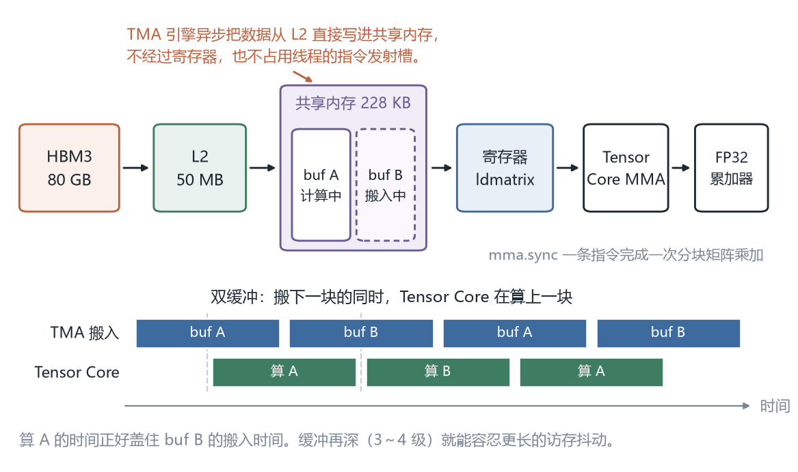

# 第 3 章　Tensor Core、数据搬运与流水线

第 1 章算出来一个数字：单卡上的 GEMM 想要接近峰值，每个字节得做 295 次浮点运算。一个 128×128 的分块只能做到 64。这中间的空缺不是靠更聪明的算术补上的，是靠流水线补上的，也就是让搬运和计算同时进行，把等待时间藏进计算时间里。

这一章讲 Tensor Core 怎么被喂饱。三个环节依次是数据从显存到共享内存、从共享内存到寄存器、从寄存器到 Tensor Core。每个环节都有自己的延迟和带宽，串起来走就是慢的，叠起来走才快。

## 3.1　MMA 指令与矩阵分块

Tensor Core 不是"一个更快的乘法器"，它执行的是矩阵乘加的固定形状指令。理解这一点，后面所有的分块设计都能推出来。

一条 BF16 的 MMA 指令做的是 16×8×16 的矩阵乘，A 是 16×16，B 是 16×8，输出累加到 16×8 的矩阵上。乘加次数是

$$ 16 \times 8 \times 16 = 2048 $$

对应 4096 次浮点运算。这条指令由 32 个线程（一个 warp）共同发起，每个线程负责输出矩阵的一部分，平均下来每个线程持有 16×8/32=4 个累加器。这就是寄存器账的起点，一个累加器占一个 32 位寄存器。

单个 SM 要跑到 7.5 TFLOPS，每秒得完成

$$ \frac{7.5 \times 10^{12}}{4096} = 1.83 \times 10^{9} $$

次这样的 MMA，也就是十八亿次。这个频率决定了 Tensor Core 的流水必须一直有指令在排队，任何一次断流都是按比例损失算力。

真实的 GEMM 不会只用 16×8 的输出块，那样复用太低。一个 warp 会把输出块做到 64×32 或者 64×64，用几十条 MMA 拼出来；一个 warpgroup 更进一步，做到 64×256 甚至 128×256。128×256 的输出块有

$$ 128 \times 256 = 32768 $$

个累加器，摊到 128 个线程上是 256 个，远超 255 个寄存器的上限。所以实际做法是 4 个 warpgroup、512 个线程一起持有，每个线程 64 个累加器，再加上操作数和地址，落在 128 到 160 之间。这个数一出来，一个 SM 上能放几个块就是定数了。

现场的症状往往是反向的。看到 TFLOPS 只有峰值的两成，第一反应是 Tensor Core 不够快，实际上经常是分块太小。用小分块时每条 MMA 后面立刻跟着读累加器、做后处理、写回，MMA 之间没有背靠背的机会，Tensor Core 有一半时间在等。把输出块做大，让一批 MMA 连发，再统一处理，同样的指令数能快一倍以上。

还有一层约束在操作数上。MMA 要求 A 和 B 按固定布局摆在寄存器里，A 的 16×16 块分到 32 个线程上是每线程 8 个寄存器，B 的 16×8 是每线程 4 个。从共享内存取这些片段不能随便读，得用专门的向量化加载指令，一条指令把一个 8×8 的小块按布局分发到整组线程。这就是为什么共享内存的排布必须和 MMA 的期望对齐，也是为什么大多数高性能内核的共享内存布局看上去很奇怪。

K 方向的分块和另外两个方向不同，它不改变输出块的大小，只改变循环次数。一条 MMA 吃 16 的 K，所以 K 块取 64 就是四条 MMA 背靠背，取 32 是两条。取太小，加载指令相对 MMA 太多；取太大，共享内存压力上来，流水段数就得降。128×256 的输出块配 64 的 K 块，一段是 A 的 16 KB 加 B 的 32 KB，共 48 KB，四段 192 KB，刚好装进 228 KB。这个 64 不是拍脑袋定的，是被存储容量和 16 这个粒度一起挤出来的。

分块还有一个副作用。输出块越大，K 方向的单次迭代干活越多，循环前后的固定开销就被摊得越薄。一个 128×256 的块算完 4096 的 K 要循环 64 次，64×64 的块也循环 64 次，但每次的活只有前者八分之一，同样一份启动和收尾开销，占比就高了一个数量级。

## 3.2　从 CUDA Core 到 Tensor Core 的吞吐差

同样的乘加，走向量单元和走 Tensor Core 是两个量级的事，差在一个"每周期能发多少"上。

一个 SM 的向量单元每周期能做 128 次乘加，换成浮点运算就是 256 次。一条 MMA 是 4096 次，只要它占用的周期少于 16 个，就等价于把整个 SM 的向量算力用满了。实际情况是它比这还快，这就是 989.4 TFLOPS 和"用 FFMA 硬算"之间十几倍差距的由来。

用指令数看得更清楚。同样一个 16×8×16 的块，用 FFMA 实现，2048 次乘加摊到 32 个线程上，每个线程 64 条指令。用 MMA 是一条。指令数差 64 倍，而每条 MMA 的执行周期比一条 FFMA 长得多，两者的乘积决定了最终吞吐，结果还是差十几倍。这也意味着一旦计算落到向量单元上，再想追回来基本无望，必须改算法让它变成矩阵乘。

这个差距改变了优化的顺序。在第 2 章的带宽受限算子里，能省的字节是有限的；而在计算受限的算子里，能不能走上 Tensor Core 决定了十倍还是零点几倍的差别。所以看到一段训练代码，第一个问题永远是有没有矩阵乘可以落到 Tensor Core 上，而不是这个矩阵乘写得优不优雅。

峰值还是一张分精度的表。同一张卡，BF16 是 989.4 TFLOPS，FP8 是 1979 TFLOPS，差两倍。这个两倍来自硬件把一个乘加拆成更小的单元同时算，不是靠时钟。所以选精度的时候要同时看两件事，算力翻了一倍，而 3.35 TB/s 的带宽一点没变，账面收益会被带宽吃掉一半。这也是为什么很多团队把 FP8 用在大矩阵乘上、把归约和归一化留在 BF16 上。

现场最典型的误用是“手工实现”。有人为了省显存，把注意力拆成很多小循环，每个元素单独算 QK，用向量单元做。算下来指令数是 MMA 版本的上百倍，即使把带宽用到极限也没用，因为这条路的上限就在那里。另一个常见情况是类型不匹配，FP32 的输入进了 BF16 的算子，硬件默默回退到向量路径，profiler 里看不出错，只是 TFLOPS 一直上不去。

把量级摆到一个 step 上看。8192 个 token、七十亿参数的模型，一个 step 是

$$ 6 \times 7 \times 10^{9} \times 8192 = 3.44 \times 10^{14} $$

次浮点运算。全走 Tensor Core，按四成 MFU 算是 0.87 秒。全走向量单元，按每个 SM 每周期 256 次算，全卡 33792 次，需要 $1.02\times10^{10}$ 个周期，换算下来是好几秒钟。两者差一个量级，而且这个差距不会因为代码写得好而缩小。方向选错的时候，优化空间只有一成；方向选对的时候，剩下的事才轮到调优。

## 3.3　异步拷贝与 TMA

数据从显存到共享内存这一段，传统写法要经过寄存器，占发射槽也占寄存器。异步拷贝把这一段从指令流里摘了出去。

没有异步拷贝时，一个线程要把数据读进寄存器再写进共享内存，两次访存加两次寄存器占用。有了异步拷贝，指令直接把数据从全局内存送到共享内存，寄存器只是中转地址，用完即放。搬运的粒度是每个线程 16 字节，一个 warp 一次搬

$$ 32 \times 16 = 512 \text{ 字节} $$

搬 16 KB 的 tile 需要 32 条这样的指令。这个数量看着不多，但它是按 warp 算的，一个 k-step 要搬 A 和 B 两块，就是 64 条，几个 warp 一起干就是上百条指令挤在发射槽上。

TMA 把这件事又简化了一层。它用一张描述符描述"从哪个张量的哪个区域搬到共享内存的哪个位置"，一条指令启动一次搬运，硬件自己去算地址、自己去分块。同样 16 KB 的 tile，指令数从 32 条变成 1 条。这不是省了几条指令的问题，是把整个地址计算和循环控制从内核里删掉了。

算一个 k-step 的实际开销。输出块 128×256，K 方向每次走 64，A 的一小块是 128×64 的 BF16，16 KB；B 的一小块是 64×256，32 KB。一共 48 KB，用 512 字节一条的话是 96 条搬运指令。而这一步对应的计算是

$$ 2 \times 128 \times 256 \times 64 = 4.19 \times 10^{6} $$

次浮点运算，按 7.5 TFLOPS 是 0.56 微秒。96 条指令按每个周期 4 条算是 24 个周期，相对于这一步的计算量来说完全可以忽略。用 TMA 之后只剩 2 条，更可以忽略。所以在 H100 上，搬运的指令开销不是瓶颈，瓶颈是搬运的字节和它需要的时间。

异步拷贝的流水靠分组实现。每发完一批搬运就提交一组，等到只剩一组在飞的时候就开始算。四组流水就是四段共享内存，组号轮转，判断条件永远是“已经完成了三组”。这个机制比自己维护两个缓冲区指针简单，也更容易和后面的计数器同步对齐，因为分组本身就是硬件维护的，软件只需要记住自己提交了几次。

现场的症状来自另一个方向。用 128 字节的 TMA 描述符，一次搬一个二维 tile，如果 tile 的宽度不是 128 字节的整数倍，硬件会拆成多次访问，每次都有额外的地址解析开销。这类问题在隐层维度是 4096 时不会出现，改成 4097 就会，性能掉三成，而代码看起来完全正常。

异步搬运还有一个用法叫多播。当多个 SM 需要同一块数据时，一次读取可以从 L2 同时写进多个 SM 的共享内存，L2 的流量只算一次。典型的场景是张量并行，每张卡都要同一份权重的前向一次。多播的收益可以直接算，N 路多播把 L2 流量降到 N 分之一，而 L2 带宽往往就是那个卡住的地方。用它的前提是数据的生命周期对齐，几份消费要在时间窗口内重叠，错开了就变成多次单播。

## 3.4　warp specialization 与生产者消费者

把所有活塞进同一批 warp，等于让搬数据的指令和算矩阵的指令互相排队。把它们拆开，两类部件才能同时忙。

生产者消费者模型是这么分工的：一个或两个 warp 专门发 TMA，负责把下一段数据搬进共享内存；一组 warpgroup 专门发 MMA，负责从共享内存取数据算矩阵。两边通过共享内存里的一个计数器同步，生产者写完一段就把计数加一，消费者看到计数够了就开始算。整个过程中没有任何一个 warp 在两头跑。

这个结构解决的是一个具体的错配。搬运指令打满的是显存和 TMA 引擎，MMA 打满的是 Tensor Core，两类资源互不干扰。混在一个 warp 里，一条 MMA 之后的搬运指令必须等 MMA 的结果写回寄存器才能发，硬件流水被打断；拆开之后，搬运可以在 MMA 还没结束时就启动，两边的延迟互相掩盖。

共享内存的预算决定了能分几组。一组消费者用一个 128×256 的输出块，每段需要 A 的 16 KB 加 B 的 32 KB，共 48 KB。四段流水是 192 KB，塞进 228 KB 还有余量。如果只做两段，96 KB，剩下的空间可以让两个块共存，但每块的流水深度就只有两段。这个取舍不是拍脑袋定的，取决于这台机器上延迟和计算量的比值，下一节算。

现场的判断依据是两类单元的利用率。Tensor Core 七成、TMA 三成，说明搬运跟不上，该加生产者；Tensor Core 三成、TMA 七成，说明算不过来，该加消费者或者换更大的 tile。两个都低，问题在同步上，去看计数器是不是等得太久。两个都高但端到端还是慢，那问题在内存带宽，不在内核里。

配比可以算。一个 k-step 里生产者只发两条 TMA 指令，而消费者要跑几十条 MMA，时间差两个数量级。所以一个生产者 warp 完全够用，甚至可以把它的活摊给两个不同的 warp 轮流发，好让某一路迟到不拖住全部。消费者的数量由输出块大小决定，128×256 用四个 warpgroup，每个拿一块。这个数字定下来，剩下的 60 多个 warp 槽空着也不可惜，它们本来就没活干。

同步用的不是屏障而是计数器。屏障会让整组 warp 停下来等，计数器只让真正依赖它的那一方停。生产者写完一段把计数加一，消费者在每条 MMA 之前查一次，计数够了就往下走。这种同步的粒度很细，代价是一个共享内存的原子操作，而收益是两边都不互相阻塞。写的难度在于相位，计数器绕回一圈之后容易算错方向，这类 bug 会表现为偶发的错结果而不是变慢，而且往往在改变流水深度之后才暴露。

多组消费者怎么切也有讲究。128×256 的输出块可以沿 N 切成两半，两组各算 128，共享同一份 A；也可以沿 M 切，两组各算 64 行，共享同一份 B。前一种省 A 的读取，后一种省 B 的。共享内存里放不下两份的时候，这两种切法只能选一种，选错的代价是重复读取。寄存器上的差别更直接，每组持有的累加器从 128 个降到 64 个，寄存器压力减半，占用率跟着上一个台阶。从一个 tile 的搬运、到寄存器里的累加、再到最后写回，整条通路和图 3-1 一样，每一级都有自己的宽度和延迟。

*图 3-1　Tensor Core 的数据通路与流水*

## 3.5　双缓冲与流水深度

流水深度不是越深越好，够用就停。判断"够用"的标准是在飞字节能不能盖住延迟。

先算在飞字节。一个 SM 分到的带宽是 25.4 GB/s，显存延迟按几百纳秒算，取 0.3 微秒，那么在任何时刻，这个 SM 需要

$$ 25.4 \times 10^{9} \times 0.3 \times 10^{-6} = 7.6 \times 10^{3} $$

字节在路上，才能保证带宽不被浪费。7.6 KB。而一段 A 加 B 的 tile 是 48 KB，一段就远超这个数。

这个结果说明，在这张卡上，两段缓冲足以盖住显存延迟，加到四段的收益不在延迟上，而在抖动上。所谓抖动，是某一段的搬运因为 L2 未命中或者 TMA 排队晚到了几十纳秒。两段缓冲时，一段在算、一段在搬，任何一次迟到都会直接变成空等；三段缓冲留了一段余量，允许偶发的迟到被吸收。

真正的约束在别处。单 SM 的带宽份额只有 25.4 GB/s，一个 k-step 要搬 48 KB，需要 1.9 微秒，而计算只要 0.56 微秒。搬运需求是计算需求的 3.4 倍，靠单 SM 的带宽份额根本喂不饱。这就是第 1 章那个 85 对 295 的算术强度缺口，落到时间上就是这 3.4 倍。

所以单卡 GEMM 能跑到峰值，靠的不是流水深度，而是 L2。相邻的块在时间上错开一点，B 的分块在 L2 里被多个块共享，HBM 的流量被摊薄到 L2 的带宽上，单 SM 拿到的有效带宽就不是 25.4 GB/s 了。流水深度的作用是让搬运和计算重叠，L2 的作用是让搬运本身变少，两者缺一不可，但后者的量级更大。

深度和 L2 还在抢同一个东西。段数越多，同时在飞的请求越多，L2 里要驻留的块也越多。L2 只有 50 MB，在飞数据一旦超过这个量，命中率就掉，每段搬运的实际延迟变长，于是需要更深的流水去盖，形成正反馈。这也解释了一个常见现象，流水从三段加到六段，前两步还有收益，第三步突然变慢。变的不是共享内存，是 L2。

现场有两种相反的错法。一种是深度给到 6 段以上，共享内存被流水吃光，一个 SM 只能放一个块，块数少到掩盖不了尾部，端到端反而慢。另一种是只做单缓冲，名义上有流水，实际上每步都在等，Tensor Core 的利用率在 30% 上下。判断方法很直接，看 Tensor Core 的活跃周期占比和 TMA 的活跃周期占比之和，接近 100% 说明重叠做对了，远低于 100% 说明还有空档。

深度和块数是一对直接的交换。每块 48 KB 的流水，两段 96 KB，一个 SM 能放两个块；三段 144 KB，只能放一个；四段 192 KB，还是一个。所以从三段加到四段，共享内存多花了 48 KB，块数一点没变，收益只有抖动余量。从两段加到三段，块数从二降到一，如果并行度靠这两个块撑着，性能反而会掉。算这笔账之前先数一下 228 KB 能容下几个 48 的倍数，答案会决定深度该定在哪里。

## 3.6　一个 FlashAttention 内核的流水

前面几节都是零件，这一节看一台装好的机器。注意力是最能体现流水的算子，因为它既有矩阵乘又有归约，还要处理中间结果。

先把不融合的代价算清楚。序列 8192、头维 128、一个头，Q、K、V 各是 8192×128 的 BF16，每份

$$ 8192 \times 128 \times 2 = 2.1 \text{ MB} $$

三份 6.3 MB。而 QK 的中间结果 S 是 8192×8192 的矩阵，BF16 存下来是 134 MB，比输入大二十倍。写出再读回就是 268 MB 的流量，按 3.35 TB/s 是 80 微秒；而整个注意力的计算量 $3.44\times10^{10}$ 次浮点运算，按峰值只要 35 微秒。搬运比计算多一倍还多，一个本来该计算受限的算子被中间矩阵拖成了带宽受限。

FlashAttention 的做法是不落这个中间矩阵。Q 切成 128 行的块，K 和 V 切成 128 行的块，每次只算一块 S，算完立刻做 softmax 的在线更新，乘上 V 累加，然后丢掉。这样显存里从头到尾只有 Q、K、V 三份，6.3 MB，1.9 微秒就能搬完。中间结果全部活在寄存器或共享内存里。

一个 Q 块要扫过全部 64 个 KV 块。每一步的搬运是 K 块 32 KB 加 V 块 32 KB，共 64 KB；每一步的计算是

$$ 2 \times 128 \times 128 \times 128 \times 2 = 8.4 \times 10^{6} $$

次浮点运算，按 7.5 TFLOPS 是 1.1 微秒。搬运 64 KB 按单 SM 份额算是 2.5 微秒，又是计算的两倍多，所以这一段同样靠 L2，K 和 V 在多个 Q 块之间被反复使用，命中率决定了实际速度。

流水在这里的形态是三层叠加。最外层是 Q 块之间的并行，不同的块分给不同的 SM；中间层是 K/V 块的预取，第三段的搬运和第一段的计算重叠；最内层是 softmax 与 MMA 的并行，矩阵乘走 Tensor Core，指数和归约走向量单元，两类指令分给不同的 warpgroup。三层里任何一层没叠上，性能就掉一半。

在线 softmax 的额外开销可以单独算。每收一个 K 块，要对 128×128 的分数矩阵求最大值、取指数、求和、再把之前累加的 128×128 输出乘上一个修正系数，加起来大约是

$$ 4 \times 128 \times 128 = 6.6 \times 10^{4} $$

次向量运算，相对于同一步 $8.4\times10^{6}$ 次矩阵乘运算不到百分之一。浮点运算占比很小，但指令数占比不小，因为这些操作都是标量或向量指令，每条处理的数据量远小于一条 MMA。这就是为什么 FlashAttention 的实现在 TFLOPS 上永远追不上纯 GEMM，它的峰值天花板本来就被这些标量操作拉低了。

现场最常见的问题是只做了第一层。代码把 Q 块分给 SM，每个 SM 内部按顺序做搬运和计算，逻辑上正确，速度只有峰值的两成。加一层预取，也就是在算当前 K 块的同时启动下一块的 TMA，能到四成；再把 softmax 拆到单独的 warp，到六成。这三步的改动量依次增大，收益也依次增大，先做哪一步取决于当前卡在哪一层。

Q 块取 128 行是个折中。取 64 行，共享内存占用小，但每个 Q 块要扫 128 个 KV 块，K 和 V 的重复读取翻倍；取 256 行，重复读取减半，但光是 Q 就要 64 KB，加上两段 K 和 V 就是 192 KB，流水只能给两段。128 行配 128 的 K 块，Q 占 32 KB，一段 K 加 V 是 64 KB，三段 192 KB，刚够塞进 228 KB。绕了一圈，又回到同一个容量预算上。

还有一个症状值得记下来。序列很长、头数很多时，把每个头都切成独立的 Q 块，块的数量会涨到几千个，每个块扫完全部 KV。这时每个块都要读一遍完整的 K 和 V，而不同头的 K/V 又不共享，L2 里待不住东西，实际带宽掉到理论值的一半。解法是把同头的多个 Q 块排到相邻的块上，让它们共享刚读过的 K/V，用启动顺序换命中率。

写一个能喂饱 Tensor Core 的内核，本质上是在 228 KB 里安排三件事。多大的 tile 装得下，几段流水盖得住延迟，几组 warp 分工不打架。这三个决定互相牵制，改动其中一个，另外两个都要重算。先算清楚再写代码，比写完再一遍遍调参省事得多，因为这类内核的性能几乎在动手之前就定了大半。
