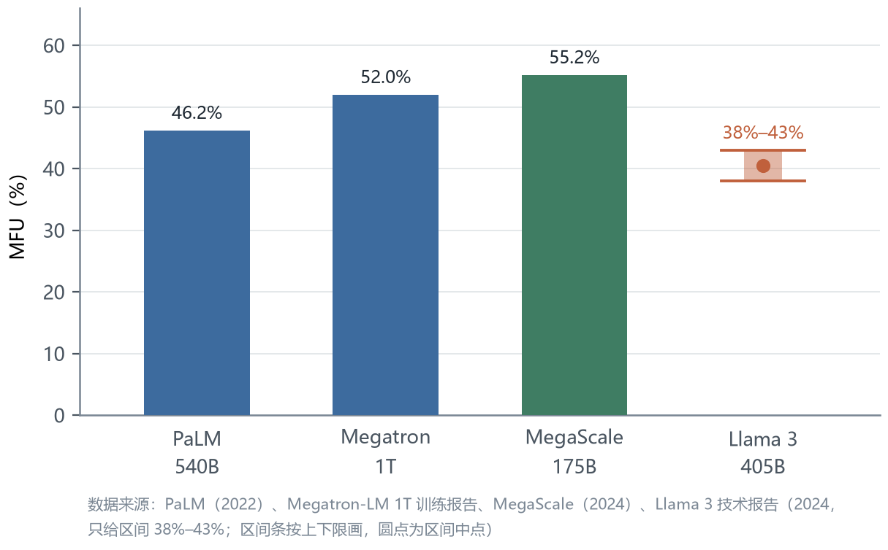

# 第 4 章　Roofline、算术强度与 MFU 的算法

一个训练作业报出 55.2% 的 MFU，另一个报出 38%，这两个数能不能直接比？多数时候不能，因为分子怎么算、分母怎么取、重计算算不算，三个选择任意组合能差出十个百分点。

这一章把 MFU 拆成可验证的算术。先算一个算子的算术强度，用它定上限；再把一个 step 的浮点运算数算出来；最后把这两个数放进同一个式子里，得到 MFU。整个过程只有乘除和求和，但每一步都有坑。

## 4.1　算术强度的定义

算术强度是一个算子每搬一个字节能做多少次浮点运算，它只跟算法和形状有关，跟实现无关。

$$ I = \frac{F}{B} $$

F 是这个算子要做的浮点运算次数，B 是它必须从显存搬进搬出的字节数。注意是"必须"，不是"实际"。实际搬运取决于实现，必须搬运取决于算法，前者可以优化，后者不能。

三个典型值放在一起就能看出差别。一个残差加法，读两个 BF16 张量写一个，每个元素 12 字节的流量、1 次加法，强度 0.083。一个 LayerNorm，每个元素大约 5 次运算（平方、累加、减均值、乘倒数、乘缩放），读写 4 字节，强度 1.25。一个 128×128 分块的 BF16 GEMM，强度 64。三者差了三个数量级，而它们在同一个 step 里同时存在。

强度还有一个随形状变化的版本。注意力的强度随序列长度增长，因为 QK 的运算量是序列长度的平方，而 Q 和 K 的字节数只是线性。序列 8192、头维 128 时，一个头的一次完整注意力搬 6.3 MB，做 $3.44\times10^{10}$ 次运算，强度

$$ I = \frac{3.44 \times 10^{10}}{6.3 \times 10^{6}} = 5460 $$

五千多。这是训练里强度最高的一类算子，比 GEMM 高两个数量级。

把常见算子的强度排一排，分布很极端。

| 算子 | 强度 | 受限于 |
|---|---|---|
| 残差加法 | 0.083 | 带宽 |
| LayerNorm | 1.25 | 带宽 |
| softmax | 1.5 | 带宽 |
| 128 分块 GEMM | 64 | 带宽 |
| 8K 序列注意力 | 5460 | 算力 |

前四行全在斜线上，它们的天花板是峰值的百分之几。最后一行在横线上，但它也跑不到峰值，因为 softmax 的标量操作把指令预算占了不少。这张表看着简单，却能回答一个常见的问题，为什么一个 step 里大部分时间花在那些看起来微不足道的小算子上。因为它们虽然只占计算量的百分之一，却要花掉超过一半的时间。

强度算错的地方通常在字节这一侧。有人只算输入输出，忘了中间张量；有人算了中间张量，忘了它要写一遍再读一遍。一个写出 134 MB 中间矩阵再读回来的注意力，字节数是 268 MB 而不是 6.3 MB，强度从 5460 掉到 128，结论完全反了。算字节的时候把每一次落显存都数上，是最稳妥的做法。落一次显存就是一次写加一次读，两倍的字节，这个习惯能省掉很多返工。

还有一条容易漏的规则，权重的字节要按 batch 摊销。一层 16384 维的投影矩阵是 536.9 MB，一个 token 走一遍就是 536.9 MB 的搬运，强度约等于 1；八个 token 一起走，同一份权重服务八次，强度变成 8；一千零二十四个 token 一起走，强度到 1024。这就是 batch 的全部意义，它不改算法，只改分摊。所以问“这个算子的强度是多少”之前，先问清楚 batch 是多少，否则答案可以差三个数量级。

## 4.2　roofline 的两个区域

把强度和硬件放在一张图上，就是 roofline。横轴是强度，纵轴是可达的 TFLOPS，图上有两条线，一条水平的峰值线，一条斜向上的带宽线。

水平的这条是 989.4 TFLOPS。斜的这条是强度乘以 3.35 TB/s。两条线交在

$$ I_{\text{拐点}} = \frac{989.4 \times 10^{12}}{3.35 \times 10^{12}} = 295 $$

强度低于 295 的算子在斜线上，受带宽限制，能跑到的 TFLOPS 是 3.35 乘以强度；高于 295 的在横线上，受算力限制，最多 989.4。

| 算术强度 | 可达 TFLOPS | 占峰值 |
|---|---|---|
| 0.083 | 0.28 | 0.03% |
| 1 | 3.35 | 0.3% |
| 8 | 26.8 | 2.7% |
| 64 | 214 | 22% |
| 128 | 429 | 43% |
| 295 | 989 | 100% |

这张表最值得看的是前两行。一个 elementwise 算子无论怎么写，都不可能超过峰值的百分之一，因为它一次只做一次运算却要搬十二个字节。给这类算子调优，目标不是 TFLOPS，是有效带宽。反过来，128 强度的 GEMM 上限是 43%，这意味着一个跑在 35% 的 GEMM 已经用掉了它上限的八成，没什么可调的；而一个跑在 15% 的 GEMM 只用了上限的三分之一，问题在实现上。

roofline 的用法是定位而不是评判。把一个 step 里所有算子按强度排开，每个画一个点，看它离自己那条上限有多远。离得近的说明实现到位，离得远的说明还有空间。整套图看下来，往往能发现某一类算子集体偏离，那就是这一类算子的写法有问题，而不是某一行代码有问题。

真实的图比两根线复杂，因为存储不止一层。数据能放进 L2 时，斜线的斜率换成 L2 的带宽，整条线会抬高；数据能放进共享内存时，再抬高一次。所以同一个 GEMM，大形状下贴在 HBM 斜线上，小形状下反而能突破 HBM 斜线，不是因为“代码变好了”，是因为工作集变小了。看到一个小矩阵乘跑出超过 989.4 的等效值，先别兴奋，那是 L2 在帮忙，把它代回大形状的账里就现原形了。

用这张图判断实现好坏，看垂直距离。一个强度 64 的 GEMM，上限是 214 TFLOPS，实测 180 就是八成四，已经很接近了；实测 60 只有两成八，说明它连带宽都没打满，问题在分块或访存模式上，不在算术上。这个判断比拿 MFU 单看准得多，因为它把“这个算子本来就不可能快”和“这个算子写坏了”分开了。

图还能解释一个看上去矛盾的现象。8K 序列的注意力强度是 5460，远超 295，按图应该跑在横线上，实际却只有峰值的两成多。原因不在数据搬得慢，而在发射预算。它的矩阵乘部分确实在横线上，但 softmax 的取指数、比大小、求和这些标量操作把每个 warp 的指令槽占了一大块，Tensor Core 只能隔一段才能发一批。roofline 只算浮点运算和字节，不算指令，所以它给出的是上限而不是预测值。图 4-1 把几种并行配置画在同一张图上，每一簇点都在引用它们自己的那个形状。

*图 4-1　不同并行配置在 roofline 上的位置*

## 4.3　训练一步的 FLOPs 计数

一个 step 的浮点运算数有一个流传很广的估算，六倍的参数量乘以 token 数。这个式子对不对，得看它怎么来的。

前向传播时，每个参数参与一次乘加，摊到每个 token 上是 2 次浮点运算，所以前向是 2ND，N 是参数量，D 是 token 数。反向传播要算两份梯度，一份对输入，一份对权重，每份都是一次同等规模的矩阵乘，加起来是 4ND。总共

$$ F = 6ND $$

这就是 6ND 的来源。它假设所有参数都是稠密的、都参与每个 token 的计算，对标准 Transformer 成立，对 MoE 不成立，因为 MoE 每个 token 只走一部分专家。

反向为什么是两倍，值得拆开看。前向是 Y=XW，一次矩阵乘；反向要算两个东西，dX=dY 乘 W 的转置，dW=X 的转置乘 dY，两次矩阵乘，运算量都是 2ND 量级。加起来是前向的两倍，所以前向 2、反向 4、合计 6。这个分解还说明了一件事，反向的两次矩阵乘形状不同，一个是 M 大 K 小，一个是 M 小 K 大，两者对分块的要求不一样，在流水线里也很难完全重叠。

拿三个真实模型验一遍。GPT-3 是 1750 亿参数、3000 亿 token，代进去是 $3.15\times10^{23}$ 次运算，论文报的是 $3.14\times10^{23}$，差 0.3%，可以忽略。Llama 3 405B 是 4050 亿参数、15.6 万亿 token，代进去是 $3.79\times10^{25}$，论文报的是 $3.8\times10^{25}$。两次都对得上，说明 6ND 在十亿到千亿参数这个区间足够用。

它低估的地方在注意力。6ND 把每个 token 的成本算成与序列长度无关的常数，而注意力的 QK 和 PV 是序列长度的平方。把这一项补上，每层每个 batch 要加

$$ F_{\text{attn}} = 12 b s^{2} h $$

b 是 batch，s 是序列长度，h 是隐层维度。系数 12 是把两次矩阵乘、转置、以及 softmax 前后的缩放都折成矩阵乘之后的保守估计。

补上之后差别不小。一个 70 亿参数、80 层、隐层 8192 的模型，8K 序列下，线性部分是

$$ 6 \times 7 \times 10^{9} \times 8192 = 3.44 \times 10^{15} $$

注意力部分是 12×8192×8192×8192×80=$5.28\times10^{14}$，占 15%。这个比例可以接受。把序列拉到 32K，注意力涨 16 倍，线性只涨 4 倍，占比变成 61%。这就是长上下文训练里 6ND 明显偏低的原因，也是为什么长序列的 MFU 总是比短序列低，分子里多出了大量二次项，分母里的时间是实打实增加的。

6ND 还有两个不适用的地方。MoE 每个 token 只过一部分专家，用总参数量算出来会虚高好几倍，该用激活参数。embedding 和输出层跟 token 数相关、跟层数无关，层数很少的小模型里这一块不可忽略，用 6ND 会低估。两种偏差方向相反，大模型上常常碰巧抵消一部分，所以拿公开的 FLOPs 数字反推 6ND 总是能对上，但这不代表式子在每个局部都对。

## 4.4　MFU 与 HFU 的区别

MFU 是实际达到的模型浮点运算速度占峰值的比例，HFU 是把重计算也算进去之后的那个比例。分子不同，分母相同。

$$ \mathrm{MFU} = \frac{6ND}{t \times C \times P} $$

t 是 step 时间，C 是卡数，P 是单卡峰值。HFU 把分子换成 6ND 加上重计算产生的运算量。两个数的关系是

$$ \mathrm{HFU} = \mathrm{MFU} \times (1 + r) $$

r 是重计算带来的额外运算比例。

拿 Llama 3 405B 算一次。运算量 $3.8\times10^{25}$，16384 张 H100，峰值 989.4 TFLOPS。若 MFU 是 40%，时间

$$ t = \frac{3.8 \times 10^{25}}{16384 \times 989.4 \times 10^{12} \times 0.4} = 5.9 \times 10^{6} $$

秒，约 68 天。这个量级和公开的训练周期是对得上的。

同一批数换成单步更好用。每步 65536 个 token，代入同样的参数是 24.5 毫秒。看到 step 时间从 24 毫秒涨到 30 毫秒，就知道 MFU 掉了两成，不用等一整天看曲线。

分母还有一个争议点，用理论峰值还是用实测峰值。理论值 989.4 是标称，一个真实的 GEMM 能跑到的上限大约是这个数的八成多，用理论值算出的 MFU 天然带着两成折损。有人主张用实测峰值做分母，得到的数字更接近“还能再挤多少”。两种都可以，但必须说清楚用的是哪个，否则两个团队的数字永远对不上。业界惯例是用标称峰值，因为它不随实现变化，横向可比。

公开的数字可以互相对照。PaLM 用 6144 块 TPU v4 训练 5400 亿参数，MFU 46.2%。Megatron 1T 用 3072 张 A100 训练 1 万亿参数，报 502 PFLOPS，除以 3072×312 TFLOPS 得 52.4%。MegaScale 用 12288 张卡训练 1750 亿参数，MFU 55.2%，比 Megatron-LM 的实现高 1.34 倍，折回对方大约是 41%。Llama 3 405B 在 16384 张 H100 上是 38% 到 43%，区间本身就说明了这个数的测量误差有多大。

这几个数的可比性有限。模型形状不同，序列长度不同，重计算策略不同，分母上的峰值取的是密集还是稀疏也不同。真正能横比的只有同一份代码在不同规模下的 MFU 变化，那反映的是并行策略的代价。

分母的选择比分子更考验诚实。峰值要取与计算精度一致的密集值，H100 的 BF16 是 989.4，不是 1979；时间要取从一个 step 结束到下一个 step 结束的墙钟，包含所有空档。两者任何一个放宽，MFU 都会好看。有个简单的自检办法，把 6ND 除以实测 MFU 得到等效的总算力，再除以卡数，如果单卡等效值超过 989.4，那一定是分子分母里有一个错了。

MFU 还会随规模变，而且不是单调的。模型很小、序列很短时，一个 step 只有几毫秒，启动和数据加载的开销占两成，MFU 永远上不去。规模变大之后这部分被摊薄，MFU 会涨。到几千卡之后通信开始吃时间，又往下掉。所以“MFU 多少算好”没有统一答案，只能跟自己上一个规模比，或者跟同规模同模型的公开结果比。

## 4.5　重计算与通信要不要计入

答案是分子里都不计，分母里都计。这一条不清楚，算出来的数就没有意义。

重计算是为了省显存，前向不保存激活，反向时重新算一遍。这部分运算不产生新的模型更新，所以不进分子。但它花的时间实打实进了分母。所以重计算的比例越高，MFU 越低，HFU 越高。一个 MFU 40%、重计算 30% 的作业，HFU 是 52%。看到别人报 52%，先问清楚是哪一个。

通信的时间同理。all-reduce、all-gather 这些操作不产生浮点运算，时间进了分母，分子一分不加。所以并行度越高，通信占比越大，MFU 越低。这也是为什么 MFU 在千卡规模和万卡规模之间会掉一截，掉的那部分不是算力不行，是同步的代价。

把时间拆开看更清楚。

| 时间构成 | 进分子 | 进分母 |
|---|---|---|
| 前向与反向的矩阵乘 | 是 | 是 |
| 重计算的矩阵乘 | 否 | 是 |
| 集合通信等待 | 否 | 是 |
| 数据加载与检查点 | 否 | 是 |
| 故障恢复与重启 | 否 | 是 |

一个 40% 的作业可以这样拆。纯矩阵乘占六成时间，重计算占一成八，通信等待占两成二，加起来是一。MFU 的上限就是纯矩阵乘那六成，剩下四成里一次浮点运算都没有。想提高它，要么把重计算降下来，靠更多显存或者更深的并行；要么把通信藏到计算后面，靠重叠。两条路的收益都能用这个比例直接算出来。

重计算也不是全有或全无。全量重算把激活降到一层，代价是多花三成的前向运算；选择性重算只重算注意力那一段，多花不到一成，省下的显存照样能把 batch 做大。两条路的 MFU 相差十几个点，而实际吞吐可能差不多，因为后者换来了更大的 batch。算这笔账要看三个数，额外的运算比例、省下的显存、以及这些显存能换来多大的 batch。第三个最难估，它取决于当前是显存受限还是算力受限。

表里最后一项，故障恢复与重启，在长周期训练里不能忽略。54 天里 466 次作业中断，其中 419 次是意外，这些重启的停机时间全部进分母，分子一点不涨。按每次停机十分钟算，466 次就是 4660 分钟，约 78 小时，占 54 天的 6%。一次重启不止是等，还要回滚到最近一个检查点，丢掉中间训的步数，那部分算力花出去了但没有产生有效更新。把这两块加起来，能吃掉端到端速度的近一成。

所以看一个作业的效率，至少要两个数。一个是 MFU，衡量算力用得好不好；一个是有效训练时间占比，衡量机器可不可用。两个数乘起来才是完整的答案。只报前一个，等于把硬件故障的责任隐藏了。

## 4.6　用 MFU 定位瓶颈

MFU 单独看没有意义，和带宽利用率放在一起才有诊断价值。

单卡带宽利用率低于三成、MFU 也低，说明 SM 在空转，通常是依赖链太长、同步太多，或者网格划分不合理。这一类问题的特征是 profiler 里 Tensor Core 的活跃周期占比很低，而队列里没有积压。

带宽利用率高、MFU 低，说明数据搬得动但算不快。常见原因是分块太小，算术强度没提上去，或者精度路径退回了向量单元。这类问题看 roofline 图上点的位置，点贴在斜线上就说明已经到头了，只能改算法。

带宽和 MFU 都高，但端到端还是慢，问题在别处。可能是通信占比大，可能是数据加载卡住，可能是某些 rank 掉队。这时候要看的是每个 rank 的 step 时间分布，而不是平均值。

两个都低、而且低得离谱，先怀疑测量。一个常见错误是把一个 step 的时间算成了整个迭代周期，把数据加载和优化器更新也摊进去，分母虚高。另一个是拿一个 micro-batch 的时间乘以累积步数，忽略了两者之间的空档。

一个真实的比例。某次一个千卡作业的 MFU 只有 28%，带宽利用率 34%，两个都低。先查单卡，GEMM 能到 62%，说明内核本身没问题；再拆 step 的时间，发现 all-reduce 占了 31%，计算只占 52%；最后看到梯度桶设得太大，反向快结束时才发第一次通信，全卡同步硬等了一轮。把桶改小、打开重叠之后，通信占比降到 12%，MFU 到 41%。

这个例子说明 MFU 的价值不在绝对值，在它逼你把时间拆开。只看 MFU 你只知道“慢”，拆开之后你知道慢在哪一段，而每一段的修法完全不同。拆解的工具不难，一个集合通信的计时器加上几个同步点就够，难的是养成先拆再改的习惯。

给几个可用的参考线。单算子层面，大 GEMM 在 H100 上做到峰值的六到八成是正常水平，做到九成以上要么是形状特别规整，要么是峰值取错了。整个 step 层面，稠密模型在千卡规模上 40% 到 55% 是常见区间，公开的最好成绩是 55.2%。低于 35% 说明有明确的结构性问题，值得停下来查；高于 55% 要先确认分子分母的算法。这几条不是标准，是量级参考，真要定预期得先算一遍 roofline。

## 4.7　常见误算

MFU 的错法比正确算法多，下面这几种每年都会遇到。

| 现象 | 错在哪 | 正确算法 |
|---|---|---|
| 报出 60% 以上的稠密训练 | 用了稀疏峰值或 FP8 峰值 | 用与计算精度对应的密集值 |
| 数字比公开结果高一大截 | 分母只算了 GEMM 时间 | 分母是整个 step 的墙钟时间 |
| 千卡和万卡 MFU 一样 | 通信没进分母 | 全时间计入 |
| 大模型 MFU 莫名其妙很高 | token 数用了单卡而不是全局 | D 是全局 token 数 |
| 数值差一倍 | 参数量用了激活参数 | 稠密用全部参数 |

第一行最常见。H100 的 BF16 峰值是 989.4 TFLOPS，这是稠密值；有些资料报的翻倍数字是稀疏加速的峰值，只有特定稀疏结构才能吃到。用 1979 做分母算 BF16 的 MFU，得到的结果除以二才是真的。

第二行也常见于内部汇报。只算矩阵乘时间，把 LayerNorm、残差、优化器、通信、检查点全排掉，MFU 能虚高十几个点。墙钟时间不好看，但它才是买卡付电费的那个时间。

第五行在 MoE 上尤其容易出错。DeepSeek-V3 用 2048 张 H800 训练 14.8 万亿 token，预训练阶段花了 2.664M 卡时，折下来每卡时处理 556 万 token。如果拿总参数量去套 6ND，算出来的运算量会比实际大好几倍，因为每个 token 只激活一部分专家。这时候该用的是激活参数量，或者直接从卡时反推。

还有两条隐蔽的错法。一条是把评估、检查点保存、数据预处理的时间从分母里排掉，只算训练步，这样报出来的数能高几个点，但那不是买卡的时间。另一条是把 padding 后的 token 数当成有效 token 数，长序列拼短序列的 batch 里 padding 能占两三成，分子一下子胖了一成，训练却只对那些真 token 下了功夫。

卡时反推是个很好用的交叉验证。知道了总卡时和总 token 数，就能算出每卡时多少 token，再和同规模公开结果比。DeepSeek-V3 的 556 万 token 每卡时、Llama 3 的 466 次中断、GPT-3 的 $3.14\times10^{23}$，这三个数构成一把很好的尺子，任何自己的估算结果都应该能在这把尺子上找到合理位置。

最后一条是单位。T 和 P 差一千倍，秒和毫秒差一千倍，这两个混一次，结论就错六个数量级。算完之后拿一个已知的模型对一遍，比如 GPT-3 的 $3.14\times10^{23}$ 或者 Llama 3 的 $3.8\times10^{25}$，对不上就是算错了。

MFU 是一个很容易把自己骗到的数字。算之前先声明三件事，峰值取的是哪个精度，分母包含哪些时间，重计算算不算进去。声明清楚，数字才有比较的意义；不声明，55% 和 38% 之间差的可能只是口径。
