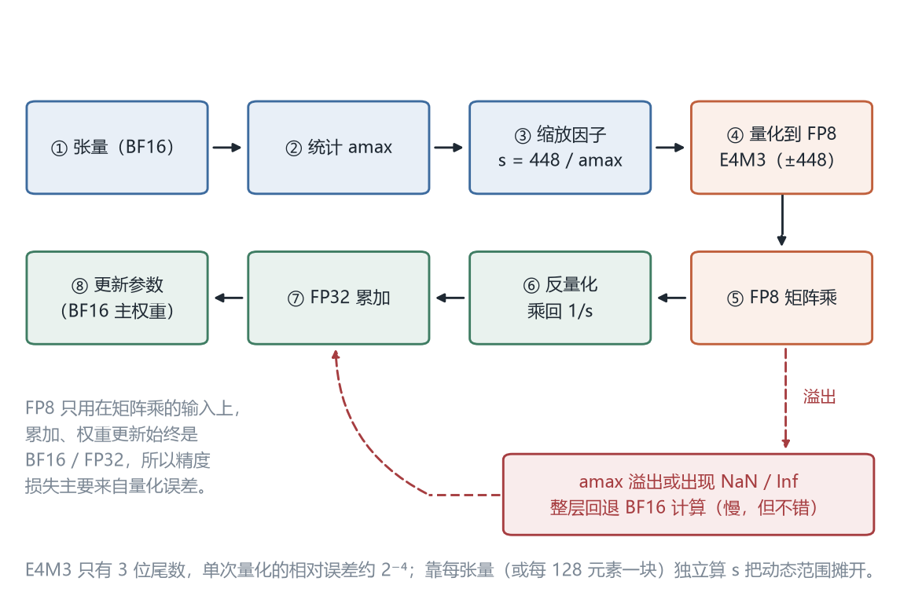

# 第 5 章　低精度训练的数值细节

把 BF16 换成 FP8，显存减半、带宽减半、算力翻倍，三个好处同时拿到。代价是每一次乘加都在丢精度，而丢的方式很难从 loss 曲线上看出来。

这一章讲低精度的数值约束。哪些位用来表示范围，哪些位用来表示精度，缩放因子怎么选，累加在哪一层必须升精度，以及出问题时按什么顺序查。这些细节不涉及新算法，但每一个都能让一次千卡训练白跑两天。

## 5.1　BF16 与 FP16 的范围差异

BF16 和 FP16 都是 16 位，但拆法完全不同。BF16 是 1 位符号、8 位指数、7 位尾数；FP16 是 1 位符号、5 位指数、10 位尾数。指数决定能表示多大的数，尾数决定能表示多细。

BF16 的 8 位指数和 FP32 一样，所以它的表示范围和 FP32 一致，大到 10 的 38 次方，小到 10 的负 38 次方。代价是尾数只有 7 位，加上隐含的一位，相对精度是

$$ 2^{-8} = 0.39\% $$

FP16 反过来，尾数 10 位，相对精度 2 的负 11 次方，也就是 0.049%，比 BF16 细八倍。但指数只有 5 位，最大能表示 65504，最小正规数只有万分之六。

这两个数字直接决定了两者在训练里的命运。梯度动辄是 10 的负 7 次方量级，FP16 在这个量级上已经在次正规区，精度急剧退化；BF16 毫无压力。反过来，需要精确表示一个 1.0001 这样的数时，BF16 的 0.39% 精度就太粗了，FP16 有余量。训练里前一种情况远多于后一种，所以 BF16 成了默认选择。

累加是另一回事。FP16 的尾数再细也架不住长时间累加，因为累加会让数值变大，而数值越大，绝对精度越粗。把 4096 个 1.0 逐个累加到 FP16 变量里，加到 2048 之后，这个量级的间隔是两个单位，再加 1.0 会被舍掉，结果停在 2048，而真值是 4096。误差百分之百。同样的操作在 FP32 里没有这个问题，因为 4096 附近 FP32 的间隔是 0.0005。

这就是为什么矩阵乘的累加器必须是 FP32。一条 MMA 指令做 2048 次乘加，如果累加器是 16 位，几百次之后低位就全丢了。硬件在 Tensor Core 里把累加器做成 32 位，代价是每个累加器占一个完整寄存器，这也解释了第 1 章里那个 64 个累加器的资源账。低精度省的是带宽和存储，不是累加路径。

现场的症状分两类。FP16 出问题通常是溢出或者下溢，loss 突然变成 nan，或者梯度全部变零、参数停止更新，这类问题容易发现。BF16 出问题则是精度不够，loss 不炸但降不下去，或者收敛到比预期差的位置，这类问题很难归因，往往要跑完一遍才发现效果不对。

还有一类位置对精度特别敏感，值得单独看。softmax 的输入要大一点，因为它要做指数；LayerNorm 的倒数平方根在小方差时会放大误差；embedding 的梯度是稀疏的大值。这三处用 BF16 都能跑，但用 FP16 得小心，因为它们的中间值容易超过范围。反过来说，矩阵乘的两个操作数对精度最不敏感，这也是为什么低精度总是先用在 GEMM 上。

## 5.2　loss scaling 的完整流程

FP16 训练绕不开 loss scaling，因为梯度的真实量级在 10 的负 7 次方附近，正好落在 FP16 精度最差的区间。

做法是把 loss 乘上一个放大系数 S 再做反向，梯度同步被放大 S 倍，落到 FP16 能精确表示的区间；更新参数之前再除回来。整个流程有四个动作。

前向算出的 loss 乘以 S。反向传播自然得到 S 倍的梯度。在优化器更新之前检查有没有 inf 或 nan，如果有，说明这一步有梯度溢出了，跳过这一步、把 S 减半、重新算；如果没有，正常更新，并且统计连续成功的步数，连续若干步没溢出就把 S 翻倍。

S 的取值范围是可以算的。取 S 等于 65536，也就是 2 的 16 次方，那么能表示的最小梯度是

$$ \frac{5.96 \times 10^{-8}}{65536} = 9.1 \times 10^{-13} $$

而溢出的门槛是 65504 除以 65536，约等于 1.0。这意味着任何一个真实值超过 1.0 的梯度都会把 FP16 撑爆。正常训练里大部分梯度远小于 1，但偶尔会有个别参数出现大梯度，这就是为什么 S 需要动态调整而不是取一个固定值。

这个 1.0 的门槛解释了动态缩放的必要性。训练早期的梯度大，S 取小一些；训练后期梯度变小，S 逐步放大，好让精度用满。如果 S 取得太保守，梯度落在精度很差的区间，等于白用了 16 位的低位；取得太激进，每几步就溢出一次，跳过的步数累积起来等于降低了有效学习率。

BF16 不需要这一套。它的指数和 FP32 一样宽，10 的负 7 次方的梯度在 BF16 里是正常数值，不溢出也不下溢。所以从 FP16 换到 BF16 之后，代码里那一堆 scaler 相关的东西可以全部删掉，删掉之后反而更稳。这是 BF16 在大模型里胜出的最直接原因，不是精度更高，是不用管。

现场看 scaler 的曲线。一条健康的曲线是长时间平台、偶尔下降、慢慢上升。如果它在几分钟内反复对折，说明有周期性的大梯度，通常是某个层的数值不稳定，或者是数据里出现了异常样本；如果它一路降到很小的值，说明梯度整体在变大，可能是学习率太高或者损失函数有问题。这两种情况都不该靠调 scaler 解决，scaler 只是把症状暴露出来。

数据并行时 scaler 要全局一致。每张卡上的梯度分片不同，如果各自维护一个 scaler，就会出现有的卡说没溢出、有的卡说溢出的情况，做一次归一化就把两边的尺度弄乱了。正确做法是在所有卡上归约一次“是否溢出”的标志，任何一张卡溢出就全体跳过，同时全体减半。这个归约很小，但漏了会出一个很难查的错，表现为训练能跑但收敛比单卡差。

还有一个交互容易被忽略，就是梯度裁剪。裁剪的阈值是按真实梯度定的，而 clipping 发生在 unscale 之前还是之后，结果完全不同。在 unscale 之前裁剪，裁的是被放大过的梯度，阈值得同步乘上缩放因子；在之后裁剪，不需要。两种写法都对，但不能混，混了之后裁剪要么形同虚设，要么把梯度压成零。

## 5.3　主权重与累加精度

混合精度训练里同时存在两份参数，一份 16 位用来算，一份 32 位用来更新。这两份的分工不能混。

16 位的那份是为了喂给 Tensor Core，读得快、占得少。32 位的那份叫主权重，保存着参数的完整精度，每次更新都作用在它上面，用完再转成 16 位供下一轮使用。如果省掉主权重，直接更新 16 位的参数，会出一个很隐蔽的问题。参数值在 1.0 附近时，BF16 的间隔是 0.0078，学习率乘梯度得到的更新量常常是 10 的负 4 次方量级，比半个间隔还小，加了等于没加，参数永远不动。

这就是小更新被吞掉的现象。它不会报错，也不会让 loss 变 nan，只会让训练在某个点之后完全停滞，看起来像收敛了，其实是更新被舍入抹平了。用 FP16 也一样，1.0 附近 FP16 的间隔是 0.00098，更新量小于 0.00049 就白更新。区别只是 BF16 的间隔粗八倍，更早进入这个状态。

显存的账在第一章之外还要重算一遍。混合精度下每个参数的开销是

$$ 2 + 2 + 4 + 4 = 12 \text{ 字节} $$

参数 2、梯度 2、一阶矩 4、二阶矩 4。主权重本身通常就是那份 4 字节的 FP32 参数，不额外占。合计 12 字节，比纯 FP32 的 16 字节省四分之一，比很多人以为的"减半"要少。真正减半的是激活，而激活跟 batch 和序列长度成正比，这才是低精度省显存的主力。

优化器状态不能降精度。一阶矩是梯度的滑动平均，量级和梯度接近，存成 BF16 还行；二阶矩是梯度平方的滑动平均，动态范围极大，从 10 的负 12 次方到 10 的负 1 次方都可能出现，BF16 的 0.39% 相对精度不够用，会被噪声淹没，导致自适应学习率失真。这一条在实践中踩过很多次，症状是训练前期正常、后期 loss 抖动加剧。

现场的判断方法是打开优化器的状态检查一下。如果二阶矩里出现了大量零或者极端值，说明精度不够；如果主权重和 16 位副本的差异在持续扩大，说明更新的路径有问题。这两项检查花不了几分钟，能排除掉一大类疑难杂症。

累加精度的坑不止在 MMA 里。一个块的 128 个线程把各自的局部和汇总成一个数，这个归约如果用 16 位做，同样会丢低位；跨块的部分走全局内存，如果原子加的缓冲区是 16 位，几百个块一叠加就完了。正确的层级是 MMA 内部 32 位、线程间归约 32 位、跳块累加 32 位，只在最后写回时转成 16 位。这条链上任何一环降精度，前面的功夫都白费。

## 5.4　FP8 的两种格式与缩放粒度

FP8 不是一个格式而是两个，选错的那个会直接把数值打爆。

E4M3 是 1 位符号、4 位指数、3 位尾数，最大值 448。E5M2 是 1 位符号、5 位指数、2 位尾数，最大值 57344。前者精度高、范围窄，后者范围宽、精度差。

相对精度可以直接算。E4M3 的尾数 3 位，加上隐含位是 4 位有效，相对精度 2 的负 4 次方，也就是 6.25%。E5M2 只有 3 位有效，相对精度 12.5%。这个精度比 BF16 差一个数量级，所以 FP8 从来不是"直接用"，而是"缩放之后用"。

分工是清楚的。前向的权重和激活用 E4M3，因为它们数值集中、量级可控，需要的是精度；反向的梯度用 E5M2，因为梯度里偶尔会出现大值，需要的是范围。混合使用的代价是两套缩放因子，收益是不会因为一个离群值把整个张量打爆。这个分工在文献里已经成了事实标准，新写的 FP8 内核如果反过来用，第一轮就会碰到溢出。

范围的问题用例子看得最清楚。一个权重张量里大部分值在 0.1 附近，但有一个 1000。用 E4M3 表示，1000 超过 448 的上限，直接变 inf；或者为了容纳它把整个张量除以 1000，那么 0.1 变成 0.0001，在 E4M3 里落到最小正规数以下，变成 0。两边都是灾难。

缩放因子就是为了解决这个矛盾。先把张量除以一个统计出来的最大值，映射到 448 以内，算完再乘回来。缩放因子按什么粒度统计，是下一节的事；这一节只需要记住，FP8 的每一个张量都必须配一个缩放因子，没有例外。

*图 5-1　FP8 训练中的缩放、量化与回退流程*

现场最典型的症状是整个张量变成零。这不是 bug，是缩放因子取得太大，所有值都被压到了最小可表示数以下。另一个症状是 loss 在第几百步突然发散，那多半是某个激活张量里出现了离群值，超出了 E4M3 的范围。两种症状都指向同一件事，去看每一层的缩放因子和最大值统计。

缩放因子怎么算也有讲究。实时统计当前张量的最大值最准，但每步都要做一次全局归约，开销不小。常见做法是用历史最大值，当前步的缩放因子取前若干步最大值的滑动平均，这叫延迟缩放。它的好处是归约可以异步做，不卡在关键路径上；坏处是遇到突发的离群值时会延迟一步才反应，那一小段时间里可能已经溢出了。折中的办法是给历史值乘一个安全系数，留一点余量，代价是精度稍微浪费一点。

## 5.5　逐张量缩放与逐块缩放

缩放因子的粒度决定了量化误差的大小，粒度越细误差越小，代价是额外的存储和归约开销。

逐张量缩放是给整个张量算一个最大值，所有元素共用这一个缩放因子。硬件最友好，一个张量一个标量，乘一下就完。问题是张量内部如果动态范围很大，小值就被牺牲了。一个最大值 1000 的张量，用 E4M3 表示，量化步长是

$$ \frac{1000}{448} = 2.23 $$

任何小于 1.1 的值都会被量化成 0 或 2.23。真实值 0.5 变成一个 0，相对误差百分之百。而权重和激活里绝大多数元素都在 0.1 到 1 之间，等于大部分信息被丢掉了。

逐块缩放把张量切成小块，每块一个缩放因子。常见的是 128 个元素一块，或者 128×128 的二维块。同样那个张量，如果某一小块里的最大值是 4，这一块的步长就是

$$ \frac{4}{448} = 0.0089 $$

同样那个 0.5，在这一块里的误差不到百分之一。同一个格式，逐张量时误差百分之百，逐块时不到百分之一，差两个数量级，区别只在于用哪个数做分母。

代价有两块。存储上，16384×16384 的矩阵按 128×128 分块，是 16384 个块，每个块一个 4 字节的缩放因子，共 64 KB，相对这个矩阵的 536.9 MB 可以忽略。计算上，每一块都要先求一次最大值，这是一次归约，在写量化结果的路径上多做一遍读。这个开销在带宽受限的算子里能到一成的额外时间，需要和精度收益权衡。

现场判断该用哪种粒度，看两个数。一个是张量内部的动态范围，最大最小值差几个数量级，差三个以上就该考虑逐块；另一个是这个张量对精度有多敏感，注意力的 softmax 输入、LayerNorm 的输入都比中间的线性层敏感。粗放一点的经验是权重和激活用逐块，梯度和优化器状态用逐张量，因为后者的动态范围反而小。

还有一个工程细节。逐块缩放要求块的大小和硬件的 tile 对齐，不对齐就得在边界上单独处理，而那部分代码往往是性能和正确性同时出问题的地方。128 这个数字不是随便选的，它就是 MMA 在 N 方向上一个常用的分块宽度，按它切既对齐又不用额外处理尾巴。选块大小之前先看一眼算子的 tile 形状，能省很多事。

## 5.6　随机舍入与确定性

从高精度降到低精度，最后一步是舍入。舍入方式的选择会影响训练的长期行为，而且影响是系统性的。

默认的就近舍入把小数部分四舍五入到最近的表示值。对一次独立的舍入，它的误差在半个间隔以内，看上去很安全。危险在于这个操作是确定性的。把同一个比半个间隔还小的增量反复加到同一个参数上，每一次都朝同一侧舍去，误差不是随机抵消而是线性累积。用 FP8 更新参数时这个问题尤其严重，参数在 1.0 附近，E4M3 的间隔是 0.125，小于 0.0625 的更新全部被舍成零。一个 10 的负 3 次方量级的学习率，在 FP8 主权重上完全失效。

随机舍入是解法。按小数部分的大小决定向上还是向下取整，小数部分 0.3 就有三成概率向上、七成概率向下。这样单次误差依然存在，但期望为零，长期累加不会漂移。代价是引入了方差，同一个张量舍两次结果不一样。

方差带来一个副作用，可复现性没了。两次配置完全相同的训练，因为随机数不同，得到的权重不会逐位相同。这在调试时很麻烦，一个改动带来的差异到底是改动本身还是随机性，分不清。所以随机舍入通常配一个固定种子，或者只在权重更新这一层打开、在其他地方关掉。

这一条在大规模训练里尤其重要。几千张卡跑几十天，任何一点系统性偏差都会被放大。用有偏舍入时，参数的分布会缓慢地朝一个方向漂，表现出来的现象是训练后期的 loss 比小规模实验差一点点，而这一点点在几十天的训练里就是几百万美元的差别。

现场的做法是先固定一切能固定的。数据顺序、随机种子、算子实现、归约顺序，全部固定之后跑两次，看 loss 曲线是否逐位一致。不一致就说明有非确定性来源，这时候再决定是接受它还是消除它。大多数情况下接受它更划算，但必须知道它在哪里。

还有一个来源是归约顺序。把 4096 个数分成 32 份并行相加，再合并这 32 个结果，这个顺序是固定的，但只要块的划分变了，比如换了卡数或者换了序列长度，顺序就变，最后一位就不一样。所以“同样的代码换个卡数结果不一样”不是 bug，是浮点加法本来就不满足结合律。

## 5.7　精度事故的排查顺序

精度问题的麻烦在于症状都长得差不多，loss 抖动、不收敛、突然发散，而原因可能在前向、在反向、在优化器、在数据。

第一步是确认问题真的出在精度上。把混合精度关掉，用 FP32 跑一百步，看现象是否消失。消失说明是精度问题，不消失说明是别的问题，别在精度上浪费时间。这一步最容易被跳过，也最容易冤枉低精度。

第二步看 loss 曲线的形状。突然变成 nan 是溢出，通常是 FP16 或者 E4M3 的上限被打穿；缓慢地一点点变差是精度不足，通常是累加或者缩放的粒度问题；周期性抖动是某个层在特定输入下不稳定，通常和数据的分布有关。三种形状对应三个方向，先分类再动手。

第三步看缩放因子。逐层的缩放因子和最大值统计是最有信息量的两个量。某个层的缩放因子远小于其他层，说明这一层的张量动态范围异常；某个层的最大值随着训练持续增长，说明这一层在发散。这两条线索能直接定位到层。

第四步是逐层比对。把同一批数据分别喂给低精度和 FP32 的模型，逐层比较输出的相对误差。误差在某层突然放大，问题就在那一层。这个方法慢，但准，是最后的手段。

| 症状 | 常见原因 | 先查什么 |
|---|---|---|
| loss 突然 nan | 前向溢出 | 各层最大值与缩放因子 |
| loss 缓慢变差 | 累加精度不足 | 累加器与主权重精度 |
| 参数停止更新 | 更新量小于半个间隔 | 主权重是否为 FP32 |
| 周期性抖动 | 某个层数值不稳 | 该层输入的分布 |
| 两次训练结果不同 | 随机舍入或归约顺序 | 种子与确定性开关 |

一个真实的顺序。某次训练在第三千步左右发散，第一步关掉 FP8 之后现象消失，确认是精度问题。第二步看曲线，是突然 nan 而不是缓慢变差，指向溢出。第三步看逐层最大值，发现注意力的分数矩阵在某几个头上比其他头大两个数量级，softmax 之前就溢出了。最后给这几个头的分数加了一个缩放，问题消失。

整个过程不到一天，靠的是按顺序排除，而不是猜。反过来，如果一开始就去调学习率、换优化器，可能两周都找不到原因，因为那些都不是病根。

低精度的麻烦最后都会落到两个地方，装不下和舍掉了。装不下是范围问题，去查每一层的最大值和缩放因子；舍掉了是精度问题，去查累加路径和更新量。把这两类分开，排查就快了一半。
