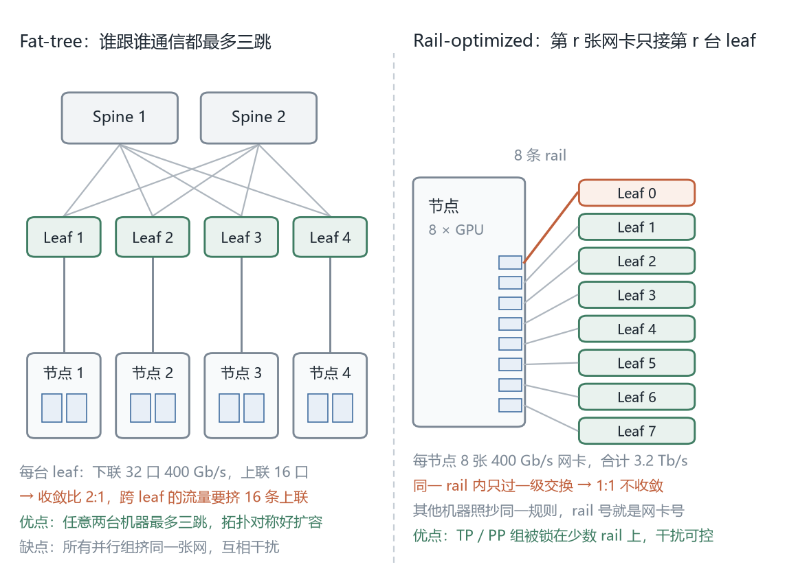

# 第 6 章　集群网络、拓扑与带宽预算

同一张 H100，把 1 GB 数据推到同机箱里另外一张卡，2.2 毫秒。推到隔壁机柜的卡，20 毫秒。芯片没变，链路换了，这是集群里最容易算错的一笔账。

算这笔账不需要知道太多协议细节，只需要三样东西。每条链路能跑多少字节每秒，任意两张卡之间有几条这样的链路，一次集合通信总共要搬多少字节。前两样由硬件和布线决定，第三样由并行策略决定。把三者乘起来，就是一次同步要花的时间。

这一章先摆链路，再摆拓扑，最后把并行策略放进去算。

## 6.1　节点内与节点外的带宽落差

H100 SXM 的 NVLink 总带宽是 900 GB/s。这个 900 是双向合计，单向大约 450 GB/s。一张 H100 要出节点，靠的是它自己那张 400 Gb/s 的网卡，也就是单向 50 GB/s。两个数字放在一起，差 9 倍。

节点内的带宽不是按卡均分的。一台服务器里 8 张卡通过 NVSwitch 全互联，任意两张卡之间的通路都走同一套交换芯片，所以每张卡都能同时和其余 7 张跑到接近满速。这也是为什么一台机器里 8 张卡做张量并行是默认配置，而 16 张卡做张量并行立刻要跨机。

跨机还有一条更差的路。如果两张卡不在同一个 NVLink 域，比如一张卡在 CPU 直连的槽位上，另一张走了 PCIe switch，那么它们之间只有 PCIe。PCIe 5.0 单向 64 GB/s，比 NVLink 慢 7 倍，比网卡只快不到 1.3 倍。有人用 PCIe P2P 做小规模通信还觉得"反正比网络快"，其实这个判断在 400 Gb/s 网卡面前已经不成立了。

把三条链路的传输时间列出来，差别很直观。

| 路径 | 单向带宽 | 传输 1 GB |
| NVLink 同节点 | 450 GB/s | 2.2 毫秒 |
| PCIe 5.0 | 64 GB/s | 15.6 毫秒 |
| IB NDR 出节点 | 50 GB/s | 20 毫秒 |

表中的时间按"字节数除以带宽"估算，没有计协议开销。真实值会再高一些，因为集合通信还有打包、校验和确认。

延迟是另一件事，它和带宽不是一回事。光在光纤里大约 20 万公里每秒，100 米 0.5 微秒，一次往返 1 微秒。一个机架按 32 台服务器算，256 张卡，机架内的往返在 2 微秒以内。一个千卡集群铺开可能跨越两三百米，单程 1 到 1.5 微秒。这个量级对 800 GB 的梯度同步毫无影响，但对 1 MB 的 all-reduce 就是主要成本。

现场最常见的症状是步时随规模突然跳变。张量并行从 8 扩到 16，模型没变，卡数翻倍，理论上单步应该快一倍，实际慢了一倍多。原因是原来 8 卡全在 NVLink 上，扩到 16 卡必须跨机，每层的两次 all-reduce 从 450 GB/s 的链路掉到 50 GB/s 的链路，时间直接乘 9。这种情况下 `nvidia-smi nvlink -s` 显示 NVLink 吞吐不高，而网卡计数器打满，一眼能看出来。

第二个症状是 `NCCL_DEBUG=INFO` 的建图日志里出现大量 `NET/IB` 通道。NCCL 建图时会打印每条通道走的链路类型，`NVLS`、`P2P/NVL`、`NET/IB` 各占多少。如果一次节点内通信出现 `NET/IB`，说明拓扑探测没认出来，可能是 `NCCL_P2P_DISABLE` 被设了，也可能是容器里没挂载 `/dev/nvidia*` 的 P2P 能力。

还有一件事要提前想清楚，就是每张卡到底有几张网卡。一台 8 卡服务器配 8 张网卡，是一卡一网卡；也有配 4 张的，那就有两张卡共用一张网卡。共用意味着出节点的单向带宽从 50 GB/s 降到 25 GB/s，而拓扑图上看不出来，因为服务器型号一样。验收的时候要拿 `lspci` 数一遍网卡枚数，再看 `NCCL_DEBUG=INFO` 里每个 rank 选了哪张 HCA。这两步花五分钟，能省掉后面两天的“为什么这两台机器慢一半”。

## 6.2　fat-tree 与收敛比

集群网络基本都是 CLOS 结构，工程上叫 fat-tree 或者 spine-leaf。最下一层 leaf 交换机接网卡，上面一层 spine 交换机把 leaf 连起来。层数按规模加，千卡两级够用，万卡要三级。

收敛比定义为下联带宽总和与上联带宽总和之比。端口速率相同时，它就是端口数之比。设下联端口数为 $P_{down}$，上联端口数为 $P_{up}$，则

$$R = \frac{P_{down}}{P_{up}}$$

$R$ 等于 1 表示无收敛，任意两张卡之间可以同时跑满各自的网卡。$R$ 等于 3 表示上行方向的总带宽只有下行方向的三分之一，跨 pod 的流量最多只能跑到单卡带宽的三分之一。

拿 1024 卡做例子。每卡一张 400 Gb/s 网卡，一共 1024 个端口。交换机按 64 个 400G 端口算，这个规格在 2022 年之后是主流。

无收敛的做法是每个 leaf 用 32 个口下联、32 个口上联。32 个下联口接 4 台 8 卡服务器，也就是 32 张卡。1024 卡需要 32 台 leaf，上联一共 1024 条，需要 16 台 64 口的 spine。全网 48 台交换机，任意两卡之间最多三跳。

3:1 的做法是每个 leaf 用 48 个口下联、16 个口上联。48 个下联口接 6 台服务器，也就是 48 张卡。1024 卡需要 22 台 leaf，上联 352 条，6 台 spine 就够。全网 28 台交换机，省掉 42% 的设备，代价是跨 pod 的带宽降到三分之一。

省下来的钱会以时间的形式还回去。还是 1024 卡，模型按 4050 亿参数、BF16 存，参数一共 810 GB。一次数据并行的梯度 all-reduce，每张卡发送的量按 ring 算法是

$$V = 2 \Psi \frac{N-1}{N}$$

$\Psi$ 是参数的总字节数，$N$ 是参与这次 all-reduce 的卡数。代入 $\Psi = 810$ GB、$N = 1024$，得到 $V = 1618$ GB。链路 50 GB/s 时是 32.4 秒。这一秒数在无收敛的网络上成立。

换成 3:1，先假设一半流量留在 pod 内，一半跨 pod。pod 内 50 GB/s，跨 pod 16.7 GB/s，等效速率是

$$B_{eff} = \frac{1}{\dfrac{0.5}{50} + \dfrac{0.5}{16.7}} = 25\ \text{GB/s}$$

时间变成 64.7 秒，翻一倍。如果流量全部跨 pod，就是 97 秒。实际值落在两者之间，取决于 rank 怎么排、ring 的邻居落在哪个 pod。

所以收敛比不是采购参数，它是通信时间的一个乘数。买 3:1 的时候要先把最坏情况算出来，看这个乘数能不能接受。Llama 3 那种规模用 1:1，不是因为他们有钱，是因为 16384 卡的梯度同步受不了 3 倍的放大。

规模再往上，两级就不够了。1024 台交换机、万级端口的规模，单层 spine 装不下，要加第三级。三级 CLOS 的结构是 leaf、spine、super-spine，收敛比在每一级都要定义一次，总收敛比是各级的乘积。工程上常见的做法是让 leaf 到 spine 无收敛，super-spine 承担全部超订，这样跨 pod 的流量只被放大一次，而不会两级叠加。

还有一种是端口速率的错配。用 32 个下联口、32 个上联口的交换机，如果把每个下联 400G 口用分线缆拆成两个 200G 口，那么下联的端口数翻倍、每口速率减半，总带宽不变，但上联每口的带宽变成下联的两倍。MegaScale 就是这么做的，目的是降低 ECMP 时多股流撞到同一个上联口的概率。这不是带宽优化，是哈希优化，效果体现在尾延迟上而不是均值上。

## 6.3　rail-optimized 的接法

一台服务器 8 张 GPU、8 张网卡。如果这 8 张网卡随便插到交换机的任意端口上，那么任意两张卡之间的路径数是 8×8 种，等价路径多，ECMP 哈希的选择空间大，撞车的概率也大。

rail-optimized 的做法是把编号相同的卡固定接到同一个 leaf 组。GPU 0 接 NIC 0，NIC 0 接 rail 0 的 leaf；GPU 1 接 NIC 1，接 rail 1 的 leaf，依此类推。这样整个集群被切成 8 张平行的子网，每张子网里所有节点的同号卡都在同一组 leaf 下，一跳可达。

好处是路径唯一且确定。同号卡之间的通信不需要经过 spine，也不存在 ECMP 选路的问题，带宽是 1:1 的。数据并行和专家并行的流量如果发生在同号卡之间，等于跑在一张独立的、无收敛的小网络上。

代价是跨 rail 的通信要绕。张量并行如果跨节点，比如 16 卡 TP 用两台机器，那么 rank 0 到 7 在一台机器上，rank 8 到 15 在另一台。这 16 张卡分布在 8 个 rail 上，all-reduce 的每一步都有一半的参与者跨 rail，这一半必须经过 spine。

一个具体的排布是这样的。128 台服务器，1024 张卡，8 个 rail，每个 rail 128 张卡，每个 rail 用 4 台 32 口的 leaf 做到 1:1，一共 32 台 leaf。跨 rail 的流量再上 spine。

现在拿一个 128 卡的 DP 组看编号的影响。纯数据并行、一台机器的 8 张卡都进同一个 DP 组时，这 128 张卡落在 16 台机器上，每台 8 张，每个 rail 分到 16 张。

按机器优先编号，rank 等于机器号乘 8 加卡号。ring 的 127 个跳里，112 个在机器内部，只有 15 个跨机器。机器内部的跳走 NVSwitch，450 GB/s；跨机器的 15 个跳从 rail 7 跳到 rail 0，这一半必须上 spine。每张卡要出网卡的流量因此只有 $1618 \times 15 / 127 \approx 191$ GB，按 50 GB/s 算是 3.8 秒，剩下的 1416 GB 走 NVLink，3.1 秒。

按 rail 优先编号，rank 等于 rail 号乘 128 加机器号。同一个 128 卡的 DP 组就变成 rail 0 的全部卡，分布在 128 台机器上。每一跳都跨机器，但都在同一个 leaf 组内，1:1 无收敛。每张卡的网卡流量是完整的 1618 GB，32.4 秒。

两种编号下来，网卡流量差 8 倍，时间差 4.6 倍。结论跟直觉相反，让 ring 的邻居留在节点内，比留在同一个 rail 里重要得多。这也解释了一个常见误判，很多人以为 rail-optimized 是为了让 DP 的 all-reduce 全部留在 rail 内，其实做不到，一个 DP 组只要跨了多台机器，就必然分布在多个 rail 上。rail-optimized 真正保证的是任意一个 rail 出来都有一张 1:1 的小网络可以走，不和别的 rail 抢 spine 的上联。两种接法的带宽分配如图 6-1。

*图 6-1　fat-tree 与 rail-optimized 的带宽分配*

图 6-1 画了两种接法。左边是普通 fat-tree，所有卡共享 spine 的上联带宽；右边是 rail-optimized，同号卡之间的流量在 rail 内闭环，只有跨 rail 才用 spine。

rail-optimized 有个副作用，布线量和光模块量都翻倍。8 个 rail 意味着每个机架要引出 8 组独立的上联光纤，每组都要经过配线架。光模块是集群里最容易坏的东西之一，Llama 3 在 54 天里记录了 35 次交换机与线缆相关的故障，占全部故障的 7% 左右。rail 数量越多，光模块总数越多，这个故障率按比例往上走，而且在 16384 卡的规模上，7% 已经足够每天碰到一次。

还有一个容易被忽略的点，rail 数量和节点数必须整除。128 台机器配 8 个 rail，每个 rail 128 张卡，这个组合很整齐。如果集群是 100 台机器，8 个 rail 就有 4 个 rail 分不到同样多的卡，某些 rail 会先撞到交换机端口数上限。这也是为什么大规模集群的卡数总是 8 的整数倍再乘 2 的幂，不是强迫症，是为了让拓扑能整除。

## 6.4　收敛比怎么算成时间

采购单上写的是收敛比，profile 里看到的是时间，两者之间隔着一个 rank 映射。这一步必须自己算，算完才知道该不该多买那 20 台交换机。

先算总量。设集群有 $N$ 张卡，每张卡一个 400 Gb/s 的网卡口，单向带宽 $b = 50$ GB/s，收敛比为 $R$，则上联侧需要的总带宽是

$$B_{up} = \frac{N b}{R}$$

1024 卡、无收敛时是 51.2 TB/s，3:1 时是 17.1 TB/s。这两个数字决定了 spine 要用多少台、多少层。万卡集群按 1:1 算是 500 TB/s 单向，这是为什么超大集群的网络成本和交换机功耗会和算力卡本身放在一个量级上讨论。

再算单次通信。数据并行的 all-reduce 在 ring 算法下，每张卡发送的字节数是 $2\Psi(N-1)/N$，其中 $\Psi$ 是参数总字节数，$N$ 是 group 大小。这个量在 $N$ 很大时趋近 $2\Psi$，与并行度基本无关，也就是 1620 GB 上下。通信时间就是这 1620 GB 除以每张卡实际能拿到的带宽。

这里有个前提要先讲清楚。1618 GB 全部走出网卡，前提是 DP 组里每台机器只贡献一个 rank，也就是 TP 或者 PP 已经把整机的 8 张卡吃干净了。如果一台机器的 8 张卡都在同一个 DP 组里，节点内那部分走 NVLink，每张卡真正上网卡的只有 $2\Psi/8$，也就是 202 GB。同一个模型、同一批卡，两种排法的网卡流量差 8 倍，而拓扑图上完全看不出来。

每张卡实际能拿到的带宽取决于这 1620 GB 里有多少比例必须跨 pod。设跨 pod 的比例为 $f$，pod 内带宽 $b$，跨 pod 带宽 $b/R$，则等效带宽

$$B_{eff} = \frac{1}{\dfrac{1-f}{b} + \dfrac{f R}{b}}$$

把 $b = 50$ GB/s、$R = 3$ 代进去，$f = 0$ 时 $B_{eff} = 50$ GB/s，$f = 1$ 时 $B_{eff} = 16.7$ GB/s，$f = 0.5$ 时 25 GB/s。时间分别是 32.4 秒、97 秒、64.7 秒。

$f$ 不是个自由参数，它由 rank 映射决定。ring 里每个 rank 只和前一个、后一个交换数据，所以 $f$ 就等于相邻 rank 落在不同 pod 的概率。DP 组里每台机器一个 rank 时，127 个跳全部跨机器，$f$ 就是这些跳里落在 pod 之外的比例。按前面的排布，一个 pod 装 4 台 leaf、也就是 16 台机器 128 张卡，而每台机器只贡献一个 DP rank，那么一个 pod 只能装 16 个 rank。128 卡的 DP 组要跨 8 个 pod，$f$ 就是 0.875。

把这个 $f$ 代回公式，$B_{eff}$ 是 18.2 GB/s，1618 GB 要 89 秒。而在同一个 pod 里完成的通信是 32.4 秒。两者的差别不在硬件，在 DP 组有没有跨 pod。

这条推理给出了一个反直觉的结论，收敛比对大消息的影响，不完全等于"总带宽除以 R"。ring 只跟邻居说话，邻居在哪个 pod 是可控的。把 DP 的 rank 按 pod 连续编号，能把 $f$ 从 0.875 降到零；随机编号则让每一次跳都跨 pod，3:1 就是实打实的 3 倍。

但也得承认一个现实，TP 吃掉整机之后，DP 组每节点只剩一个 rank，不管怎么编号，$f$ 都很难小。要把它拉回来只有两条路，要么把多个 PP stage 放在同一台机器里，让 DP 组在同一台机器里多占几个 rank；要么把梯度分片，把每卡要传的字节数除下去。前者受限于显存，后者就是第 10 章的账。

流水并行的点对点通信是另一种情况。它的对端是固定的前一级和后一级，跟编号无关，只跟 stage 怎么切有关。所以 PP 的流量要么全在本地，要么全跨 pod，没有平均可言。这也是为什么 PP 度很大时，通常要把相邻 stage 放在相邻机架。

实际配置里，这三种映射会打架。TP 要求同节点连续编号，PP 要求相邻 stage 相邻机架，DP 要求按 rail 或按 pod 连续。三条约束不可能同时满足，因为 rank 是个一维的数。通常的优先级是先满足 TP，因为它的延迟最敏感、频率最高；再排 PP，因为它决定了跨机跳数；剩下的自由度全部给 DP。这意味着 DP 的 $f$ 往往不是零，而是三两成。把这个数估出来带进上面的公式，就知道 3:1 到底能不能接受。还有一个常被跳过的步骤，就是把这些公式提前写进一份配置文档。算一遍只用十分钟，算完记录下来，以后每次改并行度先查表，比事后从 profile 里反推快得多。

## 6.5　一个千卡集群的带宽预算

千卡集群的带宽不是一项，是四类流量在抢同一批端口。训练本身的集合通信，检查点的突发写，数据管线的读，加上监控和日志的碎流量。只算第一类，剩下三类会在最不合适的时候一起冒出来。

第一类是训练通信。1024 卡按无收敛算，出向总量 51.2 TB/s。这是峰值，不是均值，因为 all-reduce 期间所有卡同时在传。持续性上它是"每几秒来一次、每次几十秒"的方波。

第二类是检查点。1750 亿参数按混合精度存一份约 2.1 TB。1024 张卡平均分摊，每卡 2.05 GB。如果要求 60 秒内写完，每卡的上传速率是

$$b_{ckpt} = \frac{2.05\ \text{GB}}{60\ \text{s}} = 34\ \text{MB/s}$$

单看很小，只有网卡的千分之一。但 1024 张卡同时写，聚合就是 35 GB/s，而这 35 GB/s 会走同一条 spine。检查点如果和 all-reduce 撞在一起，all-reduce 的时间会被拉长。这就是为什么要做异步检查点，以及为什么要把检查点限速。

第三类是数据读取。每张卡每步要吃多少 token，取决于批大小。假设每卡每步 4096 个 token，token id 用 4 字节存，原始字节是 16 KB。一步 6 秒，平均 2.7 KB/s。这个量级可以忽略，但不是因为它小，而是因为数据通常提前读进内存，实际看到的是突发的大块读。远端对象存储上做随机读的时候，瓶颈会先出现在元数据操作上，不在带宽上。

第四类是监控。每张卡几十个指标，每秒采一次，一个千卡集群是每秒几万个采样点，走的是 CPU 侧的管理网，和训练网物理隔离。这一项不该出现在带宽预算里，出现就说明布线上偷懒了。

把这四类加起来，一个千卡集群的主干带宽预算大致是 50 TB/s 量级，其中 95% 以上是训练通信。这个比例说明，优化带宽预算的第一步不是加网络，是减少训练通信量本身。分片、增大批、减少同步频率，每一样都比换交换机便宜。

四类流量的量级差得很远，放在一张表里看得更清楚。

| 流量 | 突发宽度 | 单向总量 | 特征 |
| 训练集合通信 | 51.2 TB/s | 每步 1.6 TB 每卡 | 方波，周期性 |
| 检查点 | 35 GB/s | 2.1 TB 每次 | 突发写，可延迟 |
| 数据读取 | 可忽略 | 每卡每步 16 KB | 提前预读 |
| 监控日志 | 走管理网 | 每秒数万点 | 必须隔离 |

表里第二行的总量按 1024 卡分摊 2.1 TB 算。这个数字真正要看的是它的形状，检查点是所有卡在同一个瞬间同时开始写，持续几十秒，然后完全停下来。训练通信是持续几十秒停几秒。两类方波如果相位错开，网络能同时干两件事；如果撞上，检查点会把一次 all-reduce 从 32 秒拉到 40 秒以上。工程上的处理办法是把检查点排在两个 step 之间、并且限速到主干带宽的三成以下，而不是指望网络能吸收。

机架层面还有一笔账。一机架 32 台服务器，也就是 256 张卡。256 张卡全速出节点是 12.8 TB/s，这 12.8 TB/s 要从机架的 leaf 上出去。一个机架的功率按 40 到 120 kW 算，交换机和光模块加进去，供电和散热的余量要一起留。工程上经常出现的情况是网络端口够、光模块够、但机柜的配电不够。

## 6.6　拓扑与并行策略的对应

四条并行策略对网络的要求完全不同。把对的那条放在对的链路上，是集群配置里回报最高的一件事。

张量并行最挑链路。每一层要两次 all-reduce，一次在前向、一次在反向，每次的消息大小是 batch、序列长度、隐层维度的乘积再乘两字节。取 batch 2、序列 8192、隐层 16384，一次消息是

$$S = 2 \times 8192 \times 16384 \times 2 = 537\ \text{MB}$$

在 8 卡的 TP 组里，ring all-reduce 每卡发 $2 \times 537 \times 7/8 = 940$ MB。走 NVLink 的 450 GB/s 是 2.1 毫秒，走网卡的 50 GB/s 是 18.8 毫秒。126 层、每层两次，节点内是 0.53 秒，跨节点是 4.7 秒。单这一项就能解释为什么 TP 度不能超过单机卡数。

数据并行对链路没那么挑，但它量大。一次 all-reduce 就是 1620 GB，可以切成很多块和反向计算重叠。它放在节点外，前提是分片或者大批量把量压下来。不分片的 4050 亿参数在 128 卡 DP 上要 32 秒同步一次，这个量级无论什么网络都救不回来。

流水并行只传激活，量小，但方向固定。每个微批在每一级边界上传一次 $b \times s \times h \times 2$ 字节，也就是 537 MB，15 个边界串起来是 8 GB 的单向流量。它适合放在节点外，但相邻 stage 要放在相邻机架，否则每一跳都跨 spine。

专家并行的 all-to-all 是全对全，没有"邻居"这个概念，任意两张卡都可能直接交换数据。这一条决定了 EP 必须跑在无收敛或者接近无收敛的网络上。用 3:1 跑 EP，等于给每次 all-to-all 加一个 3 倍的系数。DeepSeek-V3 在 2048 张 H800 上做专家并行，H800 的 NVLink 是 400 GB/s，这种情况下专家组的规模必须和节点边界对齐。

把这四条整理成一张对应表。

| 并行 | 每次通信量 | 频率 | 建议位置 |
| TP | 2 倍激活，约 1 GB | 每层两次 | 节点内，不超过 8 卡 |
| DP | 2 倍参数字节 | 每步一次 | 节点外，可分片 |
| PP | 1 倍激活 | 每微批每边界 | 节点外，相邻 stage 相邻 |
| EP | 1 倍激活 | 每层两次 all-to-all | 无收敛区域 |

配置的时候有个简单顺序。先看模型放不放得下，放不下就先上 TP 和 PP。TP 卡在 8，PP 补剩下的。然后用 DP 填满卡数，DP 度不够就加梯度累积。最后检查 DP 组的 rank 映射是不是按 pod 连续，EP 组是不是落在无收敛的区域。

最容易出错的地方是把 TP 组跨了节点。表面上看 TP=16 只是并行度翻倍，实际上把每层两次 all-reduce 从 450 GB/s 的链路挪到了 50 GB/s 的链路，再叠上跨机的往返延迟。步时会以一种很难解释的方式变差，因为计算部分确实变快了，只有通信部分在拖后腿，两个效应抵消之后看起来"扩展性不行"。

第二个坑是 EP 落在 3:1 的区域。这种情况在混合并行里很常见，因为 EP 组通常是最后才确定的，配的人只关心能不能整除，没关心它跨了几个 pod。症状是 all-to-all 的耗时随集群负载波动，白天跑得好，晚上隔壁作业起来就慢。

把前面的数字串成一个完整算例。4050 亿参数、BF16、16384 张 H100、每卡 400 Gb/s，拓扑按 TP 8、PP 16、DP 128 排。TP 组 8 卡同节点，每层全走 NVLink，126 层两次 all-reduce 共 0.53 秒。PP 组 16 级跳节点，每个微批 15 个边界各传 537 MB，串行起来 8 GB 单向，按 50 GB/s 算是 161 毫秒，这个数会跟其他 stage 的计算重叠。DP 组 128 卡，每台机器只出一个 rank，所以跨 128 台机器，如果不分片，每卡要过网卡 1618 GB，32 秒。

这个算例里最刺眼的是最后那个 32 秒。同一张卡在同一个 step 里，计算只花 6 秒，同步要花 32 秒。网络再快也无解，因为 1618 GB 已经是一张网卡在 32 秒里能搬完的极限。所以 4050 亿参数规模上的真正解法不在网络层，在分片，把每个卡要同步的字节数降下来。这一笔账到第 10 章展开。

最后给一个自检顺序。拿到一套集群，先问三个问题。节点内是不是 NVLink 全互联，不是的话哪些卡会掉到 PCIe 上。DP 组的 rank 映射是按机器编号还是按 rail 编号，两者差多少比例跨 pod。EP 组是不是落在无收敛区域，不是的话 all-to-all 要乘几倍。这三个问题都能在五分钟内从配置和 `NCCL_DEBUG=INFO` 的建图日志里回答，而它们解释的往往是后续三周的调优里最大的那个百分比。
