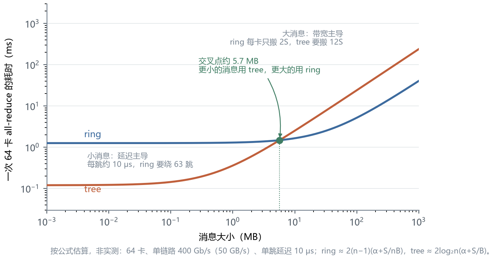

# 第 7 章　集合通信与 NCCL

集群网络是硬件，集合通信是软件，两者之间隔着一层叫 NCCL 的东西。同一套网卡和交换机，算法选错、通道数给少、消息切碎，带宽利用率能掉到两成。这一章算的是这层软件的开销。

先明确一件事，集合通信的时间从来不是"数据量除以带宽"。它等于启动开销加上传输时间，启动开销在小消息上能占到九成。所有调优动作，本质上都是在这两项之间找平衡。

## 7.1　四种原语与语义

教科书上列六种原语，实际只有四个是基本的，broadcast、reduce、all-gather、reduce-scatter。all-reduce 是 reduce-scatter 加 all-gather，all-to-all 是一次转置。这个分解不是学术上的化简，它直接决定了训练里该调哪个接口。

设参与通信的卡数为 $N$，数据总字节数为 $\Psi$，则每种原语下每张卡要发送的字节数是

$$\text{broadcast}: \Psi \qquad \text{reduce}: \Psi \qquad \text{all-gather}: \Psi\frac{N-1}{N}$$

$$\text{reduce-scatter}: \Psi\frac{N-1}{N} \qquad \text{all-reduce}: 2\Psi\frac{N-1}{N} \qquad \text{all-to-all}: \Psi\frac{N-1}{N}$$

这几个式子值得盯着看一会儿。all-reduce 的量正好是 reduce-scatter 与 all-gather 之和，两项各 $\Psi(N-1)/N$。这意味着在只需要部分和的场合，用 all-reduce 是浪费一半带宽。

梯度同步恰好是这种场合。数据并行的每张卡算出本地梯度，需要的是所有卡梯度之和再取平均，然后每张卡更新自己那份参数。如果每张卡只负责更新 $\Psi/N$ 的参数分片，那么它只需要自己那一片的完整和，也就是 reduce-scatter，不需要 all-gather。ZeRO 的第二阶段和 FSDP 的反向都建立在这个观察上。

另一个方向也成立。参数分片存放时，前向要用到全部参数，这时各卡手里只有 $\Psi/N$，需要 all-gather 拼出来。拼完用完再扔，下一次前向再拼。这就是 ZeRO 第三阶段和 FSDP 前向的形态。

all-to-all 的量看起来和 all-gather 一样，性质完全不同。all-gather 里每张卡发同样的东西给所有人，路径是"一对多"；all-to-all 里每张卡给每个对端发一段不一样的东西，路径是"全对全"。前者可以顺着 ring 走一圈，后者没有邻居的概念，直接把 spine 打满。MoE 的两次 all-to-all 和序列并行的头重排都属于后者，对网络收敛比的要求比 DP 高一个档次。

broadcast 和 reduce 在训练里用得少，但不是没用。参数初始化、随机种子同步、数据顺序的基准位置，都需要从 rank 0 广播一次。全局的监控量，比如整个集群的梯度范数、当前学习率、已消费 token 数，适合用 reduce 汇总到 rank 0 再写日志。这两类通信量都是字节级，但它们出现的次数可能比梯度同步多得多，如果放在关键的同步点上，一样会把步时拉长。

还有一个维度叫 group。前面所有公式里的 $N$ 都是 group 大小，而不是集群卡数。张量并行的 group 是 8，数据并行的 group 是 128，不同 group 的通信彼此独立，可以并发。这个性质常被忽略。一张卡在同一个时刻可以既在等 TP 的 all-reduce，又在传 DP 的梯度块，只要它们在不同的 group 里、走不同的链路。这就是重叠的物理基础。

现场最常见的错误是把 all-reduce 当成唯一的同步手段。看到梯度同步就写 `dist.all_reduce`，看到参数同步也写 `dist.all_reduce`，结果每一步多搬一倍数据。花点时间确认到底需要"全和"还是"部分和"，是最便宜的一次优化。

还有两个语义细节容易被忽略。一是求和还是求平均。PyTorch 的 `all_reduce` 默认求和，而 DDP 内部会先除一次梯度累积步数再同步，这两件事在不同地方做会导致梯度尺度差一个因子，loss 曲线看起来像学习率调错了。二是数据类型。梯度如果以 BF16 同步，累加是在 BF16 里做的还是 FP32 里做的，两种实现的数值结果不同，在万卡规模上这个差异会被放大成收敛曲线的分叉。NCCL 默认按输入类型累加，需要更高精度就先把 buffer 转成 FP32 再调，代价是字节数翻倍。

还有一个越用越常见的接口是 `all_to_all_single`，专家并行和序列并行都靠它。它的输入是每张卡一个等长的 buffer，输出是转置后的布局，每张卡从每个对端拿一段。这个接口没有"根"的概念，通信矩阵是一个完整的 $N \times N$ 图，任何一张卡坏了或者慢了，所有卡都会等。

## 7.2　ring 与 tree 的适用场景

ring 的思路是把数据切成 $N$ 块，每张卡留一块，其余的往前推。reduce-scatter 阶段推 $N-1$ 步，每步把手里的一块累加后交给下一个；all-gather 阶段再推 $N-1$ 步，把结果传回去。总步数 $2(N-1)$，每步传 $\Psi/N$。

它的好处是每张卡的发送量最小，$\Psi(N-1)/N$ 已经接近理论下界，链路被压得很满。坏处是步数随 $N$ 线性增长，小消息的时候启动开销乘上 $2(N-1)$ 会非常难看。

tree 的思路是把 $N$ 张卡组织成一棵二叉树，reduce 沿树向上做，broadcast 沿树向下做。深度是 $\log_2 N$，$N$ 等于 1024 时只有 10 层，比 ring 的 2046 步少两个数量级。代价是根节点和靠近根的上层节点要承载更多流量，带宽用不满。

所以选择规则很简单，大消息走 ring，小消息走 tree。这条规则背后的数字是这样的。取 $N = 128$，消息 $\Psi = 810$ GB，ring 的每步是 6.3 GB，两步各 127 步共 1607 GB，50 GB/s 下 32 秒，启动开销 254 次乘几微秒，可以忽略。同一个 $N$，消息换成 1 MB，ring 传输是 2 MB 单向，40 微秒，而 254 次启动按每次 2 微秒算是 508 微秒。启动开销变成主导，tree 用 7 层做完，14 微秒的启动加同样量级的传输，快一个数量级。

节点内还有第三种做法。NVSwitch 支持在交换机内部做归约，一次 all-reduce 可以由交换芯片完成，GPU 只发一次收一次，等于把 $N$ 卡的 all-reduce 变成了单跳的多播。NCCL 里对应 `NVLS` 算法。8 卡节点上的小消息走这条路，延迟比 ring 低一大截，代价是只有同一个 NVLink 域内有效。

树的形态也影响很大。单棵树的根节点是瓶颈，它一个人要发 $\Psi$ 收 $\Psi$，而叶子节点几乎不参与。双二叉树把它拆成两棵方向相反的树，一棵负责 reduce 的左半边、一棵负责右半边，两张卡各自只承担一半的根角色，带宽利用率翻倍。NCCL 里对应的算法叫 `double binary tree`，在几百张卡的中等规模上是默认选择。

跨交换机的层次结构也值得利用。一张卡到另一张卡可能经过 leaf、spine、leaf 三跳，如果集合通信能把这三级分开处理，先在 leaf 内 all-reduce，再在 spine 侧做一层，最后广播回去，每级都用最适合自己的算法，效果比一把 ring 拉到底好。NCCL 会尽量做这件事，但它需要拓扑信息准确，所以要确保它探测到的交换机层级和实际布线一致。如果布线改了但没告诉 NCCL，它会把跨 leaf 的通信当成本地处理，通道数、协议全都选错。

同节点的跳在 ring 里会被折叠。一个 128 卡的 ring 如果每 8 张卡在同一台机器上，NCCL 不会真的让数据在机器内走 7 跳，而是把它归约成一个节点级的段，节点内用 NVSwitch 一次做完。这个折叠把有效步数从 254 降到几十，是 ring 在多机场景下仍然可用的关键。如果看到日志里 ring 的步数和 rank 数一样多，说明折叠没生效，拓扑探测可能把同节点的卡当成了远程。两种算法在不同消息大小下的表现如图 7-1。

*图 7-1　ring 与 tree 的传输时间随消息大小的变化*

图 7-1 画的是两条曲线。消息小的时候 tree 在上，消息大的时候 ring 在上，交叉点由启动开销和步数共同决定，和上面那段算术是一致的。

## 7.3　消息大小与延迟带宽模型

把上面两节的东西抽象一下，一次集合通信的耗时可以写成

$$T = \alpha + \frac{S}{B}$$

$\alpha$ 是这条路径上的固定开销，包含内核启动、同步、协议握手；$S$ 是一次消息的字节数；$B$ 是这条路径的有效带宽。这个模型粗糙，但足够解释九成的现象。

$\alpha$ 的量级要看路径。同一节点内走 NVLink，1 到 2 微秒；走网卡出节点，3 到 5 微秒；跨 spine 再加 1 到 2 微秒。这些数字不是规格书上的，是实测出来的典型值，不同驱动和 NCCL 版本会浮动。

由此得到有效带宽

$$B_{eff} = \frac{S}{\alpha + S/B}$$

它的意义是"这条链路在小消息上实际能跑出多少"。取 $B = 50$ GB/s、$\alpha = 3$ 微秒，不同消息大小的结果差别很大。

| 消息大小 | 传输时间 | 启动开销 | 有效带宽 |
| 1 KB | 0.02 微秒 | 3 微秒 | 0.3 GB/s |
| 1 MB | 20 微秒 | 3 微秒 | 43 GB/s |
| 64 MB | 1.28 毫秒 | 3 微秒 | 49.9 GB/s |
| 810 GB | 16.2 秒 | 3 微秒 | 50 GB/s |

表里的传输时间按字节数除以带宽算，有效带宽按上式算。1 KB 的消息只能跑出额定带宽的 0.6%，64 MB 就已经到 99.8%。

这张表解释了两件常被误解的事。第一，NCCL 的带宽测试报告里如果写"达到 45 GB/s"，不要急着高兴，先看用的是多大的消息，1 MB 的消息能到 43 GB/s 已经是很好的成绩。第二，把消息做大是通信优化里回报最高的一步，比分通道、调协议、改算法都直接。

做大消息的办法不多，但都有效。梯度分桶把很多小张量拼成一个大 buffer；融合通信把多个 collective 合成一个；增大 batch 让同样的启动开销摊到更多 token 上。反过来的操作要慎重，比如为了早一点开始重叠而把桶切得很碎，往往会发现切碎带来的启动开销吃掉了重叠省下的时间。

分批之后的总耗时还要再加一项。把一个 $\Psi$ 字节的消息切成 $k$ 个块依次发，总时间是

$$T_k = k\alpha + \frac{\Psi}{B}$$

传输那一项不变，启动那一项乘了 $k$。所以切块只有在一个前提下划算，就是每块能与计算重叠。如果重叠能盖住 $\Psi/B$ 里的大部分，那 $k\alpha$ 就是值得付的代价；如果不重叠，切块就是纯亏。这条判断在写分桶、分块通信的时候每天都要用。

测 $\alpha$ 和 $B$ 不用写代码，NCCL 自带的 `nccl-tests` 就是干这个的。跑一组从 8 字节到 8 GB 的 `all_reduce_perf`，把每条曲线画出来，小消息端的高度就是 $\alpha$，大消息端的平台就是 $B$。同一套硬件在不同 NCCL 版本、不同驱动上这两个值会差不少，升级完环境重跑一次，拿到自己的基准数比看别人的报告有用得多。

## 7.4　NCCL 的通道、协议与调优参数

NCCL 干活分三步。先探测拓扑，搞清楚哪些卡在同一节点、走 NVLink 还是 PCIe、哪些网卡属于哪个 NUMA 节点、交换机之间怎么连。再根据拓扑和消息大小选算法，ring、tree、NVLS 或者它们的组合。最后把参与这次通信的卡编成若干条并行的通道，每条通道负责一段数据。

通道是理解 NCCL 性能的关键。一条通道对应一个 CUDA 块，多个通道就是多个块并行搬运，能同时压满多张网卡和多个 NVLink 方向。通道太少，单条通道的带宽跑不满链路；通道太多，占用的 SM 太多，和计算抢资源，而且小消息上多通道的收益很快饱和。

协议决定单个传输单元的大小。`LL` 面向小消息，把数据直接内联进指令，延迟最低但带宽差；`LL128` 用 128 字节的粒度，是个折中；`Simple` 面向大消息，用满带宽，延迟最高。NCCL 会按消息大小自动选，但环境变量可以强制。

常用的环境变量就那么几个，但每一个都要知道它改的是什么。

| 变量 | 作用 | 什么时候动它 |
| `NCCL_DEBUG` | 打开日志 | 排查拓扑与算法选择 |
| `NCCL_DEBUG_SUBSYS` | 限定日志子系统 | 只看建图或只看通信 |
| `NCCL_IB_HCA` | 指定用哪些网卡 | 多网卡机器选错卡时 |
| `NCCL_SOCKET_IFNAME` | 指定控制面网卡 | 容器里选到 docker0 |
| `NCCL_ALGO` | 强制算法 | 怀疑自动选择不合适 |
| `NCCL_PROTO` | 强制协议 | 小消息延迟敏感时 |
| `NCCL_NCHANNELS` | 通道数 | 通道数不够压不满带宽 |

`NCCL_DEBUG=INFO` 的输出值得逐行读。它会打印每张卡探测到的拓扑、每个 collective 选了哪种算法、每类链路开了几条通道。如果看到一条本该走 NVLink 的通道被标成 `NET/IB`，那说明探测出了问题，后面的性能讨论都没有意义。

调优的顺序是先看拓扑对不对，再看算法合不合适，最后才是通道数和协议。反过来做的人很多，先抄一堆环境变量，结果拓扑本身是错的，怎么调都只有一半带宽。

一个典型的调试过程是这样。某次 128 卡的 all-reduce 只能跑到 22 GB/s，预期是 45。先看 `NCCL_DEBUG=INFO`，发现有一半的通道被标成 `NET/Socket`，也就是走 TCP 而不是 IB。再查 `NCCL_IB_HCA`，发现环境里写了 `mlx5_0:1`，而机器上实际的网卡叫 `mlx5_2` 到 `mlx5_9`。名字对不上，NCCL 直接放弃了 IB。改对名字，带宽回到 44。这类问题占了现场问题的一大半，而且都不需要改代码。

有一点要提醒。NCCL 的通信内核要占 SM，通道越多占得越多。在大规模训练里，如果通信和计算要重叠，通道数开得太满会让计算内核拿不到足够的 SM，反而变慢。这和"多开通道总是好的"直觉相反。节点内 8 卡用 NVLS 时通道数通常开得比较少，跨节点大消息才需要多通道。

还有一个经常被忽略的因素是 CPU 侧。NCCL 的代理线程负责往网卡投递任务，一个通道一个线程，线程绑核绑得好不好直接影响大消息的带宽。容器里如果没给够 CPU，或者绑到了跨 NUMA 的核上，网卡带宽会莫名其妙地只有一半。这种问题在 `nvidia-smi` 里看不出来，要看 NCCL 的代理线程 CPU 占用。

版本也是变量。NCCL 的主版本之间算法选择逻辑会变，同一个环境变量在不同版本上的含义可能不一样。大规模集群里版本必须锁定，并且和 PyTorch 自带的版本对齐。用 `torch.cuda.nccl.version()` 查一遍，和 `nccl --version` 对一下，两者不一致的时候，所有基于文档的调优都不可靠。

## 7.5　一次真实的通信量清单

把前四节的东西放进一个算例。4050 亿参数、BF16、16384 张 H100、每卡 400 Gb/s，并行配置按张量 8、流水 16、数据 128。模型 126 层，隐层维 16384。

参数总量是 $4050 \times 2 = 810$ GB。

张量并行的通信发生在每一层。一次 all-reduce 的消息是 batch 乘序列长度乘隐层维乘两字节。取 batch 2、序列 8192，得 537 MB。8 卡的组内 ring all-reduce，每卡发 $2 \times 537 \times 7/8 = 940$ MB。前向一次、反向一次，126 层一共

$$V_{tp} = 940 \times 2 \times 126 = 237\ \text{GB}$$

走 NVLink 的 450 GB/s，是 0.53 秒。

流水并行的通信是点对点的激活传递，每个微批在每个边界传 537 MB。16 级有 15 个边界，一个微批单向传 8.05 GB。如果每步 8 个微批，单向就是 64.4 GB，但它是流水进行的，任一时刻只有一个方向活跃，可以和其他 stage 的计算重叠。

数据并行的通信是梯度的 all-reduce。DP 组 128 卡，每台机器只出一个 rank，每卡要过网卡的量是

$$V_{dp} = 2 \times 810 \times \frac{127}{128} = 1607\ \text{GB}$$

50 GB/s 下是 32.1 秒。

三项放在一起，0.53 秒、0.2 秒量级、32.1 秒。数据并行占了 97%。这个结论和上一章算出来的一致，也解释了为什么大规模训练的第一步优化永远是"少同步梯度"，而不是"换更好的交换机"。

把这一节的通信清单整理成表，便于换成其他配置时套用。

| 通信 | group 大小 | 每卡字节数 | 链路 | 单步时间 |
| 张量并行 all-reduce | 8 | 237 GB | NVLink | 0.53 秒 |
| 流水并行点对点 | 2 | 8.6 GB | 网卡 | 0.17 秒 |
| 数据并行 all-reduce | 128 | 1607 GB | 网卡 | 32.1 秒 |

表里第二行的字节数是 8 个微批累加的结果。单个微批上，一张卡前向发一次 537 MB、反向回传一次 537 MB，合起来 1.07 GB，乘 8 就是 8.6 GB。但它是流水的，不同微批的传输互相错开，所以实际占用的是时间而不是带宽的叠加。第三行的数字没有包含重叠，如果能把反向的一部分盖上去，实际增加的步时会小于这一值。

如果一定要在这 32 秒里做文章，能动的只有三处。把梯度分片，让每卡只同步 $1/N_s$ 的量；增大全局批，让同步次数变少；把同步和反向重叠，让这 32 秒藏进计算里。第一处把 32 秒变成 4 秒，第二处把 32 秒摊到更长的计算上，第三处只在通信时间小于计算时间时才有效。这个顺序不能颠倒。

## 7.6　挂起与超时的排查

集合通信最难受的故障不是慢，是挂住。所有卡都在等，GPU 利用率掉到零，日志里什么都没有，只有超时之后才吐出一行 `NCCL timeout`。

NCCL 内置了一个 flight recorder，默认记录最近若干次 collective 的调用信息，挂起时可以 dump 出来看最后一个动作是什么。打开方式是 `NCCL_DEBUG=INFO` 配 `NCCL_DEBUG_SUBSYS=INIT,COLL`，挂住之后发信号让它 dump。看到的内容是每张卡最后进入的 collective 类型、大小、序号。

排查顺序是这样。先确认所有 rank 是不是都进到了同一个 collective。最常见的原因是某个 rank 在 collective 之前的分支里跑飞了，比如数据加载抛了异常、某个条件判断在部分卡上成立。表现是大部分卡卡在 `allreduce` 的序号 $k$，少数卡根本没有序号 $k$ 的记录。

再看建图是否一致。每张卡打印的拓扑应该互相对得上，如果一张卡认为对端在同一个 NVLink 域、另一张卡认为要走 IB，那就说明探测结果不一致，通常是容器或驱动的问题。

再看网卡选择。多网卡机器上 `NCCL_IB_HCA` 没设的时候，NCCL 会自己挑，挑错了就会出现一部分流量挤在一张卡上或者绕到 CPU 侧。

最后才是超时参数。`NCCL_IB_TIMEOUT` 决定重传超时的指数，`NCCL_IB_RETRY_CNT` 决定重试次数，这两个值偏小会让链路抖一下就直接报错。反过来设得太大，真正的硬件故障要等很久才暴露。经验做法是让总超时明显大于一次最慢 collective 的耗时，十倍是个稳妥的起点。

Llama 3 的故障统计里有一类叫 NCCL 看门狗，54 天里出了 7 次。这个数量在所有故障分类里不算多，但它说明集合通信层的故障会被单独归类统计，因为它的表现和硬件故障不一样，硬件坏了报 XID，通信层卡住只是不返回。

还有一种"假挂起"要区分。GPU 利用率看起来是 100%，但步时不推进，这种情况通常是某个 collective 在等一个极慢的 rank，而不是死锁。区分方法很简单，看网卡计数器有没有在动。在动就是慢，不动就是挂。前者去查掉队的那张卡，后者去查 collective 的序号一致性。

掉队者的定位靠逐 rank 计时。在每个 collective 前后各打一个时间戳，按 rank 展开看分布。正常情况是一条窄带，如果有一两根尖刺比其他高几倍，那就是目标。这种尖刺的来源很集中。网卡降速、光模块误码率上升引起的重传、ECC 纠错导致的内存访问变慢、另一张卡上的进程抢了 CPU、以及最常见的一种，链路 flap 之后路由重新收敛。

超时设置的风险要算清楚。设一次最慢的 collective 是 32 秒，超时设 60 秒，看起来有两倍余量。但如果链路抖了一下让某张卡的实际带宽降到五分之一，这次 collective 就要 160 秒，60 秒的超时会在它完成之前把整个作业杀掉。而杀得越晚，浪费的卡时越多。这是一个两头受挤的参数，没有安全值，只能靠历史数据定。Llama 3 的 54 天里 466 次中断，平均每天八次多，这个频率下超时设得太保守，光重启就能吃掉一半有效时间。

检查的常规手段是定期跑一次 `nccl-tests`。单机、双机、全规模三层都跑，基线存下来。以后每次训练前对一下，带宽掉了 5% 以上就该查了，不用等到出故障。这个动作花十分钟，能提前发现大部分网卡和光模块的退化。

最后一句经验。集合通信的问题排到最后，往往发现根本不在 NCCL 里，而在一个设错的容器网段、一个没装的 `libibverbs`、或者一张被容器过滤掉的设备节点。先把"能不能跑满带宽"这个基本问题用 `nccl-tests` 验证掉，再谈算法和调优，顺序反了会让排查变成猜谜。
