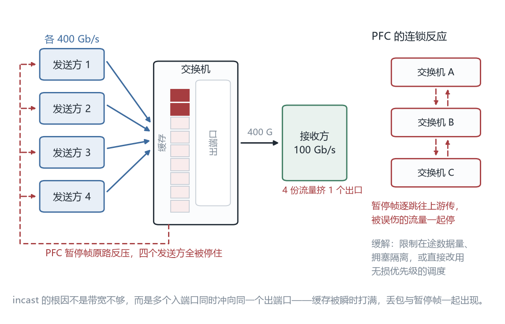

# 第 8 章　拥塞、尾延迟与多租户干扰

带宽预算算的是平均值，训练感受到的是最差值。一个 all-reduce 只要有一张卡慢，所有卡都在等它，平均值再漂亮也没用。这一章讲三件事，为什么链路会拥塞，拥塞怎么被放大成整个集合通信的延迟，以及多个作业共享一个集群时带宽怎么被抢。

这三件事的共同点是，它们在带宽利用率的曲线上都看不出来。端口跑 40% 的时候也可能正在丢包，PFC 计数在涨的时候端口利用率往往还在下降。要判断它们，得看另外一些指标。

## 8.1　incast 与 PFC 风暴

incast 是多打一。多个源同时向同一个目的发数据，目的侧那一条链路的带宽是固定的，进来的比出去的多，多出来的只能排队。

数据并行的 all-reduce 就制造这种形状。ring 算法里每个 rank 只跟两个邻居说话，看起来不像 incast。但 tree 算法、NVLS 的跨机部分、以及 MoE 的 all-to-all 都是多打一。all-gather 更直接，$N$ 张卡同时把数据发给同一张卡，那一张卡的入向链路要承受 $N$ 倍的压力。

算一下排队要多少缓冲。8 条 50 GB/s 的流同时打到 1 条 50 GB/s 的出链路上，净超出是 $7 \times 50 = 350$ GB/s。如果这个状态持续 1 毫秒，积压的数据是

$$Q = 350\ \text{GB/s} \times 1\ \text{ms} = 350\ \text{MB}$$

交换机的片上缓冲在几十 MB 量级，装不下 350 MB。装不下的部分只有两个去处，丢掉，或者让上游停下来。前者触发重传，后者就是 PFC。

*图 8-1　多打一造成的缓存占满与 PFC 暂停扩散*

PFC 的工作方式是给每个优先级配一个阈值，队列超过阈值就往上游客源发暂停帧，让它在一段时间内别发。暂停帧是按优先级生效的，所以理论上不影响其他优先级的流量。但暂停是有代价的。一台交换机暂停了上游，上游的缓冲开始积压，它再去暂停它的上游，于是暂停沿着路径反向传播，形成一片"停下来的区域"。最坏的情况是出现循环依赖，A 等 B 释放缓冲、B 等 A 释放缓冲，整个区域死锁，只能等超时恢复。

缓冲要留多少才够，取决于往返时间内能飞多少数据。链路 50 GB/s，光纤里 100 米对应 0.5 微秒，往返 1 微秒，这 1 微秒内链路能发出去的数据是

$$H = 50\ \text{GB/s} \times 1\ \mu\text{s} = 50\ \text{KB}$$

这 50 KB 就是 headroom 的下限，交换机必须在收到暂停帧之前给这条链路留出这么多空位，否则暂停帧到达的时候包已经丢了。工程上还要再乘一个安全系数，因为实际的往返不止 100 米，队列里可能已经排着别的流。千卡集群里跨 spine 的光纤往往超过 300 米，往返接近 3 微秒，headroom 就要 150 KB 起步。

同一个机架内的流量和跨机架的流量混在一个优先级上，是 PFC 扩散的常见原因。本地的 all-gather 把某个端口打满，触发的暂停帧会顺着共享优先级传到无关的流上，那些流本来不拥塞，也被停住了。这就是队头阻塞。

MoE 的 all-to-all 是另一个典型的多打一。每个 token 要路由到若干专家，专家的分布不可能均匀，热门专家所在的卡会收到远多于平均值的数据。假设一张卡平均应收到 1 份，实际收到 3 份，那它这条链路就成了三个人抢一个出口。这不是配置问题，是负载均衡问题，即使网络完全无收敛也会拥塞，因为拥塞点在目的端的内存写入而不是链路上。

还有个容易被忽略的来源是检查点。所有卡在同一个时刻向存储节点写，存储侧的聚合带宽是有限的，写不进去的部分就在网卡的发送队列里排着。这跟 incast 是一个形状，只是目的从另一张卡变成了存储。它们占的是同一批端口，所以检查点风暴期间，训练通信的延迟会莫名变长。

现场的症状很好认。交换机的 PFC 暂停帧计数在涨，暂停总时长在涨，但端口带宽利用率不高，甚至比平时还低。同时一部分流的吞吐掉到理论值的八分之一左右，这是 TCP 或者 RDMA 在丢包之后退避的典型结果。看到这三件事同时出现，基本可以确定是 incast 加 PFC，而不是带宽不够。

区分 incast 和带宽不足只需要一步。带宽不足时，端口利用率是满的，队列排着但不停，PFC 很少触发，流的总带宽之和接近链路的容量。incast 时，端口利用率在降，PFC 频发，流的总带宽远低于链路容量。两者在监控面板上是完全不同的形状，但都表现为"作业变慢"，这是它们经常被搞混的原因。

## 8.2　ECN 与自适应路由

PFC 是最后一道防线，用上它说明前面已经堵了。正常情况下应该更早发现拥塞，让发送端主动降速，这就是 ECN 做的事。

ECN 的机制是交换机在队列超过阈值时给包打个标记，接收端收到带标记的包之后回一个拥塞通知，发送端降低发送速率，然后慢慢恢复。阈值设得高，标记来得太晚，等收到通知时队列已经满了。阈值设得低，一点瞬时突发就触发降速，带宽用不满。这个阈值没有通用最优值，要按链路的 RTT 和流数量调。

比 ECN 更基础的问题是路径选得不对。等价多路径的哈希按五元组做，同一个五元组永远走同一条路。这在短流为主的场景没问题，但训练里全是大象流，每条流持续几十毫秒到几秒。设一个端口组有 8 条等价路径，16 条大流按哈希分下去，结果不会是每条路径两条流那么均匀。真实分布里，某条路径上挤三四条、另一条空着的概率很高，因为哈希函数对不同五元组的输出并不均匀。

一条路径上挤了两条大象流，它的有效带宽就是一半。如果这条路径恰好是某个 all-reduce 的关键路径，整个集合通信就按一半带宽走。这解释了为什么有时候两个作业各自跑得好好的，同时跑就都变慢，而且慢的比例不是二分之一，是更差的数字。

自适应路由的思路是不按流选路，按包或者按流片段选路。一个流的数据包被打散到多条等价路径上，每条路径的负载自然均衡。代价是包会乱序到达，接收端要重排。网卡一般支持重排，但重排窗口有限，乱序程度超过窗口就会触发重传，反而更糟。所以自适应路由的粒度要跟网卡的乱序容忍度匹配。

MegaScale 在 12288 卡上做的事情提供了另一个角度。他们没有直接上自适应路由，而是先把每个 400G 的下联口用分线缆拆成两个 200G，让上联的带宽成为下联的两倍。这样即使两条流撞到同一个上联口，也不会立刻打满。同时他们把 8 张 200G 网卡接到 8 台不同的交换机上，把同一组 ToR 下的服务器数控制在 64 台以内，减少哈希的选择空间。这是用拓扑设计换哈希质量，比改协议简单。

hash 冲突还有一个更土的办法，就是调整 rank 到网卡的绑定。8 张网卡有 8 个不同的源地址，同一个 all-reduce 的不同通道如果绑到不同网卡上，五元组就散开了。这件事在 NCCL 里由通道数控制，通道开得多，参与的五元组就多，哈希更均匀。反过来说，通道数太少除了带宽压不满，还会让哈希集中，是一个容易被忽略的副作用。

ECN 的调参在实践里往往比想象中粗糙。DCQCN 需要一组参数来描述"多快降速、多快恢复"，这些参数的最优值和流数量、RTT、交换机缓冲都相关，没有一个全局好的组合。在大规模集群上按固定参数跑，结果是部分的流过度反应，部分的流反应不足。MegaScale 的做法是把 RTT 的精确测量和 ECN 的快速响应结合起来，靠近端的 RTT 变化判断拥塞，靠 ECN 做快速降速，两者的分工是前者更早、后者更快。这套思路在 12288 卡上支撑了他们 55.2% 的 MFU。

一个实际的调参流程是这样的。先在空闲集群上跑一组固定的 all-reduce，记录带宽和 PFC 计数作为基线。然后逐步加背景流量，看带宽在哪一步开始掉。如果掉的时候 PFC 还很干净，说明 ECN 在起作用；如果 PFC 先起飞，说明 ECN 阈值偏高或者根本没开。这个测试一天能跑完，比拍脑袋猜参数靠谱。

## 8.3　尾延迟如何放大集合通信

前面两节讲的是稳态，这一节讲的是分布。

集合通信是一个屏障。all-reduce 结束的时刻等于所有参与者里最慢那个的时刻。这个性质让延迟分布的长尾变得极其重要，而均值几乎没有意义。

设每一步里，每张卡有概率 $p$ 遇到一次长度为 $\tau$ 的额外停顿，参与的张数是 $N$，则至少一张卡遇到停顿的概率是

$$P = 1 - (1-p)^{N}$$

代入 $p = 0.001$、$N = 1024$，得到 $P = 1 - 0.999^{1024} \approx 0.64$。也就是说即使每张卡只有千分之一的概率出问题，一千张卡里几乎每次都有卡出问题。

这不是最坏的情况，只是平均值。真正要看的是这一步被拉长了多少。一次 1 毫秒的停顿加在一步 6 秒的训练里，是 0.017%，可以忽略。但停顿很少只有 1 毫秒，链路重传、ECC 纠正、NVLink 降速的停顿往往是几十毫秒到几百毫秒。取 100 毫秒，一步就变成 6.1 秒，1.7%。一整天下来，有效时间少了 1.7%。

规模的影响是双重的。$N$ 变大，遇到停顿的概率按指数逼近 1，很快就饱和；同时每一步里的 collective 数量也在增加，每个 collective 都有自己的 $P$。设一步里有 254 个 ring 步，每步都有 64% 的概率被拖 100 毫秒，那一步就要多花

$$T_{extra} = 254 \times 0.64 \times 0.1\ \text{s} = 16.3\ \text{s}$$

这个数字已经不是噪声，是主要成本。当然实际不会这么糟，因为一个 collective 内部的 254 步是流水的，一次停顿只会影响当前那一步。但它说明了一个方向，集合通信的步数越多，长尾被放大的机会越多，这也是 ring 在小消息上表现差的另一个理由。

at-scale 训练里，这套推理的结论是必须主动压低长尾，而不是指望它自己消失。具体做法有三种。一是缩短单次停顿的长度，把重传超时、链路恢复时间压到最小。二是缩短同步的次数，用更大的批、更多的梯度累积让集体操作变少。三是让掉队的卡不进同步，比如把故障卡踢出 group 重新组队，代价是有效卡数下降但步时稳定。

最后一种在实现上最难，但收益最大。Llama 3 在 54 天里遇到 419 次意外中断，有效训练时间仍然高于 90%，靠的就是快速检测加快速重启，而不是让慢卡拖着所有人跑。

停顿的分布很值得看一眼。理想情况下它是无记忆的，每张卡独立、每次独立。实际不是。降频和散热有关，同一机架的卡会同时降频，因为机架功率 40 到 120 kW，散热不足时整个机架一起受影响。ECC 纠错和温度有关，光模块误码和温度也有关。这意味着停顿是成批出现的，一个时刻停的不只是一张卡，而是一个机架上的几十张。成批的停顿比独立的更伤，因为它不确定地打破了原本设计好的拓扑局部性。

这也是为什么温度数据要与通信数据放在一起看。单看 GPU 温度没意义，单看 all-reduce 耗时也没意义，两者叠在一起就能看出"每次这个机架升温的时候，全集群的 all-reduce 就多花 200 毫秒"。这类关联一旦建立，处置就很简单，把机架的风道或功率上限调一下。

还有一种停顿完全是软件造成的。某一轮里有 rank 在读检查点、在跑 `gc`、在被另一个进程抢了 CPU、在同步一个很大的元数据文件。这些停顿的长度往往比硬件停顿更长，但它们有一个优点，就是可重复。同样的配置多跑几次，问题同一个位置出现，那就不是硬件。

## 8.4　多租户下的带宽争抢

一个千卡集群很少只跑一个作业。白天跑实验，晚上跑大训练，或者两个团队各占一半，是常态。这时候网络是共享的，而共享的方式决定了每个作业看到的是什么。

按前一章的排布，1024 卡的 3:1 网络，上联总带宽是 17.1 TB/s。两个各 512 卡的作业，各自的出向需求是 25.6 TB/s，加起来 51.2 TB/s。这个数字远超上联能提供的 17.1 TB/s，比例是 3 比 1。也就是说两个作业同时满载的时候，每个只能拿到自己需求的三分之一。

但实际看到的往往不是三分之一，是更差。原因是拥塞不是公平分配的。两个作业的流量如果在同一个优先级上排队，谁先到谁占，PFC 一旦触发，被暂停的那条流会空出带宽，另一条流趁机填满，然后接着被暂停。这个振荡过程里，两边都拿不到稳定的带宽，有效吞吐比平均值更低。

一个具体的观测是这样的。某个作业单独跑，MFU 到 40%。隔壁作业起来之后，它掉到 25%，而隔壁也没到 40%。两个作业的 GPU 利用率都不低，但通信时间涨了。这种情况在网络计数器上能看出来，两个作业的 all-reduce 带宽同时下降，而链路的物理利用率并没有满，因为 PFC 和重传吃掉了有效带宽。

隔离的手段按代价从低到高排，有四档。

第一档是优先级。把训练流量放在无损优先级，其他流量放在有损优先级。这只是让训练不被其他流量打断，两个训练作业之间没有隔离。

第二档是带宽预留。在交换机上按队列给每个作业预留最小带宽，剩下的按比例分享。这种做法的保护是单向的，作业 A 抢不到 B 的预留，但 B 不用的时候 A 可以超用。

第三档是拓扑隔离。把集群按 pod 切开，每个作业占若干完整的 pod，pod 之间只在 spine 侧共享。这一档的效果取决于作业的大小和 pod 的大小是否匹配，作业如果跨 pod，共享就又出现了。

第四档是物理隔离。每个作业分到独立的 rail 或者独立的交换机平面。这一档最彻底，代价是集群的利用率下降，因为作业规模必须和划分方式对齐。

实际的做法通常是二档起步，按作业规模决定要不要升到三档。判断标准很简单，把作业的通信时间占比测出来，如果跨 pod 的那部分超过总通信时间的三成，就说明共享部分在拖后腿，值得做拓扑隔离。

多租户还有一个不对称的地方，就是容量规划。集群按最大作业设计网络，但大部分时间跑的是小作业。一个小作业只占几十张卡，它完全不需要 1:1 的带宽，却占着一段 1:1 的拓扑。反过来，调度器如果把小作业随机铺开，它们又会把碎片填进各个 pod，把本来完整的大作业空间打碎。这就是为什么拓扑感知调度不是优化项而是必需项，它同时影响性能和可调度性。

一个具体的数字感受。1024 卡集群，上联 17.1 TB/s。一个大作业要跑 800 卡，它需要的上联约是 800 乘 50 除以 3，也就是 13.3 TB/s，已经占了总容量的 78%。剩下 224 卡的作业只能用剩下的 3.8 TB/s，平均每卡 17 GB/s，是单卡带宽的三分之一。这种情况下的公平不是按卡数分，是按带宽分，而调度器往往不知道自己在按卡数分。

## 8.5　观测手段与隔离策略

拥塞和尾延迟都发生在毫秒和微秒的尺度上，靠秒级采样的监控看不出来。要看它们，必须去看交换机端口和网卡的计数器，以及集合通信的逐次耗时。

指标分三层。物理层看端口，队列深度、暂停帧计数、暂停总时长、ECN 标记数、丢弃计数、误码计数。每一层的交换机上都有，聚合起来量很大，但只需要看几个关键端口，也就是上联口。传输层看网卡，发送队列长度、重传次数、乱序计数、完成队列的错误数。应用层看集合通信，每一次 collective 的耗时、有效带宽、参与者的最大最小耗时差。

第三层最有用，也最少人做。两次 collective 的耗时差除以平均耗时，就是这一步的不均衡度。这个比值在健康的集群上应该小于 5%，超过 20% 就说明有掉队者。它的好处是把网络问题、GPU 降频、CPU 抢占全部汇总成一个数，不需要先分清楚是哪一类。

判断的顺序可以固化成一张表。

| 现象 | 先看 | 再看 | 常见原因 |
| 吞吐掉到八分之一 | 端口丢弃计数 | PFC 暂停时长 | incast 加丢包退避 |
| 时快时慢 | 队列深度 | ECN 标记率 | 哈希不均或阈值不当 |
| 全网均匀变慢 | 上联利用率 | 邻居作业 | 多租户争抢 |
| 个别 rank 慢 | 该 rank 的网卡重传 | 链路误码 | 光模块或线缆 |
| 单步偶发长尾 | 不均衡度 | 逐 rank 计时 | 掉队者或降频 |

这张表只能定位到层，具体到根因还需要看时间序列。比如"个别 rank 慢"这一行，如果重传计数在某个时刻开始单调上升，那是链路退化；如果重传正常但带宽低，那是网卡绑错了或者 NUMA 跨了。两种情况的处置完全不同。

隔离策略的选择要和观测对上。如果测出来问题是哈希不均，隔离没用，该调拓扑或者开自适应路由。如果是多租户争抢，调哈希没用，该做带宽预留。判断错方向是这类问题最常见的浪费，因为改一个参数的成本太低，人倾向于先试参数，试了三天才发现问题在架构上。

还有一个容易被忽略的观测点是时间。拥塞是有时段性的，检查点集中写入的那个时刻、数据加载的波峰、别的作业启动的瞬间，都会在网络上留下痕迹。把这些时刻和网络指标对齐，往往能解释掉一大半"莫名其妙变慢"的时段。做法很简单，在训练日志里记下每一步的开始和结束时间，和交换机的端口指标放在同一条时间轴上。这一步做完，很多争论就不用争了。

把这一整套东西固定在流程里，只需要四个动作。第一，每个作业启动时跑一次两分钟的 `nccl-tests`，把带宽基线写进作业元数据。第二，每步记录不均衡度，超过 20% 就告警。第三，交换机上联口的 PFC 和 ECN 计数按分钟采集，不用全端口。第四，作业结时把这三个指标和 MFU 一起存下来，三个月后就能看出哪台机器、哪个机架、哪个端口在缓慢退化。

这四件事都不难，难的是坚持做。大多数集群的监控面板上都有这些曲线，但没有人把它们和"这个作业上个月是 41% MFU，现在是 34%"联系在一起。拥塞和尾延迟的全部麻烦就在于此，它们不会报错，只会静静地抽走百分之七。
