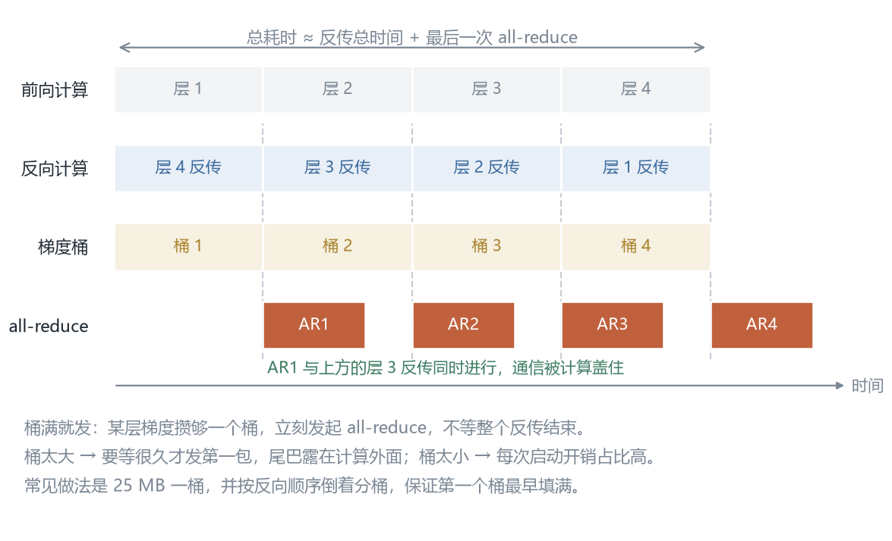

# 第 9 章　数据并行的代价

数据并行是最容易理解的并行方式，也是最早遇到瓶颈的方式。它不难写，一行 `DistributedDataParallel` 就能跑起来，但它有两个代价在规模上去之后会变得非常明显，一个是每步都要同步全部梯度，一个是同步必须等最慢的那张卡。

这一章把这笔账拆开算。先看梯度怎么分桶、怎么和反向重叠，再看桶的大小怎么定，然后算通信量随并行度怎么变，最后给扩展效率的拆解。

## 9.1　梯度桶与反向重叠

反向传播是从最后一层往前逐层算的。算完第 126 层的梯度时，第 1 层的梯度还不知道在哪里。如果等全部梯度算完再同步，那么同步时间会完整地加在步时上，一点都不重叠。

梯度分桶就是利用这个顺序。把参数的梯度按反向顺序切成若干块，攒满一块就立刻发一次 all-reduce，不用等全部算完。这样后面那些层的反向计算还在 GPU 上跑的时候，前面那些层的梯度已经在网卡上走了。

重叠的效果可以用一个很简单的式子描述。设一次反向计算的总时间是 $T_c$，需要同步的通信总时间是 $T_m$，重叠只可能发生在计算进行的时间段内，所以

$$T_{step} = T_c + \max(0,\ T_m - T_c)$$

如果 $T_m < T_c$，通信完全藏在计算里，步时就是计算时间。如果 $T_m > T_c$，藏不住的部分直接加上去。

这个式子说明一件事，重叠不是万能的。它只能省掉不超过 $T_c$ 的那部分通信。通信是计算的两倍时，重叠之后步时还是计算的两倍。第 9.3 节会看到，4050 亿参数在 16384 卡上通信是计算的五倍多，裁掉一半也还剩两倍多。分桶与反向的时间关系如图 9-1。

*图 9-1　梯度分桶与反向计算的重叠*

图 9-1 是一条时间线。上半部分是反向计算逐层进行，下半部分是各个桶的 all-reduce 依次启动，第二个桶开始传的时候第一个桶已经传完，最后一个桶在反向结束后才收尾。

现场判断重叠有没有生效，看 trace 就够了。用 Nsight Systems 抓十个步，看 NCCL 的内核和计算的 GEMM 内核在时间轴上是不是交错。如果 NCCl 内核挤在反向结束之后的一大段空白里，那就是没重叠。这种情况的原因通常有三个，桶太大导致第一个桶很晚才攒满，通信流和计算流没有正确插入 event 依赖，或者通信内核占到太多 SM 导致计算被迫让路。

第三个原因容易被忽略。NCCL 的通信要占用 SM，占用多少取决于通道数、协议、消息大小。在计算本身已经把 SM 用满的时候，通信内核争不到资源，看起来很像是"没重叠"，实际上是"抢不过"。调的办法是减少通道数或者限制通信内核的 SM 占用，而不是继续加大重叠的力度。

桶和反向顺序的对应关系也要对。PyTorch 的参数注册顺序和反向计算顺序不一定一致，桶是按注册顺序切的，如果两者错开，就会出现"第 3 个桶里装的是最早参与反向的那几层"，结果是桶满得很晚，重叠窗口被白白浪费。检查方法是把每个桶被填满的时间点打印出来，看它是不是均匀分布在反向的过程中。不均匀就说明顺序不对，要么调整参数注册顺序，要么换更小的桶。

还有一个细节是桶的分配位置。桶是常驻 buffer，在网络端口上做一次 all-reduce 之后数据回到原处，然后才做参数更新。如果桶是内存里的页锁定内存而不是显存，中间会多一次主机与设备之间的拷贝，带宽从 450 GB/s 掉到 PCIe 的 64 GB/s，这个代价在 trace 里表现为一段非 NCCL 的 memcpy。

## 9.2　桶大小怎么选

桶的大小是一个明确的权衡点，两边都有代价。

桶小，攒满得快，第一个桶能早很早开始传，尾部暴露的时间也短。代价是桶的数量多，每次 all-reduce 都有启动开销，通道建立、握手、内核启动，这些开销在几微秒量级，桶切成上万个就是几十毫秒。

桶大，启动次数少，单次消息大，带宽利用率高。代价是最后一个桶要等所有层的梯度都攒齐才能发，这段时间完全暴露在反向结束之后。

把两边写成一项，暴露的时间约是

$$T_{exp}(B) = \frac{2B}{b} + \frac{\Psi}{B}\alpha$$

$B$ 是桶的字节数，$b$ 是链路带宽，$\Psi$ 是梯度总字节数，$\alpha$ 是单次通信的固定开销。第一项是最大那个桶的传输时间，第二项是全部桶的启动开销之和。

这个式子在某个 $B$ 上有最小值。求导置零，得

$$B^{*} = \sqrt{\frac{\Psi \alpha b}{2}}$$

代入 4050 亿参数、BF16、梯度是 810 GB、$\alpha = 2$ 微秒、$b = 50$ GB/s，得 $B^{*} = 201$ MB。
把它代回去看两边的形状。$B = 200$ MB 时，暴露是 16 毫秒。$B = 20$ MB 时，启动开销那一项变成 81 毫秒。$B = 2$ GB 时，传输那一项变成 80 毫秒。两边对称地恶化。

所以 200 MB 是在这个配置下的最优点，量级上和工程上常用的几十到几百 MB 是一致的。但要提醒一点，这个式子是简化过的，它假设所有桶都能在反向过程中被填满，实际上第一个桶和最后一个桶都填不满。真实的最优值偏小一些，因为小桶在两端的不对称收益更大。

还有两个约束不能忽略。一是显存，桶是常驻的 buffer，桶越大占的显存越多。二是通信链路的对称性，如果桶的大小不是消息对齐粒度的整数倍，NCCL 内部还要再做一次切分，等于多了一层开销。

桶的数目最好能整除反向里的层数。层数不能被桶数整除时，最后一个桶会偏远，这一块额外的时间就是前面算的尾部暴露。接 126 层、每层参数量相等的情况，把参数切成 126 个等分最干净；如果非要取 64 个桶，就会有两个桶装三层的梯度，这两个桶的传输时间是别人的三倍，两端各一个，正好把尾部拉长。

一个实际的做法是先按上面的式子算出量级，然后在 100 MB 到 500 MB 之间扫三四个值，用固定步数测端到端时间。这个实验一小时内能做完，比看别人的推荐值靠谱。

测试时要注意固定住其他变量。桶大小变的时候，通信总量不变，但消息数量和消息大小都变，所以带宽利用率也跟着变，这会掩盖一部分效果。要分开看两个数，一个是总的通信时间，一个是最后一个桶的完成时刻到步结束之间的空白长度。前者反映启动开销，后者反映尾部暴露。两个数随桶大小变化的曲线一个是降的、一个是升的，交点就是合适的位置。

还有一个硬约束是显存。桶本身占的是梯度 buffer 的一部分，不额外占，但如果为了让桶对齐到某个大尺寸而把整个梯度 buffer 堆到一块连续显存里，峰值会抬高。在大模型上留余量本来就紧，这一项不一定是主要成本，但在接近显存上限的配置里会成为最后一根稻草。

## 9.3　梯度累积与等效批大小

梯度累积是用时间换显存的手段。一张卡放不下大 batch，就把它切成 $k$ 个微批，依次前向反向，梯度累加起来，最后统一做一次参数更新。

对数据并行来说，累积带来一个直接的好处，通信次数除以 $k$。设不做累积时每步同步一次，做 $k$ 次累积之后每 $k$ 个微批才同步一次，通信时间摊到每个微批上是原来的

$$\frac{T_m}{k}$$

计算时间不变，因为总 token 数没变。所以通信占比变成原来的 $1/k$。

代价在别处。激活值不用乘 $k$，因为每个微批算完就释放了。但权重梯度的 buffer 要一直留着，而且如果用的是"先算完所有微批再统一 backward"的写法，激活会全部留着，这时候显存直接乘 $k$。两种写法差一个数量级，是梯度积累最容易踩的坑。

等效批大小是另一个要算清楚的东西。全局批等于每卡微批大小乘以累积步数乘以数据并行度，再乘以每卡上的序列长度。改累积步数的时候，学习率要不要跟着改，取决于怎么理解这件事。如果认为等效批变大了，按线性缩放规则学习率应该同步放大；如果认为只是把同样的批拆得更细，学习率不该动。这两种理解在实践中都有人用，效果取决于其他超参是否同步调整。

批大小不能无限放大，这一点直接卡住了梯度累积的上限。按算力最优的配比，每个参数大约需要 20 个 token，一个 4050 亿的模型对应 8 万亿 token 的训练量。把全局批从 1600 万推到 1 亿，步数就从 50 万降到 8 万，学习率要跟着放大，但放大的幅度有上限，过了某个点收敛曲线会变差。实测的做法是逐步加批，每加一档观察一段 loss 曲线，一旦发现相同 token 数下的 loss 高于小批，就往回收一档。

这也是为什么大模型训练常常有一个批大小爬坡的过程。训练初期用小批，因为梯度噪声大有利于避开早期的尖锐区域；后期逐步放大，把通信占比压下去。爬坡的不是为了省时间，是为了在收敛和吞吐之间找一个同时可接受的中间点。

现在把 4050 亿参数那个算例接上来。16384 张 H100，TP 8、PP 16、DP 128，全局批 1600 万 token。每卡每步的计算时间是

$$T_c = \frac{6 \times 4050 \times 10^8 \times 1.6 \times 10^7}{16384 \times 989.4 \times 10^{12} \times 0.4} = 6.0\ \text{s}$$

分母里的 0.4 是假设的 MFU。而 DP 组的梯度同步每卡要过 1607 GB，50 GB/s 下是 32.1 秒。

通信是计算的 5.35 倍。这个比例下，重叠能起的作用很小，因为通信比计算长得多，无论怎么切块都藏不住。

想让通信占比降到 10%，计算时间要到 321 秒。按上面的式子反解，全局批要到 8.6 亿 token 一步。这个数字比收敛上合理的批大小大两个数量级，也就是说在大模型上，靠加批来摊薄通信是走不通的。

这条死路正是分片出现的原因。把梯度按 8 张卡一组切开，每卡只留自己那一份，节点内用 NVLink 归约，出节点的流量从 1607 GB 降到 190 GB，通信时间从 32.1 秒降到 3.8 秒。这一步做完，通信占比才回到可以重叠的范围里。第 10 章会把这一笔算清楚。

顺便说一个常被忽略的事实。分片不仅降通信量，也让每个微批的有效时间变长，因为同步不再是一个需要等全部卡的时刻。在没有分片的 DP 里，一次 32 秒的同步是一个硬屏障，任何一张卡出问题都要全体等；分片后每次 all-gather 只有几百毫秒，单个慢卡的影响被限制在局部。这是一个不写在公式里的收益，但它在万卡规模上比那些百分比更大。

## 9.4　通信量随并行度的变化

数据并行的通信量有一个容易误解的性质。它几乎不随并行度增长。

每卡要发的字节数是 $2\Psi(N-1)/N$，$\Psi$ 是参数总字节数，$N$ 是 DP 组大小。这个式子在 $N$ 从 8 涨到 16384 的过程中，前面的系数从 0.875 变到 0.99994。

| DP 组大小 | 系数 (N-1)/N | 每卡字节数 | 50 GB/s 下耗时 |
| 8 | 0.875 | 1417 GB | 28.3 秒 |
| 128 | 0.992 | 1607 GB | 32.1 秒 |
| 1024 | 0.999 | 1618 GB | 32.4 秒 |
| 16384 | 0.99994 | 1619 GB | 32.4 秒 |

表里的字节数按 810 GB 的梯度算。从 128 卡到 16384 卡，卡数涨了 128 倍，通信时间只涨了 1%。

这就是数据并行"扩展性好"的来源。每张卡要发的量固定，加卡不会让单卡的负担变重。

为什么系数会这么快趋近 1，值得想一下。ring all-reduce 里每张卡发出去的量是"其他 $N-1$ 张卡需要的那部分"，自己那一块只在自己的卡上用，不用发。卡数越多，自己那一块占总量的比例越小，所以发出去的比例越接近全部。这是一种结构性的性质，与算法实现无关。

反过来说，这条性质也解释了一个很容易搞混的细节。很多人算通信量的时候用 $2\Psi$ 而不是 $2\Psi(N-1)/N$，两者在 $N$ 大于 100 之后差别不到 1%，所以在工程估算里直接用 $2\Psi$ 完全可以。但在 $N$ 等于 8 的小组上，用 $2\Psi$ 会高估 14%，而张量并行的组恰好就是 8，这个误差就不该忽略了。

但这不是全部。纯数据并行下，加卡的同时全局批也在变大，每卡分到的样本数不变，所以计算时间也不变。两者都不变，比值不变，效率接近线性。这叫弱扩展。

强扩展是另一种情形，全局批固定，加卡只为了更快。这时候每卡的计算时间按 $1/N$ 下降，通信时间不变，比值线性上升。卡数翻一倍，通信占比也翻一倍，很快就全是通信。

这个区别在实际工作里非常关键。有人看到"数据并行扩展性好"就以为加卡一定有用，结果在小批上加了四倍卡，步时只快了不到两倍，还以为是网络有问题。实际情况是通信占比从 20% 涨到了 60%，这是数学，不是故障。

强扩展的恢复办法只有三个。把全局批一起放大，回到弱扩展；把同步的字节数减下去，也就是分片；或者把通信藏进计算，前提是它本来就不比计算长。第一条受收敛约束，第二条要改架构，第三条只在小规模上成立。这就是为什么大模型训练很少有"单纯加卡"这种优化，改的都是后面两条。

真正的限制还不止于此。参数量在比值里会消掉，这一点下一节会看到，所以模型越大并不意味着 DP 越难，模型越小也不意味着越容易。决定难易的是批大小和带宽。

真正的限制还不止于此。参数量在比值里会消掉，这一点下一节会看到，所以模型越大并不意味着 DP 越难，模型越小也不意味着越容易。决定难易的是批大小和带宽。

## 9.5　大规模 DP 的扩展效率

把上面的东西合并成一个式子，就能判断一套配置的可行性。

设全局批为 $B$ 个 token，单卡峰值算力 $F$，MFU 为 $m$，DP 组大小 $N_d$，集群总卡数 $N$，链路单向带宽 $b$，每个参数占 $s$ 字节，模型有 $P$ 个参数。每卡每步的计算时间是

$$T_c = \frac{6PB}{NFm}$$

每卡每步的通信时间是

$$T_m = \frac{2sP(N_d-1)}{N_d b}$$

两者相除，参数量 $P$ 消掉，得

$$r = \frac{T_m}{T_c} = \frac{s(N_d-1)NFm}{3N_d b B}$$

这个结果值得单独说一句。**通信占比与模型大小无关**，只跟卡数、批大小、单卡算力、链路带宽和精度有关。一个 700 亿的模型和一个 7000 亿的模型，在其他条件相同时，通信占比是一样的。这条结论违反了大多数人的直觉，但它是对的，因为参数变多时计算和通信同比例变多。

代入 4050 亿那个配置，$s = 2$、$N_d = 128$、$N = 16384$、$F = 989.4$ TFLOPS、$m = 0.4$、$b = 50$ GB/s、$B = 1.6 \times 10^7$，得 $r = 5.36$，与上一节的 32.1 除以 6.0 一致。

扩展效率定义为理想步时与实际步时的比值

$$E = \frac{T_c}{T_c + T_m^{exp} + T_{pp} + T_{s}}$$

$T_m^{exp}$ 是重叠之后仍然暴露的通信时间，$T_{pp}$ 是流水气泡和跨级传输的代价，$T_s$ 是掉队者带来的额外等待。

把 4050 亿那个配置的通信用分片压到每卡 190 GB，也就是 3.8 秒，其中七成能和反向重叠，暴露 1.1 秒；流水气泡按 16 级、64 个微批算是 19%，把计算拉长到 7.4 秒，多出 1.4 秒；掉队者按每步平均 0.3 秒算。则实际步时是 6.0 加 1.1 加 1.4 加 0.3，等于 8.8 秒，扩展效率 68%。

再乘上内核本身的效率，就是观察到的 MFU。如果单看计算时间是峰值的 56%，乘 68% 得 38%，正好落在 Llama 3 报的 38% 到 43% 这个区间。MegaScale 在 12288 卡上报 55.2%，说明他们把这几项都压得更紧，尤其是掉队者和通信暴露。

这个拆解的意义在于，它把"MFU 低"这个笼统的问题变成了四个可以分别测量的数。计算时间直接从 trace 里算，通信暴露从两条流的时间轴量，流水气泡用 $(p-1)/(m+p-1)$ 估，掉队者用逐步耗时的方差估。四个数都拿到之后，优化方向就不用猜了。

四个数里最难测的是掉队者，因为它不稳定。一个可用的办法是把每步的耗时按 rank 看分布，取 99 分位与中位数的比值。比值稳定在 1.05 以内，掉队者可以忽略；到了 1.2，就意味着整整 20% 的时间在等少部分卡，这时候优先查卡而不是查网络。

## 9.6　常见错误

这一节列的都是现场反复出现的，按发生频率排。

第一是桶太大。用默认参数或者为了"减少启动开销"把桶设到几个 GB，结果最后一个桶要等全部反向后才能发，那段时间完全暴露。症状是 trace 里反向结束之后有一大段纯通信，而前面重叠得很好。

第二是没开重叠。写过自定义训练循环的人容易忘，手动调 `all_reduce` 的时候是同步调用，整个计算流会停在那里等通信完成。要在独立的流上发通信，用 event 建立依赖，才能重叠。

第三是该用 reduce-scatter 的地方用了 all-reduce。梯度只需要本卡的参数分片时，all-reduce 多传了一倍。ZeRO 第二阶段、FSDP 的反向都是这种情况。

第四是梯度累积忘了除。累积 $k$ 步之后的梯度和是单步的 $k$ 倍，如果不同时除以 $k$，等效学习率就变成了 $k$ 倍。表现是训练前期 loss 掉得很快然后崩掉，很像学习率设大了。

第五是把 DP 度和总卡数搞混。通信量的公式里 $N$ 是 DP 组大小，不是集群卡数。写着 `world_size` 直接代进去，会得出完全错误的结论，尤其是用了模型并行的时候。

第六是忽略掉队者。前面所有的算术都假设所有卡同步推进，实际上一张卡慢 10%，整步就慢 10%。在 16384 卡的规模上，每步都有一张卡慢的概率接近 1。这就是为什么大规模训练里"平均性能"这个词没什么用，要看的是最慢那张卡。

第六这一条值得再展开一点。慢 10% 这件事在单卡上是噪声，在集群上是确定性的损失。一张卡每步都慢 10%，整步就多花 10%；而 16384 张卡里只要有一张慢，这个 10% 就落到全体头上。按一天 24 小时算，这 10% 就是 2.4 小时。一个月就是三天。这就是为什么故障检测和自动重启的投入会比对网络做微调的投入更划算。

第七是参数更新和设备同步的顺序。优化器在所有卡上独立更新自己那份参数，这件事本身是并行的、不需要通信。但如果写成了"先 all-reduce 参数再更新"，就凭空多了一次全量同步。这种错误在混合并行的手写循环里很常见，看代码时要专门找一遍。

第八是把检查点和同步撞在一起。检查点写盘的那一步，GPU 还要同时做梯度同步，两个都是突发流量，叠在一起就把网络打满。表现出来是每隔 N 步就有一个明显变长的步，而 N 正好等于保存间隔。这种规律性本身就是诊断依据，看到周期性尖刺先查保存间隔。

第九是忘了 `set_to_none`。梯度 buffer 不清零而是置零，看起来结果一样，实际上每次反向都要把整块 buffer 写一遍，多出来的写带宽在大模型上是可观的。这个开销不在通信里，在计算时间里，所以看 trace 会以为是某个内核慢了。

这九条里，前三条占了现场问题的六成以上，而且都能在 trace 里看出来。剩下的那些多半要改代码，改之前先确认前面三条都排除了。
