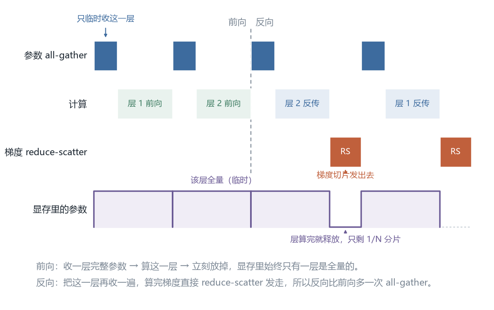

# 第 10 章　ZeRO 与 FSDP 的分片账

上一章算出一个结论，4050 亿参数在 128 卡的 DP 组上，每步要同步 1607 GB，32 秒，是计算的五倍多。这个数字没法靠网络或重叠解决，只能靠一件事，让每张卡要同步的字节数变少。

分片就是干这个的。它把优化器状态、梯度、参数按 DP 度切开，每张卡只负责其中一份。代价是通信次数变多，而且显存峰值出现的位置也变了。这一章把这两笔账都算清楚。

## 10.1　三阶段回顾与字节账

先看基线。混合精度加 Adam 的显存里，每个参数要占多少字节。

参数本身用 BF16 存，2 字节。梯度也用 BF16 存，2 字节。Adam 的一阶矩和二阶矩必须用 FP32，各 4 字节，合计 8 字节。再加上 FP32 的主权重副本 4 字节。总共

$$16 = 2 + 2 + 4 + 4 + 4$$

前四项是参数、梯度、一阶矩、二阶矩，第五项是主权重。1750 亿参数按这个算就是 2800 GB，除以 1024 张卡也要 2.7 GB 一张，看起来不大。问题在于这 2800 GB 是每张卡都要存一份的，数据并行的定义就是每张卡存完整模型。

分片把这五项的归属改掉。优化器状态只在本卡负责的那一段参数上需要，所以 12 字节可以除以 DP 度。梯度同理。参数在前向和反向时要用全量，但可以临时拼出来用完就扔。

三个阶段就是分片的深度不同。设 DP 度为 $N_d$，每参数占用的字节数是

$$\text{ZeRO-1}: 4 + \frac{12}{N_d} \qquad \text{ZeRO-2}: 2 + \frac{14}{N_d} \qquad \text{ZeRO-3}: \frac{16}{N_d}$$

第一阶段的 4 是参数加梯度，它们仍然每卡一份，被切开的是 12 字节的优化器状态和主权重。第二阶段把梯度的 2 字节也切了，所以变成 2 加 $2/N_d$ 加 $12/N_d$。第三阶段连参数的 2 字节一起切，16 全部除以 $N_d$。有些资料把第二阶段写成 $4/N_d + 12/N_d$，那是把参数也当成分片算了，属于第三阶段的账。

代入 $N_d = 8$ 看具体数字。第一阶段每参数 5.5 字节，第二阶段 3.75 字节，第三阶段 2 字节。这就是常说的"ZeRO-3 在 8 卡上把每参数压到 2 字节"。

把 4050 亿参数代进去。第一阶段是 2227 GB，第二阶段 1519 GB，第三阶段 810 GB。三个数字都远超一张 H100 的 80 GB。8 卡不够。

继续加大 $N_d$。第三阶段在 $N_d = 64$ 时是 0.25 字节每参数，101 GB，还是超过 80。$N_d = 128$ 时是 0.125 字节，50.6 GB，终于装得下了，还留了 30 GB 给激活、临时 buffer 和碎片。

这个算例说明一件事，对 4050 亿的模型，ZeRO-3 的分片度至少要 128。ZeRO-1 和 ZeRO-2 在这个规模上无论怎么切都不够，因为它们省的是优化器状态，而参数和梯度那 4 字节是硬的。$N_d$ 再大，第一阶段的每参数字节也只是从 5.5 逼近 4，永远到不了 0.125。

换成 1750 亿参数，账就松一些。第三阶段在 $N_d = 64$ 时是 43.75 GB，一卡装得下。第一阶段在 $N_d = 64$ 时是 733 GB，还是不行。所以小一倍的模型，需要的分片度也小一档，这个比例关系是线性的。

把 $N_d$ 继续往上推，三个阶段的渐近行为就分开了。4050 亿在 $N_d = 512$ 时，第三阶段是 12.7 GB，第二阶段 821 GB，第一阶段 1629 GB。第一阶段这个数除以参数量是 4.02 字节，已经贴在 4 那条线上，再加卡也掉不下去；第二阶段贴在 2；只有第三阶段老老实实按 $1/N_d$ 往下走。分片度不是越大越好，第一阶段加到某个点之后显存一动不动，只有通信和调度的开销在涨。

三个阶段的上限不一样，这一点常被混淡。ZeRO-1 无论 $N_d$ 多大，每参数也不会低于 4 字节，所以最多 4 倍。ZeRO-2 最多 8 倍，因为 $2 + 14/N_d$ 在 $N_d$ 很大时趋近 2，16 除以 2 等于 8。ZeRO-3 没有上限，它每参数是 $16/N_d$， $N_d$ 多大就降多少倍。原文里的"最高 8 倍"说的就是 ZeRO-2 这个天花板，它远容易到达，但到达之后就加卡也没用了。

| 模型 | 阶段 | Nd 等于 8 | Nd 等于 64 | Nd 等于 128 |
| 175B | ZeRO-1 | 963 GB | 733 GB | 716 GB |
| 175B | ZeRO-3 | 350 GB | 43.8 GB | 21.9 GB |
| 405B | ZeRO-1 | 2227 GB | 1696 GB | 1658 GB |
| 405B | ZeRO-3 | 810 GB | 101 GB | 50.6 GB |

表里的数字都是"每张卡"要占的显存，按十进制 GB 算。看到 1658 GB 这种数就知道不可能，一卡只有 80 GB。

还有一项账不在表里，就是激活。分片不管激活，激活只跟批大小、序列长度、层数有关，该多少还是多少。一个 126 层、隐层 16384 的模型，哪怕每卡只算一个微批，激活也是几十 GB 的量级，和分片后的权重同一数量级。所以"分片之后每卡 50 GB"这种估法只能用来看能不能装，真实的显存占用要把激活加进去，再加临时 buffer。80 GB 里能用上 65 到 70 GB 就算不错。

这也解释了一个现象。同一个模型、同样的并行度，别人能跑你不能跑，差的往往不是权重那几 GB，是激活和碎片。要用重计算把激活压下去，代价是多一次前向，这部分在第 16 章展开。

## 10.2　分片后的通信量

省显存要还通信。这一步的账很多人算错，以为分片之后通信量小了，实际不是。

基线数据并行的每卡通信量是 $2\Psi(N-1)/N$，$\Psi$ 是参数总字节数。这个量正好是"把所有梯度过一遍"。ZeRO-1 和 ZeRO-2 不改变这个量，因为它们仍然是每卡算完整梯度，只是同步时用 reduce-scatter 加 all-gather 代替 all-reduce，总量一样。

ZeRO-3 变成三倍。前向要用参数，所以要 all-gather 一次，量是 $\Psi$；反向要用参数算梯度，再 all-gather 一次，量又是 $\Psi$；梯度算完做 reduce-scatter，量是 $\Psi$。合计

$$V_{zero3} = 3\Psi\frac{N_d-1}{N_d}$$

相比基线的 $2\Psi$，多了 50%。FSDP 的实现和 ZeRO-3 是同一个账，论文里也写的 1.5 倍。

4050 亿参数代进去，$3\Psi$ 约是 2411 GB，50 GB/s 下是 48.2 秒。对比不分片的 32.4 秒，慢了 50%。所以分片不是免费的，它是用 50% 的通信时间换 8 倍到 128 倍的显存。

这个交换在什么情况下划算，取决于原来卡在哪。如果原来因为显存放不下而必须减小批或者增加流水级数，那分片换来的批大小收益会远超 50% 的通信代价。如果原来显存宽裕，分片就是纯亏。判断标准是先算显存缺口，缺口大于零才考虑分片，缺口为零时优先别的办法。

还有一个代价不在总量里，在时序里。不分片的 DDP 每步只一次大 all-reduce，那一次虽然很长，但它只有一次，可以把整块反向过程都用来重叠。分片之后变成几百次小 all-gather，每次都要等前一个单元的参数到位才能算下一个单元，依赖链变长了。重叠的窗口多，但每个窗口都很短，调度不好就变成满屏的小空洞。这就是为什么同样的通信量，分片后的实际开销经常比理论值高。

还有一条性质容易被忽略，ZeRO-3 的通信总量与 $N_d$ 几乎无关。$3\Psi(N_d-1)/N_d$ 在 $N_d$ 从 8 涨到 128 时只从 $2.63\Psi$ 变成 $2.98\Psi$，涨了 13%；从 128 涨到 1024 再涨不到 1%。加卡不会让每步要搬的字节变少，只是把这些字节摊到更多链路上，同时把每卡的计算量按 $1/N_d$ 摊薄。通信时间不变、计算时间缩短，两者之比就随 $N_d$ 线性变差。分片度存在最优值，根子在这里。

还有一个不明显的收益。分片之后每次通信的消息变小了，$N_d = 128$ 时每层的 all-gather 是 6.4 GB，而不是原来那个 810 GB 的大消息。小消息的坏处是启动开销占比高，好处是能切得更细、和计算重叠得更好，而且单个慢卡的影响被限制在一次 small collective 里，不会拖住整个同步。

把四个方案的账放一起对比，更容易看出各自的位置。

| 方案 | 每卡显存 | 每卡通信量 | 偏移的代价 |
| 数据并行 | 16 字节每参数 | 2 倍参数字节 | 显存放不下 |
| ZeRO-1 | 4 + 12 除以 Nd | 2 倍参数字节 | 参数和梯度仍然冗余 |
| ZeRO-2 | 2 + 14 除以 Nd | 2 倍参数字节 | 参数仍然冗余 |
| ZeRO-3 | 16 除以 Nd | 3 倍参数字节 | 通信多 50% |

表里说的"2 倍参数字节"是近似值，严格写法是 $2\Psi(N-1)/N$。四个方案的通信量都在同一个量级上，区别在于消息的形状和落到的链路上。这一点比总量重要， 10.4 节会用到。

## 10.3　FSDP 的参数收集与释放

FSDP 的实现比 ZeRO-3 的具体一些，值得单独看，因为它决定了显存峰值和通信时序。

核心概念是 FlatParameter。它把同一个 wrap 单元里的若干参数拼成一大块连续内存，一次 all-gather 拿整块，一次 reduce-scatter 还整块。这样做的目的是减少 collective 的次数，把很多小张量合成一个大消息。

一个单元的完整生命周期是这样的。进入这个单元的前向之前，all-gather 把分散在各卡上的分片拼成完整参数，算完前向，立刻把不属于自己的那部分扔掉，只留自己的分片。这就是 reshard。反向回来的时候，参数已经没了，所以要再 all-gather 一次，算完梯度，reduce-scatter 把梯度归约并把不属于自己的部分扔掉。

所以每个单元每步有三次集合通信，两次 all-gather、一次 reduce-scatter。一次前向里参数的收集与释放如图 10-1。

*图 10-1　FSDP 一次前向中的参数收集与释放*

图 10-1 画的是一个单元的前向。参数分片躺在各卡上，all-gather 拼成完整参数，计算完立刻 reshard 释放，下一层的 all-gather 已经在路上了。

4050 亿参数、126 层，如果每层一个单元，每层的参数是 3.21e9 个，BF16 下 6.43 GB。$N_d = 128$ 时每次 all-gather 每卡收

$$S_{ag} = 6.43 \times \frac{127}{128} = 6.38\ \text{GB}$$

6.38 GB 在 50 GB/s 下是 128 毫秒。126 层两次是 252 次，合计 32.2 秒。reduce-scatter 126 次，16.1 秒。加起来 48.3 秒，与上一节算的 $3\Psi$ 一致。

单元的大小直接决定了通信的次数和消息的大小。单元小，消息碎，启动开销多，但 reshard 得早，显存峰值低。单元大，消息大，带宽利用率高，但一次要拼出很大一块参数，峰值高。

这里有个容易被忽略的细节。前向的 all-gather 可以和前一个单元的计算重叠，只要提前把下一个单元的参数拉过来。这个预取是 FSDP 默认做的，但它需要额外的显存来放预取的参数。所以"重叠"和"显存"在这里是直接冲突的，不是两个独立的优化。

`reshard_after_forward` 这个开关就是控制这件事的。关掉它，前向拼出来的参数留到反向用，省掉一次 all-gather，通信量从 $3\Psi$ 降到 $2\Psi$，但显存要多占一份完整参数。对一个 6.43 GB 的单元来说，这一份就是 6.43 GB。省 33% 的通信换 6.43 GB 显存，在显存紧的时候不划算，在显存宽裕的时候很划算。

现场看 FSDP 跑得对不对，trace 里看三件事。一是 all-gather 和 GEMM 是不是交错。健康的 trace 是"一小段 AG、一大段 GEMM、一小段 AG"，如果看到连续几秒的 AG 之后才开始计算，说明预取没生效或者单元太大。二是 reshard 有没有真的发生。显存曲线应该是锯齿状的，all-gather 时抬升，reshard 后回落；如果一路单调上升，说明 reshard 没生效，可能是某个引用把参数抱住了。三是 reduce-scatter 的位置。正常的 RS 应该和前向的最后一个 GEMM 之后的几层反向重叠，如果它们挤在反向末尾，就是桶设置不对。

锯齿状的显存曲线是一个很好的健康指标。它的幅度就是单元大小，它的频率就是单元数。看到幅度很大可以调小单元，看到锯齿消失就要查原因。那些跑了一小时之后才 OOM 的作业，回头看一眼显存曲线，基本都是锯齿在慢慢往上漂，因为碎片在累积。

## 10.4　HSDP 的混合分片

纯 FSDP 的问题是分片组跨了太多机器。$N_d = 128$ 意味着每张卡要和另外 127 台机器上的卡通信，全部走网卡，50 GB/s。

HSDP 的思路是把分片限制在一个小范围内，范围之外用复制。设分片组大小 $N_s$，复制组大小 $N_r$，$N_s$ 乘 $N_r$ 等于总的 DP 度。参数在 $N_s$ 张卡之间切开，这 $N_s$ 份在 $N_r$ 个组之间各存一份完整的。

通信也分成两层。分片组内做 all-gather 和 reduce-scatter，量是 $\Psi$ 级别的；复制组之间对本卡负责的那一份做 all-reduce，量是 $\Psi/N_s$ 级别的。合计

$$V_{hsdp} = 2\Psi\frac{N_s-1}{N_s} + 2\frac{\Psi}{N_s}\cdot\frac{N_r-1}{N_r}$$

第一项是分片组内的两次通信，第二项是复制组之间的一次 all-reduce。$N_s = 1$ 时第一项为零，退化成普通数据并行；$N_r = 1$ 时第二项为零，退化成纯 FSDP。

关键是分片组放在哪里。如果 $N_s = 8$ 正好是一个节点，那么第一项那 $2\Psi$ 的流量全部走 NVLink，450 GB/s，比网卡快 9 倍；只有第二项那 $2\Psi/N_s$ 的流量出节点，走 50 GB/s。

算一下 4050 亿参数、$N_s = 8$、$N_r = 16$ 的情况。组内流量是 $2 \times 810 \times 7/8 = 1417$ GB，450 GB/s 下 3.15 秒。组间流量是 $2 \times 101 \times 15/16 = 190$ GB，50 GB/s 下 3.8 秒。合计 6.95 秒。

对比纯 FSDP 的 48.2 秒，快了 7 倍。原因不是总量变少，总量都在 $\Psi$ 的量级上，而是绝大部分从网卡挪到了 NVLink 上。

但显存账要同时看。$N_s = 8$ 时每卡占 $16/8 = 2$ 字节每参数，810 GB。装不下。这就是 HSDP 的局限，它为了通信把分片组做小，显存也就跟着变大了。

分片组的边界最好和物理边界重合。$N_s = 8$ 落在一个节点内，组内的 all-gather 只走 NVSwitch；$N_s = 16$ 就跨了两个节点，组内那 $2\Psi$ 的流量有一半要出网卡。按 4050 亿、$N_s = 16$、$N_r = 8$ 算，组内流量 1519 GB，其中 760 GB 走 450 GB/s 的 NVLink，另外 760 GB 走 50 GB/s 的网卡，光这一项就要 16.9 秒，比 $N_s = 8$ 的整步通信还多。$N_s$ 一旦超过节点卡数，HSDP 就退化成一个更贵的纯 FSDP。

所以真实的配置是三个维度一起调。流水并行先把模型切开，每级的参数量是 $\Psi/p$；然后在这个级内做分片。设每卡每参数占用的字节数为 $m_s$，则

$$m_s = \frac{16}{N_s}$$

这里 $N_s$ 是这一级内的分片度。对 4050 亿、$p = 16$、$N_s = 8$，每卡是 $16 \times 405\times 10^9/(16 \times 8)$ 也就是 50.6 GB。装得下，而且分片组在一个节点内，流量走 NVLink。

这个组合是实际工程中最常见的形态。流水并行负责把模型摊到多机上，分片负责把每级的显存再除以一个数，而分片组控制在节点内，让通信落在最快的链路上。

选择 $N_s$ 的时候有一个约束容易忘。$N_s$ 必须能整除 DP 度，而且每一级的所有参数都要能被 $N_s$ 切开。如果某一层只有一个参数张量、尺寸又不整除，FSDP 会做 padding，浪费显存；如果某一层跨了两个 $N_s$ 组，就会多一次跨组的 all-gather。这些细节在模型规整的时候都没问题，一旦有特殊层（比如词嵌入、输出头）就要专门处理。

## 10.5　显存峰值出现在什么时候

分片之后，显存的稳态很低，峰值却在别的地方。这是 FSDP 最容易爆的地方，因为平均占用看起来还很宽裕。

峰值出现在三个时刻。

第一个是 all-gather 完成、计算还没开始的那个瞬间。这一刻完整的参数在显存里，各卡自己的分片也还在，所以占用是"完整参数加自己那一份"。单元越大，这个峰值越高。

第二个是反向中间。前向的激活还在，反向的梯度开始产生，如果单元切得粗，同一时刻可能有几层的激活和梯度共存。

这两个时刻的峰值不一定是同一个。层数多、层内参数少的模型，第一个峰值占主导；层数少、层内参数大的模型，第二个峰值可能更高。判断办法是看显存曲线的峰值出现在训练步的哪个位置，并与 trace 对齐。出现在一次 all-gather 结束的瞬间就是第一个，出现在反向中段就是第二个。

第三个是优化器 step。分片之后每卡只更新自己那一份，峰值反而低了，这一项不是问题。

拿具体数字看第一个时刻。单元是一层时，完整参数 6.43 GB，各卡分片 6.43/8 等于 0.8 GB，峰值比稳态多 6.43 GB。单元是四层时，完整参数 25.7 GB，峰值多 25.7 GB。同一个模型，只改单元的粒度，峰值差 19 GB。
这解释了为什么 FSDP 的显存经常比估算的高。算的时候用的是 $16/N_s$，得到的是稳态；实际爆的是"稳态加一个单元的完整参数"。

控制峰值的办法有三个。把单元切小，代价是通信次数多。限制预取的数量，FSDP 有个 rate limiter 就是干这个的，它限制同时在飞的 all-gather 个数，代价是重叠变差。把单元和前向的计算顺序对齐，让 all-gather 刚好在要用之前完成，不多不少。

第三个办法最理想，但它依赖计算的耗时估计。如果某一层特别慢，预取就会提前完成然后占着显存等；如果特别快，预取来不及。实际调的时候通常按平均层时间估，然后留一点余量。

把峰值写成一个式子，便于配之前先估。设每卡稳态占用为 $M_s$，单元参数为 $U$ 字节，同时在飞的 all-gather 个数为 $c$，则峰值约是

$$M_{peak} = M_s + cU$$

$c$ 等于 1 就是只预取一个单元，等于 2 就是双缓冲。这个式子很粗糙，但它把"预取深度"和"显存"的关系说清楚了：$c$ 从 1 提到 2，峰值就多一份单元大小的参数。FSDP 的 rate limiter 就是限制 $c$。

按这个式子算 4050 亿、单元一层、$c = 2$ 的情况。稳态占用是分片后的 50.6 GB，两个单元是 12.9 GB，峰值 63.5 GB。已经吃掉了 80 GB 的八成，剩下不到 17 GB 给激活，很紧。把 $c$ 降到 1，峰值 57 GB，松了 6 GB，代价是预取深度不够，all-gather 可能来不及完成。

还有一个坑是碎片的形状。all-gather 出来的完整参数是一块连续的，各卡的分片是另一块，激活又是第三块。这三块的大小随单元走，如果单元大小不固定，分配器会在不同尺寸之间反复申请释放，产生外部碎片。表现出来的现象是"明明还有 10 GB 空闲，却报 OOM"。解决办法是把单元大小做成一致的，或者开可扩展段。

## 10.6　配置清单与常见坑

配 FSDP 或 ZeRO 的时候，按下面的顺序走，每一步都能算出来对错。

第一步算每卡字节数。用 $16 \times \Psi/(p \times N_s)$，和 80 GB 比，留出至少三成的余量给激活、临时 buffer 和峰值。余量不到三成，先回去调 $p$。

这三成不是拍出来的。4050 亿、$p = 16$、$N_s = 8$ 时权重占 50.6 GB，激活按序列 4096、每层 134 MB、一段 8 层、在飞 16 个微批算是 17 GB，通信缓冲区和 CUDA 上下文再占 2 到 3 GB，80 GB 里剩下的不到 10 GB。单元放大一倍，峰值就多 12.9 GB，直接溢出。余量要按峰值减稳态来留，不是按稳态的百分比留。
第二步定 $N_s$。优先级是让 $N_s$ 等于一个节点内的可用卡数，这样组内流量走 NVLink。如果 $p$ 已经占满了一台机器的 8 张卡，那 $N_s$ 只能是跨节点的，这时要重新考虑 $p$ 和 $N_s$ 的分配。

第三步算通信时间。用上一节的公式，把组内和组间分开，和计算时间比。比值超过 0.5 就要考虑调 $N_s$ 或者加批。

第四步选单元粒度。从一层一个单元开始，如果显存够就放大到两层、四层，同时看通信时间有没有下降。

这五步的顺序不能变，因为每一步的输出是下一步的输入。先定并行度再算显存，先算显存再算通信，先算通信再调单元，并行的逻辑就是这样的。反过来先调单元、再发现显存不够去改并行度，前面的调优全部作废。

第五步定检查点格式。分片的模型要分片保存，每卡存自己的那一份，恢复时按同样的 $N_s$ 拼回去。如果换了并行度，需要额外的转换步骤。

常见坑有这么几个。

最普遍的是只用 ZeRO-2 就想放 4050 亿的模型。按第一节的账，$N_d = 128$ 时还是 855 GB，差一个数量级。ZeRO-2 省的是优化器状态，那是 12 字节里的一部分，而参数和梯度的 4 字节动不了。

第二个是用了普通 AdamW。分片的前提是优化器也得知道分片，如果参数被切了但优化器还在按全量的形状申请状态，显存一点没省，还可能因为形状不匹配直接报错。要用分片版的优化器，或者用 FSDP 自带的。

第三个是忘记 `reshard_after_forward` 的默认值。不同版本、不同封装下这个默认值不一样，一个是省通信、一个是省显存，配错了会表现成"显存够但跑不动"或者"通信少了但 OOM"。

第四个是混合并行时的 all-gather 顺序。张量并行和 FSDP 放在一起时，如果参数收集的顺序和 TP 的 all-reduce 交错得不好，会出现一段连续的通信，看起来像没重叠。正确的顺序是让 FSDP 的 all-gather 先完成，再进 TP 的 all-reduce，两者之间插不进计算，所以这一段一定要尽量短。

第五个是检查点的接口。分片保存之后，普通的 `torch.save` 存的是各卡的碎片，恢复时必须同样的并行度。要换并行度就得先拼成完整模型再切，这一步要额外一整份显存的余量，很多人在恢复时才发现没有。

第六个是分片和优化器状态的精度不匹配。分片后每卡只维护自己那一份的一阶矩二阶矩，如果这两项存成了 BF16，在万卡上跑几万步之后累积误差会变得不可忽略。标准做法是优化器状态恒用 FP32，分片只改变它存在哪几张卡上，不改变它的精度。

最后一条是分片数不整除。参数总量除不尽 $N_s$ 时，最后一份小一点，各卡的负载就不均，峰值按最大的那份算。差一点点通常无所谓，但在余量已经很紧的时候，把参数量向上取整到 $N_s$ 的倍数，比事后 OOM 再查要好。

把这些整理成一句判断，如果显存缺口不到两倍，用 HSDP 把分片组放在节点内就能解决；如果缺两倍以上，必须先加流水并行；如果缺十倍以上，说明单机已经装不下模型的任何一级，得重新考虑整个方案的规模。这三种情况的处理方式完全不同，按显存缺口的大小分选，比按别人的推荐配置拄要准得多。

## 10.7　分片度从 8 到 512 的数值

公式给了形状，配卡的时候还需要一张能直接对照的表。三个阶段的每参数字节数，和两种模型在不同分片度下的每卡容量，摆在一起是这样。

| 分片度 $N_d$ | ZeRO-1 字节 | ZeRO-2 字节 | ZeRO-3 字节 | 175B 的 ZeRO-3 | 405B 的 ZeRO-3 |
|---|---|---|---|---|---|
| 8 | 5.5 | 3.75 | 2 | 350 GB | 810 GB |
| 16 | 4.75 | 2.88 | 1 | 175 GB | 405 GB |
| 32 | 4.38 | 2.44 | 0.5 | 87.5 GB | 202.5 GB |
| 64 | 4.19 | 2.22 | 0.25 | 43.8 GB | 101.3 GB |
| 128 | 4.09 | 2.11 | 0.125 | 21.9 GB | 50.6 GB |
| 256 | 4.05 | 2.06 | 0.0625 | 10.9 GB | 25.3 GB |
| 512 | 4.02 | 2.03 | 0.031 | 5.5 GB | 12.7 GB |

前两列从 5.5 和 3.75 一路压到 4.02 和 2.03，各自的底就露出来了。第三列是按倍数走的，从 2 到 0.031，正好六十四个跨度。看这张表比看公式快，一眼能看出哪个阶段已经到底、哪个还有余量。

700 亿参数的模型是个好例子。十六字节乘 700 亿是 1120 GB，ZeRO-2 在 $N_d = 64$ 时每参数 2.22 字节，每卡 155 GB，80 GB 的卡装不下。同一个分片度换到 ZeRO-3 是 17.5 GB，装下之后还剩 60 GB 给激活。两个阶段差了九倍，这不是调参能补的差距，只能换阶段。

反过来的问题是过度分片。1750 亿参数放到 $N_d = 512$ 的 ZeRO-3 上，每卡只有 5.5 GB，看着宽松得离谱。但这一步的通信量仍是 $3\Psi$，约 1050 GB，50 GB/s 下 21 秒。计算量按序列 4096 算是 6 乘 1750 亿乘 4096，摊到 512 张卡上每卡 8.5 毫秒，四成效率下 21 毫秒。通信是计算的 1000 倍。配置能跑起来，只是每步几乎全在等梯度。

要让这个配置重新有意义，每张卡上的 token 数得跟着分片度一起涨。$N_d$ 从 64 涨到 512 是八倍，全局批也要涨八倍，否则 $r$ 就按八倍恶化。分片解决的是显存，不解决扩展性，这句话到这里就有了具体的数。

拿 4050 亿、$N_d = 128$ 的正常配置对一遍。每卡 50.6 GB，通信 48.3 秒，计算按序列 8192 算是 6.3 秒，$r$ 是 7.7。同一个模型不分片时通信 32.1 秒，同样的计算，$r$ 是 5.1。分片用一半的通信换一百二十八倍的显存，代价是 $r$ 涨了五成。显存不够时这个交换是必须的，显存够时它是纯亏。

边界还有一条更硬的。ZeRO-1 的每参数下限是 4 字节，ZeRO-2 是 2 字节，把 80 GB 除下去，ZeRO-1 只能撑住 200 亿参数的模型，ZeRO-2 是 400 亿，再大就无论怎么加卡都装不进单卡。这两个阶段真正适用的场合是"模型本来就能放下，只想省掉一部分优化器状态"，不是把大模型塞进小卡。4050 亿这个量级，第一第二阶段从一开始就不在候选名单里。

## 10.8　一次前向与反向的时间线

把单元的生命周期摊到时间轴上，才能看清钱花在哪一段。取 4050 亿、126 层、$N_d = 128$，一个单元两层。单元参数 12.9 GB，BF16 下 all-gather 每卡收 12.8 GB，50 GB/s 是 255 毫秒。反向要再 all-gather 一次，同样 255 毫秒；梯度 reduce-scatter 一次，还是 255 毫秒。三笔通信 765 毫秒。

同一个单元的计算是两层，序列 4096，张量并行八路。6 乘 64 亿乘 4096 再除八张卡，等于 2 乘 10 的 13 次方次浮点运算，峰值下 20 毫秒，四成效率下 49 毫秒。通信对计算是 15 比 1。

| 阶段 | 动作 | 每卡字节 | 耗时 |
|---|---|---|---|
| 1 | 预取下一单元的 all-gather | 12.8 GB | 255 毫秒 |
| 2 | 前向 GEMM（两层） | 无 | 49 毫秒 |
| 3 | reshard 释放完整参数 | 12.8 GB | 不足 1 毫秒 |
| 4 | 反向的 all-gather | 12.8 GB | 255 毫秒 |
| 5 | 反向 GEMM（两层） | 无 | 98 毫秒 |
| 6 | 梯度 reduce-scatter | 12.8 GB | 255 毫秒 |

表里第 1 行和第 2 行是重叠的。预取的 all-gather 在第 2 阶段那 49 毫秒里跑，只能藏住 49 毫秒，剩下 206 毫秒裸露在关键路径上。所以跨节点分片时，FSDP 的瓶颈是 all-gather 而不是 GEMM。这也解释了 HSDP 为什么值那么多篇幅。同样 12.8 GB 挪到 450 GB/s 的 NVLink 上只要 28 毫秒，正好塞进计算窗口，通信就消失了。

反向那一笔比前向更难藏。前向的 all-gather 可以拿上一个单元的计算来遮，反向的这次找不到等价的东西，它前面是同一单元的激活梯度，后面是这一层的权重梯度，两边都等着它。默认实现按反向顺序逐个触发，能利用的只有同层反向 GEMM 开始前的几十毫秒。实测里反向的暴露时长经常是前向的两倍，步时总比"$3\Psi$ 除以带宽"高出一截，原因就在这里。想压这一项得动 `backward_prefetch`，把收集提前一个单元发起。

单元粒度改的是消息大小和次数，不改总量。总量恒等于 $3\Psi$，这一点让调单元看起来像无用功，其实它动的是另外两件事。

| 单元层数 | 单元完整参数 | 每次 all-gather | 每步次数 | 单次耗时 | 峰值增量 |
|---|---|---|---|---|---|
| 1 | 6.43 GB | 6.38 GB | 252 | 128 毫秒 | 6.43 GB |
| 2 | 12.9 GB | 12.8 GB | 126 | 255 毫秒 | 12.9 GB |
| 4 | 25.7 GB | 25.5 GB | 64 | 510 毫秒 | 25.7 GB |
| 8 | 51.4 GB | 51.0 GB | 32 | 1.02 秒 | 51.4 GB |

最后一行已经没法用了。稳态 50.6 GB 加 51 GB 是 101 GB，超过 80。单元粒度不是自由参数，它的上限由峰值倒推出来。反过来，单元小到一层时，252 次 128 毫秒的通信每次都要等前一层算完，预取窗口只有 25 毫秒，重叠率不到两成。

## 10.9　HSDP 的分组与节点内流量

分片组大小和流水级数一起变，结果差得很远。$N_s$ 只在 8 和 16 之间选，$p$ 从 8 到 32，每级参数从 101 GB 降到 25 GB，两类流量跟着缩。

| $p$ | $N_s$ | 每卡权重 | 组内流量 | 组内耗时 | 组间流量 | 组间耗时 | 合计 |
|---|---|---|---|---|---|---|---|
| 8 | 8 | 101 GB | 177 GB | 0.39 秒 | 23.7 GB | 0.47 秒 | 0.87 秒 |
| 8 | 16 | 50.6 GB | 190 GB | 2.11 秒 | 11.9 GB | 0.24 秒 | 2.35 秒 |
| 16 | 8 | 50.6 GB | 89 GB | 0.20 秒 | 11.9 GB | 0.24 秒 | 0.43 秒 |
| 16 | 16 | 25.3 GB | 95 GB | 1.05 秒 | 5.9 GB | 0.12 秒 | 1.17 秒 |
| 32 | 8 | 25.3 GB | 44 GB | 0.10 秒 | 5.9 GB | 0.12 秒 | 0.22 秒 |

第一行显存超了，101 GB 放不进 80 GB，通信再快也没用。第二行和第四行的 $N_s$ 跨了两个节点，组内流量有一半要走网卡，耗时立刻涨到两秒以上，这就是表里那两格特别难看的原因。

第三行是能落地的那一档。每卡 50.6 GB，通信 0.43 秒，同一级上的计算按序列 4096 算是 3.1 秒，通信只占 14%。对照纯 FSDP 的 48.3 秒，差了上百倍。差距不是算出来的魔术，是流水并行先把模型切成十六份，每份只管自己的 50.6 GB，再加上分片组压在节点内。

第五行更快，代价挪到了气泡上。$p = 32$ 时每级不到四层，12.4 节的公式给出气泡 49.2%，省下的 0.2 秒通信远不够补这个损失。所以 $p$ 和 $N_s$ 不能各自最优，得放在一起看。

选择的时候还有两个整除约束。$N_s$ 必须整除 $N_d$，否则复制组分不匀；每一级的参数总量要能被 $N_s$ 切开，切不干净时 FSDP 会 padding，浪费的显存按最坏的那一份算。词嵌入和输出头这类形状特殊的层，往往就是 padding 的来源。

组间那次 all-reduce 的量很小，11.9 GB，但它落在 50 GB/s 的网卡上，0.24 秒，比组内的 0.20 秒还长。这一项没法靠调 $N_s$ 消掉，它随 $N_r$ 走，$N_r$ 越大越接近 $2\Psi/N_s$。想压它只有两条路，把 $N_s$ 做大，显存不允许；把复制组压小，并行度不够。所以节点内那一刀切得越干净，剩下的这条尾巴越显眼，它是整个方案的下限。

## 10.10　峰值与配置的对照清单

把峰值算清楚，配置就只剩填表。稳态 50.6 GB，单元一层的完整参数 6.43 GB，激活按一段八层、在飞十六个微批、每层 134 MB 算是 1.07 GB。

| 单元层数 | 单元完整参数 | $c = 1$ 峰值 | $c = 2$ 峰值 | 叠加激活 |
|---|---|---|---|---|
| 1 | 6.43 GB | 57.0 GB | 63.5 GB | 58.1 GB |
| 2 | 12.9 GB | 63.5 GB | 76.3 GB | 64.6 GB |
| 4 | 25.7 GB | 76.3 GB | 102 GB | 77.4 GB |

$c = 2$ 那一列在单元两层时是 76.3 GB，只剩不到 4 GB，实测一定会溢出，因为通信缓冲区和碎片还没算。同样的配置把 $c$ 降到 1，峰值 63.5 GB，加激活 64.6 GB，余量十五 GB，这就是能跑的那一档。

对着这套数把清单列出来，每一项都能追溯到上面某一节。

| 配置项 | 取值 | 依据 |
|---|---|---|
| 流水级数 $p$ | 16 | 每级约 8 层，126 除得比较匀 |
| 分片度 $N_s$ | 8 | 一个节点内，组内走 NVLink |
| 复制组 $N_r$ | 16 | 数据并行 128 分成 16 组 |
| 每卡权重 | 50.6 GB | 6480 GB 除以 $p$ 乘 $N_s$ |
| 单元粒度 | 2 层 | 峰值 63.5 GB，余量够放激活 |
| 预取深度 $c$ | 1 | 双缓冲会撞到 76 GB |
| `reshard_after_forward` | 开 | 省一份完整参数，省 33% 通信 |
| 检查点 | 分片保存并记录 $N_s$ | 恢复时并行度必须一致 |

清单里最容易改错的是预取深度和单元粒度这两个数，它们互相牵制。单元调大一倍，$c$ 就得减一，否则峰值按两份单元一起涨。调的顺序应该是先定单元（由激活和余量定），再定 $c$（由剩下的余量定），最后回头看通信时间够不够，不够就去动 $p$。

## 10.11　四种配法并排

把前面几节的账并排放一次，阶梯的形状就很清楚了。所有数字都是 4050 亿、BF16、序列 8192、单卡 50 GB/s 出向带宽下的每卡值。

| 配法 | 每卡权重 | 每步通信量 | 通信时间 | 能不能装 |
|---|---|---|---|---|
| 纯数据并行 | 6480 GB | 1607 GB | 32.1 秒 | 装不下 |
| ZeRO-2，$N_d = 128$ | 854 GB | 1607 GB | 32.1 秒 | 装不下 |
| 纯 FSDP，$N_d = 128$ | 50.6 GB | 2411 GB | 48.3 秒 | 装得下，通信是计算的八倍 |
| HSDP 加流水，$p = 16$，$N_s = 8$ | 50.6 GB | 101 GB | 0.43 秒 | 装得下，通信占一成半 |

第二行到第三行是唯一一次显存上的质变，从 854 GB 掉到 50.6 GB，代价是通信从 32.1 秒涨到 48.3 秒。再往下第三行到第四行，每卡显存一点没变，通信掉了两个数量级。前一跳解决"能不能跑"，后一跳解决"跑得快不快"，两件事的性质完全不同。

这也给出选择的顺序。先看纯 FSDP 能不能装，能装就别急着上 HSDP，因为 HSDP 要多一个流水并行的维度，气泡和层数不均的麻烦都跟着来。装不下的时候才拆流水级，拆到每级能装为止，然后把分片组收进节点内。反过来先调 HSDP 再发现装不下，等于白调一遍。

第四行还剩一个隐患。通信 0.43 秒看着很舒服，但它假设每一级的 all-gather 都能和计算重叠。实际上一级只有八层，八个单元的预取窗口加起来不到 0.2 秒，剩下的 0.23 秒裸露在关键路径上。想把它藏干净，只能把单元切得更细，而单元一细，消息就碎，启动开销又上来了。这一层张力没有通解，只能按 trace 一点点挪。

再补一个反例，说明分片和流水不能分开调。还是 $N_s = 8$，把 $p$ 从 16 提到 32，每卡 25.3 GB，通信降到 0.22 秒，但每级只剩四层，气泡按 12.4 节的公式从 31.9% 涨到 49.2%。省下的 0.21 秒通信换掉了十七个百分点的利用率，这笔账怎么算都亏。分片降的是通信，流水降的是显存，两种手段抢的是同一块余量，必须放在一起权衡。

所以真实的配置从来不是从表里挑一行照抄。表给的是量级，落地要靠三件事对齐：显存按峰值算，通信按节点边界算，重叠按单元粒度算。三样里任何一样估错，跑起来的现象都长得像"配置不对"，但原因完全不同。

## 10.12　分片之后还剩的三笔账

分片把 16 字节压到 50.6 GB，看上去问题解决了。实际跑起来，剩下的三笔账会轮流跳出来。

| 剩余项 | 量级 | 处理办法 | 代价 |
|---|---|---|---|
| 激活 | 60 GB，开重计算后 22 GB | 选择性重计算 | 反向多算三分之一 |
| 单元峰值 | 比稳态多 6 到 13 GB | 调小单元，或降预取深度 | 通信次数变多，重叠变差 |
| 通信比 $r$ | 7.7 到 15 | 拆流水、压缩分片组 | 气泡与层数不均 |

三笔账的优先级不一样。激活是硬约束，它决定配置能不能跑；单元峰值是隐性约束，它决定跑到第几步炸；$r$ 是效率约束，它决定跑得快不快。现场最常见的错序是先去压 $r$，把 $p$ 加到 32，结果每级不到四层，气泡从 32% 涨到 49%，赚的通信全赔进去。

反过来，先把激活和峰值确认下来，剩下的余量再去换通信。按 10.10 的表，$c = 1$、单元两层时峰值 63.5 GB，加激活 64.6 GB，余量十五 GB。这十五 GB 里能挪出来的最多一半，拿去开双缓冲就回到 76 GB 以上，正好卡在边上。所以这张表其实已经把调优的天花板画出来了，剩下的空间只在 5% 上下。

最后一件事是分片与后续优化的耦合。激活由序列长度、微批数和层数决定，这三样又都由并行网格决定。换一次 $p$，整张峰值表都要重算，所以并行度一旦定下来就不要轻易动，要动就一次动到底。
