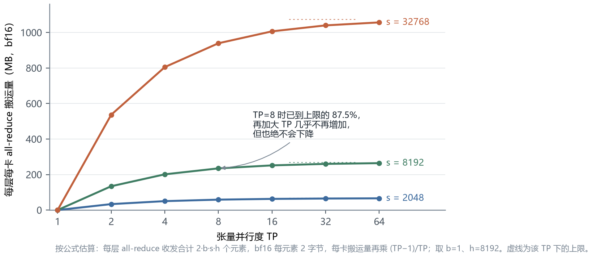

# 第 11 章　张量并行的切分与通信

## 11.1　MLP 的列并行与行并行

张量并行只有一条规则：切在输出维不通信，切在归约维要一次 all-reduce。一整层 MLP 就是这条规则用两遍。

一个 MLP 层有两个矩阵。第一个把 h 维升到 4h 维，第二个把 4h 维压回 h 维。h 是隐藏维，Llama 3 405B 的 h 是 16384，所以第一个矩阵是 16384 乘 65536。按 BF16 存，这一个矩阵就要 2.1 GB，第二个矩阵同样大。两层加起来 4.2 GB 权重，一张 80 GB 的 H100 放得下，但放完就剩不下多少给激活和优化器状态了。

把这一层的参数拆开看更清楚。MLP 是 2 乘 h 乘 4h，等于 8 乘 h 的平方，h 取 16384 时是 21.5 亿个参数。注意力是四个 h 乘 h 的投影，等于 4 乘 h 的平方，10.7 亿个参数。两者相加 32.2 亿，乘一百二十六层是 4057 亿，和 4050 亿这个总数对得上。也就是说每一层里三分之二的参数在 MLP，三分之一在注意力，做切分的时候两块都得切。

列并行切第一个矩阵，八卡各拿 16384 乘 8192 的一块。输入是完整的 h 维，每张卡算出一段 8192 维的中间结果，段与段之间没有依赖，所以这一步不需要任何通信。中间结果要过一次激活函数，GELU 或者 SwiGLU 都是逐元素运算，在本卡那 8192 维上直接做完，也不需要通信。这就是"切输出维不通信"。

行并行切第二个矩阵，八卡各拿 8192 乘 16384 的一块。输入正好是上一步本卡算出来的那 8192 维，输出是一份长度为 16384 的部分和。八份部分和加起来才是这一层的输出，于是需要一次 all-reduce。

反向的时候这条账要重算一遍。列并行的权重梯度是本卡局部算出来的，不需要通信，因为每个矩阵块对应的输入是完整的。但输出梯度只有本卡自己那 8192 维，要得到输入梯度就必须把八卡的贡献加起来，这里出现一次 all-reduce。行并行正好相反，输入的梯度是本卡局部的，权重的梯度也是本卡局部的，都不需要通信。

所以一层 MLP 的净代价是两次 all-reduce，一次在前向、一次在反向，位置正好卡在两种切法的交界处。这个结论可以直接背下来，因为它对注意力层同样成立，也对任何"先升维再降维"的结构成立。

现代模型常用的门控结构会把两个矩阵变成三个。门控分支和升维分支各是一个 h 乘 4h 的矩阵，两者逐元素相乘，再走原来的降维矩阵。结构变了，切法不变：两个升维矩阵都按列切，每个算出 4h 除以 p 的一段，在本卡上相乘，降维矩阵按行切，最后 all-reduce 一次。参数总量从 8 乘 h 的平方变成 12 乘 h 的平方，一层多了 50% 的权重和 50% 的计算，通信量一点没变。通信量只跟激活大小有关，这一点在这里体现得很清楚。

图 11-1 是这两次 all-reduce 在一层里的位置，以及传输量随并行度和序列长度的变化。

*图 11-1　张量并行通信量随并行度与序列长度的变化*

现场判断切得对不对，有个很快的办法。打开 trace，看 all-reduce 内核的前后是不是紧接着两个矩阵乘。如果一层里出现了四次以上的 all-reduce，多半是层归一化也被单独切了一刀却没和相邻算子合并，或者 dropout 的随机掩码被广播了一遍。多出来的那几次通信量不大，但每次都带固定延迟，层数一乘就是几百次，短序列时会明显拖步时。

## 11.2　注意力的多头切分

注意力天然可以多头切分。多头注意力的每个头独立算自己的 Q、K、V 和 softmax，头与头之间唯一的耦合是最后拼起来再做一次输出投影。于是把全部头按 p 等分，每张卡拿自己那份头，算完之后在本卡的维度上做输出投影的一部分，再 all-reduce 一次。结构和 MLP 完全一样，区别只在切分的维度是头而不是隐藏维。

切头的关键参数是每个头的维度 head_dim，它不随并行度变化。Llama 3 405B 的 h 是 16384，如果 head_dim 取 128，就有一百二十八个头，八卡各十六个，正好整除。这里有个硬约束，头的数量必须能被张量并行度整除，除不尽就得让某些卡多拿一个头，而这些卡的算力会被浪费，整个前向的耗时由最慢的那张卡决定。

更麻烦的是分组查询注意力。它让多个查询头共享一组键值头，键值头的数量远少于查询头。分组查询注意力的常见配置是键值头只有八个，这意味着张量并行度最多只能到八，超过八就得让多张卡复制同一份键值头。复制本身不致命，但它让这些卡在键值投影上白算一遍，显存也白占一份，而且反向的时候要处理"同一份键值头的梯度来自多个副本"的求和问题，那个求和是隐式的，出错时不会报错，只会让梯度悄悄变小。

所以一个 405B 级别的分组查询注意力模型，张量并行度的上限被键值头数量锁在八。这个上限和节点内八张卡恰好重合，工程上不是巧合。

复制带来的隐性成本体现在带宽上。键值投影的输入是完整的 h 维，输出只有键值头数乘 head_dim 那么多维。八张卡如果各复制一份，就有八倍的卡在做同样的运算，这部分的算力等于白扔。它不会报错，不会显存溢出，只会让模型算力利用率比理论值低几个点。查的时候把注意力那部分的浮点运算量单独算一遍，和总的比一下，差出来的就是这部分。

每卡承担的注意力浮点运算量随并行度线性下降。序列长度为 s，一个头算 Q 乘 K 转置是 2 乘 s 乘 s 乘 head_dim 次浮点运算，再乘一次 V 又一遍，所以前向一层是 4 乘 s 乘 s 乘 h。加上反向，按 6ND 那个惯例的三倍算，一层是 12 乘 s 乘 s 乘 h。并行度 p 一除，每卡是 12 乘 s 乘 s 乘 h 除以 p。

这一项和 s 的平方成正比，而 MLP 和投影那一项只和 s 成正比。s 取 8192 时，注意力这一项是 12 乘 8192 乘 8192 乘 16384，约 1.3 乘 10 的 13 次方。同一层按参数量算的部分是 6 乘 32.2 亿乘 8192，约 1.6 乘 10 的 14 次方，注意力只占 8%。s 涨到 32768，平方项涨十六倍变成 2.1 乘 10 的 14 次方，线性项只涨四倍到 6.3 乘 10 的 14 次方，注意力占到 33%。

这个换算解释了一件常见的事。同一个模型在 2K 序列上跑得好好的，换成 32K 就掉点，而显存和通信都没到上限。原因是计算结构变了，注意力成了主角，它的算术强度比矩阵乘低，性能自然掉。这时候加张量并行度帮助不大，该换的是注意力内核的分块策略。

## 11.3　每层通信量与激活大小的关系

现在把通信量写成公式。定义 b 为微批大小，s 为序列长度，h 为隐藏维，e 为每个元素的字节数，N 为参与 all-reduce 的卡数，也就是张量并行度。一层一次 all-reduce 的逻辑传输量是激活值本身的大小。

$$V_{\text{layer}} = 2 \times b \times s \times h \times e$$

前面那个 2 是前向一次、反向一次。之所以按激活大小算而不是按权重大小算，因为 all-reduce 发生在激活上，跟参数量没有关系。

ring 算法里每张卡实际发出的字节数还要乘一个系数，因为数据要绕环走一圈。

$$V_{\text{rank}} = \frac{N-1}{N} \times V_{\text{layer}}$$

N 等于 8 的时候这个系数是 0.875，N 等于 64 的时候是 0.984。并行度越大，系数越接近 1，ring 的效率损失越小，但总量在涨，所以不能指望提高并行度来解决通信问题。

代入 Llama 3 405B 的一组实际参数。b 取 1，s 取 8192，h 取 16384，e 取 2 字节。一次 all-reduce 是 8192 乘 16384 乘 2 再乘 2，等于 537 MB，也就是 268 MB 的激活前向反向各传一遍。一层两次，一百二十六层，再乘 0.875。

$$V_{\text{total}} = 0.875 \times 2 \times 126 \times 268\ \text{MB} \approx 59\ \text{GB}$$

59 GB 在一个微批里发出去。这个数字看起来很大，放到时间轴上就不吓人了。H100 的 NVLink 是 900 GB/s，59 GB 除以 900 GB/s 约等于 66 毫秒。同一个微批的计算量是 6 乘 4050 亿乘 8192 次浮点运算，除以八张卡再除以 989.4 TFLOPS 的峰值，满打满算是 2.5 秒，按 40% 的模型算力利用率算是 6.3 秒。通信只占 1%。

这是张量并行能用起来的根本原因。在节点内，激活的往返比算一次便宜一个数量级。

换成短序列，账就变了。s 取 1024，每层的激活降到 33.5 MB，全模型通信量降到 7.4 GB，时间 8 毫秒。计算时间也按比例降到 0.79 秒，比例似乎没变。但这里漏了一项固定开销。每次 all-reduce 都要启动内核、建握手、走一遍协议，即使消息只有几兆，也要几十微秒。一百二十六层乘两次是二百五十二次，按每次 30 微秒算是 7.6 毫秒。这一项不随 s 缩小，于是 s 越小它占比越大。s 降到 512 时带宽项只剩 4 毫秒，延迟项还是 7.6 毫秒，延迟反超带宽。

把三种序列长度摊在一起看。

| 序列长度 | 每层激活 | 全模型通信量 | NVLink 上耗时 | 计算耗时按 40% 估算 |
|---|---|---|---|---|
| 512 | 16.8 MB | 3.7 GB | 4 ms | 0.4 s |
| 8192 | 268 MB | 59 GB | 66 ms | 6.3 s |
| 32768 | 1.07 GB | 236 GB | 262 ms | 25 s |

表中第一行最能说明问题。3.7 GB 除以 900 GB/s 只要 4 毫秒，但二百五十二次集合通信的固定延迟就有 7.6 毫秒，实际耗时是带宽估算的两倍。判据很简单，一次 all-reduce 的字节数除以链路带宽，如果算出来小于 20 微秒，那这次通信是在等协议而不是等带宽。该做的是把几次小的 all-reduce 合成一次，或者干脆缩小并行度。

还有一个常被拿来对比的量，是 all-reduce 与 all-gather 加 reduce-scatter 的字节差。一次 all-reduce 走 2 乘 (N-1)/N 乘 S 的数据，一次 all-gather 加一次 reduce-scatter 合起来也是 2 乘 (N-1)/N 乘 S，单看这一对，字节数完全相同。区别在张量并行前向要一次 all-reduce、反向又要一次，两遍走下来是四倍；换成序列并行后前向一次 all-gather、反向一次 reduce-scatter，全层只走两倍。所以省的是显存，顺带把通信减半。

现场见到张量并行通信吃掉步时，症状很有特征。整卡利用率在 30% 到 60% 之间振荡，不是稳定的低，因为每层的计算段还是跑满了，只是段与段之间夹着等待。trace 上看到的是规整的锯齿，一层计算一段通信，周期固定。如果周期不固定，忽快忽慢，那就不是张量并行的问题，该去查 NCCL 的 channel 数和网卡的 PFC 计数。

反向还有一点容易被忽略。all-reduce 在反向里出现的位置比前向更靠前，因为它要等上游的激活梯度算完。如果重计算打开，反向会先重算一遍前向，再算梯度，all-reduce 就被推得更晚，与别的通信重叠的机会更少。所以开了重计算的配置，张量并行的通信更容易暴露在关键路径上。

## 11.4　序列并行为什么能省激活

上面算通信量的时候用了一个默认前提，每张卡上的激活都是完整的 s 乘 b 乘 h。这个前提只对一部分算子成立。

矩阵乘法的输出在张量并行下是被切开的，每张卡只有 8192 维。但层归一化、dropout、残差相加这些逐元素算子，输入必须是完整的 16384 维，因为归一化要在整个 h 维上求均值和方差。于是 all-reduce 之后，每张卡都持有一份完整的激活副本，八张卡存了八份同样的东西。

算一下这份冗余有多大。一层里有两个层归一化，每个的输入是 s 乘 b 乘 h，s 取 8192 时是 268 MB。两个就是 537 MB，一百二十六层是 67 GB。这还只是一份副本的开销，八张卡各存一份，全集群浪费掉的是 67 GB 乘 8。对 80 GB 的卡来说，67 GB 几乎等于没有余量放别的东西。

序列并行就是冲着这块冗余去的。既然逐元素算子在 h 维上要完整、在 s 维上完全独立，那就沿 s 维切。每张卡只保留 s 除以 p 的一段 token，归一化和 dropout 都只在自己那段上做，激活从 268 MB 降到 33.5 MB，省八倍。

代价是切法变了，通信语义也得跟着变。原来前向那次 all-reduce 是为了把行并行的部分和加起来，现在输出要按序列切开分给各卡，all-reduce 变成 all-gather 加一次重排。反向对应的那次 all-reduce 变成 reduce-scatter。三种操作的数据量不一样。

一次 all-reduce 的 ring 传输量是 2 乘 (N-1)/N 乘 S，S 是消息大小。all-gather 是 (N-1)/N 乘 S，reduce-scatter 也是 (N-1)/N 乘 S。两次 all-reduce 合起来是 4 乘 (N-1)/N 乘 S，而一次 all-gather 加一次 reduce-scatter 只有 2 乘 (N-1)/N 乘 S。**通信量正好减半，激活省八倍**，这是序列并行在工程上几乎无脑开启的原因。

它还有一个不明显的限制。序列并行要求序列长度能被张量并行度整除，因为切的是 token 维。s 取 8192、p 取 8 没问题，s 取 8191 就得分出长短不均的段，长短不均会让最长的那个 rank 成为瓶颈。变长序列训练里这个限制很麻烦，常见的做法是先把一个批里的样本打包成定长，再按定长切分。

它不是没有代价。all-gather 的输出在反向时要重新拼起来，这一步会有一个瞬时峰值，峰值大小等于一层完整激活，也就是 268 MB，比稳态的 33.5 MB 大八倍。显存规划如果按稳态算，跑到反向就会溢出。所以开序列并行的同时要确认重计算覆盖了哪些层，把峰值压回稳态附近。

另一个代价是它绑定了张量并行。序列并行只对已经有张量并行的模型有意义，因为要切的正是张量并行制造的副本。纯数据并行的模型里没有这些副本，开了也省不到东西。这也是为什么它总被说成"张量并行的补丁"而不是一种独立的并行维度。

图 11-1 的横轴如果换成序列长度，会看到一条直线，因为通信量里 s 是一次方。注意力本身是 s 的平方，所以序列越长，序列并行相对越划算，它压住的是线性膨胀的那部分显存开销。

## 11.5　TP 度与节点边界

张量并行度不该超过一台机器里的卡数，这不是经验，是带宽算出来的。

H100 的 NVLink 是 900 GB/s，InfiniBand NDR 单端口是 400 Gb/s，也就是 50 GB/s，一台机器八张网卡，聚合 400 GB/s。看起来差距只有两倍多，但 all-reduce 走的是每张卡自己那块网卡，单卡能用的跨机带宽就是 50 GB/s。900 除 50 等于 18，节点内比跨节点快十八倍。

把上面那个算例改成并行度十六，跨两台机器。每卡的 all-reduce 传输量是 15 除 16 再乘 268 MB 乘 2，等于 503 MB。走 50 GB/s 需要 10 毫秒。一层两次就是 20 毫秒，一百二十六层累计 2.5 秒。

同一份工作的计算时间，并行度翻倍后每卡只剩 1.25 秒的峰值时间，按 40% 的效率算是 3.1 秒。通信 2.5 秒，计算 3.1 秒，通信占了计算时间的八成。这一层怎么调都调不回来，因为 all-reduce 卡在关键路径上，前向的第二次不完成，下一层就没法开始。

真正麻烦的还不是带宽，是延迟。跨机一次 all-reduce 要经过网卡、交换机、光模块，光在光纤里每 100 米走 0.5 微秒，一个跨三层的集群单程就是几微秒。八卡跨两个节点做一次 all-reduce，实测往返加上协议处理，比节点内多出一到两个数量级。这个固定开销乘上每层两次乘一百二十六层，就是几百毫秒的纯等待，跟消息多大没关系。

所以张量并行度的选择不是优化问题，是约束问题。**能用节点内 NVLink 就用，跨了机基本判死刑**。Llama 3 405B 在 16384 张 H100 上用的是八路张量并行，正好一个节点，十六路流水并行乘一百二十八路数据并行，8 乘 16 乘 128 等于 16384。

现场见到过一种现象，步时在一万卡的任务里比一千卡还慢，配置只改了张量并行度从八到十六。检查 trace 会发现每次 all-reduce 的耗时从几十微秒跳到十几毫秒，而 SM 的利用率掉到个位数。这不是配置错，是物理约束被越过了。

有些集群会用 NVLink 交换机把节点连成一个更大的域，常见的做法是把一个机柜里的机器全连起来。这种结构能扩大张量并行的可用范围，但域内的对分带宽仍然低于节点内的全互联，而且域越大故障域越大，一个交换机端口出问题会影响整个域。真要跨节点做张量并行，先量一遍双向带宽和 all-reduce 的实际时延，别信标称值。

张量并行和流水并行一起用的时候，两者的边界要想清楚。流水并行把模型按层切开，每张卡只持有一段层；张量并行再把每段里的矩阵切开。两把刀是正交的，可以叠加，但叠出来的并行度受同一个约束，就是每张卡上的激活不能小到让 all-reduce 掉进延迟区。流水级数一多，每级的层数就少，总通信量跟着按比例下降，这一点对跨机部署反而有利。

## 11.6　TP 的常见性能陷阱

第一个陷阱是输出层的词表并行。词表大小 V 是 128256，最后一层要算 b 乘 s 乘 V 的 logits。s 取 8192 时这是十亿个元素，BF16 下 2.1 GB。词表并行把这 2.1 GB 按 V 切到八张卡，每卡算 16032 行，但交叉熵要在完整的 V 上做归一化，所以最后得把结果 gather 回来。这一层的通信量比前面一百二十六层加起来还大。处理办法是不真 gather，改成在切分维度上先算局部最大值和局部指数和，再做一次小的 all-reduce 合并，通信量从 b 乘 s 乘 V 降到 b 乘 s。

第二个陷阱是归约精度。混合精度训练里梯度通常用 FP32 做 all-reduce，因为 BF16 累加会丢低位。但激活的 all-reduce 用 FP32 就意味着通信量翻倍，前面那个 59 GB 变成 118 GB。张量并行的激活归约一般可以用 BF16，因为激活的数值范围比梯度温和，而且层归一化会重新定标。这一条要在数值判据下确认，不能一概而论，尤其 FP8 训练里激活的动态范围更窄。

第三个陷阱是 all-reduce 没有和计算重叠。数据并行的梯度 all-reduce 能藏在反向传播里，一层算完就发一层的梯度。张量并行的 all-reduce 藏不了，它是下一层的输入，天然落在关键路径上。能做的只有切块，把一次 268 MB 的 all-reduce 切成四块，第一块到了就开始下一层的第一个分块计算。收益取决于切块粒度和内核能否真正并行，切太碎反而被延迟吃掉，一般切四到八块就到头了。

第四个陷阱是通信组建立顺序和物理拓扑不匹配。张量并行的组必须落在同一个 NVLink 域内，如果 rank 编号和物理位置对不上，NCCL 建出来的环会绕出节点再绕回来，一次 all-reduce 就变成两次跨机。排布的时候让连续的 rank 落在同一台机器，是最省事也最省带宽的做法。

第五个陷阱是把张量并行当显存方案。它确实线性切了权重、梯度和优化器状态，但 4050 亿参数按每个参数十六字节算，除八之后每卡还要 810 GB，一张卡装不下。张量并行解决的是单层放不下的问题，整模型的显存要靠数据并行分片或流水并行来摊。把这两件事混在一起算，配置一定配不出来。

第六个陷阱是并行度和批大小同时调。张量并行度加倍、微批减半，看着通信量不变，实际上单次消息小了一半，延迟占比翻倍，步时反而变长。调参的时候一次只动一个维度，否则测出来的数据没有解释力。

想确认张量并行是不是瓶颈，有个两分钟的做法。把张量并行度从当前值减半，同时把数据并行度加倍，保持总卡数不变。如果步时明显下降，说明原来那档并行度的通信开销已经吃掉了计算收益；如果步时基本不变或者变慢，说明通信不是瓶颈，问题在别处。这个对照实验不需要改模型，只改启动参数，比读半天 profile 更快出结论。
