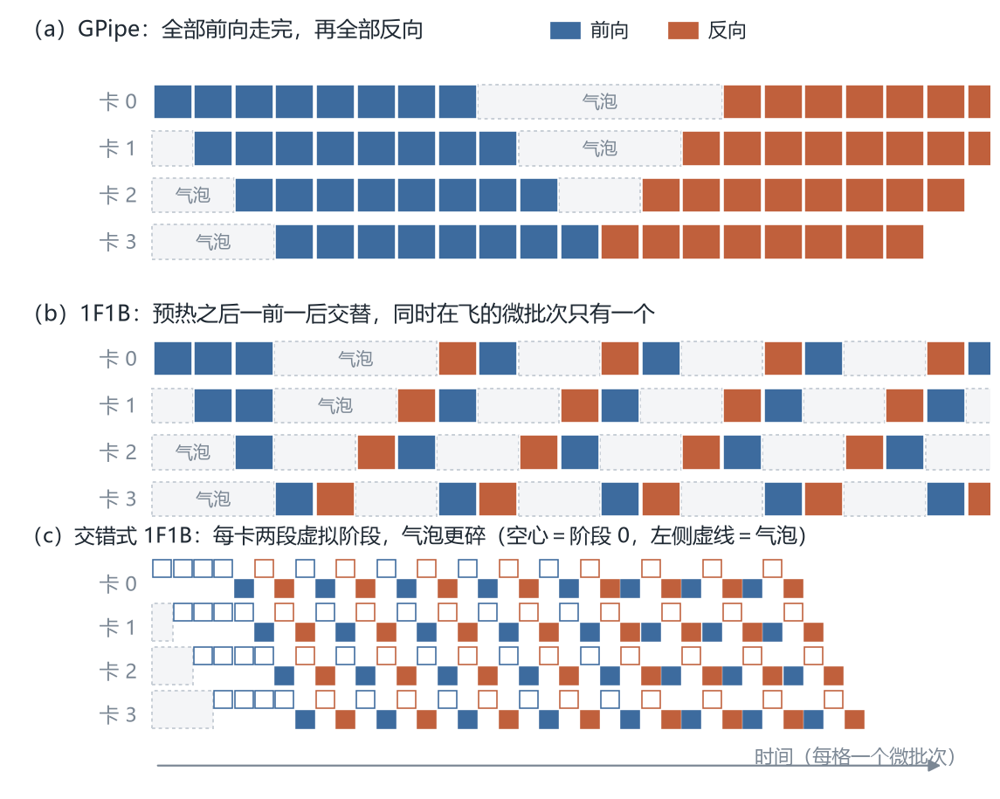

# 第 12 章　流水并行的调度与气泡

## 12.1　GPipe 的填谷与排空

流水并行把模型的层按顺序切到多张卡上。一张卡算完第一层，把激活发给下一张卡，下一张卡接着算，自己再去拿下一个微批的数据。问题是同一时刻只有一张卡在算同一个微批，剩下的 p 减 1 张都在等。要让它们都不闲，就得让 p 个不同的微批同时在流水线的不同段上，这就是把一个批切成微批、错峰送进去的全部动机。

GPipe 的做法最直白。把一个大批切成 m 个微批，先全部做完前向，再全部做反向。时间轴上会出现三段。开头是填谷，第 1 个微批从第一段走到最后一段，这期间陆续有卡加入工作，但始终有卡闲着。中间是稳态，所有卡都在忙。结尾是排空，最后几个微批逐段退出。

填谷和排空加起来占掉 p 减 1 个时间片，p 是流水级数。理想情况下 m 个微批各占一个时间片，总共 m 个。所以时间片总数是 m 加 p 减 1，其中 p 减 1 个是空的。这段空转就是气泡。

用 Llama 3 405B 的规模算一遍。模型 126 层，p 取 16，每段大约 8 层。序列长度 4096，微批大小 1，张量并行 8 路。每个 stage 的参数是 4050 亿除 16，约 253 亿。一个微批在这个 stage 上的计算量是 6 乘 253 亿乘 4096，约 6.2 乘 10 的 14 次方次浮点运算。摊到 8 张 H100 上是 7.8 乘 10 的 13 次方，除以 989.4 TFLOPS 的峰值是 79 毫秒，按 40% 的效率算是 197 毫秒。

所以一个时间片大约 0.2 秒。m 取 32，理想时间 6.3 秒，气泡 15 个时间片 3 秒，实际 9.3 秒。**三分之一的墙钟时间卡在等上面**，这就是流水并行的基本代价。

GPipe 还有个更贵的代价。它必须等所有微批的前向都做完才能开始反向，因为反向要按相反顺序走，而最后一个微批的前向还没结束时，第一个微批的激活已经在显存里躺了很久。m 个微批的激活同时在显存里，m 越大越吃不消。

台阶的高度可以算出来。32 个微批、每个一段八层的激活 1.07 GB，合计 34.2 GB，$k$ 取 3.5 时是 120 GB。同一个配置里权重只占 6.3 GB，台阶是权重的五倍。这是 GPipe 在 80 GB 卡上只能跑到十几个微批的原因，再往上加，激活就把卡填满了。

这个设计不是没想过改进，是当时的工程权衡。全部前向做完再统一反向，好处是每一层的激活只需要保存一次，反向遍历的时候按顺序取用，调度器很简单，不需要记录哪个微批走到了哪一段。代价就是把显存变成了瓶颈。想在 GPipe 上把气泡压到 10%，需要 9 倍于级数的微批，那些微批的激活全都要同时存在卡上，显存直接翻好几倍。

现场有一个很好认的特征。GPipe 的显存曲线是一个台阶，填谷阶段阶梯上升，排空阶段阶梯下降，台阶的高度就是 m 个微批的激活总量。看到这种形状，就知道跑的是 GPipe 而不是 1F1B。

段与段之间传的是整个激活张量，大小是 s 乘 b 乘 h 乘 e。序列 4096、隐藏维 16384、BF16，一个微批的跨段传输是 134 MB。p 取 16，每步有 15 个段边界，每边界传 m 次，m 取 32，总传输是 15 乘 32 乘 134 MB，约 64 GB。这个量和张量并行的 59 GB 是一个量级，但形状完全不同。它只跨一段，不需要全组归约，所以在拓扑上只要求相邻 rank 之间有带宽，不必是一个全互联域。序列换成 32768，单次跨段传输就是 1.07 GB，总量涨到 514 GB，交换机的尾延迟会被放大成实打实的步时。这时候该先算一笔账，看这段传输在不在关键路径上。

## 12.2　1F1B 的内存优势

1F1B 改的是顺序。一个微批的前向走到最后一个 stage，就立刻开始它的反向，不必等别的前向做完。稳态时每张卡上的动作变成前向一个、反向一个交替进行，名字就是这么来的。

图 12-1 是三种调度的时间线对比。

*图 12-1　GPipe、1F1B 与交错调度的时空对比*

这样改的直接后果是在飞的微批数量变了。GPipe 的在飞微批数是 m，因为所有前向都做完了才开始反向。1F1B 的在飞微批数是 p，因为反向往回走时，最多只有 p 个微批同时处在流水线的不同段上。m 取 32、p 取 16 时，在飞数从 32 降到 16，激活显存直接减半。

接着上一节的算例。一段 8 层，序列 4096，隐藏维 16384，BF16，一个微批的激活是 4096 乘 16384 乘 2，等于 134 MB 一层。八层是 1.07 GB。GPipe 的 32 个在飞微批要 34 GB，1F1B 的 16 个要 17 GB。80 GB 的卡上这 17 GB 是能接受的，34 GB 就未必，尤其还要放 6.3 GB 权重和优化器状态。

1F1B 的内存收益来自一个事实，气泡大小只跟前向的排布有关，反向排在哪里不影响气泡。既然反向可以往后挪，那就挪到最省显存的位置。这不是免费的性能优化，是把同一份气泡换一个形状。

代价在实现上。反向被拆散到稳态里，每个微批的权重梯度都得累加到一个缓冲区，直到所有微批的反向都做完才做优化器步。如果实现里忘了这一点，每个微批都更新一次权重，训练就会发散，而 loss 曲线看起来只是噪声大一点，很难归因。

调度上还有一段叫预热的阶段。1F1B 开始时要先连续做 p 个前向，把流水线填满，这一阶段只有前向没有反向，和 GPipe 一样是气泡。预热之后才进入一前一后的稳态，最后是排空，只剩反向没有前向可接。所以 1F1B 的气泡结构和 GPipe 是一样的，都是 p 减 1 个时间片，变的只是内存。这一点经常被搞反，以为 1F1B 连气泡也一起减了。

它比 GPipe 还多一个好处，反向的梯度可以更早开始归约。数据并行的梯度 all-reduce 可以按层触发，第一个微批的反向一算完，第一层的梯度就可以发出去，不用等整步结束。GPipe 做不到这一点，因为它的反向全部集中在后半段，梯度归约也被挤在那一段里，通信更容易暴露在关键路径上。

在飞数等于 $p$ 这件事值得推一遍。稳态里每个段都在忙，但它手里的微批一直在换。已经做完前向、还没轮到反向的微批会积在各个段上，它们的激活必须留在显存里。由于每段同时候着的微批不超过一个，整条线真正持有激活的微批最多 $p$ 个，$m$ 再大，多出来的只是排队长度。

1F1B 在 $m$ 小于 $p$ 时会退化。8 个微批配 16 级流水，稳态填不满，实际只有 8 个段在工作，另外 8 个段从头空到尾。公式给的 65.2% 还偏乐观，空转的段连预热都做不了。所以 $m$ 至少要等于 $p$，这是硬下限，比气泡目标更优先。

代价里还有一个不明显的项。1F1B 的每个 stage 上，前后向交替意味着权重的读带宽也被交替争抢。前向读权重、反向读同一份权重，两者粒度不同，缓存命中率比纯前向低。这个开销在小模型上能到几个点，大模型上因为计算量大反而被掩盖。

## 12.3　交错式 1F1B

交错式 1F1B 换了一把刀切层。原来第一段拿第 1 到 8 层，第二段拿第 9 到 16 层，依次往后。现在每张卡拿 v 个不连续的块，比如 v 取 2 时，第一张卡拿第 1 到 4 层和第 65 到 68 层，第二张卡拿第 5 到 8 层和第 69 到 72 层。

这样做的效果是让一个微批在流水线上来回走 v 轮。每走到一轮的末尾，就有一段更短的填谷和排空可以被别的微批填上。气泡总量不变，但被切成了 v 份，每份之间的空档能被利用。

气泡公式跟着改。原来是 p 减 1 除以 m 加 p 减 1，现在一个调度轮里可填的微批数是 v 乘 m。

$$\text{bubble}_{\text{interleaved}} = \frac{p-1}{v \times m + p - 1}$$

p 取 16、m 取 32、v 取 2，气泡是 15 除以 79，等于 19%。不交错是 32%，交错之后降到 19%，少了 40% 的等待。

代价有三个。第一个是通信量翻 v 倍，因为每个微批要多走 v 减 1 次段间点对点传输。第二个是每段只有 4 层，单次计算的时间片变短，内核启动和点对点握手这些固定开销占比上升。第三个是显存，每张卡持有 v 个不连续的层块，权重碎片化，参数缓冲区的对齐变差，实际可用的显存比理论值少一点。

工程上的经验是 v 取 2 通常划算，v 取 4 就要看具体规模了。m 越大，交错的收益越小，因为气泡本来就小，再切碎意义不大，反而多付通信。

通信代价可以算清楚。不交错时每张卡每步发 32 个 134 MB，4.3 GB，50 GB/s 下 86 毫秒；$v = 2$ 时翻倍到 8.6 GB，172 毫秒，占 6.3 秒计算的 3%。代价不大，但消息从 134 MB 碎成 67 MB，单次启动的固定开销占比翻倍，这才是短序列下交错式反而不划算的原因。

把层号具体排一遍会更清楚。126 层、p 取 16、v 取 2，一共 32 个层块，每块大约 4 层。第一张卡拿第 1 到 4 层和第 65 到 68 层，第二张卡拿第 5 到 8 层和第 69 到 72 层，依次往后到第十六张卡拿第 61 到 64 层和第 124 到 126 层。最后两块只有 3 层，因为 126 除 32 不是整数，30 个块各 4 层、2 个块各 3 层，正好 126。

这种不齐的后果比看上去严重。一个时间片的长度由最长的块决定，4 层的块和 2 层的块混在一起，短的块在等，等于把省下来的气泡又吐回去一部分。所以要交错就尽量让 p 乘 v 整除层数，126 能被 42 整除，p 取 21、v 取 2 是整齐的，但 21 级又不是一个常见的选择。工程上更常见的做法是接受微小的不均，把 v 的收益拿到手就行。

还有一个常被忽略的条件，交错式要求同一张卡上的多个层块共享一份权重缓冲，而反向传播时不同微批会在不同块上同时求导。如果实现里只给每卡分配一个梯度缓冲区，两个微批的梯度会互相覆盖。这类 bug 不会报错，只会让训练缓慢偏离，最后表现为 loss 比预期高几个百分点。

## 12.4　气泡公式与数值例子

把气泡写成比例，定义 p 为流水级数，m 为微批数。

$$\text{bubble} = \frac{p-1}{m+p-1}$$

分子的来源是填谷加排空共 p 减 1 个时间片。分母是总时间片数。这个式子只做加减除，但它的形状很说明问题：p 在分子分母里都是一次，m 只在分母里。所以**减小气泡只有两条路，加微批或者减级数**。

分子为什么是 p 减 1 而不是 p，有人觉得奇怪。第一个微批进入第一段时，后面 p 减 1 段确实都空着；最后一个微批离开最后一段时，前面 p 减 1 段也已经空了。两头各 p 减 1，但它们重叠不了，所以在时间轴上是一头一尾各占 p 减 1 个时间片，合起来是两倍的 p 减 1。而稳态有 m 个时间片，所以比例里分子是 p 减 1、分母是 m 加 p 减 1，不是两倍的分子。

几个常见组合的数值。

| 流水级数 p | 微批数 m | 气泡占比 |
|---|---|---|
| 4 | 8 | 27.3% |
| 8 | 8 | 46.7% |
| 8 | 32 | 17.9% |
| 16 | 32 | 31.9% |
| 16 | 64 | 19.0% |
| 32 | 128 | 19.5% |

表里第 2 行值得单独看。八级流水配八个微批，气泡 46.7%，接近一半的时间在等。这是小规模实验里最常见的配置，也是"流水并行不好用"这个印象的主要来源。同一批卡改成每级 32 个微批，气泡降到 17.9%，体感完全不同。

反过来推一个判据。想让气泡低于 10%，解不等式得到 m 至少要 9 倍的 p 再减 9，粗略说就是**微批数约为流水级数的九倍**。p 取 16 需要 135 个微批，p 取 8 需要 63 个。这个数在生产配置里经常达不到，所以 20% 到 30% 的气泡是常态。

还有一点容易算错。气泡比例是按时间片算的，而时间片等长这个假设只在各段层数相同、每层计算量相同时成立。126 层分 16 段除不尽，必定有的段 8 层、有的段 7 层。8 层那段的时间片比 7 层那段长 14%，整个流水线的节拍由最长的那段决定，实际气泡比公式算出来更大。

把这个偏差算出来。14 个段各 8 层加 2 个段各 7 层，总数正好 126。节拍是 8 层的时间，总时间片是 m 加 p 减 1 共 47 个，每个都是 8 层的长度。真正有效的计算量是 32 个微批乘平均 7.875 层。所以有效气泡是 1 减 32 乘 7.875 除以 47 乘 8，等于 1 减 252 除以 376，约 33%。公式给的是 31.9%，实际多了 1.1 个百分点。这不致命，但如果配置是勉强凑出来的，比如 7 个段 9 层加 9 个段 7 层，偏差会大到 8 个点以上。

这一点在现场很好认。把每张卡的忙闲画成甘特图，如果气泡的位置是固定的、每个周期都出现在同一段，那就是层数不均；如果气泡位置随机漂移，那是通信或者数据加载在抖。

trace 上定位气泡的步骤可以固定下来。先看每张卡的 SM 利用率曲线，找出连续低于五成的区间；再把这些区间对到时间轴上，看是否落在同一段的同一位置；最后核那个段的层数和单步耗时。三步下来，气泡是层数不均、通信等待还是数据加载，基本能分清。跳过前两步直接调参数，等于在猜。

## 12.5　零气泡的两阶段拆分

零气泡调度从一个观察出发。反向传播其实包含两件独立的事，一件是算这一层输入的梯度，用于传给上一层，另一件是算这一层权重的梯度，用于更新参数。前者必须在同一微批的更早层算完之前完成，后者只要在优化器步之前完成就行。

这个时间差就是可以利用的空间。把权重梯度往后排，让它填进气泡，输入梯度按原来的节奏走。稳态里原本空着的时间片被权重梯度的计算占满，气泡看起来消失了。

代价是显存。被推迟的权重梯度计算需要它对应的激活还在，等于把一部分激活的生命周期拉长了。所以零气泡不是无条件更快，它是用显存换时间。论文里的说法是在相同显存下比 1F1B 吞吐高最多 23%。这个数字是在给定显存预算下把推迟的层数调到最优得到的，不是白拿。

23% 听起来不如交错式，但要放到整体账里看。气泡占 32% 的配置，1F1B 的吞吐是理想的 68%。加上 23%，变成 84%。剩下 16% 是现代流水调度能拿到的上限附近，再往上就得靠减少级数或者增加微批。

还有一层现实约束。零气泡要求调度器精确知道每个 stage 的计算时间，才能算出该推迟几层。实际训练里计算时间随序列长度、数据分布波动，估错了就会出现"推迟的权重梯度算不完，优化器步被迫等"的情况，收益打折。所以它更适合计算时间稳定的大规模预训练，不适合变长序列的微调。

推迟的层数有一个上限，来自激活的寿命。一个段只有 8 层，权重梯度最多推迟到优化器步之前，也就是推迟量不超过一个微批的反向时长。按每片 196 毫秒算，能挪出来的计算量也就一两片。这解释了 23% 这个上限的来源，它同时被段内层数和激活存活期卡住，不是调度算法不够聪明。

能填多少也能估。零气泡把 9.2 秒压到 7.5 秒，省下 1.7 秒，按每片 196 毫秒算是 8.7 个时间片，占 15 个气泡片的六成。剩下四成填不上，因为可推迟的权重梯度受激活寿命限制。23% 这个数字不是把气泡全消掉，是把能消的那部分消掉。

实现上有三种常见路线。第一种是静态划分，把最后几个 stage 的权重梯度全部推到气泡里，简单但收益有限。第二种是按剩余时间动态决策，每个时间片开始前算一下这个空档能不能装下一个权重梯度，灵活但调度开销会上去。第三种是把前向也算进去做全局规划，理论上最优，实际很难调。开源实现里前两种居多。

风险在于数值。推迟权重梯度意味着这些层的激活不能被释放，而激活的释放时机和重计算又是耦合的。如果重计算的范围覆盖了被推迟的层，反向时激活已经没了，要么重新算一遍（多一次前向），要么直接报错。调零气泡的时候，先把重计算关掉跑一遍，确认调度逻辑对，再打开重计算按层对齐。

量收益的办法是看两个数。一个是每张卡的空闲时间占比，用 trace 里 SM 空闲的时长除以总时长；另一个是权重梯度计算的排队时长。零气泡生效时，第一个数下降，第二个数不变。第二个数涨了，说明推迟过头，该把层数调小。两个数都不变，说明瓶颈不在流水调度上，别在这里浪费时间了。

## 12.6　激活内存与微批次数

激活内存的估算要按 stage 算，不是按整个模型算。每张卡只持有自己那一段的层。

$$M_{\text{act}} = \frac{L}{p} \times s \times b \times h \times e \times k \times n_{\text{in-flight}}$$

L 是总层数，p 是流水级数，s 是序列长度，b 是微批大小，h 是隐藏维，e 是字节数，k 是每层存几份激活，n 是在飞微批数。

k 这个系数最容易被低估。一层里不只是存一份 h 维的输入，还要存注意力的 Q、K、V，存 softmax 的输出，存 MLP 的中间结果。保守估计 k 取 3 到 4。前面按 k 等于 1 算出来的 1.07 GB，实际可能是 3 到 4 GB。

把 3.5 代进去重算。一段 8 层，一微批 3.75 GB，1F1B 的在飞 16 个是 60 GB。这就装不下了，必须开重计算。重计算把 k 拉回 1 附近，代价是反向要多做一次前向，计算量多约三分之一。

一本完整的显存账长这样。权重每卡 6.3 GB，优化器状态按分片后每卡约 0.3 GB，梯度每卡 0.05 GB，激活 60 GB，再加上通信缓冲区、CUDA 上下文、碎片化预留，总共超过 70 GB。一张 80 GB 的卡上只剩不到 10 GB 余量，任何一次临时的显存峰值都能把它撞爆。开选择性重计算后激活降到 22 GB，总量落到 30 GB 左右，余量 50 GB，才算安全。

所以流水并行的显存和微批数是绑在一起的。不开重计算时，微批数受显存硬限制，气泡压不下去；开了重计算，微批数可以放开，但计算量上升。两条路都要算，没有默认答案。

这笔交换可以折成时间。前向占一次前反向总计算的三分之一，重计算多跑一遍前向，整体计算量涨三分之一，步时从 9.2 秒变 12.3 秒。用三分之一的步时换 38 GB 显存，等价于把微批从 16 加到 21 而不爆卡。划不划算取决于显存是不是硬约束，是就换，不是就别换。

图 12-1 里 1F1B 那条时间线如果把激活的存活区间画上去，会看到它们是一段一段错开的，峰值只出现在稳态的中间几个时刻。显存监控上看到的就是一条锯齿，锯齿顶端比平均值高出一大截。按平均值做容量规划，跑到第几十步就会溢出。

测微批数的上限有个经验步骤。固定其他参数，把 m 从当前值每次翻倍，看显存峰值和步时。步时会先降后升，先降是因为气泡在减，后升是因为激活挤占了可用的 L2 和寄存器，或者触发了显存分配器的碎片整理。拐点就是这组配置的上限。

这里还要对一次全局批。$m$ 从 32 提到 64，全局批从 32 乘 4096 乘 128 的 1677 万变成 3354 万，学习率要跟着放大，否则收敛变慢。反过来，学习率已经在上限时，$m$ 就加不上去，气泡也压不下来，能动的只剩 $p$ 和交错式。批大小、学习率、气泡三者绑在一起，单独调一个必然撞到另外两个。

## 12.7　调度参数怎么选

顺序是这样的。先定流水级数，再定微批数，最后校核全局批大小。

流水级数受三层约束。第一层是显存，p 越大每张卡上的层越少，权重越省，但激活的在飞数按 p 增长，不是单调变好。第二层是层数整除，126 层除以 16 余 14，必定有不均。第三层是气泡，p 越大气泡越大，需要更多微批来补。三条约束里最硬的是第二条，因为另外两条可以用微批和重计算去调，层数不均匀只能靠选别的 p 来避。

126 层的因数是 1、2、3、6、7、9、14、18、21、42、63、126。想要整齐切分，p 只能从这里面挑。实际配置里 p 取 16 需要不均匀切分，一般是 14 段各 8 层加 2 段各 7 层，或者反过来让前几段多一层。不均匀的直接后果是节拍被最长的段拉长，等于凭空多了 1 除以 8 的气泡。

微批数由气泡目标和全局批大小夹出来。气泡目标 20% 对应 m 约 4 倍的 p，10% 对应 9 倍。全局批大小是 m 乘 b 乘 s 乘数据并行度，这个数要和学习率、训练 token 总量一起看。Llama 3 405B 用 16384 张卡，数据并行 128 路，如果 m 取 32、b 取 1、s 取 4096，全局批是 32 乘 4096 乘 128，约 1677 万 token 一步。这个批量偏大，通常会把 m 降下来或者让多个数据并行组共享一个流水组。

现场症状对照。

步时周期性抖动，每隔几个微批慢一次，多半是某个 stage 层数多一层，或者那一段的显存压力大导致重计算被触发。

训练第一步就显存溢出，后面反而正常，是填谷阶段的峰值。填谷时同时有多个微批处在不同段上，显存占用比稳态高，容量规划要按峰值算。

点对点通信超时，NCCL 报 watchdog 超时，通常是某个 stage 计算时间远超其他段，等待方的接收缓冲超时。查法是打印每个 stage 的单步耗时，看方差。

吞吐上不去但每张卡利用率都在 90% 以上，这说明气泡不在卡内而在卡间，是段与段之间的等待，也就是调度本身的开销。这时候该看交错式或者零气泡，而不是继续调内核。

一个能跑的配置长这样。16384 张卡，张量并行 8，流水并行 16，数据并行 128，微批 1，序列 4096，微批数 32，选择性重计算全开，不开交错式。按上面的账，气泡 32%，重计算多算三分之一，实际模型算力利用率就是 40% 乘 0.68 再乘 0.75，约 20%。这个数字比公开的 38% 到 43% 低不少，差距主要来自重计算和气泡这两项，公开配置的序列更长、微批更多、气泡更小。把微批数抬到 128，气泡降到 10%，利用率能回到 30% 以上，代价是显存要多装四倍的激活，只能靠缩短序列或者再加一级流水来换。

## 12.8　四种调度的时空对比

把 12.1 到 12.5 的账放到同一张表里，参数固定为 126 层、$p = 16$、每段 8 层、序列 4096、微批 1，一个八层时间片 196 毫秒，四层时间片 98 毫秒。

| 调度 | 微批数 | 片长 | 总片数 | 气泡 | 在飞微批 | 步时 |
|---|---|---|---|---|---|---|
| GPipe | 32 | 8 层 | 47 | 31.9% | 32 | 9.2 秒 |
| 1F1B | 32 | 8 层 | 47 | 31.9% | 16 | 9.2 秒 |
| 交错式，$v = 2$ | 32 | 4 层 | 79 | 19.0% | 16 | 7.7 秒 |
| 1F1B | 64 | 8 层 | 79 | 19.0% | 16 | 15.5 秒 |
| 零气泡 | 32 | 8 层 | 47 | 接近零 | 16 加推迟 | 7.5 秒 |

第一行和第二行的步时完全一样，9.2 秒。这是最常见的一个误解，以为 1F1B 比 GPipe 快。它不快，它只是省显存，把在飞微批从 32 降到 16，激活从 34 GB 降到 17 GB。真正的加速来自第三行和第五行。

第三行值得细看。它用同样的 32 个微批，把每段切成了两块四层，于是时间片变短、片数变多，气泡比例降到 19%，步时 7.7 秒，比 1F1B 快 16%。代价是点对点通信从 480 次变成 960 次，每次的消息还是 134 MB。

第四行是拿微批换气泡的标准做法。1F1B 想到 19% 需要 64 个微批，步时 15.5 秒，但它处理的 token 是第三行的两倍。按每个微批的耗时算，第三行 0.24 秒，第四行 0.24 秒，两者吞吐一样。所以交错式的好处不是让每一片更快，而是让你在微批数被全局批大小锁住的时候，还能把气泡压下来。

第五行是上限。23% 的吞吐提升把 9.2 秒压到 7.5 秒，和交错式 v 取 2 差不多，但它的显存要多一点，因为被推迟的权重梯度需要激活还活着。表里这个 7.5 秒是按比例推的，不是实测值。序列越长、段内层数越多，越接近这个上限；短序列时计算时间抖动大，调度器的估算容易失准，收益会掉到 10% 以下。

## 12.9　气泡公式的数值表

12.4 的公式扫一遍 $p$ 和 $m$，形状一眼就能看出来。

| 流水级数 | $m = 8$ | $m = 16$ | $m = 32$ | $m = 64$ | $m = 128$ | $m = 256$ |
|---|---|---|---|---|---|---|
| 4 | 27.3% | 15.8% | 8.6% | 4.5% | 2.3% | 1.2% |
| 8 | 46.7% | 30.4% | 17.9% | 9.9% | 5.2% | 2.7% |
| 16 | 65.2% | 48.4% | 31.9% | 19.0% | 10.5% | 5.5% |
| 32 | 79.5% | 66.0% | 49.2% | 32.6% | 19.5% | 10.8% |
| 64 | 88.7% | 79.7% | 66.3% | 49.6% | 33.0% | 19.7% |

横向看，$m$ 每翻一倍，气泡大约减半。纵向看，$p$ 翻倍而 $m$ 不变时，气泡从 31.9% 跳到 49.2%，几乎按级数线性恶化。这两个方向不对称，是因为 $p$ 只出现在分子，$m$ 只出现在分母，而两者差一个常数项。

表里有一片区域是禁区，左上角那几格。$p$ 为 64、$m$ 为 8 时气泡 88.7%，等于十份算力只用到一份。这种配置在小规模实验里很常见，因为实验想复现生产的并行度，又拿不出那么大的批。看到 80% 以上的气泡，第一步该做的是减 $p$，不是加 $m$。

再用一个整除的级数验一遍。126 层能被 21 整除，取 $p = 21$、每段 6 层时，$m$ 为 32 的气泡是 20 除以 51，39.2%；$m$ 为 64 是 20 除以 83，24.1%；$m$ 为 128 是 20 除以 147，13.6%。同样要到 20% 以下，21 级至少需要 80 个微批，16 级只要 60 个。级数少三成，微批也少三成，两者是同一个比例。

反推同样有用。如果全局批只能给到 $m = 32$，想让气泡低于 10%，$p$ 的上限就是 32 加 9 除以 9，约 4.5，只能取 4。这个上限往往比显存允许的级数小得多，流水并行经常是被批大小卡住的，不是被显存。

## 12.10　微批次数与激活内存

气泡和显存都在 $m$ 上做文章，两者的关系不是单调的。

| $m$ | 在飞微批 | 激活（$k = 1$） | 激活（$k = 3.5$） | 开重计算后 | 步时 |
|---|---|---|---|---|---|
| 8 | 8 | 8.6 GB | 30 GB | 11 GB | 4.5 秒 |
| 16 | 16 | 17.2 GB | 60 GB | 22 GB | 6.1 秒 |
| 32 | 16 | 17.2 GB | 60 GB | 22 GB | 9.2 秒 |
| 64 | 16 | 17.2 GB | 60 GB | 22 GB | 15.5 秒 |
| 128 | 16 | 17.2 GB | 60 GB | 22 GB | 28.0 秒 |

第三列到第五列从 $m = 16$ 起就不动了，因为 1F1B 的在飞微批数等于流水级数，$m$ 超过 16 之后多出来的微批在排队，不在显存里。这正是 1F1B 的价值，加微批只花时间不花显存。

$m = 8$ 那一行是另一种极端。显存省了一半，但气泡 65.2%，步时只有 4.5 秒是因为它处理的 token 少。按每个微批的耗时算，$m = 8$ 是 0.56 秒，$m = 32$ 是 0.29 秒，前者贵了一倍。省下来的 30 GB 显存，换掉的是 65.2% 的气泡，除非显存真的到了墙，这笔交换不划算。

第二列和第三列之间的差距要按 $k$ 算清楚。$k$ 取 1 是理论值，$k$ 取 3.5 是加了 Q、K、V、softmax、MLP 中间结果之后的实测估算。同一个配置从 17 GB 变成 60 GB，80 GB 的卡直接爆掉。开选择性重计算把 $k$ 拉回 1.3 附近，22 GB，加上权重和优化器状态 7 GB，总量 29 GB，余量五十 GB，这才是能长期跑的配置。

所以 $m$ 的选择不是求极值，是先撞到哪面墙的问题。显存墙在 $m$ 还没到级数时就已经很近，$k$ 取 3.5、$m = 16$ 就是 60 GB，加权重 67 GB，再往上就爆。气泡墙则卡在 $m$ 小于四倍级数的地方。两边一夹，可用的区间比想象中窄。

序列和微批还可以互换。把序列从 4096 减半到 2048、微批翻倍到 64，总 token 不变，气泡按 $m = 64$ 算是 19.0% 而不是 31.9%，激活因为每个微批减半而从 60 GB 掉到 30 GB。同一份数据、同一批卡，只把切法改成多批短序列，气泡和显存同时改善。限制在注意力这一项，序列太短时它的算术强度下降，效率会掉，这个互换只在 2K 以上好用。

## 12.11　调度参数的选择与常见错误

选择顺序和 12.7 一样，只是每一步都能对应到具体的数。

| 步骤 | 定什么 | 主要约束 | 判据 |
|---|---|---|---|
| 1 | 流水级数 | 层数整除 | 优先取 126 的因数，1、2、3、6、7、9、14、18、21、42 |
| 2 | 每段层数差 | 节拍被最长段拉长 | 差一层就多 1/8 的气泡 |
| 3 | 微批数 | 气泡目标和全局批 | 20% 对应 $m \approx 4p$，10% 对应 $9p$ |
| 4 | 是否开重计算 | 激活是否装得下 | $k$ 从 3.5 降到 1.3 换 22 GB |
| 5 | 是否交错 | 通信次数与段长 | $v = 2$ 通常划算，$v = 4$ 要看规模 |

第一步的因数清单值得记下来。126 的因数里，实际能用的是 6、7、9、14、18、21，再大就超过节点数了。$p = 16$ 不在清单里，所以 4050 亿这个模型从一开始就注定有层数不均，只能用 14 段 8 层加 2 段 7 层去凑。

错误清单比参数清单更常用。

| 常见错误 | 现象 | 原因 | 处置 |
|---|---|---|---|
| 每个微批都做优化器步 | loss 噪声大且缓慢偏离 | 梯度没累积 | 累积到缓冲区，全部反向后统一步 |
| 改 $m$ 没改学习率 | 步时正常但收敛变差 | 等效批变了 | 按 token 数重算 |
| 层数不均 | 气泡固定在每个周期的同一位置 | 除不尽 | 换 $p$，或接受节拍 |
| 按稳态规划容量 | 第一步就 OOM，之后正常 | 填谷阶段在飞数更高 | 容量按填谷峰值算 |
| 交错式梯度互相覆盖 | loss 比预期高几个点 | 每卡只有一个梯度缓冲 | 按层块分别分配 |
| 点对点顺序不匹配 | 卡在某一步不动 | send 与 recv 对不上 | 用批量收发接口，成对提交 |
| 零气泡叠加重计算 | 反向报激活缺失 | 推迟的层被重算覆盖 | 先关重计算验证调度 |

第一条和第七条是最容易犯的，因为它们都不报错。第一条表现为 loss 曲线只是毛躁一点，跑几千步才发现收敛慢；第七条表现为训练直接崩在反向，而错误信息指向显存而不是调度。

第三条的判据很直观。把每张卡的忙闲画成甘特图，气泡如果每次都在同一个位置出现，就是层数不均；位置随机漂移，才是通信或数据加载在抖。这两种情况的处置完全相反，前者要换 $p$，后者要查网络。

## 12.12　流水并行的扩展效率

流水并行加卡的效果常被高估，因为大家习惯按"级数翻倍、时间减半"去估。实际不是，气泡会跟着涨。

固定微批数 32、层数 126，只改流水级数。每步时间近似为时间片数乘每段层数，忽略通信和固定开销。

| 流水级数 | 每段层数 | 总片数 | 相对步时 | 加速比 | 扩展效率 |
|---|---|---|---|---|---|
| 8 | 15.75 | 39 | 1.00 | 1.00 | 82.0% |
| 16 | 7.88 | 47 | 0.60 | 1.66 | 68.1% |
| 21 | 6 | 52 | 0.51 | 1.97 | 61.5% |
| 32 | 3.94 | 63 | 0.40 | 2.48 | 50.8% |
| 64 | 1.97 | 95 | 0.30 | 3.28 | 33.7% |

级数从 8 翻到 16，卡数翻倍，时间只降到六成，加速比 1.66。再翻到 32，加速比 2.48，离 4 差得很远。到 64，八倍卡换 3.28 倍速度，扩展效率只剩三成。

原因就是表里那两列。片数从 39 涨到 95，而每片只从 15.75 层缩到 1.97 层，乘积的下降速度被片数的增长抵掉了一大半。级数越大，气泡在总时间里的份额越高，这是流水并行最反直觉的地方，加卡本身就在制造气泡。

21 级这一行值得单独看。126 除 21 是 6，整除，没有层数不均，所以 61.5% 这个数是按纯气泡算的，不会再被打折扣。同样是二十级上下的 20 级、22 级除不尽，节拍会被最长段拉长，实际效率还得再低几个点。这也是 12.11 把因数清单放在第一步的原因。

这张表还有一个前提，每级的算力相同。真实的集群里各级共享同一批网卡，级数越多，跨段传输的跳数越多，端到端的抖动越大。表里的扩展效率是上限，实测通常再低几个点。

反过来说，这条曲线给出了流水并行该用到什么程度。扩展到 16 级还有 68% 的效率，32 级掉到 51%，通常到 32 级就该停了，再往上不如把卡给数据并行。数据并行的弱扩展效率接近水平，流水并行的效率是往下掉的，两者的取舍点大概就在两倍到四倍级数之间。

把这个结论代回 4050 亿的配置。16384 张卡用 16 级流水，每级 8 层，TP 为 8，DP 为 128。如果改成 32 级流水，每级 4 层，DP 降到 64，扩展效率从 68% 掉到 51%，同时每卡权重从 50.6 GB 降到 25.3 GB。多出来的 25 GB 显存换掉 17 个点的效率，只有在显存真的卡住时才值得。

同一批卡还有一条更省事的路。$p = 16$ 不动，把微批从 32 加到 128，工作量翻四倍，时间只从 47 片涨到 143 片，是 3.04 倍，扩展效率从 68.1% 升到 89.5%。加微批不花钱，加级数要花卡，两条路的性价比差得很远。所以流水并行调优的第一动作永远是加微批，加到显存或全局批为止，实在加不动了才去动级数。

表里还没算一项固定开销。级数越多，每段的权重越少，但梯度缓冲、优化器切片的分配与同步都要每段各做一遍，这部分不随层数缩。它占比不大，但会让真实曲线比表里更陡，尤其在小模型上。
