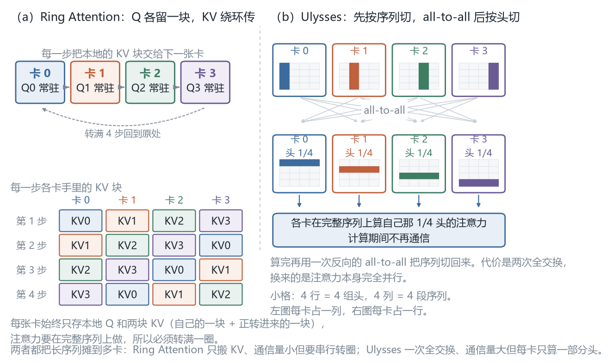

# 第 13 章　序列并行与上下文并行

## 13.1　长序列为什么需要新切法

序列长度从 8192 涨到 131072，看起来只是把数字乘了十六。实际的代价不是十六倍。

先看激活。一层里和隐藏维有关的激活是 s 乘 b 乘 h，s 翻十六倍，激活就翻十六倍。一个微批在 8192 上占 268 MB，到 131072 上就是 4.3 GB，一百二十六层是 540 GB。这个量级已经不是调参能解决的了。

再看注意力。注意力的浮点运算是 12 乘 s 的平方乘 h，s 翻十六倍，这一项翻二百五十六倍。8192 时注意力只占一层的 8%，131072 时它占 57%，成了主角。所以长序列不是"同样的活干久一点"，是换了一种计算结构。

最直接的约束来自键值缓存。分组查询注意力下每个 token 每层要存 K 和 V，按键值头八个、头维 128 算，BF16 下两个张量加起来是 2 乘 8 乘 128 乘 2 等于 4096 字节，也就是 4 KB。序列 131072 时一层是 537 MB，一百二十六层是 67 GB。这只是一个样本、一层都不分片时的总量，训练时还要存注意力的中间量，只会更多。

把这两项摊到卡上。67 GB 的键值按头和层切到八张卡，每卡 8.4 GB；540 GB 的激活按流水十六级切，每卡 34 GB。看着还能装，但 34 GB 是 k 等于 1 的乐观估计，真实一层要存三四份中间量，激活翻到 119 GB，80 GB 的卡直接没戏。

有人会问能不能把键值换到主机内存。可以，但代价是每次注意力都要跨 PCIe 取一遍。PCIe 5.0 单向上行是 64 GB/s，比 HBM 的 3.35 TB/s 慢五十倍。一层 537 MB 的键值来回一次就是十几毫秒，一百二十六层下来一秒多，而这只是一步里的搬运，跟计算一点关系都没有。所以 offload 只能当应急手段，不能当长上下文的主路。

推理和训练在这里的账不一样。推理只要存当前的键值，可以按需增长；训练还要存反向用的激活和 softmax 的中间量，量级再翻一番。所以推理能跑 128K 的配置，直接拿来训练往往显存不够，这不是实现问题，是两件事。

所以必须切。问题是切哪一维。

张量并行切头，可键值头只有八个，切到八就到底了，再切就得复制。流水并行切层，对单条超长序列没有帮助，因为一层内的序列长度没变，激活照样放不下。数据并行切批，可是一条 131072 的序列本身就是一个批，没有第二批可切。

剩下的一维就是序列本身。把 131072 个 token 切成八段，每张卡拿 16384 个，激活和键值都降到八分之一。这一步是唯一的选择，区别只在切完之后怎么算注意力。

切法有两条路。一条是只切逐元素算子，矩阵乘和注意力的切分照旧，这条路叫序列并行，上一章已经讲过它的显存收益。另一条是把注意力本身也切开，让每张卡只算一段查询、同时需要看到全部键值，这条路叫上下文并行。两条路的切分对象不同，解决的不是同一个问题。

这条路线在 2023 年之后才变常见，因为之前的模型大多停在 4K 到 8K。在那个长度上，一张卡能装下整个微批的激活，切序列的收益不明显，反而多一层通信。到了 32K 开始不切就放不下，到了 128K 切得不好也放不下。长上下文能力实际上是被显存和计算时间逼出来的，不是模型结构自然演化的结果。

图 13-1 是两种上下文并行的切分方式和数据流。

*图 13-1　ring attention 与 Ulysses 的切分方式*

## 13.2　序列并行与 TP 的配合

序列并行容易被误解成一种独立的并行维度。它不是。它没有自己的通信组，也不能单独打开，因为它切的是张量并行制造出来的副本。没有张量并行，就没有那些副本，切了也省不到东西。

这一点在配置上体现得很清楚。你把张量并行度设成 1，序列并行开关打开也不会有任何效果，因为每张卡上本来就只有一份完整的激活，没有第八份可以省。它是一张贴在张量并行上的补丁，作用是把层归一化、dropout、残差加法这些逐元素算子的输入沿序列切开，让每张卡只保留自己那段。

上下文并行才是独立维度。它有自己的通信组，可以单独配置，切的对象是查询和键值，切完以后每张卡算的是一段序列上的注意力，而不是一整层的逐元素运算。

两者的收益不在一个地方。序列并行省的是重复存储，前面那个 67 GB 的副本，切完变成 8.4 GB。上下文并行省的是键值本身，67 GB 的键值切八份，每卡 8.4 GB。数字看起来一样，来源完全不同，一个是把八份相同的东西变成一份，一个是把一份东西分成八份。

实际配置里两者经常一起用。一个节点八张卡，张量并行取八，序列并行跟着打开，逐元素算子的激活按序列切，通信从两次 all-reduce 换成一次 all-gather 加一次 reduce-scatter。这时候八张卡的 NVLink 域已经被张量并行占满了，上下文并行放不进去。

想同时要长序列的上下文并行，就得让出张量并行的位置。常见的做法是张量并行降到四，上下文并行取二，八张卡刚好用完。代价是张量并行的通信量翻倍，收益是序列能长一倍。这笔账要按具体模型的头数和序列长度算，没有通用答案。

还有一条容易被忽略的约束。序列并行的切分必须在所有参与算子的地方保持一致，也就是说层归一化的切法、残差的切法、dropout 的随机种子都要按同一段序列对齐。实现里最容易错的是残差，因为残差需要把张量并行的输出和原始输入相加，而这两份数据的布局在序列并行下不同，少了一次重排就会算出错误的结果。这个错误不会崩，只会让训练慢慢变差。

表里是三种组合在 131072 序列上的显存对比，模型按 405B 算，批量为一。

| 配置 | 权重每卡 | 逐元素激活每卡 | 键值每卡 | 合计 |
|---|---|---|---|---|
| TP8 PP16，不开序列并行 | 6.3 GB | 119 GB | 8.4 GB | 134 GB 装不下 |
| TP8 PP16，开序列并行 | 6.3 GB | 15 GB | 8.4 GB | 30 GB 装得下 |
| TP4 PP16 CP2，开序列并行 | 12.6 GB | 30 GB | 4.2 GB | 47 GB 装得下 |

第三行才勉强能跑。这张表说明一件事，长序列训练的显存瓶颈不在权重，在激活和键值。降激活靠序列并行和重计算，降键值靠上下文并行，两个是不同的事情。

## 13.3　ring attention 的逐块传递

ring attention 的思路很朴素。既然每张卡只算一段查询，而这段查询需要和全部键值做注意力，那就让键值在卡之间转圈。

具体过程是这样的。八张卡排成一个环，每张卡持有自己那段 16384 个 token 的查询、键、值。第一轮，每张卡用本地的查询和本地的键值算一份局部的注意力输出。第二轮，每张卡把键值块传给下一张卡，同时收到上一张卡的键值块，再用新的键值块算一份局部输出。八轮之后，每张卡的查询和全部八段键值都算过了。

关键是这个累加怎么做。普通的注意力要先算出完整的 s 乘 s 分数矩阵再 softmax，那需要 131072 乘 131072 个元素，17 亿个，放不下。ring attention 用的是在线 softmax，每算完一段键值就更新一次当前的输出和归一化因子。它的做法是维护一个运行最大值，新来一段就算新的局部最大值，用它重新缩放之前累加的输出，再加上新的一段。

这个技巧每个 FlashAttention 内核都在用，ring attention 只是把它跨卡用了一遍。好处是每段键值的处理都是独立的，输出只依赖一个固定大小的累加器，不需要保存历史。

把一轮的时序拆开看。计算是查询块的分数、softmax、输出累乘，通信是把本卡的键值块发给下一张卡。如果这两件事发在不同的流上，发数据的 CUDA 内核和算分数的内核可以同时跑。八轮里除了第一轮要等第一次收到数据，后面七轮都能这样重叠。所以 ring attention 的有效通信时间不是 66 毫秒，而是 66 毫秒减去被覆盖的部分，理想情况下接近零。前提是要有至少两块的缓冲，一块在算、一块在传。缓冲不够时，第二轮就要等第一轮的传输完成，重叠彻底失效。

通信量的算法是这样。每卡每层要把自己的键值块发出去七次，每次发 537 MB 除以 8 等于 67 MB，七次是 470 MB。这个数还可以写成 (P-1)/P 乘键值总量，P 取 8 时是 0.875 乘 537 MB。

一层 470 MB，一百二十六层是 59 GB。放在 NVLink 上，59 GB 除以 900 GB/s 是 66 毫秒。放在 InfiniBand 上，59 GB 除以 50 GB/s 是 1.2 秒。

这两个数差了十八倍，直接决定了 ring attention 能不能跨机。如果计算时间大于通信时间，通信可以完全藏在计算后面，代价为零。一层在 131072 序列上的注意力计算是 3.4 乘 10 的 15 次方次浮点运算，八张卡分摊后每卡 4.2 乘 10 的 14 次方，除以 989.4 TFLOPS 是 0.43 秒，按 40% 的效率算是 1.07 秒。66 毫秒的通信只占 6%，完全可以藏住；1.2 秒的通信和计算一样长，藏不住，必须严格重叠才有收益。

所以 ring attention 的部署原则只有一条，**尽可能放在 NVLink 域内**。跨机的 ring 不是不能跑，是每一层多出来的 1.2 秒会把二十倍的算力优势抹平。

块的大小是可以调的。一种做法是一轮传完整的一段键值，67 MB，次数少、延迟摊得薄；另一种是把每段再细分成若干块，一轮传几兆，重叠更细、缓冲更小。粗粒度的问题是第一块到达之前无法开工，细粒度的问题是小报文变多、有效带宽下降。实测的拐点通常在单块一到两兆，再细就不划算了。

还有一处可以省一半。因果语言模型的注意力是下三角的，第 i 段查询只需要看第 1 到 i 段的键值，后面的段完全被掩码掉。所以环上第一步，只有最后一张卡的查询需要全部键值，第一张卡的查询只需要自己那一段。如果调度器知道这一点，前半圈的计算量可以砍掉一半，通信也可以少发。实现上这一步经常被漏掉，表现为长序列训练的算力利用率只有理论值的一半左右。查的办法是把序列长度从 32K 翻到 64K、128K，看步时是不是按四倍涨。如果按四倍涨，说明平方项在主导，掩码的优化没生效；如果只按两倍多涨，说明优化已经在起作用了。

## 13.4　Ulysses 的切分方式

Ulysses 换了切的维度。ring attention 切序列、保留完整的头，Ulysses 先用两次 all-to-all 把数据布局换过来，切成头，再算注意力。

第一层布局是每张卡持有一段序列的全部隐藏维，形状是 s 除以 P 乘 h。第二层布局是每张卡持有全部序列的一部分头，形状是 s 乘 h 除以 P。两种布局的元素总数一样，只是从"按行切"变成"按列切"，这正是 all-to-all 干的事。

换过去之后，每张卡上的注意力是完整的 s 乘 s，但只有 h 除以 P 那么多个头。这一步的好处是注意力可以在单卡上完整地算，不需要跨卡累加，可以直接用现成的 FlashAttention 内核。算完输出再 all-to-all 换回按序列切的布局，供后续的 MLP 使用。

这里有个硬约束，头数必须能被并行度整除。一百二十八个头、P 取八，每卡十六个，正好。分组查询注意力的模型如果只有八个键值头，按头切就要把查询头和键值头分开处理，查询头切八份、键值头不切而是广播，这时 all-to-all 只对查询做，键值那一侧变成 all-gather。实现上这是两种不同的通信原语，混在一起很容易把通信量算错一倍。

头数不能被并行度整除时，工程上有两种收场。一种是把头补齐到最近的整数倍，多出来的头用零填充，算完再丢掉，浪费一点算力但切分整齐；另一种是让几张卡分别多担一个头，各卡的头数差一，节拍由最多的那张卡决定。补齐的内核简单，多担的显存省一点，小模型上两种差别不大，到了上百层乘上每一步的重复次数，节拍差的那百分之几会稳定地留在步时里。

通信量比 ring 大。每卡每层要发两次 all-to-all，一次换查询，一次换输出。每次的量是 (P-1)/P 乘 s 除以 P 乘 h 乘 e，P 取 8、s 取 131072、h 取 16384、e 取 2 时，是 0.875 乘 16384 乘 16384 乘 2，等于 470 MB。两次就是 940 MB，比 ring 的 470 MB 大一倍。一百二十六层是 118 GB。

但这笔账里有个变量。ring 的通信量只和键值大小有关，与并行度无关，因为总量是固定的，P 变大只是把块切得更小，转的圈数更多。Ulysses 的通信量里有 s 除以 P 这个因子，P 翻倍通信减半。所以两条线的交叉点存在。

把这个交叉点算出来。ring 每卡每层是 (P-1)/P 乘键值总量，键值总量是 s 乘 4 KB。Ulysses 每卡每层是 2 乘 (P-1)/P 乘 s 除以 P 乘 32 KB。两者相除，Ulysses 是 ring 的 2 乘 32 除以 P 乘 4，等于 16 除以 P。P 等于 8 时差两倍，P 等于 16 时打平，P 大于 16 时 Ulysses 更省。

这个 16 的来源是两个 4 KB 和 32 KB 的比值。键值每个 token 是 4 KB，隐藏维每个 token 是 32 KB，差八倍，再乘上 Ulysses 要换两次，正好十六倍。所以分组查询注意力越狠，键值越小，ring 越占优；如果用多头注意力，键值等于隐藏维，ring 的优势就消失了。

这里有个容易被忽略的细节。ring 的 470 MB 是每卡发出的量，不是全网总量。全网总量要再乘八，是 3.8 GB 每层。Ulysses 也是同样的道理。比总量时两个数同比例放大，结论不变，但做交换机带宽预算时必须按总量算，否则会低估四倍以上。

还有一个不能忽略的差别。ring attention 的通信是一段一段串行的，第八轮必须等第七轮收到，环上的依赖链是 P 减 1 步。Ulysses 的两次 all-to-all 是全集成的，延迟只有一步。所以在小消息、低延迟敏感的场景下，Ulysses 反而更好。P 很大时，ring 的串行延迟会累积成明显开销，这也是超长序列上更常见 Ulysses 或者两者混合的原因。

选型上有个实用判据。把并行度 P 和键值比 r 两个数写下来，r 等于键值每 token 字节数除以隐藏维字节数，分组查询注意力取八分之一，多头注意力取一。Ulysses 与 ring 的通信比是 2 除以 P 乘 r。这个数大于一就选 ring，小于一就选 Ulysses。r 取八分之一时，P 取八算出来是二，P 取十六算出来是一，正好卡在临界点。换成数值就是 2 除以 8 乘 0.125 等于二，2 除以 16 乘 0.125 等于一，2 除以 32 乘 0.125 等于零点五。所以 P 到十六才开始打平，到三十二才真正倒向 Ulysses。这个结论成立的前提是键值不随并行度变，而它确实不变：总量固定，P 变大只是把块切得更小。

## 13.5　通信量与显存

把两种方案的账放在一张表里，模型固定为 126 层、h 取 16384、序列 131072、BF16。

| 项目 | ring attention | Ulysses |
|---|---|---|
| 切分维度 | 序列，头保持完整 | 头，序列保持完整 |
| 每卡每层通信 | 470 MB | 940 MB |
| 每卡每层计算 | 4.2 乘 10 的 14 次方 FLOPs | 4.2 乘 10 的 14 次方 FLOPs |
| 128K 序列全模型通信 | 59 GB | 118 GB |
| 通信是否随并行度下降 | 不下降 | 按并行度倒数下降 |
| 跨卡依赖 | P 减 1 步串行 | 一步 |

显存这一侧两者差别不大。ring 每卡存自己那段的键值，537 MB 除以 8 是 67 MB 一层，一百二十六层 8.4 GB。Ulysses 换完布局后每卡存全部序列的一部分头，同样是 8.4 GB。真正的差别在中间量，ring 要存每轮的在线 softmax 累加器，只有几百 KB，可以忽略；Ulysses 要存一次完整转置的缓冲区，等于一整层的激活，s 乘 h 除以 P 乘 2 字节，131072 除以 8 乘 16384 乘 2 是 537 MB。这个缓冲区是瞬时峰值，做容量规划时不能漏。

重叠的条件也要写清楚。通信要藏进计算，前提是通信时间小于计算时间。ring 在节点内是 66 毫秒对 1.07 秒，藏得住。跨机是 1.2 秒对 1.07 秒，藏不住，只能部分重叠。Ulysses 在节点内是 132 毫秒，也藏得住，跨机是 2.4 秒，比 ring 更糟。

所以两种方案的最佳部署位置是一样的，都在 NVLink 域内。区别在选择哪一个，取决于并行度和键值比。八卡以内、分组查询注意力，选 ring；十六卡以上、多头注意力，选 Ulysses。

两者还能拼起来用，做法叫分层切分。节点内的八张卡先用 Ulysses 把头切开，因为 all-to-all 在 NVLink 上很便宜；节点之间再用 ring 把序列切开，因为跨机只传键值、传得少。这样每一级的通信都落在最适合它的介质上，代价是实现上要同时维护两套切分逻辑，调试难度翻倍。

分层切分的一个具体好处是能把上下文连续做得很长。节点内八卡 Ulysses 乘节点间 N 节点 ring，总并行度是八乘 N，而跨机部分每一层只传 537 MB 除以 N。N 取 16 时跨机每层只传 34 MB，一百二十六层总共 4.2 GB，在 50 GB/s 上只要 84 毫秒，藏得住。这是单用一种方案做不到的。

## 13.6　长上下文的实际配置

配置长上下文训练，顺序是先把序列整除关系落地，再算显存，最后算通信。

整除关系有三条。序列长度必须能被上下文并行度整除，否则各卡长短不一，最长的成为瓶颈。头数必须能被张量并行度整除。批次里的样本数最好能被上下文并行度整除，否则有的卡分不到样本，只能空转。这三条里最容易踩的是第一条，因为序列长度经常是变长的。

131072 这个数是 2 的 17 次方，能整除任何一种 2 的幂次的并行度，所以定长训练时没问题。麻烦在微调，样本长度从几千到十几万不等。做法是把一个批里的样本拼成定长的序列打包，短样本用分隔符隔开，让每个 token 只注意自己那个样本内的内容。打包之后序列长度是常数，切分才成立。

显存要按峰值算，不是按稳态。长序列的峰值出现在反向的第二个阶段，这时第一层的激活还在，最后一层的梯度刚算完，中间还有键值和 softmax 的中间量。粗略的估计是稳态的两倍。稳态 64 GB 的配置，峰值会到 128 GB，一张卡装不下。

现场症状有几个很好认。

步时是同样规模短序列的三倍以上，而且 GPU 利用率只有 40% 左右，多半是上下文并行组跨了 spine。检查方法是看 ring 组内的 rank 编号，如果编号跨越了不同的 leaf 交换机，每次键值传递都要上三层，通信时间线性增加。

利用率稳定在 50% 左右，怎么调都上不去，且只在长序列上出现，多半是因果掩码的负载不均没有利用。上半圈的计算量只有下半圈的一半，调度器如果平均分配，一半的卡在等。

训练能跑但 loss 比短序列高几个百分点，且只在超过某个长度后出现，多半是位置编码或者注意力掩码的实现在切分边界上出了问题。分段之后跨越边界的那些 token 对，掩码写错一位就会让模型看到不该看的内容，损失函数不会报错，只会让收敛变差。

最后一条经验。序列短于 32768 时，开上下文并行的收益基本为零，因为通信的固定开销和切分的边界处理会把省下来的显存折回去。判断标准是键值总量，如果八卡加起来还不到 8 GB，就别切了，把卡用在数据并行上更划算。

一个能落地的 128K 配置长这样。张量并行 4，流水并行 16，上下文并行 2，一个模型副本占 128 张卡。序列 131072，每卡持有 65536 个 token 的查询，微批 1，选择性重计算全开。权重每卡 12.6 GB，键值每卡 8.4 GB，逐元素激活按序列并行再切四份是 8.4 GB，三项加起来 29 GB，峰值按两倍算是 58 GB，八十 GB 的卡装得下。

这张账里的 128 张卡不是拍出来的。权重先锁死了张量乘流水的下限，4050 亿参数按两字节存是 810 GB，要在每卡 12 GB 上下，就得除到六十四以上。剩下两千多张卡全给数据并行，它们不参与序列切分。

这张账说明长上下文不是一个维度能解决的，它是三个维度的组合，而且每个维度的选择都被上一个维度挤占。先定序列，再定上下文并行度，再拿剩下的卡分给张量并行和流水并行，顺序不能倒。

## 13.7　长上下文的显存账本

模型固定 126 层、h 取 16384、批量一、BF16，键值按八个键值头、头维 128 算。表里每卡激活是流水切十六级之后再乘三点五份中间量的结果，每卡键值是张量并行切八份的结果。

| 序列 | 键值每层 | 键值全模型 | 激活每层 | 激活全模型 | 每卡激活 | 每卡键值 | 两项合计 |
|---|---|---|---|---|---|---|---|
| 32768 | 134 MB | 16.9 GB | 1.07 GB | 135 GB | 29.5 GB | 2.1 GB | 31.6 GB |
| 65536 | 268 MB | 33.8 GB | 2.15 GB | 271 GB | 59.2 GB | 4.2 GB | 63.4 GB |
| 131072 | 537 MB | 67.7 GB | 4.30 GB | 542 GB | 118.6 GB | 8.5 GB | 127 GB |
| 262144 | 1.07 GB | 135 GB | 8.60 GB | 1084 GB | 237 GB | 16.9 GB | 254 GB |

三点五这个系数值得先说清楚，整张表准不准全看它。一层里要存的不止一个 s 乘 h 的张量，Q、K、V 各一份，注意力的输出一份，前馈网络中间那一层还要放大到四倍隐藏维。按四倍算，一层接近四份，三点五是我见过的最小估计。所以表里的数字是下沿，不是上沿。

表按微批一算，因为长序列的微批几乎总是 1。想开 2 就得把序列减半，或者把上下文并行度翻倍，两条路在显存上等价，区别全在通信。表里也没算重计算，选择性重计算能把激活压到三成左右，代价是多跑一次前向。

相邻两列放在一起看，有件事和直觉不同。**训练里吃显存的从来不是键值，是激活。**32768 时激活是键值的十四倍，262144 时还是十四倍，比例不动，因为两者都随序列长度线性涨。真正让键值翻身的是推理，那时没有激活，键值按批乘序列累积，一张卡上几十 GB 全是它。推理能跑 128K 的配置拿来训练不够用，原因就在这里，跟实现好坏没关系。

四行里只有第一行装得下。第二行加 6.3 GB 权重是 69.7 GB，剩下不到十一 GB，通信缓冲、显存碎片、内核临时区一起挤进来就破。第三行 127 GB，怎么删都删不出来。

装得下和跑得动隔着一层。第一行那 31.6 GB 只是两项之和，加上权重 6.3 GB、优化器状态、通信缓冲，稳态五十 GB 上下，峰值乘一倍半就七十 GB，余量不到十 GB。这也解释了为什么 32K 序列训练的显存报表常年在七十 GB 附近，不是没调好，是账本来就这么紧。

以 131072 为目标，账要倒着推。上下文并行加到 8，激活除以 8 是 14.8 GB，键值除以 8 是 1.05 GB，权重 6.3 GB 不动，三项合计 22.2 GB，留够缓冲也在三十 GB 以内。

这里有个收益上限。上下文并行对激活和键值都是线性切分，对权重一点用没有。并行度从 1 加到 8，总量从 127 GB 掉到 22.2 GB，权重那 6.3 GB 在总量里的占比从 5% 涨到 28%。再往 16 加，激活 7.4 GB、键值 0.53 GB、权重 6.3 GB，合计 14.2 GB，比 8 的时候只省 36%，而并行度翻了一倍，跨机流量也跟着翻倍。多花一倍卡换三成显存，只有显存真的卡死时才划算。

所以 128K 的选择停在 8，256K 才推到 16。256K 加到 16 之后是 22.2 GB，和 128K 用 8 的结果一样。数字巧合，代价不巧合，16 级跨了两个节点，跨机的键值按前面那个除以节点数的算式再乘二，等于翻倍，链路带宽却不变。

最后一项容易漏，峰值。表里全是稳态，峰值出现在反向的第二阶段，第一层的激活还在，最后一层的梯度刚到，中间还压着 softmax 的中间量。粗算按稳态的一点五到两倍。稳态 22 GB 的配置，峰值三十出头，还有余量；稳态 63 GB 的配置就过不去了。64K 那一行看着能装，实际跑不起来，原因一半在这里。

## 13.8　ring 的块粒度与报文账

一轮传递的粒度可以调。八张卡、每卡每层 67 MB 键值，一次传完是一种做法，切成八块每块 8 MB 是另一种。切粗切细，总量不变，变的是报文数和缓冲。

单块的传输时间好算。67 MB 走 NVLink 900 GB/s 是 74 微秒，8 MB 是 8.9 微秒，1 MB 是 1.1 微秒。传播按光纤里每 100 米 0.5 微秒算，机柜内可以忽略，跨一个机柜一两微秒。所以一块 1 MB 的时候，传播占传输的四成多，一块 67 MB 的时候只占千分之七。

| 块大小 | 单块传输 | 每层报文数 | 每卡全模型报文数 | 双缓冲占用 |
|---|---|---|---|---|
| 67 MB | 74 μs | 7 | 882 | 134 MB |
| 8 MB | 8.9 μs | 59 | 7434 | 16 MB |
| 1 MB | 1.1 μs | 470 | 59220 | 2 MB |

第三列最值得看。每层 470 MB 的总量除以块大小就是报文数，块从 67 MB 细到 1 MB，报文数涨了六十七倍，而每个报文都要走一遍协议栈、打一次头、记一次计数器。这部分开销按报文数线性涨，跟块大小无关。切太细不省钱，反而多花。

缓冲那一列说明另一件事，双缓冲只要两块，67 MB 的块占 134 MB 显存，1 MB 的块只占 2 MB。放在二十几 GB 的配置上，134 MB 是百分之零点六，不构成约束。所以缓冲容量不是选块大小的理由，报文数和首块等待才是。

再看一块键值对应的计算量，这决定了通信能不能藏住。一块 16384 个 token 的键值，配同样长度的查询，注意力是 4 乘 16384 乘 16384 乘 16384，1.76 乘 10 的 13 次方次浮点运算，除以 989.4 TFLOPS 是 17.8 毫秒，按 40% 的效率算是 44 毫秒。同一块的传输是 74 微秒，量和它差三个数量级。节点内跑 ring，只要有一块缓冲能一边算一边传，通信就彻底藏住了。

真正让 ring 吃亏的不是带宽，是环上的依赖链。八张卡有七跳，每一跳都要等上一跳的块到齐，块的粒度再细也不能把这七步并成一步。第七跳结束之前，最后一张卡的查询拿不到全部键值。这条链的长度是并行度减一，八卡是七步，十六卡是十五步，跨节点时每一步的绝对时间也翻十八倍，两头一起放大。

因果掩码能在链上砍掉一截。八张卡时环上一共 8 乘 8 等于 64 个块对，因果要求第 i 段查询只看前 i 段键值，去掉上三角只剩 36 个，计算量省 44%。收发也跟着省，原本每卡要把自己的键值块发七次，按掩码只发 8 减 i 次，全环合计从 56 块降到 36 块，省 36%。

这个省法有个前提，调度器要能容忍每张卡的轮数不一样。按最长的那张卡对齐节拍，省下来的计算就白省了，快的那几张卡在原地等。现场看到长序列的算力利用率只有理论值的一半左右，多半就是这里没做，掩码在数值上是对的，调度上没用上。

落到取值上，节点内可以取大块，8 到 16 MB 一块，报文数少，传输时间也够盖住传播；跨机反而要取小块，2 到 4 MB，因为单跳时间长，块大了首块要等很久才能开工，而跨机的报文本身已经够大，再切细一点不至于掉带宽。同一套代码在两种链路上用两个块大小，是这类实现里最省事又最有效的一个调整。

## 13.9　分层切分的两级预算

节点内八卡跑 Ulysses，节点之间跑 ring，两级的量级差得远，要分开算。128K 序列、126 层、h 取 16384 时，节点内每卡每层两次 all-to-all 是 940 MB，126 层合计 118 GB。节点之间按 ring，跨机每层传 537 除以 N MB，N 是节点数。

| 节点数 | 跨机每层 | 跨机总量 | 跨机时间 | 总并行度 | 每卡激活 |
|---|---|---|---|---|---|
| 2 | 268 MB | 33.8 GB | 676 ms | 16 | 7.4 GB |
| 4 | 134 MB | 16.9 GB | 338 ms | 32 | 3.7 GB |
| 8 | 67 MB | 8.4 GB | 169 ms | 64 | 1.9 GB |
| 16 | 34 MB | 4.2 GB | 84 ms | 128 | 0.9 GB |

节点内那 118 GB 走 NVLink 是 131 毫秒，不随 N 变，是个常数。跨机那 4.2 GB 到 33.8 GB 走 50 GB/s，随 N 反比下降。N 取 2 时两级合计 807 毫秒，N 取 16 时 215 毫秒。

跨机那一列是分层切分唯一的收益来源，也是它值得多维护一套代码的理由。纯 ring 跨两个节点时，一个环上的跳有一半出了机器，跨机量在三十 GB 这个量级；分层做到十六个节点，跨机量才 4.2 GB，并行度是八倍，跨机量反而少了一个数量级。

节点内那半是常数，加节点摊不掉。十六个节点时，131 毫秒在 215 毫秒里占六成；继续加到三十二个节点，跨机项趋近零，总时间停在 131 毫秒，加卡不再省任何时间。这是分层的天花板，它把跨机的账做没了，节点内的账还是原样。

节点内那半还随序列线性涨。序列从 128K 到 256K，118 GB 变 237 GB，131 毫秒变 262 毫秒；到 512K 是 524 毫秒，那时分层的时间几乎全在节点内，跨机部分已经无所谓了。想压这一段只能提高节点内的并行度，而一个 NVLink 域只有八张卡，除非换更大的互联域，否则这一段就是硬底。

有人会问，节点内为什么不用 ring。算一下就知道 ring 更省字节，每卡每层 470 MB，是 Ulysses 的一半，131 毫秒能压到 66 毫秒。代价是节点内也变成七步串行的依赖链，而且节点内 ring 之后每张卡只握有一段序列，跨机那一级要按分段对应的方式重写，两级的分段边界要一一对齐，一套逻辑要写两遍还得互相校验。省一半的节点内字节换双份的实现风险，多数团队选不换。

把这两级拼成一个 512K 的配置。序列 524288，节点内八卡 Ulysses，节点间十六节点 ring，总并行度 128。激活按前面那个口径是 474 GB，除以 128 是 3.7 GB；键值总量 271 GB，按头切八份再按序列切 128 份，每卡 0.26 GB；权重 6.3 GB。三项加起来十 GB 出头，显存完全不是约束。

这个例子说明瓶颈会换位置。128K 时卡在显存，要算到小数点后一位看装不装得下；到 512K，显存宽裕得不像话，真正压住你的是那一层半秒的节点内 all-to-all。同一套并行方案，序列翻四倍，约束从容量变成了时间，调优的手段也跟着换。

现场有个很好认的特征。步时里有一块固定的时间不随卡数变，加卡加一倍，那块时间一点不动，剩下的大头按比例降。用这个特征能把节点内那一级认出来，因为只有它跟节点数无关。查法是拿两个不同节点数的作业对比步时，把随卡数下降的部分减掉，剩下的常数就是它。

分层的第二级还有一个可以用的小杠杆。跨机 ring 只传键值，不传查询和输出，所以它的大小由键值比决定，分组查询注意力下每个 token 只有 4 KB。如果把键值头再减一半，跨机量跟着减一半，代价是模型质量。这条杠杆在带宽真的不够时才会动，动了以后要重新验证收敛，不是纯工程问题。
