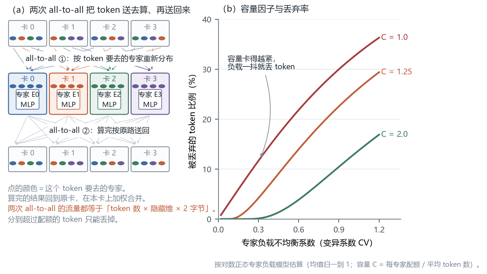

# 第 14 章　专家并行与 MoE 训练

## 14.1　稀疏激活与容量因子

混合专家模型的想法只有一句话，把一层的前馈网络复制成很多份，每个 token 只用其中几份。参数量按专家数涨，计算量按选中的专家数涨，两者脱钩。

设专家数是 E，每个 token 选 top-k 个专家。一层前馈网络被替换成 E 份，路由器给每个 token 打分，取分数最高的 k 个。k 通常取 1 或 2。E 取 64、k 取 2 时，每个 token 只用到 2 份专家，相对于 64 份全开的模型，计算量只有 3%，而参数量是 64 倍。

这就是混合专家的全部经济学。它用显存换计算，把模型容量做大而计算量不跟着涨。

问题是显存。64 个专家都在同一层里，每个都要能算，所以 64 份权重全都要在显存里。一张卡装不下，于是每个专家放在一张卡上，这就叫专家并行。专家并行的本质是把"一层里的多个并列模块"分到多张卡，和数据并行、张量并行切的维度都不一样。

专家并行有一个前向传播必须处理的问题，token 要去它选中的专家所在的卡上算。一个 token 路由到第 37 号专家，而第 37 号专家在第 37 号卡上，这个 token 就得跨卡过去，算完再回来。这中间要有一次数据交换，这就是 all-to-all 的由来。

在交换之前，得先决定每个专家收多少 token，否则缓冲区大小定不下来。这就是容量因子。

容量因子的定义是，每个专家最多收的 token 数等于容量因子乘平均 token 数。平均 token 数是本批的总 token 数除以专家数。

$$\text{capacity} = \text{CF} \times \frac{T}{E}$$

T 是本批要处理的 token 总数，E 是专家数，CF 是容量因子。T 取 8192、E 取 64、CF 取 1.25 时，每个专家最多收 160 个 token。

为什么要有这个上限。因为 GPU 上的内核要按固定的形状启动，如果每个专家收到的 token 数不一样，就得为最热门的那个专家分配缓冲区，或者做动态形状，两者都不划算。定长缓冲区加上容量上限，是工程上的折中。

CF 取 1 意味着完全不接受不均衡，只要有一个专家收到的 token 超过平均值，多出来的就被丢掉。CF 取 1.25 意味着允许 25% 的不均衡。CF 取 2 意味着允许一倍的不均衡，代价是显存和 all-to-all 的量都翻倍。

这个参数在训练里是个容易被忽略的旋钮。它不影响正确性，只影响丢多少 token，而丢 token 的代价是悄悄发生的，等到发现时已经跑了很久。

容量因子还会反过来决定显存。每个专家要预留 capacity 乘 h 乘 e 字节的输入输出缓冲，capacity 取 160、h 取 16384、BF16，一个专家一层就是 160 乘 16384 乘 2 乘 2，约 10 MB。64 个专家就是 671 MB。看着不多，但还要乘上层数、乘上同时在飞的路由和重计算的副本，最后的量大到一个量级。CF 从 1.25 抬到 2，这部分就多 60%。

还有一个常被问的问题，为什么不把专家也按张量并行切开。可以切，但专家的矩阵本来就不大，切完每张卡上的算术强度降到很低，而切分带来的 all-reduce 固定开销不变，得不偿失。专家并行的正确用法是让一个专家完整地呆在一张卡上，用卡数去乘专家数。

图 14-1 是两次 all-to-all 的数据流和容量因子的作用位置。

*图 14-1　专家并行的两次 all-to-all 与容量因子的影响*

## 14.2　all-to-all 的两种转置

一个混合专家层有两次 all-to-all，一次在前向的开始，一次在前向的结尾。

第一次叫分发。输入的形状是按 token 排的，T 行 h 列，每张卡上有 T 除以 EP 行。分发的目标形状是按专家排的，每个专家一段，每段 capacity 行。这实际上是一次矩阵转置，行变列、列变行。

第二次叫回收。专家算完之后，输出还是按专家排的，要转回按 token 排，才能接上残差和后续的层。

两次转置的通信量一样，都是 T 乘 h 乘 e 字节，e 是元素字节数。为什么是这个量，因为每个 token 的 h 维向量都要从原来的卡搬到目标卡，一共 T 个 token，一个不多一个不少。k 取 2 时每个 token 要搬两份，通信量翻倍。

这里有个容易算错的地方。分发的通信量和专家数无关，只和 token 数、隐藏维有关。专家数从 64 涨到 256，每个专家分的 token 少了，但总 token 数不变，总通信量不变。这一点和直觉相反，因为大家容易把"更多专家"和"更多通信"联系起来。

真正变的是消息的碎片度。256 个专家时，一个 token 只发出去 16384 乘 2 等于 32 KB，一个包就够；而每个专家收到的 token 来自 256 张卡，每张卡只发一小段，接收方的缓冲区里聚了 256 个来源的小包。这种多打一的模式对网络的 incast 容忍度要求很高，和集合通信的 ring 完全不同。

这也是专家并行最容易被低估的地方。它不是带宽问题，是并发连接数问题。两百多个 rank 同时往一个 rank 发数据，交换机上的缓冲一旦不够，就会触发丢包和重传，表现是某些 rank 的 all-to-all 耗时是别人的三倍。

实现上还有个细节。分发之前要先把本卡的 token 按目的地排好序，得到一个按目的地分组的缓冲区，再一次发出去。这个排序不是免费的，它是一个 scatter 加一个 gather，在显存里搬一遍 268 MB。很多人算 all-to-all 的代价时只算网络，把这部分漏了，实测会比预期慢 10% 到 20%。回收时同理，收到的是按来源分组的，要按原始位置散回去，又一遍。

## 14.3　负载不均与丢 token

容量因子定下来之后，丢 token 的机制就很简单了。假设 T 取 8192、E 取 64、CF 取 1.25，每个专家容量 160。平均每个专家该收 128 个 token。

如果路由很均匀，每个专家收 128 个，全部装下，一个都不丢。

现实中不会均匀。最热的专家可能收到三倍平均，也就是 384 个 token。容量只有 160，那么多出来的 224 个就被丢掉，占它收到的 58%。

丢掉的 token 会怎样。它不进任何专家，这一层对它来说等于没算，直接被残差原样传到下一层。也就是说这个 token 在这一层上白过了一次，前向少了一层非线性，反向也不会给任何专家贡献梯度。

这个损失是累积的。一层丢 10%，一百层下来，某些 token 可能从头到尾都没被任何专家处理过，相当于只走了残差路径。残差路径的表达能力很弱，模型对这些 token 的拟合会明显变差。

更麻烦的是它与位置有关。如果某些序列或某些领域的 token 天然有更强的专家偏好，丢 token 就会系统性地集中在这些数据上，表现为某类样本的 loss 降不下去，而总 loss 看着正常。

top-1 和 top-2 的丢弃行为不一样。top-1 时一个 token 只有一个去处，丢了就彻底没了。top-2 时它有两个专家，第一选择满了还能去第二选择，丢弃率会低一些，但第二选择的质量通常不如第一选择，等于被迫降级。所以 top-2 的模型看起来丢得少，实际是质量在悄悄下降。

现场判断丢了多少，有个直接的办法。在每个专家上统计实际收到的 token 数除以容量，得到一组利用率。如果有一部分专家的利用率是 1.0（说明顶到了上限），同时另一些只有 0.3，那就是负载严重不均，丢 token 一定在发生。这组数的方差比均值更有诊断价值。均值只告诉你平均每个专家收多少，方差才告诉你有没有人顶着上限。

更狠的办法是在前向里加一个计数器，统计被丢弃的 token 数量，按层打印。这个计数器在生产环境里应该常开，因为它不影响性能，而它给出的数字是唯一能解释"loss 为什么不降"的直接证据。

把丢 token 的累积效应算一下。假设每层丢 5%，一层里没被处理的 token 占 5%，走残差。两层下来是 1 减 0.95 的平方，约 9.75%；一百层下来是 1 减 0.95 的一百次方，约 99.4%。这个算式给出一个严厉的结论：只要每层都丢一点，一百层之后就几乎没有 token 能被完整处理。实际上丢 token 不是独立的，热专家会持续热，所以真实的累积比独立假设稍好，但量级就是这样。这也是为什么容量因子取 1.0 的训练很危险，它把不均衡直接变成了信息损失。

## 14.4　路由崩溃与辅助损失

负载不均不是随机的，它有自我强化的倾向。

一个专家收到的 token 多，它的梯度更新就多，参数就训得更好，对更多 token 的输出质量更高，路由器的分数也倾向于给它更高。这是一个正反馈。跑上几千步，少数专家会垄断大部分流量，剩下的专家几乎不更新，参数停在初始化附近。

这个现象叫路由崩溃。崩溃之后，有效的专家数远小于 E，稀疏性名存实亡，模型的参数量看起来很大，实际能用的只有几个专家。

对抗手段有两类。

第一类是辅助损失。在总损失里加一项，惩罚"专家收到的 token 分布不均"。常见的形式是把每个专家收到的 token 比例乘它的路由概率均值，求和再乘专家数，理想情况下这个值是 1，偏离越多惩罚越大。系数通常取 0.01 量级，太大就会伤害主任务的收敛。

第二类是偏置调整。不改损失函数，只在路由器的打分上加一个每个专家一个的可学习偏置，哪个专家过载就调低它的偏置，欠载就调高。这一项不参与梯度，而是按规则周期性更新，比如每步看一次负载，过载的减一点，欠载的加一点。好处是不干扰主损失，坏处是它是一个反馈环，参数没调好会震荡。

两条路都能用，区别在于辅助损失会影响模型的表达能力，因为它把均衡当成了优化目标之一；偏置调整不影响主目标，但需要额外的状态和规则。

还有一项常被合在一起讲的是路由分数的正则。路由器的输出是 softmax 之前的一串 logits，如果这些 logits 的绝对值涨得太大，softmax 会饱和，路由变成硬选择，梯度传不回去。加一个对 logits 平方均值的惩罚，把它压在小范围内，可以避免这个问题。这一项和均衡无关，纯粹是数值稳定性。

三者一起用时要注意交互。均衡损失会推着路由器把分数摊平，logits 正则会压着分数不让它涨，两者的方向一致，容易把路由弄得过于随机，模型退化成"每个 token 平均用所有专家"，稀疏的收益就没了。调的时候一次只加一项，看专家利用率的分布怎么变。

怎么判断路由已经崩了。把专家利用率排序，看前 10% 的专家吃了多少流量。均匀时这个比例就是 10%，因为 10% 的专家就该吃 10% 的流量；如果到了 60% 以上，说明已经崩了。另一个指标是最冷专家的利用率，如果它长期在 0.1 以下，说明这个专家的参数基本没在学。

## 14.5　专家并行的通信量

把一层混合专家的通信量写成公式。T 是本批 token 数，h 是隐藏维，e 是元素字节数，k 是每个 token 选的专家数。

$$V_{\text{moe}} = 2 \times k \times T \times h \times e$$

前面的 2 是分发加回收，k 是每个 token 要搬几份。注意这个式子不含专家数 EP，因为专家数只改变目的地，不改变要搬的字节。

代入一组具体数字。一个专家并行组 64 张卡，每张卡上本批 8192 个 token，所以组内总 token 是 8192 乘 64 等于 524288。h 取 16384，e 取 2，k 取 1。一层分发是 524288 乘 16384 乘 2，等于 17 GB。两次加起来 34 GB，摊到 64 张卡上每卡收发 537 MB。

一层 537 MB，如果模型有一百层混合专家，一步就是 54 GB。走 50 GB/s 的网卡是 1.07 秒。

拿这个和计算比。每个专家假设十亿参数，一张卡上一个专家，按平均每个专家收 8192 个 token 算，计算量是 6 乘 10 亿乘 8192，约 4.9 乘 10 的 13 次方次浮点运算，除以 989.4 TFLOPS 是 50 毫秒，按 40% 的效率算是 125 毫秒。通信 537 MB 在 50 GB/s 上是 10.7 毫秒，占 8%。

8% 看起来可以接受，但这个估算假设了所有通信都能和计算重叠。实际上分发的 all-to-all 必须在专家计算开始之前完成，它在关键路径的最前面，一步都重叠不了；回收的 all-to-all 可以在下一层的计算里藏一部分。所以有效暴露的时间不是 8%，而是接近一半，也就是 4% 到 5% 的步时。

重叠的策略是把分发切成若干块。按 token 块分，第一批 token 的 all-to-all 完成后就开始算它们的专家，同时传第二批。这样分发的后半段能藏在计算里，暴露的只有第一批的延迟。块太多会让每个专家收到很多小包，碎得不成样；块太少重叠不到。经验是取四到八块，和专家数、每包大小都有关系。

专家并行度对通信的影响体现在另一个地方。EP 越大，每个 all-to-all 的目的地越多，消息越碎，有效带宽越低。EP 取 8 时（一个节点内），all-to-all 走 NVLink，900 GB/s，基本无损；EP 取 64 时跨了八个节点，走 InfiniBand，50 GB/s，还要经过三层交换，实际有效带宽可能只有标称值的一半。

所以拓扑上的原则很清楚，**专家并行组尽量落在节点内，跨节点的部分要尽量少**。做得到的话，把专家按节点分组，让每个 token 的路由优先落在本节点的专家上，这就是所谓的节点受限路由。它的代价是牺牲一点路由质量，换来的是 all-to-all 不跨机。路由约束会降低专家选择的自由度，表现为同样的模型在固定专家数下 loss 略高，通常是一个千分点量级。这个代价值得付，因为跳一次机的代价是十倍以上。

把四种并行一层的通信量放在一张表里，模型参数按前面的算例，单位是每卡每层。

| 并行方式 | 通信原语 | 每卡每层通信量 | 能否隐藏 |
|---|---|---|---|
| 数据并行 | all-reduce 梯度 | 与卡数无关 | 能，藏在反向里 |
| 张量并行 | 两次 all-reduce | 2 乘激活 | 不能，在关键路径 |
| 流水并行 | 点对点 | 1 乘激活 | 部分，靠微批错峰 |
| 专家并行 | 两次 all-to-all | 2 乘 k 乘 token 乘 h | 分发不能，回收部分能 |

表里第一行最能说明问题。数据并行的通信量不随卡数增长，所以它天然适合扩展到万卡；专家并行的通信量也不随专家数增长，但它随 token 数增长，而 token 数又随批大小增长。所以专家并行和梯度累积是相互矛盾的，梯度累积减少同步频率的收益，会被 all-to-all 的量吃掉一部分。这一点在调大 batch 时特别容易撞上，因为调大 batch 往往同时调高了梯度累积步数。

## 14.6　DeepSeek-V3 的实践

DeepSeek-V3 是公开材料里混合专家训练规模最大的一个，值得单独看一眼它的账。

2048 张 H800，训练 14.8 万亿 token，预训练阶段用了 2.664M 卡时，加上全流程是 2.788M 卡时。按每卡时 2 美元算，总成本约 557.6 万美元。

把卡时摊开。2.664M 卡时除以 2048 张卡，等于 1301 小时，约 54 天。这是个很紧的数字，意味着这两个月里几乎没有大段停机。

平均每张卡处理的 token 数是 14.8 万亿除以 2048，约 72 亿个。这个数除以 54 天再除以 86400 秒，是每卡每秒约 1547 个 token。这个吞吐对应的是一个稀疏激活的模型，稠密模型的同规模训练做不到这个水平。

它用的是 FP8 训练。FP8 的价值在混合专家上比在稠密模型上更大，因为专家并行的瓶颈是通信和显存，而 FP8 把这两项都减半。前面那个 537 MB 的每层通信量，换成 FP8 就是 268 MB。

拿 2048 张 H800 算一下拓扑上的约束。H800 的 NVLink 是 400 GB/s，只有 H100 的一半，这是出口限制的产物。这意味着节点内的专家并行带宽比 H100 集群紧一倍，节点受限路由在这类硬件上不是优化而是必须。跨节点只有 400 Gb/s 的网卡，折算下来 50 GB/s，和 H100 集群一样。节点内砍半、节点外不变，结果是节点内外的带宽比从 18 降到 8，拓扑选择的空间变小了。

还有一笔账值得算。2.664M 卡时是预训练，2.788M 是全流程，差额只有 4.6%，说明后训练和数据准备的占比很小。这个比例偏低，稠密模型的后训练往往要占到一成以上。原因可能在于它的后训练沿用了同一套并行配置，没有额外的调参开销。

这里能看出一条清楚的工程逻辑。混合专家把计算量压下来之后，瓶颈就从算力转到了通信和显存，于是下一步的优化必然转向低精度和更紧凑的路由。这个顺序不是设计出来的，是被瓶颈推着走的。稠密模型把算力用满之后，下一步是通信；混合专家把算力省下来之后，下一步也是通信。两条路的终局是一样的。

## 14.7　常见坑

第一个坑是容量因子设死。CF 在配置里写成一个常数，训练过程中批的组成会变，某些批里某类数据特别集中，路由就特别不均，丢 token 突然变多。表现是 loss 曲线在某些数据段上出现台阶。处理办法是按滑动窗口统计丢弃率，超过阈值就临时提高 CF，代价是显存。

第二个坑是 top-k 的权重没归一化。top-2 时两个专家的输出要按路由分数加权求和，如果分数没归一化，加权和的量级会随路由分布变化，等效于给这一层加了一个随机缩放。这个错误不会报错，只会让训练对学习率特别敏感。

第三个坑是把 drop-less 当成万灵药。不丢 token 的实现是让每个专家收它实际收到的全部 token，缓冲区按最大值动态分配。这样不丢，但最热的专家会决定整个 all-to-all 的时间，等于把负载不均直接转化成步时抖动。丢 token 和步时抖动是同一件事的两种表现，选哪个取决于你更怕 loss 变差还是更怕时间不稳。第三种选择是按固定容量收、超出部分溢出到次优专家，实现复杂，但两个问题都能缓解一半。

第四个坑是专家并行组跨了 spine。前面说过，EP 组的 rank 要尽量落在同一层交换机下。如果 rank 编号按节点连续排，而节点分布在不同的机柜，EP 组就会横跨整个集群。查法是打印 EP 组的 rank 到交换机的映射，看跨了几层。

第五个坑是专家内部又开张量并行。专家的矩阵本来就不大，再切四份，每份的算术强度掉到很低，通信占比反而上升。正确做法是专家内部不切，靠 EP 和 DP 扩展。

第六个坑是检查点。专家并行的检查点要按专家分片存储，每个专家一个文件或者一段偏移。如果按张量并行的方式整体存，恢复时专家到卡的映射一变，就得做一次重排，几 TB 的数据重排要花很久。设计检查点格式的时候就要把专家维度单独列出来。

第七个坑是把专家数当成性能旋钮。专家数加一倍，参数量加一倍，单卡的显存也加一倍，而计算量不变。看起来是白赚容量，实际是拿显存换的。当显存成为约束时，加专家会让可用批大小变小，最终吞吐下降。判断方法是看每个 token 摊到的显存，而不是看总参数量。
