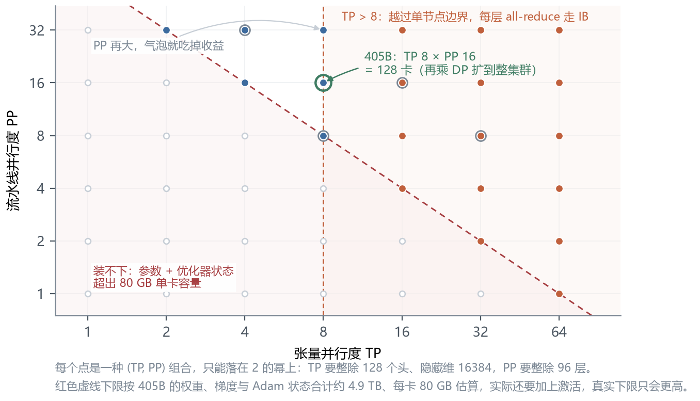

# 第 15 章　组合并行与自动切分

## 15.1　四维网格（DP/TP/PP/EP）

真实的大规模训练没有只用一种并行的。四种并行叠在一起，卡被组织成一个四维网格，总卡数是四个维度的乘积。

$$\text{cards} = \text{DP} \times \text{TP} \times \text{PP} \times \text{EP}$$

Llama 3 405B 在 16384 张 H100 上的配置是张量并行 8、流水并行 16、数据并行 128，没有专家并行，所以 8 乘 16 乘 128 就是 16384。稠密模型不需要专家并行，四个维度里只用上了三个。

这四个维度的作用完全不同，混在一起容易搞乱，分开看就清楚。

张量并行切一层的内部，解决单层放不下、单层算太久。它的通信在关键路径上，只能在节点内。

流水并行切层与层之间，解决整个模型放不下。它的通信是点对点，可以跨节点，代价是气泡。

数据并行复制整个模型，解决吞吐不够。它的通信是梯度归约，可以跨节点，而且通信量不随卡数增长，是唯一能扩展到万卡的维度。

专家并行切一层里的并列模块，只对混合专家模型有意义。它的通信是 all-to-all，对网络的多打一能力要求最高。而且它的通信量不随专家数变，只随 token 数变，所以它是四个维度里唯一一个和批大小直接挂钩的。

一个常被问的问题是，为什么不用一个大维度解决所有问题。答案是每个维度都有自己的失效点。张量并行超过八张卡就跨机，通信涨十八倍。流水并行级数一大气泡就压不住。数据并行到几千路之后，梯度归约的时间和显存都吃不消。只有组合起来，才能让每个维度都待在自己的舒适区。

排列顺序也有讲究。四个维度里，数据并行必须放在最外层，因为它要求参与同步的卡上有一模一样的模型副本。如果数据并行放在张量并行里面，每个数据并行组只能看到模型的一部分，梯度就归约不起来。同理，流水并行必须在数据并行里面，因为不同流水级上的层不一样，不能互相复制。这条嵌套关系是硬约束，很多配置错误地就错在这里。

从 4096 卡扩到 16384 卡的过程能看清这件事。4096 卡时张量并行 8、流水并行 8、数据并行 64，三个维度都没到边。扩到四倍卡，最直觉的做法是把数据并行乘四，但梯度归约的通信量虽然不随卡数涨，同步的尾延迟会涨，而且学习率要跟着调。实际的选择是把流水并行从 8 提到 16，数据并行从 64 提到 128，前者用气泡换取每卡层数减半、激活显存减半。

这个选择不是最优解，是可行解。它把激活从 34 GB 压到 17 GB，把气泡从 18% 抬到 32%。如果当时显存更紧，就只能这么选；如果网络更好，就会选数据并行。配置的差异很多时候反映的不是技术优劣，而是当时手上哪一项资源更紧。

图 15-1 是这四个维度的约束和搜索空间。

*图 15-1　并行配置的约束与搜索空间*

## 15.2　通信量与显存的总账

一个配置好不好，就看两笔账，通信的总时间和显存的总占用。两笔都要按每张卡算，不是按整个集群算。

先把 Llama 3 405B 那个配置的账摊开。序列 4096，微批 1，微批数 32，BF16。

权重侧。4050 亿参数按两字节存是 810 GB，除以张量并行 8 再除以流水并行 16，每卡 6.3 GB。这 6.3 GB 在 128 路数据并行里是复制的，如果开完全分片，还要再除以 8（节点内的分片组），降到 0.79 GB。

优化器侧。每个参数十六字节，其中参数二、梯度二、一阶矩四、二阶矩四。按 16384 张卡分片，每卡是 4050 亿乘 16 除以 16384，约 396 MB。其中参数那部分已经算在权重里了，所以新增的是 297 MB。

激活侧。一段 8 层，一微批的激活是 4096 乘 16384 乘 2 乘 8，约 1.07 GB。1F1B 的在飞微批是 16 个，17 GB。开了选择性重计算之后能压到 6 GB 上下。

三项加起来，不开重计算是 24 GB，开了是 13 GB。80 GB 的卡上余量充足，这就是为什么这个配置能跑。

通信侧要按每步算四个数。

张量并行每卡每微批是 268 MB，这里是 134 MB 的激活乘前向反向两次。一段 8 层，就是 2.1 GB。一步 32 个微批，67 GB。走 NVLink 900 GB/s，74 毫秒。这个数看着大，但它是分散在一百多个内核里陆续发生的，单次只有几兆，完全能和相邻的矩阵乘重叠。

流水并行的点对点是每微批 134 MB，32 个微批 4.3 GB，也是节点内的链路，5 毫秒。

数据并行如果按节点内分片、跨节点复制，节点内是参数的全收集加梯度的归约散播，各 6.3 GB 乘 7 除以 8，合计 11 GB，12 毫秒。跨节点是 6.3 GB 的全归约，每卡 11.8 GB，走 50 GB/s 是 236 毫秒。

把四个数加起来，节点内约 82 GB、91 毫秒，节点外约 12 GB、236 毫秒。一步的计算时间按 40% 的算力利用率算是 6 秒量级。所以通信占 4% 左右，主要来自跨节点的梯度同步。

这张账说明一件事。**在这个配置里，真正贵的是跨节点的那一次梯度同步，不是张量并行。**很多人凭直觉认为张量并行通信最重，实际上节点内的 NVLink 把它压到了可以忽略的程度，反倒是数据并行的 236 毫秒无法完全隐藏。

判据是看哪一项超过了步时的 5%。按这个标准，张量并行 74 毫秒在 6 秒的步里只占 1%，可以忽略；数据并行 236 毫秒占 4%，在边缘；任何一个跳到 10% 以上的项都是下一轮优化的目标。这比看总量有用，因为总量会被很多小项稀释，而真正卡住步时的是最大的那一项。把那一项拿出来单独看，往往能发现它比想象中大一个量级，因为它在关键路径上，而其他项都已经被重叠掉了。

换个配置，结论就变了。张量并行取 16 跨两节点，每卡每微批的通信涨到 503 MB，一步 32 个微批是一百六十亿字节，也就是 16 GB，跨机 50 GB/s 要 321 毫秒，还只能部分重叠。总通信占比从 4% 涨到 10% 以上，而且全在关键路径上。这就是那一条约束的来源。

再看一个带专家并行的账。假设模型是混合专家，专家数 64，专家并行度 64，其他维度分摊剩下的卡。每层 all-to-all 的通信量是 2 乘 k 乘 token 数乘 h 乘 e，token 数按每卡 8192 算，64 张卡合起来 524288，一层就是 34 GB，摊到每卡 537 MB。一百层下来 54 GB，走 50 GB/s 是 1.07 秒。

这个数比纯稠密配置的 236 毫秒大了四倍半，而且分发的那个 all-to-all 完全重叠不了。所以带专家并行的配置，瓶颈一定在专家那一维，别的维度怎么调都是在修边角。这也是为什么 MoE 的训练配置里，专家并行度往往是最后才定的，它一旦定下，剩下的卡就是在张量和流水之间分。

## 15.3　约束条件

配置不是随便填的，有四类约束卡着，任何一条不满足，要么跑不起来，要么跑得很慢。

第一类是整除。头数要能被张量并行度整除，键值头数也要，层数要能被流水并行度整除，专家数要能被专家并行度整除，总卡数要等于四个维度的乘积。这几条里最容易踩的是键值头，因为它经常是个小数字。Llama 3 405B 有八个键值头，张量并行就只能到八。

第二类是显存上限。每张卡要放权重、优化器状态、激活、通信缓冲四样。权重和优化器随并行度反比下降，激活随流水并行度和重计算下降，但通信缓冲随并行度上升。所以显存不是单调的，配置太大反而放不下。

第三类是拓扑边界。张量并行必须在同一个 NVLink 域内，上下文并行最好也在，专家并行组最好在同一个交换机下，流水并行的相邻级最好在同一个机柜。数据并行哪里都能放。这四条边界把集群切成不同层级的盒子，配置必须能塞进盒子里。

第四类是批大小。全局批等于微批乘微批数乘数据并行度再乘梯度累积步数。这个数要和目标批大小吻合，而它同时又受显存和气泡的约束。想调大微批数压气泡，全局批就跟着变大，学习率得跟着调，这一串是耦合的。

把这四类约束写成一张检查表，配置的时候逐条过。

| 约束 | 检查项 | 常见违反 |
|---|---|---|
| 整除 | 头数对张量并行 | 键值头只有 8，却配了 16 |
| 整除 | 层数对流水并行 | 126 层配 16 级 |
| 显存 | 四项之和小于容量 | 激活没算在飞微批 |
| 拓扑 | 张量并行在 NVLink 域内 | rank 编号与物理位置错位 |
| 批大小 | 全局批与学习率匹配 | 调微批数忘了调学习率 |

126 层配 16 级是这张表里最别扭的一条。126 的因数是 1、2、3、6、7、9、14、18、21、42、63、126。16 不在里面，所以要么接受前面说的不均切分，要么换一个级数。实际工程里选前者，因为 16 是 2 的幂，和卡数、节点数的对应关系最顺。

显存这一条值得单独展开，因为它是四条里唯一非单调的。把张量并行从小到大枚举，权重下降、优化器下降、通信缓冲上升、激活不变。把流水并行从小到大枚举，权重下降、激活下降、但每卡上的在飞微批乘了级数，总激活是先降后升的。所以存在一个中间值让显存最小，比它小放不下权重，比它大放不下激活。实际配置就是在这个谷底附近选的。

更麻烦的是四项里有三项是峰值而不是均值。权重的峰值出现在参数全收集的那一刻，激活的峰值出现在反向的第三个阶段，通信缓冲的峰值出现在 all-to-all 的中间态。三个峰值不一定同时到，但容量规划必须按它们同时到来的情况留余量。这也是为什么实际可用的显存总是比标称少十到十五 GB。

## 15.4　配置搜索的代价模型

有了约束就可以搜索。搜索的目标是最小化每步的时间，而每步时间可以写成几项之和。

$$T_{\text{step}} = T_{\text{compute}} + T_{\text{tp}} + T_{\text{pp}} + T_{\text{dp}} + T_{\text{bubble}}$$

计算项按总算力算。

$$T_{\text{compute}} = \frac{6 \times P \times B}{N_{\text{gpu}} \times \text{peak} \times \text{MFU}}$$

P 是参数量，B 是每步 token 数，N 是卡数，peak 是单卡峰值，MFU 是实际达到的效率。注意这里的 MFU 是待求的，不能既当输入又当输出。搜索时的做法是用一个经验值当输入，算出时间，跑起来再校准。

张量并行项按每卡每步的通信量算，假设完全不重叠。

$$T_{\text{tp}} = \frac{2 \times B \times h \times e \times L}{p \times \text{BW}}$$

B 是每卡每步的 token 数，h 是隐藏维，e 是字节数，L 是总层数，p 是流水级数（每卡只承担 L 除以 p 层），BW 是节点内链路带宽。这个式子算的是全部暴露在关键路径上的最坏情况，实际能重叠一部分。

流水气泡项按公式算。

$$T_{\text{bubble}} = T_{\text{compute}} \times \frac{p-1}{m+p-1}$$

数据并行项按参数量的三倍算，因为完全分片要全收集、归约散播各一次。

$$T_{\text{dp}} = \frac{3 \times P \times e \times (N_{\text{dp}}-1)}{\text{BW}_{\text{net}} \times N_{\text{dp}}}$$

搜索的做法是把 (TP, PP, DP, EP) 的可行组合枚举出来，满足整除和显存约束的留下，按上式算时间，取最小的那几个。卡数是 16384 时，四个维度的组合数是一百多种，去掉整除约束后剩几十种，手算也能算完。实际代码只有几十行，难点不在写，在把四个项的系数标定对。

这个模型的用处不在精确，在比较。它算出来的绝对值和实测差 20% 到 30% 很正常，但两三个候选配置之间的相对排序通常是准的。选配置的时候需要的正是相对排序。

MFU 这个输入得特别小心。它不是一个常数，它随微批大小、序列长度、并行度都变。序列 4096 和 32768 的 MFU 可能差十个点，因为后者的注意力占比高、算术强度低。搜索时用一个固定的 MFU 会把长序列的配置估得过于乐观。可行的修正是按序列长度给三四个不同的 MFU 值，长序列取低值，再拿实测校准。

拿 16384 张卡、4050 亿参数的稠密模型算三个候选。序列 4096，微批 1，微批数 32，计算项都是 6 秒，差异全在另外三项上。

候选一，张量 8、流水 16、数据 128。气泡 32% 是 1.9 秒，每级 8 层所以每卡参数 6.3 GB，数据并行跨节点同步 11.8 GB，236 毫秒，张量并行节点内 67 GB，74 毫秒。合计约 8.2 秒。

候选二，张量 8、流水 8、数据 256。气泡降到 18%，1.1 秒，但每卡参数翻倍到 12.6 GB，数据并行同步变成 25 GB，500 毫秒。合计约 7.6 秒。

候选三，张量 16、流水 8、数据 128。气泡也是 1.1 秒，每卡参数又回到 6.3 GB，但张量并行跨了节点，通信 321 毫秒。合计也是 7.7 秒。

三个数摆在一起，候选二最优，候选三略输，候选一最差。这个结论和直觉相反，大多数人会觉得级数越多越好，实际上级数多了气泡涨，而气泡在 32% 这个量级上很贵。

## 15.5　Alpa 与 GSPMD 的思路

手工配置的上限大概就是几十种组合，人还能算。卡数上万、维度更多的时候，靠人就不行了，于是有了自动切分。

Alpa 的思路是分层。它把并行的决策分成两级，级间用流水并行，级内用切分。级间的划分是一个整数规划问题，目标是最小化流水线的总时间；级内的切分是另一个问题，在给定的设备数下最小化通信代价。两级迭代，直到收敛。

这个分法的依据是两类并行的代价结构不同。流水并行的代价是气泡，跟级数和微批数有关，是个全局的量；切分的代价是集合通信，跟每层的张量形状有关，是个局部的量。分开优化，每一级都简单一些。

GSPMD 走的是编译器路线。它不搜索，它推导。用户给每个张量标一个分片方式，编译器沿着计算图传播这个标注，遇到需要跨设备通信的地方自动插入集合通信，遇到标注冲突的地方报错或者退让。数据流图一旦确定，通信的插入位置也就确定了。

两者的差别在谁负责决策。Alpa 是系统搜索配置，用户给约束；GSPMD 是用户给标注，系统推导通信。前者适合"我不知道怎么配"，后者适合"我知道怎么配但不想手写通信"。

工程上的现实是，绝大多数大规模训练用的是手工配置加一点点自动搜索。原因是自动切分的方案在超大规模上会遇到两个问题，一是代价模型的误差被放大，二是生成的通信模式未必匹配实际的网络拓扑。手工配置虽然笨，但每一步都能解释，出了问题能定位。

两者的搜索空间也不一样大。手配时四个维度的组合是一百多种，去掉整除约束剩几十种，人一下午能算完。自动切分要把每一层单独标切分方式，层数一百二十六、可选切分方式五六种，空间是五六的一百二十六次方，实际只能靠启发式。这也是自动切分在小模型上效果不错、到大模型上就退化成模板的原因。

一个折中的做法是用代价模型做粗筛，把候选从几十个降到三五个，再拿真实的小规模集群跑一遍，用实测数据校准，最后定配置。这个流程在千卡到万卡的规模上很常见。

两个系统都在一个地方碰壁，搜索空间的形状。四个维度里只有两个是真正的自变量，另外两个由卡数除出来。但约束是不连续的，头数、层数的整除关系把空间切成很多孤岛，梯度类的优化无法跨越这些空地。所以两者的求解器都只能做组合搜索，规模一大就只能贪心。

还有一个更实际的问题，代价模型需要知道每一步的时间，而时间又与实现强相关。同一个配置在 Megatron 里跑和在一个自写框架里跑，步时可能差一倍。所以搜索出来的配置换了软件栈就要重新校，不能当成可移植的结论。

## 15.6　手工配置的检查清单

最后给一份可以直接照着过的清单。每一条都是踩过的坑。

一，算总卡数。四个维度的乘积必须等于可用卡数，少一张都会起不来，多一张就是浪费。这一步看着废话，但节点数与卡数的换算错一位就会多出八张，现场最常见的启动失败就是它。

二，查头数。查询头数除以张量并行度必须是整数，键值头数也是。键值头不够的时候，张量并行度的上限就被锁死了。

三，查层数。层数除以流水并行度必须是整数，不是整数就接受不均切分，并且把不均带来的节拍损失算进去。

四，查专家的整除。专家数除以专家并行度必须是整数，专家并行度还要能放进一个交换机域。

五，算显存。权重、优化器、激活、缓冲四项加起来，按峰值的两倍留余量。激活要按在飞微批算，不是按一个微批。

六，算通信。按每卡每层算，再乘层数、乘微批数，分别落到节点内和节点外两条链路上，看哪一条先饱和。两条都饱和时，先动节点外那一条，因为它的带宽低一个数量级。

七，算气泡。微批数至少要四倍于流水级数，十倍以上才谈得上"气泡可忽略"。

八，算全局批。乘出来的数要和学习率、训练 token 总量一起看，别为了压气泡把批调到不合理的大小。批大一倍，学习率通常要跟着动一点，而学习率一动，前面调好的数值稳定性参数又要重调。

九，查拓扑。把张量并行的组、专家并行的组、流水并行的相邻两级，三者的 rank 到交换机的映射打印出来，看有没有跨层的。

十，留退路。配置定下来之后，先跑一千步看步时方差。方差超过 10% 说明有不均或者抖动，别急着扩大规模，先把这个抖动的来源找出来。同时把当前配置和两个备选配置写进文档，出事时才知道往哪里退。

这份清单过一遍要半小时，能省掉的返工大概是几天。规模越大，这个比例越夸张。

清单里最容易被跳过的是第九条，因为打印映射看起来麻烦。但它是唯一能发现"配置没错、部署错了"这一层问题的手段。一个配置在纸面上可以完美，rank 排错了就会多跳一层交换，而这一步没任何报错，只有步时怪怪地慢。

最后一条的经验值值得展开。步时方差超过 10% 时，先看是不是微批的分配不均，再看是不是某些 rank 的数据长度不一样，最后才怀疑硬件。如果方差在 2% 以内，就可以开跑了，这个量级的抖动是调度和缓存带来的，不解也无所谓。

这个顺序不是随便排的。前四条是硬约束，不满足就直接跑不起来，所以先过。中间三条是性能约束，满足到哪一步看手上的卡和网络。后两条是工程习惯，它们不能提高性能，只能降低返工率。按这个优先级丢弃东西，才能保证先拿到一个能跑的配置，再谈优化。
