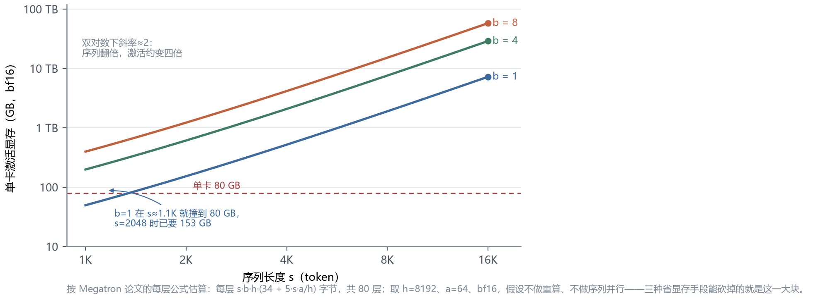

# 第 16 章　激活内存与重计算

## 16.1　激活内存的构成

一张 80 GB 的卡，训练时被五项东西分掉。参数、梯度、优化器状态、激活、工作区。前四项只跟模型形态和并行方式有关，配置一旦定下就是常数；只有激活随序列长度、微批大小、以及"存不存"的策略变化。所以显存调参这件事，本质上是在前四项吃掉之后剩下那点余量里做文章。

先看前四项有多大。175B 参数按每参数 16 字节计，参数本身、梯度、一阶矩、二阶矩、FP32 主权重加起来是 2.8 TB。单卡 80 GB，除下来需要 35 张卡才装得下模型状态，而且这 35 张卡一张都不剩给激活。这就是分布式训练绕不开的原点，激活预算必须先从这个减法里出来。

做法很干脆。算出每卡分到多少参数，乘 16，从 80 GB 里减掉，剩下的才是激活能用的空间。175B 配 TP8 与 PP8，一共 64 路切分，每卡分到 2.74e9 参数，乘 16 字节是 43.8 GB。80 减 43.8 还剩 36.2 GB。这 36.2 GB 要同时装激活、装通信缓冲、装 cuBLAS 工作区、还要留碎片。

碎片不是小数。PyTorch 的缓存分配器按块管理，块大小随申请的尺寸阶梯增长，`max_memory_reserved` 经常比 `max_memory_allocated` 高出百分之十几。80 GB 的卡上，这个差值是 8 到 16 GB，等于把激活预算砍掉三分之一。很多"纸上算下来明明够"的 OOM 就死在这里，账算的是 allocated，卡认的是 reserved。

还有一个反直觉的点。激活的峰值不在前向末尾，而在反向的某一段。反向要同时持有当前层的输入梯度和若干下游层还没释放的激活，峰值通常出现在反向前三分之一的位置。拿前向结束时的占用量去估峰值，会低估一到两层的量。层数少的模型这个偏差只有几个百分点，层数上百的模型能差出好几 GB。

五项里只有激活是活的。参数、梯度、优化器状态要动只能改并行度或者上 ZeRO，那是架构级决定，训练跑起来就没法改；激活可以靠调整微批、开重算、开 offload 在几分钟内改变量级。所以调优的次序是先动激活，把显存余量腾出来，再回头决定 batch 能开多大。

激活还有一个性质值得记住，它跟训练进度无关。第 10 步和第 10 万步的激活占用几乎一样，只要形状不变。这意味着显存预算可以在正式训练之前用小规模实验量出来，量出来之后一直有效。做法是拿单机、单层、单条样本跑一遍，把每层每个张量的形状和字节数打出来，再加上反向峰值的位置，乘上实际层数与并行度。这个过程花不了两小时，能省掉后面几周反复 OOM 的麻烦。

五项里那 36.2 GB 的激活预算还有一个常被遗忘的消耗者，参数收集缓冲。开启 ZeRO-3 或 FSDP 之后每层要先把完整参数收集出来才能算，这一份缓冲按整层参数算，在 175B 上是 3.6 GB。它跟激活抢同一块空间，而且只在每层的前向开头那一瞬间存在，看稳态占用根本看不见，只有峰值能抓到。

现场症状很好区分。改微批从 1 到 2 直接 OOM，这是线性项，激活随 b 线性涨。把序列从 4096 提到 8192 也 OOM，但降微批救不回来，这是平方项，注意力分数在作祟。这两种 OOM 的处置方式完全不同，一个是加并行度或者加梯度累积，另一个只能动序列并行、重计算、或者换更省显存的注意力实现。上来先分清是哪一种，能省掉半天试错。

## 16.2　每层激活的估算公式

先把符号定下来。s 是序列长度，b 是微批里的序列条数，h 是隐藏维度，a 是注意力头数，L 是层数，t 是张量并行度。一个形状为 (s, b, h) 的中间张量，在 BF16 下每个元素两字节，占 2·s·b·h 字节。

Megatron 给出的每层激活字节约为

$$ M_{\text{layer}} = s \cdot b \cdot h \cdot \left(34 + 5 \cdot \frac{a \cdot s}{h}\right) $$

括号里两项性质完全不同。前一项是常数，来自每层那些形状为 (s, b, h) 的中间张量，LayerNorm 的输入、LayerNorm 的输出、QKV 投影的结果、注意力的输出、MLP 升维后的中间值、激活函数的输出，一个接一个数下来十几个，每个两字节，加起来落在 34 附近，可以理解成十七个这样的张量。后一项随 s 线性增长，来自注意力分数链路上那几个形状为 (b, a, s, s) 的张量，折算到 s·b·h 这个单位上就变成了 a·s/h，前面的 5 是这批张量的折算系数。整项乘上外面的 s·b·h，就成了随 s 平方增长。

算一个具体的数。s 取 8192，b 取 1，h 取 8192，a 取 64，L 取 80。这组形状对应一个约 64B 参数的模型，下面几节的算例都用它。括号里是 34 加上 5 乘 64 乘 1，等于 354。s·b·h 是 8192 乘 8192，等于 6.71e7。每层 6.71e7 乘 354 等于 2.38e10 字节，也就是 23.8 GB。80 层是 1.90 TB。

这个数字看着不像真的，但它就是真的。8K 序列、8192 隐藏维、一点重算都不做，激活比模型状态还大。开到 TP8，每卡每层 2.97 GB，总量 238 GB，还是装不进 80 GB 的卡。张量并行在这里只能把量摊薄八倍，摊不薄的是"一层就要将近三个 GB"这个事实。

再看平方项的分量。s 等于 8192 时，常数项 34 对平方项 320，平方项已经占了九成。把 s 提到 32768，平方项变成 1280，总系数 1314，单层涨 3.7 倍；考虑外面还有个 s 也翻了四倍，总量涨 14.8 倍。长序列训练的显存问题，九成出在括号里那第二项上。

如果模型窄而序列长，比例更极端。h 取 4096、a 取 32、s 取 32768，平方项是 5 乘 32 乘 8，等于 1280，常数项 34 可以直接忽略。这时候"激活跟层数成正比"这句话就不够用了，得说"激活跟层数乘序列长度的平方成正比"，而这句话意味着序列每翻一倍，显存要翻四倍。

张量并行怎么进这个式子。切 t 路之后，每卡的 h 变成 h/t，每卡的头数变成 a/t，代入括号里 a·s/h 的比值不变，但外面的 s·b·h 缩小了 t 倍，所以每卡每层的激活就是 M 除以 t。这也是为什么 TP 度一提，激活立刻好看，但通信量同时上来，两头都是线性。

换个视角看同一个公式，会有更直观的感受。把 M 除以 s·b，得到每个 token 每层的激活字节数，是 h 乘括号里那一串。8K 序列那个例子里是 8192 乘 354，约 2.9 MB。80 层加起来，一条样本 232 MB，换成一千条就是 232 GB。所以一条样本要吃掉多少显存这个问题的答案不是几十兆，是几百兆。

*图 16-1　激活内存随序列长度与批大小的变化*

图的横轴是序列长度，纵轴是每卡激活。几条曲线对应不同的 b。短序列段几条线基本贴在一起，因为常数项主导；过了某个拐点开始分开，间距随 s 拉大，因为平方项主导之后 b 的系数也被一起放大。拐点的位置就在 34 与 5·a·s/h 相等的地方，这个例子里是 s 等于 h 除以 5a 再乘 34，算出来不到一千。也就是说只要序列过千，就进了平方区。

## 16.3　全量重计算与选择性重计算

把上面那个公式当成一个连续的光谱，三个常用档位的系数分别是 354、34、2。

354 是一点不省，所有中间张量都留在显存里等反向用。34 是只重算注意力那一段，分数矩阵前向算完 softmax 就用掉、不落地，反向需要时再算一遍。2 是每层只留输入，反向把整层前向重跑，MLP 也在内。

同样那个 8K 序列、80 层的算例，三档的每卡占用是 238 GB、22.8 GB、1.34 GB。从 238 到 22.8 靠的是选择性重计算，一步降十倍；从 22.8 到 1.34 靠全量，再降十七倍。工程上绝大多数配置停在第二档，因为第三档多算的东西太多。

选择性重计算的收益为什么这么大，要看注意力那部分的张量尺寸。分数矩阵是 (b, a, s, s)，8K 序列、64 头、单条样本就是 4.3e9 个元素，BF16 下 8.6 GB。而这个张量在前向里只用来做一次 softmax 和一次乘 V，用完就没用了。把它丢掉重算，省下的是显存，付出的是那一次 s×s×s 量级的乘加。

这里有个现代框架里已经自动完成的事。用了 FlashAttention 之类的分块注意力之后，完整的 s² 分数矩阵本来就不落地，只有分块内的 s×s_block 小块在共享内存里转。也就是说"不重算"这一档的 354 系数，在有 flash 的实现里天然只剩下 34 那段。这就是为什么 2022 年之后 8K 序列突然变得常见，硬件没变，是分数矩阵不再进 HBM 了。

全量重计算的适用场景是层内中间张量太大而序列不长的模型。MLP 的升维中间值是 4·s·b·h，跟 h 成正比；h 到 16384 的模型里，这一项比注意力分数还大。这种模型里选择性重计算几乎没用，只能整层重跑。

还有个折中做法，只重算 MLP 的第一级。丢掉 h 到 4h 那个中间值，重算时多算一次 4h 的矩阵乘。系数能省下八到十个单位，多出来的算力比整层重跑少一半。实现上就是在 MLP 的第一层后面插一个 checkpoint 边界，粒度比"整层"细一级。

按层分配也是常见手段。前面几层激活小、重算便宜、留着；后面几层激活大、重算贵、丢掉。这样峰值被压在常数附近，多算的部分只占少数层。所谓的智能重算、自动重算调度，内核大多就是这个思路的工程化，只是把"哪几层丢"变成一个搜索问题。

还有一个细节，重算会改变反向的计算顺序。原来反向是按层倒着走，现在每一层里要先重建前向、再算反向，指令流被打断，Tensor Core 的空转时间变长。模型深的时候这个影响能到几个百分点，量不大但真实存在。把重算段里的几层一次性重建、然后一次性反向，能把这个影响摊薄。

现场症状。开了选择性重计算但显存没降，八成是框架默认把分数矩阵也存了，配置项名字通常带 `recompute_attention` 或者 `attention_dropout`，没打开。用了 `torch.utils.checkpoint` 但 `use_reentrant` 参数没设对，输入被完整保留，重算等于白做，显存不降、时间白花。还有一种，重算边界设在了 LayerNorm 之后，导致 LayerNorm 的输入输出都留着，省下的量只有预期的一半。

边界位置的判定有一个简单办法，把每一层里最大的那几个张量按字节数排个序，再看重算能覆盖到哪几个。边界画在哪，边界以外的张量就必须留到反向结束。所以真正决定峰值的是边界以外的总量，而不是边界以内被丢掉的总量。这个区别在浅层模型上不明显，在层数上百的模型上能差出一倍，因为后面的层贡献了绝大部分字节，而前面几层几乎是免费的。

## 16.4　重计算的时间代价

重计算是拿计算换显存，换的汇率要先算清楚。

一步训练的浮点运算按 6ND 分解。N 是参数量，D 是这一步过的 token 数。前向 2ND，反向 4ND。反向是前向的两倍，因为每个矩阵乘要算两份梯度，一份给输入、一份给权重。重算一遍前向就是在这之上再加 2ND。

$$ \frac{2ND + 4ND + 2ND}{2ND + 4ND} = \frac{8}{6} = 1.33 $$

多三分之一。这个比例跟模型多大、切几路、序列多长都没有关系，只跟"多算了几遍前向"有关。重算两遍就是 10/6，1.67 倍；只重算一半的层就是 7/6，1.17 倍。

算一个具体的步时。前面那个 80 层、h 等于 8192 的模型，每层参数按 12·h² 估是 8.05e8，80 层约 6.4e10，s 取 8192、b 取 1。每层前向的浮点运算约 24·h²·s·b，h 取 8192 时是 24 乘 6.71e7 乘 8192，等于 1.32e13。80 层是 1.06e15，一步（前向加反向）是 3.17e15。用 TP8 摊到每卡是 3.97e14，按单卡 989.4 TFLOPS 的百分之四十即 396 TF 算，一步 1.00 秒。加上重算变成 1.33 秒，多 330 毫秒。一条样本多三分之一秒，听上去不多，乘上几千张卡乘上几百万步就是账。

MFU 的记法要分开。如果 MFU 只把模型本身需要的浮点运算放进分子，重算多出来的那部分不进分子，MFU 就被摊薄三成。同一份硬件，报出去 46.2% 的模型 MFU，对应的硬件实际利用率约 61.5%，这个 61.5% 有时被叫作 HFU。两个数都对，但不能混着比。

这也是不同论文的 MFU 不能直接对照的原因。有的把重算算进去，有的不算；有的把注意力那 12·b·s²·h 的修正项算进去，有的只用 6ND。看到 55.2% 这种数字，先问分子是什么，再问分母用的是稠密峰值还是带稀疏的峰值，两个问题不问清楚，比较就没有意义。

重算还有一个不明显的收益。它把显存压力转成算力压力，而大集群里这两样东西的稀缺程度常常是反的。显存是硬的，一张卡 80 GB 就是 80 GB，超一点就 OOM；算力是软的，利用率从百分之四十提到五十只是参数调优。所以显存受限的配置里，重算接近免费。反过来，算力已经打到七成、显存还剩一大截的配置里，重算就是纯损失，这时候该做的是把重算关掉、把 batch 开大。

粒度也会影响代价。把 80 层切成 80 个重算段，反向时每段重建一次计算图、重新走一遍自动微分的调度，这部分开销按段数线性增长。切成 20 段、每段四层，省下的调度开销能抵掉一部分重算时间，代价是中间的激活不能全丢，峰值会高一些。这个权衡没有普适的答案，只能在自己模型上试两三档。

重算还会和流水并行的气泡互相影响。气泡本身是空闲时间，重算插在空闲里可以部分藏掉，所以 PP 度大的配置里，重算的实际代价低于三分之一。这一点在按公式估步时的时候容易被漏掉，估出来的步时偏悲观。

还有一笔账容易漏，重算对通信没有帮助。张量并行的两次 all-reduce 是按激活大小算的，跟存不存激活无关，所以重算省下的是显存，通信量一动不动。这意味着显存宽松之后如果把 batch 调大，通信量会按比例上涨，原本被盖住的通信时间会浮出水面。

现场症状。开了重算步时涨三成、吞吐按 tokens/s 算基本不变，这是预期，说明瓶颈还在显存侧。步时涨六成，通常是重算粒度过细，每层一个边界，调度开销盖过了计算本身，把粒度调粗能立刻改善。还有一种，开了重算之后步时先降后升，那是重算让显存宽裕了、于是有人把 batch 调大，两笔账叠在一起，看起来像是重算变便宜了。

## 16.5　激活 offload

另一条路是把激活搬到主机内存，反向要用时再搬回来。这条路的天花板是 PCIe。

H100 的 PCIe 5.0 单向 64 GB/s，HBM 是 3.35 TB/s，差 52 倍。同一个张量，在 HBM 里读写算一份时间，走一趟 PCIe 要 52 份。这个比例决定了 offload 只能照顾小东西。

算例一，全量重算那一档，每卡激活 1.34 GB。搬出去 21 毫秒，搬回来 21 毫秒，往返 42 毫秒。同样这份激活重算一遍，按上一节的数，每卡每层 4.2 毫秒、80 层 333 毫秒。这一组数字里 offload 快八倍。

算例二，选择性重计算那一档，每卡 22.8 GB。单程 356 毫秒，往返 712 毫秒，已经比重算贵一倍。算例三，不重算的 238 GB，单程 3.7 秒，往返 7.4 秒，一步才一秒多，这条路直接死掉。

所以 offload 的适用范围很窄。它只对"重算很贵、体积又不大"的张量划算，典型是 LayerNorm 的输入输出、残差分支上那几个，每层几百兆的量级。把整层激活都推下去，省下的显存换不回时间。

第二个约束是主机内存。每节点 8 卡，每卡 22.8 GB 就是 182 GB，加上操作系统、页缓存、以及 pinned memory 的预留，256 GB 的机器刚够，512 GB 才宽裕。放到 16384 卡的规模上，主机内存总量是几十个 TB，这笔钱不比显存便宜多少。有些团队算完这笔账就放弃了 offload，回到重算。

第三个约束是争抢。PCIe 上跑的不止激活。如果节点间走的是 PCIe 网卡而不是 NVLink，梯度 all-reduce 也从这里出去；检查点写盘要先拷到主机内存；数据加载的 pinned buffer 拷贝也走同一条总线。offload 一旦把 PCIe 打满，梯度通信就得排队，步时的抖动会变得很难解释，因为抖动幅度取决于两者相位。

还有一个变种值得知道，offload 到别的 GPU 的显存而不是主机内存。这样走的是 NVLink 900 GB/s，比 PCIe 快十四倍，代价是那张卡自己的显存被占。在 PP 配置里，空闲的流水级显存可以借出来做这个事，实际效果比重算好，实现复杂度也高一个量级。

实践上 offload 是按层挑选的，不是全开。挑选的依据是"这一层搬出去省多少、重算它要多少"，比值高的先挑。做法是先跑一遍 profile，把每层的激活字节数和重算耗时列成表，按每 GB 省下的毫秒数排序，从前往后取到预算为止。这样通常只搬二三十层就能把峰值压下来，PCIe 压力也小。

时段也要挑。检查点写盘的那几百毫秒里，PCIe 和存储都在忙，这时候不该安排 offload 的搬运；理想的做法是让 offload 的搬运跟检查点错开，靠事件而不是固定节奏去同步。这件事在代码里往往没人管，因为 offload 的搬运藏在自动微分的钩子里，看不见。

现场症状。开了 offload 之后 GPU 利用率掉到六成出头，`nvidia-smi` 上看不到异常，但看 PCIe 吞吐是满的，步时方差变大。这就是 offload 和通信在抢同一条总线。另一个症状是主机内存缓慢上涨直到 OOM killer 动手，那是 offload 的缓冲区没释放，通常发生在异常退出重启之后。

## 16.6　显存峰值建模与验证

建模的顺序是固定的，状态、激活、工作区、碎片，逐项从 80 GB 里扣。

状态这一项按 16 字节乘每卡参数量。激活按 16.2 的公式，注意选对档位，还要注意反向峰值比前向末尾高一到两层。工作区包括通信缓冲、cuBLAS 的 workspace、以及归约用的临时张量，量级在几 GB。碎片按 reserved 与 allocated 的差算，一般留一成。

拿一个 175B 的真实形状算。175B 的隐藏维按 12288、层数按 96 算，每层参数 1.8e9，跟 12·h² 对得上。s 取 8192、b 取 1，每层的 (s, b, h) 是 1.01e8 个元素，选择性重计算下系数 34，得到每层 3.4 GB，96 层是 328 GB，TP8 之后每卡 41 GB，再 PP8 分下去是 5.1 GB。

预算表长这样。

| 项目 | 每卡占用 |
|---|---|
| 参数、梯度、优化器状态 | 43.8 GB |
| 激活（选择性重计算） | 5.1 GB |
| 通信与 cuBLAS 工作区 | 4 GB 量级 |
| 碎片（按一成算） | 8 GB |
| 合计 | 60.9 GB |

剩 19 GB。这 19 GB 就是可以挥霍的部分。b 从 1 提到 2，激活翻倍到 10.2 GB，合计 66 GB，还能跑；s 从 8192 提到 16384，选择性重计算下激活也是线性翻倍到 10.2 GB，但重算的代价按平方涨四倍，因为那一层的分数要重算两遍，步时会明显变长。真要同时把 b 和 s 都翻倍，激活 20.4 GB，合计 76 GB，只剩 4 GB，这时必须再加一级 PP 或者把重算换成全量。

表里没有列的一项，参数收集时的瞬时峰值。用 ZeRO-3 或 FSDP 的时候，前向每层要先 all-gather 出完整参数，用完再释放。这个收集缓冲的大小是整层参数，175B 每层约 1.8e9 参数、BF16 下 3.6 GB。如果激活峰值恰好落在同一时刻，两项叠加，剩的 19 GB 立刻只剩十五 GB 出头。框架通常靠预取窗口控制这个叠加，窗口设大了峰值就上去了。这也是为什么实际选 PP 度的时候，宁可多切一级、留出余量，而不去博那个理论上的最小值。

验证有三招。

第一招看 `max_memory_allocated` 和 `max_memory_reserved` 的差。差在一成以内正常，超过两成说明分配模式有问题，多半是反复申请变长张量，打开 `expandable_segments` 能缓解。

第二招做层数差分。先用 40 层跑一步记峰值，再用 41 层跑一步，两次之差就是每层的激活。拿这个数去除 6.71e7 乘 354，得到实际生效的系数。算出来接近 354 说明重算没开，接近 34 说明选择性重算生效，接近 2 说明全量。这一招能在十分钟内确认配置有没有真的落地，比读框架源码快。

第三招扫序列。固定其他参数，把 s 从 4096 扫到 16384，每档记峰值，画曲线。曲线接近直线说明常数项主导，该调 batch；明显上翘说明平方项主导，该加序列并行或者换注意力实现。这条曲线的形状比任何一个单点数值都有用，因为它告诉你下一步该动哪个旋钮。

工程上更实用的做法是把峰值打成时序图。每步采一次 allocated，横轴是步数，纵轴是字节。健康训练的图是锯齿，前向爬升到顶、反向开头再冲一次、优化器更新后掉回去。锯齿的齿高就是激活量，齿底是状态量，两者一眼可分。如果图是台阶，说明有东西在缓慢泄漏；如果每次到某个固定步就冲一次尖，那是参数收集和激活峰值撞在了一起。

这张图还有一个用处，验证预算。把预测的几个数画成水平线叠上去，哪一项先被突破一目了然。多数时候突破的不是激活，是碎片，因为碎片随训练时间缓慢增长。

上线前的余量怎么留。经验值是预测值的两成，且不低于 4 GB。留得少，第一次遇到长样本就 OOM；留得多，白白浪费显存、batch 开不大。两成这个数是从前面那张表里反推的，表里到 78.6 GB 已经只剩 1.4 GB，没有余地的配置只能在第一周里反复掍。

现场症状，预测 60 GB、实际 79 GB，差出十九 GB。这个差通常来自三处。反向峰值比前向高，占几 GB；通信缓冲按最大桶预分配，哪怕这一步的桶没满也占着；cuBLAS 第一次遇到大矩阵时把 workspace 撑大，之后一直不释放。三处都在预算表之外，所以预算表算出来的数一般要再加两成余量才敢上线。

## 16.7　每层激活的逐项清点

34 这个数不是估出来的，是一个张量一个张量数出来的。数之前先定单位，形状为 (s, b, h) 的张量算一个单位，形状为 (s, b, 4h) 的算四个，形状为 (b, a, s, s) 的按 a·s/h 折算。一个单位在 BF16 下是 2·s·b·h 字节，单位数乘二就是公式括号里的那个系数。

一层 Transformer 里需要留到反向的中间量，按这个约定数出来是这样。

| 张量 | 形状 | 单位数 |
|---|---|---|
| 层输入（残差分支要留） | (s, b, h) | 1 |
| LN1 输出 | (s, b, h) | 1 |
| QKV 投影输出 | (s, b, 3h) | 3 |
| 注意力输出（out proj 之前） | (s, b, h) | 1 |
| 注意力投影输出 | (s, b, h) | 1 |
| 残差相加后的隐藏 | (s, b, h) | 1 |
| LN2 输出 | (s, b, h) | 1 |
| MLP 升维输出 | (s, b, 4h) | 4 |
| SiLU 输出 | (s, b, 4h) | 4 |
| 合计 |  | 17 |

十七个单位，三十四个字节当量，正好是公式里的 34。这个对得上不是巧合，一层的中间张量个数是结构决定的，跟模型多大没有关系。所以模型从 70 亿长到 4000 亿，常数项一直是 34，变的只有 h 和 a。

表里还有几项没列。down-proj 的输出不单独留，它跟下一次残差相加共用一块 buffer，反向时从残差里减出来就行。dropout 的 mask 每个元素一字节，按两个字节折算只有半个单位，实际框架里要么打包成位图、要么干脆不存，表里就舍掉了。TMA 的 staging buffer 待在共享内存里，不落 HBM，也不计。

不同框架数出来的系数会在 32 到 36 之间浮动。差别来自 SiLU 是原地写还是另开一块、LayerNorm 的均值和方差存不存、QKV 是真存三份还是存一份再切。做预算用 34 够了，几个百分点的误差比碎片那十几 GB 小得多。

把单位换成字节。s 与 h 都取 8192、b 取 1 时，一个单位是 134 MB，十七个单位 2.28 GB。这是常数项，也是注意力走了分块实现以后一层的全部激活。

分数链路那 320 拆开看更有意思。单个头的分数矩阵是 (b, s, s)，8192 乘 8192，6.71e7 个元素，正好一个单位。64 个头就是 64 个单位，8.6 GB。softmax 的输出同尺寸，再 64 个单位。剩下的 192 来自按一字节存的那批中间量，dropout mask、给反向留的概率副本，按两字节折算相当于 96 个单位。128 加 128 加 64 是 320，跟公式里的 5·a·s/h 对得上，那个 5 其实就是 2.5 乘二。

160 个单位对 17 个单位，九倍多。所以没走分块注意力的实现里，一层的激活九成压在分数矩阵上，剩下一成才在正常的前后向张量上。16.3 里三档系数为什么差那么远，答案就在这个比例里。

再把 8192 那个例子的全量摆一遍。s 与 h 取 8192、a 取 64、L 取 80、b 取 1，一层 354 个单位当量、23.8 GB，八十层 1.90 TB。TP8 之后每卡一层 2.97 GB、全部 238 GB。再切 PP4，每卡只看二十层，59.5 GB。这个数进得去 80 GB 的卡，但已经占掉七成半，梯度、优化器状态、通信缓冲都没地方放。PP 到 8 段、每卡十层是 29.8 GB，这才留得出余量。

交叉验证可以按 token 再算一遍。系数 354 是每个 (s, b, h) 元素对应的字节数，所以每个 token 每层是 354 乘 h，2.9 MB，八十层 232 MB 一条样本。这个数跟按总量除 token 数得到的完全一样，两条路对上，说明单位换算没出错。

还有一处容易数错，反向峰值。前向结束时手上只有最后一层的输出和残差，反向一开始要立刻把它展开成这一层的全部中间量，峰值就出现在这里，比前向末尾高出一到两层的量。八十层的模型里这是两个百分点的总量，摊到每卡是几 GB。层数越多、每层越薄，这个偏差越小；层数上百、每层几个 GB 的模型，忽略它当天就会 OOM。

## 16.8　两种重计算的算力账

重算省显存的幅度前面算过了，代价要单独算，因为它跟省下的显存不成比例。

全量重算多跑一整层前向，每层 2ND。一步的浮点量是 6ND，前向 2ND、反向 4ND，多出来这 2ND 就是三分之一。这个比例跟形状无关，只要整层重跑就是它。

选择性重算只重跑分数矩阵。一层注意力里 QK 和 PV 各 2·b·s²·h 次浮点运算，合计 4·b·s²·h。要重算的只是 QK 那一步，softmax 的指数也算在内，但它是逐元素的，量级可以忽略。把这一项除以一层前向加反向的总浮点量，重算占一步的比例是

$$ \frac{2\,b\,s^{2}\,h}{72\,h^{2}\,s\,b} = \frac{s}{36\,h} $$

s 等于 h 时是三十六分之一，2.8%。同一个 8192 的例子里，一步 1.00 秒，全量重算变成 1.33 秒，选择性重算变成 1.03 秒。两个都在省显存，代价差十二倍。

| 档位 | 每卡激活 | 步时 | 比上一档省下的显存 | 比上一档多花的时间 | 兑换率 |
|---|---|---|---|---|---|
| 不重算 | 238 GB | 1.00 s | 无 | 无 | 无 |
| 选择性重算 | 22.8 GB | 1.03 s | 215 GB | 30 ms | 0.14 ms/GB |
| 全量重算 | 1.34 GB | 1.33 s | 21.5 GB | 300 ms | 14 ms/GB |

最后一列是全章最该记住的一个数。选择性重计算每省 1 GB 显存花 0.14 毫秒，全量重计算每省 1 GB 花 14 毫秒，差一百倍。工程上绝大多数配置停在第二档，不是不想省，是最后那 21 GB 太贵。

这张表还有个隐含前提，注意力本身已经是分块实现。如果分数矩阵还落在 HBM 里，不重算那一档的系数是 354 而不是 34，起点就是 1.90 TB，前面两档的账要重算一遍。所以调显存的第一件事永远是确认注意力实现，而不是先动重算开关。

时间摊到步数上更有说服力。八十层的模型跑一百万步，全量重算多出来的 330 毫秒乘上去是 91 小时，差不多四天。选择性重算的 30 毫秒乘上去是 8 小时。同一个集群、同一份电费，差出来的是三天半的机时，按 16384 张卡算是一百三十多万卡时。

反过来算也成立。一个显存已经很宽裕的配置，把重算关掉省下的是那三分之一，而代价是激活涨回 238 GB，装不下。所以重算这个开关不是"开或关"的选择，是"开到哪一档"的选择，判断依据就是上面那张表的兑换率跟当前显存余量的对比。

还有一个经常被混在一起的账，重算让 MFU 变难看但硬件利用率没变。分子只算模型必需的浮点量时，全量重算会把 46.2% 的 MFU 摊成 34.7%，而芯片实际在跑的时间占比没变。这个差别在跟别的团队比数字的时候会造成误判，也会让自己误以为硬件出了问题。

## 16.9　offload 的单位搬运成本

把 offload 的账做成单价，判断就简单了。

一个单位、一张卡，TP8 下是 16.8 MB。PCIe 5.0 单向 64 GB/s，搬出去再搬回来 33.6 MB，0.52 毫秒。这个 0.52 毫秒就是 offload 的单价，跟搬的是什么无关，只跟字节数有关。

重算的单价按层算，一层前向每卡 4.2 毫秒，还是 16.4 里那个数。两条一比，判据立刻出来了。搬出去的那部分如果能让一层不用重算，搬的量必须小于八个单位，也就是 134 MB。超过这个数，搬的比重算贵。

| 搬什么 | 每卡每层搬运 | 往返时间 | 省下的重算 | 结果 |
|---|---|---|---|---|
| 只搬层输入 | 16.8 MB | 0.52 ms | 整层 4.2 ms | 赚八倍 |
| 输入加 LN 输出 | 33.6 MB | 1.05 ms | 整层 4.2 ms | 赚四倍 |
| 常数项全搬 | 285 MB | 8.9 ms | 整层 4.2 ms | 亏两倍 |
| 分数矩阵 | 1.07 GB | 33 ms | 注意力 0.35 ms | 亏九十倍 |

最后一行值得多看两眼。分数矩阵是整层里最大的一块，也是重算最便宜的一块，两件事同时成立，所以它的兑换率最差。凡是"大而且便宜"的张量都不该搬，该重算。反过来，小而且贵的才值得搬，比如层输入这种一个单位却卡住整层反向的东西。

按这个单价挑，八十层只搬输入是 41.6 毫秒换 333 毫秒，净赚 291 毫秒；常数项全搬是 712 毫秒换 333 毫秒，净亏 379 毫秒。这两个数正好对上 16.5 里算例一和算例二的结论。差别不在 offload 本身，在挑的粒度。

中间还有个最优区间。搬四个单位还能省整层是赚两倍，搬八个单位刚好打平，超过八个就转亏。所以真要精细调，目标是把"反向重建一层所需的最小集合"压到八个单位以内，而不是把显存峰值压到最低。这两个目标在多数模型上是冲突的，峰值最低意味着全搬，全搬意味着最贵。

换到 NVLink 上，单价降到 0.037 毫秒一个单位，八个单位的门槛提到一百一十个，整层十七个单位全搬也只要 0.63 毫秒，赚六倍。这就是为什么在流水并行里借空闲流水级的显存比走 PCIe 划算得多，代价是要自己管跨级的显存生命周期，实现复杂度上一个台阶。

单价还有一个隐藏的乘数，争抢。0.52 毫秒是独占 PCIe 的数。节点间如果走 PCIe 网卡，梯度归约也在这条总线上，两边一挤，单价按比例涨。400 Gb/s 的网卡跑满要 50 GB/s，PCIe 一共 64 GB/s，几乎没有余量，这时候 offload 的单价翻倍，门槛降到四个单位。所以在 IB 组网的集群里 offload 好做，在以太网加 PCIe 网卡的集群里基本做不了，差别不在软件栈。

最后一个约束是粒度对齐。offload 的搬运是按张量发起的，一个 16.8 MB 的张量正好能让 DMA 跑在满带宽上，切成 2 MB 的小块就只有三成带宽。所以按张量挑完还要保证每个张量本身够大，太碎的模型只能整层打包，那就回到"整层搬亏两倍"的老路上。

## 16.10　峰值模型的误差对账

16.6 那张表算出来 60.9 GB，实测经常是 79 GB。差出来的十几个 GB 不是算错，是表里没列的项。把这几项单独摆出来，模型才能拿去用。

$$ M_{\text{peak}} = M_{\text{state}} + \alpha M_{\text{act}} + M_{\text{ws}} + M_{\text{bucket}} + M_{\text{gather}} + M_{\text{frag}} $$

| 误差项 | 典型量级 | 出现时机 |
|---|---|---|
| 注意力没走分块实现，系数 354 | 每卡 5.1 GB 变 53 GB | 一开训就 OOM |
| 反向峰值比前向末尾高一到两层 | 0.4 到 0.9 GB | 每步都有 |
| ZeRO-3 参数收集缓冲 | 整层参数 3.6 GB | 前向每层 |
| 通信桶按最大桶预分配 | 2 GB 量级 | 常驻 |
| cuBLAS workspace | 1 GB 量级 | 首次大矩阵之后常驻 |
| 分配器碎片 | 8 到 18 GB | 随时间缓慢增长 |

第一项最要命。175B 那个例子里 h 是 12288、头数 96，平方项 5·a·s/h 等于 320，系数从 34 跳到 354，每卡激活从 5.1 GB 变成 53 GB，直接装不下。所以预算表上写 34 有一个前提，注意力必须是分块实现。这个前提没落在纸面上，换一版框架或者某个开关被默默关掉，账就全错。

按 60.9 GB 起算，把中间四项加上去，反向峰值 0.9 GB、参数收集 3.6 GB、通信桶 2 GB、workspace 1 GB，合计 68.4 GB。实测 79 GB，还剩 10.6 GB 全在碎片上，也就是碎片合计 18.6 GB、占两成四。16.6 里说过超过两成就是分配模式有问题，原因通常是序列长度有几种取值在轮换，分配器缓存下来的块尺寸对不上号。把序列按 512 对齐，或者打开 `expandable_segments`，能收回来一部分。

对账的意义在于知道该修哪一项。上面这六项里，前三项是配置问题，改一行就有几 GB 到几十 GB；后三项是运行时行为，只能通过预分配和参数调。所以实测超出预算时先查前三项，别一上来就怀疑碎片。

验证上还可以加一组差分，专门分离状态项和激活项。固定层数与序列，把 b 从 1 提到 2，峰值之差就是一份激活，因为参数、梯度、优化器状态都跟 b 无关。这一个差分比看绝对值有用，它直接给出"激活每份多少字节"，跟 16.2 的公式一对就能判断档位对不对。再做一次层数差分，得到每层的增量，两个数一除，得到平台的层数，也就验证了 PP 切分有没有按预期生效。

三组差分凑齐，模型里每一项都有实测对应物。状态项从每卡参数量乘 16 得到，激活从 b 差分得到，平方项从序列扫描的曲率得到，剩下的全归到工作区和碎片，而这两项本来就不是靠公式算准的，只能留余量。

最后一条是留量的取法。预测值加两成且不低于 4 GB，这个经验值是从对账过程里反推出来的。上面那个例子里预测 60.9、上限 68.4、实测 79，如果上线时只按预测加两成即 73 GB 去配，第一次遇到长样本就会撞墙。按上限加两成是 82 GB，卡不住，说明这个配置本身就该再加一级 PP。余量的作用是筛掉"纸面上勉强够"的配置，不是给 OOM 留个缓冲。
