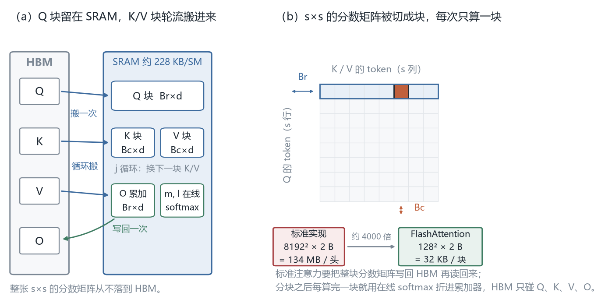

# 第 17 章　算子融合与内核选择

## 17.1　融合为什么省带宽

一张 H100 的算力是 989.4 TFLOPS（BF16），带宽是 3.35 TB/s。两个数一除，得到 295 FLOP/byte。这个数就是分水岭：一个算子每从 HBM 搬一个字节，能凑出 295 次浮点运算，它才可能被算力限制；凑不出来，它就被带宽限制。

大部分逐元素算子连 1 都凑不出来。一次 ReLU 每读一个元素做一次比较，算术强度是零点几。LayerNorm 稍微好一点，每元素几十次运算，强度也就十几。这些算子的运行时间完全由 HBM 往返次数决定，跟算力没关系。

这就是融合的全部理由。把 k 个逐元素算子合成一个内核，中间结果留在寄存器和共享内存里，不落 HBM，HBM 往返从 k 次读写降到一次读写。

$$ T_{\text{unfused}} = \frac{2 \cdot k \cdot n \cdot 2}{B} \qquad T_{\text{fused}} = \frac{2 \cdot n \cdot 2}{B} $$

n 是元素个数，第二个 2 是 BF16 的字节数，B 是带宽，前面的 2 是一读一写。k 个算子省下的就是 k 倍。

算例。n 取 6.71e7（s 与 h 都是 8192 的一层），BF16 下每个张量 134 MB。k 取 5，不融合要在 HBM 上过 1.34 GB，按 3.35 TB/s 是 400 微秒；融合之后只过 268 MB，80 微秒。一层省 320 微秒，80 层省 25.6 毫秒。相对一秒多的步时，这是百分之二点五。

百分之二点五听着不多，但这是单条样本的账。微批开到 8 就是二十毫秒乘 8，而且模型越小这个比例越大，因为融合省的是与 h 成正比的量，而计算是与 h 平方成正比的。h 从 8192 降到 1024，计算量降 64 倍，融合省下的量只降 8 倍，占比从百分之二点五涨到百分之二十。小模型上做融合的收益，比大模型高一个量级。

融合也有代价，主要是寄存器压力。k 个算子合在一起，中间结果要同时活着，寄存器用量按 k 增长。寄存器一旦不够，编译器就把中间值溢出到 local memory，而 local memory 就是 HBM，融合的收益直接归零。这是"融合之后反而慢"最常见的原因。

第二个代价是并行度下降。融合后的内核一个线程要负责更多工作，为了装下中间值，块大小被迫缩小，占用率跟着降。原来每个 SM 能跑 8 个块，融合后只能跑 3 个，延迟隐藏变差，带宽也就跑不满。

融合的粒度还受共享内存约束。一个块要处理一整行才能算 LayerNorm，h 等于 8192 时一行就是 16 KB（ BF16 ），228 KB 的共享内存最多装十四行。块里行数少了，向量化宽度不够；行数多了，占用率下来。这个帐篷顶就在十几行附近，调参调的就是它。

现场症状。打开融合之后步时没变，看 ncu 会发现 local memory 的读写量上去了，那就是寄存器溢出。步时反而变长，同时 SM 占用率从七成掉到三成，那是块大小缩得太狠。这两种情况都应该把融合的链拆短，五合一不如二合一加三合一。

## 17.2　LayerNorm、残差、bias 的融合

一个 Transformer block 里最值得融合的一段，是残差加、LayerNorm、以及紧随其后的那些逐元素操作。

不融合的写法是很自然的。残差加法一个内核，读主分支、读残差分支、写结果，三次张量搬运。LayerNorm 一个内核，为了算均值和方差要读一遍，归一化时再读一遍，写一遍，三次。QKV 的 bias 加法两次。dropout 两次。SiLU 两次。第二个残差再一次三次。加起来十二到十六次搬运。

融合之后能做到四次。残差加和 LayerNorm 合在一起，读主分支、读残差分支，在寄存器里加完直接算 sum 与 sum of squares，一遍出均值方差，再在寄存器里归一化写出去。这一步的关键是在同一遍读里同时累计一阶和二阶矩，不用 Welford 那种两遍扫描。数值上直接用 E[x²] 减 E[x]² 在 bf16 里有精度风险，所以累计要用 fp32，这一点融合内核里必须显式写。

算例，还是那个 6.71e7 元素的层。不融合按 14 次搬运算，1.88 GB，560 微秒。融合按 4 次算，536 MB，160 微秒。一层省 400 微秒，80 层 32 毫秒，占 1.33 秒步时的百分之二点四。

这里有个容易忽略的点，融合的边界应该切在"需要整块数据才能算"的地方。LayerNorm 需要整行的均值和方差，所以它的融合边界是行，一行 h 个元素。跨行的融合做不了，因为要等整行读完才知道怎么归一化。这也是为什么 LayerNorm 的融合内核在 h 不是 128 的倍数时性能会掉，尾部处理会破掉向量化。

bias 加法单独做很浪费，它完全可以并进前一个 GEMM 的 epilogue。GEMM 算完最后一个 tile，结果还在寄存器里，顺手加 bias 再写出去，一次搬运都不多。cuBLAS 的 epilogue 支持这个，自己写 Triton 的话就是在累加器输出前加一行。

dropout 的融合更微妙一些。它需要一个随机数，而随机数生成器有状态，融合进别的内核之后状态推进的次序就变了，这会影响可复现性。这也是很多框架在训练和推理用不同融合策略的原因。

还有一个规律值得记住。逐元素部分占步时的比例，只跟模型的形状有关，跟 b 和 s 基本无关。因为 GEMM 的时间随 b 与 s 线性涨，逐元素的时间也随 b 与 s 线性涨，两边同步走。所以大 batch 不会把融合的相对收益变大，也不会变小；变的是 h，h 越小，逐元素占比越高。这条规律能帮你在没跑之前就估出融合值不值得做。

现场症状。融合之后数值对不上，loss 从第一步就偏高，多半是 LayerNorm 的方差用了有偏估计或者精度不够，把累计容器从 bf16 改成 fp32 就好。融合之后某些层的梯度变成 NaN，那是残差分支上的 dropout mask 被复用了，同一个 mask 在前向和反向用了两次，实际上应该只在前向生成、反向复用同一份。

## 17.3　FlashAttention 的分块与在线 softmax

标准注意力的写法是三步。先算 S 等于 Q 乘 K 的转置，形状 (b, a, s, s)，落 HBM；再对 S 做 softmax，落 HBM；最后乘 V。中间那个 S 是全部问题所在。

算一下它有多大。b 取 1、a 取 64、s 取 8192，元素数是 4.3e9，BF16 下 8.6 GB。这个张量要被写一次、读两次（softmax 读、乘 V 读），实际上还要存 softmax 的输出，加起来在 HBM 上过三十多个 GB。按 3.35 TB/s 是十毫秒量级，而这一层的实际计算只要几毫秒。整个注意力变成访存受限。

FlashAttention 的做法是不把 S 写出去。把 Q 按行分块，K 和 V 按列分块，每处理一个 K 块就更新一次输出累加器。这样显存从 O(s²) 降到 O(s·h)，8K 序列下是 134 MB，降到原来的六十四分之一。

难点在 softmax 的归一化是全局的。算完第一块的时候不知道后面还有没有更大的值，所以不能直接归一化。在线 softmax 维护两个标量，当前见过的最大值 m 和对应的指数和 l。每来一个新块，先算这一块的局部最大值，跟 m 比，取大的作为新的 m，然后把已经累加的输出按指数差缩放回去。

$$ O_{\text{new}} = O_{\text{old}} \cdot e^{m_{\text{old}} - m_{\text{new}}} \qquad l_{\text{new}} = l_{\text{old}} \cdot e^{m_{\text{old}} - m_{\text{new}}} + \sum_j e^{x_j - m_{\text{new}}} $$

只有乘法和求和，没有除法，所以每一步都能在寄存器里完成，不需要回读。最后一遍把 O 除以 l 就得到结果。这个技巧不是 FlashAttention 发明的，数值计算里叫 streaming softmax，FlashAttention 的贡献是把它和分块矩阵乘拼成一个内核，让中间结果从不落 HBM。

*图 17-1　FlashAttention 的分块计算与显存占用*

分块之后算术强度上来了。一层的注意力计算是 4·s²·h 次浮点运算，8K 序列下 2.2e12；需要从 HBM 读的是 Q、K、V 三块，各 134 MB，共 402 MB。强度是 5500 FLOP/byte，远高于 295，所以变成了算力受限。同样一层，改成算力受限之后，时间从十毫秒级降到五毫秒级。

分块大小是调参的核心。块越大，每次从 HBM 读进来的 K、V 被复用的次数越多，算术强度越高；但块大意味着共享内存占用大，228 KB 的共享内存装不下太大的块。s 等于 8192、head_dim 等于 128 时，一个 128×128 的 K 块是 32 KB，加 V 块 32 KB，加 Q 块 32 KB，再加输出累加器，正好卡在共享内存的边上。这也是为什么 head_dim 从 128 变成 96 或者 160 时性能会掉一截，分块边界对不齐。

因果掩码会把算术强度拉低一半。因为下三角之外的分块不用算，但也不能白拿，每个块要么算要么跳，而块的对角线上总有一半是浪费的。s 等于 8192、块 128 时，对角块有 64 个，每个浪费一半，总浪费量相当于全部计算的百分之零点八，可以忽略。s 等于 512 时分块只有 4 个，对角浪费占四分之一，这时候因果掩码的优化就显得很重要。

变长序列是另一个维度。一批里长短不齐，pad 到最长会让短样本的计算全浪费。按实际长度打包（varlen）后每个样本只算自己那段，代价是内核里要多一层偏移量查表，而且分块边界不再对齐。经验上平均长度不到最长长度一半时，varlen 比 pad 快三成以上。

现场症状。序列很短（比如 512）时 FlashAttention 反而比朴素实现慢，那是分块的开销盖过了省下的搬运，短序列该用朴素实现或者干脆用融合的 mask 版本。训练时 loss 在中段突然跳，同时 attention 的输出有 inf，那是在线 softmax 的 m 没有及时更新，通常是某个块全被 mask 掉了、局部最大值取了 -inf。

## 17.4　融合优化器与参数更新

优化器这一步在计算上很便宜，在访存上很贵。

Adam 每更新一个参数，要读参数、读梯度、读一阶矩、读二阶矩，写回参数、写回一阶矩、写回二阶矩。参数和梯度是 BF16 各两字节，两个矩是 FP32 各四字节。读 12 字节，写 10 字节，一共 22 字节每参数。再加上 FP32 主权重，读 4 写 4，变成 30 字节。

$$ T_{\text{opt}} = \frac{30 \cdot N_{\text{local}}}{B} $$

N 是这张卡上的参数量，B 是带宽。

算例。175B 配 TP8 与 PP8，每卡 2.74e9 参数。30 乘 2.74e9 是 82 GB，按 3.35 TB/s 是 25 毫秒。同一步的计算时间约 1.33 秒，优化器占百分之二。

这个比例不大，但如果优化器被拆成四个内核（一阶矩更新、二阶矩更新、参数更新、主权重转换），每个内核都要把张量完整读一遍写一遍，实际搬运量翻倍，时间从 25 毫秒变成 50 毫秒以上。融合成一个内核，四个步骤在寄存器里连着做，25 毫秒就守住了。

更进一步是算子融合的边界扩展到梯度裁剪。裁剪需要先算全局范数，这是一次额外的全量读。融合的做法是在反向的最后一个梯度桶里顺便累计平方和，避免再读一遍。这一招在梯度桶很大的时候能省几十毫秒。

FP32 主权重和多精度的组合最容易写错。正确的次序是，用 BF16 的参数做前向，用 BF16 的梯度做更新前的缩放，然后在 FP32 里更新主权重，最后把主权重转回 BF16 供下一步用。这个转回的动作如果在单独的内核里做，又是一次全量读写。合进优化器内核，成本归零。

分片优化器和融合有冲突。ZeRO 把优化器状态按 DP 度切开，每个 rank 手里是一段不连续的参数。融合内核需要连续内存才能向量化，分片之后每段的长度变小，向量化宽度从 128 位降到 32 位，带宽利用率掉三成。解决的办法是把分片的粒度对齐到内核的向量宽度，或者干脆用 bucketed 的排布把同 rank 的参数放在一起。

优化器这一步还有个时间窗口可以利用。数据并行下，每个 rank 只处理自己分片里的参数，处理完不需要等别人，直到下一步的 all-gather 才需要同步。所以优化器内核的尾部可以跟下一个桶的梯度 all-reduce 重叠，只要两者不在同一个流上串行。这一步做得好，25 毫秒能藏掉一半。

现场症状。开了融合优化器之后 loss 曲线在几千步后缓慢发散，多半是主权重更新的次序错了，先转了 BF16 再更新，精度被截断两次。步时在优化器阶段出现尖峰，那是分片之后的碎片化让内存池反复扩缩，看 reserved 的曲线就能确认。

## 17.5　CUDA Graph 与启动开销

一步训练要发多少个内核。反向的每个算子一个，逐元素的一堆，通信的每个桶一个，再加上优化器。千亿参数的模型，一步几百到上千个内核不奇怪。

每发一个内核，CPU 侧要做的活包括参数检查、网格计算、驱动调用。这段开销按几微秒算，一千个内核就是几毫秒。如果 CPU 够快、GPU 上的内核够长，这几毫秒能被盖住，因为 GPU 是异步执行的，前一串还在跑，后一串已经在排队。

盖不住的情况有两种。一种是内核太短，每个只有十几微秒，CPU 发得比 GPU 跑得慢，GPU 就出现空泡。另一种是中间夹了同步点，比如 Python 侧的 `.item()`、打印 loss、或者动态调整的超参，每次同步都把流水打断，CPU 必须等 GPU 跑完才能继续发。

CUDA Graph 解决的是第一种。把整步的内核序列录成一个图，之后每次只提交一次，CPU 的开销从上千次调用降到一次。录制的时机会把地址固定下来，所以之后不能再有新的显存分配，内存池必须提前设成固定大小。

算例。假设一步有 800 个内核，每个的 CPU 侧开销按 5 微秒算，是 4 毫秒。步时 1.33 秒的时候，这 4 毫秒占千分之三，可以忽略。但如果模型小、并行度高，一步只有 30 毫秒，4 毫秒就是百分之十三。这就是为什么 CUDA Graph 在小模型和高并行度配置里是必需品，在大模型上则是可选项。

录制图有几个硬限制。形状必须固定，所以变长序列的 batch 要先 padding 到定长，或者按几个固定长度分桶、每桶录一张图。随机数状态要显式管理，因为图里的 RNG 内核每次跑出来的数是一样的，不推进状态的话 dropout 就失效了。NCCL 的集合通信要在 capture 模式下支持，老版本不支持，会把图打断。显存里不能有需要重新分配的操作，否则图执行时会崩。

图还有一个用法是跨微批。梯度累积的多个微步结构相同，可以把整个累积周期录成一张图，把 all-reduce 也纳进去。这样一步之内 CPU 完全不介入，通信与计算的事件依赖由 GPU 侧的图来保证，比 Python 里插事件可靠。代价是累积步数变成结构的一部分，改累积步数就要重录。

重计算和 CUDA Graph 的配合要多想一步。重算会在反向里重新跑前向，内核数量因此变多，图的节点也就变多。如果重算的段是动态决定的（比如按显存余量自适应），图就录不下来，因为结构每次不一样。所以要用图，重算的策略必须先固定下来。

变长序列的处理是靠分桶。把序列长度分成几个固定档（比如 2048、4096、8192），每档录一张图，运行时按实际长度选图。这个做法把“定长”的硬要求变成了工程上可接受的近似，代价是档与档之间会有 padding 浪费。

图的执行还有一个前提，结构必须固定。这就是流水并行的微批数不能动态变、专家并行的容量因子不能随步变的原因。谁的形状会变，谁就不能进图，一个节点不进图就拖着整步回到逐次启动。所以用图之前先把动态的东西清干净，这往往比录图本身工作量大。

现场症状。开了 CUDA Graph 之后显存多占了一大块，那是内存池被固定成峰值大小，预留的碎片永远不还。训练几步之后 loss 不变，那是 RNG 状态没推进，每次前向看到的 dropout mask 都一样。图捕获时报错说某个算子不支持 capture，那是自定义算子里有 CPU 侧的同步或者内存分配，得先把那部分改成 out-of-place 的静态实现。

## 17.6　Triton 与手写 CUDA 的取舍

同一个内核有三种写法，库调用、Triton、手写 CUDA。选哪个不看技术先进性，看它占步时的多少。

库调用优先。cuBLAS 的 GEMM、cuDNN 的卷积、NCCL 的集合通信，这些都被调到接近硬件极限，自己写的胜算很小。判断标准很简单，如果这个形状是标准形状（M、N、K 都是 128 的倍数，对齐良好），库调用就够了。

Triton 用在库没有覆盖、但又不值得手写的地方。它用块级编程模型，一个 program 处理一个 128×128 的块，共享内存分配、异步拷贝、流水深度由编译器自动处理。写一个融合的 LayerNorm 加残差，三十行代码，性能能到 hand-written 的八成到九成。这个性价比在快速迭代阶段无可替代。

手写 CUDA 用在两个地方。一是需要 TMA 和 warp specialization 的场合，比如 Hopper 上的生产者消费者流水线，Triton 表达不了那么细的控制。二是需要 thread block cluster 和分布式共享内存的场合，跨 block 的数据交换在 Triton 里没有直接映射。这两种都是把最后百分之十的性能榨出来的手段，投入是 Triton 的五到十倍。

判断顺序可以量化。先跑一次 profile，把这个内核占步时的百分比拿出来。占比低于百分之一，用库；百分之一到百分之十，用 Triton；超过百分之十且已经确认它是瓶颈，才值得手写。这个门槛不是拍的，是投入产出的比值算出来的，手写一个内核要两三周，占百分之一的内核优化到极限也只省百分之一。

Triton 有两个坑要知道。一是 autotune 在第一次运行时会试几十种配置，每个配置都要跑一遍，模型大的时候第一分钟全花在这上面，而且这个过程在每个进程里都要重复。把最优配置写死成常量，能省掉这段。二是编译缓存在不同机器之间不共享，容器重启后要重新编译，如果编译时间算在启动超时里，作业会被调度器杀掉。

库调用也不总是安全的。cuBLAS 选算法时会看形状，形状稍有变化就从大内核切到 split-k 的小内核，性能可能出现三成以上的断崖。判断方法是拿几个相邻的形状各跑一次基准，看看曲线是不是平的。如果出现台阶，就在那个台阶附近把形状强行对齐。

还有一个不常被提及的成本，可移植性。手写内核跟架构绑死，用了 TMA 和 cluster 的代码在上一代卡上跑不了，换一代就得重写一遍。Triton 的代码在 A100 和 H100 上都能跑，性能不一样，但至少能跑。在做长周期项目的时候，这个因素比单次性能测试的百分之十更重要。

现场症状。换了一个 Triton 版本之后某个内核慢了百分之三十，那是编译器对块的调度策略变了，把 autotune 打开能找回一部分。手写内核在 A100 上很快、在 H100 上反而慢，那是没用 TMA，Hopper 的共享内存带宽和 A100 的访问模式不一样，直接照搬代码会浪费一半带宽。

## 17.7　选择顺序

优化的顺序不能凭直觉，得按 profile 的占比排。

第一步永远是拿 profile。一步的 trace 打开，按内核时间排序，看前十个占了多少。经验上前十个内核占九成以上，剩下的几百个加起来不到一成，优化它们没有意义。

拿到占比之后按 Amdahl 定律算上限。一个占四成的部分优化掉一半，整步只快两成。这个上限要先算出来，再决定投多少人。

| 症状 | 先做什么 | 再做什么 |
|---|---|---|
| 逐元素内核占三成以上 | 融合相邻的逐元素链 | 检查是否寄存器溢出 |
| 注意力内核占四成以上 | 换 FlashAttention 实现 | 调分块大小对齐 head_dim |
| 内核间隙多、GPU 空转 | 查 CPU 侧同步点 | 上 CUDA Graph |
| 优化器阶段占一成以上 | 融合优化器 | 主权重转 BF16 合进内核 |
| 某个自定义算子占两成 | 写 Triton 版本 | 确认瓶颈后手写 CUDA |

这张表的读法是从上往下。上面的症状出现频率高、修复成本低，下面的相反。一张表能覆盖八成的情况。

有一个反直觉的经验，先修启动开销通常比先修内核更划算。因为启动开销是"整步乘以一个比例"，改一处全局受益；而单个内核的优化只影响局部。一步 800 个内核、每个多花 5 微秒，就是 4 毫秒，这 4 毫秒要从 GEMM 里省出来几乎不可能，从 Python 侧省出来只是改几行。

还有一个纪律，一次只改一处。同时改融合策略和分块大小，性能变了也说不清是谁的功。把 baseline 的步时、每个内核的时间、HBM 读写量存成一份基准，每次只动一个变量，动完跟基准比。这份基准在项目末期回查“哪一次提交变慢了”的时候会救命。

验收的标准也要定。融合之后应该看到 HBM 读写的字节数下降，这个数 ncu 里直接有；启动开销优化之后应该看到内核之间的空隙变窄，trace 上看就是色块挨得更紧；换内核之后应该看到该内核的时间下降而其他不变。三个指标里任何一个不达标，说明改错了地方。

## 17.8　逐元素链的字节账

17.1 里那个 295 FLOP/byte 是分水岭，把常见算子按这个尺度排一遍，谁该融合谁不用融合一眼就能看出来。

| 算子 | 每元素字节（BF16） | 每元素运算次数 | 算术强度 |
|---|---|---|---|
| ReLU | 4 | 1 | 0.25 |
| 残差相加 | 6 | 1 | 0.17 |
| bias 相加 | 4 | 1 | 0.25 |
| dropout（含 mask） | 5 | 2 | 0.40 |
| SiLU | 4 | 4 | 1.0 |
| softmax（一行） | 4 | 6 | 1.5 |
| LayerNorm | 4 | 8 | 2.0 |

一列看下来，最高的 LayerNorm 也只有 2，离 295 差两个数量级。这张表的意思是，这些算子的执行时间完全由字节数决定，算力再翻一倍也不会变快。反过来，把字节数砍一半，时间就砍一半，这是唯一有效的优化方向。

融合的收益还有一层，跟 batch 无关。一层里逐元素的搬运量随 b 线性涨，计算量也随 b 线性涨，两边同步走，所以 b 从 1 提到 8，融合省下的比例不变。真正改变比例的是 h，窄模型受益多，宽模型受益少。这条规律让人可以在没跑基准之前就估出融合值不值。

一层的常数项是十七个单位、2.28 GB。每个算子单独过一遍 HBM，一读一写，十七个单位就是三十四次搬运，4.56 GB，按 3.35 TB/s 是 1.36 毫秒。把整条逐元素链融成一条之后，中间值留在寄存器和共享内存里，搬运次数降到六七次，0.3 毫秒左右。一层的计算时间是 33 毫秒，1.36 对 33 是百分之四，融合之后是百分之一。

百分之四看着不起眼，但它跟 h 成反比。把逐元素的搬运时间和一层的计算时间写在一起，比值是

$$ \frac{T_{\text{elem}}}{T_{\text{comp}}} = \frac{u \cdot 4 \cdot s\,b\,h / B}{24\,h^{2}s\,b / P} = \frac{u\,P}{6\,B\,h} \approx \frac{19.7\,u}{h} $$

u 是单位数，P 是有效算力，B 是带宽。h 取 8192、u 取 17 时是 0.041，h 掉到 1024 时变成 0.33。同一个模型变窄八倍，逐元素从百分之四涨到三成三，融合从"顺手做一下"变成"必须做"。

中间值用什么精度存也会翻倍。把整条链的中间值从 BF16 换成 FP32，字节数加倍，1.36 毫秒变 2.7 毫秒，融合之后的 0.3 毫秒也变 0.6。所以一个融合内核里要区分两类量，需要精度的累计容器用 FP32，纯粹过路的中间结果留 BF16。全都升到 FP32 是最常见的浪费，比不融合还亏。

还有一个方向是减少写的次数。残差相加是读两份写一份，如果后面的 LayerNorm 要读这份结果，融合之后这份结果根本不用落 HBM。这就是 17.2 里那条从十四次搬运压到四次的路径。判断标准很简单，一个张量被写出去之后，如果只有紧挨着的下一个算子读它，这一次写就是白写。

现场症状。融合之后吞吐没变但 ncu 显示 DRAM 吞吐降了，那是融合确实生效了，只是这一层本来就不是瓶颈，收益被别处盖住。融合之后 DRAM 吞吐没降，那是编译器把中间值又写回了 global memory，看 SASS 里的 `STG` 指令数量就能确认，多半是链太长、寄存器不够。

## 17.9　归一化的融合边界

LayerNorm 值得单独拎出来，因为它的融合边界不是由数据流决定的，是由数学决定的。

算均值要读完整行，算方差要读完整行，归一化又要读一遍。朴素写法是三趟，六次搬运。一遍扫描的写法把 E[x] 和 E[x²] 同时累加，读完一趟就有了均值和方差，然后原地归一化写出去，两次搬运。省下这四次搬运不需要任何技巧，只要在同一个循环里累两个累加器。

数值上有个坑。用 E[x²] 减 E[x]² 求方差，在 BF16 里几乎一定出问题，因为两项都是大数、差值是小量，有效位被吃掉。累加器必须是 FP32，而且行内元素多的时候要用分块累计再合并，否则 FP32 也会掉精度。这一条在内核里必须显式写出来，不能指望编译器替你升精度。

| 写法 | 每行搬运次数 | h 为 8192 时一行字节 | 相对时间 |
|---|---|---|---|
| 三趟朴素 | 6 | 96 KB | 1.0 |
| 两趟（先统计算，再归一化） | 4 | 64 KB | 0.67 |
| 一趟（同时累计一二阶矩） | 2 | 32 KB | 0.33 |

反向也要用整行。LayerNorm 的反向需要 x 和 rstd，rstd 是每行一个标量，存下来只要几百字节，x 却要整张量。所以融合边界画在 LayerNorm 上时，前向必须把输入留下，这一点省不掉。有人以为把 LN 融进前一个算子就能连输入都不留，那是把重算和融合搞混了。

共享内存决定了行内并行能做到多宽。h 等于 8192、BF16 时一行 16 KB，228 KB 的共享内存能放十四行，也就是一个块处理十四行。如果中间值用 FP32，一行 32 KB，只能放七行。块里行数少了，每个线程分到的元素变少，向量化宽度不够，一次只能发 4 字节的加载，带宽利用率掉到六成左右。

寄存器是另一个约束。一个块 128 个线程处理一行 8192 个元素，每个线程 64 个元素，FP32 累计需要 128 字节，也就是 32 个寄存器，加上地址、循环变量、归一化阶段的临时值，五六十个寄存器跑不掉。一个 SM 有 65536 个寄存器，块大小 128 时最多能放 8 个块，占用率五成。如果每个线程处理 128 个元素，寄存器翻倍，只能放 4 个块，延迟隐藏立刻变差。

RMSNorm 是个例外。它不减均值，只算均方根，累加器少一个，反向也少一项，同样行宽下寄存器压力小两成。代价是数值行为和 LayerNorm 不一样，换过来要重新验一遍 loss 曲线，不能只看吞吐。

现场症状。融合之后某个特定 h 的性能特别好、相邻的 h 掉一半，那是 h 能被块大小整除与不能整除的差别，尾部处理把向量化打断了。h 是 4096 和 8192 都很好、6144 很差，就是这个原因。处理办法是把块大小做成按 h 选择的几档，而不是一个全局常量。

## 17.10　在线 softmax 的递推代价

在线 softmax 那两行递推看起来是免费的，实际有三笔开销，都不大，但理解它们才知道块大小为什么不能随便调。

第一笔是重新缩放。每来一个新块，如果这一块的局部最大值超过了历史最大值，就要把已经累加的输出乘一个指数因子。缩放的对象是输出累加器，宽度是 head_dim。一个头上缩放的乘加次数是 (s/块大小) 乘块大小乘 d，也就是 s 乘 d，跟块大小无关。s 取 8192、d 取 128 时是 1.05e6 次乘加，六十四头合起来 6.7e7，相对这一层注意力的 2.2e12 是万分之零点三。

第二笔是串行依赖。缩放必须在下一个块累加之前完成，所以块与块之间是一条链。块 128 时链长 64，块 256 时链长 32。总浮点量不变，但链越长，流水填充与排空的开销占比越高，而且每级都要等共享内存的读写延迟。这是块大小不能取太小的真正原因，不是因为算得多，是因为等得多。

第三笔是指数函数。标准写法用 exp，硬件上是一条 SFU 指令加几次修正，吞吐比 FMA 低一个量级。改成 exp2 只差一个常数因子，可以把这个因子提前乘进 Q，也就是所谓的 scale 折叠，一个头省下 s² 次乘法。这一步在数值上等价，实现上却能让 softmax 那段快两成。

块大小的账可以这样算。一个 Q 块要对所有 K 块循环，每个 K 块从 HBM 读一次，被多少个 Q 块复用取决于 Q 块的大小。块取 128 时，一个 128 行的 Q 块配 8192 长的 K，K 被读 64 次；块取 256 时 K 被读 32 次，HBM 读量减半。这就是 17.3 里算术强度随块大小上升的来源。共享内存限制了上限，128 乘 128 的 BF16 块是 32 KB，Q、K、V 各一块加输出累加器就把 228 KB 用掉了大半。

因果掩码的处理要小心全 mask 的块。下三角之外的分块整块被 mask 掉，如果照常参与计算，块内所有分数都是 -inf，局部最大值也是 -inf，exp(-inf 减 -inf) 得到 NaN，一路传下去。正确做法是这些块直接跳过，或者在 mask 时用一个很大的负数而不是 -inf 表示禁用。这个 bug 在序列短、块数少的时候不出现，序列一长就开始冒 inf，很难查。

变长序列的分块边界更麻烦。varlen 之后每个样本的起点不对齐到块大小，一个块可能横跨两个样本，掩码要按样本内偏移算。这里的实现细节决定了能不能真拿到三成收益，做得糙的版本反而比 pad 到定长慢。

现场症状。序列从 8192 提到 16384 之后 attention 的时间涨了四倍多而不是四倍，那是块数翻倍让串行链变长，同时又撞上了共享内存的上限。attention 的输出在长序列尾部出现 inf，那是全 mask 块的 NaN 传上来了。把块大小从 128 改到 256 之后 loss 有微小偏移，那是在线 softmax 的 rescale 用了 BF16 而不是 FP32，累计误差在深层的注意力和上被放大了。

## 17.11　启动开销的实测与图回放

启动开销这件事最容易凭感觉判断，所以要把它变成一张表。

一步的内核数在千亿参数模型上是几百到上千，每个内核的 CPU 侧开销按 4 微秒算，其中包括参数检查、网格计算、驱动提交。

| 一步的内核数 | CPU 侧开销 | 步时 30 ms | 步时 300 ms | 步时 1.33 s |
|---|---|---|---|---|
| 400 | 1.6 ms | 5.3% | 0.5% | 0.12% |
| 800 | 3.2 ms | 10.7% | 1.1% | 0.24% |
| 1600 | 6.4 ms | 21.3% | 2.1% | 0.48% |

同一份代码，在 30 毫秒的步时里要吃掉两成，在 1.33 秒的步时里只占半个百分点。所以"要不要上 CUDA Graph"这个问题没有统一答案，先量一下自己的步时和内核数，落在哪一档一目了然。

图的回放开销是十微秒量级。八百个内核的序列从 3.2 毫秒降到十微秒，省下的 3.19 毫秒在 30 毫秒的步时上是百分之十，在 1.33 秒上是百分之零点二。这跟上面那张表的差值是同一件事的两面。

录制本身有几个硬限制，前面说过形状固定、RNG 状态、通信 capture、不能重新分配显存。这里补两条实操上的。一是内存池的固定是在捕获时按当时的峰值定下的，之后的碎片不再归还，等于凭空多占一份预留，80 GB 的卡上这个数是 8 到 16 GB。二是图一旦录错，报错信息几乎没有指向性，只能靠二分法把节点一段一段拆出来单独录，这是使用图最耗时间的环节。

图回放之后还有一个隐藏的收益，间隙消失。逐次启动时内核之间有几十纳秒到几微秒的空隙，八百个内核累计起来是几百微秒到几毫秒，这部分在图里没有了，因为整张图是一次提交、GPU 侧按依赖直接推进。这部分收益在 trace 上看得最清楚，色块之间贴紧了。

代价是可调试性。图执行期间不能单步，不能在中间插 `print`，改一个超参就要重新录。所以工程上的做法是留一条非图的路径，调试时走那条，性能测试和正式训练走图。两条路径的数值必须一致，这一点要用同一个种子跑一遍对拍。

现场症状。上了图之后显存多占十几 GB，那是内存池按峰值固定了，正常。图回放之后 loss 曲线跟逐次启动不一样，那是 RNG 内核的状态没推进，每次 dropout 用的 mask 相同，训练等价于少了一半正则。捕获时卡住不动，那是有算子在做同步，把 `.item()` 或者动态形状的地方揪出来。

## 17.12　内核选择与投入产出

17.6 给了一条判断顺序，这里把它变成一张能直接对照的表。表里的"极限收益"是指把这个内核优化到完全不占时间，那是拿不到的上限，实际能拿到一半就不错。

| 内核占步时 | 极限收益 | 合理手段 | 典型投入 |
|---|---|---|---|
| 50% 以上 | 50% | 换库、换算法、手写 | 三周起 |
| 20% 到 50% | 10% 到 25% | 手写或深度调 Triton | 两到三周 |
| 5% 到 20% | 2.5% 到 10% | Triton 加形状对齐 | 一到两周 |
| 1% 到 5% | 0.5% 到 2.5% | Triton，或只改参数 | 几天 |
| 1% 以下 | 不到 0.5% | 什么都不做 | 零 |

读法是先看占比落在哪一行，再看这一行的投入能不能接受。一个占百分之三的内核，优化到极限也就省百分之一点五，投两周去写是个亏本买卖，除非这个内核在别的项目里还能用。

投入产出要按训练周期折算才准确。一次两个月的训练，省百分之一点五的步时等于省下零点九天，按 16384 张卡算是将近一万五千卡时。这个数跟两周的人力比，在单个项目上通常不划算，在十个项目复用的公共库上就非常划算。所以判断依据不是占比，是这个内核的复用次数。

形状对齐常常比写内核便宜得多。很多占百分之三的内核，慢的原因是 M 或 N 不是 128 的倍数，尾块把向量化和流水都打断了。把 batch 凑到能整除、或者把词表大小补到 128 的倍数，不用写一行内核代码，性能就能回来一半。做优化之前先花十分钟检查形状，比花两周写内核的期望收益高。

库调用的形状敏感性也在这里体现。cuBLAS 按形状选算法，M 从 4095 变到 4096 就可能从一个大内核切到 split-k，性能出现断崖。判断方法是拿几个相邻形状各跑一次基准，曲线平就没事，出现台阶就在台阶附近强行对齐。这个动作的成本是半小时，收益可能是两位数。

最后一个纪律是版本锁定。手写内核和 Triton 内核的性能都跟编译器版本强相关，一次镜像升级就能让做了三个月的优化回到起点。要用内核优化，就得把镜像版本固定下来，升级时重跑基准。没有这套纪律，优化的收益会在半年内被无声地吃掉。
