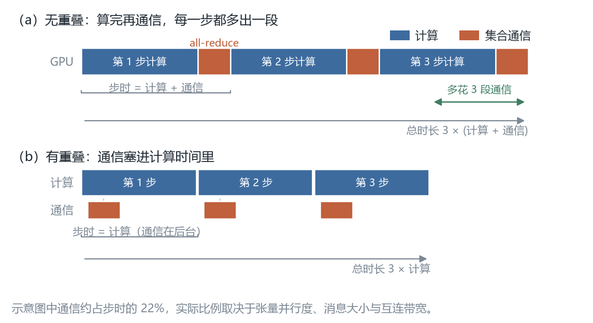

# 第 18 章　通信与计算的重叠

## 18.1　三种重叠

集群里要重叠的通信有三种，性质各不相同。

第一种是数据并行的梯度归约。反向是从最后一层往前算的，第 L 层的梯度算完就能发出去，不用等前面各层。所以归约可以跟反向并行推进。这条路的窗口最长，是整段反向的时间，占总步时的三分之二左右，收益也最大。

第二种是张量并行的归约。每层前向末尾有一次 all-reduce，反向对应位置再一次。这个归约卡在两层的中间，前一层算完才能发、后一层要等它回来才能继续，可重叠的窗口只有相邻层里那些不依赖它的算子，比如 LayerNorm 和残差。窗口窄，收益有限，但在 TP 度大的时候仍然值得做。

第三种是流水并行的激活传递。上一级的输出要送给下一级，点对点，量是 s·b·h 乘字节数。这条传递本身就能和本级的其他微批计算重叠，因为流水并行本来就有多个微批在飞。

三者的量级差得很远。拿一个真实配置算，405B、TP8、PP16，一共 128 路切分，用 16384 张 H100，于是 DP 度是 128。每卡分到 3.16e9 参数，BF16 下梯度是 6.3 GB。

DP 的归约量按 ring 算法是每卡传输 2S(N-1)/N，S 是每卡的梯度字节数，N 是 DP 度。

$$ V_{\text{dp}} = 2 \cdot S \cdot \frac{N-1}{N} = 2 \cdot 6.3 \cdot \frac{127}{128} = 12.5 \text{ GB} $$

按单卡一张 400 Gb/s 网卡即 50 GB/s 算，12.5 GB 要 250 毫秒。同一配置一步的浮点运算是 6ND，N 是 405e9 参数，D 取 400 万 token，摊到 16384 张卡、按单卡 989.4 TFLOPS 的四成即 396 TF 算，一步 1.5 秒，其中反向约 1.0 秒。250 毫秒塞得进 1.0 秒，理论上能被完全盖住。

TP 的量小得多。405B 的隐藏维是 16384，s 取 8192、b 取 1 时，一层要归约的激活是 1.34e8 个元素、BF16 下 268 MB，前向反向各一次共 536 MB。走 NVLink 900 GB/s 是 0.6 毫秒。同一层的计算，每层参数 12·h² 即 3.2e9，前向浮点运算是 2 乘 3.2e9 乘 8192 得 5.3e13，TP8 摊到每卡 6.6e12，按 396 TF 是 17 毫秒。通信占百分之三点五。

这就是张量并行必须待在节点内的原因。同样这 536 MB 走 50 GB/s 的网卡要 10.7 毫秒，占 17 毫秒的六成，重叠也救不回来，因为窗口本身就只有 17 毫秒。

PP 的传递量跟 TP 同量级，一个微批一次 268 MB，走网卡 5.4 毫秒，走节点内 NVLink 0.3 毫秒。级间通常跨节点，所以按前者算。一级的 7.9 层要算 134 毫秒，5.4 毫秒的传递占百分之四，被多微批的调度天然盖住。

三种重叠的价值排序很清楚。DP 的归约量大、窗口长，是重叠的主战场；TP 的量小、窗口窄，重叠只能捞回一部分；PP 的传递被微批调度盖住，不太需要额外手段。

三种重叠还会互相干扰。DP 的 all-reduce 走网卡，TP 的 all-reduce 走 NVLink，两者碰的不是同一份带宽，可以真的并行。但两者都要占 SM，也都读写 HBM。如果在反向尾部 TP 的归约和 DP 的归约同时发生，SM 占用叠加，计算内核拿到的 SM 更少，反而变慢。调度器不会主动避让这件事，得靠人把桶的边界错开。

还有一个常被忽略的选项，把 all-reduce 拆成 reduce-scatter 加 all-gather。两段的总传输量与 ring all-reduce 一样，但拆开之后有一个好处，reduce-scatter 结束时每个 rank 已经拿到了自己那一片的完整和，如果下一步只需要处理自己那一片（ZeRO 的分片优化器正是如此），all-gather 就能推到后面、跟其他计算重叠。一个拆法把一段通信变成两段可分别调度的通信。

现场会出现什么。如果 DP 的归约没有重叠，步时会从 1.5 秒变成 1.75 秒，多百分之十七。这个百分之十七在 MFU 上体现得很直接，一个本来能报 40% 的配置会掉到 34%。如果 TP 的归约没有重叠，损失只有百分之四左右。两者都没做，损失叠加起来两成上下，但很多人会误以为是算力不够。

还有一种重叠容易被当成异常，它是故意不做的。张量并行的归约在单机上走 NVLink，通信量小，重叠的调度成本可能比它省下的还多，于是有的框架干脆让它串行。这种配置下看到 TP 的通信色块老实排在计算后面，不用改；要看的是 DP 的那一段有没有重叠。

## 18.2　流与事件的调度

重叠在代码层面靠的是流。一个流是一串按序执行的操作，不同流之间没有顺序，除非显式插入依赖。

PyTorch 的默认布局是两条流。计算走默认的计算流，NCCL 的集合通信走 NCCL 自己的流。这两条流之间的关系完全由事件决定，框架在合适的时机插入事件，把该串的地方串起来。

梯度归约的依赖是这样。反向算到某一层，这个桶的梯度写完，在计算流上记录一个事件；通信流等这个事件，然后发 all-reduce；优化器要用归约结果，所以在计算流上等通信流的事件。三段串起来是一个菱形，中间的 all-reduce 与后面的反向并行。

$$\text{计算流}:\ \text{反向}_L \rightarrow \text{record}(e_1) \rightarrow \text{反向}_{L-1} \rightarrow \cdots$$

$$\text{通信流}:\ \text{wait}(e_1) \rightarrow \text{all-reduce} \rightarrow \text{record}(e_2)$$

$$\text{计算流}:\ \text{wait}(e_2) \rightarrow \text{优化器}$$

菱形一旦被破坏，重叠就没了。破坏的方式有好几种，都很常见。

第一种是在通信流上做了同步。任何一次 `torch.cuda.synchronize()`、`.item()`、`print(loss)` 都会把两条流拉到同一个时间点上，之后重新开始。这类操作在调试代码里到处都是，有人忘了删，性能就少一截。

第二种是桶的边界没对上。框架按参数注册的逆序切桶，如果某一层的参数注册顺序跟计算顺序不一致，某个桶要等很久才能凑齐，那个桶的 all-reduce 就只能等到反向末尾才发，等于放弃了重叠。这在自定义模型里很常见，尤其是绕开了标准 Module 结构的实现。

第三种是通信流的优先级没设。GPU 调度器在同优先级下按提交顺序执行，如果通信内核排在计算内核后面，它就只能等。把通信流设成高优先级，能让它在带宽和 SM 上抢到位置，代价是计算内核被打断，整体不一定更快。这个旋钮要看具体负载，不能一概而论。

梯度累积的情况下要额外注意。多个微步共用一个反向，只有最后一个微步才需要发 all-reduce，前面几个微步的梯度只在本地累加。PyTorch 里靠 `no_sync()` 上下文控制这件事，忘了加的话每个微步都发一次，通信量直接乘上累积步数，而且这些 all-reduce 没有重叠窗口，全变成串行。这是梯度累积最常见的性能事故。

另一个旋钮是桶的大小上限，`bucket_cap_mb` 这类参数。默认值通常在 25 MB 附近，对大模型偏小。调它之前先算一下，每块通信时间应该远小于对应那段反向的时间，否则尾巴长；同时每块又要大到 NCCL 能用上带宽优先的算法。这两个条件夹出来的区间就是 25 到 100 MB。

还有一个结构上的选择，把 TP 组和 DP 组放到不同的进程组。默认情况下所有集合通信共用一个进程组，NCCL 建拓扑时要同时兼顾两种流量，通道数和网卡分配会做出妥协。拆成两个进程组，TP 组只用 NVLink 上的设备、DP 组只用网卡，各自能拿到更好的拓扑映射。代价是多一份通信缓冲。

事件的粒度也要算。一次 event record 加一次 wait 的 CPU 开销在几微秒量级，按 5 微秒估。每层插一对，126 层就是 252 对，1.3 毫秒；按桶插，8 个桶 16 对，几乎为零。所以重叠的调度粒度应该跟着桶走，而不是跟着层走。有人为了更细的重叠在每层都插一对事件，结果 CPU 侧变成了瓶颈，GPU 反而空转。

现场会出现什么。步时里出现一段什么都没有的空洞，长度正好等于纯通信时间，那就是串行了。另一种表现是步时方差变大，同一份数据相邻两步差一成，那是两条流在争同一个资源，谁先谁后不确定。

## 18.3　分块与流水线化

重叠要成立，通信必须切成小块，一块一块地插进计算里。

原因很直接。如果整个梯度一次性 all-reduce，它只能在反向全部结束之后发，因为要等所有梯度就绪。切成 m 块，第 i 块在反向算到第 i 段时就已经就绪，可以立刻发出去，而反向还在算第 i+1 段。

$$ T_{\text{step}} = T_{\text{compute}} + \max\left(0,\ T_{\text{comm}} - T_{\text{compute}}^{\text{(tail)}}\right) $$

后一项是尾巴，指最后一块通信没有计算可以盖住的部分。m 越大，尾巴越短，但每块的启动开销占比越高。

算例。DP 归约 250 毫秒，反向 1.0 秒，切成 8 块，每块通信 31 毫秒、每块对应的反向 125 毫秒。第一块的通信在第二块反向时进行，一路推下去，最后一块的 31 毫秒没有计算可盖，成为尾巴。总步时从 1.75 秒降到 1.53 秒，省下 219 毫秒，重叠效率八成八。

同一个例子切成 2 块，每块 125 毫秒通信对 500 毫秒反向，尾巴 125 毫秒，省下 125 毫秒，效率五成。切成 32 块，尾巴 7.8 毫秒，每块只有 7.8 毫秒的通信量、启动开销按几十微秒算占不到百分之一，效率九成七，收益已经饱和。

所以桶的大小有一个最优区间。太小，NCCL 会切到延迟优先的算法，小消息的带宽利用率本来就低；太大，尾巴长。经验值是每个桶 25 到 100 MB，8 卡节点、400 Gb/s 网卡的环境里，这个区间能把启动开销压到百分之一以内。

切块还有一个容易忽略的收益，它能把通信的尾部与优化器重叠。最后一个桶的 all-reduce 不可能被反向盖住，但可以被优化器的前半段盖住。优化器按参数顺序更新，第一组参数更新完不需要等最后一组，所以只要把优化器的执行顺序与桶的顺序对齐，尾巴还能再藏一部分。这一招能把有效重叠效率从八成八推到九成以上。

算法选择也会影响切块的效果。大消息走 ring，带宽利用率高但延迟也高；小消息走 tree 或者 NVLS，延迟低但带宽利用率一般。同一个 31 毫秒的桶，在不同算法下的实际耗时可能差一倍。NCCL 自己会按消息大小选，但它的阈值是按通用场景调的，跟你的集群不一定匹配。把 `NCCL_ALGO` 写成固定值跑几组对比，往往能找出比默认更好的选择。

*图 18-1　无重叠与有重叠的时间线*

图的上半是没有重叠的时间线，反向结束后接一段纯粹的通信，两段之间没有交叠。下半是切块之后的时间线，通信的色块夹在计算的色块之间，只有最后一块露在外面，就是那个尾巴。两条时间线的长度差，就是重叠省下的时间。

流水线化还有一个层次，是在内核内部。NCCL 自己的 ring 算法就是把消息切成 chunk 在卡间转，转一块算一块。用户侧的桶切分和 NCCL 内部的 chunk 切分是两个独立的粒度，前者决定重叠的窗口，后者决定带宽利用率。调优时只需要管前者，后者的默认值一般够用。

现场会出现什么。桶数从 2 加到 8 步时掉了百分之十几，那是桶太小、启动开销上来了，看 trace 会发现通信色块之间有大量细小的间隙。桶数加到 64 反而变慢，同样是小消息效率问题。还有一种，桶数加了但尾巴没变短，那是桶的就绪顺序跟计算顺序不一致，前面的桶还没凑齐。

## 18.4　重叠失败的典型现象

重叠失败有几种典型的现场表现，成因各不相同。

最直接的是通信时间整段加在步时上。步时等于计算时间加通信时间，两者不重叠。诊断方法很简单，把 NCCL 的调试日志打开，看 all-reduce 的起止时刻，如果所有调用都集中在反向结束之后，那就是串行了。九成是桶的边界问题或者流被同步了。

第二种是重叠了但没省时间。trace 上两条流确实在并行，但总时长没变。这是资源争抢，通信占了 SM 或者占了 HBM 带宽，计算因此变慢，省下的通信时间被吃掉。

按 SM 算一下。NCCL 的 ring 内核每个通道起若干个 block，8 卡节点里通常起 8 到 16 个通道，每个通道几个 block，粗算占掉 8 个 SM。H100 有 132 个 SM，占百分之六。反向 1.0 秒因此变成 1.06 秒，多 60 毫秒。250 毫秒的通信净省 190 毫秒，重叠效率七成六。这七成六就是现实中的上限，说通信完全被隐藏是不准确的。

第三种是掉队者把窗口吃掉。all-reduce 是同步的，最慢的那个 rank 决定完成时刻。掉队者的伤害不是线性的。一步里假设每个 rank 的归约耗时带有抖动，而集合通信的完成时刻由最慢的那一个决定。128 个 rank 里，最慢的往往比平均高几个百分点。如果每层都有一次归约，抖动就在每层重复一次，累积下来是百分之几乘上层数。

这解释了一个常见现象，小规模测出来的 MFU 很好，一上千卡就掉一大截，而 trace 上看每条流都很健康。健康是因为每条流都在等最慢的那个，看上去大家都很忙。要确认掉队，得看各 rank 通信起止时刻的分布，而不是看某一张卡的 trace。

第四种是显存。桶的缓冲区在归约完成前不能复用，m 个桶就是 m 份缓冲，还都要能放下最大的一块。再加上 NCCL 自己内部的缓冲，几 GB 就出去了。有人为了重叠把桶数加到 64，显存先炸了。

第五种最隐蔽，重叠把计算拖慢了但通信没省。表现是 SM 利用率下降、HBM 带宽上升，两者同时出现，说明 NCCL 在跟计算抢 HBM 而不是抢 SM。这在带宽受限的算子（逐元素、LayerNorm）上与 all-reduce 并行时最明显。

还有一种干扰容易被误判成重叠失败，检查点和日志的 IO。写检查点的那几十秒里，网络是满的，all-reduce 排不上队，步时突然变长。如果检查点是同步写的，这段时间整个作业都在等 IO，跟重叠没关系；如果是异步写的，它会跟通信抢带宽，表现就是重叠效率从八成八掉到五成。把检查点的网络流量限速或者走单独的链路，能把这个问题隔开。

现场会出现什么。步时对桶大小极其敏感，调一次变一次，说明处在边界上。步时随着集群规模变大而恶化，但单机测试一直很好，那是掉队者。步时在检查点之后的头几十步特别慢，那是通信组重建之后 NCCL 在重新建图。

## 18.5　用 trace 验证重叠

重叠这件事不能靠推理确认，必须看 trace。

Nsight Systems 的界面里，每个流是一条泳道，横轴是时间，色块是内核。判断重叠只需要看两件事，通信与计算的色块在时间上有没有交叠，以及交叠期间两者的宽度有没有变化。

第一个观察点是有没有交叠。如果所有通信色块都在计算色块之后排队，那就是没重叠，往流和事件的方向查。

第二个观察点是交叠期间的宽度。取一段交叠的时间，量一下计算色块的宽度，再取一段纯计算的时间，量同样的色块。如果交叠时变宽了两成，说明通信在抢资源，重叠的收益要打折。

第三个观察点是间隙。计算色块之间如果有小于十微秒的空隙，那是内核启动的间隙，数量多的话累计起来可观，CUDA Graph 能消掉这部分。

第四个观察点是 NCCL 内核自己的时间。单独跑一次纯通信的微基准，对同样大小的张量做一次 all-reduce 不夹任何计算，量出 t0；再在 trace 里量实际时间 t1。若 t1 明显大于 t0，说明通信被计算拖慢了；反之说明计算被通信拖慢了。这一组对比能定量算出相互干扰的代价。

NCCL 内核的名字里信息很多，会读它们省很多时间。名字里带 `RING` 或 `TREE` 是算法，带 `LL` 是延迟优先、带 `Simple` 是带宽优先，带 `NVLS` 是用上了 NVSwitch 的硬件归约。一个本该走大消息路径的桶走了 LL 变体，说明消息被切得太小；TP 的归约没走 NVLS，说明拓扑没识别对或者环境变量禁掉了。

把 trace 导成数据库之后可以做统计，比如把所有 NCCL 内核的时长加起来除以总时长，得到通信占比；把计算内核的时长加起来除以 SM 数，得到平均占用。这一组数比肉眼数色块准得多，也能拿到跨时间段的趋势，用来判断某次配置变更到底影响了哪一部分。

在 PyTorch 里还有一个轻量的办法，不用 Nsight。用 CUDA 事件把一步拆成几段计时，前向、反向、优化器各记一段，再单独记一个等待通信的累计值。这个累计值靠在不同位置插入同步点实现，会引入测量误差，但能快速判断方向。

现场会出现什么。trace 上两条流并行得很好，但步时就是长，那把两段分开跑一次，看是不是单独跑每段都更快。如果单独跑更快，那就是争抢，该减少重叠而不是增加。这个结论跟直觉相反，但在带宽受限的负载上经常成立。另一种情况，trace 里通信色块的长度是变化的，有的 31 毫秒有的 45 毫秒，那是网络拥塞或者掉队，该往网络侧查，而不是继续调桶。

导数据库做统计有一个前提，时间戳的时钟要一致。多机 trace 里各卡的时钟靠 PTP 或者 NCCL 自己对齐，偏差在几十微秒量级，对毫秒级的色块可以忽略，对判断十微秒的内核间隙就不可靠。所以间隙那一类问题不要看跨机 trace，回到单机上看。

## 18.6　重叠的极限

重叠不是无限的，它有硬上限。

$$ T_{\text{step}} \geq \max\left(T_{\text{compute}},\ T_{\text{comm}}\right) + T_{\text{serial}} $$

T_serial 是那些结构上不能重叠的部分，比如优化器必须等全部归约完成、前向的第一层必须等参数收集完成。这个下限决定了通信量的天花板，通信量再大也不能超过计算时间，否则重叠就无能为力。

把这条不等式代进前面的例子。计算 1.5 秒、通信 250 毫秒，比值 6 比 1，重叠绰绰有余。把 PP 度从 16 降到 4，每卡分到的参数涨四倍到 12.7e9，梯度 25 GB，归约量 50 GB，时间 1.0 秒；计算不变，还是 1.5 秒。比值变成 1.5 比 1，尾巴就有 1.0 秒，重叠只能盖住一部分。再降到 PP2，每卡 25e9 参数，归约量 100 GB，时间 2.0 秒，超过计算时间，这时候无论怎么重叠都没用。

这个推演说明一件事，通信占比不由卡数决定，由每卡的参数量决定。ring all-reduce 每卡要传的量是 2S(N-1)/N，N 大到一定程度 (N-1)/N 就饱和到 1，再多加卡也不会让每卡的传输量变多。真正变化的是 S，而 S 由每卡分到多少参数决定，也就是由 TP 与 PP 的度决定。

判据可以写成一个比。通信量与带宽的比，除以计算量与算力的比，得到一个无量纲的数。

$$ r = \frac{V_{\text{comm}} / B_{\text{net}}}{F_{\text{step}} / P_{\text{gpu}}} $$

r 小于 1，重叠有用而且能藏干净；r 在 1 到 2 之间，重叠能藏掉一部分，步时由通信主导；r 大于 2，必须减少通信量，调流和调桶都没意义。

按前面的数算，DP 归约的 r 是 250 毫秒比 1500 毫秒，0.17。这是一个很健康的配置。

r 还有一个等价的写法，按每卡的通信字节除以每卡的浮点运算量，得到一个每 FLOP 要传多少字节的数，再跟网络的每 FLOP 能给多少字节相比。前者是 12.5 GB 比 5.9e14 FLOP，得到 2.1e-5 字节每 FLOP；后者是 50 GB/s 比 396 TFLOPS，得到 1.3e-4。网络能给的是需要的六倍。这种写法跟用多少卡无关，只跟单卡的比例有关，方便在选型阶段做判断。

当 r 大于 1 的时候，可以动的旋钮按代价从低到高有四个。提 TP 或 PP 度，把每卡的参数量换小，成本是气泡与层内通信变多。上 ZeRO 分片，把通信量按 DP 度除下去，成本是参收集时的瞬时峰值。把梯度从 BF16 量化到 FP8，通信量直接减半，成本是收敛风险。换网络，把 400 Gb/s 换成更高速率或者收敛比更好的拓扑，成本是钱。四档代价差一个量级，按这个顺序试。

重叠的三个前提常常一起失效。第一，要能切开，桶的边界得跟计算顺序对得上；第二，要能并发，两条流得中有足够的带宽和 SM；第三，要能收敛，也就是通信时间得小于计算窗口。三个条件里前两个可以调，第三个不能，它由拓扑和并行度决定。调优前先算 r，就是为了确认第三个条件到底成立不成立。

另一个极限是流水并行的气泡。气泡占比是 (p-1)/(m+p-1)，p 是流水级数、m 是微批次数。p 等于 16、m 等于 32 时是三分之一。这个三分之一跟通信重叠没关系，它是调度结构决定的，只能靠增加微批数或者换零气泡调度来降。很多人把气泡和通信没重叠混为一谈，看到步时长就去调 NCCL，方向就错了。

现场会出现什么。通信时间占步时三成以上，且怎么调桶都降不下来，那就是 r 太大，该改并行配置。步时随并行度变化而阶跃式变差，但每卡的梯度量没变，那是网络带宽不够。重叠开了之后 MFU 卡在某个值上，换桶大小、换 NCCL 算法都不动，那是撞到了气泡或者别的结构性上限，不是通信问题。

## 18.7　三类重叠的依赖结构

18.1 把三种重叠摆在一起比了量级，这里把它们的依赖结构拆开，因为能不能重叠取决于依赖，而不取决于量。

| 重叠 | 可用的窗口 | 每卡通信量 | 窗口对通信的倍数 | 实际可达 |
|---|---|---|---|---|
| DP 梯度归约 | 反向全段，约 1.0 s | 12.5 GB | 4 倍 | 八成八 |
| TP 层内归约 | 自然窗口约 0.4 ms，补齐后 11 ms | 每层 536 MB（双向） | 1.5 倍到 18 倍 | 五成到八成 |
| PP 激活传递 | 其他微批的计算 | 每微批 268 MB | 一个微批的整层 | 九成以上 |

DP 的依赖最简单，一层梯度算完就能发，跟后面的层没有关系。这个性质让切块直接有效，块切多细都行，唯一的上限是启动开销。所以 DP 的窗口质量最好，量也最大，重叠的主战场确实在这里。

TP 的依赖是硬的。行并行的那一层算完，必须把各卡的部分和加起来才能得到完整输出，而下一步的 LayerNorm 要用这个完整输出。这是一条链，链上没有空隙。层内真正不依赖归约结果的只有残差那一支，按字节数算是五个单位、0.4 毫秒，而通信要 0.6 毫秒，塞不进去。

要重叠 TP 的通信，只能把窗口从别处借。借的地方是反向里的权重梯度计算。反向算到某个行并行层时，输入梯度要跨卡求和，权重梯度只跟本卡的激活和输出梯度有关，不需要那个和。两件事在同一条流上是串行的，拆到两条流上就能并行。权重梯度的时间占一层反向的三分之一，一层反向是 34 毫秒，借出来的窗口是 11 毫秒，通信 0.6 毫秒塞得进去，还能剩很多。

这就解释了一个现象，TP 的重叠从来不会自动发生。框架默认的调度是按依赖顺序排的，它没有理由把权重梯度和输入梯度拆到两条流上，除非有人显式这么写。所以看到 TP 的通信时间整段压在关键路径上，不是配置错了，是没人做这个重排。

PP 的依赖最松。上一级发出去的数据，下一级要用的时候才用，而同一时刻还有三四个微批在飞，任何一个都可以填这个空。所以 PP 的传递几乎不需要额外手段，只要微批数够。真正吃掉 PP 效率的不是通信，是气泡，那个是结构问题，跟通信无关。

三类重叠抢的资源不一样，这一点决定了它们能不能同时做。DP 走网卡，TP 走 NVLink，PP 也走网卡但量小。DP 和 TP 同时进行时带宽不冲突，冲突的是 SM 和 L2。DP 和 PP 同时进行时带宽要分，一共 12.5 GB 加若干个 268 MB。

## 18.8　分块大小的定量选择

18.3 给了公式，这里把它算成一张表，桶数该取几就有了依据。

前提还是那个配置，每卡梯度 6.3 GB，ring 算法传 12.5 GB，网卡 50 GB/s，反向 1.0 秒。

| 桶数 | 每块传输量 | 每块通信时间 | 尾块露在外面 | 重叠效率 | 备注 |
|---|---|---|---|---|---|
| 1 | 12.5 GB | 250 ms | 250 ms | 0 | 等于不重叠 |
| 2 | 6.25 GB | 125 ms | 125 ms | 50% | 只适合微批极少 |
| 4 | 3.13 GB | 63 ms | 63 ms | 75% | 常见默认 |
| 8 | 1.56 GB | 31 ms | 31 ms | 88% | 甜点 |
| 16 | 781 MB | 16 ms | 16 ms | 94% | 收益开始饱和 |
| 32 | 391 MB | 7.8 ms | 7.8 ms | 97% | 启动开销占百分之一 |
| 64 | 195 MB | 3.9 ms | 3.9 ms | 98% | 小消息效率掉，不划算 |

效率一列等于 1 减 1/m，扣掉的就是最后一块没被盖住的那份。八块时是 87.5%，十六块是 93.8%。

按这个式子，m 从 8 加到 16 只多拿六个百分点，从 16 加到 32 只多拿三个百分点，而启动开销线性增长、消息越小带宽越跑不满。所以桶数过了 16，收益基本被这两项吃掉，8 到 16 是这张表给出的合理区间。

桶的字节数还能换算出另一件事。八块时每块对应 787 MB 梯度，按每参数两字节算是 3.9e8 个参数。这个配置每卡 3.16e9 个参数、每段 7.9 层，一层约 4e8 个参数。所以八块时一个桶正好是一层。这不是巧合，`bucket_cap_mb` 的默认值 25 MB 是按小模型定的，在大模型上算下来刚好落在一层的量级，于是"每层一个桶"成了事实上的默认行为。

每层一个桶还有一个副作用，桶的就绪顺序跟反向的计算顺序天然一致，重叠不会错位。如果把桶设得比层小，一个层的参数会被拆进两个桶，第二个桶要等这一层的反向算完才齐，第一个桶可以早发，但两个桶的通信时间都很短，启动开销占比上升。

| 桶大小 | 每桶对应层数 | 通信时间 | 启动开销占比 | 适合场景 |
|---|---|---|---|---|
| 25 MB | 三十分之一层 | 1 ms | 百分之二 | 小模型 |
| 100 MB | 八分之一层 | 4 ms | 千分之五 | 中等模型 |
| 800 MB | 一层 | 31 ms | 万分之六 | 大模型 |
| 3 GB | 四层 | 125 ms | 万分之一点五 | 微批很少 |

最后一行那种桶只有在微批数少于四的时候才成立，因为一个桶要等四层的反向算完才齐，如果反向总长只有几百毫秒，等桶齐的过程中前面的通信早就发完了，尾巴占的比例又上去了。这个约束就是桶大小不能一味放大的原因。

18.3 里那个 25 到 100 MB 的经验值，是按一层只有几十兆的模型给的。套到每卡三亿参数的模型上，一层就 800 MB，那个区间显得太小，桶数会到三十二以上。判断标准不是绝对字节数，是每块通信时间跟启动开销的比值，以及每块对应的反向段能不能盖住它。小模型用 25 到 100 MB、大模型用一层一个桶，两条规则不矛盾，它们都是同一个式子的解，只是解在式子上的位置不同。

## 18.9　NCCL 占用的两笔资源

重叠失败的第二种成因是争抢，争抢要分两笔算，一笔是 SM，一笔是 HBM。两笔的量级差得很远，处理方式也完全不同。

SM 这一笔很好算。NCCL 的 ring 内核每个通道要起若干 block 做数据搬运，占用多少 SM 跟通道数成正比。8 个通道大致占 8 个 SM，16 个通道占 16 个。H100 有 132 个 SM。

| NCCL 占用 SM | 占 132 的比例 | 重叠后一步 | 不重叠一步 | 净效果 |
|---|---|---|---|---|
| 4 | 3% | 1.55 s | 1.75 s | 省 200 ms |
| 8 | 6% | 1.60 s | 1.75 s | 省 150 ms |
| 16 | 12% | 1.71 s | 1.75 s | 省 40 ms |
| 24 | 18% | 1.83 s | 1.75 s | 亏 80 ms |

算法是乘一个 132/(132 减占用) 的系数。占用 24 个 SM 时，计算只剩 108 个 SM 干活，一步从 1.5 秒拖到 1.83 秒，比不重叠还慢。临界点在 18 个 SM 附近，也就是百分之十四。这条线很重要，因为它说明重叠不是免费的，占用超过一成四就该考虑少开通道。

通道数是可以调的，`NCCL_MAX_NCHANNELS` 就是管这个的。默认值在 8 卡节点上通常给到 16 或更多，为的是把多张网卡和多条 NVLink 都用满。在纯带宽受限的场景里这个默认值是对的，在 SM 紧张的场景里就是负担。把它压到 8，通信时间可能从 250 毫秒涨到 280 毫秒，但计算不再被拖慢，净收益反而是正的。

HBM 这一笔小得多。12.5 GB 的归约要读一遍梯度写一遍结果，共 25 GB，摊在 1.0 秒的反向上是 25 GB/s，占 3.35 TB/s 的百分之零点七。平均看完全不构成压力。局部的压力在别处，如果跟 all-reduce 并行的是逐元素算子，两边在同一段时间里都要读写 HBM，那一段的带宽就被分掉，逐元素算子的时间翻倍。这就是 18.4 里第五种失败现象的来源，它的特征是平均带宽没超、局部带宽满了。

L2 是第三笔，容易被忽略。ring 内核的数据要过 L2，而计算内核的激活也过 L2。两边抢 L2 的时候，命中率下降，本来能省下来的 HBM 读又变成真读。这一笔没法直接测，只能通过对比"独立跑通信"和"重叠跑通信"的带宽来间接判断。

现场症状。把通道数从 16 降到 8 之后步时反而变快，那是 SM 争抢超过临界点，重叠本来在做负功。通信量和通信时间同时上升但步时下降，那是同一件事的另一种表现。SM 占用率从七成掉到五成而算力利用率也掉了，那是 NCCL 抢了 SM 又没把带宽跑满，说明通道数配得跟网卡数不匹配。

## 18.10　重叠失败的 trace 特征

把现场表现做成对照表，排查时就不用凭感觉猜。

| trace 上的特征 | 成因 | 验证方法 |
|---|---|---|
| 通信色块全在反向之后排成一串 | 桶边界不对，或流被同步 | 看 NCCL 日志的起止时刻，全部集中在末尾 |
| 两流并行但总时长没变 | SM 或带宽争抢 | 单独跑一次纯通信微基准对时间 |
| 交叠段计算色块变宽两成 | 同上，且争抢发生在带宽上 | 量交叠段与纯计算段的色块宽度 |
| 通信色块忽长忽短，31 ms 与 45 ms 交替 | 网络拥塞或掉队 | 看各 rank 起止时刻的分布 |
| 每步开头有一段长空洞 | 参数收集或前向等待 | 对比 ZeRO 开关前后的空洞长度 |
| 检查点之后几十步特别慢 | 通信组重建、NCCL 重新建图 | 看是否在固定步数后自愈 |
| 通信与计算完全不重叠，且日志里有同步调用 | `.item()` 或 `print` | 全局搜同步点 |

表里第三行值得多说一句。色块变宽是最容易被忽略的证据，因为两条流确实在并行，看起来一切正常。量法很简单，找一段只有计算的时间，量一个 GEMM 的宽度；再找一段交叠的时间，量同样形状的 GEMM 的宽度。差百分之二十就是通信拿走了一部分资源，重叠的收益要按这个折扣算。

第四行的分布比单卡 trace 有用得多。集合通信的完成时刻由最慢的 rank 决定，所以每一张卡看上去都很忙，因为它确实在等。要确认掉队，得把 128 个 rank 的 all-reduce 起止时刻拉到一张图上，看完成时刻的离散度。离散度超过百分之五就说明有掉队者，这时候调桶大小是白费力气。

最后两行是外部因素，容易被当成重叠问题。检查点的异步写会跟通信抢网卡带宽，表现为重叠效率从八成八掉到五成，而且只在写了之后的一段时间里出现。通信组重建则是另一回事，作业重启之后 NCCL 要重新建拓扑、重新挑算法，头几十步慢是正常的，不用管。

诊断顺序建议从表往下走。先确认有没有交叠，再确认交叠有没有效果，最后才怀疑外部因素。反过来查会浪费很多时间，因为外部因素的证据最难拿。

## 18.11　重叠极限与判据 r

18.6 给的判据 r 可以推成一个更简洁的形式，用它能在选型阶段就判断重叠有没有戏。

DP 的通信时间是 4·P_local 除以网络带宽，其中 P_local 是每卡参数量，4 来自梯度两字节乘 ring 算法的二倍系数。计算时间是 6·P_local·D_local 除以单卡算力，D_local 是每卡每步过的 token 数。两式一除，P_local 消掉了。

$$ r = \frac{4\,P_{\text{local}} / B_{\text{net}}}{6\,P_{\text{local}}\,D_{\text{local}} / P_{\text{gpu}}} = \frac{2\,P_{\text{gpu}}}{3\,B_{\text{net}}\,D_{\text{local}}} $$

这个式子最反直觉的地方是模型大小不见了。r 只跟单卡算力、网络带宽、每卡每步的 token 数有关。把 D_local 换成 D_total 除 DP 度，得到另一个写法。

$$ r = \frac{2\,P_{\text{gpu}} \cdot N_{\text{dp}}}{3\,B_{\text{net}} \cdot D_{\text{total}}} $$

代进前面的数，单卡 396 TFLOPS，网卡 50 GB/s，DP 128，全局每步 400 万 token，算出来 0.169。跟 18.6 里用绝对时间算的 0.17 一致。

从这个式子能读出两条结论，都很实用。

第一条，卡数翻倍而全局 batch 不变，r 翻倍。16384 卡加到 32768 卡，D_total 还是 400 万，r 从 0.17 变成 0.34，通信开始占据明显份额。这就是"上千卡之后 MFU 掉"的算术解释，跟硬件好坏没关系，是每卡分到的 token 变少了。

第二条，全局 batch 跟着卡数一起翻倍，r 不变。这也解释了为什么大集群都配大 batch，不是为了收敛，是为了让 r 保持在零点二以下。

反过来可以算一条设计规则。要让 r 不超过 0.2，每卡每步的 token 数下限是多少。

$$ D_{\text{local}} \geq \frac{2\,P_{\text{gpu}}}{3\,B_{\text{net}} \cdot 0.2} = \frac{2 \times 396}{3 \times 50 \times 0.2} \times 10^{3} \approx 2.64 \times 10^{4} $$

两万六千个 token。序列 8192 时，每卡微批至少四条。这个数在很多集群上是配不出来的，因为显存装不下四条 8192 的样本，于是只能靠梯度累积。梯度累积会加长一步的时间，但不改变每步的 token 数，所以 r 确实降下来了，代价是步时变长、气泡占比变化，是另一笔账。

按 PP 度展开算一遍，看得更清楚。

| PP 度 | 每卡参数 | 梯度 | 归约量 | 通信时间 | r |
|---|---|---|---|---|---|
| 16 | 3.16e9 | 6.3 GB | 12.5 GB | 250 ms | 0.17 |
| 8 | 6.3e9 | 12.6 GB | 25 GB | 500 ms | 0.33 |
| 4 | 12.6e9 | 25 GB | 50 GB | 1.0 s | 0.67 |
| 2 | 25e9 | 50 GB | 100 GB | 2.0 s | 1.33 |

计算时间固定 1.5 秒。PP 降到 8，重叠还能藏住大半；降到 4，通信开始主导；降到 2，无论怎么重叠都不够用。这张表说明 PP 的度不只是显存手段，它同时是通信手段，两者在这里是同一个旋钮。

TP 的 r 单独算一次。一层归约 536 MB 对 17 毫秒计算，通信 0.6 毫秒，r 是 0.035，比 DP 低一个数量级。所以 TP 的重叠即使做得很糙，损失也只有几个百分点。这也解释了为什么工程上大家愿意在 TP 上花时间调顺序，收益不大；而 DP 的重叠一旦没做，损失两成。

最后一个判据是关于极限的。把 r 乘上没被藏住的那一份，得到实际的通信代价占比。r 是 0.17、效率 0.88 时，没藏住的部分是 0.12，乘出来 0.02，也就是百分之二。想让这个数再降一半，只能从 r 下手，从效率下手已经没有空间了。这就是 18.6 里那句"调流和调桶都没意义"的定量依据。
