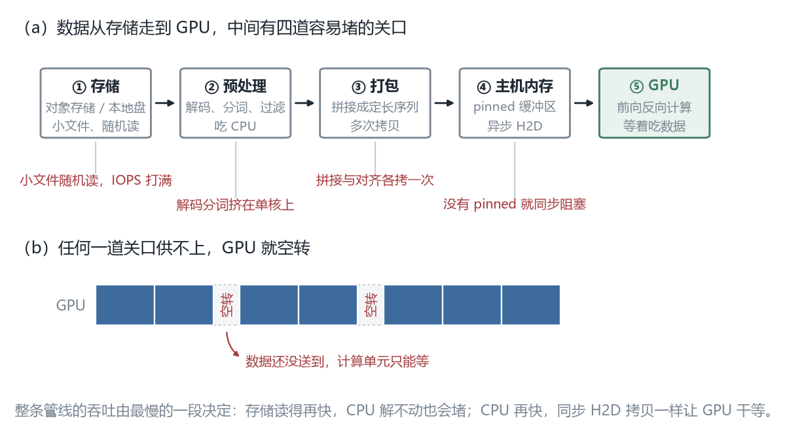

# 第 19 章　数据管线与吞吐

## 19.1　一条样本从存储到 GPU 的路径

一条样本要过的关口有六道。远端存储、节点本地缓存、主机内存、CPU 上的解码与分词、collate 拼批、最后是 H2D 拷贝进显存。每一道的延迟量级差得很远，出问题的地方通常不在你以为的那一道。

先把每一道的数字摆出来。远端对象存储的一次 GET 请求，延迟在几十毫秒。并行文件系统的一次随机小读，延迟在毫秒级。节点本地 NVMe 的随机读，几十微秒。主机内存命中，百纳秒级。H2D 拷贝走 PCIe 5.0，单向 64 GB/s。

按一条 8192 token 的样本算，分词之后存成 uint32，是 32 KB。32 KB 走 PCIe 是 0.5 微秒，走 NVMe 是几百微秒，走远端存储是几十毫秒加传输。所以从存储到显存的这条路，时间几乎全花在存储那一端。

一个 batch 也不大。8 条 8192 token 的样本，uint32 存下来是 262 KB，走 PCIe 4 微秒。就算每步要传 4 个这样的 batch，也就十几微秒。结论很直接，H2D 拷贝在训练里几乎从来不是瓶颈，除非你在做逐样本的零散拷贝，把那点固定开销乘上几千次。

卡内这一段值得单独算一遍。32 KB 在 3.35 TB/s 的 HBM 上占 9.8 纳秒，走 PCIe 5.0 的 64 GB/s 是 0.51 微秒，从 400 Gb/s 的网卡进来是 0.66 微秒。三个数跟存储的一次访问（本地盘几十微秒、并行文件系统毫秒、对象存储几十毫秒）差两到五个数量级，所以这条路上真正决定成败的不是哪一段跑得多快，而是一条样本要被打几次招呼。每多一次独立的读，就多一次几十毫秒的等待，而这一次等待跟样本多大没有关系。

*图 19-1　数据从存储到 GPU 的管线*

图上从左到右是这六道关口，每道标了典型的延迟量级。中间那条横线是 GPU 消费数据的速度，只要任何一个关口比它慢，GPU 就空转。整条管线的设计目标不是让每一道都最快，而是让最慢的那一道比消费速度略快，并且抖动可控。

还有一道关口容易被漏掉，collate 之后的 batch 形状。若每条样本长度不同、又没打包，batch 里所有序列要 pad 到本批最长，于是 batch 的 token 数每一步都在变。步时跟着变，看起来像机器在抽风，其实是数据形状在变。把序列长度分档、每档固定长度，步时立刻变平稳，代价是某些档带有 padding 浪费。很多人把这个问题归到存算上，查半天 CPU 和带宽，方向就错了。

抖动比平均延迟更难对付。一次 20 毫秒的读，如果稳定发生，可以让流水线提前 20 毫秒预取，代价只是内存。如果时快时慢，就得以最坏情况设计预取深度，内存和 worker 数都要按最坏情况配。真实集群里，远端存储的 P99 延迟常常是 P50 的五到十倍，这个倍数才是管线设计的真正约束。

现场会出现什么。GPU 利用率呈周期性锯齿，每几十步掉一次，那是某个 worker 卡在一次慢读上。利用率平稳但只有六成，那是管线整体慢，得看每个 worker 的在途请求数。还有一种，前一百步很快、之后越来越慢，那是 page cache 被打满或者本地缓存被淘汰，读开始落到远端。

## 19.2　分词与打包

数据在进模型之前要先变成定长的 token 序列，这一步的浪费经常被低估。

自然语料的长度分布很不均匀。假如一个数据集里平均长度 700 token，上限设成 4096，那么按上限 padding 之后，一条序列里只有百分之十七的元素是有效 token。剩下的百分之八十三在算力上是被浪费的，因为注意力要对整个 4096 长度做计算，pad 出来的位置也要参与矩阵乘，虽然可以用 mask 把它们的输出清零，但乘加已经做完了。

这个浪费折算成算力很惊人。有效 token 占比百分之十七，意味着同样的硬件只能产出百分之十七的有效吞吐，等价于把 989.4 TFLOPS 的卡当成 168 TFLOPS 用。一个本该跑 40% MFU 的配置，实际有效 MFU 只有 7%。

解决办法是打包。把多条短样本按顺序拼进一个定长序列，用 attention mask 或者变长注意力的方式保证样本之间互相看不见。打包之后有效 token 占比能到百分之九十五以上，等于把算力捡回来五倍多。

字节这一侧也跟着变。按 4096 位置、uint32 存储，一条序列占 16 KB，里面只有 700 个有效 token，摊到每个有效 token 上是 23.4 字节；打包到九成五之后，同样的 16 KB 装下三千八百多个 token，摊到每个 token 上是 4.2 字节。不过字节这条路本来就不紧张，所以这部分收益几乎全部落在算力上，带宽只是顺带省了。

打包有两个坑。第一个是串味，如果 mask 写错了，后一条样本能看到前一条的内容，模型会学到跨文档的虚假关联，表现是 loss 掉得比预期快、下游评测却很差。检查方法是拿一个只有两条样本的极小批次，手动算一遍注意力，看第二条样本的第一个 token 对第一条的注意力权重是不是零。

第二个是打包改变了样本的边界。原来一条样本一个序列，现在一条序列里有好几条样本，位置编码要按样本重置，否则第二条样本会带着前一条的长度偏移。用绝对位置编码的模型必须显式处理这件事，用旋转位置编码的也一样，rope 的起点要按样本内的位置算。

分词本身也有取舍。在线分词（读原始文本、在 CPU 上跑 tokenizer）灵活，数据更新方便，代价是每样本几毫秒的 CPU 时间。离线分词（预先跑一遍、存成 uint32 数组）把这段成本移出训练循环，代价是存储翻几倍、以及数据更新要重跑。

分桶是 padding 与打包之外的第三条路。把长度接近的样本放进同一个桶，每桶 pad 到桶的上界。长度分布若集中在几个簇上（比如代码、短句、长文档），分桶的浪费能压到一成以内，而且不用改 mask。代价是桶内样本的多样性下降，梯度噪声的变化需要重新调学习率。

分词还有一个数字要对清楚，词表大小乘以隐藏维就是 embedding 矩阵的大小。词表 12.8 万、隐藏维 8192、BF16 下是 2.1e9 字节，也就是 2.1 GB。这个矩阵在 TP 下的切分方式是沿词表维度切，所以每卡只存一部分，但它不参与梯度分桶的常规路径，很容易在显存预算里被忘掉。

存储的账要算清楚。一段 4 GB 的原始文本，分词成 uint32 之后大约是 1 GB 的 token 数组（按每 token 4 字节、大致 4 字符一 token 估）。看起来省了，但如果原始文本是压缩存储的，1 GB 未压缩可能只有 300 MB 压缩后，这时候分词后的数组反而更大。离线分词是否划算，取决于原始数据的压缩率和 tokenizer 的速度。

现场会出现什么。步时稳定但每秒有效 token 数远低于理论值，先查 padding 比例，把序列长度的分布打出来看一眼。loss 曲线前几千步异常平滑，然后突然变差，那是打包的 mask 有问题，跨样本的注意力在早期起到了正则化的假象。

## 19.3　dataloader 的进程与线程

PyTorch 的 DataLoader 用多进程做数据准备。每个 worker 是一个独立的进程，各自持有一份 dataset 的副本，产出的 batch 通过共享内存队列交给主进程。

用进程不用线程的原因很实际。数据准备里大量是 Python 代码，解码、切片、拼批，全在 GIL 的管辖下。多线程在 CPU 密集的 Python 代码上几乎不加速，只有多进程能真正并行。所以 worker 数是进程数，不是线程数。

worker 数怎么定。一个粗略的判据是，单个 worker 准备一个 batch 的时间乘以 batch 数，要小于 GPU 消费这些 batch 的时间。如果 GPU 一步 1.5 秒、一步 4 个 batch，那么每 375 毫秒要备好一个 batch，而单 worker 备一个要 50 毫秒，理论上一个就够，配 4 个是为了覆盖抖动。

worker 太多的代价很实在。每个 worker 要复制一份 dataset 的元数据，如果有几百万条样本的索引表，每个 worker 几百兆，16 个 worker 就是几 GB 的主机内存。每个 worker 还各自打开文件句柄，几千个 worker 会把文件系统的元数据服务打爆，这在大集群上是真实的故障模式。

prefetch 深度是另一个旋钮。每个 worker 预取几个 batch，默认是 2。深度 2 意味着最多容忍一次两倍于平均耗时的慢读；如果 P99 是平均的五倍，深度至少要 5。深度加大占内存，一个 batch 262 KB，深度 8、16 个 worker 也就几十兆，通常不是问题。

pin memory 要不要开。开了之后 batch 先拷进锁页内存，H2D 拷贝可以走 DMA 不经过 CPU，速度更快也不会被换页打断。代价是锁页内存不能被交换出去，占用的是物理内存。按前面的算，H2D 只占几微秒，开不开的差别在固定开销上，通常开了更好，但没必要为它把内存吃满。

还有一个容易忽略的配置，persistent workers。默认每个 epoch 结束 worker 会被销毁重建，重建要重新打开文件、重新初始化 dataset，如果 dataset 初始化慢（比如要建索引），这个开销会周期性地出现。设成 persistent，worker 活到训练结束，省掉这部分，代价是 worker 里的状态要自己重置。

worker 数还有一个隐含上限，是物理核数。超过之后每个 worker 分到的 CPU 时间按比例下降，准备一个 batch 的墙上时间反而变长，表现为加了 worker 步时更不稳。判断方法很简单，把 worker 数从 8 一路加到 32，看单个 worker 准备一个 batch 的耗时有没有开始上升，上升的那一档就是上限。共享内存队列也不能忽略，队列的槽位数是预取深度乘 worker 数，这部分内存是常驻的，设得太大在几百个进程的节点上会悄悄吃掉几十 GB。

还有两个配置容易被忽略。一是 CPU 亲和性，worker 进程若不绑定，会被调度到跟网卡中断同一个 NUMA 节点上，读数据时相互抢。二是 worker 与数据加载线程的优先级，训练主进程在等数据的时候 CPU 是空的，这时后台的日志、监控采集会抢到核，让下一次预取变慢。把 worker 数量按物理核而不是超线程数配，是避免这类互相干扰的简单办法。

现场会出现什么。`num_workers=0` 是最常见的低级错误，数据在主进程里准备，GPU 每个 batch 都等一次，利用率掉到三成。worker 数加到 32 之后步时反而变长，那是 CPU 核数不够，worker 之间抢 CPU。还有一个隐蔽的，dataset 的 `__getitem__` 里做了网络请求，每个样本一次，那么 worker 数再多也没用，瓶颈在远端延迟而不是并行度。

## 19.4　远端读取与缓存

训练数据的存放位置决定了这条管线的下限。

对象存储便宜、容量大、适合归档，但它的访问模型是每次 GET 一个对象。一次 GET 的延迟在几十毫秒，而且这个延迟跟对象大小关系不大，一个 1 MB 的对象和一个 100 MB 的对象，首字节延迟差不多。这意味着随机小读的吞吐极低。

并行文件系统适合训练，因为它支持大文件的随机读，也支持多客户端并发。但它的元数据服务是瓶颈，几万个客户端同时打开几百万个小文件，元数据操作会把整个文件系统拖慢，所有作业一起受害。

正确的做法是把数据集打成大 shard。一个 shard 一两 GB，训练时顺序读，读完再换下一个。顺序读能把延迟摊薄，一个 shard 读一次花的延迟，抵得上几千条样本。缺点是 shard 内部的样本顺序固定，要打散得在 shard 内部再 shuffle 一次，或者读多个 shard 交叉取。

再往上一层是节点本地缓存。第一次读到某个 shard，写进本地 NVMe；后续读命中，延迟从几十毫秒降到几十微秒。缓存命中率的算法很简单，缓存容量除以数据集大小，但实际命中率取决于访问模式，如果 shard 的访问是随机的，命中率就是容量比；如果是有序的，命中率可以接近一。

算一个命中率的例子。数据集 100 TB，节点本地 NVMe 4 TB，命中率上限是百分之四。这个数字看起来很悲观，但训练的实际访问是有序的，一个 shard 在被淘汰之前会被完整读完，所以有效命中率取决于同时活跃的 shard 数，而不是整个数据集。

换一个口径算同一件事，结论会完全不同。Llama 3 的 62 TB 数据按每片 1 GB 切，是六万多片；16384 张卡分布在 2048 个节点上，同一时刻活跃的片最多两千多片，也就是 2 TB 左右的工作集。每个节点只要留四片，也就是 4 GB，按片算的命中率就接近百分之百。前面那个百分之四，是"把整个数据集塞进缓存"的口径，这个百分之百，是"读一片能读两天"的口径。两个数都对，但报命中率的时候必须说清用的是哪一个，否则一半的容量规划会建在错的前提上。

缓存还要管一致性。如果数据集更新了，本地缓存里的旧 shard 会被读到，训练就在用旧数据。版本号或者时间戳校验是必须的，代价是每次读要额外一次元数据查询，这一次查询又回到远端。折中的做法是在作业启动时把所有 shard 的哈希拉下来，训练期间只比对内存里的表。

预取窗口的容量也要算。一个 worker 预取 d 个 batch、一个 batch 262 KB，t 个 worker 就是 0.26·d·t MB，数值上很小。但如果预取的是没打包的原始样本，一条样本平均 8 KB、一个 batch 几千条，量级就上去了。真正占内存的是 page cache 与本地缓存，前者可以随时回收，后者不能。很多节点 OOM 是因为本地缓存把内存吃光，而不是因为预取。

还有一层是 shard 到节点的映射。同一个 shard 被哪几个节点读，决定了缓存命中率也决定了网络流量分布。默认的取模映射会让某些节点比其他节点多读很多，因为读的人都按同一个顺序拉。按节点做一次亲和性分配，把 shard 均匀铺到节点上，能让网络流量均匀，也能让缓存命中率更稳。这件事在作业启动时做一次就够，作用却很大。

现场会出现什么。前几个 epoch 很快，之后越来越慢，那是缓存被反复淘汰。所有节点的网络读带宽都打满但训练还是卡，那是读的是小文件，每个文件一次元数据操作。某些节点的读量远高于其他节点，那是 shard 到节点的映射不均，得在启动时按节点做一次 shard 的亲和性分配。

## 19.5　数据吞吐的估算

要喂多少，这个问题有解析解。

每卡每秒能消化多少 token，由算力和模型规模决定。单卡每秒做的浮点运算是峰值乘 MFU，每个 token 需要 6N 次浮点运算，两者一除就是答案。

$$ \text{tokens/s/GPU} = \frac{P \cdot \text{MFU}}{6N} $$

P 是单卡峰值，N 是参数量。

算例。175B 参数，单卡 989.4 TFLOPS 按四成算得 396 TF，6 乘 175e9 是 1.05e12。396e12 除以 1.05e12 得 377。也就是说一张 H100 在训 175B 的时候，每秒消化 377 个 token。

这个数换算成字节非常小。377 token 乘 4 字节是 1.5 KB/s。一个 8 卡节点 12 KB/s，16384 张卡合计 25 MB/s。这个带宽比一块机械硬盘的顺序读还低。

所以数据管线的瓶颈从来不是带宽。真正的约束在两处，一处是每样本的固定开销，一处是抖动。

固定开销的算法是这样。每卡每秒的样本数是 tokens/s 除以序列长度。175B、8192 序列时是 0.046 样本/s，一个节点 0.37 样本/s。每样本就算花 10 毫秒的 CPU 时间，节点每秒也只需要 3.7 毫秒的 CPU，占用不到百分之一。

换成小模型就不一样了。7B 参数、1024 序列，每卡每秒 9430 token，也就是 9.2 个样本；一个节点 74 个样本/秒。每样本 10 毫秒的 Python 开销，就是每秒 740 毫秒的 CPU 时间，需要一个核专职做这件事。模型再小、序列再短，或者预处理更重（图像解码、音频重采样），这条线就会被跨过去。

这就是为什么小模型训练的数据管线问题比大模型多一个量级。大模型慢，慢在算力，数据怎么喂都跟得上；小模型快，快得让管线来不及。

抖动那一头要看 P99。假设远端读的 P99 是 100 毫秒，一个 batch 要读一个 shard，那么每 100 个 batch 就有一次 100 毫秒的停顿。一步 1.5 秒有 4 个 batch，平均每 25 步遇到一次，步时从 1.5 秒变成 1.6 秒，方差比均值更能说明问题。

同一个公式套在 405B 上，得到的是另一个量级。989.4 TFLOPS 按四成是 396 TF，除上 6 乘 405e9 即 2.43e12，得 163 token/s。16384 张卡乘起来是 2.7e6 token/s，一天是 2.3e11，按这个速度 15.6 万亿 token 要跑两个月量级。

把 token 换算成步也有用。一步若处理 400 万 token，16384 张卡就是每卡 244 个 token，按 163 token/s 算只需 1.5 秒。这个 1.5 秒就是前面几章一直在用的步时，它不是拍出来的，是从吞吐倒推的。

这类估算最容易出的错是口径混用，有三个口径各能差一倍。MFU 是按峰值算还是按实测的持续算，差一倍；序列长度是按打包后的定长算还是按有效 token 算，差一倍；字节是按 uint32 还是按 uint16 存，又差一倍。三个混在一起，同一个集群能被算成八种不同的吞吐，讨论就进行不下去。写估算的时候把这三件事写清楚，比把结果精确到小数点后一位有用得多。

现场会出现什么。tokens/s 的计算值跟实测差得远，先确认 MFU 用的是哪个口径，再确认序列长度是不是按 padding 后的算。按 padding 后的长度算，会把有效吞吐算低，把浪费藏起来。

## 19.6　确定性、断点续训与数据顺序

数据顺序要能复现，这件事在出问题的时候价值极高。

出问题的场景很具体。loss 在第 3 万步突然跳了，你要判断是数据问题还是数值问题。办法是回到第 29999 步的检查点，重放接下来的几百步，看跳不跳。如果数据顺序不能复现，重放出来的是另一批样本，什么都判断不了。

可复现的做法是按全局步号决定样本。第 g 步用哪些样本，由一个确定性的函数从 g 算出来，跟 worker 数、进程数、机器数都无关。这个函数通常是一个带种子的置换，种子固定，置换表可以分块生成。

按 worker 的本地 RNG 生成就不行。worker 数从 8 改成 16，样本的分配全变了。这在小规模试验时无所谓，在正式训练里等于换了一份数据。

断点续训要存的东西有四样。当前的 epoch、当前 shard 的编号、shard 内的字节偏移、以及随机数生成器的状态。只存步号不够，因为从步号反推 shard 偏移需要完整的索引表，而索引表可能很大。

打包之后这件事更麻烦。一个 pack 可能跨 shard，续训时要能从 pack 的边界开始，而不是从 shard 的边界。做法是把 pack 的构成也写进检查点，或者在设计时保证 pack 不跨 shard，用 padding 补齐。后者的代价是每个 shard 尾部浪费一点，通常可以接受。

把这个"浪费一点"算出来，就知道为什么可以接受。一片 1 GB 里，最后一个 pack 平均浪费一半，也就是 4096 个位置、16 KB。62 TB 数据是六万多片，全部加起来 2 GB，占数据总量的三万分之一。用 2 GB 的浪费换掉"pack 跨片"这一类边界 bug，划算得没有讨论余地。

还有一个容易忽略的点，恢复之后的数据顺序会影响到优化轨迹。哪怕样本集合完全一样，顺序不同也会让 loss 曲线出现小的偏差。这在排查时会被误判成"训练不稳定"。所以恢复后的前几十步，要把 loss 与原始曲线对比，偏差在一万分之一以内才算恢复正确。

框架层面的 DataLoader 有自己的 `state_dict`，里面存的是各 worker 的采样器状态。直接调用它做快照能省很多事，但有两个前提，一是 worker 数在恢复前后必须一致，否则状态对不上；二是采样器要用可序列化的确定性实现，用到了迭代器内部的惰性状态就不行。不满足这两个前提时，宁可自己存一个全局步号加种子，别用框架的快照。

现场会出现什么。恢复之后 loss 从 2.31 跳到 2.35，几十步后回来，那是数据顺序变了。恢复之后 loss 一路发散不回来，那是优化器状态没恢复全，或者学习率调度器的步数没对上。恢复之后第一步特别慢，几十秒，那是 worker 在重建索引或者重新拉 shard 列表。

## 19.7　常见事故

数据这一侧的事故有几类，几乎每一类都能在日志里找到痕迹。

第一类是 padding 浪费。特征是步时正常、MFU 正常、但每秒有效 token 数远低于按 token 计的预期。查法是把一个 batch 的 mask 打出来，算有效 token 占全部位置的比例。低于五成就要考虑打包。

第二类是样本串味。特征是 loss 掉得比基准快，但下游评测上不去。查法是用两条明显不相干的样本（比如一段代码和一段诗歌）拼一个 pack，看模型对后一条的第一个 token 的预测是否被前一条影响。如果影响明显，mask 写错了。

第三类是长尾样本。数据集里混进了几个超长样本，长度是平均值的几十倍，它们每次出现都让那一步的显存和时间爆掉。查法是把长度分布画出来看尾部，处理办法是截断或者单独分桶。

第四类是 worker 饥饿。特征是 GPU 利用率周期性掉到零，周期与 IO 的慢读对齐。查法是给每个 worker 的在途请求数和等待时间打点，看是哪个环节慢。多数情况是远端读或者文件句柄数限制。

第五类是缓存与版本不一致。特征是恢复训练之后 loss 形状异常，或者同一份数据两次读到不同的内容。查法是比对 shard 的哈希，看缓存里的是不是最新的。这类问题在没有版本管理的自建缓存里非常常见。

第六类是数据加载与检查点抢 IO。特征是每到保存检查点的时刻，数据侧的等待时间飙升，步时长出几十秒。查法是看保存时刻的网络与磁盘吞吐，如果数据读的延迟同时上去了，就是抢带宽。解决办法是给检查点写盘限速，或者让数据预取在保存窗口内提前多取一些。

第七类是分词器与模型不匹配。换了 tokenizer 的版本，词表大小变了，embedding 层对不上，报错还算好的，不报错的情况是 token id 越界被截断，模型在学一堆无意义的 id。查法是拿几条样本手工 decode 再 encode，看是否一致。

第八类是重复与污染。去重没做好，同一篇文档在数据里出现几十次，模型在那几十次上过拟合，loss 看上去很好，泛化很差。污染更麻烦，评测集的内容漏进了训练集，指标好看但不可信。这两件事在数据侧查，不在训练侧查，但经常在训练侧被发现，因为 loss 与评测的背离是它们唯一的信号。

现场会出现什么。数据相关的问题有个共同特征，它们在单机上很难复现，因为单机的 worker 少、缓存全命中、shard 只有一两个。要复现得按生产配置起同样多的 worker、指向同样的远端存储。这也是为什么数据侧的问题经常拖很久才定位，大家习惯性地先在模型和通信上找。

## 19.8　把样本换算成字节

存储的报价单上写的是 GB 和 IOPS，不写 token。前面几节的判断要落到这两个单位上，才能跟存储那一侧对上话。

一条 8192 token 的样本，uint32 存是 32 KB。这 32 KB 在卡内要走三段，三段耗时都在微秒以下。

| 路段 | 速率 | 32 KB 的传输时间 |
|---|---|---|
| HBM3 | 3.35 TB/s | 9.8 纳秒 |
| PCIe 5.0 单向 | 64 GB/s | 0.51 微秒 |
| NVLink | 900 GB/s | 36 纳秒 |
| 400 Gb/s 网卡 | 50 GB/s | 0.66 微秒 |

NVLink 那一行不在读数据的路径上，列出来是为了对比。同一节点上把 32 KB 从一张卡搬到另一张，比从主机内存过 PCIe 还快一个数量级。这也解释了为什么数据并行里的激活值交换不算贵，而把数据从盘上取回来才贵。

按吞吐换算，三档规模的字节需求差别很大。

| 模型 | 每卡 token/s | 每卡字节/s | 8 卡节点字节/s | 每卡每天 |
|---|---|---|---|---|
| 7B，1024 序列 | 9400 | 37.6 KB | 301 KB | 3.3 GB |
| 175B | 377 | 1.5 KB | 12 KB | 130 MB |
| 405B | 163 | 651 B | 5.2 KB | 56 MB |

表里的 token/s 按 989.4 TFLOPS 的 BF16 峰值、MFU 四成、每 token 6N 次运算算出来，字节按 uint32 一个 token 四字节折算。这是估算，不是实测，实测会低一些，因为 MFU 很少刚好四成。

第一个算例套在 Llama 3 上。16384 张卡每卡 163 token/s，集群每秒 267 万 token，15.6 万亿 token 要跑 580 万秒，也就是 67.7 天，跟公开的 54 天训练窗口在一个量级上。这些 token 按四字节存是 62.4 TB，摊到每天 0.92 TB。集群的注入能力是 2048 个节点乘 8 张网卡乘 50 GB/s，合 819 TB/s，读取只占它的 1.3×10⁻⁸，还不到一亿分之一。

第二个算例是每步的量。一步 400 万 token，16384 张卡平摊，每卡 244 个 token，976 字节；一个 8 卡节点 7.8 KB。这条 50 GB/s 的链路传完 7.8 KB 要 0.16 微秒，而一步是 1.5 秒，占用率在千万分之一这个量级。也就是说数据链路上 99.99999% 的时间是闲的，任何"带宽不够"的判断在这一层都站不住。

第三个算例回答一个常被问错的问题，一个 shard 能撑多久。shard 取 1 GB，一个 8 卡节点在 405B 上的读取速率是 5.2 KB/s，读完要 1.9×10⁵ 秒，五十三个小时；175B 上是 12 KB/s，二十三小时。这说明 shard 的粒度比一步大五个数量级，缓存命中靠的是"读一片能读两天"，不是"读一片读一步"。也说明 shard 太小时元数据压力会上去，而 shard 大到能读两天时，片内的样本顺序就成了随机性的唯一来源，必须在片内再打散一次。

## 19.9　样本级恢复的三个坐标

19.6 说断点续训要存 shard 编号、片内偏移、随机数状态，这一节把这件事做到字节。

先看为什么步号不够。一步 400 万 token，序列 8192，一步就是 488 条样本；跑到第 3 万步，累计 1460 万条样本，按每条 32 KB 算，字节偏移是 480 GB。也就是说"从第 3 万步接着读"这句话翻译成字节，是"偏移 480 GB"，而这个偏移具体落在哪个 shard 的哪个位置，靠步号乘不出来。shuffle 之后样本的顺序和 shard 的顺序没有关系，反推只能靠完整的索引表。

所以要存的是坐标，不是一个数字。

| 字段 | 大小 | 缺了会怎样 |
|---|---|---|
| 全局步号 | 8 字节 | 不知道该取哪一批样本 |
| epoch 序号 | 4 字节 | 置换表重新起算，样本重复或漏读 |
| shard 编号 | 4 字节 | 只能从片头重读，数据顺序与模型状态错位 |
| 片内字节偏移 | 8 字节 | 按样本大小线性推算，打包之后算不准 |
| pack 内样本序号 | 2 字节 | 片里的中段无法定位，只能整个 pack 重读 |
| 采样器种子 | 8 字节 | 换了一份数据，loss 曲线不可比 |
| 分词器与词表版本 | 32 字节 | token id 的语义变了，读出来看着正常却是错的 |
| worker 数 | 2 字节 | 恢复前后分片方式不同，偏移全部错位 |

八个字段加起来不到一百字节，比一份检查点小十个数量级，可少了任何一个，恢复就只能"大致对上"。工程上最容易漏的是最后两项，因为它们不在数据侧，而在配置侧。分词器版本尤其危险，词表从 12.8 万换到 12.9 万，越界的 id 会被静默截断，训练照样跑，学到的是一批无意义的位置。

恢复之后要验证，不能只看它跑起来了。做法是取恢复后前 100 步的 token id 序列算一个哈希，与原始轨迹同期的哈希比对。100 步是 4 亿个 token，按四字节算是 1.6 GB 数据，在 CPU 上算哈希是几秒到几十秒，比一次恢复便宜一到两个数量级。哈希对上，再去看 loss 的偏差，两者都过才算恢复成功。

一条纪律要跟检查点绑在一起。数据侧这一百字节，必须和优化器状态用同一个步号命名、写在同一个事务里。分开写就会出现参数在第 30000 步、数据位置在第 29990 步的情况，而这种情况不会报错，只会让恢复后的 loss 慢慢偏。

## 19.10　一台节点的数据侧预算

前面几笔账落到一台节点上，就是一张清单。清单的意义在于指出哪一项真的会打满。

| 资源 | 需求 | 依据 |
|---|---|---|
| 网络注入 | 5.2 KB/s | 405B 每卡 651 B/s，节点 8 卡 |
| 本地盘 | 4 GB | 预取四片，每片 1 GB |
| 主机内存 | 4 GB 加十几 MB | 预取加上 batch 队列 |
| CPU | 每秒 0.16 条样本 | 1302 token/s 除以 8192 |
| 文件句柄 | 每 worker 数片 | 片数乘 worker 数 |

除 CPU 之外，每一项的余量都在三个数量级以上。网络注入能力是 400 GB/s，需求是 5.2 KB/s；本地盘按 TB 算，需求是 GB。这就是"数据侧不缺带宽"这句话落到一台机器上的样子。

CPU 那一栏要按模型翻过来算。405B 上每秒 0.16 条样本，每样本十毫秒的 Python 开销才占千分之一点六，怎么都不缺；7B、1024 序列上每秒 74 条样本，同样的十毫秒就是 0.74 个核，预处理再重一点（图像解码、音频重采样、正则清洗），三个核也未必够。一台节点两颗 CPU 的机器，核数是有限的，dataloader 吃掉三个核之后，日志、监控、checkpoint 的序列化都会变慢。

所以数据侧要扩容，顺序是加核、加盘、最后才考虑带宽。反过来做的人很多，看到"数据慢"就去加网卡，加完发现瓶颈在 CPU 的解码上，网卡从头到尾闲着。

算例收一下。7B 模型按公开的算力最优配比，每个参数配 20 个 token，70 亿参数就是 1.4 万亿 token。按每卡 9400 token/s、1024 张卡算，集群每秒 963 万 token，1.4 万亿 token 要 1.45×10⁵ 秒，四十个小时。这四十个小时里，数据侧的 CPU 需求是每节点 0.74 个核乘上节点数，而字节需求是每卡 3.3 GB 每天。同一套存储和同一套管线，喂 7B 的压力比喂 405B 大三个数量级，这是小模型集群最容易踩的坑。

## 19.11　一次数据侧事故的复盘

事故开头很平淡。4096 卡的作业跑到八千步，步时从 1.4 秒涨到 2.1 秒，有效吞吐掉了三分之一。GPU 利用率没有归零，只是从九成多掉到六成出头，锯齿比之前密。

第一轮排查看的是通信。梯度 all-reduce 的时间没有变，NCCL 的带宽曲线平稳，排除。第二轮看算力，每张卡的时钟正常，没有降频。第三轮才回到数据，给 dataloader 的等待时间打点，发现一步里有 0.6 秒在等样本，正好是步时多出来的那部分。

接着查等待发生在哪一段。远端读的 P50 完全正常，P99 涨了三倍。按节点看读量，前 64 个节点的读量是其余节点的两倍多。到这一步基本能确定，不是存储慢，是访问分布不均。

根因在启动脚本里的一行取模。shard 一共 3072 片，rank 按 `rank % 3072` 领片，4096 个 rank 里有 1024 个（编号 3072 到 4095）和前 1024 个 rank 领到了同一批片。于是三分之一的 shard 被两份 rank 同时读，总读量放大到 1.33 倍，而且这两个 rank 在不同节点上，本地缓存各自存了一份，谁也帮不了谁。作业规模从 1024 卡扩到 4096 卡的时候这个 bug 才显形，因为 1024 能整除 3072。

处置只改了一行，把取模换成按节点做亲和性分配，让每片只落在一个节点上，再由节点内的 8 个 rank 轮流读。改完 P99 回到正常值的一点一倍，步时回到 1.45 秒。

这件事值得记的地方有三处。一是扩容会把取模映射的整除关系打破，任何按 rank 取模的分片都要在扩缩容时重新验证。二是数据侧的问题在监控上表现为"存储变慢"，很容易把运维引到加盘的方向，而真实原因是读量被放大。三是定位靠的是三个打点，每卡样本速率、远端读的 P99、每节点的读字节数，缺一个都只能猜。

这类复盘写下来只有两页，价值在下次扩缩容的时候。数据侧的每一条假设都随规模变化。取模的整除关系在 1024 卡上成立，在 4096 卡上不成立；worker 数 16 够用，32 开始互相抢核；一片读两天在 405B 上成立，换到 7B 上只剩几个小时，缓存窗口跟着缩到原来的三十分之一。把假设连同当时的数字一起记下来，比记一句"注意数据管线"有用得多。
