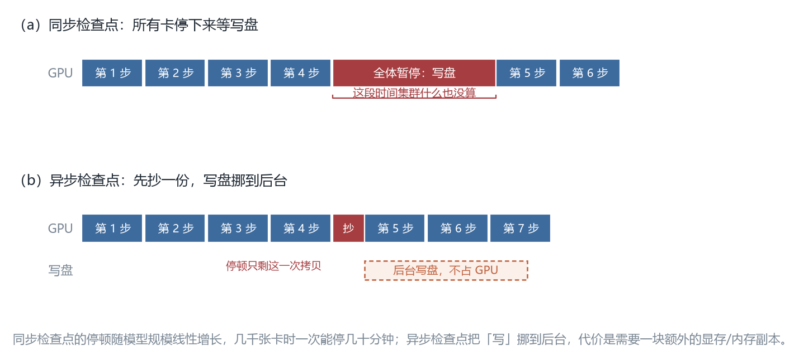

# 第 20 章　检查点、恢复与 checkpoint 风暴

## 20.1　一份检查点有多大

检查点的大小由参数量和保存的精度决定，算起来只有一项乘法。

一个参数要存五样东西。BF16 的参数本体两字节、BF16 的梯度两字节、FP32 的一阶矩四字节、FP32 的二阶矩四字节、FP32 的主权重四字节。加起来 16 字节。这是最完整的存法，也是恢复时最省事的存法。

175B 参数乘 16 字节是 2.8 TB。这个数字比很多人以为的大一个量级。一张 80 GB 的卡装不下，一台 8 卡的机器也装不下，只有整个集群的存储才能装下。

实际的实现会省掉一些。梯度可以不存，因为它下一步会重新算出来，只要参数和优化器状态对了，梯度自然对。去掉梯度是 14 字节，2.45 TB。主权重和参数也可以合并存成一份 FP32，省掉重复的两字节，变成 12 字节，2.1 TB。

| 存法 | 每参数字节 | 175B 总量 |
|---|---|---|
| 参数、梯度、两个矩、主权重 | 16 | 2.8 TB |
| 去掉梯度 | 14 | 2.45 TB |
| 再去掉重复的参数副本 | 12 | 2.1 TB |

多数框架的默认落在 12 到 14 字节之间。看到某个系统报"检查点 2.1 TB"，它用的就是 12 字节的账。

把 16 字节拆开看，占比最重的是优化器。两个矩一共 8 字节，占了一半；参数和梯度各 2 字节，主权重 4 字节。所以"只存权重、不存优化器"的检查点，大小是完整检查点的八分之一，405B 上就是 810 GB 对 6.48 TB。这个比例解释了一个常见现象，很多人算出来"一份检查点只要 800 GB，一块盘就够"，那是模型权重的账，续训要用的那份是它的八倍。

摊到每张卡上，量就小得多。16384 张卡分 2.8 TB，每卡 171 MB。1024 张卡分 2.8 TB，每卡 2.7 GB。这个区别很重要，因为写盘的时间不由单卡决定，由存储的聚合带宽决定。

还有一份清单文件容易被忘。它不用存张量，只存“这一份检查点包含哪几个分片、每个分片的步号、大小、校验和”。几万个分片的清单只有几 MB，但它是把几万个文件粘成一个整体唯一的东西。清单没写或者写坏了，数据全在盘上也没用。

清单的大小可以估。13 万个分片，每条记路径、大小、步号、校验和，六十来字节，合起来 8 MB 左右。8 MB 存在盘上不算什么，但它会被所有 rank 读一遍，16384 个进程同时 open 同一个文件，有的文件系统对单文件的并发 open 加了锁，这一读就能卡住几十秒。做法是每个 rank 读自己那一份清单，或者由 rank 0 读进共享内存再广播，别让 8 MB 变成启动时的单点。

不存的东西也要说清楚。激活不存，重算比存便宜。随机数状态要存，几十 KB，但少了它恢复之后的 dropout 就不一样。数据加载的位置要存，几十字节。优化器的步数要存，一个整数。这些东西加起来不到 1 MB，却是恢复能否成功的关键，漏掉任何一个，恢复出来的训练轨迹就跟原来不一样。

现场会出现什么。检查点比账算的大一倍，通常是存了两份参数（BF16 一份、FP32 一份）外加梯度全存，没做任何裁剪。检查点比账算的小很多，通常是只存了模型权重、没存优化器状态，这种检查点只能用来推理，不能用来续训。恢复到第 3 步 loss 就发散，通常是优化器状态里的步数没存或者存错了。

## 20.2　同步写与异步写

同步写的意思是，所有 rank 把数据写完、落盘确认之后，才继续下一步计算。

这个定义的代价很直接。写 2.8 TB，存储聚合带宽 500 GB/s，就是 5.6 秒。带宽掉到 100 GB/s，就是 28 秒。这段时间 GPU 什么都不干，全部在等 IO。按一步 1.5 秒算，5.6 秒等于扔掉将近四步。

异步写把这段拆成两半。前半段是 GPU 把数据拷到主机内存，后半段是后台线程从主机内存写存储。GPU 只需要等前半段。

前半段的时间由 PCIe 决定。每卡 2.7 GB 走 PCIe 5.0 的 64 GB/s，是 42 毫秒。16384 卡的场景每卡只有 171 MB，是 2.7 毫秒。这两个数跟 5.6 秒比，差了两个数量级。

*图 20-1　同步检查点、异步检查点与恢复的时间线*

图的上半是同步写，计算和写盘严格交替，写盘那段是一条空白。下半是异步写，GPU 在拷完内存之后立刻回到计算，写盘在后台跟下一步重叠，只在最后可能撞上下一次保存。

异步写不是免费的。第一个代价是主机内存。16384 卡的场景，每个节点 8 卡，每卡 171 MB，一个节点 1.4 GB，可以忽略。1024 卡的场景，每卡 2.7 GB，一个节点 22 GB，256 GB 内存的机器还撑得住，但同时跑两份就紧张了。如果保存间隔短于写盘持续时间，内存里会堆着两三份检查点，这时候要么加大内存，要么限流。

按这个比例往下推，规模一大，暂存区就得改设计。1 万亿参数的模型在 3072 张卡上，每卡 16 TB 除以 3072，是 5.2 GB，一个 8 卡节点 42 GB。节点内存要同时装训练进程、页缓存和这份暂存，两份就接近一百 GB。所以那种规模上，异步写不能整份拷，得按张量切片拷，写完一片释放一片，用时间换内存。这也是为什么异步检查点在大模型框架里通常和分片绑定在一起实现，而不是简单地起一个后台线程。

第二个代价是可靠性。数据还在主机内存里没落盘的时候，如果进程崩了、机器掉电了，这份检查点就没了。而这时候训练已经往前跑了几十步，回退到上一个检查点的代价更大。所以异步写必须配合"落盘确认"的机制，在确认之前不能删旧检查点。

第三个代价是带宽争抢。异步写盘用的是同一张网卡、同一条到存储的链路。梯度 all-reduce 也走这里。写盘期间通信延迟上升，步时变长，甚至出现掉队。这一点在 18 章讲过，处置办法是给写盘限速，把峰值压到带宽的六成以下。

还有一个不是代价、但必须处理的细节，异步写期间的状态不能被改。optimizer 把数据拷到内存后，若下一步又把这块内存当成自己的缓冲重新写入，后台线程读到的就是脏数据。所以暂存区必须是真拷贝而不是引用，而且每份拷贝要活到落盘确认。这一点在实现上常被优化成 zero-copy，省了内存却引入了偶发的损坏。

现场会出现什么。开了异步之后步时确实短了，但每隔一段时间出现一次尖峰，那是写盘与下一次保存撞上了，内存里堆了两份。开了异步之后 loss 在某次恢复后对不上，那是保存时数据还没落盘就被当成有效检查点，恢复到了半份数据。

## 20.3　分片与并行写

2.8 TB 不可能由一个进程写。必须切开，每个 rank 写自己那一片。

切法有两种。一种是每卡一个文件，16384 张卡就是 16384 个文件，每个 171 MB。另一种是每个节点一个文件，2048 个节点就是 2048 个文件，每个 1.4 GB。还有一种是按张量分，一个张量一个文件，文件数由模型结构决定，几百到几千个。

文件数直接决定元数据压力。并行文件系统的元数据服务每秒能处理的创建、打开、关闭操作是有限的，几万个客户端同时创建几万个文件，元数据服务会先满。它一慢，所有客户端的 open 都排队，写盘时间从几秒变成几十秒。

按节点聚合是一种常用的缓解。每个节点上的 8 个 rank 先把数据汇到节点上的一个进程，由它写一个大文件。文件数从 16384 降到 2048。代价是节点内多一次拷贝，走共享内存或者本地 NVMe，几 GB 的量在几十毫秒。这个交换通常是划算的。

分片的粒度还决定了能不能换并行度恢复。按张量存的检查点可以在恢复时重新切分，比如原来 128 路、现在换 512 路，只要每个张量能按新维度切就行。按卡存的检查点就不行，它把张量切碎了还不知道怎么拼回去。要做弹性训练，就得按张量存，代价是文件数多、元数据压力大。这是一个非常实际的取舍。

写的方式也有讲究。顺序写一个大文件，存储能跑到顺序带宽；随机写很多小偏移，性能会掉到十分之一。分片的时候要保证每个 rank 写的是文件里一段连续的区域，而不是按张量散落各处。

$$\text{每 rank 写量} = \frac{16 \cdot N}{G}$$

N 是参数量，G 是参与的 GPU 数。175B、16384 卡时是 171 MB，1024 卡时是 2.7 GB。

聚合带宽是另一个约束。存储能给的带宽不是所有客户端加起来之和，它有一个上限，通常跟存储节点数、网络收敛比有关。假设存储侧能给 500 GB/s，2.8 TB 要 5.6 秒。这个数跟客户端有多少张卡无关，加卡只会让并发更高，不会让总时间更短。

所以要缩短写盘时间，只有两条路，减少要写的数据量，或者提高存储带宽。前者靠省字节（12 字节而不是 16 字节，省四分之一）或者靠降精度（优化器状态用 BF16，省一半，但有收敛风险）。后者靠加存储节点或者换更快的介质。

按张量存的账也值得粗算一下。一层里有注意力的几个投影、MLP 的几个矩阵、两个归一化的参数，按八个张量算，126 层就是一千出头，加上词嵌入和输出头，一份检查点一千多个文件。这个数和模型规模关系不大，只和层数有关，所以元数据压力比按卡存低一个数量级。代价是每个张量都要带自己的形状、切分方式和并行度信息，清单文件的复杂度上去了，恢复时的拼接逻辑也复杂，写错一处就是形状不匹配。

写和读的带宽需求还不一样。写到存储是突发，几秒钟打满；读是持续，恢复时集中读一次。设计时按突发的峰值配带宽，成本很高；按平均值配，写盘就会拖长。多数团队取折中，按峰值的六成配，接受写盘时间比理论值长一半。

现场会出现什么。写盘时间的方差很大，同样大小的检查点有时 6 秒有时 40 秒，那是元数据服务在拥塞。写盘时间随卡数增加而变长，那是文件数按卡数增长，元数据压力上去了。某些 rank 写完得特别晚，那是分片不均，通常是 embedding 层或者输出层没有按 token 维度切分。

## 20.4　保存频率的取舍

保存太勤，写盘时间占掉可观的算力；保存太稀，故障来了要回退很多步。这中间有一个最优点。

先算保存的成本。一次保存如果让 GPU 停 5.6 秒，一步 1.5 秒，等于扔掉 3.7 步。每 1800 秒存一次，一天存 48 次，损失 48 乘 5.6 等于 269 秒，占一天的百分之零点三。这个成本可以忽略。

如果保存是同步的、而且写盘要 60 秒，每 1800 秒存一次，一天损失 48 乘 60 等于 2880 秒，占百分之三点三。这就开始有感觉了。

再看回退的成本。故障发生时，从最近一个检查点重算到故障点，扔掉的时间是平均半个保存间隔。平均故障间隔是 MTBF，保存间隔是 T，每次故障平均浪费 T/2 的计算时间，每小时浪费 3600·T/(2·MTBF) 秒。

总成本是两部分之和，一部分是保存本身的开销，一部分是回退的浪费。

$$ C(T) = \frac{T_w}{T} + \frac{T}{2 \cdot \text{MTBF}} $$

T_w 是一次保存的耗时。对 T 求最小，得到最优点。

$$ T^{*} = \sqrt{2 \cdot T_w \cdot \text{MTBF}} $$

这个式子只在乘除与开方范围内，但开方就是乘幂，用它推出来的数才是重点。

算例。MTBF 按 Llama 3 的公开数据估。54 天内 419 次意外中断，一天 7.8 次，MTBF 约 11100 秒，也就是三个多小时。一次保存耗时 60 秒，最优点 T 是根号下 2 乘 60 乘 11100，等于 1154 秒，约 19 分钟。

如果保存优化到 5.6 秒，最优点变成根号下 2 乘 5.6 乘 11100，等于 353 秒，约 6 分钟。保存越快，就该存得越勤。

这个结论很多人不接受，直觉上"存得勤浪费算力"。但把回退也算进去，在 MTBF 只有三小时的集群上，19 分钟存一次才是最优的，一小时存一次会扔掉半小时的算力。

T_w 里还应该算上对后续步的影响。写盘期间通信变慢，后面几十步的步时都偏高，这部分隐性成本可能比 GPU 停等的时间还大。把 T_w 当"有效保存耗时"，取实测的步时增量，估出来的 T 会更保守一些，实际部署时按这个值再往上取一档。

保存的时刻也有讲究。理想的位置是数据 shard 的边界与优化器步的整数倍同时满足的地方，这样恢复时不需要定位到半个 pack 里。做不到了就退一步，让保存只在优化器更新的步上发生，不要落在梯度累积的中间，否则存下来的是一个累加到一半的状态，恢复后第一步的梯度会偏小。

梯度累积把这件事变复杂了一点。每卡 micro batch 是 1，累积 8 步更新一次，一步 1.5 秒，那么每 12 秒才有一次优化器更新。保存只能落在这 12 秒的边界上，也就是保存窗口的粒度被放大到 12 秒。若保存逻辑写在 micro step 的循环里、按计数器触发，就很容易落在累积的中间，存下来的梯度是半份。这种检查点加载不报错，表现是恢复后的前几步 loss 比原来高一点点，然后慢慢贴回去，极难排查。

现场会出现什么。检查点间隔设成 4 小时，看起来省了写盘，实际上每次故障回退两小时，一天故障七八次，根本跑不完。间隔设成 5 分钟，写盘时间占比超过一成，MFU 明显下降。这两种情况都很常见，中间那个最优点从来没人算过。

## 20.5　恢复流程与时间分解

恢复比保存麻烦，因为它的路径更长，每一步都可能出问题。

第一段是排队。故障发生之后，作业要重新申请资源。如果集群紧，可能等几分钟到几十分钟。这一段跟检查点无关，但它是恢复时间的大头，很多团队统计的恢复时间把这段算进去，看到几十分钟就以为加载慢。

第二段是加载。2.8 TB 从存储读到显存。存储聚合带宽 500 GB/s，理论 5.6 秒。实际上要几十秒到几分钟，原因是随机读和元数据。恢复时要打开几万个文件，每个文件的元数据查询几毫秒，加起来就是几十秒。加载时的读是并发的还是串行的也差很多，很多框架的加载是单线程反序列化，一个 rank 一个 rank 拷，2.7 GB 乘上 16384 就是灾难。

第三段是重建通信组。所有进程要重新交换地址、建 ring、建 NVLink 拓扑。这一段在小集群上是几秒，16384 卡上是几十秒。NCCL 的建图是分布式的，每个 rank 要跟所有邻居握手，规模一大，握手的总次数按平方增长的部分就显出来。

第四段是预热。第一次前向会遇到 cuBLAS 选算法、内存分配器扩池、CUDA Graph 重新捕获。这几件事每个都要几百毫秒到几秒。如果用了图，重捕获可能更久。

第五段是追平。恢复之后要把数据加载的位置对齐、把随机数状态对齐、把学习率调度对齐。这一段不做显式操作，但做错了会在几十步之后表现为 loss 异常。

| 阶段 | 量级 |
|---|---|
| 排队等资源 | 分钟到几十分钟 |
| 加载 2.8 TB | 几十秒到几分钟 |
| 重建通信组 | 几秒到几十秒 |
| 预热 | 几秒 |
| 追平与校验 | 几十步的计算时间 |

把表里的数加起来，一次恢复在 16384 卡的规模上是十到二十分钟量级。MTBF 三小时的话，一天七八次故障，光恢复就是两小时，占一天百分之八。这个比例跟检查点写盘的百分之三叠起来，是超过一成的固定损耗。

恢复流程要练。很多团队第一次真正恢复是在生产作业崩了之后，那时才发现加载脚本有 bug、发现了两个并行度不一致的张量。演练的做法很简单，每周抽一个作业主动杀掉再恢复，记录每个阶段的时间。三次演练之后，恢复的每一秒都能对上账，真出事的时候就不会手忙脚乱。

还有一种恢复比崩溃恢复更难，就是换并行度的恢复。16384 张卡里坏了 8 张，调度器给你 16376 张，模型状态要对，数据分片方式也要变。按卡存的检查点在这里没法用，因为它把张量切碎了却没记怎么拼回去；按张量存的能重切，代价是恢复时多一段重新分片的计算，把每个张量读进来、按新维度切开、再写出去。这一段的时间跟分片后的写盘同量级，几百 GB 到几 TB，取决于存的是哪一档。所以要做弹性训练，第一件事是把检查点的格式从"按卡"换成"按张量"，这件事在做之前改，比上线之后再改便宜得多。

现场会出现什么。加载慢得离谱但存储带宽只用了两成，那是单线程反序列化。加载完成后卡在通信组重建，日志停在 NCCL 初始化，那是某个 rank 的地址交换失败，通常是网卡或者 DNS。恢复后第一步特别慢，几十秒，那是图重捕获和 cuBLAS 选算法。恢复后 loss 曲线对不上而且一直不回来，那是优化器步数或者学习率调度没恢复。

## 20.6　checkpoint 风暴

单个作业按最优间隔保存是好习惯，多个作业一起这么做就是灾难。

风暴的成因有三种。第一种是同频。所有作业都从整点开始、都设 30 分钟间隔，于是每小时的第 0 分和第 30 分，全集群的作业同时开始写。第二种是恢复引发的补偿性保存。一次故障之后，很多作业会在恢复完成后立刻存一份，怕再出问题，于是故障之后的一两分钟里出现一次额外的高峰。第三种是人为的，有人在监控面板上看到 loss 异常，手动触发一次全量保存，几十个作业一起响应。

风暴的后果不是"慢一点"，是雪崩。存储打满之后，写盘时间从 5.6 秒变成几十秒；写盘变慢，作业的下一步就变慢；变慢之后超时重试变多，元数据压力更大；元数据一慢，读也慢，数据管线开始饿；然后有作业开始报错退出，退出后又重新排队，重新排队又要加载检查点，加载又是读，读又打在已经打满的存储上。

算一下峰值。100 个作业，每个 1024 张卡，每份检查点 2.8 TB，同时开始写就是 280 TB。存储 500 GB/s，要写 560 秒，接近十分钟。这十分钟里所有作业都卡在写盘上，等于全集群停了十分钟。

错峰把这些数摊开看。同样 280 TB，如果 100 个作业的保存时刻均匀散在 1800 秒的窗口里，平均写入速率是 155 GB/s，只有存储上限的三成，任何时刻都不会排队。差别不在总量，在同时性。这也说明判断风暴不能只看"总容量除以带宽"，要看峰值时刻有多少个作业在写，那才是压垮存储的东西。

再把单作业的量算一遍。1024 张卡分 2.8 TB，每卡 2.7 GB，同步写就是每卡 2.7 GB 要在这几分钟里推出去。单卡看，2.7 GB 走 50 GB/s 的网卡是 54 毫秒，走 PCIe 5.0 是 42 毫秒，都不算什么。所以风暴的成因从头到尾不在客户端，而在存储侧的同时接入能力。

缓解的办法都是错峰。给每个作业的保存间隔加一个随机抖动，比如 1800 秒加减 120 秒，让峰值散开。或者按作业的启动时间取模，让不同作业落在不同相位。抖动这一招成本极低，效果最好，但很多调度器不提供，得在训练脚本里自己做。

第二个办法是限速。给每个客户端的写带宽设一个上限，比如单卡 200 MB/s，一个节点 1.6 GB/s。这样即使同时写，也不会把存储的入口打满，写盘时间拉长但不会雪崩。限速的代价是单个作业的写盘时间变长，但集群整体的有效吞吐提高了。

第三个办法是分层。每个节点先把检查点写到本地 NVMe，再由一个后台进程慢慢往存储搬。这样写盘的峰值被本地盘吸收，存储看到的是平滑的流量。代价是本地盘要能装下一份检查点，2048 个节点各 1.4 GB，对 NVMe 来说是小事。

调度器层面也能做事。把检查点的写请求标上一个较低的优先级，跟训练的关键路径区分开，存储侧就能在拥塞时先保证读。再进一步，给每个租户一个写带宽配额，超额排队，这样单个作业的鲁莽不会拖死其他人。这两件事都需要存储和调度器一起改，落地成本不低，但在多租户集群上是必需品。

现场会出现什么。每到整点步时突然变长几十秒，几分钟后恢复，那是同频保存。故障之后的一两分钟里出现一次全集群的写盘高峰，那是补偿性保存。存储的写入队列长度在监控上呈现锯齿，峰值触顶，那是已经打满，任何新的写都会排队。

## 20.7　一致性、原子写与校验

检查点最怕的不是慢，是坏了却看不出来。

一份检查点由几万个文件组成。保存过程中如果有几个 rank 失败、几个文件写了一半，而框架认为保存成功，那么下次恢复时会加载到一份拼接起来的数据，参数和优化器状态来自不同的时刻。这种检查点能加载、能跑，loss 却对不上，排查时极难定位。

原子写是基本的防护。做法是先写到一个临时目录，所有分片都写完之后，写一个 `_SUCCESS` 标记文件，或者把临时目录整体 rename 成正式名字。rename 在多数文件系统上是原子的。恢复时只认带标记的目录。

版本是第二层防护。每个检查点带一个全局步号和一个格式版本。步号用来排序、用来判断新旧，格式版本用来防止用新版代码加载旧格式。格式版本不匹配时必须显式拒绝，不能"尽力兼容"，因为静默的不兼容会变成几十步之后的 NaN。

校验是第三层。每个分片带一个校验和，恢复时先校验再加载。校验和的代价是要把数据读一遍算一遍，2.8 TB 的 CRC 计算在 CPU 上是几分钟，跟加载时间同量级。折中的做法是只在保存时算、把结果写进清单，恢复时抽样校验，或者只在怀疑有问题时全量校验。

抽样的比例可以按代价定。全量校验要把 2.8 TB 读一遍，按 500 GB/s 是 5.6 秒的纯 IO，加上 CPU 上的计算，实际是分钟级。抽百分之一是 28 GB，IO 不到零点一秒，计算在秒级，能覆盖"某个分片整体写坏"这类故障，覆盖不了单个字节的翻转。折中的常用做法是保存时全量算、恢复时抽样验，另外在训练中途每若干步抽一个分片重算一次，专门抓静默损坏。

还有一层是自洽性。参数、优化器状态、随机数状态、数据位置、步数，这五样必须来自同一时刻。如果保存是异步的、五个部分由不同的线程写，就可能出现参数是第 1000 步、优化器是第 1001 步的情况。做法是把五样东西打成一个事务，用同一个步号命名，缺一样就整份作废。

校验和还能拓一部分静默数据损坏。存储层的位翻转不会报错，读回来的字节就是错的，一个参数从 1.0 变成 1.0000001 看不出来，但几万个参数都错一点，loss 就会偏。把保存时的校验和与恢复时算出来的对比，能抳住这一类。代价是每次恢复多一遍全量读，所以多数团队只在关键节点上开。

清理策略也要小心。存储有限，旧检查点要删。删的时候必须保留至少两份，因为最新那份可能正好是坏的。删除应该是软删除，先标记、过一段时间再真删。有人写了个"保留最近三份"的清理脚本，某次三份都是坏的，作业从零开始。

现场会出现什么。恢复后 loss 与原始曲线偏差千分之一以内、几十步后收敛回来，那是正常。偏差百分之一而且不回来，那是数据位置或随机数状态没对上。loss 直接 NaN，那是某些分片损坏或者参数与优化器不同步，先做全量校验。能加载但报张量形状不匹配，那是格式版本变了，代码回退或者做显式转换。

## 20.8　三种规模、三种存法的账本

前面几个数分散在各节里，把常见的三种规模排在一张表上，量的差别就出来了。表里的写盘时间按 500 GB/s 的聚合带宽算，那是这一章反复用的基准；如果存储只给 216 GB/s，时间要乘 2.3。

| 模型 | 16 字节 | 14 字节 | 12 字节 | 16 字节写完 |
|---|---|---|---|---|
| 175B | 2.8 TB | 2.45 TB | 2.1 TB | 5.6 秒 |
| 405B | 6.48 TB | 5.67 TB | 4.86 TB | 13 秒 |
| 1T | 16 TB | 14 TB | 12 TB | 32 秒 |

第一个算例看每卡的量。Megatron 1T 那套是 1 万亿参数、3072 张卡，16 字节一份是 16 TB，每卡 16 TB 除以 3072，5.2 GB。这个数比 405B 在 16384 卡上的 396 MB 大十三倍，因为卡数少了五倍多，参数量又多了一倍多。写盘时间 32 秒，一步按 1.5 秒算是二十一步，同步写就要停二十一步。这也是 1T 级模型几乎不用同步检查点的原因，代价已经大到不能忽略。

第二个算例算省字节能省多少。405B 从 16 字节改到 12 字节，一份从 6.48 TB 降到 4.86 TB，省 1.62 TB。按每 1800 秒存一次，一天 48 次，省下 77.8 TB 的写入量。在 216 GB/s 的带宽下，这相当于每天少花 360 秒，六分钟。六分钟听起来不多，但它是每天六分钟，跑两个月就是六小时，而代价只是不再单独保存主权重、恢复时从 BF16 参数重建一份 FP32 副本。这个交换在多数情况下划算，前提是重建的精度损失能接受，因为 BF16 只有七个比特的尾数，从它反推 FP32 主权重，等于承认这一步的精度已经丢了。

第三个算例是内存那一侧的账。175B 在 1024 张卡上，每卡 2.7 GB，一个节点 22 GB。异步写要留一份暂存，两份就是 44 GB，再加上数据管线的页缓存，256 GB 的机器就只剩一半给训练进程。这时候保存间隔要跟写盘时间对齐，让内存里同时只有一份暂存。判断办法很简单，在保存前后各打一次内存用量，如果保存后回落得慢，说明有第二份在排队。

## 20.9　把恢复时间压下来

20.5 把恢复拆成五段，这一节说每段能做什么，以及为什么压恢复和压写盘是两件不同的事。

| 手段 | 针对阶段 | 效果 | 代价 |
|---|---|---|---|
| 按张量分片加并行加载 | 加载 | 从分钟级降到十秒级 | 文件数变多，元数据压力上去 |
| 清单预取、目录预建 | 加载 | 省掉几万次 open 的排队 | 启动时要多读一份清单 |
| 拓扑文件缓存 | 重建通信组 | 省掉重复探测 | 换机器或换网卡后必须失效 |
| CUDA Graph 与算法缓存复用 | 预热 | 省掉几百毫秒到几秒 | 形状变化即失效 |
| 数据侧状态与检查点同事务 | 追平 | 免掉几十步的回退 | 无 |

加载这一段的空间最大。2.8 TB 分到 16384 张卡，每卡 171 MB，走 PCIe 5.0 的 64 GB/s 只要 2.7 毫秒。实际的加载要几十秒到几分钟，多出来的时间全在打开文件、解析格式、单线程反序列化上。把这三个环节换掉，加载就能从分钟级掉到十秒级，这是恢复优化里性价比最高的一件事。

算例。MTBF 按 Llama 3 的 419 次意外中断算，一天 7.8 次，平均间隔三个多小时。恢复如果一次要十五分钟，一天就是 7.8 乘 900 秒，7020 秒，占一天的 8.1%。压到七分钟，是 3276 秒，占 3.8%。两者差 4.3%，按 54 天的训练窗口算，是两天多。

这里要提醒一句，恢复时间和保存间隔不能用同一个公式优化。20.4 推出来的最优点只管两件事，写盘的开销和回退的浪费，恢复时间是每次故障的固定成本，跟保存间隔无关。所以正确做法是先压恢复时间，再用压完之后的参数去算最优间隔。反过来先调间隔，会发现怎么调都差一点点，因为那 8% 一直在那里。

通信组那一段的压缩空间比想象的小。16384 个 rank 的握手是分布式做的，能省的只是重复探测，省不掉拓扑本身。真正能省的是别让它在恢复时重新跑一遍健康检查，那一段在故障刚发生时最慢，因为坏掉的机器还没被摘出去。

排队那一段是恢复时间的大头，而且它跟检查点毫无关系。集群满的时候，一次故障之后要重新申请 16384 张卡，等几分钟到几十分钟。这一段能用工程手段压缩的空间不大，能做的是把作业拆成"可让位"和"不可让位"两类，让大作业有一个预留池，故障之后从池里补而不是重新排队。另一条路是把大作业切成若干同构的子作业，一张卡坏了只影响一个子作业，代价是全局的并行策略要被切开，通信模式会变。

还有一段常被算漏，故障判定本身。从一张卡出问题到框架决定重启，中间要走心跳超时、NCCL 超时、上层重试。这些超时值通常设得很保守，加起来可能几分钟，比加载还长。设得太短会误判，一张卡短暂卡顿就被踢出集群；设得太长，一次真故障要多等几分钟。这个参数没有通用值，得按自己集群的 P99 卡顿时间来定。

## 20.10　保留、删除与清理

检查点不能只存一份，最新的那份可能正好是坏的。存几份是个容量问题，也是个元数据问题。

| 保留份数 | 405B 的文件数 | 容量 |
|---|---|---|
| 3 | 39 万 | 19.4 TB |
| 5 | 65 万 | 32.4 TB |
| 10 | 131 万 | 64.8 TB |

文件数按每份 13 万个分片算。保留三份是 39 万项，目录遍历已经开始变慢；保留十份是 131 万项，容量 64.8 TB，比 62 TB 的训练数据还大。这就是保留策略最容易失控的地方，检查点的容量开销会悄悄超过数据集本身，而数据集是只读的、可以压缩、可以放便宜介质，检查点不行。

算例。一份 13 万文件删掉，如果删除速率和创建同量级，也得几十秒。而清理脚本通常是在保存完成之后立刻执行的，于是删除的元数据操作正好撞在下一轮写入的准备阶段。表现是每个保存周期结束之后步时还会抖一次，很多人以为是异步写的尾款，其实是清理。处置只有两条，把清理推迟一个间隔，或者让清理按批走，每批几千个文件，摊到几分钟里。

清理还有一条纪律，删之前要确认新的一份已经完整校验过。顺序必须是写完、校验、标记、再删旧的。反过来先删再校验，中间那段时间集群是没有可用检查点的，而这段时间恰好是故障最容易暴露的时候，因为写盘本身就在给存储和网络加压。

分层保留能同时解决容量和元数据。本地 NVMe 留最近一份，只为本节点快速回滚；并行文件系统留三五份，跨节点可用；对象存储按天或按周留一份，用来回溯几周前的状态。三层各管一段时间尺度，元数据压力只落在最上面那层，下面两层可以做成大文件、少文件，用归档格式存。

分层的容量账要一起算。405B 一份 6.48 TB，热层三份是 19.4 TB；对象存储如果按天留一周，再加 45 TB；加起来六十多 TB，跟训练数据本身差不多大。所以按天备一周这种看起来很保守的策略，容量开销相当于又存了一份数据集。改成按周留四周，是 26 TB，代价是最坏情况要回退一周的进度。这个取舍没有标准答案，但要把数字摆在桌上再决定，而不是默认每天都留。

最后一个细节，检查点的命名里必须带步号，且能按步号排序。有人在文件名里写时间戳，看起来更直观，实际会踩两个坑：跨机器的时钟不一定同步，排序会乱；恢复时按名字猜步号，猜错就是回退到更早的状态。步号是唯一可靠的顺序，格式版本可以另加一个字段，但排序只能靠步号。
