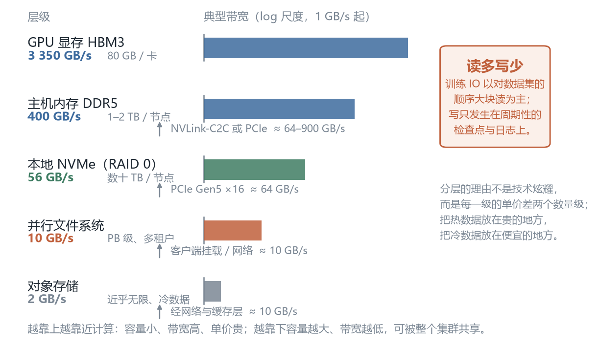

# 第 21 章　存储系统与带宽预算

训练对存储的要求，跟"存多少数据"关系不大，**跟"什么时候要、要得多急"关系极大**。同一个万卡集群，喂数据只需要每秒几兆字节，写一份检查点却要在半分钟里推两百多 GB/s 出去。这两个数差了四个数量级，所以"存储够不够"这种问法本身就没有答案，得先问是哪个场景。

真正难的地方也不在带宽。训练读数据的算术强度高得离谱，每个 token 只读 2 个字节，却要算 6 × 4050 亿次浮点运算，折合每字节约 1.2 万亿次运算。H100 的 roofline 拐点是每字节 295 次运算，训练数据的每字节运算量比拐点高九个数量级。任何带宽只要不是完全断掉，都够用。出事的地方是延迟抖动和元数据，是每 7 秒就要备齐两千万个 token 的那份准时。

## 21.1　三层存储各管一段

按延迟排队，存储分成三层。本地 NVMe、并行文件系统、对象存储。它们的差别不在容量，在延迟、在并发模型、在故障时谁来承担后果。把这三件事想清楚，配置就自然出来了。

本地 NVMe 挂在本机 PCIe 上，延迟最低，而且完全不消耗集群网络。代价是它不共享，别的节点读不到，盘坏了自己承担。它在训练里的位置是"第一跳"，数据集 shard 在这里落一份，检查点先写到这里，日志也在这里。一块盘坏掉只是这台机器少了一份缓存，不影响全局，这是它最大的好处。它的坏处是容量小，一个节点塞一两块盘，装不下整个数据集，只能装一个滑动窗口。

并行文件系统提供全局命名空间，一个文件被条带化到多个存储目标上，聚合带宽随节点数线性增长。它的开销在于客户端、元数据服务和网络三处都要参与，任何一个环节排队，应用看到的都是毫秒级延迟。它最适合"1 GB 以上的大文件、顺序读写、多客户端并发"这三件事同时成立的时候。小文件、随机读、目录遍历，都会把它打回原形。它的另一个特点是故障域大，一次元数据服务切换，整个集群的训练进程一起卡住。

对象存储按对象存，一次 PUT 或 GET 整个对象，不支持随机写，也不支持追加。它便宜、能横向扩、并发连接数可以做到很大，但单次请求的延迟比前两层高出一到两个数量级。它适合归档、适合当数据集的源头、适合长期保存检查点，不适合训练进程直接去随机取样本。还有一个常被忽略的限制，对象存储一般没有"修改对象中间一段"的能力，所以检查点的断点续写在这里做不了，只能整体重写。

更麻烦的差别在接口语义上，这一层比带宽更容易咬人。并行文件系统有目录、有 rename、有 truncate，写一个临时目录再整体改名，是原子的，检查点靠这一条保证"要么全有要么全无"。对象存储没有目录，只有前缀，rename 实际是复制加删除，既不原子也不便宜，几十万个对象改一次前缀等于把整份数据重写一遍。所以同一套原子写的做法，在两层上的实现完全不同，移植的时候不能照抄。

一致性模型也不一样。并行文件系统一般给的是关闭即可见，多客户端读同一个文件要看协议是否带缓存一致性；对象存储现在多数给强一致，但列举操作和写入之间仍有时间差。这两种语义都会让"刚写完就读"这个动作出问题，而检查点恢复恰好就是这个动作。所以设计上要留一步显式的确认，别依赖"写完就能读到"。

| 层级 | 典型延迟 | 带宽来源 | 单次故障影响 |
|---|---|---|---|
| 本地 NVMe | 百微秒量级 | 本机 PCIe | 单节点 |
| 并行文件系统 | 毫秒量级 | 客户端数乘以单客户端带宽 | 全集群 |
| 对象存储 | 十毫秒到百毫秒量级 | 网关与后端并发 | 单个桶或区域 |

用一句话概括这套分工：数据从对象存储进并行文件系统，从并行文件系统进本地盘，从本地盘进内存。每一跳用的都是"更贵但更快"的存储，反过来走就一定出事。千卡以上还让训练进程直接去对象存储随机读样本，前几十步可能看不出来，等到队列深度堆起来，步时的抖动会让人怀疑是网络问题。

判断自己做错的信号很直接。每个 step 都有百分之几的时间在等 IO，而网络和 GPU 都不忙；或者 `strace` 里 `open` 的等待时间比 `read` 还长。这两种都指向路径走反了，不是存储不够快。

数据集的冷热也是分层的一个维度。正在训练的版本是热的，放在并行文件系统上；上一版留着回滚，可以挪到便宜一些的存储；更早的归档到对象存储。这个分层不是节省成本，是为了减少热数据区里的文件数，让元数据服务只面对当前在用的那几万个 shard。做过一次版本管理的集群，元数据压力往往比没做的低一个数量级。

还有一件事要在一开始就定下来，就是每个 shard 多大。太小，元数据压力大，一次读不够塞满一条链路；太大，缓存窗口变粗，随机性变差，一个 shard 落后会拖慢一整轮。1 GB 到 4 GB 是比较稳的区间，因为它正好是"一条 50 GB/s 的链路传 20 到 80 毫秒"的量级，和一步的时间在同一个数量级上，预取的节奏好安排。

## 21.2　带宽与 IOPS 要分开算

先算读。Llama 3 用 15.6 万亿个 token、16384 张卡跑了 54 天，折合每秒约 330 万个 token，每张卡每秒约 200 个 token。按每个 token 存成 2 字节的整数 ID 计算，整个集群的读取需求是：

$$\text{读带宽} = 3.3 \times 10^{6} \times 2 = 6.7 \ \text{MB/s}$$

这个数字大到不像真的。整台机器 8 张 H100 挂着 8 条 400 Gb/s 的网卡，合计 400 GB/s 的注入能力，2048 个节点就是 819 TB/s，而集群只需要 6.7 MB/s 来喂数据。差一亿倍。所以"数据读取的带宽够不够"这个问题，在万卡规模上永远是可用的，带宽从来不是瓶颈。

再看写。Llama 3 405B 按每个参数 16 字节存一份检查点，单份是：

$$\text{检查点大小} = 4.05 \times 10^{11} \times 16 = 6.48 \ \text{TB}$$

要在 30 秒内写完，集群需要：

$$\text{写带宽} = \frac{6.48 \times 10^{12}}{30} = 216 \ \text{GB/s}$$

摊到 16384 张卡，每卡 13.2 MB/s。读只要每秒 400 字节，写要每秒 13 兆，差三万倍。同一个存储系统要同时应付这两种负载，必须按写来配，按读来省。

图 21-1 把三层的带宽量级和它们在训练里的位置画在一起。

*图 21-1　存储层级与典型带宽*

这张图值得盯一会儿。左边是每一层的带宽量级，右边是训练在不同阶段对带宽的需求。读的那条线低到几乎贴着横轴，写的那条线在检查点时刻打出一个尖峰。设计存储的时候，要按那个尖峰的高度和宽度来配，中间的空白不能当成常态。

把写这条路径拆开看更清楚。每张卡要往外送 396 MB，数据在 HBM 里，搬到主机内存走 PCIe，再从网卡出去。三段的理论时间是：

$$\text{读显存} = \frac{396 \ \text{MB}}{3.35 \ \text{TB/s}} = 0.12 \ \text{ms}$$

$$\text{过 PCIe} = \frac{396 \ \text{MB}}{64 \ \text{GB/s}} = 6.2 \ \text{ms}$$

$$\text{过网卡} = \frac{396 \ \text{MB}}{50 \ \text{GB/s}} = 7.9 \ \text{ms}$$

三段加起来不到 15 毫秒，而实际要 30 秒，差三个数量级。这说明卡这一侧完全不是瓶颈，瓶颈在存储端能不能同时接住 16384 条写流。很多时候检查点慢，运维去查 GPU、查 PCIe 带宽，方向从一开始就错了。

带宽之外还有 IOPS，也就是每秒能完成多少次操作。一次 2.4 KB 的读和一次 240 MB 的读，占用的带宽差十万倍，占用的操作数却都是 1。一步 2000 万个 token 摊到每张卡是 1200 个 token、2.4 KB。如果这 2.4 KB 是一次读回来的，那就是每步一次操作，几乎不算事；如果它是按样本拆成 8 次读，每次都要一次 RPC，延迟 1 毫秒，串起来就是 8 毫秒；如果拆成 800 次，就是 800 毫秒，一步 6 秒里有 13% 在等 IO。

结论是把小读合并成大读。packing 之后每卡每步取一个定长块，一次 read 拿 2.4 KB，操作数降到最低。这件事在数据管线里做，比在文件系统上调参数有效得多。

再往下算一步，就知道为什么"操作数"这个词比"带宽"更要紧。16384 张卡每步各读一次，是 16384 次读；如果每次读的延迟是 1 毫秒，而且这些读是串行的，一步就要 16 秒，是步时的十倍。并行的客户端能把这个时间摊掉，但并行的上限由存储侧的并发服务能力决定。所以每步的读次数要压到一个客户端一次，再靠 16384 条流并发把它摊平；一旦某个环节把一次读拆成八次，延迟就乘以八，而带宽一点都没变。

还有一个容易忽略的量。检查点不是一张卡写一个文件，实践中每个 rank 会写若干个 50 MB 左右的分片，16384 个 rank 各写 8 个就是 13 万个文件。30 秒内创建 13 万个文件，元数据操作峰值是 4400 次每秒，这样一个数字单靠一个元数据服务扛不住。

分片大小本身也是个取舍。分片太小，文件数暴涨，元数据先崩；分片太大，单个客户端的上传并发不足以填满一条链路，带宽用不满，而且一个分片重传的代价变大。50 MB 到 200 MB 是常见区间，因为它大约等于"一条 50 GB/s 的链路传 1 到 4 毫秒"，足够细到能并行，又足够大到不产生海量小文件。

突发和平均要分开看。检查点占一天时间的比例很小，按 3 小时一次、每次 30 秒算，是 0.28%。但存储要按那 30 秒里的 216 GB/s 去配，不能按全天摊平的 0.6 GB/s 去配。这个比例也解释了为什么共享存储上其他业务会觉得"训练把盘打爆了"，它一天只用 0.28% 的时间，但那 0.28% 用的是全部带宽。错峰安排非训练业务，比加盘便宜。

## 21.3　元数据是真正的天花板

文件系统的带宽和元数据是两套资源，扩的时候也是两条路。带宽不够加存储目标，元数据不够加元数据服务。现场最常见的情况是带宽只用了 10%，元数据已经打满。

用一个例子说明差距在哪。15.6 万亿个 token，如果按每篇文档一个文件存，平均 2000 个 token 一篇，文件数是：

$$\text{文件数} = \frac{15.6 \times 10^{12}}{2000} = 7.8 \times 10^{9}$$

七十八亿个文件。按每秒一万次创建估算，光是把这个数据集建出来就要 9 天。之后每次训练启动，dataloader 要去列目录、stat、open，这些操作的次数和文件数成正比，跟数据量无关。这就是小文件拖垮文件系统的具体机制，不是"文件系统性能差"，是它被要求做了七十八亿次本该做一次的事。

正确做法是打包成大 shard。同样 31 TB 的数据，按每片 1 GB 存，文件数降到 3.1 万个，元数据压力下降五个数量级。每个 shard 内部按定长块切好，偏移量写进索引头，读的时候一次 `pread` 定位。索引的开销要单独算：每片装 5 亿个 token，平均 2000 个 token 一条样本，就是 25 万条索引，每条 8 字节，每片 2 MB，全量 62 GB。这些索引分到 2048 个节点，每节点 30 MB，放在内存里没问题。

索引的粒度也值得说一句。按 token 建索引太细，62 GB 会变成几百 GB；按 shard 建索引太粗，一次 shuffle 就要读整片。按样本建是唯一合理的粒度，因为训练需要的随机性就发生在样本这一层。至于 shard 内部样本怎么排，那是数据准备阶段的事，训练时不该再动。

元数据服务怎么扩，是有前提的。目录树按子树切分到不同服务，前提是热点不在同一个子树里；如果 16384 个 rank 都在自己的训练目录下建检查点，热点天然是散的，切分就有意义。反过来，所有检查点都往一个固定目录写，这就是自己给自己造了一个单点，加多少服务都没用。改变目录布局往往比加硬件快。

检查点的元数据压力更集中，因为它有时间窗口。13 万个分片要在 30 秒内建完，如果全部塞进同一个目录，目录锁会成为串行点。工程上的解法是分目录，按 rank 区间散成几百个子目录，每个子目录几千项。这件事看起来像洁癖，实际上是能不能在 30 秒内写完的分界线。

分目录的粒度也有个数。13 万个分片散进 200 个子目录，每个目录 650 项，目录锁的争用就降到原来的二百分之一；散进 2000 个目录，每目录 65 项，争用基本消失，但目录本身的创建又成了新的操作量。经验上每目录几百项是个平衡点，再多就是给自己造热点，再少就是元数据操作翻倍。这个数不是拍出来的，它等于"总文件数除以可并行的目录数"，而可并行的目录数受客户端并发能力限制。

保留策略也会反过来咬元数据。保留三份检查点，每份 13 万个文件，目录里就有近四十万项；如果保留十份，就是一百三十万项。删除旧检查点的操作同样是元数据密集的，一次删十几万文件会让元数据服务抖上几十秒，而这个抖动往往正好撞在新检查点要写的时刻。所以删除要错峰，不能和写入挤在同一个窗口。

还有一种元数据惊群。16384 个 rank 在启动或恢复时同时 `stat` 同一个索引文件，同一个 inode 上会瞬间积压上万次查询。有些文件系统对单文件的并发 open 加了锁，于是 16384 次操作变成串行，启动就卡在这。解法是让每个 rank 读自己那一份索引，或者先由一个 rank 读进共享内存再广播。

现场症状很好认。`ls` 一个目录卡十几秒，`stat` 超时但 `dd` 顺序写很快，元数据服务 CPU 打满而存储目标带宽只有个位数。看到这三条同时出现，**不用怀疑带宽，去数文件**。

## 21.4　读多写少下的缓存设计

训练读有两个特点。第一，总量小，每秒几兆字节，带宽上怎么都能满足。第二，准时，每 6 秒要备齐 2000 万个 token，晚一秒就是一步的空洞。所以缓存的目标不是省带宽，是把延迟的尾巴剪掉。这个定位一变，很多设计选择就不一样了。

先解决放大。如果 128 个数据并行副本都去读同一批 shard，读取需求会放大 128 倍，从 6.7 MB/s 变成 858 MB/s，虽然还是不大，但所有副本挤在同一批存储目标上，排队立刻出现。做法是让每个 DP rank 按 rank 号取模分到不同的 shard 区间，同一个 shard 在一轮里只被一个 rank 读。这一条不做，后面所有缓存都白搭。

放大的账要算全，因为数据并行不是唯一的乘数。张量并行和流水并行会让同一个节点内的若干进程读同一批数据，这一层可以靠节点内广播消掉，不用再去存储取一遍。真正剩下的乘数只有数据并行这一维。所以读放大等于数据并行度除以"节点内共享的份数"，4096 路数据并行、每节点 8 个进程共享，实际放大是 512 倍，不是 4096 倍。这个区别决定了你需不需要在节点内做一次广播，还是直接让每个进程各读一份。

然后做两级缓存。本地 NVMe 缓存整个 shard，粒度是 1 GB，顺序读进来，命中率高且不会碎。内存缓存解包后的定长块，粒度是几 KB，用来做样本级的重排和 shuffle。两者的淘汰策略不一样，前者按 shard 的访问轮次淘汰，后者用完就扔。用一个 LRU 同时管这两层，会把 shard 打碎成随机读，比不缓存还慢。

预取深度按"能不能盖住 P99 延迟"定。一个 shard 1 GB，本地盘按 1 GB/s 读要 1 秒；一步 6 秒，所以提前两步发起预取就够。问题在于存储的 P99 延迟往往是 P50 的十倍以上，平均值毫无意义。要按 P99 设计，也就是按"最慢的那 1% 的读要多久"来算预取深度，宁可多占一点本地盘。

预取的容量需求可以直接算出来：

$$C_{\text{cache}} = B_{\text{shard}} \times d$$

$B_{\text{shard}}$ 是单个 shard 的大小，$d$ 是预取深度。1 GB 乘 4，就是 4 GB。对一个有几百 GB 本地盘的节点，这个需求小得不可思议。所以缓存容量的约束几乎不存在，约束在"能不能把读组织成顺序的大块"。这一点和直觉相反，很多人第一反应是"盘不够大"，实际上盘一直够大，是访问模式把盘用成了随机设备。

回源带宽可以写成：

$$B_{\text{back}} = (1 - h) \times B_{\text{need}} \times f$$

$h$ 是命中率，$B_{\text{need}}$ 是需要的带宽，$f$ 是 rank 之间的重复因子。因为 $B_{\text{need}}$ 本身只有 6.7 MB/s，即使 $h$ 等于 0、$f$ 等于 128，回源也只有 858 MB/s，一条链路的量级。这说明缓存的价值不在带宽，在把"每次都要等一次远端延迟"变成"大部分时候等本地盘"。

缓存不该做的事也要说清楚。不要把整个 epoch 缓存下来，31 TB 的数据没有哪一层放得下；不要按样本粒度做远端随机读；不要在缓存里做解压和 tokenize 的重活，那样 CPU 会先成为瓶颈。最后一条在实际系统里很常见，缓存做对了，瓶颈挪到 CPU 上，症状看起来还是"数据慢"，但看 CPU 利用率就分得清。

## 21.5　一个万卡集群的存储预算

把前面的算式收拢成一张表，就是万卡集群该配多少存储。

| 项目 | 数量 | 依据 |
|---|---|---|
| 数据容量（整数 ID） | 31 TB | 15.6 万亿 token × 2 字节 |
| 数据容量（原始文本） | 62 TB | 按每 token 4 字节估算 |
| 检查点单份 | 6.5 TB | 4050 亿参数 × 16 字节 |
| 检查点保留三份 | 19 TB | 单份乘以 3 |
| 读带宽 | 7 MB/s | 330 万 token/s × 2 字节 |
| 写带宽 | 216 GB/s | 6.5 TB 除以 30 秒 |
| 元数据峰值 | 4400 次/秒 | 13 万个分片除以 30 秒 |
| 集群网络注入能力 | 819 TB/s | 2048 节点 × 8 网卡 × 50 GB/s |

先看容量。数据和检查点加起来不到 120 TB，这个量在今天的存储里算不上大，几十块大容量盘就能装下。所以"存储预算"这个词容易误导人，**真正的预算在带宽和并发上**。按容量去买存储的人，最后往往会发现买来的是容量，缺的是并发。

再看带宽的比例。216 GB/s 只需要集群网络注入能力的万分之三。这意味着检查点慢，几乎不可能是网络带宽的问题，一定是"存储端接不住这么多并发流"或者"元数据排队"。反过来说，如果检查点写不完，先去看每张卡的实际写速率是不是均匀，而不是去加网卡。

按这个比例配存储节点，需要的是"能持续输出 216 GB/s 并且接住 2048 个客户端"的能力。假设单个存储节点能稳定输出 10 GB/s，那需要 22 个节点，再留一倍余量就是 44 个。这个倍数不是浪费，是因为检查点是突发的，30 秒里要用掉全天的平均带宽，峰值和均值差几个数量级。

还有一处容易算错。检查点写到并行文件系统之后，通常还要同步一份到对象存储做长期保存。这一跳如果串在训练的关键路径上，30 秒就变成了几分钟。正确做法是让并行文件系统上的那份先落盘、训练立刻继续，再由后台任务把对象存储的那份传上去。异步这件事必须在设计里，不能靠"传得快"。检验方法是看两次检查点之间的步时有没有被拉长，如果每 30 分钟有一段步时上浮，说明上传挤进了训练窗口。

最后是热备和校验的空间。检查点写完之后要能读回来，读回来要能确认没坏，所以磁盘上实际占用的空间要比"三份乘以 6.5 TB"多一些。按 20% 的余量给，是 23 TB。这个数看起来小，但如果用的是对象存储的版本化功能，每一版都算钱，这时候保留策略就该更紧一些。

## 21.6　现场瓶颈与监控

存储出问题的形态只有四种，认清了就不用瞎试。

第一种，带宽打满。顺序读大文件变慢，`iostat` 里设备利用率接近 100%，延迟随队列深度线性上升。这种是真不够，加存储目标或者换更大的条带。

第二种，元数据打满。带宽只用了一点点，操作延迟却涨到几十毫秒。`ls` 卡、`open` 慢、训练启动卡在枚举文件。这种加带宽没用，要加元数据服务，或者回去把文件数降下来。

第三种，客户端 CPU 打满。存储侧看起来正常，但每张卡所在的进程 CPU 饱和在解压、校验、tokenize 上。这种看 `perf top` 就知道，和存储无关，是数据管线的活没卸载出去。

第四种，链路重传。存储和计算之间的网络有丢包，TCP 或 RDMA 在重传，表现为吞吐忽高忽低、延迟长尾。这种在存储侧看不出来，要去数网卡的 retransmit 和 RDMA 的 retry。

监控抓三个数就够定位。一是每进程每秒的读写字节数，用来判断是哪个阶段在读写；二是 open 与 read 的 P99 延迟，用来区分元数据和带宽；三是 dataloader 的等待时间占步时的比例，这是唯一直接和钱挂钩的指标。它超过 5%，就等于白扔 5% 的算力，按 16384 张卡算就是 800 多张卡在空转。

真正定位一次故障，顺序是固定的。先确认是读慢还是写慢，看的是哪一段步时变长；再确认是带宽还是操作数，看的是单次请求的平均大小，平均几兆就是带宽，平均几 KB 就是操作数；然后看是客户端还是服务端，看的是客户端 CPU 与服务端 CPU 谁先饱和；最后看是不是只有一部分节点受影响，如果只有一组 rail 上的节点慢，问题在链路不在存储。这四步走完，基本不用猜。

这三个数要按"每步"的粒度采样，不是每分钟。因为一步只有几秒，每分钟的平均值会把三秒的卡顿抹平，而三秒的卡顿恰好就是一步的空洞。采样窗口比要观测的现象长，是监控里最常见的错误。

最后一条经验是把两条曲线叠在一起看。步时曲线和 IO 曲线如果同步起伏，因果就确定了；如果步时抖动而 IO 平稳，问题在别处，别在存储上耗时间。曾经有一个集群每隔 3 小时步时涨 20%、持续两分钟，运维查了两周网络，最后发现是检查点；另一个集群每 30 分钟抖一次，是 shard 切换时的元数据峰值。形态不同，路径完全不同，只有把时间轴对齐才能分清。

## 21.7　读写比例与并发流

同一个存储系统要同时接住读和写，而这两种负载的形状完全不同。把它们的峰值、均值和并发数摆在一起，配容量的逻辑就清楚了。

| 负载 | 峰值 | 均值 | 并发流数 |
|---|---|---|---|
| 读数据 | 6.7 MB/s | 6.7 MB/s | 2048 |
| 写检查点 | 216 GB/s | 0.6 GB/s | 16384 |
| 写数据集 | 一次性 | 可忽略 | 少 |
| 元数据 | 4369 次/秒 | 平时接近零 | 16384 |

读写比是 216 GB/s 比 6.7 MB/s，三万两千倍。这个比例决定了三件事：存储要按写的峰值配带宽，按读的稳态配缓存，按元数据的瞬时峰值配目录结构。三件事对应三种资源，互相不能顶替。加带宽不会让元数据变快，加元数据服务也不会让写盘变快。

写的均值那一栏值得多说一句。3 小时存一次、每次 30 秒，占空比是 0.28%，摊到全天是 0.6 GB/s。按均值配，峰值那 30 秒里每一秒都在欠账，一份 6.48 TB 的检查点要写三个小时；按峰值配，99.7% 的时间带宽是空的。两种都浪费，实际的做法是按峰值的六成配，接受写盘时间比理论值长一半。这个取舍在前一节算过，这里只强调一点，占空比越低，按峰值配越不划算，所以提高保存频率反而可能降低对存储的要求，因为每次要写的量没变，但峰值可以被错峰摊平。

并发的算法要精确一点。13 万个分片要在 30 秒内写完，就是每秒 4369 个分片；每个 50 MB，乘起来正好 216 GB/s。反过来说，每个分片只有 30 秒的窗口，一个 50 MB 对象在 30 秒内传完，单条连接只要 1.67 MB/s。这个速率低得让人意外，它说明写检查点不需要很高的单流带宽，需要的是一万三千多条流同时在跑。

这里就是最容易踩的坑。框架如果按 rank 串行写自己的 8 个分片，单条连接就要 13.3 MB/s，八倍的压力压在一根流上；而存储侧对单流的限速往往比聚合带宽低得多，于是时间被拉长八倍，30 秒变成四分钟。解法不是加带宽，是把写做成并发的，一个 rank 同时开 8 条流，或者干脆把分片再切细。

队列深度也要一起看。存储侧打满之后，延迟随队列线性上升，客户端看到的是超时；超时的请求会重发，重发的请求又占队列，队列更深，延迟更高。这个正反馈是 20.6 讲的风暴在客户端一侧的样子。断它的办法只有一个，给写设超时上限并退避，宁可让这一次保存失败也不要让重试把队列灌满。

## 21.8　容量、副本与物理占用

前面算的都是逻辑容量，也就是"数据有多大"。真实采购要按物理占用算，中间隔着一个冗余系数。

| 冗余方式 | 放大系数 | 31 TB 数据 | 19.4 TB 检查点 |
|---|---|---|---|
| 三副本 | 3 | 93 TB | 58 TB |
| 两副本 | 2 | 62 TB | 39 TB |
| 纠删码 4+2 | 1.5 | 47 TB | 29 TB |
| 纠删码 8+2 | 1.25 | 39 TB | 24 TB |

算例。一套万卡集群的逻辑容量是 31 TB 数据加 19.4 TB 检查点，50.4 TB。三副本要 151 TB 裸容量，纠删码 8+2 只要 63 TB，差 88 TB。这个差距在几十 TB 的规模上是几台机器，在 PB 级上就是一层楼的机柜。

选哪种不能只看系数。纠删码的代价在两处，一是写放大，部分条带的写要读旧数据再算校验，随机小写的开销能翻好几倍；二是重建，一块盘坏了要从其余盘读整条带重算，重建期间的读放大是系数本身的好几倍。检查点这种"一次写几十万个 50 MB 大文件、几乎不随机改"的负载，正好落在纠删码最擅长的形状上，因为每个分片都是一次整条带顺序写。反过来，训练数据的 shard 若被频繁局部更新，纠删码就不划算。

还有一层容易被忘，校验和重试占的空间。写失败的分片要重写，重写期间新旧两份同时存在；删除是软删除，标记之后要过一段时间才真正回收。这两件事让实际占用比表里的数再高出一到两成。所以采购时按表里的数加 20% 才是能用的容量，19.4 TB 的检查点乘 1.25 再乘 1.2，是 29 TB。

把冗余和带宽放一起看，结论比直觉顺一点。纠删码既省容量也省写带宽，因为物理写入只放大 1.25 倍，三副本要放大三倍。216 GB/s 的写入需求，在 8+2 下对应的物理写入是 216 乘 1.25，270 GB/s；三副本下是 648 GB/s。带宽这一侧的收益常常被忽略，一套按三副本设计的存储改成纠删码，同样的逻辑写入量只需要 42% 的物理带宽，这才是它在训练集群里最直接的价值，容量只是顺带。

## 21.9　一次没有带宽告警的复盘

这次故障从头到尾没有出现过带宽告警，这也是它拖了两周的原因。

现象是 MFU 从四成出头掉到三成五，步时抖动的幅度变大，但没有周期性。存储侧的监控面板很干净，聚合带宽只用了百分之八，元数据服务的 CPU 在四成，所有硬件的健康状态正常。运维的结论是"存储没问题"，排查的方向转向了通信和算子。

转折点是给每步的 `open` 系统调用计数。一个节点每步的 open 是 64 次，一步 1.5 秒，就是每秒 43 次；2048 个节点乘起来 8.7 万次每秒。而数据集一共六万多片。也就是说，集群每秒把整个数据集的分片打开一遍还多。

根因在 dataloader 的实现里。每个 worker 取一个 batch 时，先 open 当前 shard，读完就 close，下一批再 open 一次。单机上看这个写法毫无问题，open 是微秒级的操作；在 2048 个节点同时做的时候，它变成了每秒八万多次的全局元数据请求，把元数据服务推到了它不擅长的负载上。元数据 CPU 四成不代表没排队，因为排队发生在锁上，不在 CPU 上。

处置是把句柄常驻。每个 worker 启动时打开自己要用的四个分片，训练期间不再 open/close，只在换片时做一次。改完 open 的次数从每秒八万多次降到每分钟几百次，步时回到 1.45 秒，MFU 回到四成。

这件事的教训有三条。第一，元数据服务的瓶颈不在 CPU 利用率，而在操作数，CPU 四成配上排队是常态。第二，单机上正确的写法在大集群上可能是错的，判断标准要换成"全局每秒操作数"，而不是"单次操作多快"。第三，监控里必须有每步的操作计数，只盯带宽会漏掉这一类问题，因为它的带宽占用确实很低。

顺带一个观察。这类问题的抖动没有周期性，因为它取决于各节点的 open 时刻是否撞在一起，而各节点的进度是漂移的。周期性的抖动通常指向检查点或定时任务，无规律的抖动指向元数据、锁、重试。把抖动的规律性当成第一个分类依据，能省很多时间。

## 21.10　降级运行：慢盘、只读与重建

存储不会一直完好，训练也不会因为存储降级就停下来。这一节说几种降级形态，以及训练侧该做什么。

| 故障形态 | 表面现象 | 训练侧的动作 |
|---|---|---|
| 单盘变慢，重试变多 | 部分客户端延迟长尾，带宽不高 | 标记并摘除，别等它彻底坏 |
| 存储节点掉线 | 一段条带的读全部重试 | 限速重建，别和检查点撞车 |
| 元数据主备切换 | 全集群的 open 卡住几十秒 | 加退避重试，别立刻重启作业 |
| 只读挂载 | 写检查点失败，读正常 | 检查点先落本地盘，攒着再搬 |
| 容量写满 | 写失败，读正常 | 配额、清理、软删除回收 |

慢盘比坏盘难处理。坏盘会被摘出去，重建按计划走；慢盘还在服务，只是每次读多花几十毫秒，于是它拖慢的是一段条带上的所有读，而监控上只能看到"这一组节点的延迟偏高"。判断办法是看单盘的队列深度与重试计数，两个都高就是慢，不用等它报错。

元数据切换是最容易被误判成故障的一种。主备切换期间，所有 open 都会卡住几十秒，训练进程的 dataloader 会卡在系统调用里，框架的心跳可能超时，于是作业被判定为挂起并重启。重启之后又要加载检查点，加载又要 open，正好撞在还没恢复的元数据服务上。正确做法是给 dataloader 的读加长退避，让作业扛过这几十秒，而不是重启。

重建的带宽要预留，而且要跟检查点错开。重建一个存储节点的数据量，通常等于这个节点的容量，按 10 GB/s 的单节点能力算是几十分钟到几小时。这段时间里可用带宽少了一块，如果正好赶上检查点窗口，写盘时间就会被拉长。

算例。假设重建占走了两成的带宽，检查点原本 30 秒写完，现在要 30 除以 0.8，37.5 秒。按 20.4 的最优间隔公式，写盘耗时从 30 秒涨到 37.5 秒，最优点只挪动几个百分点，看起来无所谓。但重建会持续几小时，这几小时里如果发生故障，恢复要读的那份检查点也在同一条链路上，恢复时间同样被拉长两成。真正该做的不是调间隔，是把重建的带宽限死在一个固定值上，让它成为可预测的常数。

最后一条是容量写满。写到 95% 之后，多数文件系统的分配策略会退化，写放大上升，元数据操作变慢，某些实现还会直接切成只读。所以在监控里给容量设一个 85% 的告警线，比等到写失败要早得多，而训练侧的处理是把检查点的软删除真正回收，或者把老版本的 shard 挪到对象存储。