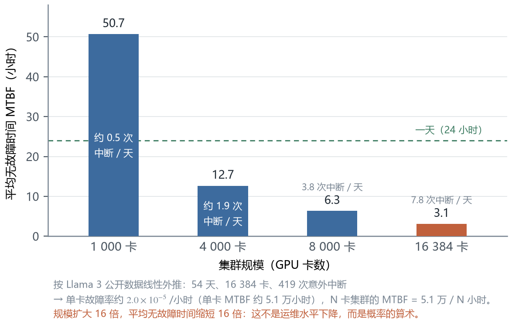

# 第 22 章　硬件故障谱与静默数据损坏

万卡集群里，**故障不是意外，是背景噪声**。Llama 3 的 405B 模型在 16384 张 H100 上跑了 54 天，记录了 466 次作业中断，其中 47 次是计划内的维护，419 次是意外。419 除以 54 天，平均每 3.1 小时断一次。这个频率意味着任何一个"出事了再处理"的流程都撑不住，运维必须把中断当成周期性事件来设计。

更麻烦的是这 419 次里有 6 次是静默数据损坏。它不报错、不重启、不掉卡，只是让模型悄悄地学错东西。前面 413 次你能看见，这 6 次看不见。

## 22.1　故障分类与真实统计

先把 419 次拆开。Llama 3 论文给出的分类里，GPU 本体 148 次，GPU 的 HBM3 72 次，软件缺陷 54 次，交换机与线缆 35 次，主机非计划维护 32 次，GPU 上的 SRAM 19 次，GPU 系统处理器 17 次，网卡 7 次，NCCL 看门狗 7 次，静默数据损坏 6 次，GPU 温度传感器 6 次，其余 16 次。

| 类别 | 次数 | 占比 |
| GPU 本体 | 148 | 35.3% |
| GPU 的 HBM3 | 72 | 17.2% |
| 软件缺陷 | 54 | 12.9% |
| 交换机与线缆 | 35 | 8.4% |
| 主机非计划维护 | 32 | 7.6% |
| GPU 的 SRAM | 19 | 4.5% |
| GPU 系统处理器 | 17 | 4.1% |
| 网卡 | 7 | 1.7% |
| NCCL 看门狗 | 7 | 1.7% |
| 静默数据损坏 | 6 | 1.4% |
| GPU 温度传感器 | 6 | 1.4% |
| 其余 | 16 | 3.8% |

把 GPU 本体、HBM3、SRAM、系统处理器四项加起来是 256 次，占 61.1%，论文给的"GPU 相关问题占 58.7%"应该是归因口径上做了合并，比如把系统处理器算进主机侧。不管是 58.7% 还是 61%，结论都一样。**六成的中断来自那张卡本身**。再加 78% 归因于确认或疑似硬件问题，剩下的两成多才是软件、配置和人为操作。

换算成单卡的故障率，才有可比性。419 次中断发生在 16384 张卡、54 天里，卡日总数按 16384 乘 54 算。

$$N_{\text{card-day}} = 16384 \times 54 = 884736$$

每卡日的意外中断率是 $419 / 884736 = 4.7 \times 10^{-4}$，倒数就是单卡的平均无故障时间。

$$\text{MTBF}_{\text{card}} = \frac{884736}{419} = 2111 \ \text{卡日}$$

2111 卡日约等于 5.8 年。一张卡平均能用将近六年不出事，听起来很可靠。但作业级的中断间隔是这个数除以卡数：

$$\text{MTBF}_{\text{job}} = \frac{\text{MTBF}_{\text{card}}}{N}$$

1024 张卡是 2.1 天，2048 张卡是 1.03 天，16384 张卡是 0.13 天，也就是 3.1 小时。这就是规模效应的全部内容。**可靠性和卡数成反比**，你没法通过"挑好卡"绕过去，只能通过"恢复得快"绕过去。

图 22-1 把这条曲线画出来。

*图 22-1　故障率随集群规模的变化*

图上看得很清楚，从一千卡到一万六千卡，中断间隔从两天掉到三小时。这条曲线的形状决定了整章后面所有的工程选择：既然是三小时一次，检查点间隔、恢复流程、备件策略都得按三小时的节奏设计，而不是按"偶尔出一次事"设计。

平均每次中断吃掉多少时间，也能反推。Llama 3 报告有效训练时间高于 90%，也就是 54 天里有将近 5.4 天被浪费掉了。把这 5.4 天摊到 419 次中断上，得到每次的损失。

$$\text{单次损失} = \frac{54 \times 0.1 \times 86400}{419} = 1113 \ \text{s}$$

大约 18.6 分钟。这 18.6 分钟里包含检测、定位、隔离、换卡或重启、加载检查点、重建通信组、预热回稳。它同时也是"检查点间隔该多长"的参照，因为最坏情况下一次中断会浪费掉一个完整的检查点间隔。

这 419 次不是均匀分布的。实际集群里中断有聚集性，同一批次上机的卡会在相近的时间段集中出问题，因为它们的批次相同、焊点疲劳的进度也相同。所以在做容量规划时，不能把 3.1 小时当成一个稳定的节拍，真实情况可能是两周没事、然后一天断五次。备件和值班都要按峰值准备，不能按均值。

计划内那 47 次也值得看一眼，它占了总数的 10%。计划内维护是好的，因为它可以错峰、可以提前保存检查点、可以在作业边界执行。把这 10% 从意外里拉出来，本身就是一条很划算的工程手段。任何一个能变成"提前安排"的故障，就不再是故障。

统计口径本身也值得说一句。419 次是按作业中断记的，不是按日志里的错误行记的。同一次中断里往往同时出现 HBM 报错、NCCL 超时和进程退出，按日志行数统计会把一次故障记成三次；反过来只看"作业挂了"这一个信号，软件缺陷和硬件故障又混在一起。所以自建故障库时，一条记录的粒度应该是"一次需要人介入的作业中断"，附带根因判定和证据链，而不是把监控系统的告警条数直接倒进来。那个 16 次的"其余"就是这个做法留下的痕迹，它提醒你分类永远不完备，剩下的是没归进任何一类的现场。

## 22.2　GPU 与 HBM

六成中断来自卡本身，其中最大的两块是 GPU 本体和 HBM。148 次 GPU 本体故障的表现通常是掉卡、XID 报错、驱动认为设备失联，重启也回不来。72 次 HBM3 故障更隐蔽一些，因为 HBM 有片上 ECC，单比特错误会被纠正，不产生任何用户可见的现象。

HBM 在 54 天里坏 72 次，折合每天 1.33 次。一台 8 卡节点上每张 H100 挂 80 GB HBM3，整个集群的 HBM 容量是 1.31 PB，其中任何一片出问题，那张卡就不能再用。从概率上说 72 次对应 16384 张卡，是每千卡日 0.081 次，这个量级和任何大批量硬件的现场返修率是一个数量级。

HBM 会坏，主要因为它同时承受三件事，700 W 的功耗、频繁的温度循环、以及 TSV 和焊点的机械应力。加速器在训练里是满载的，功率在 600 到 700 W 之间反复跳，封装内部的热应力一天要循环上万次。焊点疲劳是必然结果，只是早晚。

识别 HBM 故障要看 XID 和 ECC 计数，两者的意思不同。XID 48 是 HBM 上出现了双比特错误，也就是不可纠正的那种；XID 63 和 64 是行被退役；XID 94 和 95 分别是可隔离和不可隔离的 ECC 错误；XID 79 是设备从总线上掉了。看到 48 就要把当时那一步的结果当作不可信，看到 94 卡还能继续跑但已经不能指望，看到 95 或 79 必须立刻隔离。这套编码不是给人看的，是给自动化脚本看的，运维系统应该直接按 XID 号做决策，不要等人来读日志。

比 XID 更早的信号是可纠正错误的增量。一张卡的 ECC 计数在 24 小时内涨三次，就该主动下线。这里没有普适阈值，因为可纠正错误本身是正常现象，但增量的突变不是。做法是给每张卡记一个 ECC 计数的滑动基线，超过基线若干倍就报警，而不是设一个绝对值。

现场会看到三种形态。第一种是训练突然 abort，日志里一行 `uncorrectable ECC error`，最省心，因为定位明确。第二种是某张卡算力下降，比如降频到 80%，它不会报错，只是每一步都比别人慢，输出正确但拖慢整个集合通信。第三种是 loss 慢慢变成 NaN，前几步正常，几十步后开始出现异常值，这种最容易被误判成超参问题。

第二种形态值得多说一句。降频的卡在 all-reduce 里是天然的掉队者，因为它算得慢，别人都在等它。集合通信的耗时由最慢的那个决定，所以一张卡降频 20%，整个作业的步时可能涨 20%，而所有监控指标都正常，GPU 利用率 100%，显存正常，网络正常。要发现它，必须看每张卡的时钟频率和每张卡的单独耗时，不能只看集群平均。

HBM 的退化也属于这一类，只是它体现在带宽上而不是频率上。3.35 TB/s 是标称值，一片堆栈开始劣化时，实测可能掉到 3.1 TB/s，也就是 7% 的损失。这个损失对 GEMM 影响有限，因为 GEMM 的算术强度高，数据进 SM 之后要反复用；但对 attention 和 norm 这类访存密集的算子影响直接，它们的耗时几乎和带宽成正比。按 126 层的模型算，每层都有 attention 和两次 norm，这些算子加起来通常占单步的两三成，带宽掉 7% 就意味着单步涨 1.5% 到 2%。这个量级没人会注意到，但它会在几个月里慢慢累积，最后表现为"同样的配置，现在比半年前慢 3%"。查这种问题只能靠每周一次的全容量带宽测试，把数值按卡存下来，看趋势。

SRAM 那 19 次属于另一类。共享内存和寄存器文件在芯片内部，面积大、密度高，但没有 HBM 那样的全覆盖 ECC。出问题时的表现是某个内核算出离谱的值，而不是设备失联，所以它更像静默损坏，只不过它偶尔会触发一个不可纠正的错误让进程崩溃，于是被归到了有报错的那一类。

处置流程是固定的四步。隔离节点，从调度池里摘掉，避免下一个作业又踩上去；定位到具体的卡和具体的 stack，因为一张卡上有多个 HBM 堆栈，有时候只需要换模块；换件之后跑 burn-in，确认新卡在压力下不报错；最后回池，回池的第一个作业要盯住它的 ECC 计数。这四步里最容易省掉的是第三步，而省掉它的代价是同一张卡在一周内坏第二次。

## 22.3　网卡、光模块、交换机

网络相关的故障在统计里是 49 次：交换机与线缆 35 次，网卡 7 次，NCCL 看门狗 7 次，合计 11.7%。这个比例看起来不高，但网络的特殊性在于故障域。一张卡坏了影响一个 rank，一条链路坏了影响一整组走这条 rail 的卡。

先算数量。一台节点 8 张 GPU、8 张网卡，每张网卡两个光口接两根光纤。节点侧就是 16 根，2048 个节点是 32768 根，交换机侧还要再来一遍，全集群六万多根光纤和同样数量的光模块。这个规模和 GPU 的数量是同一个量级，所以光模块的现场返修率会直接线性放大到作业级。

35 次交换机与线缆故障，摊到 54 天是每天 0.65 次。摊到六万根光纤上，是每根每 54 天 5.3×10⁻⁴ 次，折合每年 0.36%。这个数字单看很低，乘上六万就不低了。

网络的故障表现和 GPU 完全不同，它不报错。光模块劣化的典型路径是误码率上升，前向纠错把这些误码吃掉，链路看起来还是 up 的，但每次纠错都要花时间，端到端延迟就从微秒涨到几十微秒，并且出现长尾。对一次 all-reduce 来说，一条链路的重传会让整个环等它，因为环是串行的。

光模块自己的诊断通道里有四个数值得按周看，收光功率、偏置电流、温度、供电电压。劣化的典型轨迹是偏置电流慢慢上升而收光功率慢慢下降，因为激光器的阈值电流随老化升高，为了维持同样的输出，驱动只能加大电流，等电流顶到上限，链路开始误码。这个过程通常持续几周，采样频率按周就够，前提是真有人看。四个数里偏置电流最灵敏，它往往在误码出现前就已经爬了半个月。

NCCL 看门狗那 7 次是另一类。它不是硬件坏，是通信卡住了，看门狗超时之后主动杀死进程。卡住的原因可能是某条链路 down、某个 rank 掉队、某个交换机的转发表没收敛。看门狗是症状，不是病因，看到它就说明前面已经出事了。

排查顺序要从 NCCL 的日志反推。日志里会报哪个 rank 在哪个集合通信操作上超时，超时的 rank 集合就限定了故障范围。然后按拓扑把 rank 映射到 rail 和交换机端口，去查那些端口的错误计数器，包括 CRC 错误、symbol 错误、链路 flap 次数。计数器有增量就换模块，没有增量就往上一层查，可能是交换机本身或者路由。

这里有一个容易被忽略的物理事实。光在光纤里每 100 米走 0.5 微秒，一个跨三个机架的环，单程延迟就是几微秒。误码导致的重传不是只多花一个往返，而是让这条流暂时脱离节奏，在集合通信里表现为一次几十微秒的停顿。当这种停顿每秒出现几十次，步时就会稳定地上浮几个百分点，而所有链路都是 up 的。

故障域要按拓扑层级来数，不能笼统地说"网络有问题"。最下面是一根光纤或一个光模块，坏了影响一对端口；上面是一台交换机，坏了影响挂在它下面的所有端口，在 rail 优化的拓扑里，这往往是一整段连续编号的 GPU；再上面是脊交换机，坏了可能影响整个集群的一半。同一个"网络故障"，影响 1 张卡和影响 8000 张卡是完全不同的两件事，排查时必须先把范围确定下来。

症状的形态很好辨认。如果是持续变慢，那是带宽问题；如果是周期性抖动，每 N 步一次，那大概率是某条链路在重传或者某个交换机端口在 flap。前者要加带宽，后者要换件，方向完全不同。

## 22.4　电源与散热

电源和散热在统计里没有单独的条目，因为它们的故障最终表现成主机非计划维护那 32 次，或者 GPU 温度传感器那 6 次。但它们在设计阶段的约束力比任何一项都强。

算一下功率密度。一张 H100 的 TDP 是 700 W，一台 8 卡节点的 GPU 部分就是 5.6 kW，光是这 32 台的 GPU 部分塞满一个机架就要 179 kW。而一个机架的供电上限是 40 到 120 kW。这两个数对不上，说明"32 台 8 卡服务器塞满一个机架"在 700 W 的卡上是做不到的，何况还要加上 CPU、网卡和风扇。按 120 kW 的上限倒推，一个机架最多装 21 台，也就是 168 张卡，这还没算 CPU 和网络。实际部署里往往更少，因为要留余量给风扇和峰值。

这条约束会一路传导到调度器。机架的卡数不是 8 的整数倍随便取，它由功率决定的装箱上限卡死。

功率约束还会以"降频"的形式静默出现。当机架总功率接近上限，电源管理会把 GPU 的功率封顶降下来，时钟随之下降。降 10% 的功率大约对应 10% 的算力，步时涨 11%。这个变化不产生任何错误，只是 MFU 从 43% 变成 39%。如果监控只看 GPU 利用率，会得出"一切正常"的结论，因为利用率还是 100%，只是每个时钟周期干的活少了。

温度传感器那 6 次故障的后果类似。传感器读数错了，风扇控制环路会做出错误决策，可能把整机架的风扇拉到满速，也可能降到最低。前者是噪声和功耗，后者是过热降频。一台机器降频，它就成了整个作业的掉队者，步时被它拖住。

识别功率问题要看三个量，每张卡的实时功率、时钟频率、以及温度。三者一起看才能区分是"功率封顶"还是"温度墙"。功率贴着上限、频率低于标称、温度正常，那是功率封顶，要改机架配电或者降低单机密度；功率没到上限、频率低、温度高，那是散热不足，要查风扇和风道。

电源本身故障的代价要单独算。一个 PSU 挂了，整台节点掉电，8 张卡一起下线。这一次故障影响的不是 1 个 rank，而是 8 个，而且它们可能在 8 个不同的并行组里，导致通信组要整体重建。备件策略要按"节点级故障"来准备，不能按"卡级故障"准备。

## 22.5　静默数据损坏

6 次，占 1.4%。这个比例小到可以忽略，但它是唯一一类"不打断训练却污染模型"的故障，代价和前面所有类别不在一个量级。

定义很简单。一次计算或一次传输，结果错了，但没有任何错误标志被置起来。硬件认为自己算对了，软件认为硬件算对了，错误就这样进入梯度，进而进入权重。

来源有五处。HBM 里的位翻转没有被 ECC 捕获，这在多比特翻转同时发生时可能出现；SRAM 里的位翻转，寄存器文件和共享内存没有 HBM 那样的全覆盖保护；计算单元的退化，某些乘法器在特定输入下出错；链路上的位翻转，如果校验强度不够；以及驱动和固件里的逻辑错误。Llama 3 的统计把 SRAM 单独列了 19 次，那是有报错的，没报错的那 6 次才是真正的静默。

检测手段有四种，代价依次上升。第一种是数据校验和，在样本进入训练前算一次，在关键节点再算一次，能抓住传输和存储引入的错误，但抓不住计算错误。第二种是抽取重算，随机挑一小部分步，用更高精度或另一条路径重算前向，对比输出。第三种是双轨比对，同一步在两份副本上各算一次，对比结果。第四种是训练后验证，用一批固定样本跑推理，看指标是否漂移。

工程上常用第二种，因为它的成本可以调到任意低。抽 0.1% 的步，额外算力是 0.1%；抽 1%，就是 1%。对比之下，双轨比对要 100% 的额外算力，只有在对正确性要求极高的场景才用。

抽取重算的关键是"重算的路径必须和主路径不同"。如果用同样的内核、同样的精度再算一遍，同一个硬件 bug 会以同样的方式复现，结果一致，检测失效。要么换精度（比如 BF16 主路径、FP32 重算），要么换实现（比如换一个 GEMM 库），要么换硬件（在另一个节点上算）。三者至少满足一个。

定位是二分。把 16384 张卡分成两半，让一半用另一条路径重算同一批数据，与主路径的输出逐位比对，看哪一半偏离。偏离的那一半再分，14 轮之后定位到单卡。每一轮只需要一步的时间，所以整个定位在几分钟内完成，前提是你能做确定性重放。

代价可以量化。假设一次静默损坏没被发现，它污染了 3 天的训练才被 loss 曲线察觉，那么浪费的算力是：

$$C_{\text{waste}} = 16384 \times 3 \times 24 = 1.18 \times 10^{6} \ \text{卡时}$$

118 万卡时。对照 DeepSeek-V3 全流程的 2.788M 卡时，一次没抓住的静默损坏等于烧掉一次完整训练的四成。这就是为什么 6 次也要认真对待，它不是按次数算成本，是按"没抓住的那一次"算成本。

现场的表现很微妙。loss 在某个 step 之后整体抬高百分之几，不回落，也不发散；或者某个 benchmark 的指标莫名下降；或者同一份数据训练两次，结果差得超出随机性。这三种都不像故障，更像"模型能力不行"，所以最容易被放过。

## 22.6　健康检查与 burn-in

新卡上机前要烤，这个流程在超算里做了几十年，在 GPU 集群里反而常被跳过。原因是烤机要花时间，而卡是紧缺资源，谁都希望它立刻投产。算一下这笔账就会发现不烤是亏的。

一次中断的平均损失是 18.6 分钟乘以 16384 张卡：

$$C_{\text{interrupt}} = 16384 \times \frac{18.6}{60} = 5080 \ \text{卡时}$$

五千卡时。而给全集群做一次 2 分钟的自检，成本是：

$$C_{\text{check}} = 16384 \times \frac{2}{60} = 546 \ \text{卡时}$$

五百多卡时。也就是说，只要自检能提前拦下一次中断，投入产出比就是九比一。这个账还没算上"中断发生在关键节点"的额外损失，也没算上运维被半夜叫起来的人力成本。

自检要检五项。算力，跑一个足够大的矩阵乘，对比实测 TFLOPS 与标称峰值，按经验，大 GEMM 通常能到峰值的八成左右，也就是 989.4 TFLOPS 的八成约 790 TFLOPS，明显低于这个值就要查；HBM 带宽，做全容量读写，实测应该接近 3.35 TB/s，掉到 3.0 TB/s 以下说明有堆栈劣化；NVLink，跑全互联的带宽测试，实测应该接近 900 GB/s；网卡，做 loopback 测单向带宽，应该接近 50 GB/s；最后跑一次全节点的 all-reduce，对比参考值。

五项里最有价值的是最后一项，因为它同时覆盖了卡、链路和 NCCL 的配置。单项测试都过、all-reduce 不达标的情况非常常见，原因往往是拓扑映射错了或者某个环境变量不对，这类问题在单项测试里看不出来。

周期上分两级。作业启动前跑 2 分钟的轻量版，只做算力和 all-reduce；每周跑一次 30 分钟的全量版，加上 HBM 全容量和 NVLink 全互联。轻量版拦住的是"这次上机的卡有问题"，全量版拦住的是"用着用着开始劣化"。

烤机的判据要用相对值，不用绝对值。同一批卡里，某张卡的算力比同批中位数低 5% 以上，就该单独看。绝对值会受环境温度、功耗封顶、驱动版本影响，相对值不会。这也是为什么烤机要成批做，单张做没有参照。

时长也有讲究，两分钟的轻量版只是筛掉明显坏的卡，真正的早期失效要靠温度循环逼出来。做法是让卡在满载和空闲之间来回切换，功率在 700 W 和几十瓦之间反复跳，让封装内部的热应力循环起来，至少跑几十个循环再看 ECC 计数。这个流程慢，一次要几小时，所以只在整批上机时做，不做单卡。它的收益是把"上机两周后集中失效"提前到"上机当天就知道"，那时候换件的代价最低，机架还没封、线还没理、作业还没排上去。

## 22.7　故障注入与演练

硬件会不会坏不由你决定，但"坏了之后多久恢复"由你决定。演练的目的就是把后面这件事变成可测量的数。

要注入的故障有六种，对应六条最常见的路径。杀掉 rank 0，验证的是主控失效后整个作业能不能正确退出，而不是挂在那里；杀掉一个中间 rank，验证的是 NCCL 能不能在超时后干净地报错；拔掉一张网卡，验证的是链路 down 之后作业会不会卡在集合通信上；在某条链路上注入 0.1% 的丢包，验证的是误码导致的延迟抖动会不会被监控发现；伪造一次 ECC 错误计数，验证的是隔离流程会不会自动触发；在检查点写到一半时杀掉进程，验证的是恢复时能不能识别出损坏的分片。

六种里最容易被漏掉的是最后一种，因为它不常见，但后果最严重。检查点写到 60% 时进程被杀，磁盘上留下一个不完整的分片，如果恢复流程只看文件名不看校验和，就会加载进一个半截的检查点，然后得到一堆 NaN。这种事发生一次，就够让人对整个检查点机制失去信心。

演练要度量三个时间。检测时间，从故障发生到监控报警，目标是一分钟以内；定位时间，从报警到确认是哪张卡、哪条链路，目标是十分钟以内；恢复时间，从确认到训练重新跑起来，目标是二十分钟以内。三者相加就是 MTTR。

MTTR 必须小于检查点间隔的三分之一，否则检查点就失去意义了。举例来说，间隔 30 分钟、MTTR 19 分钟，最坏情况下一次故障要浪费掉一个完整间隔加上恢复时间，接近 49 分钟，等于每三次故障就有一次要重跑半小时。这种情况下要么缩短间隔，要么压缩 MTTR，通常压缩 MTTR 更划算，因为它不增加日常开销。

演练频率按变更来定，不按日历来定。改过调度器、换过驱动、动过网络配置、加过新批次硬件，这四件事之后都要重跑一遍。没变更就一个月一次，跑最关键的两种，杀 rank 和半途杀检查点。

最后要留下的是一份清单，不是一份报告。清单上写的是"看到 XID 95 该做什么"、"某 rail 丢包超过多少该换模块"、"检查点校验失败该回退到哪一份"，每条都有明确的判断条件和动作。事故现场没有人有心情读报告，但所有人都能照着清单执行。

## 22.8　一张能贴在值班位上的症状表

现场排查最快的路径不是推理，是对照。看到什么现象，查哪个计数器，下一步做什么，这套东西应该压缩到一页纸。

先把几类主要硬件的症状摊开。表的用法是从左往右读，认现象，看判据，落到动作。

| 部件 | 典型现象 | 关键判据 | 动作 |
|---|---|---|---|
| GPU 本体 | 训练直接 abort，设备从总线消失 | XID 79，或 XID 48 之后紧跟进程退出 | 立即隔离，换卡 |
| HBM（不可纠正） | 训练中断，或输出出现明显异常值 | XID 48、63、64，不可纠正计数非零 | 隔离，按堆栈定位后换模块 |
| HBM（可纠正） | 表面正常，步时缓慢上浮 | 可纠正 ECC 计数 24 小时内涨三次以上 | 标记观察，下个作业边界下线 |
| SRAM | 单个 kernel 输出离谱，偶尔崩 | 同一个 kernel 在不同卡上结果不一致 | 隔离，跑固定输入的单元测试确认 |
| 网卡 | all-reduce 卡住，或长尾明显 | 端口 down、重传计数上升、loopback 低于 50 GB/s | 先换线，再换卡 |
| 光模块 | 链路 up 但延迟抖，周期性变慢 | 收光功率下降、偏置电流上升、CRC 错误有增量 | 成对换模块 |
| 交换机 | 一整段连续编号的卡同时变慢 | 端口 flap 次数非零、转发表收敛慢 | 换端口或整机，先算故障域 |
| 电源 | 整节点掉电，8 张卡一起下线 | PSU 告警、机架功率曲线断崖式下跌 | 换 PSU，顺带查同机架其他节点 |
| 温度传感器 | 风扇满速，或整机过热降频 | 读数与同机架其他节点偏差超过几度 | 换传感器板，临时锁风扇曲线 |

表里只有三条判据是数值型的，其余靠日志。这三条最值得自动化，因为它们能在人还没反应过来的时候触发动作。loopback 低于 50 GB/s 是硬指标，它对应的就是 400 Gb/s 的理论值，跑不满说明物理层有问题，没有解释空间。可纠正 ECC 的"24 小时三次"是经验阈值，不同批次可以调，但必须有一个。端口 flap 次数只要非零就值得看，正常的链路一年也不该 flap。

表里没覆盖的一类是"都对但就是慢"。这种情况要看三个量的相对值，每张卡的时钟、每张卡的功率、每张卡的实测带宽。三者里有一个明显低于同批中位数，那张卡就是源头。难点不在判断，在采集，因为要按卡粒度存时序数据。只存集群平均值的话，一张卡的异常会被一万多张卡摊薄到看不见。

对照表还要配一条反向路径，从计数器回到现象。值班的人经常先看到告警再去找现象，方向是反的。"某条 rail 的 CRC 错误在涨"这条告警，落到训练上是什么？是每隔几分钟一次的长尾，是某个 DP 组的梯度同步总比别人慢半拍。把这条映射写清楚，人才能在告警和训练曲线之间建立联系。缺了它，告警就只是一堆数字，看多了就麻木了。

## 22.9　静默损坏的检测预算

6 次听起来少，但检测它的成本不便宜，所以要先算清楚花多少钱买多少覆盖率，再决定投多少。

设抽查比例是 $p$，一次静默损坏在权重里存活 $k$ 步才被 loss 曲线察觉，抽检命中它的概率是：

$$P_{\text{hit}} = 1 - (1-p)^k$$

意思很直白，$k$ 步里每一步都有 $p$ 的概率被抽到，一次都没抽到就是 $(1-p)^k$。取 $k=100$，四档抽查比例的差别很大。

| 抽查比例 | 命中概率（k=100） | 额外算力 | 用在什么时候 |
|---|---|---|---|
| 0.1% | 9.5% | 0.2% | 常态运行 |
| 1% | 63% | 2% | 怀疑期 |
| 5% | 99.4% | 10% | 定位期 |
| 10% | 接近 100% | 20% | 单卡验证 |

额外算力是抽查比例乘以重算倍率。BF16 主路径、FP32 重算，一次重算大约两倍算力，抽 1% 的步就是 2% 的开销。这笔账算下来，常态 0.1% 几乎免费，但它只挡得住十分之一。真正有用的是 1% 那一档，六成命中，代价 2%，多数团队能接受。

$k$ 的估计决定整张表。如果损坏只影响一步里的一次归约，下一步新梯度一来就把它冲淡了，$k$ 接近 1，那么任何抽查比例都没用，只能靠双轨比对。真正危险的是会持续复现的损坏，比如某张卡的乘法器在特定输入下出错，这类会一直错到有人发现，$k$ 可能是几千步。$k$ 越大，抽查越划算，这也是为什么"能不能撑住三天不被发现"这个问题，比"错误率多高"更值得问。

手段要分层，因为每一层抓的东西不一样。

| 手段 | 抓什么 | 开销 | 频率 |
|---|---|---|---|
| 数据校验和 | 传输与存储上的位翻转 | 一次哈希，可忽略 | 每个 shard 读入时 |
| 单元测试 | 计算单元的确定性退化 | 分钟级 | 每天 |
| 抽取重算 | 计算路径上的偶发错误 | 0.2% 到 20% | 持续 |
| 双轨比对 | 全部错误 | 100% | 上线前 |
| 训练后验证 | 已经累积的污染 | 一次推理 | 每个检查点 |

单元测试这一项最容易被忽略，也最便宜。做法是准备一组固定输入的小 kernel，矩阵乘、归约、softmax 各一个，输入固定、精度固定、期望输出也固定，每天早上在每张卡上跑一遍，逐位比对。运算是确定性的，任何一位不对就说明这张卡的计算单元退化了。整套跑完不到一分钟，16384 张卡并行跑也就是一分钟。

它抓不住通信引入的错误，也抓不住只在特定数据下才出现的错误。但它是唯一能在不占训练算力的前提下天天跑的手段。有些集群把它做进上机流程，新卡先过单元测试再进池，这个做法值得抄，因为它把"卡是好的"从一个假设变成了一个每天被验证的事实。

校验和的定位能力比想象中强。样本进训练前算一次，dataloader 出口再算一次，两次不一致就说明管线里的传输或解码出了问题。这个检查不需要额外硬件，代价是一次哈希，相对于后面的 GPU 计算可以忽略。它的局限是只覆盖数据路径，覆盖不了计算路径，所以它和数据重算是互补关系，谁也不能替代谁。

最后一个现实约束。手段再全，也要有人看结果。抽检发现偏离之后如果没人去追那一次，检测等于没做。所以抽检日志必须自动汇总，每天一条，写清楚抽了多少步、命中几次、偏离的 rank 是哪些。这条日志的价值在趋势，命中次数从每周一次变成每天一次，说明集群里有一批卡在集体劣化，那批卡大概率是同一批次上机的。

## 22.10　备件、库存与换件节奏

故障率最后要落到一张采购单上。

按 54 天的数据外推一年，419 次中断对应 2832 次。这个外推有个前提，硬件批次和负载强度一年内不变。实际上新批次上机会有一段故障高峰，真实数字会更高，先按 2832 算。

不是每次中断都要换件。软件缺陷 54 次、NCCL 看门狗 7 次、主机非计划维护 32 次，这三类加起来 93 次，处置方式是重启或者改配置。真正要动硬件的，是 GPU 本体、HBM、SRAM、系统处理器这四项的 256 次，加上网卡的 7 次和网络设备的 35 次，共 298 次。折到一年约 2014 次换件。

一张卡的返修周期按两周估算，含拆下、送修、检测、返回、烤机。那么在途加待换的卡数是：

$$N_{\text{spare}} = \frac{2014 \times 14}{365} \approx 77 \ \text{张}$$

七十七张，再加两成安全库存，八十到九十张。对一个 16384 卡的集群来说这是 0.5%，看着不多，但它必须常备，因为故障是聚集的。某个月集中坏二十张，手上只有十张，剩下十台机器就得空着等件，而空着的机器占着机架位置和交换机端口，成本远高于多备几张卡。

备件的结构比总数更重要。GPU 本体和 HBM 占换件量的绝大多数，但 HBM 有时只需要换模块而不是整卡，取决于封装形式。板卡级的备件单价低、周转快，应该多备；整卡单价高，可以少备但必须有。一个常见的错法是按金额配比备件，结果备了一堆贵的整卡，坏的时候发现缺的是几十块钱的光模块。

换件节奏也要设计。夜间值班通常只隔离不更换，因为换件要拆机、要静电防护、要跑烤机，凌晨两点做这些容易出错。隔离区于是会累积，到白班集中处理。隔离区的容量要按一晚上的故障数设计，按 3.1 小时一次的中断率，一晚八小时是两到三次，留十个位置足够。

白班的换件窗口最好和作业边界对齐。换一台节点意味着那 8 张卡要从池子里摘掉，作业还在跑的时候摘卡，等于缩容或者中断。把换件集中在作业切换的间隙能省掉很多麻烦。这也是弹性调度和备件管理会碰在一起的地方，弹性做得好的集群，换件可以在作业不停的情况下做，摘 8 张卡只是让 DP 度从 2048 变成 2047，重映射一次就继续跑了。

还有一个和批次有关的做法值得提。同一批次上机的卡，故障时间也接近，这是焊点疲劳和批次一致性共同决定的。所以备件不要按平均消耗买，要按批次退役计划买。如果计划明年换掉两批共 2048 张卡，这两批的故障高峰会出现在换掉之前，备件要提前一个季度到位。提前一个季度意味着多压一个季度的库存资金，但比在高峰里停机等件便宜得多。
