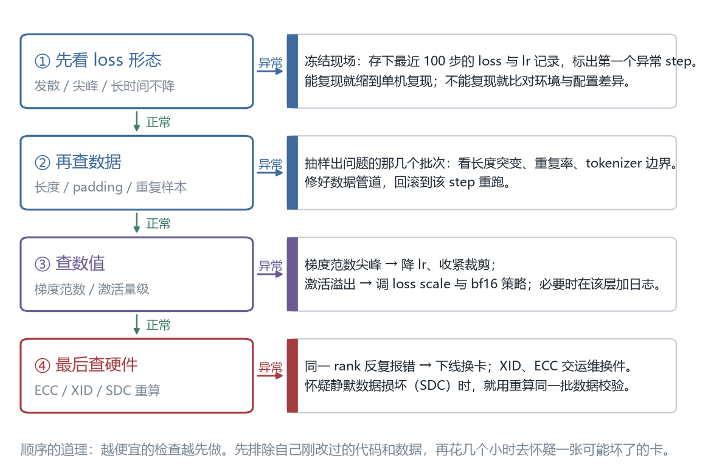

# 第 23 章　训练不稳定的诊断

loss 突然涨了，所有人第一反应是调学习率。这个反应错得离谱，因为学习率是所有可能原因里最不可能的一个，它在前一万步都没变过，为什么第一万零一步会突然出问题。

真正的顺序是反的。先判断这是数据、数值还是硬件，再看是哪一层、哪个样本、哪张卡。判断对了，处置只有一行命令；判断错了，降学习率也能让曲线好看一点，但问题会在三天后以更贵的方式回来。

这一章就按这个顺序讲。先认形态，再看三个观测窗口，然后给出可执行的排查链，最后说处置。

## 23.1　loss spike 的几种形态

四种形态，处置完全不同。

第一种是单点尖峰。某一步 loss 跳到原值的几倍，接下来几十到几百步内平滑回到原来的趋势线上。这种最常见，通常是一个极端 batch，某个样本有异常长的重复串，或者某段数据的分词结果异常。它自己会好，不需要回滚，但需要事后抓出那个样本，否则同样的事每周都来一次。

第二种是台阶。loss 抬到一个更高的平台，然后稳定在那里，不回原来的趋势线。它意味着权重已经被推到了另一个区域，梯度还在正常下降，只是从更差的位置下降。这种必须回滚，因为继续训练只是在错误的盆地里走得更远。

第三种是缓慢漂移。loss 的均值没变，但方差变大，或者有效学习率在下降。常见于优化器状态被污染，或者激活值的分布慢慢偏移。这种最容易被忽略，因为每一步看起来都正常。

第四种是直接 NaN。前几步 loss 正常，然后一步跳到 `inf` 或 `nan`，此后一切都是 NaN。这种最好定位，因为时间点明确，但要小心。NaN 往往不是第一次出错的地方，而是第一次出错被暴露的地方。

区分这四种靠的是两个量：回到趋势线的步数，和抬升的幅度是否可逆。单点尖峰在 100 步内回原线；台阶超过 1000 步还在高位；漂移则是统计量变化而均值不变。这三个判据可以在监控里自动算，不需要人盯着看。

还有一种形态要单独提，就是“先抖后爆”。前几百步梯度范数就在反复触发裁剪，每隔十几步来一次，但 loss 看不出异常；然后某一步直接跳上去。这种其实不是偶发，是系统已经在失控的边缘磨了很久，只是前几次都被裁剪拉回来了。看到这种，不要等到爆，提前回滚。

图 23-1 给出了一条完整的排查路径。

*图 23-1　训练异常的排查顺序*

图上从左到右分三段：先确定形态，再用三个观测窗口缩小范围，最后落到具体的处置动作。要注意的是中间那一段不是并列的，它有严格顺序，顺序错了会白跑几小时。

## 23.2　梯度范数与更新比例

**梯度范数比 loss 更早出问题**，这个时间差是排查里最有用的一条线索。

原因很简单。loss 是整个 batch 上所有样本的平均，一个样本出现了极端值，被几百万个 token 平均之后可能只让 loss 涨 1%。但梯度范数反映的是所有方向里最大的那个，同样的异常在梯度上会放大成几十倍。所以经验上梯度范数会比 loss 提前三到五步出现异常，这个提前量足够触发告警、保存现场、甚至在算出异常的那一步就直接中止，从而保住一个干净的检查点。

看梯度范数要看两个东西，绝对值和它相对基线的倍数。绝对值没有普适标准，因为不同模型、不同层的量级差几个数量级。基线用滑动中位数，阈值用中位数的若干倍，这样能自适应不同阶段。前一万步的范数往往比后期大得多，用固定阈值会在前期误报一片。

第二个量是更新比例：

$$r = \frac{\eta \|g\|}{\|w\|}$$

$\eta$ 是学习率，$\|g\|$ 是梯度范数，$\|w\|$ 是参数范数。它衡量的是"这一步把权重推了多远"。这个量比梯度范数更能说明问题，因为它把学习率和参数尺度都算进去了。同一个梯度范数，在参数范数大的层里是正常更新，在参数范数小的层里可能是灾难。

按经验，$r$ 在 10⁻³ 量级以上就该警惕，到 10⁻² 量级基本意味着一步就把权重推出去了，后面几十步都在往回爬。这个阈值不是硬标准，但它有一个好处。它跟学习率无关，所以当有人调了学习率导致训练发散时，这个量会立刻跳起来，而梯度范数可能纹丝不动。

第三个量是裁剪触发率。梯度裁剪把范数限制在一个上限内，触发率就是"有多少步被裁到了"。正常情况下这个比例很低且平稳，比如千分之几。如果它从千分之几涨到百分之几，说明有相当一部分步的梯度都超限了，这不是偶发，是系统性的。系统性异常不会自己好。

裁剪本身的副作用值得说一句。它把整组梯度按同一个比例缩小，所以被裁的那一步实际走出的距离比学习率规定的短。偶尔裁一次无所谓，连续裁十次就等于学习率降了。这也是为什么“先抖后爆”那条路径危险。裁剪在看不到的地方把学习率偷偷降了，训练变慢，但没人知道原因。

算一下这个副作用有多大。裁剪阈值设在 1.0，某一步的实际梯度范数是 20，裁剪会把这组梯度整体乘 0.05，实际走出的距离只有学习率规定的二十分之一。连续十步这样，累计位移相当于半步的正常更新，这十步里的有效学习率等于降到了二十分之一，训练几乎停在那里。而 loss 曲线看不出异常，因为它确实在缓慢下降，只是慢。

低精度带来的故障集中在两个地方。

BF16 的尾数是 7 位，相对精度是 2⁻⁸，约 0.39%。这个精度做乘法够用，做累加不够。一个长度 8192 的归约，如果累加器也是 BF16，误差按元素数的平方根累积：

$$\varepsilon \approx \sqrt{8192} \times 2^{-9} = 90 \times 0.002 = 0.18$$

按这个式子估算，相对误差能到十几个百分点。所以所有归约的累加器必须是 FP32，这不是"更好"，是"必须"。现场的表现是 loss 比预期高但能下降，模型能训但效果差一截，没有任何报错。这类问题很难事后发现，因为没有任何一步是"错的"。

FP8 的问题在缩放。E4M3 能表示的最大值是 448，一旦某个张量块的实际最大值乘以缩放因子之后超过这个范围，值就变成 inf，反向传播时就是 NaN。E5M2 的范围大得多，能表示到 57344，但尾数只有 2 位，精度很差。两种格式的取舍就在这里，要范围用 E5M2，要精度用 E4M3。

缩放的典型故障是滞后。缩放因子通常根据上一批数据的最大值统计出来，如果这一批突然出现一个大得多的值，因子来不及更新，第一步就溢出。表现是 loss 在某个特定类型的 batch 上炸，换成别的 batch 就正常。这类问题在数据分布不均匀时特别常见，比如混了一小部分长文本或者代码。

识别方法是看缩放因子的曲线。正常训练里它缓慢变化，如果它在 spike 之前有一个明显的下降或者阶跃，基本可以确认。另一个信号是溢出计数，FP8 训练框架一般会记录每个张量的溢出次数，这个数非零就说明有东西超范围了。

## 23.3　注意力熵与激活异常

前两个量是全局的，注意力熵是第一个能定位到层的量。

注意力熵衡量的是 softmax 输出的分散程度。熵高，说明注意力均匀分布在所有 token 上；熵低，说明集中在少数几个 token 上。正常训练里，浅层的熵较高，深层的熵较低，整体随训练缓慢下降，这是模型在学习聚焦。

异常有两种。熵突然塌到接近零，说明某个头把所有注意力压在一个 token 上，通常是这个头的输入里出现了一个异常大的值，softmax 被这一个值主导了。熵突然升高到接近均匀分布，说明输入几乎全是零或者全相等，这个头实际上失效了。

熵塌陷的影响比看起来大。一个头塌了，它的输出就是一个几乎固定的向量，梯度对它没有信息，等于这个头停止学习。如果塌陷发生在多个层，模型的容量就被静默削减了。这种削减不会让 loss 立刻跳，只是让最终的收敛点变差。

监测的做法是每层每头算一个平均熵，每 100 步采样一次。100 步按一步 6 秒算，是 10 分钟，这个粒度足够发现趋势，又不会因为采样本身拖慢训练。

熵的绝对值很难设阈值，不同层不同头的量级差很多。可用的做法是看比值，当前熵除以这个头在训练早期的熵。正常情况这个比值在 0.3 到 1 之间缓慢下降，掉到 0.05 以下算塔陷，涨到 1.5 以上算失效。用比值不用绝对值，理由和梯度范数一样，各层的尺度不同。

激活异常看两个统计量，每层输出的均方根和最大值。前者反映分布的尺度，后者反映极端值。判据是层间对比。如果某一层的均方根比它的前一层和后一层都大一个数量级，这一层就是可疑的。深层的激活尺度通常比浅层大，但不会突变，突变说明残差流里积累了不该有的东西。

最大值更直接。BF16 能表示的最大值远大于任何正常激活，所以激活不会溢出，但它会在反向传播时把梯度放大。一个比正常值大一千倍的激活，会让这一层的梯度也大一千倍，然后被裁剪掉，然后这一层就停在原地不动了。

这三个量（梯度范数、注意力熵、激活均方根）一起看，能把问题定位到"第几层、第几个头"。这时候再去查这一层的数据和参数，范围就小得多。

代价要说清楚。每层每头算熵需要在 softmax 之后加一个归约，在前向里是额外开销，而且会打断算子融合，实测算力损失可能到几个百分点。所以只在调试时开，平时关。有些人想常开，那得接受 MFU 掉几个点，这笔账要提前算。

## 23.4　数据问题引发的异常

数据引发的问题占实际故障的多数，但它最难被承认，因为承认它意味着数据管线有 bug，而数据管线通常是别人写的。

三类最常见。

第一类是重复。同一个 shard 被读了多次，或者断点续训后从 epoch 起点重新开始，导致一段数据被训练了十几遍。重复本身不会让 loss 跳，它会让模型在那段数据上过拟合，然后泛化变差。判定方法是统计每个 shard 的读取次数，正常应该大致均匀，出现某个 shard 的计数是别人十倍，就找到了。

重复的代价可以直接算。Llama 3 的训练总量是 3.8×10²⁵ FLOPs，如果其中 1% 是重复数据，浪费的算力是 3.8×10²³ FLOPs。集群的有效算力是 16384 张卡乘以 989.4 TFLOPS 再乘以 0.4 的 MFU，约 6.5×10¹⁸ FLOP/s，除下来是 5.9×10⁴ 秒，也就是 16 小时。1% 的重复等于十六小时、一万六千张卡的算力。这个数字一般能让数据团队认真起来。

第二类是脏数据。典型的是 HTML 残渣、编码错误导致的乱码、以及长重复串。前两种让模型学到噪声，影响有限；长重复串的杀伤力大得多。一段同样的 token 重复上千次，注意力会全部压在这段上，熵塌到零，梯度出现尖峰，然后就是一次 spike。这类样本在清洗时很难被规则抓住，因为它们语法上完全合法。

第三类是分布偏移。混合比例错了，比如代码数据从 5% 变成 25%，loss 会整体抬高一个台阶，然后在新分布上继续下降。这种"错得很合理"，因为模型确实在学东西，只是学的东西不是你想要的。

判定数据问题靠一个实验：换数据顺序，重跑同样的步数。如果 spike 消失，那是顺序相关的，某个 shard 或者某个采样逻辑有问题；如果 spike 在同样的步数出现，那是数据内容相关的，得去查那一步的 batch。

这个实验有一个陷阱。顺序变了，全局 batch 的组成也变了，同一个样本可能被分到别的 rank、和别的样本组成新的 batch。所以“spike 消失”有两种解释，一种是顺序相关的 bug，另一种是那个样本凑巧被别的样本稀释掉了。区分两者的办法是把顺序改成局部的，只打乱 rank 之间的对应关系，不动 shard 内部的样本次序，这样批次组成不变，只变位置。这一步多花半小时，但能省掉后面几小时的错方向。

混合比例的改动还会带来一个副作用，就是梯度尺度的变化。代码数据的 loss 通常比自然文本低，切换到代码为主的 batch 时，梯度整体会变小，然后被学习率推得不够。反过来，从代码切回自然文本时梯度会突然变大。所以混合比例调整时，最好在一个 epoch 边界上做，而不是在训练中途，否则统计量会失真，前面建好的基线全部作废。

还有一个容易忽略的点，断点续训后的数据位置。如果恢复时只恢复到 epoch 级别而不是样本级别，就会把已经训过的一段再训一遍。这个问题在短训练里看不出，在长训练里会让 loss 曲线出现周期性台阶，周期正好等于检查点间隔。看到“每隔固定步数台阶一次”，先怀疑这个。

偏移的代价可以直接算。如果恢复时多训了 500 步，每步 6 秒，浪费的是 16384 乘 500 乘 6 秒，折合 13653 卡时。这个数比一次回滚还大，而且它不产生任何效果，纯粋白烧。所以恢复流程里“恢复到样本级”这件事，比检查点写得多快更重要。

## 23.5　排查顺序与工具

顺序是有讲究的，因为每一步都能排除掉一大类原因，而排错的代价是几小时。

第一步，定位时间点。spike 发生在第几步，这一步对应哪个检查点、哪个数据 shard、哪一批样本。这一步不需要任何工具，需要的是日志。如果日志里没有记录每步用了哪些 shard，那后面的排查会慢十倍，所以这个记录必须从第一天就有。

第二步，排除硬件。全集群扫一遍 XID 和 ECC 增量，看 spike 前后有没有卡报错。有就直接换卡重跑，因为硬件问题的排查成本最低、结论最确定。Llama 3 的 419 次中断里有 148 次是 GPU 本体、72 次是 HBM，这个比例说明硬件是高频原因，先排除它不亏。

第三步，验证可复现性。从 spike 之前的检查点恢复，固定数据顺序、固定随机种子、固定并行配置，重放 20 步。复现了，说明是确定性的原因，往下走；没复现，说明是非确定性的，指向通信或者硬件，回到第二步再查一遍，这次查得更细。

这一步里"固定数据顺序"是关键。分布式训练的默认配置下，每个 rank 的数据流依赖随机种子和 rank 号，不固定的话每次重放喂进去的 batch 都不同，复现性实验就没有意义。

第四步，缩小规模。把同样的 batch 放到单节点 8 卡上跑。单机也炸，那是数据和数值的问题，与并行无关；单机不炸，那是并行引入的，要么是通信，要么是某个切分边界上的数值差异。

第五步，定位到样本。把那个 batch 拆成单条样本，逐条过前向，看哪一条的 loss 异常。这一步很慢但很确定，通常几十条样本就能找到。

第六步，定位到层。如果样本没问题，那就是数值。逐层比较 loss 贡献或者激活统计量，找到第一个出现异常的那一层。

六步走完，原因基本确定。每一步用到的工具不同。第一步用训练日志，第二步用 XID 和 ECC 的采集，第三步用确定性重放，第四步用单机复现，第五步用逐样本前向，第六步用逐层统计。工具不是重点，顺序才是。

时间预算也要有。走完六步大概需要四到八小时，其中第三步和第四步最耗时。如果六小时还没有结论，说明假设错了，应该回到第一步重新看时间点，而不是继续在第六步里挖。

有一件事不要在排查初期做，就是拟合 loss 曲线。人很容易把一个单点尖峰看成趋势的转折，然后开始算它的斜率变没变、曲率有没有异常。这些分析在事后复盘时有用，在排查时只会浪费时间，因为形态已经告诉你了大概是什么类型。先分类，再验证，最后才去解释曲线。

## 23.6　处置手段

处置的优先级是回滚、跳数据、调学习率、收紧裁剪，顺序不能颠倒。

**回滚要回到"spike 之前最后一个干净检查点"，不是上一步**。这是最容易做错的一步。很多人觉得回滚一步代价最小，于是从上一步恢复，结果一百步内再次 spike。原因是上一步的权重已经被污染了，梯度还在异常区域，从那里继续只是重复同一个过程。回到干净检查点意味着放弃最多一个间隔的训练量，按 30 分钟间隔算，损失半小时；而从污染点反复失败，可能耗掉一天。

干净的定义是检查点保存时 loss 和梯度范数都在基线范围内。这个判断要在保存时做，不是在恢复时做，因为恢复时你只有一个数，没有前后的对比。

跳数据用于确认了某条样本有问题的情况。跳过它，但要记录到黑名单，否则下一轮还会遇到。黑名单要跟检查点一起存，不然恢复之后又忘了。这类修补会留下数据集的洞，洞大了会影响最终质量，所以要定期回头处理，不能一直跳过。

黑名单要有额度。没有额度的黑名单会慢慢变成一个筛子，一开始每万条跳几条，几个月后跳到几十分之一，而 loss 曲线看起来一切正常，因为跳过的样本从来不参与计分。做法是每周统计一次黑名单占比，超过某个比例就停下来清理，把能修的修好、能重采的重采。这个动作本身不产生收益，但它防止一个修修补补的数据集被当成完好的一直用下去。

调学习率只在一种情况下用，就是确认了更新比例过大，且确认了不是数据或硬件。盲目降学习率的后果是训练变慢，而且掩盖了真问题。有些团队把"降学习率"当成万能药，结果每次故障都降一点，几个月后学习率降到初始值的十分之一，训练效率损失惨重，而原始的数据 bug 一直还在。

收紧裁剪是最后一招。把裁剪阈值从常用的值往下调，能压住尖峰，但也会压住正常的梯度，等效于降低了学习率。它适合作为临时措施，让训练撑到下一个检查点，不适合作为长期方案。

还有一条原则要提。任何处置都要留下记录，记录里写清楚改了什么、为什么改、改完之后 loss 和梯度范数怎么变。没有记录的处置，三天后没人知道当时发生了什么，同一个问题会再排查一遍。

检查点保留几份，直接决定回滚能退多远。只留一份的话，回滚就是退回上一个间隔，如果那个间隔里已经有污染，你只有一次机会；留三份能退三个间隔，代价是三倍存储。按 30 分钟间隔和 4050 亿参数一份 6.48 TB 算，三份是 19.4 TB，这个量在集群存储里不算什么，但它买到的是排查时不必在时间上将就。

回滚之后的头一百步要格外盯。干净检查点加同样的数据顺序，第一步的 loss 应该和上次一致到小数点后几位，对不上就说明恢复过程本身有问题，比如优化器状态没加载全、数据位置偏了、或者某个 rank 的参数没同步。这一步对不上就继续跑，等于在错的基础上再叠一层错。

## 23.7　预防性监控

预防的成本远低于事后排查。一次排查四到八小时，加上重跑的算力，按 16384 张卡算，八小时就是 13 万卡时。而建立一套监控，只需要在训练循环里加几个统计量。

必看的指标有七个。loss，每步；梯度范数，每步；裁剪触发率，每百步；更新比例，每百步；每层激活的均方根，每百步；缩放因子与溢出计数，每步（FP8 训练）；XID 与 ECC 增量，每分钟。

告警要分级，不能一刀切。单点 spike 不告警，只记录，因为它是噪声；连续三步梯度范数超过中位数三倍，告警；出现 NaN 或者 inf，立即停止训练并保存现场；裁剪触发率翻倍，告警；ECC 计数增量异常，告警但不一定停。

阈值必须自适应。用前 1000 步建一个滑动中位数和绝对偏差，之后用中位数的若干倍做阈值。固定阈值的问题在于，训练早期的范数可能是后期的十倍，固定阈值要么前期全报警，要么后期全放过。

基线要按阶段重建。学习率衰减、batch 大小变化、数据配比切换，这三件事之后分布都会变，旧的基线不再适用。每次变更后重新累积 1000 步，重新算中位数。不做这件事，监控会在变更后的一周里疯狂误报，然后被人关掉。

最后一点，所有指标必须和检查点存在同一个地方，并且带步数戳。事后归因需要"第 12000 步的梯度范数是多少、当时用的是哪个 shard、哪张卡在报错"这三个信息同时在场。缺任何一个，排查就得靠猜。存储这些数据的成本，跟一次中断的算力成本比，可以忽略。

具体算一下。七个全局指标每步一行，一步 6 秒，一天 14400 行，一行几十字节，一天不到 1 MB。就算把每层每头的熵都存下来，126 层乘 16 个头是 2016 个浮点，一步 8 KB，一天 116 MB。相对一份 6.48 TB 的检查点，这点存储可以忽略，但它在事后能省下的时间是几天。

## 23.8　把形态变成判据

"尖峰""台阶""漂移"这些词在监控里没法用，得换成能算的数。三个量就够，回落的步数、抬升的幅度、以及抬升之后趋势线有没有被破坏。

| 形态 | 回落步数 | 幅度 | 趋势线 | 处置 |
|---|---|---|---|---|
| 单点尖峰 | 100 步内 | 3 到 10 倍，一次性 | 不变 | 记录，不回滚 |
| 台阶 | 不回 | 1.5 到 3 倍 | 平移，斜率不变 | 回滚 |
| 缓慢漂移 | 不回 | 均值不变，方差变大 | 斜率下降 | 查优化器状态 |
| 直接 NaN | 不适用 | 到 inf | 中断 | 回滚，同时扫硬件 |
| 先抖后爆 | 裁剪反复触发后爆 | 先 2 到 3 倍，后跳 | 斜率已经下降 | 不等爆，提前回滚 |

表里的"3 到 10 倍"和"1.5 到 3 倍"不是定律，是量级。单点尖峰的幅度大而短，台阶的幅度小而长，这个组合本身带着信息。看到一个 5 倍尖峰三天不回，那不是尖峰，是台阶被误判了。

判据要能自动算，所以每一步只存三个数，当前 loss、滑动 100 步的中位数、这 100 步的线性拟合斜率。三个数就能定形态。超过中位数若干倍是尖峰候选；尖峰之后 100 步内是否回到中位数附近，区分尖峰和台阶；中位数回归之后斜率为负且幅度接近历史，说明趋势没被破坏。

这套判据的盲区在训练早期。前几千步 loss 下降很快，中位数自己在快速移动，用固定窗口算出来的"偏离"全是噪声。所以形态判定要等训练稳定之后再开，或者早期用更长的窗口。这件事没有巧办法，靠经验设一个起点。

另一个盲区是学习率衰减的边界。衰减那一步 loss 会跳一下，然后在新学习率上继续下降，形态上完全像一个台阶。所以每次改学习率都要在监控里打标记，让判据知道这是预期变化。不打标记的后果是每次衰减都被判成故障，人就开始忽略告警，两周后告警功能等于不存在了。

判据真正的价值不在分类，在于它把"要不要回滚"从人的直觉变成了写下来的规则。值班的人半夜被叫起来，最需要的不是分析能力，是一条明确的规则。回落 100 步内回原线就不动，超过 100 步不回落就回滚到上一个干净检查点。有了这条规则，处置时间从半小时压到五分钟，而且不同班次的人做出一致判断。

## 23.9　排查要用的最小工具集

六步排查里，真正需要专门工具的是第三步和第六步，其余靠日志和现成的监控。工具不需要多，需要在需要的时候立刻能调出来。

| 用途 | 需要什么 | 前提 |
|---|---|---|
| 定位时间点 | 每步的 shard 列表、样本 id 范围 | 从第一天就开始记录 |
| 排除硬件 | XID 与 ECC 的按卡时序 | 采集粒度到卡 |
| 确定性重放 | 固定种子、固定数据顺序、固定并行配置 | 数据管线支持按步索引 |
| 单机复现 | 能把一个 batch 单独喂进 8 卡 | 训练脚本支持离线 batch |
| 逐样本前向 | 单条样本的 loss | 推理路径与训练路径一致 |
| 逐层统计 | 每层激活均方根、每层梯度范数 | hook 点齐全 |

表里最贵的是第一行。记录每步用了哪些 shard 不难，难的是它要在训练开始前就做，那时候没人觉得需要。等出事再补，历史数据已经没了，只能从当前步开始记，然后等下一次复现。

第二行的粒度也常被做错。很多监控只存集群级的 ECC 总数，这个数在一万多张卡上永远是"有一些"，看不出是哪张。必须按卡存并带时间戳，否则"spike 前后有没有卡报错"这个问题根本答不了。

确定性重放的前提比想象中苛刻。除了种子和并行配置，还有三个东西会影响结果，cuBLAS 的算法选择、原子操作的累加顺序、数据加载的线程调度。要真正做到逐步一致得开确定性模式，代价是性能掉一到两成。所以它只在排查时开。

有个折中做法值得推荐，叫影子重放。不动主训练，另起一个 8 卡的小作业，从同一个检查点加载，用同一批数据跑 20 步，对比前几步的 loss。小作业可以随便开确定性模式，慢一点无所谓。这个做法能把第三步的成本从"停整个作业"降到"多跑一个小作业"，而结论是一样的。

逐层统计的工具要注意开销。每层都挂 hook 会把算子融合打断，长序列上的 attention 层尤其明显。做法是只挂可疑层，或者采样，每 100 步采一次，只在采样的那一步打开 hook。常开会掉几个点的 MFU 这笔账前面算过，实际测量里如果挂全层，掉的往往更多，所以采样不是可选项。

工具之外还有一件事，现场保存。spike 发生的那一步，如果能把输入 batch、模型分片、优化器状态各存一份，后面所有分析都不用重跑。代价是一份 batch 的存储和几十秒的写入时间，收益是把排查从"复现"变成"回放"。这件事应该在监控里做成自动的，看到 NaN 就触发，不要等人来决定要不要存。

## 23.10　把排查成本算出来

排查的每一步都有价格，把它算出来，才知道该在哪一步停手。

先说最贵的，停训。16384 张卡停一小时是 16384 卡时。按 DeepSeek-V3 论文里用的 2 美元每卡时，一小时是三万二千美元。这个价格决定了排查必须并行做，而不是一步步串着做。

八小时排查是 13 万卡时，二十六万美元。对照 DeepSeek-V3 全流程的 2.788M 卡时，一次排查吃掉的是整次训练预算的 4.7%。这个比例说明，排查超过一天就不划算了，那时候应该直接回滚到更早的检查点，接受损失，把问题留给事后分析。

回滚是另一笔账。回滚到 30 分钟前的检查点，损失是：

$$C_{\text{rollback}} = 16384 \times 0.5 = 8192 \ \text{卡时}$$

八千卡时，一万六千美元。对比八小时排查的二十六万，回滚便宜了十六倍。这个对比给出一条很实用的规则，八小时内定不下原因，回滚比继续查便宜。

但要加一个修正项。回滚不一定解决问题，如果根因还在，比如那张坏卡还在池子里、那段脏数据还在管线里，回滚之后会再炸一次，两次回滚就是一万六千卡时。所以回滚之前要做两件事，隔离可疑的卡，拉黑可疑的 shard。这两件事花五分钟，能把回滚的成功率从五成提到九成。

第三笔账是误判。把数据问题判成数值问题，处置是降学习率，训练继续但效率下降，可能几天后才被发现；把数值问题判成硬件问题，处置是换卡，换了没用，再换，一直换到有人开始怀疑方向。这两种误判的成本都不是一次性的，是持续的，而且它们会消耗团队对监控的信任。

三笔账放在一起，能得出一条排班规则。值班的人在第一小时只做两件事，定位时间点和扫硬件，加起来不超过二十分钟。有结论就直接处置；没有结论就把现场存下来，回滚，把深度分析留给白班。夜间不做深度分析，因为深度分析需要清醒的头脑和齐全的工具，两样夜里都没有。

## 23.11　提前量

指标不是并列的，它们有先后。用对了顺序，能在 loss 跳起来之前就动手。

| 层次 | 指标 | 拿到的时间 | 相对 loss |
|---|---|---|---|
| 数据 | 重复率、最长重复串、长度分布 | batch 组好、进模型之前 | 早一步以内 |
| 前向 | 注意力熵、激活均方根 | 该层算完 | 同一步内 |
| 反向 | 每层梯度范数 | 该层反传结束 | 比 loss 早三到五步显形 |
| 全局 | 全局梯度范数、更新比例 | 反传结束、裁剪之前 | 同上 |
| 输出 | loss | 前向结束 | 基准 |

数据层最值得做，因为它的成本最低。一个 batch 组好之后，在送进模型之前算三个统计量，n-gram 重复率、最长重复串长度、序列长度分布，都不需要 GPU，CPU 上几百毫秒能算完。长重复串是 spike 最常见的直接原因，而它在这三个统计量里排第一。按一步 6 秒算，这几百毫秒的提前量不到一步，但足够让管线在送数据前就把这个 batch 拦下来重采。

提前量要自己量，不能照抄。做法是拿历史上的 spike 做对齐，把每条指标的偏离度按步数画在一起，看谁先起。有的集群梯度范数领先五步，换一套并行配置可能只领先两步，因为它取决于异常的传播路径。量一次以后就能定告警的先后顺序，先响的那个负责触发保存现场，后响的负责确认。

这个提前量的价值可以直接折算。梯度范数领先五步，一步 6 秒，就是 30 秒的窗口。30 秒够做三件事，暂停作业、保存现场、把异常 rank 的中间结果 dump 下来。做了这三件事，问题从"需要复现"变成"可以回放"，省下的最少是一次回滚的八千卡时。用一次就够回本，而这套钩子的开发量是几天。

提前量也有个副作用要说清楚。指标越早，噪声越大，因为信息还没被平均掉。数据层的重复率统计会在一批正常的长文档上频繁报警，梯度范数在 warmup 阶段天天超阈值。所以每一层都要有自己的阈值策略，早期指标用宽阈值加人工确认，晚期指标用窄阈值直接触发动作。把它们设成同一套阈值，结果只有一个，所有告警都被关掉。
