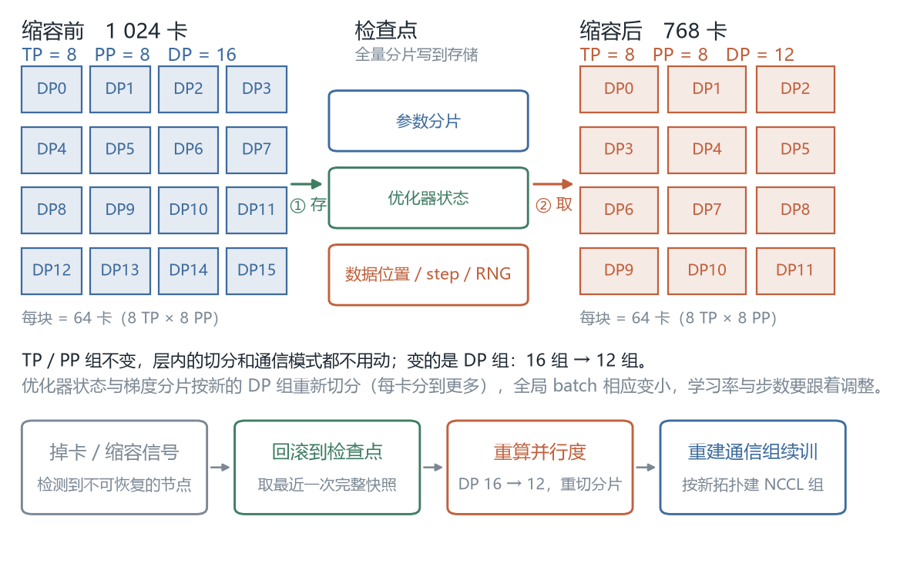

# 第 24 章　容错、弹性与调度

大规模的代价可以用一行式子写完。**作业的中断间隔等于单卡的无故障时间除以卡数**。16384 张卡的作业，中断间隔是 3.1 小时。这个数不是运气，是算术。所以容错不是一个可选功能，它是把 3.1 小时一次的必然中断，摊薄成百分之几的效率损失。

调度器的工作从这个式子开始。它要在三件互相冲突的事之间找平衡。作业要整块给（不然并行配置没法成立），拓扑要贴着放（不然通信慢一倍），集群要尽量装满（不然卡白买）。三件事没有同时最优的解，只有针对当前负载的取舍。

## 24.1　故障域与作业粒度

故障域是有层级的，从小到大是卡、节点、机架、脊交换机下的一组机架、整个集群。一次故障影响的范围，取决于坏的是哪一层，也取决于作业怎么映射到这些层上。

对一个 16384 张卡的作业，任何一张卡坏了，整个作业都要停。因为数据并行的梯度归约是全体的，张量并行的每一层都要全体参与，流水并行的每一级都要等上一级。缺一个 rank，集合通信就挂住，然后看门狗超时，然后全体退出。

所以作业级的故障率是：

$$\lambda_{\text{job}} = N \lambda_{\text{card}}$$

$N$ 是卡数，$\lambda_{\text{card}}$ 是单卡故障率。按 Llama 3 的统计，单卡的平均无故障时间是 2111 卡日，代入就得到作业级的中断间隔：1024 卡是 2.1 天，4096 卡是 12.4 小时，16384 卡是 3.1 小时。

这条式子还给出了一个诱人的方向，把作业切小，故障率就线性下降。切到 1024 卡，故障间隔变成两天，听起来好多了。但代价是并行度降低，通信量上升，MFU 下降。一个 16384 卡的作业如果切成 16 个 1024 卡的作业，每个作业的 MFU 可能从 40% 掉到 25%，那么省下来的故障时间远不够补上效率损失。

所以**切小不是答案，弹性才是**。弹性指的是作业在卡数变化时能继续跑，而不是退出重来。它把"故障导致中断"变成"故障导致缩容"，缩容的代价远小于重启。

还有一个和粒度有关的量，是一次故障影响的卡数。卡坏了影响 1 个 rank；节点掉了影响 8 个；一个机架掉电影响 21 台节点、168 张卡；一个脊交换机坏了可能影响几千张卡。这四种情况的发生概率差很多，但都必须在设计里考虑到，因为后果差得更远。

衡量作业粒度合不合适，看一个比值。一次中断浪费的算力，除以两次中断之间产出的算力。前者等于中断间隔乘以卡数乘以损失时间比例，后者等于间隔乘以卡数乘以有效时间比例，卡数约掉，比值就是"损失时间除以有效时间"。16384 卡、间隔 3.1 小时、每次损失 18.6 分钟，损失比例是 10%，正好对上 Llama 3 报的"有效时间高于 90%"。

这个比值还说明一件事。中断频率本身不可怕，可怕的是每次中断的代价。间隔从 3.1 小时缩到 1.5 小时，如果单次代价能同时从 18.6 分钟压到 9 分钟，损失比例不变。反过来，间隔不变但恢复变慢，损失比例立刻上升。这也是为什么后面几节的重点都在"恢复"而不在"避免"。

把这个账算细一点。16384 卡按 MFU 40% 算，有效算力相当于 6554 张卡满载；切成 16 个 1024 卡的作业，MFU 掉到 25%，有效算力是 4096 张卡，差异 37.5%。故障这一边，16384 卡的损失比例是 10%，1024 卡按同一套参数算是 1.04%，省下不到 9 个百分点。37.5 换 9，切小是亏的，而且亏得不少。

## 24.2　gang scheduling 与拓扑感知

gang scheduling 的意思很朴素，要么全给，要么不给。作业申请 2048 个节点，调度器只有 2000 个空闲节点时不启动它，而不是先给 2000 个让它等着。

为什么必须这样，因为分布式训练在部分分配的状态下什么也做不了。张量并行的 8 张卡少一张，前向都算不出来；数据并行的梯度归约少一个 rank，集合通信会永远等下去。所以先给一部分卡的唯一后果是这些卡被占着但不干活，同时还挡住了别的作业。

gang 的代价是碎片。集群里空闲 2000 个节点，但作业要 2048 个，就得等；这 2000 个节点在等的期间只能跑小作业，如果没有合适的小作业，它们就闲着。这就是调度里最经典的矛盾：要么浪费一点容量，要么让大作业饿死。

实现上，gang 还要求一步完成。如果 2048 个节点是分批给出来的，先到的那批会占着卡等后到的那批，而这批卡在其他作业眼里已经是"已分配"，于是集群看起来满了，实际上有大量卡在空转。这种情况在多租户集群里特别常见，因为每批分配之间可能隔几分钟，而几分钟对训练作业来说是很长的等待。

拓扑感知是第二层约束。不同的并行维度对带宽的要求差一个数量级以上：

| 并行维度 | 通信量级 | 放哪里 |
| 张量并行 | 每层两次全归约，量级最大 | 同节点，走 NVLink |
| 流水并行 | 相邻级之间传激活 | 同机架或相邻机架 |
| 专家并行 | 两次全对全 | 同 rail，避免跨脊 |
| 数据并行 | 梯度归约，量级与卡数无关 | 可以跨 rail |

张量并行必须放在节点内，因为节点内是 900 GB/s 的 NVLink，节点外是 50 GB/s 的单端口，差了 18 倍。把 TP 组拆到两台机器上，一次全归约的时间就涨 18 倍以上，任何重叠都盖不住。

流水并行跨节点是可以的，因为传递的是激活，量比梯度小，而且有计算可以重叠。但要放在同一机架或者相邻机架，跨脊的跳数多了，延迟会累积。

数据并行最宽容，因为它每次只传整个梯度，与卡数无关，而且可以切成桶和反向传播重叠。所以 DP 组可以跨 rail、跨机架，只要能保证收敛比。

这四条约束一旦写进调度器，装箱就变成了一个受限问题。先按 TP 组切出 8 卡的原子单位，再把 PP 组拼成同机架的块，再把 DP 组铺到剩下的地方。顺序反了就会出问题，比如先按 DP 铺开，再想找 8 卡连续的 NVLink 域，往往已经找不到了。

碎片的具体形态值得看一眼。一个 2048 节点的作业，如果按脊交换机分组，一个脊下挂 32 个节点，那它需要 64 个完整的脊组。集群里空闲 2000 个节点，如果分散在 200 个脊组里各 10 个，那么一个完整的 32 节点组都拼不出来，作业永远排不进。

这就是"总数够但拼不出"。运维看到队列显示"空闲 2000 节点"，作业却排了六小时，第一反应是调度器有 bug。实际上调度器没错，是布局错了。解法是留出整块的备用容量，或者允许作业跨组但要接受通信损失。

这里有一个前提常被忽略，就是拓扑映射表本身。调度器要按脊组装箱，得先知道每个节点挂在哪个脊组、每个 8 卡域都在哪台机器上。这张表要么从部署系统导，要么从交换机侧采集，两条路都会出错，接错线、标识写错、机器换了位置而表没改。装箱错了不一定报错，只是慢，所以这张表需要定期校验，比如每月跑一次全集群的带宽测试，把实测结果和表里的预期对一遍。

## 24.3　弹性训练与动态扩缩

弹性要解决的核心问题是参数怎么重新分。卡数变了，并行配置就得变，而参数在每张卡上的布局是由并行配置决定的。布局一变，原来的检查点就加载不进去了。

变化的自由度不一样，难度也不一样。

数据并行度最容易改。参数在每张卡上的布局不变，只是优化器状态的分片数和梯度归约的组变了。从 128 路降到 96 路，每张卡的优化器状态从 1/128 变成 1/96，多出来的部分要重新分配。因为 ZeRO 的阶段 1 和 2 本身就是按 DP 度切优化器状态和梯度的，改 DP 度只是改一个除数。

张量并行度难改。TP 从 8 改成 4，每个 TP 组里的参数翻倍，原来切在 8 张卡上的权重，现在要合并到 4 张上，每张卡的显存需求翻倍。如果显存本来就紧张，这条路走不通。而且 TP 的切分方式决定了权重的形状，合并需要做一次重排，不是一个简单的拷贝。

流水并行度也难改，因为层被切到不同级上，改级数等于改层的归属。专家并行度同理。

所以工程上的弹性，绝大多数只做 DP 度。这个限制看起来保守，但它覆盖了最常见的场景：加卡、减卡，而不改模型的切分方式。

要让 DP 度可以随便改，检查点必须按"全局参数索引"存，而不是按 rank 存。按 rank 存的检查点，第 3 号文件里是第 3 号 rank 的参数，rank 数一变就全乱了；按全局索引存的检查点，每个参数有一个全局唯一的名字和偏移，任意并行度都能算出自己该加载哪一段。这一条是弹性的技术前提，也是检查点格式设计里最容易被忽略的地方。

重映射的过程分三步。读出全局参数，按新的并行配置算出每张卡该拿哪一段，然后切分、写回。整个过程的数据量等于一份完整的参数，4050 亿参数按 BF16 是 810 GB，走过一次网络就是几分钟。

图 24-1 把这个过程画成一个时间线。

*图 24-1　弹性训练中的扩缩与参数重映射*

扩缩的代价可以估。一次扩缩要做保存、重排、加载、重建通信组、预热，加起来和一次完整恢复差不多，按 18.6 分钟的量级算。所以扩缩不能太频繁，一天几次可以，一小时几次就得不偿失。

验证重映射对不对，有一个简单的判据。扩缩之后第一步的 loss，应该和扩缩之前最后一步的 loss 一致到小数点后几位。对不上，说明重映射有 bug，可能是某个参数被加载了两次，或者某个分片被漏掉了。这个检查必须自动化，因为人眼看不出来。

自动化的做法是在扩缩流程里加一个断言，重映射完成、第一步跑完，把 loss 和一个区间比对，区间是扩缩前最后一步的 loss 加减一个容纳数值抖动的容差。越界就不继续跑，保存现场并回退到旧布局。这个断言的成本是几分钟，省略它的代价是一次跑了几小时才发现不对的作业。

弹性也有不该做的时候。如果作业只剩最后几个百分点，扩缩带来的收益抵不过重映射的风险；如果并行配置本身就处于临界点，比如显存只剩不到一成余量，改 DP 度会让每卡优化器状态变大，直接 OOM。这两种情况下，宁可等一次故障顺便重启，也不主动扩缩。

## 24.4　抢占与优先级

多租户集群里，抢占是不可避免的。生产训练要保证进度，实验作业要能跑起来，两者的优先级不同，调度器必须能让高优先级作业插队。

抢占的代价等于被抢占作业的检查点开销加上重新排队的时间。如果被抢占的作业恰好刚跑了两分钟，那两分钟就白扔了；如果它刚存了检查点，损失接近零。所以被抢占作业的检查点频率，直接决定了抢占的成本。

这给了一个设计原则，优先级越低，检查点越频繁。高优先级作业按故障率定间隔，低优先级作业按被抢占率定间隔。一个每天被抢占十次的实验作业，检查点间隔应该按 2.4 小时的三分之一来定，也就是 48 分钟一次，而不是按故障率算出来的十几分钟。

期望浪费可以估。间隔 48 分钟，被抢占的时刻在间隔内近似均匀分布，平均要去掉半个间隔，也就是 24 分钟。一天被抢占十次，一天去 240 分钟，占 16.7%。把间隔缩到 24 分钟，平均去 12 分钟，一天 120 分钟，占 8.3%，但检查点次数翻倍，写入开销从 1% 涨到 2%。两档的总损失是 17.7% 和 10.4%，在这个抢占频率下缩间隔划算。

抢占还要考虑"抢占谁"。如果集群里全是低优先级作业，抢占一个大的会释放很多卡，但也浪费了它已经跑的时间；抢占几个小的能凑够数，但会打断更多作业。常见策略是优先抢占"跑得最久但进度最少"的，因为它的沉没成本最低。

有一个反直觉的结论，抢占次数多不一定是坏事。如果每次抢占的损失只有几分钟，而集群利用率从 70% 提到 95%，那多出来的 25% 算力远大于抢占的损失。反过来，如果因为怕抢占而不敢调度，集群空着 30%，那才是真的浪费。

实现上有两种简化。第一种是不真抢占，只在新作业到来时把低优先级的作业标记为"可被驱逐"，等待它自己走到下一个检查点再退出。这种做法代价小，但新作业要等；第二种是直接杀进程，代价大但延迟低。前者的等待时间波动很大，后者的检查点开销上升，通常按作业类型分开用。

度量抢占是否健康，看一个比值。被抢占作业的平均已运行时间，除以检查点间隔。这个比值接近 0.5 说明抢占很均匀；远小于 0.5 说明抢占太频繁，检查点跟不上；远大于 0.5 说明抢占太少，低优先级作业占着资源不动。

## 24.5　检查点作为货币

检查点是容错体系里的通货。它买到的是"回滚的距离"，付出的是一份写入的带宽和时间。间隔定得太长，每次故障回滚很远；定得太短，写入开销吃掉太多算力。

这两者的最优解有一个闭式结果。设单次写入耗时 $w$，作业的平均无故障时间 $M$，最优的检查点间隔是：

$$T_{\text{opt}} = \sqrt{2 w M}$$

对应的时间损失比例是：

$$\text{loss} = \sqrt{\frac{2 w}{M}}$$

代入 16384 卡的场景。$w$ 按 30 秒算，$M$ 是 3.1 小时也就是 11160 秒，间隔是 818 秒，约 13.6 分钟；损失比例是 7.3%。

再代入一个 1024 卡、1750 亿参数的场景。检查点 2.1 TB，假设这台作业能独占同一套存储的 216 GB/s，写就是 9.7 秒；$M$ 是 2.1 天也就是 177984 秒，间隔是 1858 秒，约 31 分钟；损失比例是 1.04%。

两个场景的对比很有意思。规模大了 16 倍，最优间隔从 31 分钟缩到 13.6 分钟，损失比例从 1% 涨到 7.3%。也就是说，规模越大，检查点必须越频繁，但损失还是越来越大。这条趋势说明了为什么大集群必须做异步检查点和分片写：只有把 $w$ 压下来，才能把损失压下来。

$w$ 压到多少有意义？如果 16384 卡的 $w$ 能从 30 秒压到 3 秒，损失比例从 7.3% 降到 2.3%，间隔从 13.6 分钟变成 4.3 分钟。这两项改善加起来，等于凭空多出 5 个百分点的有效算力，按 16384 张卡算就是 800 多张卡。

检查点还有存储成本，这份成本是硬的。三份保留乘以 6.48 TB 是 19.4 TB，这个量不大，但它要求读写都得能到，所以不能放在最冷的归档层。折中的做法是热的留三份、冷的再往前归档，冷的那份恢复慢但几乎不会被用到。

把 $w$ 拆开看更清楚。一份 4050 亿参数的完整检查点按 16 字节算是 6.48 TB，摊到 16384 张卡上每卡 395 MB。这份数据从显存经 PCIe 拷到主机内存，按 64 GB/s 算是 6 毫秒；从主机内存写到存储，按 500 GB/s 的聚合带宽算是 13 秒。所以同步写的 30 秒里，绝大部分耗在存储而不是 PCIe 上。异步写之所以有效，就是把这 13 秒挑到后台，让 GPU 只等那 6 毫秒。

检查点还有一个隐性作用，它是调度的依据。调度器知道每个作业最近一次检查点是什么时候，就能估算抢占它的代价，从而做出更优的决策。所以检查点的时间戳必须暴露给调度器，不能只存在训练进程自己的日志里。

## 24.6　调度器的常见策略

调度器要同时优化四个指标，队列等待时间、集群利用率、作业的通信效率、抢占次数。四者互相冲突，所以没有通用最优解，只有针对负载的取舍。

先来先服务加回填是最常见的组合。队列按提交顺序排，但允许小作业插到大作业前面的空隙里，前提是不推迟大作业的预计开始时间。这个"不推迟"是回填能成立的关键，没有它，小作业会把大作业饿死。

回填的成败取决于运行时间估计的准确度。估长了，小作业插不进去，队列变慢；估短了，插进去之后挤掉大作业的启动时间，回填就不可信了。工程上的做法是给每类作业记历史分位数，用 P90 而不是平均值做估计，宁可保守。保守的代价是少插几个小作业，不保守的代价是整个回填机制失效。

装箱的目标是最小化跨机架的边数。同一个作业的节点尽量放在少数几个机架里，因为跨机架的流量要走脊交换机，而脊交换机的收敛比通常是最低的。装箱做得好，同样的作业能快 10% 以上，因为通信少了。

预留是给确定性的需求用的。一个大作业预定下周三上午 9 点开始，调度器从那时起给它留出 2048 个节点，其他作业不能用。预留的好处是可预期，坏处是留出的容量在等待期间可能闲着。所以预留要慎用，一般只给最关键的训练。

指标里最容易被误读的是利用率。集群利用率 95% 听起来很好，但如果作业的平均等待是 8 小时，说明装箱策略把集群切碎了，大块拼不出来。这种情况下，把利用率降到 90% 反而能让大作业更快开始，总体产出更高。

作业形状也是调度器要读的信息，而不只是卡数。两个都要 1024 卡的作业，一个需要 8 卡 NVLink 域整块、一个需要单卡独立，它们能用的资源完全不同。如果调度器只看总卡数，就会把后者放到本可以给前者的整块里，然后前者永远排不进。把形状写进作业声明，是两行配置的事，但它决定了装箱能不能做对。

第二个容易误读的是排队长度。队列里有 200 个作业不代表负载重，可能只是 200 个作业都在等同一个 2048 节点的整块。要看的是"按资源形状分类的等待时间"，而不是总数。

表里列的是几种策略的适用场景。

| 策略 | 解决什么 | 代价 |
| 回填 | 小作业填空隙 | 需要准确的运行时间估计 |
| 预留 | 关键作业的可预期性 | 等待期间容量闲置 |
| 拓扑装箱 | 降低跨架流量 | 碎片增加，等待变长 |
| 优先级抢占 | 保证生产进度 | 低优先级作业被反复打断 |
| 弹性扩缩 | 消化碎片与故障 | 参数重映射的复杂度 |

选择哪一种，取决于集群里跑的是什么。全是同构的大作业，拓扑装箱最重要；混着大量小实验，回填最重要；有硬性交付时间的，预留最重要。指望一个策略同时满足所有场景，只会得到一个什么都做不好的调度器。

## 24.7　演练与 SLA

容错体系能不能用，不看设计文档，看演练结果。SLA 上应该写三个数，有效训练时间比例、故障恢复时间、队列等待时间。这三个数都是可测的，也都能被演练验证。

故障恢复时间要拆开看，拆不开就没法优化。它由四段组成。检测，从故障发生到监控发现；定位，从发现到确认是哪张卡哪条链路；处置，从确认到换件或隔离完成；恢复，从处置完成到训练重新跑起来。四段里通常第二段最长，因为要人去查。

按 Llama 3 的 18.6 分钟反推，比较合理的目标是检测 1 分钟、定位 5 分钟、处置 2 分钟、恢复 10 分钟。定位能做到 5 分钟的前提是拓扑映射自动化，知道哪个 rank 在哪台机器的哪个槽位，这个映射必须从部署时就记录下来，不能靠猜。

演练要覆盖四种场景。杀主进程，验证退出是否干净；杀一个中间 rank，验证看门狗会不会在合理时间内触发；拔一条链路，验证作业会不会卡在集合通信上；在检查点写到一半时杀掉，验证恢复时能不能识别损坏的分片。

每种演练都要记录四个时间，然后和上一次比。如果某次演练的恢复时间从 19 分钟涨到 35 分钟，说明有东西退化了，可能是驱动版本、可能是拓扑记录不全、也可能是新加的检查点校验太慢。

演练频率按变更定。改过调度器、换过驱动、动过网络、上新批次硬件，这四件事之后必须重跑。没有变更就一个月一次，跑最关键的两种。

演练的记录要有固定格式，否则没法对比。至少五个字段，场景、检测时间、定位时间、处置时间、恢复时间。再配一个备注，写清楚这次和上次哪里不一样。备注比时间数字更有价值，因为时间涨了往往不是流程退化，是某个环节换了人或者换了工具。

最后一点，SLA 要写清楚"什么不算故障"。计划内维护不算，因为它是可控的；用户自己改配置导致的重启不算；被高优先级作业抢占不算，因为那是策略而不是故障。不写清楚这三条，SLA 的数字会被人为地拉低，然后失去意义。

汇报 SLA 时要把三个数一起报，不能只报有效时间。只报 92% 的有效时间，不报平均等待 6 小时，这个数就没有信息量；只报恢复时间 19 分钟，不报一个月断了 200 次，同样没有信息量。三个数放在一起看，才能判断出瓶颈在硬件、在调度还是在恢复流程。

把这三个数和前面的式子对起来看，整个体系就闭环了。作业级故障率决定检查点间隔，检查点间隔决定损失比例，损失比例决定有效训练时间，有效时间就是 SLA 上那个数。任何一环改了，后面三个数都要重算，不能只改一处。

## 24.8　扩缩之后的收敛

扩缩在几分钟内完成，影响却持续几百步。参数布局换了，每张卡看到的数据变了，全局 batch 也变了，优化器依赖的假设被打破了几处，得逐条补回来。

第一处是全局 batch 的大小。DP 度从 1280 降到 1024，全局 batch 少了 20%。按线性缩放规则，学习率也要跟着降两成，否则更新比例会被抬高。这条规则在大 batch 区间只是经验，方向却是对的，改了 batch 不改学习率，等于悄悄加大了学习率。

第二处是每张卡上的优化器状态。ZeRO 阶段 1 把优化器状态按 DP 度切，4050 亿参数的两个矩是 3240 GB，DP 1280 路时每卡 2.5 GB，降到 1024 路时每卡 3.2 GB。多出来 0.6 GB 不算多，但显存余量只剩半 GB 的作业会直接 OOM。所以缩容之前先看一眼余量，这个检查比跑一次重映射便宜太多。

第三处是数据顺序。DP 度变了，每个 rank 分到的 shard 集合也变了，同一个全局 batch 里的样本组成跟着变。如果数据管线按 rank 号取 shard，扩缩之后会有一段样本被重复读，另一段被漏读。这个错误的后果和断点续训偏移一样，只是更隐蔽，因为它发生在扩缩那一刻，不在检查点边界上。

第四处是通信组重建。NCCL 的通信组按 rank 集合建，扩缩之后必须重建，要几秒到几十秒，取决于卡数和拓扑。这段时间 GPU 是闲的，所以每次扩缩至少损失半分钟。

四处加起来，一次扩缩的代价按 18.6 分钟的量级估算是合理的，和一次完整恢复差不多。这个数决定了频率。一天三次是 56 分钟，占 3.9%；一小时三次就是每个小时扔 56 分钟，作业根本跑不动。所以弹性要配节流，规定最小扩缩间隔，比如 30 分钟一次，把频率压在这个量级。

扩缩之后还需要一小段 warmup。参数没变，但梯度尺度和优化器的状态统计会漂移一两天，直接按原学习率跑，前几百步容易出尖峰。做法是给 100 到 200 步的线性 warmup，把学习率从八成拉到全值。按 6 秒一步算，这段是 10 到 20 分钟，换来的是不用回滚，很划算。

## 24.9　碎片账

集群的可用容量不是一个数，是一组数。总数够、最大连续块不够，作业还是排不进。

按利用率反推最直观。2048 个节点的集群跑到 95%，空闲是 102 个节点。这 102 个节点如果散在 64 个脊组里，平均每组 1.6 个，那么任何需要 2 个节点以上连续块的作业都得等。

| 空闲比例 | 空闲节点 | 每组平均空闲 | 不跨组能排的作业 |
|---|---|---|---|
| 20% | 410 | 6.4 节点 | 6 节点 |
| 10% | 205 | 3.2 节点 | 3 节点 |
| 5% | 102 | 1.6 节点 | 1 节点 |
| 2% | 41 | 0.6 节点 | 排不进 |

表里假设空闲均匀分布，实际不会这么均匀，但趋势是对的。它说明一件反直觉的事，95% 的利用率在碎片化的布局下，等价于"只能跑单节点作业"。想跑一个 32 节点的整块，需要的不是"集群里空闲 32 个节点"，而是"某一个脊组整个空出来"。

这就是"总数够但拼不出"的全部内容。运维看到队列显示空闲两千节点、作业却排了六小时，第一反应是调度器有 bug，其实调度器没错，是布局错了。

等待时间可以估。如果每个作业平均占用一个脊组 4 小时，64 个组就是每小时 16 次整块释放，平均等待 3.75 分钟。这个估算的前提是作业等长且互相独立，实际的长尾会让它变长，但数量级是对的。反过来，如果集群里跑的都是几十小时的大作业，组整块释放的频率掉到每小时一两次，平均等待就是半小时以上。这解释了为什么同一个集群在不同负载下，排队体验差得那么远。

解法有两条。一条是留出整块的备用容量，代价是那部分卡平时闲着；另一条是允许作业跨组，代价是跨脊的通信损失。两条都要付钱，选哪条取决于作业能不能忍受跨脊。数据并行为主的作业能忍，因为梯度归约可以切桶和反向重叠；张量并行跨脊就不能忍，一次全归约的时间会涨十几倍。所以调度器需要知道作业的并行构成，而不是只知道卡数。

## 24.10　配额、借用与公平

配额的作用不是限制，是让每个团队能预测自己什么时候能跑起来。

| 配额方式 | 保证什么 | 副作用 |
|---|---|---|
| 硬配额 | 团队之间不互相挤占 | 用不满时容量闲置 |
| 软配额加借用 | 空闲容量能被利用 | 回收时打断借入方的作业 |
| 优先级分层 | 生产作业的进度 | 低优先级作业反复被打断 |
| 时间窗预留 | 关键节点的确定性 | 等待期容量不能给别人 |

借用的关键在回收条款。A 团队配额 8192 卡，实际只用 4096，B 借走另外 4096 跑实验。A 要用满的时候，B 必须让出来。如果 B 的作业没有检查点，让出来就是全丢；如果它 5 分钟前存过，损失 5 分钟。所以借入的作业必须强制开检查点，而且间隔按回收宽限期定，宽限 15 分钟，间隔就定 5 分钟。

这笔账算下来，借用是划算的。B 借 4096 卡跑 12 小时，中途被回收一次，扔掉 5 分钟，是 341 卡时，占 49152 卡时的 0.7%。被回收十次也才 7%。相比之下，那 4096 卡如果因为配额限制空着 12 小时，损失的是百分之百。

公平性不要追求绝对平均，要追求没人饿死。所以看的指标是每个团队的最长等待时间，不是平均等待。平均值会被大量小作业拉低，一个团队如果一直被卡在大作业上，它的平均等待可能很漂亮，而最长等待已经到几十小时。报这个数的时候要报分位数，P50 和 P95，最好直接报最长。

配额还有一个常见的错法，按卡数给而不按形状给。给一个团队 1024 卡，但这 1024 卡散在 128 个脊组里，团队连一个 8 节点作业都排不起来，配额看着不少，实际用不上。配额要按"能拼出的形状"折算，8 卡域、整节点、整脊组各算一类，三类都够才叫够用。

还有一条容易被忽略的，配额要跟着检查点走。借用期间存的检查点，回收之后还在不在？如果借入方被赶走后检查点被清掉了，下次它再借到卡就得从头开始，"借用很便宜"这个结论就不成立了。检查点应该按作业归属保留一段时间，而不是按资源归属清理。这一条看起来是存储策略，实际上是调度策略的一部分。

## 24.11　调度器需要知道的四件事

容错做得再好，如果调度器不知道，也发挥不出来。反过来，调度器再聪明，如果训练进程不告诉它状态，它只能瞎猜。两边之间需要一个明确的信息接口。

第一件是作业的形状。不是卡数，是 8 卡域、整节点、整脊组三级各要多少。这一条决定了装箱能不能做对。

第二件是检查点的时间戳和位置。调度器要靠它算抢占代价，也要靠它在故障后告诉作业从哪恢复。时间戳必须是写盘完成的时间，不是发起的时间，两者可能差几十秒。

第三件是节点健康状态。被隔离的节点必须从可分配池里摘出去，而且摘除要自动。人工摘除的问题是延迟，从故障到人看到告警再到人点按钮，中间是几分钟，这几分钟里调度器可能已经把新作业排到坏节点上了。

第四件是作业能不能容忍缩容。有的作业能，缩容只是慢一点；有的不能，比如正在做固定规模收敛实验的。这个标志要写在作业声明里，调度器才知道故障时该缩容还是该重启。

四件里最容易缺的是第三件。不少集群的健康信息和调度信息在两个系统里，中间靠脚本同步，同步周期是分钟级。结果是坏节点被反复分配，同一个作业连续踩三次同一个坑。解法是把健康检查做成调度器的一个过滤插件，每次分配前查一次，代价是一次内存查询。这个改动不大，但它把"隔离生效"的延迟从分钟压到零。

还有一个反方向的接口。调度器要告诉训练进程你被缩容了、缩到多少，这个通知必须走带外通道，不能走集合通信，因为通信组正在重建。常见做法是写一个共享文件或者发一个信号，训练进程在下一个检查点边界读一次。这个细节不做，训练进程会以为自己的 rank 集合没变，然后在新拓扑上算出错误的通信组，表现是一连串看不懂的 NCCL 报错。

更细的一层是故障感知的补位。节点坏了被摘掉，调度器补进来的新节点最好落在同一个脊组里，因为补到别处会让作业的形状变差。如果补不进来，宁可让作业缩容一个节点，也不要跨脊硬塞。这条规则要写进调度器的亲和性配置，不能靠人记得。

两个系统通常是两个团队做的，接口定得越晚返工越多。最省事的做法是在第一个作业上线之前，就把这几个字段定下来，形状、检查点、健康、可缩容，以及缩容时的目标规模。字段定好之后两边可以各自演进，不会互相拖。这不是架构问题，是合同问题。
