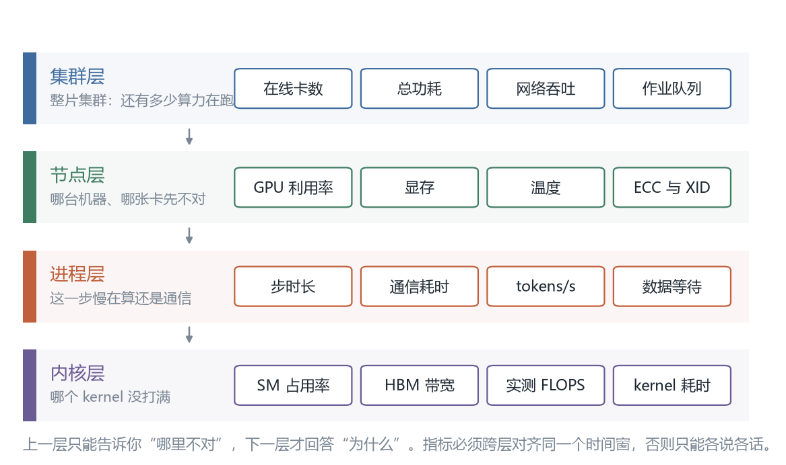

# 第 25 章　监控与可观测性

训练跑到第三周，loss 还在降，一条报错都没有，但同样走一步花的时间比第一周长了。没有人会收到通知。这类退化只能从曲线上看出来，而曲线如果没画，就等于不存在。

监控要解决的从来不是“机器有没有挂”。挂了有退出码，有告警，有人来重启，这件事本身不难。难的是两种状态。还活着但变慢了，以及看起来完全正常但算错了。前者要靠基线和对照才看得见，后者要靠校验才抓得住。装一个采集器不会自动带来这两样东西。采集器只负责把数字搬到一个地方，能不能从数字里读出结论，取决于你有没有先想清楚每个数字该跟谁比。

## 25.1　四层指标与它们各自回答的问题

指标要分层，不是因为工具这么设计，而是因为每一层回答的问题不一样。集群层回答“今天这台集群产出了多少有效算力”；节点层回答“这台机器有没有病变”；进程层回答“这一步的时间花在哪”；内核层回答“这个 kernel 离硬件上限还有多远”。混在一张表里，四个问题一个都答不清。

举例说，断言“这张卡利用率 97%”属于节点层的事实，它不能回答集群层的问题。真正决定集群产出的是有效卡时，也就是把排队、重启、恢复、检查点这些时间全部扣掉之后剩下的部分。16384 张卡跑 54 天，如果有百分之十的时间在做无用功，损失的就是一千多张卡的整月租期。这个数只能从事件流里算，任何瞬时指标都推不出来。

四层的采样频率差得很远。集群层一分钟一次就够，节点层十到十五秒，进程层每步一次，内核层要专门开 profiler 而且只能开一小段。这个差异决定了它们不能存在同一个地方。采集频率高的数据留在节点本地，聚合成少数几个数再往上送；频率低的直接进时序库。

基数是个容易低估的坑。16384 张卡、每卡 200 个指标、十五秒采一次，写入速率是

$$ R = \frac{16384 \times 200}{15} \approx 2.2 \times 10^{5} $$

按这个数估算，每秒二十多万个数据点。单机时序库撑不住，即使撑住了，查询也会慢到没人愿意打开面板。所以分层不是架构洁癖，是容量约束。把每卡 200 个指标压到每卡 20 个关键指标，写入量立刻降一个数量级，剩下的指标留在本地环形缓冲里，出事时按时间窗口捞出来。

还有一个更琐碎但更容易踩的坑。同名指标不同源。管理库报的显存占用和框架自己报的占用经常差几百兆甚至几个 G，原因是前者算的是驱动分配过的物理页，后者算的是缓存池里已用的部分；管理库报的利用率是时间占比，厂商自己的采集组件报的是 SM 活跃比例。把两个来源的数画在同一张图上做差，得到的结论一定是错的。用哪个源都可以，但一个指标只能有一个源，并且要在面板上写清楚。

分层还有第三个理由，跨层归因。集群层发现吞吐掉了，节点层找出三台可疑机器，进程层看到这三台的通信内核时间明显偏长，内核层看出是某条 rail 上的队列重传。少任何一层，链条就断在中间，剩下的只能靠猜。现场的经验是，能在一小时内定位的问题，几乎都是四层数据齐全的；查三天的问题，通常缺的就是中间那一层。

## 25.2　关键指标清单

只报 GPU 利用率的监控等于没有监控。下面这张表是能支撑判断的最小集合，多出来的指标可以加，但少了其中任何一行，出问题时都会缺一块证据。

| 层次 | 指标 | 采样 | 判据 |
|---|---|---|---|
| 集群 | 作业数、排队时长、有效卡时 | 1 分钟 | 与上周同日对比 |
| 集群 | 故障计数、重启次数 | 事件驱动 | 按天汇总 |
| 节点 | SM 利用率、显存占用 | 15 秒 | 同类节点横比 |
| 节点 | HBM 带宽、NVLink 流量 | 15 秒 | 与理论上限比 |
| 节点 | 网卡丢包、重传、PFC 计数 | 15 秒 | 非零即查 |
| 节点 | ECC 可纠正计数、XID | 15 秒 | 看增长速率 |
| 节点 | 温度、功耗、当前频率 | 15 秒 | 是否触墙 |
| 进程 | 步时、loss、梯度范数 | 每步 | 相对自身基线 |
| 进程 | 通信耗时占比、数据等待 | 每步 | 看占比趋势 |
| 内核 | NCCL 内核时长、GEMM 效率 | 按需 | 与微基准对照 |

先说利用率这一行，因为它最容易被误读。它统计的是“这段时间里至少有一个 kernel 在跑”的比例，不是有多少 SM 在真的干活。一个只用八个 SM 的拷贝内核也能把它打到满格。NCCL 的内核会占满所有 SM，却几乎不做浮点运算，所以通信等待期间利用率照样好看。**利用率回答的是“卡有没有在忙”，不是“忙得值不值”。**

值不值要用 MFU 算。

$$ \mathrm{MFU} = \frac{6ND}{t \cdot G \cdot P} $$

其中 N 是参数量，D 是每步处理的 token 数，t 是步时，G 是卡数，P 是单卡峰值算力。6ND 的来源是每个参数每个 token 前向两次乘加、反向四次。

拿一组具体数字走一遍。4050 亿参数，每步 400 万 token，16384 张 H100，单卡 BF16 峰值 989.4 TFLOPS，实测步时 1.5 秒。分子是

$$ 6 \times 4.05 \times 10^{11} \times 4 \times 10^{6} = 9.72 \times 10^{18} $$

分母是

$$ 1.5 \times 16384 \times 989.4 \times 10^{12} = 2.43 \times 10^{19} $$

相除得 40%。按这组配置估算，这个结果落在公开的 38% 到 43% 区间里，说明账算对了。同一套配置如果你算出 65%，不要高兴，多半是 D 记错了，或者把重计算产生的算力也算进了分子。重计算会让实际执行的总浮点运算增加，但模型本身的 FLOPs 没有变，算 MFU 时只能用后者。

显存要连着看。80 GB 的卡在训练里通常跑到七十几 GB，剩下的余量决定你能不能在出问题时抓一次显存快照。余量长期低于一成，说明批量或序列长度已经顶到天花板，任何一次碎片波动都会 OOM。更细的看点是显存随时间的变化形状。稳定训练里它应该是一条平线，如果每个检查点前都往上抬一点再落回去，那是参数卸载或者异步检查点的临时副本；如果它是一条缓慢上升的斜线，那就是泄漏，早晚会炸。

HBM 带宽要和算术强度一起看。3.35 TB/s 是物理上限，逐元素算子能跑到两 TB/s 左右就算不错。真正的问题是配比。一个算术强度为个位数的算子，即使跑满带宽也只能发挥几个百分点的算力，这时候去优化它的指令效率是白费力气。反过来，一个大 GEMM 的带宽利用率只有三成，但它已经跑到峰值的六成以上，那就一点问题也没有。

NVLink 流量是张量并行的体温计。每层两次 all-reduce，环状算法的传输量是激活字节的两倍乘以 (N-1)/N。取 8192 的序列长度、16384 的隐藏维、BF16、单条样本，一份激活是

$$ 8192 \times 16384 \times 2 = 2.68 \times 10^{8} $$

约 268 MB。TP 度为 8 时，一次 all-reduce 要传的字节数是 2.68×10⁸×2×7/8，按这个式子估算约 469 MB。前向一次、反向一次，126 层下来是 118 GB 上下，摊到 900 GB/s 的 NVLink 上是 0.13 秒。步时 1.5 秒里有百分之九左右跑在 NVLink 上，这个比例合理。如果实测流量只有估算的三分之一，先怀疑某一层没走 NVLink 而是绕了 PCIe；实测是估算的两倍，那多半是开了某层没必要的重复归约。

网卡侧看三个数。丢包、重传、PFC 暂停帧。正常训练里它们的日增量应该接近零。一旦开始以每小时几十的速度增长，说明某条链路在拥塞或劣化，此时集合通信的尾延迟会先变大，然后步时才跟上。丢包和重传的区别也值得分清。丢包指向物理层，重传指向拥塞，暂停帧指向对端来不及收。三者同时上涨，先怀疑交换机缓冲区，别急着换光模块。

ECC 与 XID 是硬件层的两个窗口。ECC 分易失和累计两类，易失计数清零后归零，累计计数只增不减。真正有信息量的是增速。单比特可纠正错误的累计值在一天内涨了几百，说明这颗 HBM 正在退化，行重映射的余量也在被吃掉。XID 是驱动报出的错误码，落卡、双比特不可纠正错误、NVLink 链路训练失败各有各的码，收到就记下来，别只记一个“有错误”。记录格式里至少要带上出现次数、首次和末次时间、以及当时在跑哪个作业的哪个 rank。

温度和频率要一起看。700 W 的卡在机柜进风温度升高时会先降频，再谈别的。降频不会报错，只会让步时悄悄上移，而且往往整机柜一起上移，看起来像是网络问题。这也是为什么机柜级的进风温度值得单独采一个指标，它比显卡自己的温度更能解释成片的、每天同一时段出现的性能波动。

进程层的通信耗时占比是另一个高价值指标。它等于集合通信内核的累计时长除以步时，正常配置下在百分之十到二十之间，随并行度和模型形状变化。这个数突然翻倍，通常不是网络变慢，而是重叠失效，通信被排到了计算之后，串行加起来当然翻倍。判断方法很简单，看通信和计算的时间区间是否重叠，重叠没了，占比自然涨。

梯度范数在监控里的作用被低估了。它是训练稳定性的早期警报，通常在 loss 出现异常之前几步就开始抖动。把梯度范数和学习率画在同一个坐标系里看更新比例，也就是范数与学习率之积相对参数范数的量级，比单看范数更有判别力。这个比例长期在千分之一上下是正常的，突然跳到百分之一，说明这一步的更新会实质改变参数，接下来多半会有一次扰动。

数据等待时间的意义在于排除法。GPU 空转的时候，要么在等通信，要么在等数据，要么在等下一个 kernel 被启动。数据等待持续偏大，说明瓶颈在存储或预处理，此时优化模型结构毫无意义。这个指标经常被漏掉，因为它不在显卡上，而在 dataloader 的进程里。

## 25.3　日志与事件

指标是连续的，事件是离散的。指标告诉你曲线变了，事件告诉你那一刻发生了什么。两者不在同一条时间轴上，就永远对不上因果。

日志的第一条纪律是不要人人写。16384 个进程每步各打一行，每行 200 字节，步时 1.5 秒，一秒就是两兆多字节，一天下来接近两百 GB。这些日志会先写满本地盘，然后拖慢写日志的进程，最后拖慢整个集合通信。常规做法是只让每个节点的一个 rank 打摘要，全局只留 rank 0 的全量日志，出问题时再按需打开某个 rank 的详细输出。

第二条纪律是时间戳要同源。跨节点比对的前提是时钟一致，靠普通的网络时间协议只能到毫秒，靠精确时间协议能到微秒。时间错位一毫秒，因果顺序就可能反过来，你把“谁等谁”看成了“谁先谁后”。诊断挂起的时候，这个错误会把人引到完全相反的方向上。

第三条是结构化。`key=value` 的形式能被检索，自由文本不能。检查点开始、结束、写入字节数、耗时，重启原因，配置版本，这些字段在复盘时会被反复查询。写成自然语言句子当然好看，但三个月后你想筛出“所有因为网卡原因重启的作业”就做不到了。

日志还有采样的必要。全量日志在稳态训练里信息密度极低，绝大部分行都是一样的内容。可行的做法是固定采样。正常情况下每 N 步留一行，异常时自动切成全量并保留前后若干步的上下文。这样既控制了体量，又保证了出事时的证据链完整。

采样的比例可以直接从体量倒推。前面算过全量日志一天接近两百 GB，如果每百步留一行，体量降到两 GB，这个数对本地盘是可以接受的；如果每千步留一行，降到两百 MB，代价是丢掉了大部分单步细节，只能看出趋势。合理的落点是每百步留一行摘要、每千步留一次完整的状态快照，再把异常前后各若干步的全量日志单独归档。这样一套日志在事后能回答三个层次的问题，什么时候开始变慢、慢在哪一类操作上、那几步的具体数值是什么。

日志的保留策略要按用途分层。诊断用的详细日志留三天足够，因为异常一旦过去就再也复现不了；事件和重启记录要留到项目结束，它们是计算有效训练时间的唯一依据；配置与版本信息要永久保留，否则你没法解释半年前的某次结果。

事件流里必须有的几类。作业启动与退出、每次重启及原因、检查点、并行配置变更、镜像与驱动升级、抢占与驱逐、人工干预。把这几类画在步时曲线上，绝大多数“为什么这天开始变慢”都能在两分钟内定位到区间。图上能看到的规律往往是人的直觉发现不了的，比如每次驱动升级后的第二天都会有一次步时抬升，比如每个整点都有一个尖峰对应存储系统的快照任务。

## 25.4　告警分级与降噪

分级的依据是人要不要现在动手，不是数值有多大。作业已经停了、并且不会自愈，这是最高级，要叫人。作业还在跑、但吞吐明显低于自身基线，这是第二级，工作时间处理。单点隐患，比如 ECC 增速偏高、某块盘剩余寿命不多，这是第三级，排进维护窗口。纯趋势，比如显存余量逐周下降，这是第四级，进周报。

这里有个关键区分。错和慢的检测方式完全不同。错有事件，阈值告警就够。慢没有事件，只有一段变长的时间，任何固定阈值都会误报，只能和基线比。所以每个作业都要建立自己的基线。相同配置下前若干步的步时中位数，之后按小时滑动更新，偏离超过一定比例才报。基线要跟着作业走，而不是跟着机器走，因为同一台机器在不同模型下的正常步时可能差好几倍。

降噪靠四件事。同源聚合，一台机器的八张卡同时报同一个问题，合并成一条，按节点计数。抑制窗口，同一个对象在冷静期内不重复通知。按作业聚合，把“某 rank 通信超时”归到“作业 X 异常”下面，而不是单独发一条。趋势替代瞬时，用一小时的中位数代替一分钟的瞬时值做判据，能消掉绝大部分抖动。

还有一个常被忽略的手段是分组合并。同一个故障域内的告警天然相关，一台交换机下的二十台机器同时报链路异常，正确的告警是一条“某交换机下联异常”，而不是二十条“网卡异常”。把故障域信息写进标签，聚合就自动成立，这也是拓扑数据必须进监控系统的原因之一。

告警还要写下处置手册。一条告警对应一段固定动作。先看哪张面板，确认哪三个指标，不行就执行哪条命令，再不行找谁。没有手册的告警，值班的人只会转发给另一个人，而不会解决问题。手册也会反过来校验告警定义。如果写不出处置步骤，说明这条告警本身不知道该让人干什么，应该删掉。

告警还有预算。一个值班工程师一晚上能真正处理的有效告警就那么十几条，超过之后人会开始忽略，然后连真的那条也一起忽略。所以宁可少报、报准，也不要为了“覆盖全面”把阈值调低。宁可漏报一次可以通过巡检补回来的隐患，也不要让值班的人对告警脱敏。

## 25.5　分布式追踪

单机 profiler 只能看到本机的因果。一次集合通信的慢，可能是另一台机器上某条链路的问题，本机的时间线上只会显示一段等待，看不出在等谁。

分布式追踪补的就是这一段。做法是把每个 rank 的关键区间打上时间戳和标识，汇总后按同一条时间轴铺开。谁先发起、谁最后到、谁在等，一目了然。NCCL 的 flight recorder 常驻在内存里，用一个环形缓冲记录每次集合通信的元信息和调用栈，超时时自动落盘，这是排查挂起最有效的第一手材料。没有它，挂起只能靠逐个 rank 加打印来二分，一晚上能定位一次就算运气好。

环形缓冲要开多大，算一遍就知道。假设一步里有两千次集合通信，每次记录带上标识、对端列表、消息大小和调用栈，一条按 256 字节估，单个 rank 每步就是半兆字节；留最近三十步，是十五兆字节；一个节点八张卡，一百二十兆字节，随便哪台机器都放得下。这笔内存账说明环形缓冲没有理由不常开，真正需要权衡的是写盘频率，而不是缓冲大小。

字段设计比工具选型更重要。每个区间至少要带四项。全局唯一的通信标识、rank 号、起止时间、区间类型。有了通信标识，才能把一次 all-reduce 在 16384 个 rank 上的区间拼成一条；有了类型，才能区分这是张量并行的归约还是数据并行的梯度同步，两者的正常时长差一个数量级。

开销要分层控制。CUDA event 计时只在流上插标记，开销在微秒量级，可以常开。采样到指令级的 profiler 会串行化执行，只能开几百毫秒，否则测出来的东西已经不是被测对象。实践中的组合是：常开轻量计时，异常时自动落盘上下文，需要深挖时再对少数几个 rank 开重量级采样。

时间轴对齐有个实操细节。不同节点的时钟即使都走了精确时间协议，也会有几十微秒的固定偏差。直接叠加会让本来重叠的两段看起来前后错开。做法是先用一次集合通信做校准，把每个 rank 的偏差估计出来并扣掉，再画图。这一步不做，重叠分析就没有意义，因为张量并行的通信本来就只有百微秒量级。

追踪数据的存放也要想清楚。16384 个 rank 每次集合通信一条记录，一步几千次通信，一天下来是十亿量级的记录，不可能全存。可行的做法是只存聚合值加慢样本。每次通信存最长和最短两个值，超过基线一定倍数的才存完整区间。这样既能看到分布，又能事后放大看个例。

## 25.6　一次步时退化的定位复盘

一个典型过程值得完整走一遍，因为它展示了分层指标怎么串起来用。

某次训练从第九天起步时从 1.50 秒漂到 1.62 秒，没有任何报错。第一步先排除数据。数据加载的等待时间曲线没有变化，说明不是喂不饱。第二步做 rank 间横向对比，把每张卡的前向加反向耗时铺成热力图，发现四台机器稳定偏慢百分之几，其余正常。第三步看拓扑，这四台不在同一机架、不在同一台叶子交换机下，网络拥塞这个假设被削弱。第四步在单机上跑同样的 GEMM 和拷贝微基准，结果和好机器一致，说明算力本身没问题。第五步回头看这四台的 HBM 相关计数，累计可纠正错误在持续增长，行重映射余量接近耗尽。换掉这四台，步时回到 1.50 秒。

这个案例的教训是：单机微基准正常、集群里偏慢，说明问题出在并发访问路径上。微基准是串行跑一次大矩阵，坏掉的存储单元可能刚好没被踩到；真实的训练同时有几千个流在读写，踩中的概率完全不同。所以微基准只能用来排除“算力坏了”，不能用来证明“机器是好的”。

还有一类退化看上去像性能问题，实际上是配置漂移。集群里混着两个版本的固件、两种型号的网卡、两批不同步的驱动，单机测试都正常，整体就是慢一点，因为没有一台机器错。这种问题靠监控指标抓不到，只能靠一份定期的配置一致性核对，把每台机器的固件、驱动、链路速率、多卡拓扑拉平，再和自己的标准清单比。

另一类常见的退化方向刚好相反。所有机器都慢一点，没有哪台特别突出。这时候横比失效，只能跟自己比。做法是把这一步的耗时拆成计算、通信、空洞三段，看哪一段涨了。计算涨了去查降频和 ECC，通信涨了去查重叠和链路，空洞涨了去查调度和启动开销。三段的比例是可以算的，三段都算完，问题域就只剩一个。

这两类退化在曲线上也很好区分。前者是几条线分叉，后者是整片线一起平移。前者需要到 rank 级别去找，后者直接去查机柜进风温度和作业外的存储流量。判断错了方向，就会在一个已经没有问题的方向上来回查三天，而真正的变化在另一张面板上。

把四层指标和跨层归因的路径画在一张图上，就是图 25-1 的样子。

*图 25-1　监控指标的分层与跨层归因路径*

## 25.7　采集开销要算进预算

采集本身要花钱。一个指标从产生到被人看见，中间要经过读取、传输、存储三段，每一段都有成本，规模一大，任何一段都可能反过来影响训练。

存储这笔账最好算，先做一道算例。按 25.1 的口径，16384 张卡、每卡 200 个指标、十五秒采一次，每秒二十多万个点。一个点只算 8 字节的数值，写入速率是 1.7 MB/s，一天一百五十 GB。真实系统里每个点还要带时间戳、卡号、作业号、节点名这些标签，标签加起来通常比数值本身大好几倍，按 48 字节一个点估，写入速率涨到 10.5 MB/s，一天九百 GB 上下。这个量级对分布式时序库不算致命，但它意味着保留期必须短，查询必须走预聚合，否则一次全量扫描就能把库拖垮，而拖垮的那一刻往往正好是出事想查的时候。

| 层次 | 采样间隔 | 上报粒度 | 每秒点数 | 保留期 | 存放位置 |
|---|---|---|---|---|---|
| 集群 | 60 秒 | 每作业 | 个位数 | 一年 | 时序库 |
| 节点 | 15 秒 | 每卡 20 项 | 两万一千 | 三十天 | 时序库 |
| 节点明细 | 15 秒 | 每卡 200 项 | 二十一万 | 三天 | 本地环形缓冲 |
| 进程 | 每步 | 每节点一个 rank | 一万六千 | 七天 | 时序库 |
| 内核 | 按需 | 每 rank 一次 | 不定 | 单次一份 | 对象存储 |

表里的点数可以互相校验。节点层是 16384 张卡乘 20 个关键指标除以 15 秒，得两万一千多；节点明细换成 200 个指标，得二十一万八千多，正好是 25.1 里那个数的十分之一与十倍。进程层只让每节点一个 rank 报，2048 个节点乘十几个标量除以步时，得一万六千左右，比每个 rank 都报少了将近一个数量级，而排查时真正需要的只是“这个节点在等什么”，不需要每张卡各说一遍。

采集端的开销不出现在任何账单上，只出现在步时的尾部，所以最容易被忽略。第二道算例就放在这里。假设节点采集进程每采一个点花 1.5 毫秒，一台机器八张卡、每卡两百个指标，一轮就是 1600 次采样，累计 2.4 秒的 CPU 时间。十五秒一轮，平均占用单核的百分之十六。这个数看起来不大，但如果采集进程没有绑核，它就会和通信线程抢同一批 CPU，表现为通信尾延迟抬高，而 GPU 侧一切正常，于是所有人都在查网络。

降采样是唯一有效的减负手段。每卡 200 个指标压到 20 个，写入降一个数量级，采集端的 CPU 也跟着降一个数量级，判断力几乎没有损失，因为剩下那 20 个恰好是出事时会看的那些。被压掉的指标不该删，应该改成异常时才采，平时只在本地留一个很短的滚动窗口。这个设计的前提是先想清楚哪些指标属于必须常看，而这件事本身就是监控设计的主要工作量。

采样周期还要避开和步时的整数倍关系。步时 1.5 秒、采样 15 秒，正好十步一轮。如果每一步的耗时随流水阶段有周期性起伏，每次采到的就都是同一相位上的值，曲线会平滑得可疑。把间隔改成 13 秒或 17 秒，这种混叠立刻消失。细节很小，但它决定了面板上的曲线是真的还是假的。

## 25.8　告警的量与降噪的算术

告警系统最难的不是发出来，而是发得刚好。发得太少漏掉真事，发得太多值班的人会开始麻木，然后连真事也一起划过去。

先把量算出来，这是本章第三道算例。16384 张卡的集群，按 Llama 3 那 54 天里的节奏，意外中断平均每天七点八次。一次中断在原始告警层面至少生成四条，节点失联、进程退出、看门狗超时、调度器重排，各自都是一条。再加上可纠正错误增速、机柜进风温度、链路抖动这类隐患告警，一天的原始条数在一百二十上下。这个数还没算上同一台机器上八张卡同时报同一条的情况，算上还要翻几倍。

| 级别 | 判据 | 响应时限 | 通知方式 | 系统自动动作 |
|---|---|---|---|---|
| P0 | 作业已停且不会自愈 | 立即 | 电话加值班群 | 隔离节点，从最近检查点重启 |
| P1 | 作业在跑，吞吐低于自身基线一成 | 当班内 | 值班群 | 记录离群 rank，等检查点边界处理 |
| P2 | 单点隐患，如可纠正错误增速偏高 | 一个维护窗口 | 工单 | 打标记，不打扰作业 |
| P3 | 慢性趋势，如显存余量逐周下降 | 一周 | 周报 | 无 |

降噪的三条规则可以把这一百二十条压到十几条。第一条是同源聚合，同一节点、同一故障域内的告警合并成一条，按节点计数而不按卡计数。第二条是抑制窗口，同一对象在半小时内不重复通知，只更新计数。第三条是用一小时的中位数替代一分钟的瞬时值做判据，把抖动挡在阈值之外。三条都用上，一天推给值班的人大概十几条，其中真正要动手的四到六条。

算比例就能看出改进空间在哪里。设一天推送 30 条、人工确认有用的 6 条，有效率两成。一个值班工程师一晚上能认真处理的有效告警也就十几条，所以 30 条已经接近饱和。把推送量压到 12 条而有用条数不变，有效率提到五成，人的注意力才真正落到该落的地方。这件事和阈值调多低关系不大，和聚合做得好不好关系最大，因为阈值越低，被放大的恰恰是噪声。

还有一个比值值得单独记，就是每次中断产生的告警条数。这个比值上升，说明故障的传播路径变复杂了，往往是某个中间件在放大错误；它下降，说明聚合规则在起作用。把它按周统计画成一条曲线，比盯任何单条告警都有用。按前面那组数，120 条原始告警对应 7.8 次中断，一次中断摊十五条，把这个数压到五条以下，值班的人才有余量去思考而不是转发。

告警还要配处置手册，一条告警对应一段固定动作。先看哪张面板，确认哪三个指标，不行执行哪条命令，再不行找谁。手册反过来也校验告警定义，写不出处置步骤的告警，说明它不知道该让人干什么，应该删掉。

## 25.9　一次挂起的完整时序

挂起是最难处理的一类故障，因为它几乎不发信号。进程没有退出，GPU 没有报错，利用率掉到零，日志停在最后一行，什么也不发生。这种状态能依靠的只剩时间。

一次典型的挂起是这样走完的。第 0 分钟，某个 rank 在等一次全归约，对端因为一条链路的问题没有把数据发出来。第 3 分钟，通信库的看门狗超时，环形缓冲落盘，进程以非零码退出。第 4 分钟，调度器发现作业退出，开始按失败处理。第 6 分钟，可疑节点被标记并隔离。第 9 分钟，作业重新拉起，上千个节点各自开始加载检查点。第 26 分钟，检查点读完，通信组重建完成。第 31 分钟，热身步跑完，吞吐回到稳态。第 33 分钟，第一步有效训练产出。第 40 分钟，本轮回合的复盘记录写完，节点送去诊断。

| 时刻 | 事件 | 耗时 | 可压缩的部分 |
|---|---|---|---|
| T+0 | 一次全归约卡在某个 rank | — | 无 |
| T+3 分钟 | 看门狗超时，环形缓冲落盘 | 3 分钟 | 超时阈值，不能无限缩短 |
| T+4 分钟 | 调度器判定失败 | 1 分钟 | 心跳间隔 |
| T+6 分钟 | 节点标记与隔离 | 2 分钟 | 可以自动完成 |
| T+26 分钟 | 加载检查点、重建通信组 | 20 分钟 | 分片、并行读 |
| T+31 分钟 | 热身步跑完 | 5 分钟 | 预热步数 |
| T+33 分钟 | 首步有效训练 | 2 分钟 | 基本不可压缩 |

这个时序里有两段值得分开看。一段是从挂起到看门狗超时的三分钟，它由超时阈值直接决定，设得太短会误杀正常的慢集合通信，设得太长则每次挂起都要白等，所以它只能优化到“刚好比最慢的正常通信长几倍”。另一段是从加载检查点到吞吐恢复的二十五分钟，它由检查点大小和存储带宽决定，跟故障本身毫无关系，却在这条时间轴上占了六成。

把损失折成卡时，这笔账立刻变得具体，也能看清损失是怎么被时间放大的。40 分钟乘 16384 张卡，是一万零九百多卡时。按每卡时两美元算，一次挂起的直接成本在两万美元上下；一天挂一次，一个月就是六十万美元。这个数解释了为什么值得为缩短恢复时间做工程，也解释了为什么检查点的分片和并行读必须在开训前就做好，因为它们在故障发生时没有补救的机会。

如果同样一次挂起发生在 1024 张卡的集群上，账是另一个样子。40 分钟乘 1024 是六百八十多卡时，一千多美元，团队往往会觉得“重启一下就行”，于是恢复流程长期没有人优化，等规模涨到十六倍，同一个流程的代价也涨到十六倍，而习惯已经养成，改不动了。规模变了，同一件事的性质会变，这是很多运维经验迁移失败的原因。

复盘记录要写成可检索的形式，而不是一段叙述。至少要有时刻表、判定依据、根因、改动、验证五段。根因这一栏最容易写错，写成“某节点网卡异常”没有价值，要写到“该节点第 5 号网卡的固件版本与集群标准版本不一致，拥塞时不再触发重传”这一层，改动才能落地。验证这一栏则要求下一个检查点周期内同类告警不再出现，否则这条复盘只是记录，不是修复。
