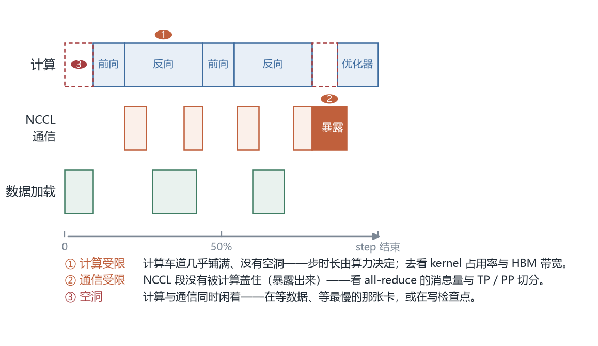

# 第 26 章　Profiling 与性能验收

同一个模型，同样的卡数，两个团队报出来的 MFU 差一倍，先别怀疑有人撒谎。十有八九是两边的口径不同。一个按每步实际 token 数算，一个按假设的 token 数算；一个把重计算算进分子，一个没算；一个的步时取的是中位数，一个取的是最短的那一步。

性能这件事，测出来是什么样，取决于你怎么测。这一章讲两件事。拿到一份 trace 之后，按什么顺序读；以及一批卡交到你手上时，用什么基准、报哪些数，才算验收完成。

## 26.1　Nsight Systems 与 Nsight Compute 的分工

工具只有两类，分工很清楚。系统级的时间线工具回答“时间花在哪儿”，单内核的分析工具回答“这个 kernel 为什么慢”。前者看全局，后者看局部，顺序不能颠倒。英伟达的栈里对应的是 Nsight Systems 和 Nsight Compute，一个给你一条完整的时间线，一个给你一个内核的剖面。

时间线工具采集的是 CPU 侧的调用栈、CUDA 接口调用、每个 kernel 在每张卡上的起止时间、内存拷贝、以及集合通信的区间。它给出的东西本质上是一条甘特图。一条训练步在这张图上应该长成什么样，是有标准形状的。一串前向 kernel，一串反向 kernel，中间夹着若干缩短的通信条，整体紧凑，没有大段空白。形状不对，问题就已经暴露了一半。

单内核工具采集的是一个 kernel 内部的执行细节。实际达到的吞吐占峰值的比例、访存吞吐、占用率、每个 warp 卡在什么指令上、L2 与显存的流量分布。它的代价是会串行化执行并多次重放同一个 kernel，一次分析可能让这一步慢上百倍。所以它只能在单卡、小批量、关掉通信的条件下用，测的是内核本身的上限，不是训练的实际表现。

两者的关系是漏斗。先用时间线在几千个 kernel 里挑出最值得看的两三个，再用单内核工具把那两三个拆开。反过来做，你会花一整天分析一个总共只占步时百分之一的 kernel，然后得出“这个 kernel 效率不高”这种没有用处的结论。

还有一件事得先想清楚。你要看的是哪一个 scale。一张卡、一个节点、还是上万个 rank，看的东西完全不同。单机的时间线关心的是流之间怎么排、拷贝有没有挡住计算；集群规模关心的是 rank 之间的等待、某条链路的重传、以及谁在拖后腿。前者一台机器就能看完，后者要把上万份时间线按同一根系铺平，不然你看到的永远是“本机在等”，而不是“等在谁身上”。

在集群规模下，采样还必须懂得取舍。上万个 rank 全部开详细采集，产生的数据量会让存储和采集本身变成瓶颈，所以只能抽。可行的做法是先开轻量计时，把每步的分段耗时、集合通信时长、空洞比例采下来，发现离群 rank 后再对这几十个 rank 开详细追踪。这样即使平时不开，事后也能把从“谁慢”到“慢在哪一行”的链条走完。

有一类开销要提前知道。时间线工具本身会在每个 kernel 启动时插桩，短序列、小模型的情况下，插桩开销可能让步时变长百分之几十，测出来的空洞也被放大。所以对比实验必须在同一套采集配置下做。要么都开，要么都关。

## 26.2　一份 trace 的读法

拿到 trace 不要从头往后看，那是最慢的读法。按固定顺序走四步。找空洞，找最长，看并行，做对照。

先看空洞。把整步的时间轴摊开，找那些所有流上都没有 kernel 的区间。这些区间就是纯粹的浪费，而且是最容易修的部分。空洞的来源无非几种。等数据、等通信、等 CPU 下发下一个 kernel、等同步点。

再看最长。把这一步里所有 kernel 按时长排序，前十个通常占了七成以上的时间。这些才是值得优化的对象，其余的看一眼就行。

然后看并行。通信是不是真的和计算重叠了，重叠了多久，重叠期间计算有没有变慢。这一步决定了通信开销是被隐藏了还是被摊在了步时上。

最后做对照。同一份配置关掉通信再跑一次，或者把批量减半再跑一次，看哪些数字跟着变。没有对照，你无法区分“这个 kernel 慢”和“这个 kernel 本来就该这么久”。

trace 要存下来，而不是看完就删。它只占几百兆，却能把一次发现的耗时曲线变成一个可复现的基准。后来的人改了一个参数，拿新的 trace 和三个月前那张重，就能看到底是哪一段变了。没有旧 trace 做锚点，所有“变慢了”的争论都会变成凭感觉。

用一组数走一遍。某步总时长 1.5 秒，其中 GEMM 类内核累计 0.95 秒，集合通信内核累计 0.30 秒，两者重叠 0.22 秒，其余内核 0.20 秒，剩下 0.27 秒是空的。这几个数可以拼出三个比例。

$$ \eta_{\mathrm{calc}} = \frac{0.95}{1.5} = 63\% $$

$$ \eta_{\mathrm{comm}} = \frac{0.30}{1.5} = 20\% $$

$$ \eta_{\mathrm{ovl}} = \frac{0.22}{0.30} = 73\% $$

计算占 63%，通信占 20%，重叠率 73%，也就是有 0.08 秒的通信裸露在关键路径上，加上 0.27 秒的空洞，一共 0.35 秒没有产出。如果把这些全部消掉，步时会降到 1.15 秒，同一批卡多产出三成。这就是为什么读 trace 的顺序里，“找空洞”排在“看内核”前面。

要注意通信时间不能简单相加。NCCL 的内核会占满所有 SM，它跑的时候 GEMM 只能拿到剩下的资源。所以 0.30 秒通信里有 0.22 秒虽然算“重叠”，但这 0.22 秒里的计算速度是下降的。判断方法很简单。比较同一段计算在有通信和无通信时的耗时，差出来的部分就是重叠的隐性成本。这个成本在张量并行度大的时候尤其明显，因为归约太频繁。

空洞还分真假。真的空洞里什么也没跑，GPU 在等；假的空间是“有 kernel 在跑，但跑的是无效工作”，比如为了对齐批量而补的零样本、因为负载不均而空转的专家。后者在时间线上看起来是满的，只有对比有效 token 数才能发现。这也是为什么单看利用率会骗人。它把无效工作也算成了忙。

判断空洞归属有个简单办法。把空洞的前一个 kernel 和后一个 kernel 找出来，看它们的依赖关系。空洞夹在两次集合通信之间，那是在等同步；夹在数据加载和第一个前向 kernel 之间，那是在等数据；夹在两个小 kernel 之间且 CPU 侧有对应间隔，那是在等下发。三种空洞的修法完全不同，前者要改并行或重叠，中者要改存储与预处理，后者要改内核数量或上图捕获。

还有一种看图就能发现的病。某个 kernel 在时间轴上宽度不均匀，一会宽一会窄。这通常意味着它的输入形状在变，比如变长序列没有打包，每步的 padding 比例不同。形状不稳定会让所有的调优失效，因为没有一个固定的最优配置。

## 26.3　三类瓶颈怎么分辨

计算的物理上限只有两个数。峰值算力和峰值带宽。它们的比值是一个门槛，算术强度过了这个门槛才可能跑到峰值。

$$ I^{*} = \frac{P}{B} $$

P 是单卡峰值算力，B 是显存带宽。代入 H100 的 989.4 TFLOPS 和 3.35 TB/s，按这个式子估算，门槛是每字节约 295 次浮点运算。这个数很直观地说明了为什么逐元素算子永远跑不满。一次 LayerNorm 每搬一个字节只做几次运算，离门槛差两个数量级。

于是判据就有了。拿单内核工具看一个 kernel 的算术强度，落在门槛左边，它是访存受限，优化方向是减少搬运、提高复用、做融合；落在门槛右边，它是计算受限，优化方向是提高指令效率、减少非矩阵运算的占比、把数据留在寄存器里。

现场症状也能对上。访存受限的 kernel，显存吞吐接近峰值而算力只有个位数百分比，这类 kernel 堆在一起时，整步的显存带宽利用率会顶到七成以上。计算受限的 kernel，SM 一直在忙，但实际算力只有峰值的五六成，这时候要去看指令混合，如果 FP32 的标量指令和 Tensor Core 的矩阵指令比例不对，说明时间花在了不该花的地方。

注意门槛本身会随序列长度变。序列越长，注意力的平方项占比越大，同一个模型的有效算术强度就越低；隐藏维越大，矩阵乘的比重越高，强度就越好。所以“这个模型是计算受限还是访存受限”没有固定答案，它随着场景变。判断必须针对具体的配置，而不是拿一个笼统的结论到处套。

通信瓶颈的判据是另外一套。它的特征是通信内核的时间长、且没有被重叠掉；同时网络侧的重传、暂停帧、链路利用率会有异常，rank 之间会明显不同步。这里最容易误判的是把一个慢节点当成网络问题。处理办法是看通信内核时长的分布。所有 rank 都快、只有少数几个慢，那是节点问题；所有 rank 一起慢，那才是网络或算法问题。

还有一类介于两者之间的情形。数据流在显存和片上之间反复来回。它的算术强度靠算平均数看起来不低，但实际上每一小段都在等数据，单内核工具会报出很高的访存吞吐和很低的算力利用率，同时共享内存的 bank 冲突计数很高。这种时候改公式没用，得改数据布局。

判断瓶颈归属还有一个比看指标更快的办法。动手改一个参数，看步时向哪个方向动。把张量并行度从八改到四，如果步时下降，说明通信是主要成本；把序列长度减半，如果步时下降得比预期多，说明激活和访存是主要成本；把批量加倍，如果步时几乎不增，说明你原本处在没吃满硬件的区间。这种单变量对照比读一百个指标都快，前提是每次只改一个。

第四类瓶颈经常被漏掉。启动开销。一个 kernel 从 CPU 发起、到 GPU 开始执行，这段固定成本在小 kernel 上占比很高。一步里有几百个小 kernel 时，累计的启动开销能吃掉可观的比例，而且它在 trace 上表现为每个 kernel 前面都有一小段空白，很容易被当成正常。判别方法是看 CPU 侧下发和 GPU 侧执行的重叠程度。CPU 跑到前面去了，说明下发不是瓶颈；两者严格同步前进，说明每一步都在等下发。

## 26.4　微基准与端到端基准

微基准测的是硬件能力的上界，端到端测的是这套软件栈在这个模型上的实际表现。两个都要有，缺一个就会得出错误结论。

单卡微基准至少要三样。一个大矩阵乘法，用厂商库的最优实现，测出来的数字除以峰值就是这张卡的算力兑现率，这个数应该很接近公开的峰值，差太多说明卡、供电或散热有问题。一个纯拷贝或三元组运算，测显存带宽，健康的机器能到标称值的八成上下。一个逐元素的访存型算子，配合前面两个，用来确认访存路径没被降速。

这三样之外，还建议加一个低精度算子的专项。低精度的峰值和实际能跑到的值差距比高精度更大，因为缩放、舍入、累加都在额外的路径上。量一下实际训练要用的形状与精度，才知道后面算 MFU 时该拿哪个数当分母。拿 BF16 的峰值去除 FP8 的实测，得到的百分比看着很高，但什么也说明不了。

网络微基准至少两样。单机八卡的全归约，走 NVLink，测的是节点内互联的实际带宽与算法效率，消息大小要扫一遍，从几十 KB 扫到几百 MB，因为小消息看延迟、大消息看带宽。跨机全归约，走网卡，测的是端到端，包括网卡、交换机、拓扑和收敛比的影响。这两个数要记下来，它们是后面所有通信占比估算的分母。

端到端基准要固定一切。模型、序列长度、批量、并行度、镜像版本、数据来源（建议用合成数据，排除存储的干扰）。跑够几百步，取稳态的步时中位数，同时记录方差。方差比均值更有诊断价值，一条平稳的曲线和一条锯齿形的曲线，平均步时可能一样，但后者说明有周期性的等待。

微基准的一个常见用途是筛机器。同一批上电的机器跑同一个小程序，耗时应高度一致，差出百分之几就是异常。这个测试十分钟就能跑完，却能把大部分“能开机、能训、但就是慢”的机器提前挑出来。代价低的筛法比事后在万卡作业里找掉队者便宜得多，因为后者的每一次排查都要停整个作业。

微基准也会说谎。同一张卡，单独跑满带宽，和在八卡机器上与另外七张卡一起跑，结果可以差很多，因为显存带宽、缓存、功耗都是共享的。所以微基准要和它要解释的场景同环境。要解释的是训练，就得在完整节点、正常功耗设置下测。只在空载单卡上测出来的漂亮数字，不能拿来当分母算效率。

两者之间的差距是软件栈的效率损失。微基准里单卡能到峰值的九成，端到端 MFU 只有四成，中间的五成就是通信、气泡、重计算、访存和调度吃掉的。这个差距不能靠换硬件解决，只能靠改配置和改实现。

## 26.5　扩展效率怎么测

扩展效率要测两次，两种口径不能混。

强扩展是总工作量不变、卡数增加，看时间怎么降。理想情况下降为 N 分之一，实际达不到，效率定义为

$$ E_{\mathrm{strong}} = \frac{T_1}{N \cdot T_N} $$

T1 是单卡时间，TN 是 N 卡时间。举例说，固定总批量下，单卡一步 1.2 秒，8 卡一步 0.162 秒，效率是 1.2/(8×0.162)，按这个式子估算约 92.6%，八卡之内几乎线性。同一份总批量扩到 1024 卡，每卡只剩千分之一的工作，计算降到毫秒级，而一次全局同步仍要几百毫秒，效率会掉到百分之一以下。这不是代码变差了，是小批量下的强扩展本来就没有意义。

弱扩展是每卡的工作量不变、卡数增加，看时间能不能保持持平。这个口径更贴近真实训练，因为真实训练里加卡的目的就是加快，批量也跟着放大。弱扩展下步时几乎不涨就是好，涨得越快说明通信占比越大。

两个口径给出的结论常常相反。数据并行的强扩展效率会随着卡数快速下降，因为每加一倍卡就多一次全局同步；而弱扩展效率可以保持得很好，因为每卡的工作量没变，通信占比基本恒定。所以报扩展效率时必须写明是哪种，否则数字没有意义。

效率下降的原因可以拆成三项。不重叠的通信、流水线气泡、掉队者。三项都可测。不重叠的部分等于通信时长减去重叠时长，直接从前一节的分段里拿；气泡按 (p-1)/(m+p-1) 估算，p 是流水级数，m 是微批次数，十六级、三十二个微批时约三成；掉队者要对比 rank 间的分布，最慢的一小撮决定整体。三项加起来如果已经超过实测损失，说明拆错了；如果远小于实测损失，说明还有一项没找到，通常是访存或者数据加载。

扩展测试还有一个容易被忽略的前提。负载必须固定。同一批测试里如果数据长度分布变了、有效 token 数变了，你测到的就不是扩展效率而是数据差异。所以测试要用固定的合成数据，每步 token 数写死，序列长度写死。真实数据下的效率会低一些，但那个差距属于数据管线的账，不该算到并行策略头上。

还有第三个口径值得测。固定并行度、只放大数据并行。它能把通信开销单独隔离出来，因为张量并行和流水并行的通信量不随数据并行度变化。这个测试最能暴露大规模同步的问题，队列尾部的延迟、掉队者、交换机收敛比，都会在这里显形。

公开的数字可以作为参照。1750 亿参数在 12288 张卡上做到 55.2% MFU，比同规模的标准实现高 1.34 倍；4050 亿参数在 16384 张 H100 上是 38% 到 43%。跨模型跨硬件直接比 MFU 是没有意义的，但同一个模型、同一个软件栈下，配置改前改后的对比非常有用。

## 26.6　验收指标与报告

验收不是跑个分就完事，是要给出一个可复核的结论。这套集群、这套软件栈、在这个模型上，能达到什么水平，以及达到这个水平需要什么条件。

要报的指标有六个。

MFU，按模型 FLOPs 算，写清楚每步 token 数、卡数、峰值取值。通信占比，也就是集合通信内核时长与步时之比，以及重叠率。步时稳定性，给中位数和尾部，尾部比中位数更能反映掉队者的影响。检查点开销，一次写盘耗时除以保存间隔，按一次 90 秒、每三小时一次估算，占比约百分之零点八。故障恢复时间，从作业失败到重新开始产出有效步，分解成排队、加载、重建通信组、预热四段。有效训练时间，实际有效步时除以墙钟时间。

最后一个是总账，也是唯一一个能跨配置比较的指标。如果一件事让 MFU 涨了两个点，但让恢复时间翻倍，它在总账上可能是负的。

把两者接起来的式子很朴素。有效算力等于标称算力乘上一串效率，步进效率、通信效率、可用率。写成乘法的好处是每项都能单独测、单独改。一把一个好的 MFU 和一个低可用率相乘，得到的才是这个集群真正在干什么的产出。很多团队把全部精力投在 MFU 上，可用率却一直卡在低谷，最后的总账比同行差一大截。

验收结论要写成区间，而不是一个点。同一套配置在不同日子跑出来的 MFU 会有波动，环境温度、邻居作业、固件版本都会影响它。报一个点会让人误以为那是保证值，报一个区间并且说明波动来源，才是对后面使用这套集群的人负责。

报告还要写清楚条件。卡数、并行度组合、序列长度、全局批量、是否重计算、精度格式、镜像与驱动版本、存储类型、网络拓扑与收敛比。少写一项，三个月后就没人能解释这份数据是怎么来的。

验收的常见错误是只测最好的一天。集群在刚上电、刚做完压力测试的时候状态最好，跑分漂亮，一周后开始有个别链路劣化，数字就下来了。所以验收要跨天，至少在工作日和周末各跑一次，并且记录当时的环境温度，机房温度对步时的影响是能看出来的，尤其是功耗接近整机柜上限的时候。

一段真实的步按三类瓶颈拆开，形状大体如图 26-1。

*图 26-1　一段训练步的 trace 与三类瓶颈*
