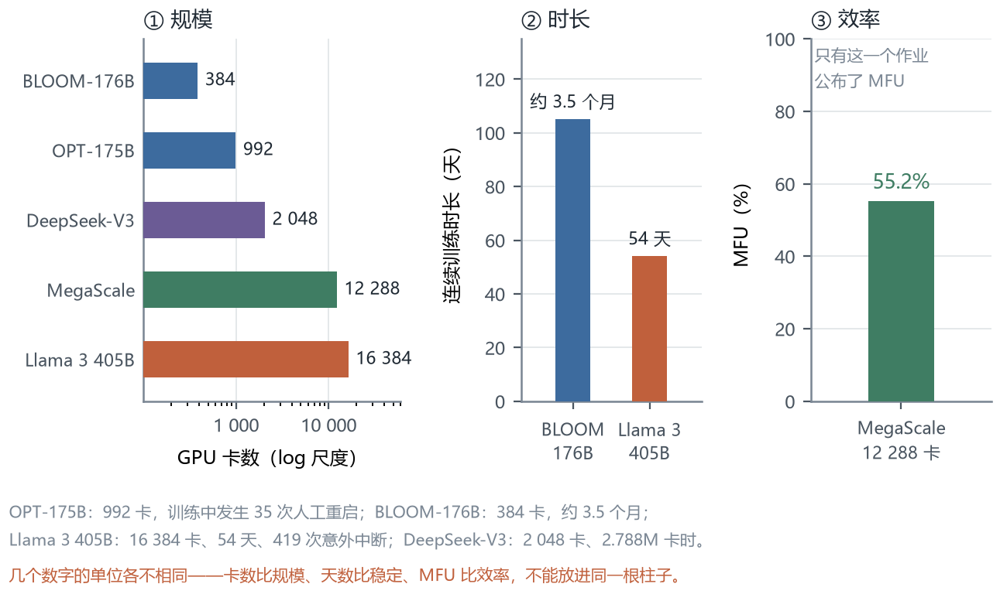

# 第 27 章　真实集群的复盘

前面二十几章讲的都是可以算清楚的东西。多少字节、多少微秒、多少倍。这一章反过来，讲几个真实跑完的大规模训练，它们遇到了什么，怎么处理的。

之所以值得看，是因为这些数字里有一样东西是算不出来的，就是故障的节奏。你可以算出一次全归约要多久，但你算不出下周三下午三点会坏哪张卡。而后者对总成本的影响，往往比前者大。

## 27.1　OPT 的两个月

OPT-175B 用了 992 张 A100 80GB，训练大约两个月。论文里有一句话很朴素。硬件故障导致了至少 35 次人工重启，期间换下去的机器远超这个数，据此估算由硬件故障触发的自动重启在 70 次以上。

把这两个数加起来，两个月里至少 105 次重启。按 60 天估算，平均每 14 小时就要停一次。这个频率意味着什么？意味着这个作业从来没有连续跑满过一天。任何需要“跑稳三天才能看出来”的现象，在这个节奏下都观察不到。

人工重启的流程值得记下来，因为它说明了为什么人工重启比自动重启贵得多。作业先暂停，然后对可疑节点跑一轮诊断，诊断出来的机器隔离出去，最后从最近的检查点恢复。诊断本身要时间，隔离之后要重新组网，恢复之后还要重建通信组、重新预热。一次人工干预轻松吃掉几个小时，而一次自动重启只需要加载检查点。

这两个数可以摊成一张账，算一道算例。992 张卡跑满两个月，是 143 万卡时。105 次重启如果每次按三小时估，损失的卡时是 105 乘 3 乘 992，约 31 万，占总量的两成二。这个比例放到任何预算表里都很扎眼，而它还只算了停机，不含回滚后重跑的那一段。按每卡时两美元折算，两成二的不可用相当于三十多万美元。这条账解释了为什么“缩短一次重启的时间”比“减少一次重启”更值得投入，因为后者的天花板由硬件决定，前者由流程决定。

损失尖峰是另一条线。OPT 遇到了多次 loss 发散，处理办法是把学习率降下来，再从更早的检查点重跑。注意这两个动作的组合。不是从上一步重跑，而是往回退一段。因为发散往往不是那一步造成的，是前面若干步累积的结果。这一点后面第 23 章已经讲过，OPT 是最早把它写成流程的项目之一。

这段经历里最值得抄的一条是：**把“机器坏了”当成常态，把“人工介入”当成例外**。105 次重启里只有 35 次需要人，其余靠自动化。这个比例决定了项目能不能在两个月里跑完，而不是在两个月里应付故障。

两个月的调度曲线本身值很多信息。一年里能跑完的作业数不多，每个作业的前期实验、中期调参、后期重跑都要占卡时；一次大规模训练只占整个项目卡时的一小部分。OPT 的两个月只是预训练那一段，前面还有几轮小规模实验，后面还有微调与评估。把预算全部押在“预训练能跑完”上，不算错，但会把其他环节压得很紧。

还有一段很少被提到的细节。OPT 在数据侧也做了筛选。团队发现某些数据子集在中小规模上就会引起梯度范数的尖刺，于是干脆把这类子集从语料里拿掉。这个决定看似保守，但它把一类不可预测的故障提前变成了可预测的数据配置。到大规模上再去处理“训练到一半遇上胖样本”的成本，比在数据阶段拿掉它高得多。

这也是可复用的顺序。先在小规模上用梯度范数筛数据，再上大规模。小规模上已经会尖刺的数据，到了十倍规模不会变好，只会变得更频繁。数据问题不会因为卡变多了而消失，它只会因为步变多了而更多地被触发。

但这里有个容易被误读的地方。按卡时粗略折算，16384 张卡跑一天和 992 张卡跑十六天扫过的样本量差不多，因为两者消耗的卡时相当。所以“小规模短跑没暴露的问题，大规模一定会暴露”这句话并不成立，真正决定暴露概率的是扫过多少样本，不是用了多少卡。想提前发现问题，办法只能是加密采样或者主动注入，不能指望把作业拉长。

还有一个关于人的事实。人工重启的比例会在项目后期下降。不是因为故障变少，是因为团队已经见过同样的错，知道先查哪里。这部分经验不会被写进代码，但它实实在在地体现在停机时长上。反过来，换人接手一个跑到一半的大作业，前两周的故障处置时长一定会变长。

两个月这个时长也值得注意。它不是硬件决定的，是人的耐心和组织节奏决定的。作业跑得越久，换人、变更、升级的可能性越大，配置漂移的风险越高。很多团队会把一个本来能跑四个月的作业切成几段，每段重新调学习率，代价是多花一点算力，收益是每一段都在一个稳定的软件版本上跑完。

## 27.2　BLOOM 的三个半月

BLOOM-176B 用了 384 张 A100 80GB，跑在法国的一个政府超算上，前后大约 3.5 个月。规模只有 OPT 的四成不到，时间却更长。

算一下总卡时。3.5 个月按每月 30 天、每天 24 小时估算，

$$ 384 \times 30 \times 24 \times 3.5 \approx 9.7 \times 10^{5} $$

接近一百万卡时。这个数是总占用，包含了故障、排队、等待的时间，不等于有效计算量。要算有效计算，还得乘上利用率。

把利用率乘进去能得到一个上限。每卡 156 TFLOPs，384 张卡合计每秒 5.99 乘 10 的 16 次方次浮点运算，3.5 个月约 907 万秒，乘起来是 5.4 乘 10 的 23 次方。按每个参数每个 token 六次运算反推，这个算力最多能处理 5100 亿 token，实际处理的当然少于它，差额就是排队、故障、预热和末尾评估占掉的那部分。这个上限的用处不在精确，而在于它能把“三个半月到底干了多少活”从一句话变成一个区间。

论文给出的最快配置下每卡 156 TFLOPs。A100 的 BF16 峰值是 312 TFLOPs，两者相除正好是 50%。按这个数估算，BLOOM 的峰值兑现率在一半左右。这个比例在 2022 年是相当好的成绩，因为它是纯数据并行加流水并行、没有用当时还不成熟的重计算与算子融合的组合。

稳定性方面，BLOOM 的报告比 OPT 平静得多。硬件故障的频率是每周一到两起 GPU 故障，因为有备用节点自动接管，加上每三小时存一次检查点，对吞吐的影响不明显。真正造成长时间停摆的是软件问题。数据加载器里的一个死锁缺陷，以及磁盘空间耗尽，两者各带来数小时级别的停机。整个训练里只出现了一次损失尖峰，模型自己恢复了。

这个对比很有意思。同样是千卡以下规模，OPT 的敌人是硬件，BLOOM 的敌人是软件。差别不在运气，在两个集群的运维成熟度和软件栈的复杂度。BLOOM 用的框架组合更保守，数据管线的并发度更低，于是硬件故障被备用节点吸收了，而软件缺陷成了主要风险。

从这里能抽出一条实用规则。故障率不是常数，它取决于你的软件栈有多复杂。每引入一个新组件，新的数据加载器、新的通信库、新的精度格式，你都同时引入了它自己的缺陷谱。规模和复杂度是两条独立的曲线，很多团队只盯前一条。

备用节点的成本也该算清。留出几台机器做备份，看起来是浪费，实际上是买了一份可以随时切换的保险。这份保险的价格大约等于备用比例，而它能抵御的是“一台机器坏了，整个作业却只能排队等修”的风险。在几百卡的规模上，这笔账划得来；到了万卡规模，你不可能留出一成机器做备份，就只能靠自动隔离加快恢复。备份策略随规模变化，不是一成不变的。

这个比例可以算得很具体。384 张卡的 2% 是八台，停下来一台用一台，一个月里能吸收掉十几起 GPU 故障，和每周一到两起的节奏正好对得上。同样比例的 2% 放到 12288 张卡上是 246 台，这些机器本身要上电、要占机柜、要维护，成本远超它们吸收的停机。所以大规模集群的选择只能是把备份从“整机”改成“时间”，用更快的恢复去代替更多的冗余。

还有一个容易被忽略的对比点。BLOOM 在公共超算上跑，意味着它与别的作业共享存储和网络。共享带来的损耗不在它的控制范围内，也让它的性能数据不可直接与专用集群相比。看别人的效率数字时，先问清那是一台什么机器、和谁共用。

共享的代价也可以估个量级。假设并行文件系统的聚合带宽被邻居占去一半，检查点写入就从几分钟变成十几分钟，而每三小时存一次，一天八次，多出来的时间就是一小时量级；若邻居又占用了网络，集合通信的尾延迟会先变差，步时的中位数看不出，尾部却明显上跳。这类损耗靠优化自己的代码消不掉，只能靠排期避开，或者把这段损耗当成预算里固定的一成。

## 27.3　Llama 3 的 54 天

Llama 3 405B 是公开材料里颗粒度最细的一份。16384 张 H100，80 GB HBM3，700 W，126 层，隐藏维 16384，4050 亿参数，15.6 万亿 token，总算力 $3.8\times10^{25}$ FLOPs，MFU 在 38% 到 43% 之间。

稳定性数据来自一个 54 天的窗口。这 54 天里共有 466 次作业中断，其中 47 次是计划内的，包括固件升级、配置更新、数据集切换；剩下 419 次是意外中断。约 78% 的意外中断归因于确认或疑似的硬件问题，GPU 相关问题占全部意外中断的 58.7%。

419 次意外中断摊到 54 天，按这个数估算，平均每天 7.8 次。这个数字比 OPT 的每 14 小时一次还要密，但两件事并不矛盾。规模从 992 张卡涨到 16384 张卡，涨了十六倍多，而中断频率只涨了几倍。单位卡的中断率其实是下降的，因为自动化程度和硬件批次都不同了。

把这个说法算实。OPT 是 105 次除以 992 张卡除以 60 天，每千卡每天一点七六次；Llama 3 是 419 次除以 16384 张卡除以 54 天，每千卡每天零点四七次。相差三点七倍。规模涨了十六倍，单位卡的中断率反而降了近四倍，说明新一代集群的“每卡每小时出事概率”低了，规模变大带来的只是绝对次数变多。这也意味着随着集群变大，“每天坏几次”应该从意外变成预期，值班表和工作流要按这个前提重新设计。

分类表值得逐行看。GPU 本体 148 次，GPU 的 HBM3 72 次，软件缺陷 54 次，交换机与线缆 35 次，主机非计划维护 32 次，GPU 的 SRAM 19 次，GPU 系统处理器 17 次，网卡 7 次，通信库看门狗超时 7 次，静默数据损坏 6 次，GPU 温度传感器 6 次，其余 16 次。加起来正好 419 次。

这张表最反直觉的地方是软件缺陷排第三。54 次，比交换机和线缆加起来还多。这说明在万卡规模上，“硬件坏了”不是唯一的敌人，训练框架自己的缺陷同样能让整个作业停下来。另一个值得记住的数是静默数据损坏 6 次，概率很低，但一旦发生，如果你没有检测手段，这 6 次会变成六段被污染的训练。

检测这种东西的成本可以算。两份各 1 GB 的副本互比要搬 2 GB 数据，按 3.35 TB/s 是 0.6 毫秒，相对于 1.5 秒的步时是万分之四，开在每步末尾也感觉不到。真正的成本不在带宽，而在“跟什么比”，你需要一份参照，参照可以来自上一轮的自己的副本，也可以来自另一组副本的互比。这就是为什么冗余副本在万卡规模上不只是为了容错，它同时也是检测的手段：两份一致，才说明两份都对。

尽管每天要中断近八次，有效训练时间还是高于 90%。这个数可以反推。

$$ \eta_{\mathrm{eff}} = 1 - \frac{T_{\mathrm{lost}}}{T_{\mathrm{total}}} $$

54 天是 1296 小时，90% 的有效时间意味着损失不超过 130 小时；466 次中断分摊下来，平均每次只损失不到 20 分钟。这个数才是真正的工程成就。它不是靠减少故障达成的，是靠把每次故障的处置时间压到十几分钟达成的。自动检测、自动隔离、自动从最近的检查点恢复，全程不需要人。

这条经验可以直接搬。当故障不可避免时，优化目标就从“降低故障率”转成“降低单次故障成本”。后者的杠杆大得多，因为前者受硬件和运气限制，后者完全取决于你的自动化程度。

还有一条不那么显眼但很实用。训练团队发现环境温度会影响吞吐，白天温度高的时候，显卡的动态调频会让整体吞吐悄悄下滑一点。这个幅度不大，但它是有规律的，且无法通过改代码解决。能做的只有两件事。把它计入基线，别在白天调参；以及在机房层面把进风温度控制住。

排障工具上他们做了一件很具体的事。把通信库的飞行记录器常态化开着，每次集合通信的元信息和时长都进环形缓冲，看门狗超时时自动落盘。这个手段看上去平凡，但它解决的是万卡训练里最耗时的一类问题，挂起。挂起没有错误码，进程不退出，GPU 也不报错，只是什么也不发生。没有环形缓冲里的栈和元信息，你只能靠进程逐个堆栈采样去二分。

他们还提到一个混合网络的麻烦。节点内走 NVLink，节点间走以太网上的远程直接内存访问，两者失败时的表现完全不同。后一种会给出明确的超时，前一种的失败往往表现为一个加载指令永远不返回，既没有错误码也没有超时，因为等待的一方永远不会知道对方已经不在了。这类卡死靠应用层超时才能得救，而超时设得太短会误杀正常的慢集合通信。

## 27.4　MegaScale 的调优

MegaScale 的报告讲的是另一件事。同样的 1750 亿参数，在 12288 张卡上做到 55.2% MFU，比同规模的标准实现高 1.34 倍。反推一下基线的水平，55.2 除以 1.34，按这个式子估算约 41%。也就是说，它做的事让效率从四成出头提到了五成半。

它靠的不是某一个绝招，是几件小事的叠加。第一件是把通信切碎并塞进计算里。数据并行的梯度同步按模型分块做，流水并行的收发和计算错开，张量并行的归约和激活的重算叠在一起。第二件是给通信算子定优先级，让关键的集合通信先拿到带宽，不被后台的检查点写盘挤掉。第三件是把存储的读放大问题解决掉，恢复的时候不让上万个进程同时去读同一份状态。

换成步时更直观。同一个模型、同一批 token，基线是 55.2 除以 1.34，即 41.2%，优化后是 55.2%，步时按比例缩到原来的 0.746，也就是每十步省下两步半。这听起来不多，但摊到 12288 张卡上，每天省下的卡时是万级。这就是为什么“把通信藏进计算”这类工作看起来只是几个点的提升，折算成卡时和钱却是另一个量级。

几个并行维度的重叠要分别设计。数据并行的梯度是全模型大小的，通信量大但可以和反向计算自然错开；流水并行的传输只有激活大小，但它在关键路径上，一旦不重叠就直接变成气泡；张量并行的归约量小但次数多，单次的延迟比带宽更要紧。把这三个当成同一类通信去调，一定会有一项调不好。

第四件事最值得单独说。掉队者。在万卡规模上，最慢的那台机器决定整体速度。报告里提到，极小一部分机器，不到百分之一，在训练中明显更慢，而排掉这些离群点之后，不同次运行之间的效率就变得一致了。这个观察解释了一个常见困惑。同样的配置、同样的代码，两次运行的 MFU 能差好几个点。原因不是配置，是这次调度恰好把几台慢机器分到了同一个作业里。

这条经验对工程的启示是，集群需要一层“性能体检”的筛选，而不是只在坏了的时候才处理。坏了的机器会被检测出来，慢的机器不会。慢机器的影响是持续性的、均摊到每一步的，而且它在单机微基准上完全正常，因为微基准是串行跑一个大矩阵，慢机器的问题往往在并发访问时才显形。

MegaScale 还做了一件很多人忽略的事。把每个 rank 的关键代码段耗时用 CUDA event 记下来，汇总成热力图。这个手段开销很小，可以常开，但它的诊断力很强，因为万卡规模上的问题，绝大多数不是“某个 kernel 慢”，而是“某几台机器慢”。

恢复路径上的优化也值得单提。作业重启时，上万个进程同时去读同一份共享状态，存储的读带宽会瞬间变成瓶颈，而这段时间是完全不产出算力的。可行的做法是让同一组里只让一个进程去读，读完广播给其余进程，把读放大从“每个进程各读一份”压到“每组读一份”。这种改动的收益在正常情况下看不出来，在恢复时能省下几十分钟，而在故障频繁的集群里，每次故障都省几十分钟，一个月就是可观的数量。

读放大的量级可以用一个小文件算清。一个 2 GB 的共享状态，12288 个进程各读一遍就是 24 TB，按存储聚合带宽 100 GB/s 算要 246 秒，四分钟全部花在读同一个文件上，而且这四分钟里所有卡都空着。改成每组读一份再节点内广播，总读量降到几十 GB 量级，时间回到一两秒。这个改动很小，但它把恢复时间里最不可控的一段变成了常数。

还有一个容易被误解的点。它的 55.2% 不能直接和 Llama 3 的 38% 到 43% 比。模型不同，硬件不同，甚至 MFU 的分子口径也可能不同。能比的只有同一篇报告内部的配置对比，也就是改前改后的差距。把不同报告的数字放到一个排行榜上，得到的结论一定会误导你。

## 27.5　DeepSeek-V3 的成本账

DeepSeek-V3 换了个角度报账。不报 MFU，报钱。2048 张 H800，14.8 万亿 token，预训练 2.664M 卡时，含上下文扩展与后训练的全流程 2.788M 卡时。按每卡时 2 美元估算，总成本 557.6 万美元。

把卡时换算成天数。2.788M 除以 2048，按这个式子估算约 1361 小时，也就是 56 天多一点。预训练部分占 95.6%，说明在这个项目里，后训练和上下文扩展的成本几乎可以忽略，这是 MoE 架构加 FP8 训练带来的规模效应，也是 2048 卡这个规模相对容易调度带来的好处。

每 token 的成本可以往下算一层。557.6 万美元除以 14.8 万亿 token，按这个式子估算约 $3.8\times10^{-8}$ 美元，也就是每百万 token 不到四分钱。这个数之所以有意义，是因为它把所有效率损失，故障、气泡、通信、低精度带来的返工，全都折进去了。MFU 是工程师的指标，每 token 成本是老板的指标，两者算的是同一件事。

还可以再往上一层，算每卡时产出多少 token。14.8 万亿除以 2.788M 卡时，是每卡时五百三十万 token。拿 4050 亿参数、MFU 40% 的稠密模型比，这个数是五十八万，差九倍。这个差距不属于工程水平，而属于模型结构，MoE 每处理一个 token 只激活一部分参数，分母里的有效参数量小得多。所以拿这个指标跨结构比较，比出来的是结构，不是效率。真正想比工程水平，得把它换成相同的激活参数量再算。

它做到这个成本的两个支点都在前面讲过。一是 FP8 训练。在 2048 张 H800 上把精度压到 FP8，算力和带宽同时受益，代价是要处理缩放和溢出。二是通信与计算的近全覆盖。MoE 的跨节点全对全是这类模型最大的开销，把它藏进计算里，等于把这部分时间从账上抹掉。

还有一个隐含的经验。规模选得克制。2048 张卡是一个调度上很舒服的规模，拓扑容易规整，故障域可控，恢复也快。用 12288 张卡能更快跑完，但单位成本不一定更低。这个取舍没有标准答案，取决于你是赶时间还是压成本。

把它量化一下。2.788M 卡时放到 12288 张卡上是 227 小时，不到十天；放到 2048 张卡上是 1361 小时，五十六天。两种排法用的是同一笔算力，差别全在墙钟与故障暴露时间上。按前面那个每天几次中断的节奏，五十六天里要碰上上百次停机，而十天里只有十几次，而且规模小的时候每次停机影响的卡数也少。快速跑完不只是赶时间，它同时压缩了出故障的窗口，这笔收益通常不计入预算表，但它真实存在。

FP8 那部分成本也没被瞒着。降低精度省下的是算力和带宽，付出的是稳定性工作。缩放因子要逐块统计，溢出时要能回退，数值异常时要能从前一个干净检查点恢复。这些工作不产生任何性能收益，却是前面的性能收益成立的前提。看一个低成本案例时，只看它省了多少，不看它为省这些付出了什么，复制时会吃大亏。

把它的账和别人的对一下时，注意口径。它的 56 天是“全部算力除以卡数”得到的满载等效时长，是从卡时反算出来的；而 Llama 3 报告里的 54 天是一个观察窗口，两者的含义完全不同，不能相减也不能相除。卡时这个单位的好处是不会歧义。它把多卡短时间和少卡长时间压成了同一个数。

这也是为什么报账最好报卡时。同样一个项目，按“跑了两个月”说，和按“用了一百多万卡时”说，信息量差很多。前者看不出规模，后者压不进背景，两个都要写才完整。DeepSeek-V3 的 2.788M 卡时配上 557.6 万美元，就把规模和钱一次性说清楚了。

## 27.6　共同的经验

把五次训练放在一起看，有几条反复出现。

故障是常态，不是意外。992 张卡两个月至少 105 次重启，16384 张卡 54 天 419 次意外中断。任何按“作业能连续跑完”来设计的流程都会失败，包括手工记录、按次结算、靠人盯着的监控。

单次恢复成本比故障率更值得优化。Llama 3 的 419 次中断之所以只吃掉不到一成的时间，是因为每次处置不到 20 分钟。能做到这一点，靠的是自动检测、自动隔离、自动加载检查点三件事都通了，而不是靠修硬件。

效率的差距藏在重叠里。MegaScale 从四成出头提到五成半，靠的全是重叠和优先级；Llama 3 的 38% 到 43% 里，损失的主要部分也是没被重叠掉的通信与气泡。这两个案例都说明，到了万卡规模，算力本身不是瓶颈，让算力不停下来才是。

掉队者的影响被严重低估。不到百分之一的慢机器能拉低整个作业的效率，而它们在单机测试上完全正常。所以集群需要一层常态化的性能体检，把“慢”和“坏”分开处理。

两者的处理方式不一样。坏的应该立即隔离，因为它会引发超时和重启；慢的不能立即隔离，因为你无法证明它慢，而且在一个同步作业里隔离任何一台都意味着整个作业要重启。所以对待慢机器，可行的办法是先记录、后验证、等到下一个自然的检查点边界再剔除。这个节奏很反直觉，但它是万卡规模下唯一可行的节奏。

成本要按 token 算，而不是按卡时算。卡时只反映你租了多久，token 成本才反映你产出了多少。当有人问“这套配置值不值”，能回答这个问题的只有后者。

但卡时也不能丢，因为它是唯一不会因为口径而变的单位。同一个项目报“跑了两个月”和报“用了一百多万卡时”，后者能直接对上预算表，前者需要对方先知道你有多少卡。所以两份都要给，一份给人看，一份给账看。这也是几个案例里少数几个可以无条件照搬的做法，它不依赖硬件，也不依赖模型。

最后一条是关于心态的。这五次训练里，没有一个团队的叙事是“我们设计了一个完美的系统然后它跑通了”。真实的叙事都是：先跑起来，发现一类问题，修掉，再发现下一类。OPT 的处理办法是从更早的检查点回滚，BLOOM 的处理办法是加备用节点，Llama 3 的处理办法是把处置时间压到十几分钟，MegaScale 的处理办法是把慢机器筛出来。没有一个办法是通用的。

| 项目 | 卡数 | 时长 | 关键数字 |
|---|---|---|---|
| OPT-175B | 992 | 约 2 个月 | 35 次人工重启，70 次以上自动重启 |
| BLOOM-176B | 384 | 约 3.5 个月 | 每卡 156 TFLOPs，约峰值一半 |
| Llama 3 405B | 16384 | 54 天窗口 | 466 次中断，有效时间高于 90% |
| MegaScale | 12288 | 175B | MFU 55.2%，为基线的 1.34 倍 |
| DeepSeek-V3 | 2048 | 全流程 | 2.788M 卡时，557.6 万美元 |

五组数据放在一张图上，规模和效率并不是同一条曲线，见图 27-1。

*图 27-1　几次公开的大规模训练的规模、效率与故障*

## 27.7　把五个案例摊开看口径

27.6 讲的是共性，共性之下还有一层差别，五个项目付出的代价并不在同一个地方。把它们的数摊在一张表上，能看出各自把成本压在了哪一环。

| 维度 | OPT-175B | BLOOM-176B | Llama 3 405B | MegaScale | DeepSeek-V3 |
|---|---|---|---|---|---|
| 卡数与型号 | 992 张 A100 80GB | 384 张 A100 80GB | 16384 张 H100 | 12288 张 | 2048 张 H800 |
| 时间口径 | 约 2 个月墙钟 | 约 3.5 个月墙钟 | 54 天观察窗 | 未给墙钟 | 2.788M 卡时 |
| 效率口径 | 未报 MFU | 每卡 156 TFLOPs | MFU 38% 到 43% | MFU 55.2% | 报成本 |
| 故障节奏 | 105 次重启 | 每周一到两起 | 419 次意外中断 | 掉队者不足百分之一 | 未报 |
| 主要矛盾 | 硬件 | 软件 | 恢复速度 | 重叠 | 单位成本 |
| 可迁移的做法 | 自动重启为主 | 备用节点 | 飞行记录器常开 | 通信切碎 | 精度换成本 |

表里有三行最容易混，得逐个说清。时间这一列同时装着三种东西，OPT 与 BLOOM 是墙钟，Llama 3 的 54 天是一个稳定性观察窗口，DeepSeek-V3 的 2.788M 卡时是全部算力累加，除以 2048 张卡后得到的是满载等效时长。三者不同质，不可相减也不可相除，尤其不能拿 Llama 3 的 54 天去减 DeepSeek 的 56 天，那个差额没有任何含义。

效率这一列同样混着四种东西。BLOOM 报的是单卡兑现实测值，除以 312 TFLOPS 的峰值得到一半左右；Llama 3 报的是 MFU 区间，分子是模型 FLOPs；MegaScale 报的是一个点，55.2%；DeepSeek 干脆不报效率，直接报钱。四个数里只有同一个团队的改前改后才能直接比，跨团队比需要先把口径拉平。

卡数也不是效率的决定因素，这一点最反直觉。384 张卡能跑到峰值一半，12288 张卡能跑到五成五，而 16384 张卡报的是四成上下。规模涨了几十倍，效率基本没跌，原因是模型尺寸、并行策略和软件栈都在同步变。反过来看，如果 12288 张卡用了不合适的并行组合，五成五也会掉到四成，掉的那部分和硬件无关。

把 MFU 的区间换成卡时，又是一道算例，能看出一项很具体的代价。4050 亿参数、15.6 万亿 token 的总运算是 6ND，即 3.8 乘 10 的 25 次方。按 38% 算，卡时约 2810 万；按 43% 算，约 2480 万，中间差三百三十万卡时。按每卡时两美元算，那个五个点的 MFU 区间就是六百万美元量级的差距。换句话说，一个验收报告把区间写成一个点，可能就抹掉了六百万美元的不确定性。

## 27.8　失败的账

五个案例里真正贵的不是故障本身，而是两种状态：故障已经发生但没被发现，以及发现了却没有现成的处置路径。前一种会把一次停机变成一段被污染的训练，后一种会把十几分钟变成几个小时。

| 案例 | 失败的形态 | 代价的量级 | 换来的改动 |
|---|---|---|---|
| OPT | 多次 loss 发散 | 回退一段重跑 | 从更早检查点回滚，数据侧先筛子集 |
| BLOOM | 数据加载死锁、磁盘写满 | 数小时级停机 | 保守软件栈加备用节点 |
| Llama 3 | 静默数据损坏 6 次 | 未检测则每次数小时污染 | 校验、比对、飞行记录器常开 |
| MegaScale | 掉队者 | 每步稳定损失几个点 | 常态化性能体检与离群剔除 |
| DeepSeek-V3 | FP8 溢出与数值异常 | 回退重算 | 逐块缩放，可回退的检查点 |

静默数据损坏那一行的账最值得算，先做一道算例。按三小时存一次检查点的节奏，一次没被发现的损坏最多污染三小时的数据，也就是从损坏发生到上一次干净检查点之间的全部步。6 次乘 3 小时再乘 16384 张卡，是 29.5 万卡时，加上重新计算的 29.5 万，一共近 60 万卡时，按每卡时两美元是百万美元量级。而检测手段本身几乎不花算力，代价只是在每步末尾加一次校验并将抽样比对。这就是检测类投入的典型样子，平时看不出收益，发生时把损失从百万级压到万级。

回滚的账算出来是另一个结果。OPT 发散几次，每次退回三小时重跑，5 次是 5 乘 3 乘 992，不到一万五千卡时，几万美元。用几万美元买一次保险，回滚是极便宜的处置方式；而很多团队不愿回滚，原因是回滚之后要重跑一遍，看上去在“倒退”，于是选择降学习率硬跑，结果后面再发一次散，代价更大。这个心态问题比技术问题难解决。

掉队者那一行的账容易被当成零。不到百分之一的机器慢一点，直觉上影响也只有百分之一。实际上同步作业里最慢的那个决定全部，慢三成就是全体慢三成，落在 MFU 上就是几个点。12288 张卡上的三个点，等于 369 张卡在全程空转。买一批卡不会有人犹豫，而丢掉同样的有效算力只需要几台慢机器，这就是为什么性能体检应该常态化。

把这五个案例的停机时间摊开看，能看出一个很容易被忽略的事实。Llama 3 那 419 次中断如果每次真的只花二十分钟，54 天里的处置时间一共是一百四十小时，平均每天两小时半，占总时间的百分之十出头，和他们报告的有效训练时间高于 90% 正好对得上。反过来说，如果每次处置要一小时，同样的故障次数会把有效时间拉到七成以下，而硬件一点没变。这个对比说明，“处置时长”这个看似行政性的指标，在大规模训练里和 MFU 是同一量级的工程变量。

复盘文档的价值不在写得多漂亮，而在能不能变成默认路径。Llama 3 的飞行记录器之所以有用，是因为它默认就开着，不需要有人在紧急时想起去开；BLOOM 的备用节点之所以能吸收故障，是因为切换不需要人点头。凡是需要“先想起来再执行”的处置，在真实的故障时刻都执行不了，因为那一刻人正在慌。所以每写完一份复盘，都该问一句：这条改动是默认生效的，还是要靠人记得。只靠记性的改动，下一次还会以同样的形式失败。
