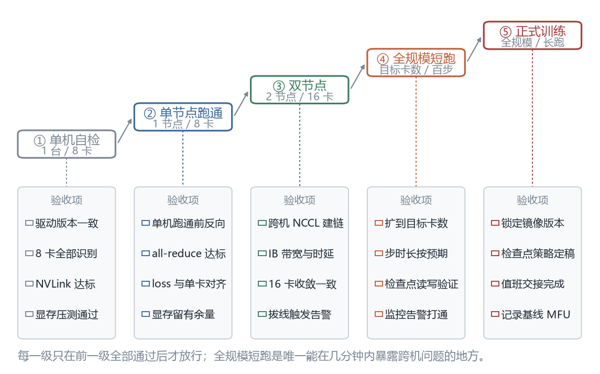

# 第 28 章　从零启动一次千卡训练

前面二十七章拆开讲了每一块。这一章把它们按时间顺序串起来，给出一次真实的启动流程。从确定规模，到选机器，到读第一天的曲线。

写法上会有点不一样。这一章本身是一份清单，但清单不能是项目符号的堆叠，因为真正决定成败的是条目之间的顺序和依赖。所以每一节都按“先做什么、做完看什么、不对怎么办”的节奏走，段落之间是承接关系，不是并列关系。

## 28.1　先算规模，再谈机器

不要先问“我该买多少卡”。这个问题没有答案，除非你先知道要训多大的模型、跑多少 token、打算花多长时间。

模型规模通常由目标决定，token 数有一个起点。算力最优时，每个参数配大约 20 个 token。700 亿参数配 1.4 万亿 token，这是那条曲线上的一个点。真要训练时往往还会多给一些，因为推理时的表现和 token 数正相关。

有了这两个数，总算力就定了。

$$ C = 6 \times N \times D $$

N 是参数量，D 是 token 数。系数 6 来自前向两次乘加、反向四次，每个参数每个 token。

卡时由总算力除以单卡有效算力得到。

$$ H = \frac{6ND}{P \cdot u} $$

P 是单卡峰值，u 是预期的 MFU。代入 700 亿参数、1.4 万亿 token、H100 的 989.4 TFLOPS、MFU 取 40%，按这个式子估算，

$$ H = \frac{5.88 \times 10^{23}}{989.4 \times 10^{12} \times 0.4} \approx 1.49 \times 10^{9} $$

换算过来约 41.3 万卡时。用 1024 张卡跑，是 403 小时，也就是十七天左右。

这个数要立刻做一次合理性检查。十七天里，按每天中断若干次、每次损失十几分钟算，加上末尾的检查点和评估，实际墙钟时间通常是这个数的 1.2 到 1.3 倍。所以“十七天”要读成“三周”。项目排期按卡时算是乐观的，按墙钟算才是真的。

接着算显存，因为它决定并行度，而并行度决定通信量。显存账分两项。参数与梯度、优化器状态，它们被切分的深度不一样。

$$ M = \left(\frac{4}{T \cdot P_{p}} + \frac{12}{T \cdot P_{p} \cdot D_{d}}\right) \times N $$

T 是张量并行度，Pp 是流水并行度，Dd 是数据并行度，三个相乘就是总卡数。分子里的 4 是参数与梯度的字节数，它们只被张量与流水切分；12 是参数、梯度与优化器状态合起来的字节数，它们还被数据并行切分，这就是只切优化器状态的做法。如果把参数也切到底，每一项都除以数据并行度，每卡降到 12N 除以总卡数。

代入 700 亿参数、总卡数 1024、张量并行 8、流水并行 1、数据并行 128，括号里是 0.5 加 0.012，乘上 700 亿，按这个式子估算每卡约 35.8 GB。80 GB 的卡还剩四十多 GB 给激活、通信缓冲和碎片，够用但不宽裕。如果换成 4050 亿参数、16384 张卡、张量 8、流水 16、数据 128，每卡只要 13 GB 左右，剩下的全给激活。

这两组数字说明一件事。**在千卡以上，显存通常不是主要矛盾，通信才是**。真正决定你能不能跑满的是网络，显存只决定你能不能装下。

数据量也要算一笔。1.4 万亿 token，按每个 token 两字节存成整数索引，是 2.8 TB；加上预处理中间文件、去重用的哈希、以及断点续训需要的样本位置索引，实际占用通常是这个数的两到三倍。这个体量对并行文件系统不算大，但小文件数量会成为问题。如果按每条样本一个文件存，文件数会到亿级，元数据服务会先于带宽崩掉。

还要算上排队。一千张卡不是随时能拿到的，共享集群里排队几天很正常。排期时把排队时间和训练时间分开列，不要把两者混成一个数，否则一旦排队变长，你会误以为是训练变慢。

## 28.2　机器与网络的选择

选型的第一条约束是节点内的带宽落差。同一台机器里，八张卡通过 NVLink 互联，单向 900 GB/s；出了机器，一张 400 Gb/s 的网卡折合 50 GB/s。两者差十八倍。

这个落差决定了并行的摆放位置。最频繁的通信必须留在节点内，也就是张量并行度不超过单节点的卡数。八卡节点就配八路张量并行，不要配十六。跨节点的那一层用流水并行和数据并行，它们的通信频次低一个数量级。

网络拓扑的选择在这个规模上其实只有一种正确答案。无阻塞或接近无阻塞的 fat-tree，加 rail-optimized 接线。每台机器八张网卡，第 i 张接第 i 台叶子交换机，这样同一张卡的所有跨机通信都走同一个 rail，不会互相踩。1000 张卡的集群需要一千个下联端口，收敛比 1:1 时上联带宽也按同样标准配。

收敛比可以放宽，但要知道代价。3:1 的收敛比意味着三张卡抢一份上联带宽。对数据并行的梯度同步来说，这个带宽是突发使用的，平时空着，峰值时抢；对流水并行的激活传输来说，它一直在用，收敛比一降就直接变成瓶颈。所以收敛比的选择要和并行策略一起定，不能分开决策。

存储侧最容易算错的是检查点的突发写。700 亿参数的一份完整检查点，按每参数 12 字节算是 840 GB。如果要求五分钟内写完，聚合带宽需要 2.8 GB/s；如果一千张卡各自写自己那份、不做任何聚合，存储侧看到的是上千个并发流，元数据压力比带宽压力更早爆掉。

这里有一条容易被忽略的换算。840 GB 是十进制字节，而网络带宽通常按十进制标称，存储的可用容量却常按二进制报。做预算时统一成十进制，误差会小一点，也少一场无谓的争论。

功耗与散热也要在选型阶段定下来。单卡 700 W，一台八卡机就是五六千瓦，一个机架的功率到了几十甚至上百千瓦的量级。这个量级决定了你不能用普通风冷机柜，也决定了每排机柜的配电和制冷必须成对设计。一个常见的失误是算好了卡的预算，却没算制冷的预算，结果装机之后机柜进风温度偏高，显卡长期降频，实际算力比预期低一截。

备件比例也得在这里定。按经验，几百卡的集群留几台备机是划算的，因为一台机器坏了就换，不用等修。到了几千卡以上，备机比例会降到很低，这时候换机速度跟不上了，只能靠自动隔离加快速恢复。选型时把这两套策略的成本算在一起，比只比卡价更接近真实支出。

## 28.3　锁死软件栈

软件栈的版本必须一次锁死，之后任何一次改动都要走完整的验证流程。要锁的有五样。驱动、CUDA、通信库、训练框架、以及矩阵运算库。这五样之间有隐含的对应关系，单独升一个通常能跑起来，然后在第八小时以一个看不懂的错误挂掉。

锁定具体怎么做？把整套环境打成容器镜像，记录镜像的摘要值，作业启动时只允许拉这个摘要。集群上不允许出现“某人手动装了个包”的情况，因为一个 pip 安装就可能换掉矩阵运算库的版本，然后所有人的性能数据都失去可比性。

环境变量要显式写进启动脚本，不要依赖默认值。至少要显式指定三样。通信库走哪几张网卡、进程间用哪个网络接口、以及日志级别。前两样写错的后果很隐蔽，通信库会自己挑一张能用的卡，通常挑中管理网，于是所有跨机通信都挤在一条千兆链路上，训练能跑，只是慢得莫名其妙。

超时参数也要一开始就定好，而不是等出问题再调。集合通信的超时、进程组的超时、以及作业调度器的心跳超时，三者的数值要形成梯度。最内层最短，最外层最长。设反了会出现“通信库还在等，调度器已经把作业杀了”的情况，日志里什么也看不到。

镜像本身要有回归测试。每换一次版本，就用一个小模型、固定步数、固定数据跑一遍，把步时、loss 前一百步的曲线、检查点耗时存成基准。新版本跑出来的结果如果不能复现基准，就不要上大规模。这个测试只需要几分钟，却能拦住大部分“升级完就变慢”的事故。

升级要成套，不要单点。驱动和通信库是一起升的，框架和矩阵运算库是一起升的，CUDA 版本变了镜像基底也要换。中间任何一步单独升，都会产生一个不在文档里的组合。真的需要升级时，先在少量节点上灰度，跑满一天，再全量。

## 28.4　并行配置的确定顺序

配置的确定有严格顺序。先满足显存，再满足整除，最后优化通信。顺序颠倒会得到一堆跑不起来的方案。

显存这一步用上一节的式子，把张量、流水、数据三个维度调到每卡余量在百分之十五以上。余量留太少，第一次存检查点时的临时副本就会把你打爆。

整除这一步是硬约束。每个并行度都必须整除对应的维度。注意力头数要能被张量并行度整除，层数要能被流水并行度整除，总卡数要等于三个维度的乘积。这些条件不满足时，框架会在启动时报错，或者在某个前向里算出错误的形状。

通信这一步才开始谈优化。张量并行固定为节点内卡数，剩下的卡数分给流水和数据。流水并行度增加会把气泡按 (p-1)/(m+p-1) 放大，p 是流水级数，m 是微批次数。十六级流水、六十四个微批时，气泡约占一成九。要压到一成以下，微批次数得跟着翻倍，而微批次数受激活内存限制，这就又回到显存那一步了。

一组可行的千卡配置长这样。4050 亿参数、16384 张卡、张量 8、流水 16、数据 128，微批次数 64，开选择性重计算。每卡常驻状态十几 GB，激活靠重计算压住，气泡一成九，剩下的效率损失主要是跨机通信，靠重叠吃掉大部分。这个配置不是最优的，但它是能跑起来的，而能跑起来比最优重要。

配置一定要有备份方案，而且要提前测过。主方案跑不起来的时候，最忌讳现场手改并行度，每一次改动都会打开一组新的通信路径，而你对它们零经验。可行的做法是在启动测试阶段就跑两组，一组激进一组保守，保守的那组至少慢两成但很稳。出问题时切过去，比连夜调参强。

如果用到了专家并行，就多一个维度要摆。专家并行的全对全通信量大，而且负载不均时会有尾延迟，所以它必须放在带宽最好的一层；它和数据并行、张量并行的维度正交，算总卡数时是四个数相乘。这一步最容易出的错是把专家并行度设得大于单节点卡数，于是每次全对全都跨机，本就不宽裕的带宽再被削一半。

## 28.5　四步启动与自检

不要一次性拉起一千张卡。分四步，每一步都有明确的通过标准，不通过就停下来查。这一步省下来的时间，会在后面以十倍的代价还回来。

第一步是单机八卡。跑一个纯计算的微基准，看每卡实际能达到的算力，和峰值比应该很接近；跑一个纯拷贝，看显存带宽；跑单机八卡的集合通信，扫消息大小，看小消息的延迟与大消息的带宽。三样都合格，这一台机器才算可用。这一步只花十几分钟，但它能把坏机器挡在门外。

第二步是单节点跑真实模型，用最终要用的配置，只把数据换成合成数据。看步时是否稳定、显存峰值是否在预期内、有没有出现重计算的异常触发。这一步的目的是让软件栈的所有路径都跑一遍。数据加载、前向、反向、优化器、检查点。

第三步是两节点，也就是十六张卡。这一步唯一要验证的是跨机通信。打开通信库的调试输出，确认它选中了正确的网卡、走的是远程直接内存访问而不是套接字、算法选择符合预期。然后跑一次集合通信微基准，把实测带宽和网卡的理论带宽对一下，低于七成就得查。

第四步才是全规模。这时候不要看 loss，先看三样。步时的分布、通信耗时的占比、以及各 rank 之间的差异。步时的尾部如果比中位数高一截，说明有掉队者；通信占比如果接近理论值，说明重叠没生效；rank 之间的差异如果集中在几台机器上，那几台就是要处理的。

四步的时间成本大概是半小时、一小时、两小时、半天。加起来不到一天，而它能避免的是“千卡跑了六小时才发现网卡选错”这种事故。

每一步都要存数据。存步时、存通信带宽、存显存峰值，存成一份基线。后面每一次异常，第一件要做的事就是和这份基线比。没有基线时，所有人只能凭印象说“好像变慢了”，而凭印象的判断在集群上通常是错的。

第四步还有一个容易被忽略的检查项。一次完整的检查点。在千卡全部就绪、数据还没开始产出的阶段写一次，量出耗时和带宽，顺便验证恢复流程能跑通。很多人直到第一次真故障才发现检查点写不完或者根本读不回来，而那时作业正处在最不想被打断的时段。

## 28.6　第一个二十四小时

作业起来之后，头二十四小时不是等它跑，是盯六个数。

第一个是 loss。前一百步应该单调下降，即使有抖动也在一个很窄的带子里。如果它先降后升，不要再等，立刻停下来查数据和学习率。

第二个是梯度范数。它的量级应该在启动时就稳定下来，之后缓慢变化。启动阶段就出现几十倍的跳变，通常是初始化或者数据有问题。

第三个是步时。看中位数也看尾部。中位数稳定而尾部很高，是有掉队者；中位数本身在缓慢上移，是降频、显存碎片或者检查点在偷偷占用带宽。

第四个是通信耗时占比。把它和启动测试时的值对比，涨了就是重叠失效或者网络出了问题。

第五个是硬件计数。可纠正错误、错误码、温度、频率。这几个数在头一天应该是平的，一旦出现单调增长，记下来，排进维护。

第六个是数据管线的等待时间。它最容易被忽略，因为它不在显卡上。等待时间持续偏高，说明预处理跟不上，这时候任何模型侧的优化都是白费。

按步时 1.6 秒估算，二十四小时能走五万三千步左右。这个步数足以让绝大多数配置问题显形，也足以让第一批数据被完整走一遍，如果某类样本会让训练炸掉，头一天大概率会遇上。

头一天还要做一件事。人为制造一次故障。故意杀掉一个进程，看框架能不能在预期时间内报错退出，看调度器能不能自动重拉，看恢复要多久。这个演练必须在上量之前做，因为它会把“发现→判定→重启→恢复”整条链路的真实耗时暴露出来。很多团队的第一份恢复时间数据，就是从这种演练里得到的。

第一天结束时写一份简单的记录。步时中位数、MFU、通信占比、有效步数、发生过的事件。这份记录会成为后面每一次对比的起点，也是整个项目唯一一份“一切都正常”的完整快照。

## 28.7　踩过的坑

有些错误几乎每次都会有人犯，值得单独列出来，但它们的共同点是都与代码无关，全在环境上。

最常见的是共享内存太小。容器的默认共享内存往往只有几十兆，而数据加载的多进程要用它传张量，一超过就崩，报错还指向一个和共享内存毫无关系的地方。这个参数的修正只要一行，但找它可能要一天。

第二常见的是网卡选错。机器上有管理网、存储网、计算网，通信库默认可能选中管理网。表现是训练能跑，跨机带宽只有预期的几十分之一。判断方法是看集合通信的实测带宽和网卡标称值差多少。

第三是主机名解析。上千个进程互相寻址，靠的是一张主机名到地址的表。表里有一条错的，或者某个节点解析超时，整个作业会在建组阶段卡住，而卡住的地方看起来和网络毫无关系。

第四是文件描述符不够。每个进程要打开数据文件、日志、通信端口，几百个是常态。上限设得太低，会在跑到某一步时突然开始报错，而且是随机分布在各个 rank 上，看起来像硬件故障。

第五是日志写爆本地盘。前面算过，全量日志一天接近两百 GB。本地盘写满之后，进程会以各种奇怪的方式失败。

第六是检查点同时写。一千个进程同时往同一个文件系统写，元数据服务先撑不住。解决办法是分片、限流、错峰，让写入像一条平稳的河而不是一次洪峰。

第七是版本漂移。有人在某个节点上换了驱动，或者某个容器的镜像标签指向了新的版本。这类问题最难查，因为它是概率性的，而且只影响一部分机器。

第八是超时设置。通信超时设得太短，正常的慢集合通信会被误杀；设得太长，真的挂起要等很久才发现。可行的做法是设一个比正常慢集合通信长几倍的阈值，并且开通信库的飞行记录器，超时时自动落盘。

第九是时钟不同步。跨节点的时间戳差一毫秒，排查时就会把因果关系看反。

第十是 CPU 亲和性。数据加载的进程如果和通信线程抢同一批核，会表现为通信延迟忽高忽低，而 GPU 侧一切正常。

这些坑没有一条是算法问题，但它们加起来能让一次千卡训练在第一周里损失掉可观的时间。准备一份启动前的核对表，逐条打勾，比事后一条条查便宜得多。

核对表要写成可以逐项确认的形式，而不是原则。例如不写“确认网络正常”，而写“在每台机器上执行一次跨机集合通信，带宽不低于网卡标称值的七成”。前者没人能确认，后者能。

最后一条不属于环境，但同样常见。**把“跑起来”当成“跑对了”**。作业启动成功、loss 在降、步时正常，三件事同时成立也有可能算错。低精度的缩放因子、数据打乱的种子、检查点的分片一致性，这些东西都不会自己报错。所以除了性能验收，还要有一组可复现的数值验收。固定输入、固定种子、跑十步，把 loss 和你手上的基准对一次。

整个流程和每一阶段的自检项，画成一张图就是图 28-1。

*图 28-1　千卡训练的启动顺序与自检项*
